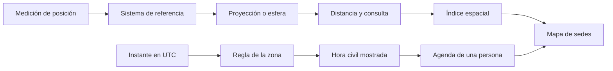
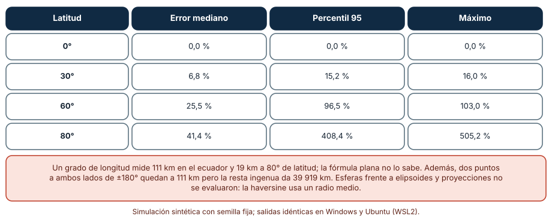
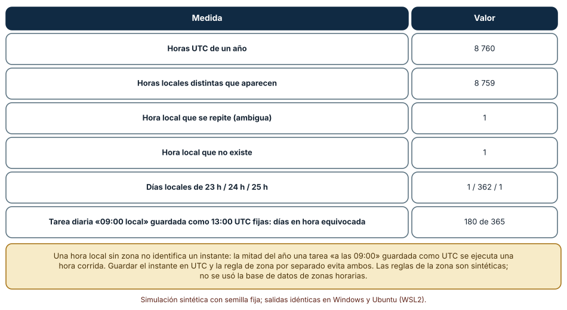
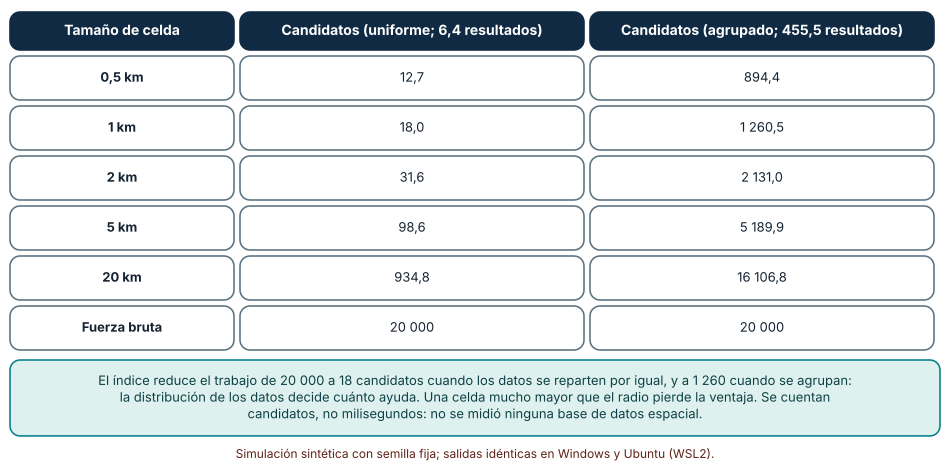

# SE-285 — Sistemas geoespaciales y temporales

[← SE-284 — Blockchain, consenso y contratos inteligentes](https://github.com/vladimiracunadev-create/modern-software-engineering-program/blob/main/classes/part-23-software-especializado-y-dominios/se-284-blockchain-consenso-y-contratos-inteligentes/README.md) · [↑ Parte 23](https://github.com/vladimiracunadev-create/modern-software-engineering-program/blob/main/classes/part-23-software-especializado-y-dominios/README.md) · [📚 Índice completo](https://github.com/vladimiracunadev-create/modern-software-engineering-program/blob/main/classes/README.md) · [🌐 Portal](https://vladimiracunadev-create.github.io/modern-software-engineering-program/classes/SE-285.html) · [SE-286 — Low-code, no-code y automatización visual →](https://github.com/vladimiracunadev-create/modern-software-engineering-program/blob/main/classes/part-23-software-especializado-y-dominios/se-286-low-code-no-code-y-automatizacion-visual/README.md)

## Punto profesional y fundamento pedagógico

**Punto profesional.** La clase existe para que trates una coordenada y un instante como datos con modelo propio: una posición depende de un sistema de referencia y de una forma de la Tierra, y un momento depende de una zona y de reglas que cambian. Quien programa un mapa o una agenda responde por los errores que aparecen lejos del lugar y de la época en que se probó.

**Por qué aparece aquí.** Es la novena clase de la **Parte 23**, después de **Blockchain, consenso y contratos inteligentes**: allí el reloj y el orden eran los de un protocolo; aquí son los del mundo, con husos horarios, cambios de hora y una Tierra que no es plana. Lo que parece un número (una latitud, una hora) esconde una convención, y el fallo aparece cuando alguien cruza una frontera, un meridiano o una noche de cambio de hora. El caso conductor sigue siendo la plataforma educativa ficticia: un mapa de sedes y un calendario de sesiones en vivo para estudiantes de varios países.

**Error conceptual que debe corregir.** Creer que una latitud y una longitud son coordenadas planas y que una hora local identifica un instante. Los grados de longitud miden menos cuanto más cerca del polo, y una hora de pared sin zona puede ser ambigua, inexistente o corrida según el día del año.

**Secuencia de aprendizaje.** Antes de leer los resultados, predices cuánto se equivoca una distancia calculada como si los grados fueran un plano a distintas latitudes y qué le pasa a una tarea «cada día a las 09:00» durante un año con cambio de hora; después mides el error por latitud, las horas repetidas e inexistentes de un año y cuántos candidatos examina una consulta con un índice de rejilla. La secuencia usa predicción, explicación propia, contraste y recuperación. [ICAP](https://icap.education.asu.edu/research) distingue participación de construcción de conocimiento; [How People Learn II](https://nap.nationalacademies.org/catalog/24783/how-people-learn-ii-learners-contexts-and-cultures) exige conectar conocimiento previo, contexto y transferencia; la [práctica de recuperación](https://pubmed.ncbi.nlm.nih.gov/16507066/) respalda producir de nuevo la explicación tras una demora; y [Education for Life and Work](https://nap.nationalacademies.org/resource/13398/dbasse_084153.pdf) exige devolución que explique la causa del error.

**Evidencia de aprendizaje.** `geo-log.md` con la predicción, la tabla de error por latitud, la tabla de un año de reloj, la tabla de candidatos por tamaño de celda y una nota que diga qué parte del cálculo depende de la forma de la Tierra y de la base de datos de zonas horarias, que no se usaron.

**Límite de la conclusión.** Los puntos, la distribución de las sedes, las reglas de la zona horaria y la rejilla son construcciones del autor. No se usó ninguna base de datos de zonas horarias, ningún elipsoide, ninguna proyección, ningún índice espacial de una base de datos ni ningún dato geográfico real: los experimentos muestran mecanismos de geometría esférica, de reglas horarias y de indexación en CPython.

### Trazabilidad fuente → afirmación

| Fuente primaria u oficial | Afirmación que respalda | Lo que no prueba |
|---|---|---|
| [IANA, Time Zone Database](https://www.iana.org/time-zones) | Mantiene la base de datos de zonas horarias que recoge los cambios históricos y futuros de las reglas civiles; las reglas cambian por decisión de cada jurisdicción. | No dice qué zona corresponde a un usuario ni predice cambios futuros de ley. |
| [IETF, RFC 3339: Date and Time on the Internet](https://www.rfc-editor.org/rfc/rfc3339) | Fija un formato de marca de tiempo con desplazamiento respecto de UTC para intercambiar instantes sin ambigüedad. | Un desplazamiento fijo no conserva la regla de la zona ni dice la hora local de otro día. |
| [IETF, RFC 7946: The GeoJSON Format](https://www.rfc-editor.org/rfc/rfc7946) | Define un formato para geometrías con coordenadas en el sistema WGS 84 en orden longitud, latitud y trata el cruce del antimeridiano. | No resuelve la elección de proyección ni la precisión de la medición. |

## Antes de empezar

Recupera lo aprendido en `SE-284`: un registro compartido necesita un orden acordado de eventos. Con el reloj del mundo no hay uno solo: cada jurisdicción decide su hora. La pregunta activa es: **¿qué sistema de referencia y qué regla horaria está asumiendo este dato, y qué ocurre cuando cruza una latitud, un meridiano o una noche de cambio de hora?**

## Prerrequisitos

- Haber completado `SE-284` o poder explicar qué garantiza y qué no garantiza una marca de tiempo ordenada.
- Python 3.11 o posterior y un terminal; todo el código usa solo la biblioteca estándar (`math`, `random`).
- Saber qué son la latitud y la longitud a nivel básico.

## Problema auténtico

La plataforma educativa ficticia publica un mapa de sedes y un calendario de sesiones en vivo. Una estudiante cerca del círculo polar ve «sedes a menos de 50 km» que están a 90 km; un docente programa una sesión diaria «a las 09:00» y durante medio año sus estudiantes llegan una hora tarde; una exportación de sesiones cruza el antimeridiano y la ruta entre dos sedes del Pacífico mide 40 000 km; y la búsqueda de «sedes cercanas» tarda segundos cuando hay muchas sedes en una misma ciudad. Cada síntoma es una convención de espacio o de tiempo no declarada.

## Objetivos observables

Al terminar podrás:

1. distinguir sistema de referencia, proyección y distancia sobre la esfera con un ejemplo y un contraejemplo del mapa de sedes;
2. medir el error de tratar grados como un plano a varias latitudes y calcular la distancia con la fórmula de la esfera;
3. distinguir instante y hora civil, y medir cuántas horas se repiten o no existen en un año con cambio de hora y cuántos días se desvía una tarea guardada como hora UTC fija;
4. medir cuántos candidatos examina una consulta de radio con un índice de rejilla según el tamaño de celda y la distribución de los puntos;
5. declarar qué precisión y qué privacidad ofrece una coordenada publicada.

## Mapa conceptual



El mapa tiene dos columnas independientes que se juntan en el producto: el **espacio** (de la medición a la consulta) y el **tiempo** (del instante a la hora que ve la persona). En ambas, el dato crudo no basta: hace falta la convención que lo interpreta.

## Temas y por qué importan

| Tema | Por qué cambia una decisión profesional | Evidencia mínima |
|---|---|---|
| Sistemas de referencia y proyecciones | Define qué significa un par de números y qué distorsión introduce plano. | Predicción, traza causal y contraejemplo de **Sistemas de referencia y proyecciones** en `geo-log.md` |
| Distancia y geometría esférica | Evita errores que crecen con la latitud y en el antimeridiano. | Predicción, traza causal y contraejemplo de **Distancia y geometría esférica** en `geo-log.md` |
| Instantes, zonas y cambios de hora | Distingue cuándo ocurre algo de qué reloj lo muestra. | Predicción, traza causal y contraejemplo de **Instantes, zonas y cambios de hora** en `geo-log.md` |
| Índices espaciales | Convierte una búsqueda lineal en una local. | Predicción, traza causal y contraejemplo de **Índices espaciales** en `geo-log.md` |
| Precisión y privacidad de la ubicación | Evita publicar más de lo necesario y prometer más de lo medido. | Predicción, traza causal y contraejemplo de **Precisión y privacidad de la ubicación** en `geo-log.md` |

## Conceptos y decisiones

### 1. Sistemas de referencia y proyecciones

Un par de números `(latitud, longitud)` solo significa algo respecto de un **sistema de referencia**: el más usado en intercambio es WGS 84, el de los receptores de navegación y el que fija GeoJSON. La Tierra no es una esfera ni un plano, sino algo próximo a un elipsoide; una **proyección** convierte coordenadas geográficas a un plano y siempre distorsiona algo (áreas, ángulos, distancias). Para medir distancias o áreas en una región se usa una proyección adecuada a esa región, no una universal. Mezclar datos en sistemas distintos sin transformar produce desplazamientos de metros a cientos de metros que parecen errores del dato.

### 2. Distancia y geometría esférica

Un grado de latitud mide siempre unos 111 km, pero un grado de longitud mide 111 km por el coseno de la latitud: unos 96 km a 30°, 55 km a 60° y 19 km a 80°. Calcular la distancia con el teorema de Pitágoras sobre grados sobreestima las distancias este–oeste a medida que se sube. La fórmula del **haversine** da la distancia sobre una esfera de radio medio; es muy superior al plano y su error frente a un elipsoide ronda décimas de por ciento, aceptable para «sedes cercanas» y no para catastro. Además, la longitud salta de +180° a −180°: la resta ingenua entre dos puntos a ambos lados del antimeridiano da casi una vuelta completa. Los formatos como GeoJSON advierten de este caso.

### 3. Instantes, zonas y cambios de hora

Un **instante** es un punto de la línea del tiempo, independiente de cualquier reloj; se guarda mejor en UTC. La **hora civil** es lo que marca el reloj de pared en una zona y depende de reglas decididas por cada jurisdicción y modificadas con frecuencia; la base de datos de zonas horarias de IANA las recoge. Un desplazamiento fijo respecto de UTC (como en el formato del RFC 3339) identifica un instante pero no conserva la regla: «UTC−4» no dice qué hora será dentro de seis meses. Los cambios de hora crean horas locales **inexistentes** (el reloj salta) y **ambiguas** (el reloj repite), y días de 23 o 25 horas. Una tarea recurrente «a las 09:00» debe guardar la hora local y la zona, no un instante fijo.

### 4. Índices espaciales

Buscar los puntos a menos de un radio de una posición recorriendo todos cuesta tantos cálculos como puntos. Un índice reduce los candidatos. La **rejilla** divide el espacio en celdas y guarda los puntos por celda: una consulta solo mira las celdas que cubre el radio. Su eficacia depende del tamaño de celda (muy grande, no filtra; muy pequeña, multiplica las celdas a revisar) y de la distribución de los datos (una ciudad densa concentra miles de puntos en pocas celdas). Estructuras adaptativas (árboles) se ajustan a la densidad a cambio de más complejidad. Las bases de datos espaciales como PostGIS ofrecen índices de ese tipo y funciones de distancia sobre esfera y elipsoide.

### 5. Precisión y privacidad de la ubicación

Cada decimal de una coordenada es una promesa de precisión: cuatro decimales corresponden a unos 11 m y seis a unos 11 cm, que ningún receptor de consumo ofrece. Publicar más dígitos de los medidos da una falsa precisión y, en datos de personas, puede revelar su casa. Una ubicación es un dato personal sensible: reduce la precisión al mínimo necesario, agrega por celdas cuando se puede y declara cuánto tiempo se guarda. Un conjunto de trayectorias es difícil de anonimizar, porque los desplazamientos habituales identifican.

### Cuánto se equivoca un grado tratado como plano

Se generan 5 000 pares de puntos a menos de unos 100 km entre sí en cuatro latitudes (0°, 30°, 60° y 80°). Se calcula la distancia con haversine (radio 6 371,0088 km) y con la hipotenusa en grados multiplicada por 111,195 km por grado, y se mide el error relativo.

```python
def haversine(a, b):
    la1, lo1, la2, lo2 = map(math.radians, (*a, *b))
    d = math.sin((la2 - la1) / 2) ** 2 + math.cos(la1) * math.cos(la2) * math.sin((lo2 - lo1) / 2) ** 2
    return 2 * R * math.asin(math.sqrt(d))
def plano_en_grados(a, b):
    return math.hypot(a[0] - b[0], a[1] - b[1]) * 2 * math.pi * R / 360
```

| Latitud | Error mediano | Percentil 95 | Máximo |
|---:|---:|---:|---:|
| 0° | 0,0 % | 0,0 % | 0,0 % |
| 30° | 6,8 % | 15,2 % | 16,0 % |
| 60° | 25,5 % | 96,5 % | 103,0 % |
| 80° | 41,4 % | 408,4 % | 505,2 % |

Para dos puntos a ambos lados del antimeridiano (0° N, 179,5° E y 179,5° O) la distancia por haversine es 111,2 km; la resta ingenua de longitudes da 39 919 km. Resultado idéntico en Windows (CPython 3.12.9) y en Ubuntu bajo WSL2 (3.12.3).



**Cómo leer la figura.** Cada fila es una latitud; las columnas dan el error relativo de la distancia plana frente a la del haversine. **Dónde deja de valer:** el haversine usa una esfera y también tiene error frente a un elipsoide, que no se midió; en el ecuador la distancia plana coincide solo porque el grado de longitud mide lo mismo que el de latitud en una esfera. Los porcentajes máximos altos a 80° vienen de pares casi alineados con un meridiano, donde el denominador es pequeño. La figura no evalúa ninguna proyección.

### Un año de reloj con cambio de hora

Se define una zona sintética con regla: UTC−4 en invierno y UTC−3 desde la hora 2 886 (día 120) hasta la hora 7 205 (día 300). Se recorren las 8 760 horas UTC de un año, se calcula la hora local y se cuentan las horas locales que aparecen dos veces o ninguna, los días locales de 23 y 25 horas, y los días en que una tarea guardada como «13:00 UTC» deja de caer a las 09:00 locales.

```python
def desplazamiento(h): return -3 if INICIO <= h < FIN else -4
local = [h + desplazamiento(h) for h in range(365 * 24)]
repetidas = sum(1 for v in Counter(local).values() if v == 2)
vistas = set(local)
inexistentes = sum(1 for l in range(local[0], local[-1]) if l not in vistas)
```

| Medida | Valor |
|---|---:|
| Horas UTC de un año | 8 760 |
| Horas locales distintas que aparecen | 8 759 |
| Hora local que se repite (ambigua) | 1 |
| Hora local que no existe | 1 |
| Días locales de 23 h / 24 h / 25 h | 1 / 362 / 1 |
| Tarea «09:00 local» guardada como 13:00 UTC: días en hora equivocada | 180 de 365 |

Medio año (180 días) la tarea guardada como instante fijo se ejecuta a las 10:00 locales.



**Cómo leer la figura.** Cada fila mide una consecuencia del cambio de hora sobre un año de 8 760 horas. **Dónde deja de valer:** las reglas de la zona son inventadas (dos cambios al año, de una hora); las reales difieren en la fecha, el sentido y el tamaño del cambio, algunas no tienen ninguno y las reglas se modifican por ley. La figura no usa la base de datos de zonas horarias, de modo que no dice nada de ningún país concreto.

### El índice de rejilla: cuánto filtra y cuándo deja de filtrar

Se colocan 20 000 puntos en un cuadrado de 100 × 100 km, de dos formas: uniformes y agrupados (16 000 en torno a una «ciudad» con desviación de 3 km y 4 000 uniformes). Se construyen rejillas con celdas de 0,5 a 20 km y se lanzan 300 consultas de radio 1 km, contando los candidatos examinados.

```python
def candidatos(puntos, rejilla, celda, qx, qy, radio):
    for cx in range(int((qx - radio) // celda), int((qx + radio) // celda) + 1):
        for cy in range(int((qy - radio) // celda), int((qy + radio) // celda) + 1):
            for i in rejilla.get((cx, cy), ()):
                yield i                      # luego se filtra por distancia real
```

| Tamaño de celda | Candidatos (uniforme; 6,4 resultados) | Candidatos (agrupado; 455,5 resultados) |
|---|---:|---:|
| 0,5 km | 12,7 | 894,4 |
| 1 km | 18,0 | 1 260,5 |
| 2 km | 31,6 | 2 131,0 |
| 5 km | 98,6 | 5 189,9 |
| 20 km | 934,8 | 16 106,8 |
| Fuerza bruta | 20 000 | 20 000 |

Con celdas de 1 km y puntos uniformes se examinan 18 candidatos para encontrar 6,4; con una ciudad densa, 1 260 para 455.



**Cómo leer la figura.** Cada fila es un tamaño de celda; las columnas cuentan los candidatos por consulta con dos distribuciones. **Dónde deja de valer:** se cuentan candidatos, no milisegundos: el coste real incluye memoria, construcción del índice y acceso a disco, y no se midió ninguna base de datos espacial. La rejilla plana usa kilómetros sobre un plano, por lo que ignora la curvatura; para áreas grandes habría que indexar por celdas sobre la esfera.

## Definiciones de trabajo

- **sistema de referencia:** convención que da significado a un par de coordenadas respecto de una forma y un origen de la Tierra.
- **proyección:** transformación de coordenadas geográficas a un plano, que distorsiona áreas, ángulos o distancias.
- **instante:** punto de la línea del tiempo, independiente del reloj de cualquier zona.
- **hora civil:** hora que marca el reloj de pared en una zona según sus reglas vigentes.
- **índice de rejilla:** estructura que guarda los puntos por celda de un reticulado para limitar los candidatos de una consulta espacial.

Las definiciones son operativas para el mapa de sedes y el calendario. No convierten términos con una historia más amplia en sinónimos y deben contrastarse con la documentación primaria enlazada al final.

## Ejemplo mínimo

El fragmento calcula la longitud de un grado de longitud a distintas latitudes. Antes de ejecutarlo, predice cuánto mide a 60°.

```python
import math
R = 6371.0088
km_por_grado_lon = lambda lat: 2 * math.pi * R / 360 * math.cos(math.radians(lat))
assert round(km_por_grado_lon(0)) == 111
assert round(km_por_grado_lon(60)) == 56
assert round(km_por_grado_lon(80)) == 19
```

A 60° de latitud, un grado de longitud mide la mitad que en el ecuador (cos 60° = 0,5). Registra versión, comando y salida; calcula el de 89° y explica por qué una cuadrícula de grados se vuelve cada vez más estrecha hacia el polo.

## Ejemplo profesional

El equipo de la plataforma guarda cada sesión con tres campos: el instante de inicio en UTC, el identificador de la zona del docente y la hora local de la regla («09:00»), y calcula la hora civil de cada participante en el momento de mostrarla, usando la base de datos de zonas horarias del sistema y registrando la versión de la base en la salida. Los intercambios usan el formato RFC 3339. Las sedes se almacenan como longitud y latitud en WGS 84 con cinco decimales (cerca de un metro); la búsqueda de sedes cercanas usa haversine sobre un prefiltro de rejilla de 5 km, y el cruce del antimeridiano se prueba con una sede en cada lado. La ubicación del estudiante no se envía al servidor: se pide el radio y el cálculo se hace en el cliente con una celda de 5 km, y la sede se publica con la precisión mínima necesaria. Una prueba de regresión comprueba la noche de cambio de hora de dos zonas distintas.

Compara con el prototipo: distancia en grados, tarea guardada como instante fijo y búsqueda lineal. Un diseño es adecuado cuando cada dato lleva su convención y cada convención tiene una prueba; es frágil cuando funciona solo en la zona del desarrollador.

## Práctica guiada

1. Dibuja las dos columnas (espacio y tiempo) del producto y marca qué convención asume cada dato.
2. Predice el error de la distancia plana a 60° de latitud y escribe el número.
3. Calcula las distancias de 5 000 pares a cuatro latitudes con haversine y con el plano y compara con tu predicción.
4. Define una zona con cambio de hora, recorre un año de horas y cuenta las horas repetidas, inexistentes y los días de 23 y 25 horas.
5. Programa una sesión diaria de dos maneras (instante fijo y hora local con zona) y cuenta los días en que difieren.
6. Construye una rejilla y mide los candidatos por consulta con dos distribuciones y cinco tamaños de celda.
7. Entrega `geo-log.md` y pide a otra persona que diga en qué fechas se rompería tu calendario.

## Ejercicios

1. **Latitud:** calcula el error mediano de la distancia plana a 45° con pares de unos 10 km y de unos 1 000 km y explica por qué cambia.
2. **Antimeridiano:** escribe una función de diferencia de longitud que devuelva el camino más corto y pruébala con tres pares que crucen ±180°.
3. **Hora ambigua:** define una regla de cambio de hora y escribe cómo debería programarse una tarea a las 01:30 locales en la noche de la hora repetida.
4. **Celda:** con la distribución agrupada, estima el tamaño de celda que minimiza los candidatos y justifica por qué no es el menor.

## Reto verificable

Entrega `geo-log.md` con la predicción, la tabla de error por latitud, la de un año de reloj, la de candidatos y la convención de guardado de las sesiones. Se aprueba si otra persona ejecuta el código desde un checkout limpio, obtiene los mismos números y puede decir qué día del año se rompe una tarea guardada como instante fijo y qué haría con la hora ambigua. No se aprueba por afirmar que «usa UTC» sin explicar cómo se calcula la hora que ve cada persona.

## Caso conductor

La plataforma educativa ficticia es el caso conductor de la Parte 23. Esta clase deja el noveno artefacto: el mapa de sedes con haversine y prefiltro de rejilla, y el calendario con instante UTC, zona y hora local de la regla. `SE-286` pasa a un dominio donde el código lo escriben personas que no se dicen programadoras: la automatización visual. Cambia después una sola decisión, el tamaño de la celda, y observa cuántos candidatos más se examinan en la ciudad densa.

## Preguntas frecuentes

### ¿Basta con guardar todo en UTC?

Para un instante sí. Para algo que debe ocurrir «a las 9 de la mañana» de cada día, no: hay que guardar la hora local y la zona, porque la relación entre ambas cambia con las reglas.

### ¿Cuántos decimales debo guardar de una coordenada?

Los que corresponden a la precisión medida y necesaria: unos cinco decimales dan alrededor de un metro. Más dígitos prometen una precisión que el dato no tiene y exponen más a la persona.

### ¿El haversine es suficiente?

Para «cercanía» a escala de ciudad o país, sí. Para catastro, ingeniería o rutas largas necesitas un elipsoide y un sistema de referencia adecuado.

### ¿Por qué mi consulta es lenta aunque tengo un índice?

Porque el índice filtra solo si las celdas están equilibradas con los datos. Con una zona muy densa, una celda puede contener miles de puntos; hay que ajustar el tamaño o usar una estructura adaptativa.

## Fallo controlado y diagnóstico

Reproduce el fallo clásico de la clase: **una tarea diaria que llega una hora tarde durante medio año**. Guarda «09:00 local» como 13:00 UTC y recorre un año con la regla de cambio de hora.

Registra síntoma, entrada mínima, hipótesis, observación que descarta cada hipótesis, causa, corrección y prueba de regresión. **Síntoma:** a partir de una fecha, la sesión de las 09:00 empieza a las 10:00 en la agenda de los estudiantes. **Hipótesis rivales:** (a) el reloj del servidor está desfasado; (b) el calendario del cliente tiene una zona errónea; (c) la sesión se guardó como un instante fijo y la regla local cambió. **Prueba:** convierte 13:00 UTC con el desplazamiento de cada día; si da 09:00 en invierno y 10:00 en verano durante 180 días, la causa es (c). **Conclusión:** se guardó la hora de un día y no la regla. **Regresión:** guarda la zona y la hora local de la regla, calcula el instante cada día y añade una prueba que recorra la noche de cada cambio de hora. No cambies a la vez la zona y el servidor.

## Errores comunes y cómo corregirlos

| Síntoma | Causa probable | Corrección |
|---|---|---|
| «Cercanías» que están más lejos de lo mostrado | Distancia en grados tratada como plano | Haversine o proyección adecuada, con prueba por latitud |
| Una ruta mide la vuelta al mundo | Resta de longitudes sin tratar el antimeridiano | Diferencia mínima módulo 360 y prueba en ±180° |
| Una tarea se corre una hora a partir de una fecha | Instante fijo para una regla local | Guardar zona y hora local; calcular el instante cada día |
| Una hora local aparece dos veces o ninguna | Cambio de hora sin tratar | Definir el comportamiento para horas ambiguas e inexistentes y probarlo |
| Una búsqueda lenta en la zona más poblada | Índice con celdas desequilibradas | Medir candidatos por distribución y ajustar o usar un índice adaptativo |

## Entorno y archivos clave

```text
work/SE-285/
├── README.md
├── mapa/
│   ├── distancia.py
│   ├── reloj.py
│   └── rejilla.py
├── tests/test_mapa.py
└── evidence/geo-log.md
```

El `README` declara plataforma, versión de Python, semillas y comandos. Los experimentos usan solo la biblioteca estándar (`math`, `random`, `collections`) y se ejecutaron con CPython 3.12.9 en Windows 11 y 3.12.3 en Ubuntu bajo WSL2: las salidas fueron idénticas. Si añades una dependencia (por ejemplo, la base de zonas horarias del sistema), fija procedencia y versión.

## Seguridad, ética y accesibilidad

- la ubicación de una persona es un dato personal sensible: pide el permiso mínimo, reduce la precisión y declara cuánto se conserva;
- no publiques trayectorias ni sedes con una precisión que revele la casa de una persona;
- muestra las horas con la zona y en un formato comprensible, y ofrece una alternativa textual a los mapas;
- no supongas que todas las personas tienen un dispositivo con localización ni que su zona es la del servidor;
- usa coordenadas sintéticas en las prácticas y evita las de lugares reales de personas.

## Puente hacia el trabajo con agentes

Un agente al que se le pide «calcula las sedes cercanas y programa la sesión diaria» usará la distancia euclídea sobre grados y guardará la hora de hoy convertida a UTC. Pídele en cambio que declare el sistema de referencia, que use haversine o una proyección justificada, que pruebe el antimeridiano y el polo, y que guarde la zona y la hora local de la regla con una prueba para cada cambio de hora. Revisa especialmente si trata los grados como un plano y si guarda un instante fijo para algo recurrente: son los dos defectos que esta clase mostró.

## Transferencia

Traslada el análisis a otro sistema con espacio y tiempo (por ejemplo, el seguimiento de un reparto): cambia los puntos y los eventos, y conserva el procedimiento de declarar el sistema de referencia, probar los bordes (antimeridiano, cambio de hora) y medir los candidatos del índice. La transferencia está lograda cuando puedes explicar qué parte del diseño dependía de la geografía y cuál no, no cuando el código se parece.

## Evaluación y evidencia

| Criterio | Evidencia para aprobar |
|---|---|
| comprensión | explicación de sistema de referencia, instante y hora civil con ejemplos del mapa y el calendario |
| corrección | errores, horas y candidatos reproducibles con las mismas semillas |
| diseño | haversine con prefiltro, instante UTC con zona y hora local, y precisión mínima publicada |
| diagnóstico | reproducción del fallo «tarea una hora tarde» con regresión |
| incertidumbre | declaración de que ningún experimento usó un elipsoide, una proyección ni la base de zonas horarias |
| reproducibilidad | versiones, comandos, salida y límites declarados |

## Fuentes

- [IANA, Time Zone Database](https://www.iana.org/time-zones) — reglas de las zonas horarias; autoridad: IANA.
- [IETF, RFC 3339: Date and Time on the Internet](https://www.rfc-editor.org/rfc/rfc3339) — formato de marcas de tiempo; autoridad: IETF.
- [IETF, RFC 7946: The GeoJSON Format](https://www.rfc-editor.org/rfc/rfc7946) — formato de geometrías en WGS 84 y cruce del antimeridiano; autoridad: IETF.
- [OGC, Simple Features](https://www.ogc.org/standards/sfa/) — modelo de geometrías y operaciones espaciales; autoridad: Open Geospatial Consortium.
- [PostGIS, documentación](https://postgis.net/documentation/) — tipos, funciones e índices espaciales; autoridad: proyecto PostGIS.
- [Python: `zoneinfo`](https://docs.python.org/3/library/zoneinfo.html) — acceso a la base de zonas horarias desde Python; autoridad: documentación de Python.

Cada fuente respalda el mecanismo indicado; ninguna demuestra que el 25,5 % de error a 60°, los 180 días de desvío o los 18 candidatos por consulta se observen con datos reales. Esa afirmación depende del lugar, de la ley horaria y de la distribución de los puntos.

## Límites y siguiente paso

Se ejecutaron tres simulaciones con datos sintéticos en Windows y Ubuntu (WSL2) con resultados idénticos. No se usó ningún elipsoide, proyección, índice de una base de datos espacial ni la base de zonas horarias: los puntos, la regla de cambio de hora y la rejilla son construcciones del autor. La siguiente clase pasa a la automatización visual y al software sin código.

## Glosario

- **sistema de referencia:** convención que da significado a un par de coordenadas respecto de una forma y un origen de la Tierra.
- **proyección:** transformación de coordenadas geográficas a un plano, que distorsiona áreas, ángulos o distancias.
- **instante:** punto de la línea del tiempo, independiente del reloj de cualquier zona.
- **hora civil:** hora que marca el reloj de pared en una zona según sus reglas vigentes.
- **índice de rejilla:** estructura que guarda los puntos por celda de un reticulado para limitar los candidatos de una consulta espacial.

---

[← SE-284 — Blockchain, consenso y contratos inteligentes](https://github.com/vladimiracunadev-create/modern-software-engineering-program/blob/main/classes/part-23-software-especializado-y-dominios/se-284-blockchain-consenso-y-contratos-inteligentes/README.md) · [↑ Parte 23](https://github.com/vladimiracunadev-create/modern-software-engineering-program/blob/main/classes/part-23-software-especializado-y-dominios/README.md) · [📚 Índice completo](https://github.com/vladimiracunadev-create/modern-software-engineering-program/blob/main/classes/README.md) · [🌐 Portal](https://vladimiracunadev-create.github.io/modern-software-engineering-program/classes/SE-285.html) · [SE-286 — Low-code, no-code y automatización visual →](https://github.com/vladimiracunadev-create/modern-software-engineering-program/blob/main/classes/part-23-software-especializado-y-dominios/se-286-low-code-no-code-y-automatizacion-visual/README.md)
