# Parte 24 — Diseño, patrones y refactorización

La Parte 23 llevó el diseño a un dominio profundo. Esta parte hace la pregunta que sigue cuando el sistema ya existe y tiene usuarios: **cómo se reparte el código para que pueda cambiar sin romperse, cómo se corrige cuando se repartió mal y cómo se evoluciona sin romper a quien lo usa**. Trabaja sobre un caso conductor sintético, el componente `tarifas` de una plataforma de entregas, que calcula el costo de un envío y que a lo largo de la parte se mide, se separa, se prueba, se refactoriza y se evoluciona. Recorre la cohesión, el acoplamiento y la encapsulación, los principios SOLID y sus límites, la herencia, la composición y la delegación, los patrones creacionales, estructurales y conductuales, los patrones funcionales, reactivos y concurrentes, los olores de código y su diagnóstico, la refactorización segura con una red de pruebas medida, el diseño para el cambio, la prueba y la operación, la complejidad accidental y esencial, la deuda técnica con su interés, un taller de refactorización de una función heredada y un proyecto de evolución compatible.

## Pregunta rectora

> ¿Qué cambio quiero que sea barato, cómo lo medí y qué haría abandonar esa conclusión?

## Antes del recorrido clase por clase

Esta parte no enseña un lenguaje ni un marco. Enseña a convertir las palabras del diseño (cohesión, acoplamiento, patrón, olor, deuda) en una medida sobre un cambio concreto, y a conocer lo que esa medida no ve. Cada clase mide con código real analizado con `ast`, con pruebas de contrato, con mutación o con simulaciones de semilla fija: cuántos sitios hay que editar cuando una decisión cambia (51 con un getter que oculta el nombre pero no la unidad, 0 con comportamiento encapsulado), qué fracción de órdenes de pruebas falla con un singleton (99,8 %), cuántos mutantes matan cinco ejemplos frente a los valores de borde (12 y 19 de 19), cuántos cambios de una respuesta rompe a un consumidor sin que la suite del proveedor lo vea (14 de 23). Cada clase declara además qué no demuestra.

```mermaid
flowchart LR
    A[Cohesión y acoplamiento] --> B[Principios y sus límites]
    B --> C[Herencia, composición y delegación]
    C --> D[Patrones de diseño]
    D --> E[Funcional, reactivo y concurrente]
    E --> F[Olores y diagnóstico]
    F --> G[Refactorización segura]
    G --> H[Diseño para cambio, prueba y operación]
    H --> I[Complejidad esencial y accidental]
    I --> J[Deuda técnica e interés]
    J --> K[Taller de refactorización]
    K --> L[Evolución compatible]
    L -->|un consumidor se rompe o un cambio cuesta más de lo previsto| A
```

El diagrama se lee de izquierda a derecha y no es un proceso obligatorio. El retorno indica que un cambio que cuesta más de lo medido, o un consumidor que se rompe, reabre el diseño; un componente evolucionado no cierra el diseño, lo fecha.

## Resultados acumulativos

Podrás calcular la falta de cohesión de una clase y contar los sitios que edita un cambio según el acceso al dato; estimar cuándo aparece el primer ciclo de dependencias sin una regla de capas; medir las funciones que modifica añadir una regla en una cadena y en un registro, y detectar con una prueba de contrato las subclases que rompen la sustitución; reproducir una clase base frágil, enumerar los órdenes de los decoradores y medir el efecto del orden de las bases en la herencia múltiple; ejecutar una suite en orden aleatorio, aislar observadores y calcular cuán parecidos son, por su estructura, los patrones; detectar impurezas con tres niveles de prueba, comparar cuatro políticas de una cola con contrapresión y enumerar las intercalaciones de dos hilos; medir olores sobre código de un repositorio fijado por commit y distinguir una falsa alarma de un problema; medir una red de pruebas con mutación y elegir el tamaño del paso de un refactor; inyectar el reloj, calcular los módulos que toca una decisión y reconstruir solicitudes con identificador; separar la complejidad esencial de la accidental y cubrir los pares de doce opciones; estimar el interés de una deuda y decidir cuándo pagarla; registrar un maestro dorado y decidir qué rarezas de una función heredada se conservan; y evolucionar un componente con un verificador de firmas, contratos de consumidor y una ventana de deprecación, sabiendo qué ve cada comprobación.

Al finalizar podrás defender un diseño con sus cambios previsibles medidos, su red de pruebas con una puntuación de mutación, su registro de deuda con intereses estimados y su plan de evolución por fases, y podrás indicar qué parte de tu conclusión es observación, cuál es inferencia y cuál es suposición.

## Prerrequisitos enlazados

- [Parte 5 — Fundamentos de programación](https://github.com/vladimiracunadev-create/modern-software-engineering-program/blob/main/classes/part-05-fundamentos-de-programacion/): funciones, clases, módulos y pruebas básicas.
- [Parte 6 — Paradigmas de programación](https://github.com/vladimiracunadev-create/modern-software-engineering-program/blob/main/classes/part-06-paradigmas-de-programacion/): programación orientada a objetos, funcional y concurrente a nivel conceptual.
- [Parte 7 — Estructuras de datos y algoritmos](https://github.com/vladimiracunadev-create/modern-software-engineering-program/blob/main/classes/part-07-estructuras-de-datos-y-algoritmos/): medir, comparar y no confundir un resultado con un modelo.
- [Parte 13 — Especificaciones, contratos y modelos](https://github.com/vladimiracunadev-create/modern-software-engineering-program/blob/main/classes/part-13-especificaciones-contratos-y-modelos/): contratos comprobables y compatibilidad entre versiones.
- [Parte 16 — Git, colaboración y código abierto](https://github.com/vladimiracunadev-create/modern-software-engineering-program/blob/main/classes/part-16-git-colaboracion-y-codigo-abierto/): historia de cambios, commits pequeños y revisión.
- [Parte 23 — Software especializado y dominios](https://github.com/vladimiracunadev-create/modern-software-engineering-program/blob/main/classes/part-23-software-especializado-y-dominios/): reglas de un dominio que el diseño debe reflejar.
- Python 3.11+ y terminal; los experimentos usan solo la biblioteca estándar, datos sintéticos y, en una clase, el repositorio de este programa fijado por commit.

## Bloques y progresión

1. **Reparto y reutilización:** las clases 289–291 miden cohesión, acoplamiento y encapsulación, ponen a prueba los principios SOLID y comparan herencia, composición y delegación.
2. **Patrones y estado:** las clases 292–293 usan los patrones como vocabulario de problemas, con sus pruebas, y deciden dónde vive el estado con funciones puras, flujos con contrapresión y datos con un solo dueño.
3. **Corregir lo existente:** las clases 294–295 diagnostican olores con contexto y refactorizan con una red de pruebas medida.
4. **Diseñar y valorar:** las clases 296–298 diseñan para el cambio, la prueba y la operación, separan la complejidad esencial de la accidental y ponen precio a la deuda técnica.
5. **Aplicar e integrar:** las clases 299–300 refactorizan una función heredada sin cambiar su comportamiento y evolucionan un componente sin romper a sus consumidores.

## Evidencia medida y límites

Las figuras y los ejemplos de esta parte usan análisis de código y simulaciones ejecutados con CPython 3.12.9 en Windows 11 y repetidos con CPython 3.12.3 en Ubuntu bajo WSL2. Los datos son **sintéticos**, el código analizado es de ejemplo (salvo en `SE-294`, que usa cuatro archivos de scripts de este repositorio fijados por el commit `4dafaa63`) y las semillas están fijadas: las salidas de los doce experimentos fueron idénticas en ambos sistemas salvo el final de línea de la consola de Windows, sin diferencias en ninguna cifra. Ninguno mide tiempos de ejecución. Todo el código usa solo la biblioteca estándar y, en `SE-294`, `git`.

Los experimentos son: LCOM4 de una clase de envíos y de su separación, sitios de edición de treinta clientes según lean un campo, usen un getter o pidan comportamiento, y el primer ciclo de veinte módulos con dependencias al azar (`SE-289`); las funciones modificadas al añadir reglas en una cadena y en un registro, las subclases que rompen el contrato de una tarifa frente a ejemplos y azar, y los clientes afectados por una interfaz ancha con el costo de una abstracción (`SE-290`); un contador por herencia y por composición con dos bases, los 24 órdenes de cuatro recargos y 3000 jerarquías con herencia múltiple (`SE-291`); órdenes aleatorios de pruebas con un singleton, observadores que fallan y se dan de baja, y la similitud sintáctica de cinco patrones (`SE-292`); la detección de impurezas con tres niveles de prueba, una cola con cuatro políticas en un escenario estable y uno saturado, y todas las intercalaciones de dos hilos (`SE-293`); los umbrales de olores sobre 65 funciones, la duplicación frente a los parámetros y la envidia de características (`SE-294`); 19 mutantes de una función de tarifa, su cobertura de líneas y el tamaño del paso de un refactor (`SE-295`); los módulos tocados por decisión, el reloj real e inyectado en una semana y la reconstrucción de solicitudes sin identificador (`SE-296`); la misma regla en dos formas, la cobertura por pares de 4 a 12 opciones y la complejidad ciclomática y cognitiva (`SE-297`); cuatro políticas de pago de deuda frente al interés, refactorizar ahora o al primer cambio y la elección de archivos (`SE-298`); un refactor de cuatro pasos contra un maestro dorado de 3000 entradas, los mutantes que mata según su tamaño y los arcos que alcanza (`SE-299`); y doce cambios de una función pública frente a un verificador de firmas, la ventana de deprecación de 500 clientes y los contratos de ocho consumidores (`SE-300`).

Los parámetros (las clases y los treinta clientes, los grafos de veinte módulos, el contrato de `Tarifa` y sus cuatro subclases, las probabilidades de fallo de los observadores, la cola exponencial de 70 y 100 llegadas por segundo contra 80, las doce funciones de pureza, las etiquetas del detector de envidia, los 19 y los 39 mutantes, la probabilidad de 0,03 de defecto por paso, las matrices de conocimiento de los módulos, la duración media de 75 ms de una solicitud, el interés por unidad de deuda, la fricción de 3 puntos, la relación entre complejidad y cambios, el 10 % de valores no booleanos, los ocho consumidores y los porcentajes de clientes diligentes, reactivos y abandonados) son supuestos del autor, no datos de un producto, una institución ni de personas reales. Las reglas de los detectores (olores, envidia, firma, pureza) se escribieron mirando los mismos ejemplos que las evalúan: su exactitud real es desconocida. La complejidad cognitiva es una implementación simplificada del autor. Los generadores de números pseudoaleatorios de Python se usaron solo para simular. No se midió ningún proyecto de producción, no se ejecutó ningún hilo, no se usó ningún reloj de sistema ni ningún sistema de registros, no se contrastaron los mutantes con defectos reales y no se consultó a ningún consumidor real. Esta parte no tiene laboratorio propio en `labs/`; el proyecto `SE-300` define el paquete y la evidencia. Cada clase termina con un puente hacia el trabajo con agentes.

## Guía razonada clase por clase

El componente `tarifas` mantiene su cálculo estable mientras cambian las decisiones de diseño. Cada clase explica qué incertidumbre reduce, qué medida la muestra, qué no demuestra y qué evidencia permite abandonar la conclusión.

### Bloque 1 — Reparto y reutilización

#### SE-289 — Cohesión, acoplamiento y encapsulación

Un diseño se juzga por cuántos lugares toca un cambio. La clase calcula el LCOM4 de una clase mezclada y de sus tres partes, cuenta los sitios que edita un cambio de unidad según el acceso al dato y mide cuándo aparece el primer ciclo de dependencias si nadie decide su sentido.

El estudiante separa `Envio` y registra la decisión que esconde cada módulo. `SE-290` examina los principios que guían esas separaciones.

#### SE-290 — SOLID y sus límites

Cada principio responde a un tipo de cambio y deja de pagar donde ese cambio no ocurre. La clase mide las funciones que modifica una regla nueva en una cadena y en un registro, detecta con una prueba de contrato las subclases que rompen la sustitución y calcula el costo de lectura de una abstracción sin segundo uso.

El estudiante decide qué principio aplica a `tarifas` y cuál no. `SE-291` compara los mecanismos de reutilización.

#### SE-291 — Composición, herencia y delegación

Reutilizar tiene tres formas y cada una promete cosas distintas cuando la base cambia. La clase reproduce una clase base frágil, enumera los órdenes de cuatro decoradores y mide qué fracción de jerarquías con herencia múltiple se puede crear y cuántas dependen del orden de las bases.

El estudiante decide, opción por opción, cómo se reutiliza. `SE-292` nombra los patrones que combinan estos mecanismos.

### Bloque 2 — Patrones y estado

#### SE-292 — Patrones creacionales, estructurales y conductuales

Un patrón es vocabulario de un problema, no una plantilla. La clase ejecuta una suite en orden aleatorio con un singleton y con inyección, mide las notificaciones que se pierden con observadores que fallan y calcula cuán parecidas son, por su estructura, cinco implementaciones de patrones distintos.

El estudiante documenta, por patrón, el problema, el cambio esperado y la prueba que lo vuelve visible. `SE-293` pregunta dónde vive el estado.

#### SE-293 — Patrones funcionales, reactivos y concurrentes

Decidir el dueño del estado decide qué puede salir mal. La clase detecta impurezas con tres niveles de prueba, compara cuatro políticas de una cola con un productor más rápido y enumera las intercalaciones de dos hilos que incrementan un contador.

El estudiante asigna un dueño y una protección a cada dato de `tarifas`. `SE-294` pasa de los mecanismos a los síntomas.

### Bloque 3 — Corregir lo existente

#### SE-294 — Code smells y diagnóstico contextual

Un olor es una sospecha que se confirma con contexto. La clase mide cuatro reglas sobre 65 funciones de un repositorio fijado por commit, simula el costo de mantener dos copias frente a unirlas y evalúa un detector de envidia de características contra el criterio de una persona.

El estudiante entrega una tabla de diagnóstico con la decisión de tratar o dejar cada olor. `SE-295` ejecuta los tratamientos con seguridad.

#### SE-295 — Refactorización segura apoyada por pruebas

Una red de pruebas se mide por lo que detecta, no por lo que ejecuta. La clase genera mutantes de una función con `ast`, contrasta cobertura de líneas con mutantes muertos y simula el costo de localizar un defecto según el tamaño del paso.

El estudiante entrega la red de `tarifas` con bordes derivados y el plan de pasos. `SE-296` diseña desde el principio para el cambio.

### Bloque 4 — Diseñar y valorar

#### SE-296 — Diseño para cambio, prueba y operación

Una misma decisión afecta a quien cambia, prueba y opera. La clase cuenta los módulos que toca una decisión en dos descomposiciones, ejecuta una prueba que depende del reloj en cada minuto de una semana y mide cuánto se degrada la reconstrucción de solicitudes sin identificador.

El estudiante lista las decisiones ocultas, las dependencias inyectadas y los datos registrados. `SE-297` separa la complejidad que el problema exige.

#### SE-297 — Complejidad accidental y esencial

Parte de la complejidad es el problema y no se quita. La clase escribe una regla de 96 casos en una tabla y en condicionales anidados, cubre los pares de doce opciones con nueve configuraciones y compara la complejidad ciclomática con una medida cognitiva simplificada.

El estudiante clasifica la complejidad de `tarifas` como esencial o accidental. `SE-298` pone precio a lo que queda.

#### SE-298 — Deuda técnica, interés y opciones

La deuda cobra interés solo cuando se trabaja en ella. La clase simula cuatro políticas de pago según el interés, compara refactorizar ahora, al primer cambio o nunca según la frecuencia de cambio y mide qué criterio de elección de archivos evita más interés.

El estudiante entrega un registro de deuda con interés estimado y decisión. `SE-299` aplica la refactorización a una función heredada.

### Bloque 5 — Aplicar e integrar

#### SE-299 — Taller: refactorizar sin alterar comportamiento

Sin especificación, el oráculo es lo que el código hace hoy. El taller registra un maestro dorado de 3000 entradas, ejecuta un refactor de cuatro pasos que cambia el comportamiento en dos de ellos y mide los mutantes y los caminos que alcanza el maestro según su tamaño.

El estudiante entrega el refactor con una decisión por rareza heredada. `SE-300` evoluciona el componente hacia sus usuarios.

#### SE-300 — Proyecto: evolución compatible de un componente

Compatible es lo que no rompe a quien usa, no lo que no cambia la firma. El proyecto compara un verificador de firmas con ocho consumidores, estima la ventana de deprecación de 500 clientes y mide quién detecta los cambios de una respuesta de doce campos. La Parte 25 pasa a la arquitectura.

El estudiante entrega el paquete de evolución con sus fases y la lista de lo que ninguna comprobación ve.

## Resumen operativo del recorrido

| Clase | Capacidad que construye | Pregunta que resuelve | Evidencia acumulativa |
|---|---|---|---|
| [SE-289](https://github.com/vladimiracunadev-create/modern-software-engineering-program/blob/main/classes/part-24-diseno-patrones-y-refactorizacion/se-289-cohesion-acoplamiento-y-encapsulacion/) | Cohesión, acoplamiento y encapsulación | ¿Cuántos lugares toca este cambio? | `design-log.md` con LCOM4, sitios y ciclos |
| [SE-290](https://github.com/vladimiracunadev-create/modern-software-engineering-program/blob/main/classes/part-24-diseno-patrones-y-refactorizacion/se-290-solid-y-sus-limites/) | SOLID y sus límites | ¿Qué cambio justifica este principio? | `solid-log.md` con contrato y medidas |
| [SE-291](https://github.com/vladimiracunadev-create/modern-software-engineering-program/blob/main/classes/part-24-diseno-patrones-y-refactorizacion/se-291-composicion-herencia-y-delegacion/) | Composición, herencia y delegación | ¿Qué detalle de la base conoce mi subclase? | `reuse-log.md` con orden y bases |
| [SE-292](https://github.com/vladimiracunadev-create/modern-software-engineering-program/blob/main/classes/part-24-diseno-patrones-y-refactorizacion/se-292-patrones-creacionales-estructurales-y-conductuales/) | Patrones de diseño | ¿Qué problema resuelve este patrón y cómo lo pruebo? | `patterns-log.md` con problema y prueba |
| [SE-293](https://github.com/vladimiracunadev-create/modern-software-engineering-program/blob/main/classes/part-24-diseno-patrones-y-refactorizacion/se-293-patrones-funcionales-reactivos-y-concurrentes/) | Patrones funcionales, reactivos y concurrentes | ¿Quién es dueño de este dato? | `state-log.md` con dueños y políticas |
| [SE-294](https://github.com/vladimiracunadev-create/modern-software-engineering-program/blob/main/classes/part-24-diseno-patrones-y-refactorizacion/se-294-code-smells-y-diagnostico-contextual/) | Code smells y diagnóstico contextual | ¿Este olor es un problema aquí? | `smells-log.md` con diagnóstico |
| [SE-295](https://github.com/vladimiracunadev-create/modern-software-engineering-program/blob/main/classes/part-24-diseno-patrones-y-refactorizacion/se-295-refactorizacion-segura-apoyada-por-pruebas/) | Refactorización segura | ¿Qué prueba fallaría si cambio el comportamiento? | `refactor-log.md` con mutación y pasos |
| [SE-296](https://github.com/vladimiracunadev-create/modern-software-engineering-program/blob/main/classes/part-24-diseno-patrones-y-refactorizacion/se-296-diseno-para-cambio-prueba-y-operacion/) | Diseño para cambio, prueba y operación | ¿Qué decisión escondo, inyecto y registro? | `design-for-change-log.md` con decisiones |
| [SE-297](https://github.com/vladimiracunadev-create/modern-software-engineering-program/blob/main/classes/part-24-diseno-patrones-y-refactorizacion/se-297-complejidad-accidental-y-esencial/) | Complejidad accidental y esencial | ¿Cuánta de esta complejidad es del problema? | `complexity-log.md` con formas y pares |
| [SE-298](https://github.com/vladimiracunadev-create/modern-software-engineering-program/blob/main/classes/part-24-diseno-patrones-y-refactorizacion/se-298-deuda-tecnica-interes-y-opciones/) | Deuda técnica, interés y opciones | ¿Cuánto cuesta no pagar esta deuda? | `debt-log.md` con interés y decisión |
| [SE-299](https://github.com/vladimiracunadev-create/modern-software-engineering-program/blob/main/classes/part-24-diseno-patrones-y-refactorizacion/se-299-taller-refactorizar-sin-alterar-comportamiento/) | Taller: refactorizar sin alterar comportamiento | ¿Qué rarezas heredadas conservo? | `workshop-log.md` con maestro y decisiones |
| [SE-300](https://github.com/vladimiracunadev-create/modern-software-engineering-program/blob/main/classes/part-24-diseno-patrones-y-refactorizacion/se-300-proyecto-evolucion-compatible-de-un-componente/) | Proyecto: evolución compatible de un componente | ¿A quién rompe este cambio y cómo lo sé? | `evolution-package-log.md`, verificador y plan |

## Proyecto integrador

El proyecto **SE-300** entrega un paquete de evolución con un verificador de compatibilidad por firma y su comparación con ocho consumidores, los contratos de esos consumidores, la ventana de deprecación estimada con sus supuestos, el plan por fases (ampliar, migrar, contraer) de cuatro cambios del componente `tarifas` y la lista de lo que ni el verificador, ni los contratos ni el modelo de migración ven. Se acompaña de los límites declarados: qué parte del paquete no se contrastó con consumidores reales ni con una infraestructura de despliegue.

## Criterios de salida

- las doce clases explican todos sus temas mediante mecanismos, ejemplos y límites;
- cada afirmación de que un diseño «es mejor» se apoya en una medida sobre un cambio concreto y declara lo que esa medida no ve;
- cada refactor se hace en pasos que se comparan con un oráculo cuya capacidad de detección se midió;
- cada olor, deuda o abstracción tiene una decisión de tratar o dejar, con su razón y su evidencia;
- las probabilidades, los porcentajes y los parámetros se declaran como supuestos y nunca como mediciones de un producto;
- otra persona reproduce comandos y resultados desde un checkout limpio;
- el informe declara lo observado, lo inferido y lo no ejecutado.

## Preguntas de control por bloque

- ¿Qué decisión escondió este módulo y cuántos lugares toca su cambio?
- ¿Qué detalle de la base conoce esta subclase y qué pasaría si la base lo cambiara?
- ¿Qué prueba fallaría si este refactor cambiara el comportamiento y cómo sé que fallaría?
- ¿Cuánto interés paga este código cada vez que lo toco y cuántas veces lo toco?
- ¿Quién usa qué de esta interfaz y qué parte de mi comprobación depende de que alguien lea el sentido?

## Fuentes de la parte

- [Parnas, «On the criteria to be used in decomposing systems into modules» (CACM, 1972)](https://doi.org/10.1145/361598.361623) — descomposición por decisiones ocultas; autoridad: Communications of the ACM.
- [Stevens, Myers y Constantine, «Structured design» (IBM Systems Journal, 1974)](https://doi.org/10.1147/sj.132.0115) — cohesión y acoplamiento; autoridad: IBM Systems Journal.
- [Liskov y Wing, «A behavioral notion of subtyping» (ACM TOPLAS, 1994)](https://doi.org/10.1145/197320.197383) — subtipos que preservan el comportamiento; autoridad: ACM TOPLAS.
- [Gamma, Helm, Johnson y Vlissides, «Design Patterns» (1994)](https://www.informit.com/store/design-patterns-elements-of-reusable-object-oriented-9780201633610) — catálogo de patrones; autoridad: los autores (Addison-Wesley).
- [Fowler, «Refactoring» (2.ª ed.)](https://martinfowler.com/books/refactoring.html) — refactorizar en pasos pequeños con pruebas; autoridad: Martin Fowler.
- [DeMillo, Lipton y Sayward, «Hints on Test Data Selection» (IEEE Computer, 1978)](https://doi.org/10.1109/C-M.1978.218136) — origen de la prueba de mutación; autoridad: IEEE Computer.
- [Brooks, «No Silver Bullet» (IEEE Computer, 1987)](https://doi.org/10.1109/MC.1987.1663532) — complejidad esencial y accidental; autoridad: IEEE Computer.
- [Cunningham, «The WyCash Portfolio Management System» (OOPSLA, 1992)](http://c2.com/doc/oopsla92.html) — metáfora de la deuda técnica; autoridad: su autor.
- [Semantic Versioning 2.0.0](https://semver.org/) — versionado para comunicar compatibilidad; autoridad: sus autores.
- [SWEBOK Guide v4.0a](https://www.computer.org/education/bodies-of-knowledge/software-engineering) — áreas de conocimiento de ingeniería de software; autoridad: IEEE Computer Society.

Las fuentes se vinculan también dentro de cada clase. Definen vocabulario y mecanismos; la adecuación de las decisiones de `tarifas` se demuestra con el caso, la evidencia trazable y la revisión de otra persona, no con la autoridad de la fuente.
