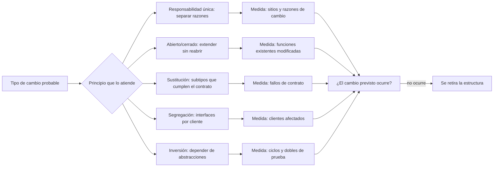
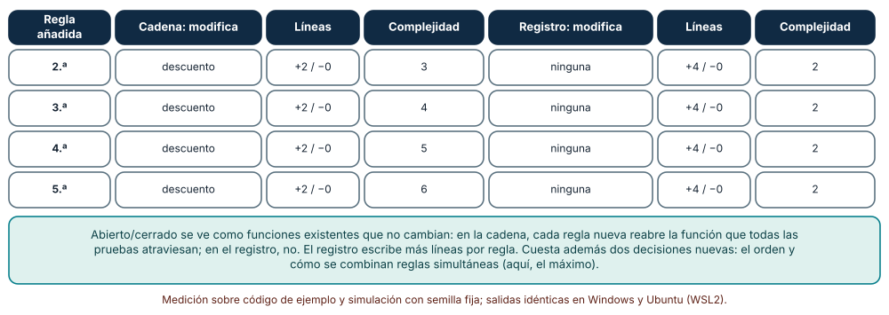
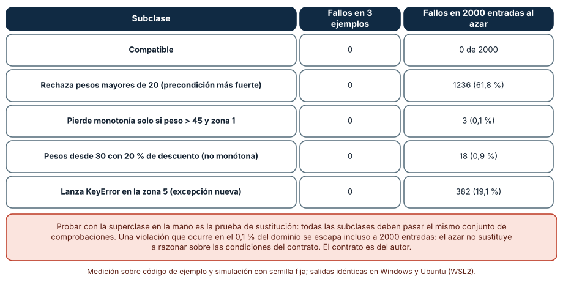
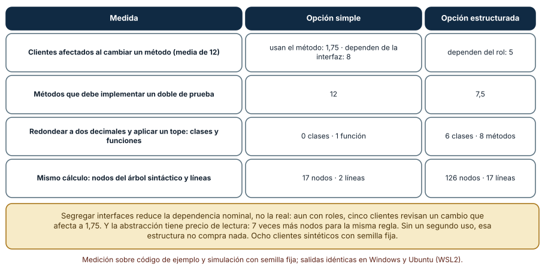

# SE-290 — SOLID y sus límites

[← SE-289 — Cohesión, acoplamiento y encapsulación](https://github.com/vladimiracunadev-create/modern-software-engineering-program/blob/main/classes/part-24-diseno-patrones-y-refactorizacion/se-289-cohesion-acoplamiento-y-encapsulacion/README.md) · [↑ Parte 24](https://github.com/vladimiracunadev-create/modern-software-engineering-program/blob/main/classes/part-24-diseno-patrones-y-refactorizacion/README.md) · [📚 Índice completo](https://github.com/vladimiracunadev-create/modern-software-engineering-program/blob/main/classes/README.md) · [🌐 Portal](https://vladimiracunadev-create.github.io/modern-software-engineering-program/classes/SE-290.html) · [SE-291 — Composición, herencia y delegación →](https://github.com/vladimiracunadev-create/modern-software-engineering-program/blob/main/classes/part-24-diseno-patrones-y-refactorizacion/se-291-composicion-herencia-y-delegacion/README.md)

## Punto profesional y fundamento pedagógico

**Punto profesional.** La clase existe para que uses los cinco principios SOLID como preguntas que se contrastan con un cambio y una prueba, y para que sepas cuándo cada uno deja de pagar: un principio aplicado sin un cambio que lo justifique es estructura que se lee, se prueba y se mantiene sin comprar nada.

**Por qué aparece aquí.** Sigue a **Cohesión, acoplamiento y encapsulación** (`SE-289`): allí se midió cuántos lugares toca un cambio; aquí se examinan los principios que dicen cómo repartir responsabilidades, extender sin reabrir, sustituir sin sorpresas, segregar interfaces e invertir dependencias. Cada principio se pone a prueba sobre el componente `tarifas`.

**Error conceptual que debe corregir.** Creer que SOLID es una lista de reglas que siempre mejoran el diseño: cada principio responde a un tipo de cambio concreto y, aplicado donde ese cambio no ocurre, solo suma estructura.

**Secuencia de aprendizaje.** Antes de mirar los resultados, predices qué modifica añadir una quinta regla de descuento en una cadena `if/elif` y en un registro de reglas, qué subclases de una tarifa pasan tres ejemplos y cuántas violan el contrato, y cuántos clientes se afectan realmente cuando cambia un método de una interfaz ancha. Después lo mides con `difflib`, `ast` y pruebas de contrato sobre código ejecutable. La secuencia usa predicción, explicación propia, contraste y recuperación. [ICAP](https://icap.education.asu.edu/research) distingue participación de construcción de conocimiento; [How People Learn II](https://nap.nationalacademies.org/catalog/24783/how-people-learn-ii-learners-contexts-and-cultures) exige conectar conocimiento previo, contexto y transferencia; la [práctica de recuperación](https://pubmed.ncbi.nlm.nih.gov/16507066/) respalda producir de nuevo la explicación tras una demora; y [Education for Life and Work](https://nap.nationalacademies.org/resource/13398/dbasse_084153.pdf) exige devolución que explique la causa del error.

**Evidencia de aprendizaje.** `solid-log.md` con la predicción, la tabla de reglas añadidas, la tabla de subclases frente a la prueba de contrato, la medida de interfaz ancha y de estructura, y una nota que diga qué principio se aplicó a `tarifas` y cuál se decidió no aplicar.

**Límite de la conclusión.** Las reglas de descuento, el contrato de `Tarifa`, las subclases y los ocho clientes son construcciones del autor. Ningún experimento se hizo sobre una base de código real: muestran mecanismos del diseño, no la frecuencia de cada problema.

### Trazabilidad fuente → afirmación

| Fuente primaria u oficial | Afirmación que respalda | Lo que no prueba |
|---|---|---|
| [Liskov y Wing, «A behavioral notion of subtyping» (ACM TOPLAS, 1994)](https://doi.org/10.1145/197320.197383) | Un subtipo debe preservar el comportamiento observable de su supertipo: precondiciones no más fuertes, postcondiciones no más débiles. | No dice cuántas violaciones hay en un proyecto ni cómo detectarlas todas. |
| [Martin, «The Open-Closed Principle» (blog, 2014)](https://blog.cleancoder.com/uncle-bob/2014/05/12/TheOpenClosedPrinciple.html) | Formula que un módulo debe poder extenderse sin modificarse y que la apertura se decide respecto de un tipo de cambio concreto. | Es la exposición de su autor, no una medición de sus efectos. |
| [PEP 544, protocolos](https://peps.python.org/pep-0544/) | Define tipos estructurales en Python, útiles para declarar interfaces estrechas sin herencia. | No dice qué interfaces conviene definir en `tarifas`. |

## Antes de empezar

Recupera lo aprendido en `SE-289`: una decisión que cambia debe quedar dentro de un módulo. La pregunta activa es: **¿qué tipo de cambio justifica cada principio en `tarifas`, y qué cambio me haría abandonarlo?**

## Prerrequisitos

- Haber completado `SE-289` o poder explicar qué mide LCOM4 y qué esconde un getter.
- Python 3.11 o posterior y un terminal; todo el código usa solo la biblioteca estándar.
- Conocer clases, herencia y funciones como valores en Python.

## Problema auténtico

`tarifas` calcula descuentos con una cadena de condicionales que crece cada trimestre: estudiantes, volumen, aniversario, verano, primera compra. Cada vez que marketing añade una regla, alguien abre la misma función, la prueba completa pasa a tener un caso más y una vez se rompió el descuento de volumen sin que nadie lo hubiera tocado. Al mismo tiempo, el equipo creó una subclase `TarifaExpress` que «hereda todo» y rechaza pesos de más de 20 kilos, y un servicio nuevo implementó la interfaz `Tarifario` de doce métodos solo para usar dos. Los tres síntomas son de principios distintos, y no todos piden la misma cura.

## Objetivos observables

Al terminar podrás:

1. medir cuántas funciones existentes se modifican y cuánto crece la complejidad al añadir una regla en una cadena y en un registro;
2. escribir una prueba de contrato que detecte una subclase que viola la sustitución y estimar lo que ejemplos y azar no ven;
3. contar cuántos clientes depende de verdad de un método y cuántos dependen de la interfaz que lo contiene;
4. calcular el costo de lectura de una abstracción sin segundo uso;
5. decidir, con un cambio y una medida, qué principio aplicar a `tarifas` y cuál no.

## Mapa conceptual



El mapa parte del tipo de cambio: sin un cambio probable, el principio no tiene a qué responder. La última flecha es parte del diseño: una estructura que nadie usa se retira.

## Temas y por qué importan

| Tema | Por qué cambia una decisión profesional | Evidencia mínima |
|---|---|---|
| Responsabilidad única | Separa lo que cambia por razones distintas. | Predicción, traza causal y contraejemplo de **Responsabilidad única** en `solid-log.md` |
| Abierto/cerrado | Decide si una regla nueva reabre código que ya funciona. | Predicción, traza causal y contraejemplo de **Abierto/cerrado** en `solid-log.md` |
| Sustitución de Liskov | Un subtipo que sorprende rompe a quien lo usa sin saberlo. | Predicción, traza causal y contraejemplo de **Sustitución de Liskov** en `solid-log.md` |
| Segregación de interfaces | Reduce la dependencia nominal de cada cliente. | Predicción, traza causal y contraejemplo de **Segregación de interfaces** en `solid-log.md` |
| Inversión de dependencias y límites | Permite probar y sustituir, y tiene un costo de indirección. | Predicción, traza causal y contraejemplo de **Inversión de dependencias y límites** en `solid-log.md` |

## Conceptos y decisiones

### 1. Responsabilidad única

Un módulo debe tener una sola razón para cambiar. No significa «hacer una sola cosa»: significa que un grupo de personas o de decisiones lo mueve. La clase `Envio` de `SE-289` cambiaba por razones de precio, de comunicación y de auditoría; separarla no reduce el código sino las razones por las que se reabre. La pregunta práctica es quién pide el cambio y qué otros módulos se enteran.

### 2. Abierto/cerrado

Un módulo está abierto a extensión y cerrado a modificación **respecto de un tipo de cambio**. Para «añadir una regla de descuento» se puede cerrar el cálculo detrás de un punto de extensión; para «cambiar cómo se combinan las reglas» ese mismo punto no ayuda. Cerrar un módulo respecto de todo es imposible, y cerrarlo respecto de un cambio que no ocurre es costo sin retorno. La pregunta es cuál es el cambio más frecuente y si hoy cuesta más de lo que costaría el punto de extensión.

### 3. Sustitución de Liskov

Donde se espera una `Tarifa` debe poder usarse cualquier subclase sin que el cliente lo note. Eso fija un **contrato**: precondiciones (qué acepta), postcondiciones (qué devuelve) e invariantes (qué se mantiene). Una subclase puede aceptar más y prometer más; si acepta menos (rechaza pesos altos), devuelve menos (pierde monotonía) o lanza excepciones nuevas, rompe al cliente. El lenguaje no lo comprueba: lo comprueba una prueba de contrato que se ejecuta contra todas las subclases.

### 4. Segregación de interfaces

Un cliente no debe depender de métodos que no usa. Una interfaz ancha obliga a cada cliente a revisar, recompilar o doblar métodos ajenos, y vuelve incierto qué cambio afecta a quién. La segregación crea interfaces por rol (leer tarifa, calcular recargo, cobrar). Reduce la dependencia nominal, no la real: si el cambio es en un método que sí usan, el cliente se afecta igual.

### 5. Inversión de dependencias y sus límites

Un módulo de alto nivel no debe depender de uno de bajo nivel: ambos dependen de una abstracción que el alto nivel define. Permite sustituir (probar con un doble, cambiar el proveedor) y evita ciclos cuando la capa baja necesita avisar a la alta. Su costo es la indirección: una clase, una interfaz y una fábrica para una regla que se usa una vez. Hay tres límites que conviene conocer: una abstracción sin un segundo uso no demuestra nada, la extensibilidad especulativa se vuelve deuda, y cada capa añadida es una capa más que leer.

### Añadir una regla sin reabrir lo que funciona

Se parte de una función `descuento` con una regla y se añaden, una a una, las otras cuatro (estudiante, volumen, aniversario, verano, primera compra) de dos maneras: como un `elif` más, y como una función registrada con un decorador en una lista, con `max` como política de combinación. Con `difflib` se cuentan las líneas cambiadas entre versiones, con `ast` las funciones existentes cuyo texto cambia y la complejidad ciclomática de `descuento`.

```python
f0, f1 = funciones(previo), funciones(nuevo)
modificadas = [k for k in f0 if f1.get(k) != f0[k]]      # funciones existentes que cambiaron de texto
```

| Regla añadida | Cadena: funciones modificadas | Líneas | Complejidad | Registro: funciones modificadas | Líneas | Complejidad |
|---|---:|---:|---:|---:|---:|---:|
| 2.ª | 1 | +2 / −0 | 3 | 0 | +4 / −0 | 2 |
| 3.ª | 1 | +2 / −0 | 4 | 0 | +4 / −0 | 2 |
| 4.ª | 1 | +2 / −0 | 5 | 0 | +4 / −0 | 2 |
| 5.ª | 1 | +2 / −0 | 6 | 0 | +4 / −0 | 2 |

Resultado, idéntico en Windows (CPython 3.12.9) y en Ubuntu bajo WSL2 (3.12.3). El registro no modifica ninguna función ya escrita; la cadena modifica siempre la misma, y su complejidad crece una unidad por regla.



**Cómo leer la figura.** Cada fila es una regla añadida; las columnas comparan lo que cambia en cada diseño. **Dónde deja de valer:** el registro escribe más líneas por regla y traslada dos decisiones a otro sitio: en qué orden se evalúan y cómo se combinan reglas simultáneas (aquí, el máximo). Si una regla nueva necesita conocer el resultado de otra, el registro se complica más que la cadena. El experimento mide la forma del cambio, no su valor para el negocio.

### Subclases que cumplen tres ejemplos y rompen el contrato

El contrato de `Tarifa.costo(peso, zona)` es: peso en (0, 50], zona de 1 a 5, devuelve un `float` no negativo con dos decimales, no decrece al subir el peso y no lanza para entradas válidas. Se escriben cuatro subclases con una violación cada una (precondición más fuerte, monotonía rota en un rincón estrecho, descuento que rompe la monotonía a partir de 30 kilos, excepción nueva en la zona 5) y una compatible. Se ejecuta la misma prueba de contrato con tres ejemplos de camino feliz y con 2000 entradas aleatorias de semilla fija.

```python
def cumple(t, peso, zona):
    c = t.costo(peso, zona)
    c2 = t.costo(min(50, peso + 0.5), zona)
    return isinstance(c, float) and c >= 0 and round(c, 2) == c and c2 >= c
```

| Subclase | Fallos en 3 ejemplos | Fallos en 2000 entradas |
|---|---:|---:|
| Compatible | 0 | 0 |
| Rechaza pesos mayores de 20 | 0 | 1236 (61,8 %) |
| Pierde monotonía si peso > 45 y zona 1 | 0 | 3 (0,1 %) |
| Descuento del 20 % desde 30 kilos | 0 | 18 (0,9 %) |
| Lanza `KeyError` en la zona 5 | 0 | 382 (19,1 %) |

Las cuatro violaciones pasan los tres ejemplos. Una prueba aleatoria las encuentra todas, pero la que está confinada a un rincón estrecho aparece solo en 3 de 2000 entradas.



**Cómo leer la figura.** Cada fila es una subclase; la última columna es la fracción de entradas aleatorias en que el contrato se rompe. **Dónde deja de valer:** el contrato lo escribió el autor y lo que no escribió (por ejemplo, un tiempo máximo) no se comprueba. El azar encuentra violaciones anchas y falla con las estrechas: para estas, hay que razonar sobre las condiciones del contrato y probar los valores frontera. Una suite que pasa solo prueba que no se encontró una violación.

### Interfaces anchas e indirección

Doce métodos y ocho clientes sintéticos, cada uno usa de uno a tres. Se compara la interfaz ancha con cuatro roles de tres métodos: cuántos clientes se ven afectados al cambiar un método y cuántos métodos debe implementar un doble de prueba. Como contraste, la misma regla (redondear a dos decimales y aplicar un tope) se escribe como una función y como dos estrategias con una fábrica; se cuentan clases, métodos, nodos del árbol sintáctico y líneas.

```python
real = [sum(1 for c in clientes if m in c) for m in M]
nominal_rol = [sum(1 for c in clientes if any(m in r and (c & r) for r in roles)) for m in M]
```

| Medida | Opción simple | Opción estructurada |
|---|---|---|
| Clientes afectados al cambiar un método (media) | usan el método: 1,75 · dependen de la interfaz ancha: 8 | dependen del rol: 5 |
| Métodos por doble de prueba | 12 | 7,5 |
| Redondeo y tope | 1 función, 17 nodos, 2 líneas | 6 clases, 8 métodos, 126 nodos, 17 líneas |



**Cómo leer la figura.** Las dos primeras filas comparan dependencias; las dos últimas, el costo de lectura de la misma regla. **Dónde deja de valer:** los roles redujeron de 8 a 5 los clientes que deben revisar un cambio, pero solo 1,75 lo sufren de verdad; la segregación cambia la dependencia declarada, no la real. Y la comparación de estructura usa una regla trivial sin segundo uso: con tres redondeos distintos que se intercambian en tiempo de ejecución, las estrategias se justifican.

## Definiciones de trabajo

- **razón de cambio:** decisión o grupo de personas cuya petición obliga a modificar un módulo.
- **punto de extensión:** lugar donde se pueden añadir variantes sin editar el código existente.
- **contrato:** conjunto de precondiciones, postcondiciones e invariantes que un cliente puede esperar de un tipo.
- **prueba de contrato:** prueba que se ejecuta contra todas las implementaciones de una interfaz para comprobar que cumplen lo mismo.
- **dependencia nominal:** dependencia declarada en el tipo, aunque el cliente no use todos sus métodos.

Las definiciones son operativas para `tarifas`. No convierten términos con una historia más amplia en sinónimos y deben contrastarse con la bibliografía enlazada al final.

## Ejemplo mínimo

El fragmento comprueba el contrato de una subclase. Antes de ejecutarlo, predice si pasa.

```python
class Tarifa:
    def costo(self, peso, zona): return round(3.0 * peso + 2.0 * zona, 2)

class Limitada(Tarifa):
    def costo(self, peso, zona):
        if peso > 20: raise ValueError("peso maximo 20")
        return super().costo(peso, zona)

def acepta(t, peso, zona):
    try: t.costo(peso, zona); return True
    except Exception: return False

assert acepta(Limitada(), 10, 1) and not acepta(Limitada(), 25, 1) and acepta(Tarifa(), 25, 1)
```

La subclase acepta menos que la base: `Limitada` no es sustituible. Registra versión, comando y salida; cambia el límite a 50 y predice si ahora es compatible.

## Ejemplo profesional

El equipo no aplica los cinco principios a la vez: elige por cambio. Para los descuentos, que marketing añade cada trimestre, introduce el registro de reglas y deja la política de combinación (el máximo) escrita en un solo lugar con una prueba. Para `TarifaExpress`, escribe la prueba de contrato de `Tarifa`, la ejecuta contra todas las subclases y convierte la restricción de 20 kilos en una validación explícita que ningún cliente espera de una `Tarifa` general. Para el servicio con la interfaz de doce métodos, define dos protocolos, `LeeTarifa` y `CalculaRecargo`, con `typing.Protocol`. Y para el redondeo, que se usa una vez, deja una función.

Compara con el estado anterior: la decisión es adecuada si cada estructura nueva responde a un cambio que ya ocurrió dos veces; es frágil si se justifica con «por si acaso». Anota en `solid-log.md` el cambio que haría retirar cada estructura.

## Práctica guiada

1. Escribe la función de descuento con una regla y predice cuántas funciones modificará la quinta.
2. Añade las otras cuatro reglas en una cadena y en un registro y mide funciones modificadas, líneas y complejidad.
3. Escribe el contrato de `Tarifa` y cuatro subclases que lo violen; predice qué subclases pasan tres ejemplos.
4. Ejecuta la prueba de contrato con ejemplos y con 2000 entradas aleatorias, y añade una prueba de bordes.
5. Genera ocho clientes con semilla fija y mide los clientes afectados por la interfaz ancha, por el rol y por el uso real.
6. Escribe el redondeo como una función y como estrategias y compara nodos y líneas.
7. Entrega `solid-log.md` y pide a otra persona que identifique, para cada estructura, el cambio que la justifica.

## Ejercicios

1. **Abierto/cerrado:** añade una regla que depende del resultado de otra (descuento de cumpleaños que se aplica después del de volumen) y muestra qué diseño la acomoda peor.
2. **Liskov:** escribe una subclase que viole la postcondición de dos decimales y la prueba que la detecte con una sola entrada.
3. **Segregación:** divide una interfaz de seis métodos en dos protocolos y calcula los clientes afectados antes y después.
4. **Límites:** encuentra en un código tuyo una abstracción con una sola implementación y propone cómo comprobar que se puede retirar.

## Reto verificable

Entrega `solid-log.md` con la predicción, la tabla de reglas añadidas, la tabla de subclases frente a ejemplos y a azar, la medida de la interfaz ancha y la de la estructura, y una lista de qué principio se aplicó a `tarifas` y cuál no, con el cambio que lo justifica. Se aprueba si otra persona ejecuta el código desde un checkout limpio, obtiene los mismos números y puede decir qué prueba de contrato corre contra todas las subclases. No se aprueba por citar los cinco principios ni por afirmar que una estructura «es más extensible» sin un cambio que lo muestre.

## Caso conductor

El componente `tarifas` conserva el desglose de `SE-289` y gana tres artefactos: el registro de reglas de descuento con su política de combinación, la prueba de contrato de `Tarifa` y dos protocolos estrechos. `SE-291` decidirá cuándo conviene reutilizar por herencia y cuándo por composición. Cambia después una sola decisión, el orden de evaluación de las reglas, y observa qué pruebas se mueven.

## Preguntas frecuentes

### ¿SOLID es obligatorio?

No: son heurísticas que resumen problemas recurrentes. Cada una responde a un tipo de cambio y se aplica cuando ese cambio ocurre. Un código que aplica los cinco sin que ocurra ningún cambio es más difícil de leer, no mejor.

### ¿Cómo sé si una subclase respeta el contrato?

Escribiendo el contrato como pruebas ejecutables y corriéndolas contra la base y contra cada subclase. Los tipos no lo garantizan: `Limitada` tenía la firma correcta y rechazaba el 61,8 % del dominio.

### ¿Un registro de reglas es siempre mejor que un `if`?

No: con una o dos reglas estables, el `if` es más corto y más claro. El registro paga cuando las reglas se añaden con frecuencia y no dependen unas de otras. Si dependen, el registro necesita orden y combinación y puede quedar peor que la cadena.

### ¿Para qué sirve segregar si el cliente igual se rompe?

Reduce las revisiones innecesarias y el tamaño de los dobles de prueba, y hace explícito de qué depende cada cliente. No reduce el efecto de cambiar un método que el cliente sí usa.

## Fallo controlado y diagnóstico

Reproduce el fallo clásico de la clase: **una subclase que pasa los ejemplos y rompe a un cliente en producción**. Toma `PrecondicionFuerte` (rechaza pesos de más de 20 kilos) y úsala en un cliente que calcula el costo de un pedido de 25 kilos.

Registra síntoma, entrada mínima, hipótesis, observación que descarta cada hipótesis, causa, corrección y prueba de regresión. **Síntoma:** el cálculo de un pedido grande falla con `ValueError` solo cuando se usa la tarifa exprés. **Hipótesis rivales:** (a) el cliente pasa un peso incorrecto; (b) la tarifa base calcula mal; (c) la subclase rechaza una entrada que la base acepta. **Prueba:** ejecuta la misma entrada contra `Tarifa` y contra la subclase; si la primera responde y la segunda no, la causa es (c). **Conclusión:** la subclase fortaleció una precondición. **Regresión:** agrega la prueba de contrato que corre sobre todas las subclases con pesos de 0,5 a 50 y mueve la restricción a un validador anterior, fuera de la jerarquía. No cambies a la vez la subclase y el cliente.

## Errores comunes y cómo corregirlos

| Síntoma | Causa probable | Corrección |
|---|---|---|
| Cada regla nueva reabre la misma función | Cadena de condicionales sin punto de extensión | Registrar reglas y escribir la política de combinación en un solo sitio |
| Una subclase pasa los ejemplos y falla con datos reales | Contrato no escrito como prueba, o probado solo con camino feliz | Ejecutar una prueba de contrato con azar y bordes contra todas las subclases |
| Un doble de prueba implementa métodos que nunca se llaman | Interfaz ancha | Definir protocolos por rol |
| Una clase, una interfaz y una fábrica para una regla que se usa una vez | Abstracción sin un segundo uso | Retirar la estructura hasta que el segundo uso exista |
| Se aplican los cinco principios y el cambio sigue costando lo mismo | Se aplicaron sin un cambio concreto | Empezar por el cambio y medir antes y después |

## Entorno y archivos clave

```text
work/SE-290/
├── README.md
├── descuentos/
│   ├── cadena.py
│   └── registro.py
├── contrato/
│   ├── tarifa.py
│   ├── subclases.py
│   └── test_contrato.py
├── interfaces/
│   └── protocolos.py
└── evidence/solid-log.md
```

El `README` declara plataforma, versión de Python, semillas y comandos. Los experimentos usan solo la biblioteca estándar (`ast`, `difflib`, `random`, `textwrap`, `statistics`) y se ejecutaron con CPython 3.12.9 en Windows 11 y 3.12.3 en Ubuntu bajo WSL2: las salidas fueron idénticas. Si añades una dependencia, fija procedencia y versión.

## Seguridad, ética y accesibilidad

- una regla de descuento afecta a lo que paga una persona: el orden y la combinación de reglas deben ser explícitos y auditables, y no quedar escondidos en un registro implícito;
- una restricción de negocio (peso máximo, zona excluida) que se esconde en una subclase puede discriminar sin que nadie lo vea; ponla en un validador visible;
- los mensajes de error de un contrato roto deben ser comprensibles para quien opera, no solo para quien programa;
- no uses datos reales de clientes para probar el contrato;
- respeta las licencias de los textos citados y atribuye lo adaptado.

## Puente hacia el trabajo con agentes

Un agente al que se le pide «aplica SOLID a tarifas» creará interfaces, fábricas e inyección en todo el módulo y presentará la estructura como mejora. Pídele en cambio que parta del cambio («añadir una regla de descuento»), que mida las funciones modificadas antes y después y que escriba la prueba de contrato de `Tarifa` y la ejecute contra todas las subclases. Revisa especialmente si creó una abstracción con una sola implementación, si movió una regla de cobro a un lugar que ninguna prueba cubre o si declaró «cerrado a modificación» un módulo que sigue reabriéndose con el cambio más frecuente.

## Transferencia

Traslada el análisis a otro componente (por ejemplo, el de reglas de reembolso): cambia las reglas y las subclases, y conserva el procedimiento de elegir el cambio, medir lo que modifica y probar el contrato. La transferencia está lograda cuando puedes explicar qué principio no aplicaste y por qué, no cuando el diseño tiene las mismas piezas.

## Evaluación y evidencia

| Criterio | Evidencia para aprobar |
|---|---|
| comprensión | explicación del cambio al que responde cada principio con ejemplos de `tarifas` |
| corrección | funciones modificadas, fallos de contrato y clientes afectados reproducibles con las mismas semillas |
| diseño | registro de reglas, prueba de contrato y protocolos estrechos con el cambio que justifica cada uno |
| diagnóstico | reproducción del fallo «subclase que rompe al cliente» con regresión |
| incertidumbre | declaración de que contratos, subclases y clientes son del autor |
| reproducibilidad | versiones, comandos, salida y límites declarados |

## Fuentes

- [Liskov y Wing, «A behavioral notion of subtyping» (ACM TOPLAS, 1994)](https://doi.org/10.1145/197320.197383) — subtipos que preservan el comportamiento; autoridad: ACM Transactions on Programming Languages and Systems.
- [Martin, «The Open-Closed Principle» (2014)](https://blog.cleancoder.com/uncle-bob/2014/05/12/TheOpenClosedPrinciple.html) — formulación del principio abierto/cerrado; autoridad: su autor.
- [Martin, «The Single Responsibility Principle» (2014)](https://blog.cleancoder.com/uncle-bob/2014/05/08/SingleReponsibilityPrinciple.html) — responsabilidad única como razón de cambio; autoridad: su autor.
- [PEP 544, protocolos](https://peps.python.org/pep-0544/) — tipos estructurales en Python; autoridad: Python Enhancement Proposals.
- [Python: `abc`](https://docs.python.org/3/library/abc.html) — clases abstractas; autoridad: documentación de Python.
- [Fowler, «Yagni»](https://martinfowler.com/bliki/Yagni.html) — el costo de construir flexibilidad que no se usa; autoridad: Martin Fowler.
- [Parnas (1972)](https://doi.org/10.1145/361598.361623) — ocultar decisiones que probablemente cambien; autoridad: Communications of the ACM.

Cada fuente respalda el mecanismo indicado; ninguna demuestra que los 61,8 % de fallos, las cuatro líneas por regla o los 126 nodos se observen en `tarifas`. Esa afirmación depende de sus contratos, sus clientes y su historia de cambios.

## Límites y siguiente paso

Se ejecutaron tres análisis con código de ejemplo y datos sintéticos en Windows y Ubuntu (WSL2) con resultados idénticos. No se midió ninguna base de código real ni la frecuencia de cada problema; los contratos, las subclases y los clientes son construcciones del autor. La siguiente clase compara herencia, composición y delegación como formas de reutilizar.

## Glosario

- **razón de cambio:** decisión o grupo de personas cuya petición obliga a modificar un módulo.
- **punto de extensión:** lugar donde se pueden añadir variantes sin editar el código existente.
- **contrato:** conjunto de precondiciones, postcondiciones e invariantes que un cliente puede esperar de un tipo.
- **prueba de contrato:** prueba que se ejecuta contra todas las implementaciones de una interfaz para comprobar que cumplen lo mismo.
- **dependencia nominal:** dependencia declarada en el tipo, aunque el cliente no use todos sus métodos.

---

[← SE-289 — Cohesión, acoplamiento y encapsulación](https://github.com/vladimiracunadev-create/modern-software-engineering-program/blob/main/classes/part-24-diseno-patrones-y-refactorizacion/se-289-cohesion-acoplamiento-y-encapsulacion/README.md) · [↑ Parte 24](https://github.com/vladimiracunadev-create/modern-software-engineering-program/blob/main/classes/part-24-diseno-patrones-y-refactorizacion/README.md) · [📚 Índice completo](https://github.com/vladimiracunadev-create/modern-software-engineering-program/blob/main/classes/README.md) · [🌐 Portal](https://vladimiracunadev-create.github.io/modern-software-engineering-program/classes/SE-290.html) · [SE-291 — Composición, herencia y delegación →](https://github.com/vladimiracunadev-create/modern-software-engineering-program/blob/main/classes/part-24-diseno-patrones-y-refactorizacion/se-291-composicion-herencia-y-delegacion/README.md)
