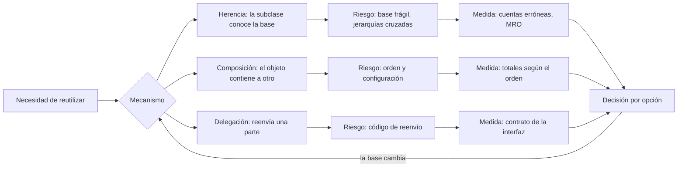
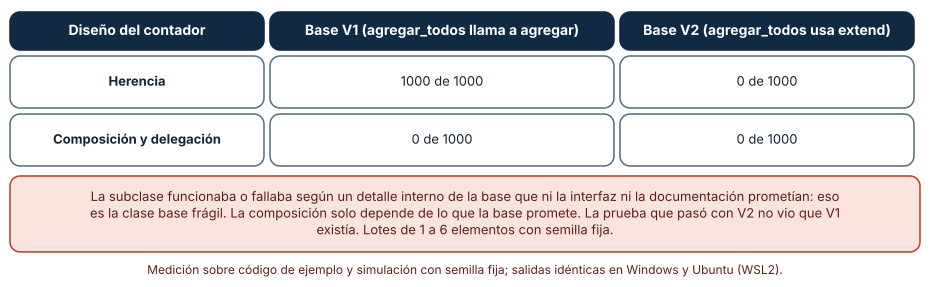
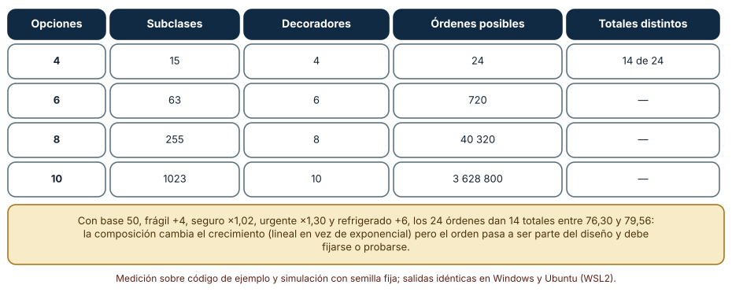
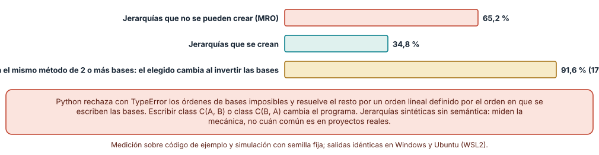

# SE-291 — Composición, herencia y delegación

[← SE-290 — SOLID y sus límites](https://github.com/vladimiracunadev-create/modern-software-engineering-program/blob/main/classes/part-24-diseno-patrones-y-refactorizacion/se-290-solid-y-sus-limites/README.md) · [↑ Parte 24](https://github.com/vladimiracunadev-create/modern-software-engineering-program/blob/main/classes/part-24-diseno-patrones-y-refactorizacion/README.md) · [📚 Índice completo](https://github.com/vladimiracunadev-create/modern-software-engineering-program/blob/main/classes/README.md) · [🌐 Portal](https://vladimiracunadev-create.github.io/modern-software-engineering-program/classes/SE-291.html) · [SE-292 — Patrones creacionales, estructurales y conductuales →](https://github.com/vladimiracunadev-create/modern-software-engineering-program/blob/main/classes/part-24-diseno-patrones-y-refactorizacion/se-292-patrones-creacionales-estructurales-y-conductuales/README.md)

## Punto profesional y fundamento pedagógico

**Punto profesional.** La clase existe para que elijas entre heredar, componer y delegar por lo que cada mecanismo promete cuando la base cambia, cuando las opciones se combinan y cuando varias jerarquías se cruzan, y no por la costumbre de «favorecer la composición» ni por la comodidad de heredar.

**Por qué aparece aquí.** Sigue a **SOLID y sus límites** (`SE-290`): allí se vio que una subclase puede romper el contrato de su base; aquí se examina el mecanismo que permite reutilizar comportamiento y las tres formas de pagar por él. Se aplica a las opciones de envío de `tarifas` (frágil, seguro, urgente, refrigerado).

**Error conceptual que debe corregir.** Creer que la herencia es reutilización gratuita y que la composición es siempre mejor: la herencia acopla la subclase a detalles internos de la base, y la composición traslada el costo a decidir el orden de las piezas y a escribir la delegación.

**Secuencia de aprendizaje.** Antes de mirar los resultados, predices si un contador que hereda de una colección cuenta bien cuando la base cambia su implementación interna, cuántos totales distintos dan cuatro recargos aplicados en todos los órdenes posibles y qué fracción de jerarquías con herencia múltiple al azar se puede ni siquiera crear. Después lo ejecutas con clases reales de Python. La secuencia usa predicción, explicación propia, contraste y recuperación. [ICAP](https://icap.education.asu.edu/research) distingue participación de construcción de conocimiento; [How People Learn II](https://nap.nationalacademies.org/catalog/24783/how-people-learn-ii-learners-contexts-and-cultures) exige conectar conocimiento previo, contexto y transferencia; la [práctica de recuperación](https://pubmed.ncbi.nlm.nih.gov/16507066/) respalda producir de nuevo la explicación tras una demora; y [Education for Life and Work](https://nap.nationalacademies.org/resource/13398/dbasse_084153.pdf) exige devolución que explique la causa del error.

**Evidencia de aprendizaje.** `reuse-log.md` con la predicción, la tabla del contador por herencia y por composición, la tabla de órdenes de decoradores, el resultado de las jerarquías aleatorias y una nota que diga qué opciones de `tarifas` se compusieron y por qué.

**Límite de la conclusión.** Las clases, los recargos y las jerarquías son construcciones del autor. Las jerarquías aleatorias no tienen semántica: miden la mecánica de la resolución de métodos de Python, no la frecuencia de herencia múltiple en proyectos reales.

### Trazabilidad fuente → afirmación

| Fuente primaria u oficial | Afirmación que respalda | Lo que no prueba |
|---|---|---|
| [Gamma, Helm, Johnson y Vlissides, «Design Patterns» (1994)](https://www.informit.com/store/design-patterns-elements-of-reusable-object-oriented-9780201633610) | Recomienda favorecer la composición de objetos sobre la herencia de clases y explica que la herencia expone a la subclase los detalles de la base. | No mide cuántos defectos evita la composición en un proyecto. |
| [Python: «The Python 2.3 Method Resolution Order»](https://docs.python.org/3/howto/mro.html) | Describe cómo Python linealiza las bases y por qué algunos órdenes son inconsistentes y se rechazan. | No dice cuándo conviene la herencia múltiple. |
| [Fowler, catálogo: «Replace Superclass with Delegate»](https://refactoring.com/catalog/replaceSuperclassWithDelegate.html) | Describe el paso de herencia a delegación y las condiciones en que ayuda. | No cuantifica el beneficio ni el costo en un código concreto. |

## Antes de empezar

Recupera lo aprendido en `SE-290`: una subclase debe cumplir el contrato de su base. La pregunta activa es: **¿qué parte de la base conoce mi subclase sin que nadie lo haya prometido, y qué haría si la base cambiara?**

## Prerrequisitos

- Haber completado `SE-290` o poder explicar qué es una prueba de contrato.
- Python 3.11 o posterior y un terminal; todo el código usa solo la biblioteca estándar.
- Conocer clases, `super()` y funciones que devuelven funciones.

## Problema auténtico

El equipo de la plataforma de entregas añadió, en dos años, cuatro opciones al envío: frágil, seguro, urgente y refrigerado. La primera versión usó herencia: `EnvioFragil(Envio)`, `EnvioUrgente(Envio)`. Cuando alguien necesitó «frágil y urgente», nació `EnvioFragilUrgente`, y con el seguro y la cadena de frío ya hay quince combinaciones por cubrir. En paralelo, un contador de entregas heredó de una colección propia del equipo; cuando la colección cambió su método de inserción masiva, el contador empezó a contar el doble sin que nadie hubiera tocado el contador. Cada síntoma pide una decisión de reutilización diferente.

## Objetivos observables

Al terminar podrás:

1. reproducir un fallo de clase base frágil y explicar por qué la subclase depende de un detalle que la base no prometió;
2. contar las subclases que exige una herencia por combinación y compararlas con los decoradores, incluyendo el efecto del orden;
3. medir qué fracción de jerarquías con herencia múltiple se puede crear y cuántas dependen del orden de las bases;
4. decidir con un criterio explícito entre herencia, composición y delegación para cada opción de `tarifas`;
5. declarar qué contrato exige la composición y cómo se comprueba.

## Mapa conceptual



El mapa parte de la necesidad, no del mecanismo: reutilizar tiene tres formas y cada una tiene un riesgo y una medida. El retorno marca que un cambio en la base puede reabrir la decisión.

## Temas y por qué importan

| Tema | Por qué cambia una decisión profesional | Evidencia mínima |
|---|---|---|
| Herencia | Reutiliza mucho a cambio de conocer los detalles de la base. | Predicción, traza causal y contraejemplo de **Herencia** en `reuse-log.md` |
| Clase base frágil | La subclase falla cuando la base cambia sin cambiar su interfaz. | Predicción, traza causal y contraejemplo de **Clase base frágil** en `reuse-log.md` |
| Composición y delegación | Dependen solo de lo prometido y obligan a escribir el reenvío. | Predicción, traza causal y contraejemplo de **Composición y delegación** en `reuse-log.md` |
| Combinaciones y orden | Las opciones se multiplican y el orden cambia el resultado. | Predicción, traza causal y contraejemplo de **Combinaciones y orden** en `reuse-log.md` |
| Herencia múltiple | Resuelve métodos por un orden lineal que puede no existir. | Predicción, traza causal y contraejemplo de **Herencia múltiple** en `reuse-log.md` |

## Conceptos y decisiones

### 1. Herencia

La herencia hace que una subclase **sea** su base y reutilice su implementación. Es la forma más corta de compartir código y, a cambio, la más intrusiva: la subclase ve los métodos protegidos, el orden en que la base llama a sus propios métodos y los atributos. Funciona bien cuando la relación es de verdad «es un» (sustituible, `SE-290`), la base está pensada para extenderse y las dos evolucionan juntas, por ejemplo dentro del mismo paquete y con las mismas personas.

### 2. Clase base frágil

El problema aparece cuando la base cambia **sin cambiar su interfaz**. Un caso clásico: una colección implementa `agregar_todos` llamando a su propio `agregar`. Una subclase que cuenta los elementos sobrescribe `agregar` y `agregar_todos` y suma en ambos: con esa implementación de la base cuenta el doble. Si la base cambia a un `extend` interno, la subclase pasa a contar bien. Ninguna de las dos bases rompe su documentación, y la subclase depende del detalle. Quien hereda asume el compromiso de seguir a la base.

### 3. Composición y delegación

En composición, el objeto contiene a otro y le reenvía lo que necesita (delegación). Depende solo de lo que el contenido promete en su interfaz. Cuesta escribir el reenvío y decidir qué parte de la interfaz se expone. Gana en dos cosas: la implementación interna puede cambiar sin que lo note quien contiene, y el contenido se puede sustituir en ejecución (un doble de prueba, otra estrategia).

### 4. Combinaciones y orden

Cuando las opciones se combinan, la herencia por combinación crece como 2ⁿ − 1 subclases. La composición con decoradores crece como n, pero introduce el **orden** como parte del diseño: un recargo fijo antes de un porcentaje no da lo mismo que después. El orden debe fijarse por regla de negocio y probarse, no dejarse al azar del que arma la cadena.

### 5. Herencia múltiple

La herencia múltiple añade el problema del rombo: si dos bases definen el mismo método, ¿cuál se ejecuta? Python linealiza las bases (MRO). Hay órdenes de bases imposibles, que se rechazan al crear la clase, y órdenes posibles en los que **el orden en que se escriben las bases cambia el programa**. Por eso suele reservarse a mixins sin estado y sin métodos con el mismo nombre.

### Un contador que cuenta bien o mal según la base

Una colección con `agregar` y `agregar_todos` se escribe en dos versiones: en la primera, `agregar_todos` llama a `self.agregar` por cada elemento; en la segunda usa `extend`. Se implementa el contador de dos maneras: heredando y sobrescribiendo ambos métodos, y componiendo (contiene una colección y reenvía). Se prueban 1000 lotes de 1 a 6 elementos con semilla fija y se compara la cuenta con el número real.

```python
class Contado(base):                       # herencia
    def agregar(self, x): self.cuenta += 1; super().agregar(x)
    def agregar_todos(self, xs): self.cuenta += len(xs); super().agregar_todos(xs)
```

| Diseño del contador | Base V1 (`agregar_todos` llama a `agregar`) | Base V2 (`agregar_todos` usa `extend`) |
|---|---:|---:|
| Herencia | 1000 de 1000 con cuenta errónea | 0 de 1000 |
| Composición y delegación | 0 de 1000 | 0 de 1000 |

Resultado, idéntico en Windows (CPython 3.12.9) y en Ubuntu bajo WSL2 (3.12.3). Con la base V1 la herencia falla siempre, incluso con lotes de un solo elemento, porque cada elemento se cuenta en `agregar_todos` y de nuevo en `agregar`.



**Cómo leer la figura.** Las filas son diseños; las columnas, la implementación interna de la base, que la interfaz no promete. **Dónde deja de valer:** el ejemplo es el caso clásico de la literatura y es deliberadamente limpio; en un proyecto real la dependencia suele ser más sutil (un orden de llamadas, un atributo, un efecto lateral). Y la composición no es inmune: depende de que el contrato de la base se cumpla. La figura no dice que la herencia esté mal, sino que su corrección depende de algo que no figura en la interfaz.

### Cuatro recargos y el orden en que se aplican

Los recargos son: frágil (+4), seguro (×1,02), urgente (×1,30) y refrigerado (+6), aplicados sobre una base de 50. Con decoradores (funciones que envuelven a otra) se prueban los 24 órdenes posibles y se cuentan los totales distintos. Para la herencia por combinación se cuentan las subclases necesarias para n opciones.

```python
for orden in itertools.permutations(RECARGOS):
    v = 50.0
    for nombre in orden:
        aplicar = RECARGOS[nombre]
        v = aplicar(v)
    res.setdefault(round(v, 2), []).append(orden)
```

| Opciones | Subclases por combinación | Decoradores | Órdenes posibles | Totales distintos |
|---:|---:|---:|---:|---|
| 4 | 15 | 4 | 24 | 14, entre 76,30 y 79,56 |
| 6 | 63 | 6 | 720 | — |
| 8 | 255 | 8 | 40 320 | — |
| 10 | 1023 | 10 | 3 628 800 | — |



**Cómo leer la figura.** Cada fila es un número de opciones; las columnas comparan cuánto crece cada estrategia y cuántos órdenes hay. **Dónde deja de valer:** no todos los órdenes son válidos para el negocio: casi siempre hay una regla (primero los recargos fijos, luego los porcentuales) que deja uno o pocos. La cifra de 14 totales distintos describe este conjunto de recargos, no una regla general. El experimento muestra que el orden es parte del diseño, no que una combinación sea correcta.

### Jerarquías con herencia múltiple al azar

Se generan 3000 jerarquías de ocho clases; cada clase hereda de cero a tres de las anteriores, elegidas al azar y en orden aleatorio, y la mitad define un método `hola`. Se intenta crear cada clase con `type`. Si se crea, se mira la última: si hereda `hola` de dos o más bases, se resuelve el método con las bases en su orden y en el invertido, y se compara el valor que devuelve.

```python
try:
    clases.append(type(f"C{i}", tuple(bases) or (object,), cuerpo))
except TypeError:
    fallo = True; break                      # MRO inconsistente
```

De las 3000 jerarquías, el 65,2 % (1956) no se puede crear por un orden de resolución inconsistente. De las 1044 que se crean, 191 heredan `hola` de dos o más bases, y en 175 de ellas (91,6 %) invertir el orden de las bases cambia el método que se ejecuta.



**Cómo leer la figura.** La primera barra son las jerarquías imposibles; la tercera, la fracción de las posibles cuyo comportamiento depende del orden en que se escriben las bases. **Dónde deja de valer:** las jerarquías son aleatorias y sin semántica; un proyecto real no las construye al azar y rara vez cruza ocho clases. El resultado muestra que el orden de bases es información de diseño que el lenguaje usa sin avisar, no cuán común es el problema.

## Definiciones de trabajo

- **herencia:** mecanismo por el que una clase reutiliza la implementación y la interfaz de otra y puede sustituirla.
- **composición:** diseño en que un objeto contiene a otros y los usa para cumplir su trabajo.
- **delegación:** reenvío de una operación del objeto a otro objeto que la realiza.
- **clase base frágil:** situación en que un cambio interno de la base, sin cambiar su interfaz, rompe a sus subclases.
- **orden de resolución de métodos (MRO):** orden lineal en que el lenguaje busca un método entre una clase y sus bases.

Las definiciones son operativas para `tarifas`. No convierten términos con una historia más amplia en sinónimos y deben contrastarse con la bibliografía enlazada al final.

## Ejemplo mínimo

El fragmento muestra que el orden de las bases cambia el método que se ejecuta. Antes de ejecutarlo, predice qué devuelve cada clase.

```python
class A:
    def hola(self): return "A"
class B:
    def hola(self): return "B"
class AB(A, B): pass
class BA(B, A): pass
assert AB().hola() == "A" and BA().hola() == "B"
```

El orden en que se escriben las bases decide. Registra versión, comando y salida; añade una tercera base que defina `hola` y predice qué clase gana.

## Ejemplo profesional

El equipo decide opción por opción. `Fragil`, `Seguro`, `Urgente` y `Refrigerado` se vuelven decoradores de un `CalculadoraEnvio` con la interfaz `costo(envio)`, y el orden se fija por una regla escrita: primero los recargos fijos, después los porcentuales. Una prueba recorre los 24 órdenes y comprueba que solo el orden de la regla es válido. La colección contadora se reescribe por composición. Se deja la herencia para `EnvioInternacional(Envio)`, que sí es un «es un» sustituible, vive en el mismo paquete y comparte el contrato de `SE-290`.

Compara con el estado anterior: la decisión es adecuada si ya no hay quince subclases, el contador no cuenta doble y la prueba de orden falla cuando alguien cambia la cadena; es frágil si cada nueva opción obliga a tocar la cadena en varios sitios o si la interfaz de `CalculadoraEnvio` crece para dar cabida a cada decorador.

## Práctica guiada

1. Escribe la colección con las dos implementaciones de `agregar_todos` y predice qué contador cuenta mal.
2. Implementa el contador por herencia y por composición y pruébalos con 1000 lotes de semilla fija.
3. Implementa los cuatro recargos como funciones y recorre los 24 órdenes; anota los totales distintos.
4. Escribe la regla de orden de `tarifas` y la prueba que descarta los demás órdenes.
5. Genera 3000 jerarquías aleatorias y cuenta las que se crean y las que cambian de método al invertir las bases.
6. Reescribe `EnvioFragilUrgente` como una composición y compara líneas y pruebas.
7. Entrega `reuse-log.md` y pide a otra persona que identifique, en tu diseño, qué detalle de la base conocería una subclase.

## Ejercicios

1. **Base frágil:** cambia la base V1 para que `agregar_todos` cuente en un hook `_antes_de_agregar` y muestra qué diseño del contador sobrevive sin cambios.
2. **Orden:** añade un quinto recargo (cupón de monto fijo) y determina cuántos órdenes dan el mismo total.
3. **Delegación:** escribe una clase que delegue en una colección solo `agregar` y `__len__` y explica qué dejó fuera.
4. **Múltiple:** construye un rombo con un método en la base común y en una rama, y predice cuál se ejecuta antes de comprobarlo.

## Reto verificable

Entrega `reuse-log.md` con la predicción, la tabla del contador por herencia y composición, la tabla de órdenes, el resultado de las jerarquías y la decisión por opción de `tarifas`. Se aprueba si otra persona ejecuta el código desde un checkout limpio, obtiene los mismos números y puede decir qué implementación de la base haría fallar a la herencia. No se aprueba por afirmar que la composición «es mejor» ni por contar solo los casos en que la herencia funciona.

## Caso conductor

El componente `tarifas` conserva el registro de reglas y el contrato de `SE-290` y gana la cadena de recargos con su regla de orden y el contador por composición. `SE-292` pondrá nombre a patrones concretos (fábrica, adaptador, observador) que combinan estos mecanismos. Cambia después una sola decisión, el orden de dos recargos, y observa qué prueba falla.

## Preguntas frecuentes

### ¿Siempre hay que preferir la composición?

No: la herencia es adecuada cuando la relación es «es un», la base se diseñó para extenderse y ambas evolucionan juntas. «Favorecer» la composición es una inclinación por defecto, no una regla.

### ¿Los decoradores resuelven el orden?

No: lo hacen visible. La regla de negocio (primero los fijos, luego los porcentuales) debe escribirse y probarse; de lo contrario, el orden depende de quien arma la cadena.

### ¿Cómo sé si mi subclase depende de un detalle de la base?

Pregúntate qué pasaría si la base reescribiera un método con el mismo comportamiento externo. Si la subclase sobrescribe un método que la base también llama internamente, depende del detalle.

### ¿Los mixins son herencia múltiple?

Sí, con una disciplina: sin estado, sin métodos con el mismo nombre que otros mixins y con un propósito concreto. Cuando se rompe la disciplina, aparecen las dependencias del orden de bases.

## Fallo controlado y diagnóstico

Reproduce el fallo clásico de la clase: **un contador heredado que cuenta el doble**. Usa la base V1 y cuenta un lote de tres elementos con la subclase que sobrescribe ambos métodos.

Registra síntoma, entrada mínima, hipótesis, observación que descarta cada hipótesis, causa, corrección y prueba de regresión. **Síntoma:** el contador de entregas muestra 6 tras agregar 3. **Hipótesis rivales:** (a) los elementos se agregan dos veces; (b) el contador se inicializa mal; (c) la base llama a `agregar` desde `agregar_todos` y la subclase cuenta en ambos. **Prueba:** imprime los elementos de la colección tras el lote (tres, no seis) y el orden de las llamadas; si `agregar` se llama tres veces dentro de `agregar_todos`, la causa es (c). **Conclusión:** la subclase conoce un detalle de la base. **Regresión:** pasa el contador a composición, agrega una prueba con ambas versiones de la base y no cambies a la vez el contador y la base.

## Errores comunes y cómo corregirlos

| Síntoma | Causa probable | Corrección |
|---|---|---|
| Un contador cuenta doble tras un cambio interno de la base | Herencia que sobrescribe métodos que la base también usa | Componer y reenviar solo lo prometido |
| Cada nueva opción duplica las subclases | Herencia por combinación | Componer con decoradores o con una lista de recargos |
| El total cambia al reordenar los recargos | El orden no es parte de la regla escrita | Fijar la regla de orden y probar todos los órdenes |
| `TypeError` al definir una clase con varias bases | Orden de resolución inconsistente | Revisar el orden de las bases o reducir a una base con composición |
| El comportamiento cambia al invertir las bases | Dos bases definen el mismo método | Usar mixins sin nombres compartidos o componer |

## Entorno y archivos clave

```text
work/SE-291/
├── README.md
├── reuso/
│   ├── coleccion.py
│   ├── contador_herencia.py
│   └── contador_composicion.py
├── recargos/
│   ├── decoradores.py
│   └── test_orden.py
├── mro/
│   └── jerarquias_aleatorias.py
└── evidence/reuse-log.md
```

El `README` declara plataforma, versión de Python, semillas y comandos. Los experimentos usan solo la biblioteca estándar (`itertools`, `random`, `statistics`) y se ejecutaron con CPython 3.12.9 en Windows 11 y 3.12.3 en Ubuntu bajo WSL2: las salidas fueron idénticas. Si añades una dependencia, fija procedencia y versión.

## Seguridad, ética y accesibilidad

- un recargo se cobra a personas: el orden de aplicación afecta al monto final y debe poder explicarse en una factura, no depender de la cadena de objetos;
- una jerarquía profunda dificulta que quien audita encuentre qué regla aplicó: documenta la regla de orden y el método que resuelve cada opción;
- los mensajes que describen el cálculo deben ser legibles con tecnologías de apoyo;
- no heredes de clases de terceros que no están pensadas para extenderse; una actualización puede cambiar su comportamiento sin aviso;
- respeta las licencias de los libros y atribuye lo adaptado.

## Puente hacia el trabajo con agentes

Un agente al que se le pide «agrega la opción refrigerado» creará una subclase más de `Envio` y combinará por herencia con las existentes. Pídele en cambio que añada un decorador, que escriba la prueba de orden de los recargos y que muestre qué pasa si la base cambia su implementación interna. Revisa especialmente si sobrescribió un método que la base también llama, si importó una base con `import *` o si añadió una base más a una clase sin comprobar que el orden de bases no cambió un método heredado.

## Transferencia

Traslada el análisis a otro componente (por ejemplo, las notificaciones con canales opcionales): cambia las opciones y los reenvíos, y conserva el procedimiento de probar la base con dos implementaciones, enumerar los órdenes y revisar el orden de bases. La transferencia está lograda cuando puedes explicar qué detalle de la base conoce cada subclase, no cuando el diseño usa decoradores.

## Evaluación y evidencia

| Criterio | Evidencia para aprobar |
|---|---|
| comprensión | explicación de la diferencia entre herencia, composición y delegación con ejemplos de `tarifas` |
| corrección | cuentas, totales según el orden y jerarquías reproducibles con las mismas semillas |
| diseño | decisión por opción, regla de orden de recargos y contador por composición |
| diagnóstico | reproducción del fallo «contador heredado que cuenta doble» con regresión |
| incertidumbre | declaración de que las jerarquías aleatorias no representan proyectos reales |
| reproducibilidad | versiones, comandos, salida y límites declarados |

## Fuentes

- [Gamma, Helm, Johnson y Vlissides, «Design Patterns» (1994)](https://www.informit.com/store/design-patterns-elements-of-reusable-object-oriented-9780201633610) — composición frente a herencia de clases; autoridad: los autores (Addison-Wesley).
- [Python: «The Python 2.3 Method Resolution Order»](https://docs.python.org/3/howto/mro.html) — linealización de bases en Python; autoridad: documentación de Python.
- [Fowler, «Replace Superclass with Delegate»](https://refactoring.com/catalog/replaceSuperclassWithDelegate.html) — paso de herencia a delegación; autoridad: Martin Fowler.
- [Fowler, «Replace Subclass with Delegate»](https://refactoring.com/catalog/replaceSubclassWithDelegate.html) — subclases sustituidas por un colaborador; autoridad: Martin Fowler.
- [Liskov y Wing (1994)](https://doi.org/10.1145/197320.197383) — subtipos que preservan el comportamiento; autoridad: ACM TOPLAS.
- [Python: `itertools`](https://docs.python.org/3/library/itertools.html) — permutaciones usadas para enumerar los órdenes; autoridad: documentación de Python.

Cada fuente respalda el mecanismo indicado; ninguna demuestra que las 1000 cuentas erróneas, los 14 totales distintos o el 65,2 % de jerarquías imposibles se observen en `tarifas`. Esa afirmación depende de sus bases, sus opciones y su historia de cambios.

## Límites y siguiente paso

Se ejecutaron tres análisis con clases reales de Python y datos sintéticos en Windows y Ubuntu (WSL2) con resultados idénticos. No se midió ninguna base de código real; las colecciones, los recargos y las jerarquías aleatorias son construcciones del autor. La siguiente clase nombra patrones que combinan herencia, composición y delegación y examina cuándo describen un problema que existe.

## Glosario

- **herencia:** mecanismo por el que una clase reutiliza la implementación y la interfaz de otra y puede sustituirla.
- **composición:** diseño en que un objeto contiene a otros y los usa para cumplir su trabajo.
- **delegación:** reenvío de una operación del objeto a otro objeto que la realiza.
- **clase base frágil:** situación en que un cambio interno de la base, sin cambiar su interfaz, rompe a sus subclases.
- **orden de resolución de métodos (MRO):** orden lineal en que el lenguaje busca un método entre una clase y sus bases.

---

[← SE-290 — SOLID y sus límites](https://github.com/vladimiracunadev-create/modern-software-engineering-program/blob/main/classes/part-24-diseno-patrones-y-refactorizacion/se-290-solid-y-sus-limites/README.md) · [↑ Parte 24](https://github.com/vladimiracunadev-create/modern-software-engineering-program/blob/main/classes/part-24-diseno-patrones-y-refactorizacion/README.md) · [📚 Índice completo](https://github.com/vladimiracunadev-create/modern-software-engineering-program/blob/main/classes/README.md) · [🌐 Portal](https://vladimiracunadev-create.github.io/modern-software-engineering-program/classes/SE-291.html) · [SE-292 — Patrones creacionales, estructurales y conductuales →](https://github.com/vladimiracunadev-create/modern-software-engineering-program/blob/main/classes/part-24-diseno-patrones-y-refactorizacion/se-292-patrones-creacionales-estructurales-y-conductuales/README.md)
