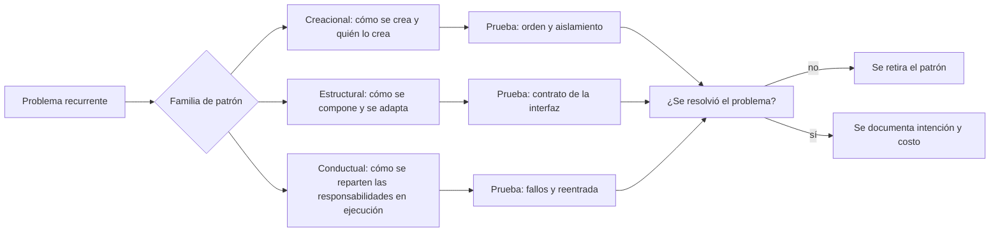
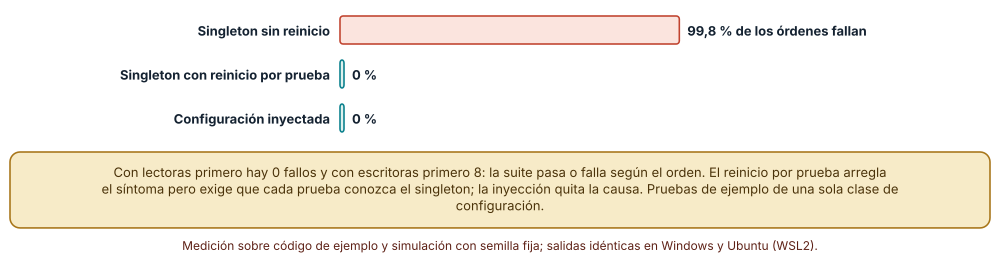
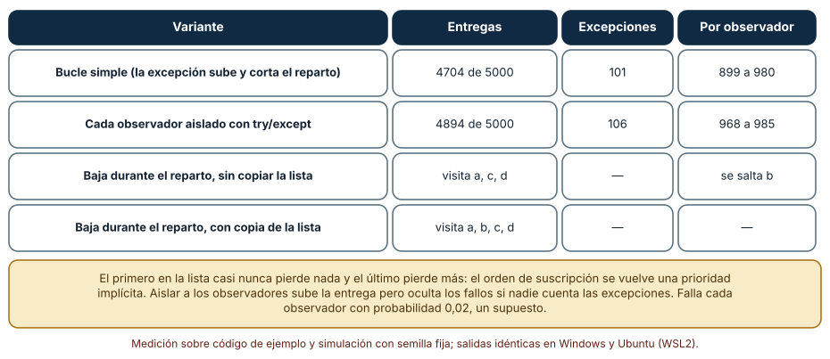
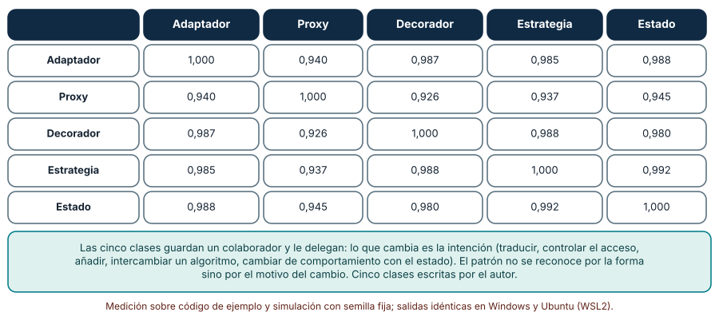

# SE-292 — Patrones creacionales, estructurales y conductuales

[← SE-291 — Composición, herencia y delegación](https://github.com/vladimiracunadev-create/modern-software-engineering-program/blob/main/classes/part-24-diseno-patrones-y-refactorizacion/se-291-composicion-herencia-y-delegacion/README.md) · [↑ Parte 24](https://github.com/vladimiracunadev-create/modern-software-engineering-program/blob/main/classes/part-24-diseno-patrones-y-refactorizacion/README.md) · [📚 Índice completo](https://github.com/vladimiracunadev-create/modern-software-engineering-program/blob/main/classes/README.md) · [🌐 Portal](https://vladimiracunadev-create.github.io/modern-software-engineering-program/classes/SE-292.html) · [SE-293 — Patrones funcionales, reactivos y concurrentes →](https://github.com/vladimiracunadev-create/modern-software-engineering-program/blob/main/classes/part-24-diseno-patrones-y-refactorizacion/se-293-patrones-funcionales-reactivos-y-concurrentes/README.md)

## Punto profesional y fundamento pedagógico

**Punto profesional.** La clase existe para que uses los patrones de diseño como vocabulario de problemas recurrentes y no como plantillas que se instalan: sabrás nombrar el problema que un patrón resuelve, el costo que trae y la prueba que lo vuelve visible, y reconocerás cuándo el patrón solo añade estructura.

**Por qué aparece aquí.** Sigue a **Composición, herencia y delegación** (`SE-291`): los patrones de la tradición de «Design Patterns» son combinaciones nombradas de esos tres mecanismos. Se aplican a `tarifas`: cómo se crea la configuración, cómo se adapta un proveedor externo y cómo se avisa a quien debe enterarse de un cambio.

**Error conceptual que debe corregir.** Creer que un patrón se reconoce por su estructura de clases: adaptador, proxy, decorador, estrategia y estado tienen casi el mismo código; los distingue la intención, es decir, el problema que resuelven y el cambio que esperan.

**Secuencia de aprendizaje.** Antes de mirar los resultados, predices qué fracción de órdenes aleatorios de pruebas falla si la configuración es un singleton, cuántas notificaciones se pierden si un observador falla y cuán parecido es, por su estructura sintáctica, un adaptador de un proxy. Después lo mides con pruebas y análisis del árbol sintáctico. La secuencia usa predicción, explicación propia, contraste y recuperación. [ICAP](https://icap.education.asu.edu/research) distingue participación de construcción de conocimiento; [How People Learn II](https://nap.nationalacademies.org/catalog/24783/how-people-learn-ii-learners-contexts-and-cultures) exige conectar conocimiento previo, contexto y transferencia; la [práctica de recuperación](https://pubmed.ncbi.nlm.nih.gov/16507066/) respalda producir de nuevo la explicación tras una demora; y [Education for Life and Work](https://nap.nationalacademies.org/resource/13398/dbasse_084153.pdf) exige devolución que explique la causa del error.

**Evidencia de aprendizaje.** `patterns-log.md` con la predicción, la tabla de órdenes de pruebas, la de observadores, la matriz de similitud estructural y una nota que diga qué patrón se usó en `tarifas`, qué problema resuelve y qué prueba lo hace visible.

**Límite de la conclusión.** Las clases, las pruebas y los observadores son construcciones del autor; la matriz de similitud usa cinco clases mínimas escritas por el autor. Ningún experimento mide qué patrones usan los proyectos reales ni cuántos defectos evitan.

### Trazabilidad fuente → afirmación

| Fuente primaria u oficial | Afirmación que respalda | Lo que no prueba |
|---|---|---|
| [Gamma, Helm, Johnson y Vlissides, «Design Patterns» (1994)](https://www.informit.com/store/design-patterns-elements-of-reusable-object-oriented-9780201633610) | Cataloga veintitrés patrones con su intención, estructura y consecuencias, y los clasifica en creacionales, estructurales y conductuales. | No demuestra que usar un patrón mejore un diseño concreto. |
| [Fowler, «Inversion of Control Containers and the Dependency Injection pattern»](https://martinfowler.com/articles/injection.html) | Compara pasar las dependencias por parámetro con buscarlas en un localizador global y explica el efecto sobre la prueba. | No dice qué contenedor o marco conviene. |
| [Luo, Hariri, Eloussi y Marinov, «An empirical analysis of flaky tests» (FSE, 2014)](https://doi.org/10.1145/2635868.2635920) | Analiza pruebas intermitentes de proyectos de código abierto y distingue categorías, entre ellas la dependencia del orden de ejecución. | No mide la frecuencia en `tarifas` ni en proyectos fuera de su muestra. |

## Antes de empezar

Recupera lo aprendido en `SE-291`: componer es depender solo de lo prometido. La pregunta activa es: **¿qué problema recurrente tengo en `tarifas`, cómo lo nombraría sin el nombre del patrón y qué prueba mostraría que lo resuelve?**

## Prerrequisitos

- Haber completado `SE-291` o poder explicar la diferencia entre herencia y delegación.
- Python 3.11 o posterior y un terminal; todo el código usa solo la biblioteca estándar.
- Conocer clases, funciones de primera clase y excepciones.

## Problema auténtico

La configuración de `tarifas` (recargo global, moneda, tolerancia) vive en un objeto al que se accede desde cualquier parte con `Config.get()`. Los doce módulos lo usan y la suite de pruebas pasa en el orden en que está escrita; el día que alguien la ejecuta en paralelo o reordena archivos, ocho pruebas fallan sin que haya cambiado el código. Por otro lado, el cálculo notifica a cinco servicios cuando cambia una tarifa, y una excepción en el tercer servicio deja sin aviso a los dos últimos. Y un proveedor externo de tarifas internacionales devuelve gramos y códigos de zona de texto, que tres módulos convierten cada uno a su manera. Son tres problemas con nombres de patrón (singleton, observador, adaptador) y el mismo riesgo: usar el nombre sin medir el problema.

## Objetivos observables

Al terminar podrás:

1. reproducir una suite dependiente del orden causada por un estado global y comparar tres remedios (sin reinicio, reinicio por prueba, inyección);
2. medir cuántas notificaciones se pierden con observadores que fallan y qué cambia al aislarlos, y reproducir el salto por baja durante el reparto;
3. calcular cuán parecidas son, por su estructura, implementaciones de patrones distintos y explicar por qué la intención las distingue;
4. describir un patrón por el problema, el cambio que espera y el costo, no por su diagrama;
5. declarar qué patrón se adopta o se rechaza en `tarifas` y qué evidencia haría revisar la decisión.

## Mapa conceptual



El mapa parte de un problema y termina en una decisión que se puede retirar. Un patrón sin problema que lo justifique es estructura, no diseño.

## Temas y por qué importan

| Tema | Por qué cambia una decisión profesional | Evidencia mínima |
|---|---|---|
| Patrones como vocabulario | Permite nombrar un problema y sus consecuencias en una frase. | Predicción, traza causal y contraejemplo de **Patrones como vocabulario** en `patterns-log.md` |
| Creacionales | Deciden quién crea, cuántas instancias hay y cómo se prueba. | Predicción, traza causal y contraejemplo de **Creacionales** en `patterns-log.md` |
| Estructurales | Adaptan, envuelven o simplifican sin cambiar al colaborador. | Predicción, traza causal y contraejemplo de **Estructurales** en `patterns-log.md` |
| Conductuales | Reparten responsabilidades que ocurren en ejecución. | Predicción, traza causal y contraejemplo de **Conductuales** en `patterns-log.md` |
| Intención frente a estructura | El código no basta para saber qué patrón es ni si hace falta. | Predicción, traza causal y contraejemplo de **Intención frente a estructura** en `patterns-log.md` |

## Conceptos y decisiones

### 1. Patrones como vocabulario

Un patrón de diseño nombra una solución recurrente a un problema recurrente, con sus consecuencias. Su valor principal es de comunicación: decir «aquí hay un observador» permite discutir el orden de las notificaciones y los fallos sin describir las clases. Su riesgo es la aplicación por catálogo: buscar un patrón para cada cosa y terminar con capas sin problema. La unidad de análisis es el problema: el patrón es una de las respuestas posibles.

### 2. Patrones creacionales

Responden a quién crea los objetos y cuántos hay. La fábrica oculta qué clase concreta se crea; el constructor por pasos (builder) ordena la creación de objetos con muchas opciones; el singleton garantiza una sola instancia y un punto de acceso global. El singleton es el más usado y el que más cuesta: el estado global acopla a todos los módulos y vuelve las pruebas dependientes del orden. La alternativa suele ser crear la instancia una vez y pasarla a quien la necesita (inyección).

### 3. Patrones estructurales

Responden a cómo se componen las partes. El **adaptador** traduce la interfaz de un proveedor a la que espera el sistema; el **decorador** añade comportamiento a un objeto con su misma interfaz; el **proxy** controla el acceso (caché, permisos, carga diferida); la **fachada** ofrece una interfaz simple a un subsistema. Los cuatro envuelven a un colaborador y le delegan, y por eso su código se parece tanto: lo que cambia es la intención.

### 4. Patrones conductuales

Responden a cómo cooperan los objetos en ejecución. El **observador** avisa a quien se suscribió cuando algo cambia; la **estrategia** intercambia un algoritmo; el **estado** cambia el comportamiento según un estado interno; el **comando** convierte una petición en un objeto. Su riesgo es de ejecución, no de estructura: en qué orden se avisa, qué pasa si un observador falla o se da de baja durante el reparto, quién es dueño del estado.

### 5. Intención frente a estructura

Dos implementaciones con el mismo código pueden ser patrones distintos, y un patrón puede tener varios códigos. Por eso un detector que mire solo la forma de las clases no puede decir qué patrón hay. La intención se documenta con el problema que se resolvió y el cambio que se espera, y se comprueba con una prueba que falle si el patrón se rompe (el orden de pruebas, el aislamiento del observador, el contrato del adaptador).

### Un singleton y el orden de las pruebas

La configuración es una clase con una instancia global (`Config.get()`) con un campo `recargo`. Doce pruebas: ocho leen el valor por defecto y esperan 100 al calcular un precio base de 100, cuatro lo cambian a 0,1. Se ejecutan 5000 órdenes aleatorios de semilla fija con tres variantes: el singleton sin reinicio, el singleton reiniciado antes de cada prueba y una configuración pasada como parámetro.

```python
def t_lee_default_g(): assert precio_global(100) == 100
def t_sube_recargo_g():
    Config.get().recargo = 0.1                 # cambia el estado global
    assert abs(precio_global(100) - 110) < 1e-9
```

| Variante | Órdenes con algún fallo | Fallos totales |
|---|---:|---:|
| Singleton sin reinicio | 4990 de 5000 (99,8 %) | 31 924 |
| Singleton con reinicio por prueba | 0 | 0 |
| Configuración inyectada | 0 | 0 |

Con las pruebas en el orden en que están escritas (lectoras primero) no hay fallos; con las escritoras primero hay 8. La suite pasa o falla según el orden.



**Cómo leer la figura.** Cada barra es la fracción de 5000 órdenes con al menos un fallo. **Dónde deja de valer:** el reinicio arregla el síntoma pero obliga a cada prueba a conocer el singleton, y un olvido lo trae de vuelta; la inyección elimina la causa, a cambio de pasar el parámetro por varias capas. El experimento tiene una sola clase de configuración y un solo campo; en un sistema con varios singletons que dependen entre sí, el reinicio es más difícil. Muestra la mecánica, no la frecuencia.

### Observadores que fallan y que se dan de baja

Un publicador avisa a cinco observadores en 1000 eventos; cada observador falla con probabilidad 0,02 (un supuesto). Se comparan un bucle simple, en que la excepción sube y corta el reparto, y un bucle que aísla a cada observador con `try/except`. Aparte, se da de baja un observador mientras se recorre la lista de suscriptores.

```python
for o in obs:
    try:
        o(ev)
    except RuntimeError:
        excepciones += 1
        break                       # el bucle simple: se corta el reparto
```

| Variante | Entregas de 5000 | Excepciones | Por observador |
|---|---:|---:|---|
| Bucle simple | 4704 | 101 | 899 a 980 |
| Cada observador aislado | 4894 | 106 | 968 a 985 |
| Baja durante el reparto, sin copiar la lista | visita a, c, d | — | se salta b |
| Baja durante el reparto, con copia | visita a, b, c, d | — | — |

El primer observador casi nunca pierde nada y el último pierde más: el orden de suscripción se convierte en una prioridad que nadie decidió.



**Cómo leer la figura.** Las dos primeras filas comparan la entrega; las dos últimas, el efecto de modificar la lista mientras se recorre. **Dónde deja de valer:** aislar a los observadores sube la entrega, pero esconde los fallos si nadie cuenta las excepciones; y la probabilidad de fallo es un supuesto. El experimento no incluye observadores lentos ni que publiquen nuevos eventos al ser avisados (reentrada), que son otras causas de errores en este patrón.

### Cinco patrones, casi el mismo código

Se escriben cinco clases mínimas (adaptador, proxy, decorador, estrategia y estado) y se extrae la huella de cada una: cuántos nodos de cada tipo tiene su árbol sintáctico. Se calcula la similitud coseno entre las huellas de cada par.

```python
def huella(src):
    return Counter(type(n).__name__ for n in ast.walk(ast.parse(src)))
```

| | Adaptador | Proxy | Decorador | Estrategia | Estado |
|---|---:|---:|---:|---:|---:|
| Adaptador | 1,000 | 0,940 | 0,987 | 0,985 | 0,988 |
| Proxy | 0,940 | 1,000 | 0,926 | 0,937 | 0,945 |
| Decorador | 0,987 | 0,926 | 1,000 | 0,988 | 0,980 |
| Estrategia | 0,985 | 0,937 | 0,988 | 1,000 | 0,992 |
| Estado | 0,988 | 0,945 | 0,980 | 0,992 | 1,000 |



**Cómo leer la figura.** Cada celda es la similitud de las huellas de dos patrones; 1,000 es idéntica. **Dónde deja de valer:** son cinco clases mínimas del autor y la medida es tosca (cuenta tipos de nodo, no el flujo de llamadas); implementaciones reales con caché, hilos o configuración se distinguirían más. Aun así, el resultado muestra la tesis: la forma casi no separa los patrones; los separa la razón por la que se escribieron.

## Definiciones de trabajo

- **patrón de diseño:** solución nombrada a un problema recurrente de diseño, con su intención y sus consecuencias.
- **singleton:** patrón que garantiza una única instancia con acceso global, con el costo del estado compartido.
- **adaptador:** patrón que traduce la interfaz de un colaborador a la que espera el cliente.
- **observador:** patrón en que un objeto avisa a quienes se suscribieron cuando su estado cambia.
- **inyección de dependencias:** práctica de pasar a un objeto sus colaboradores en vez de que los busque.

Las definiciones son operativas para `tarifas`. No convierten términos con una historia más amplia en sinónimos y deben contrastarse con la bibliografía enlazada al final.

## Ejemplo mínimo

El fragmento muestra que una modificación de la lista durante el recorrido salta un elemento. Antes de ejecutarlo, predice qué elementos se visitan.

```python
lista = ["a", "b", "c", "d"]
visitados = []
for x in lista:
    visitados.append(x)
    if x == "a":
        lista.remove("a")
assert visitados == ["a", "c", "d"]
```

Al quitar `a`, el iterador avanza una posición sobre una lista que se movió y se salta `b`. Registra versión, comando y salida; recorre `list(lista)` y predice el resultado.

## Ejemplo profesional

El equipo trata los tres problemas por separado. Para la configuración, deja de usar `Config.get()` y construye un objeto `Configuracion` una vez en el arranque que pasa a los módulos que lo necesitan; la suite pasa en cualquier orden y lo comprueba con una ejecución en orden aleatorio con semilla registrada. Para las notificaciones, mantiene el observador, copia la lista antes de recorrerla, aísla cada observador y registra cada excepción en un contador que sube una alarma. Para el proveedor internacional, escribe un adaptador con una prueba de contrato: gramos a kilos, códigos de texto a enteros, y un error explícito para una zona desconocida. En el registro de decisiones anota, para cada patrón, el problema, el cambio esperado y el costo.

Compara con el estado anterior: la decisión es adecuada si la suite pasa en cualquier orden, ningún aviso se pierde en silencio y la conversión de unidades vive en un solo lugar; es frágil si, para cada nueva unidad, el adaptador crece con condicionales o si el contador de excepciones nadie lo mira.

## Práctica guiada

1. Escribe la suite de doce pruebas con el singleton y predice qué fracción de órdenes falla.
2. Ejecuta 5000 órdenes con semilla fija y compara con el reinicio por prueba y con la inyección.
3. Implementa el publicador con cinco observadores que fallan con probabilidad 0,02 y cuenta las entregas con y sin aislamiento.
4. Reproduce la baja durante el reparto y corrígela con una copia de la lista.
5. Escribe las cinco clases mínimas de adaptador, proxy, decorador, estrategia y estado y calcula la matriz de similitud.
6. Escribe el adaptador del proveedor internacional con su prueba de contrato.
7. Entrega `patterns-log.md` y pide a otra persona que diga, sin ver el código, cuál es el problema que resuelve cada patrón.

## Ejercicios

1. **Creacional:** reescribe una fábrica que devuelve una clase según un texto y una que recibe la clase como parámetro y compara cuál es más fácil de probar.
2. **Observador:** añade un observador lento y mide cómo cambia la latencia del último observador con un reparto sincrónico.
3. **Estructural:** escribe un proxy con caché de tarifas y una prueba que muestre cuándo devuelve un valor obsoleto.
4. **Intención:** escribe en dos frases el problema que resuelve cada una de tus cinco clases mínimas sin usar el nombre del patrón.

## Reto verificable

Entrega `patterns-log.md` con la predicción, la tabla de órdenes de pruebas, la de observadores, la matriz de similitud y la decisión por patrón de `tarifas` con su problema, su cambio esperado y su costo. Se aprueba si otra persona ejecuta el código desde un checkout limpio, obtiene los mismos números y puede decir qué prueba falla si se vuelve al singleton. No se aprueba por listar los nombres de los patrones ni por afirmar que el diseño «usa patrones».

## Caso conductor

El componente `tarifas` conserva el registro de reglas, el contrato de `SE-290` y los recargos de `SE-291`, y gana una configuración inyectada, un publicador de cambios de tarifa con observadores aislados y un adaptador del proveedor internacional. `SE-293` examinará los patrones funcionales, reactivos y concurrentes, que cambian dónde vive el estado. Cambia después una sola decisión, el orden de suscripción, y observa qué aviso se retrasa.

## Preguntas frecuentes

### ¿Un singleton siempre es malo?

No: una sola instancia es a veces el requisito (un pool de conexiones, un contador global). El problema es el acceso global que acopla a todos los módulos y vuelve las pruebas dependientes del orden. Crear una vez y pasar la instancia da lo bueno sin lo malo.

### ¿Cómo distingo un adaptador de un proxy si el código es igual?

Por la intención: el adaptador cambia la interfaz que se ofrece (gramos a kilos); el proxy conserva la interfaz y controla el acceso (caché, permisos). La prueba que escribes también es distinta: la del adaptador verifica la traducción, la del proxy verifica cuándo no llama al colaborador.

### ¿Aislar a los observadores no esconde los errores?

Puede hacerlo si nadie mira las excepciones. Aislar es la mitad; la otra mitad es contarlas y alarmar cuando se repiten.

### ¿Cuántos patrones debo conocer?

Los que resuelven problemas que tienes. El catálogo es un vocabulario para pedir ayuda a otras personas; conocerlo entero no es el objetivo.

## Fallo controlado y diagnóstico

Reproduce el fallo clásico de la clase: **una suite que pasa en el orden en que se escribió y falla al reordenarla**. Ejecuta las doce pruebas del singleton con las cuatro escritoras primero.

Registra síntoma, entrada mínima, hipótesis, observación que descarta cada hipótesis, causa, corrección y prueba de regresión. **Síntoma:** ocho pruebas que leen el recargo por defecto fallan al ejecutar la suite en orden aleatorio, y pasan una por una. **Hipótesis rivales:** (a) la prueba tiene un error de cálculo; (b) hay una condición de carrera; (c) una prueba anterior dejó el estado global modificado. **Prueba:** ejecuta cada prueba que falla sola y luego después de una escritora; si pasa sola y falla tras la escritora, la causa es (c). **Conclusión:** el singleton arrastra el estado entre pruebas. **Regresión:** pasa la configuración como parámetro, añade una ejecución en orden aleatorio con semilla registrada y no cambies a la vez la configuración y las pruebas.

## Errores comunes y cómo corregirlos

| Síntoma | Causa probable | Corrección |
|---|---|---|
| La suite pasa en un orden y falla en otro | Estado global compartido (singleton) | Inyectar la dependencia y ejecutar en orden aleatorio con semilla |
| Un servicio no recibe avisos cuando otro falla | Observadores en un bucle que se corta con la primera excepción | Aislar cada observador y contar las excepciones |
| Un observador se salta al darse de baja durante el reparto | Modificación de la lista que se recorre | Recorrer una copia |
| Tres módulos convierten gramos a kilos cada uno a su manera | Falta un adaptador en la frontera con el proveedor | Un adaptador con prueba de contrato |
| Se discute qué patrón es en vez de qué problema resuelve | Se mira la forma, no la intención | Escribir problema, cambio esperado y costo |

## Entorno y archivos clave

```text
work/SE-292/
├── README.md
├── config/
│   ├── singleton.py
│   └── inyectada.py
├── avisos/
│   ├── publicador.py
│   └── test_observadores.py
├── proveedor/
│   └── adaptador.py
├── patrones/
│   └── similitud.py
└── evidence/patterns-log.md
```

El `README` declara plataforma, versión de Python, semillas y comandos. Los experimentos usan solo la biblioteca estándar (`ast`, `random`, `collections`, `math`) y se ejecutaron con CPython 3.12.9 en Windows 11 y 3.12.3 en Ubuntu bajo WSL2: las salidas fueron idénticas. Si añades una dependencia, fija procedencia y versión.

## Seguridad, ética y accesibilidad

- una notificación perdida de un cambio de tarifa puede cobrar un monto equivocado: la pérdida silenciosa de avisos es un riesgo para las personas, no solo un defecto técnico;
- un proxy con caché de tarifas puede mostrar precios vencidos: define el tiempo de vida y la invalidación;
- un adaptador que descarta datos desconocidos del proveedor puede esconder un cambio de condiciones: haz que una zona desconocida sea un error explícito;
- no uses datos reales de clientes en las pruebas ni en la bitácora de excepciones;
- respeta las licencias de los catálogos de patrones y atribuye lo adaptado.

## Puente hacia el trabajo con agentes

Un agente al que se le pide «aplica patrones de diseño a tarifas» añadirá una fábrica, un singleton y un observador donde no hacía falta y los nombrará en los comentarios. Pídele en cambio que describa el problema de cada patrón, el cambio que espera, el costo y la prueba que falla si el patrón se rompe, y que ejecute la suite en orden aleatorio con semilla. Revisa especialmente si introdujo un `get_instance()` global, si el bucle de notificación corta con la primera excepción o si el adaptador deja pasar un campo desconocido sin error.

## Transferencia

Traslada el análisis a otro componente (por ejemplo, el de reembolsos): cambia el proveedor, los observadores y la configuración, y conserva el procedimiento de ejecutar en orden aleatorio, contar las entregas y escribir el contrato del adaptador. La transferencia está lograda cuando puedes explicar qué problema resuelve cada patrón que elegiste y cuál rechazaste, no cuando el diagrama se parece.

## Evaluación y evidencia

| Criterio | Evidencia para aprobar |
|---|---|
| comprensión | explicación del problema que resuelve cada patrón con ejemplos de `tarifas` |
| corrección | órdenes de pruebas, entregas de avisos y similitud reproducibles con las mismas semillas |
| diseño | configuración inyectada, observadores aislados y adaptador con prueba de contrato |
| diagnóstico | reproducción del fallo «suite que depende del orden» con regresión |
| incertidumbre | declaración de que las clases y las probabilidades son supuestos del autor |
| reproducibilidad | versiones, comandos, salida y límites declarados |

## Fuentes

- [Gamma, Helm, Johnson y Vlissides, «Design Patterns» (1994)](https://www.informit.com/store/design-patterns-elements-of-reusable-object-oriented-9780201633610) — catálogo de patrones; autoridad: los autores (Addison-Wesley).
- [Fowler, «Inversion of Control Containers and the Dependency Injection pattern»](https://martinfowler.com/articles/injection.html) — inyección de dependencias frente a localizador; autoridad: Martin Fowler.
- [Luo et al., «An empirical analysis of flaky tests» (FSE, 2014)](https://doi.org/10.1145/2635868.2635920) — pruebas intermitentes y dependencia del orden; autoridad: ACM SIGSOFT FSE.
- [Python: sentencia `for`](https://docs.python.org/3/reference/compound_stmts.html) — advertencia sobre modificar la secuencia que se recorre; autoridad: documentación de Python.
- [Python: `ast`](https://docs.python.org/3/library/ast.html) — análisis sintáctico usado para la huella de cada patrón; autoridad: documentación de Python.
- [Python: `unittest`](https://docs.python.org/3/library/unittest.html) — pruebas y aislamiento entre casos; autoridad: documentación de Python.

Cada fuente respalda el mecanismo indicado; ninguna demuestra que el 99,8 % de órdenes fallidos, las 4704 entregas o la similitud de 0,926 a 0,992 se observen en `tarifas`. Esa afirmación depende de su configuración, sus observadores y sus pruebas.

## Límites y siguiente paso

Se ejecutaron tres análisis con código de ejemplo y datos sintéticos en Windows y Ubuntu (WSL2) con resultados idénticos. No se midió el uso de patrones en proyectos reales ni su efecto sobre los defectos; las clases, las probabilidades de fallo y las cinco implementaciones mínimas son construcciones del autor. La siguiente clase examina los patrones funcionales, reactivos y concurrentes, que cambian dónde vive el estado.

## Glosario

- **patrón de diseño:** solución nombrada a un problema recurrente de diseño, con su intención y sus consecuencias.
- **singleton:** patrón que garantiza una única instancia con acceso global, con el costo del estado compartido.
- **adaptador:** patrón que traduce la interfaz de un colaborador a la que espera el cliente.
- **observador:** patrón en que un objeto avisa a quienes se suscribieron cuando su estado cambia.
- **inyección de dependencias:** práctica de pasar a un objeto sus colaboradores en vez de que los busque.

---

[← SE-291 — Composición, herencia y delegación](https://github.com/vladimiracunadev-create/modern-software-engineering-program/blob/main/classes/part-24-diseno-patrones-y-refactorizacion/se-291-composicion-herencia-y-delegacion/README.md) · [↑ Parte 24](https://github.com/vladimiracunadev-create/modern-software-engineering-program/blob/main/classes/part-24-diseno-patrones-y-refactorizacion/README.md) · [📚 Índice completo](https://github.com/vladimiracunadev-create/modern-software-engineering-program/blob/main/classes/README.md) · [🌐 Portal](https://vladimiracunadev-create.github.io/modern-software-engineering-program/classes/SE-292.html) · [SE-293 — Patrones funcionales, reactivos y concurrentes →](https://github.com/vladimiracunadev-create/modern-software-engineering-program/blob/main/classes/part-24-diseno-patrones-y-refactorizacion/se-293-patrones-funcionales-reactivos-y-concurrentes/README.md)
