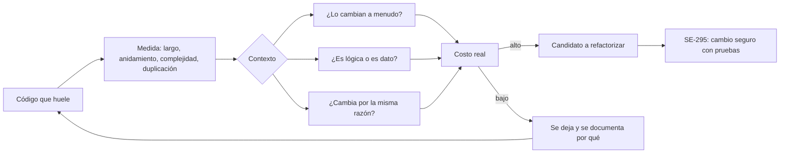
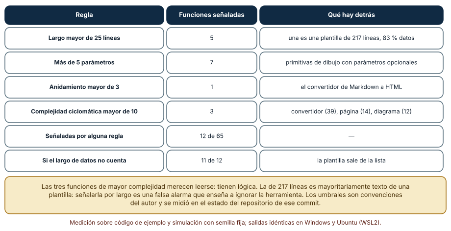
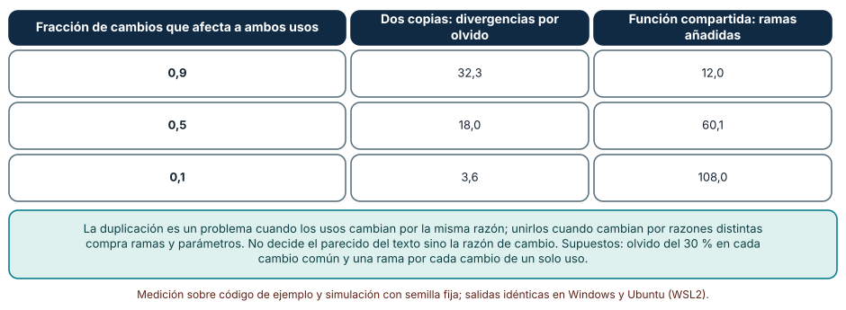
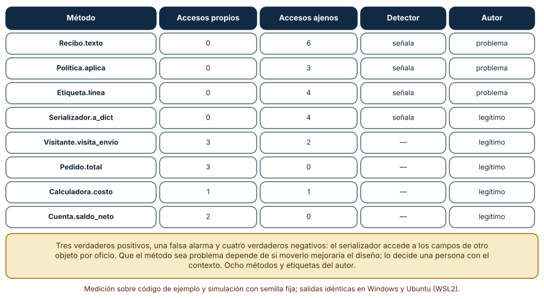

# SE-294 — Code smells y diagnóstico contextual

[← SE-293 — Patrones funcionales, reactivos y concurrentes](https://github.com/vladimiracunadev-create/modern-software-engineering-program/blob/main/classes/part-24-diseno-patrones-y-refactorizacion/se-293-patrones-funcionales-reactivos-y-concurrentes/README.md) · [↑ Parte 24](https://github.com/vladimiracunadev-create/modern-software-engineering-program/blob/main/classes/part-24-diseno-patrones-y-refactorizacion/README.md) · [📚 Índice completo](https://github.com/vladimiracunadev-create/modern-software-engineering-program/blob/main/classes/README.md) · [🌐 Portal](https://vladimiracunadev-create.github.io/modern-software-engineering-program/classes/SE-294.html) · [SE-295 — Refactorización segura apoyada por pruebas →](https://github.com/vladimiracunadev-create/modern-software-engineering-program/blob/main/classes/part-24-diseno-patrones-y-refactorizacion/se-295-refactorizacion-segura-apoyada-por-pruebas/README.md)

## Punto profesional y fundamento pedagógico

**Punto profesional.** La clase existe para que trates un olor de código como una sospecha que se confirma o se descarta con contexto, y no como un defecto que un umbral declara: sabrás qué señala cada medida, qué falsas alarmas produce y qué pregunta hacer antes de refactorizar.

**Por qué aparece aquí.** Sigue a **Patrones funcionales, reactivos y concurrentes** (`SE-293`): hasta ahora se eligieron mecanismos antes de que el código existiera; aquí se parte de código que ya existe y que «huele». Los olores son el puente entre el diseño y la refactorización de `SE-295`.

**Error conceptual que debe corregir.** Creer que un olor es lo mismo que un defecto y que el umbral de una herramienta decide si el código es malo: un olor es un síntoma que a veces señala un problema y a veces un código que debe ser así, y solo el contexto (quién lo cambia, cuánto cambia, qué lo rodea) lo distingue.

**Secuencia de aprendizaje.** Antes de mirar los resultados, predices cuántas funciones de un repositorio real señalan cuatro reglas de olores y cuántas de ellas son falsas alarmas, qué es más caro entre mantener dos copias parecidas y unirlas en una función con parámetros, y cuántos de ocho métodos con «envidia» son realmente un problema. Después lo mides con `ast` sobre código fijado por commit y con una simulación. La secuencia usa predicción, explicación propia, contraste y recuperación. [ICAP](https://icap.education.asu.edu/research) distingue participación de construcción de conocimiento; [How People Learn II](https://nap.nationalacademies.org/catalog/24783/how-people-learn-ii-learners-contexts-and-cultures) exige conectar conocimiento previo, contexto y transferencia; la [práctica de recuperación](https://pubmed.ncbi.nlm.nih.gov/16507066/) respalda producir de nuevo la explicación tras una demora; y [Education for Life and Work](https://nap.nationalacademies.org/resource/13398/dbasse_084153.pdf) exige devolución que explique la causa del error.

**Evidencia de aprendizaje.** `smells-log.md` con la predicción, la tabla de umbrales con las funciones señaladas y su clasificación, la de duplicación frente a parámetros, la de envidia de características y una nota que diga qué olor de `tarifas` se descartó y con qué contexto.

**Límite de la conclusión.** El primer análisis usa 65 funciones de cuatro archivos de scripts de este mismo repositorio en un commit fijo; no son código de `tarifas` ni una muestra de la industria. La duplicación se simula con parámetros supuestos y las ocho etiquetas «problema/legítimo» son un criterio del autor.

### Trazabilidad fuente → afirmación

| Fuente primaria u oficial | Afirmación que respalda | Lo que no prueba |
|---|---|---|
| [Fowler, «CodeSmell» (bliki)](https://martinfowler.com/bliki/CodeSmell.html) | Define un olor como una indicación superficial que suele corresponder a un problema más profundo, pero no siempre. | No da umbrales ni dice qué olores son más costosos. |
| [Sjøberg, Yamashita, Anda, Mockus y Dybå, «Quantifying the Effect of Code Smells on Maintenance Effort» (IEEE TSE, 2013)](https://doi.org/10.1109/TSE.2012.89) | Estudia empíricamente la relación entre olores de código y esfuerzo de mantenimiento con tareas reales de mantenimiento. | No prueba que un olor concreto cueste lo mismo en otro proyecto, equipo o lenguaje. |
| [Python: `ast`](https://docs.python.org/3/library/ast.html) | Documenta el árbol sintáctico con el que se calculan largo, anidamiento y complejidad. | No define umbrales: son convenciones. |

## Antes de empezar

Recupera lo aprendido en `SE-293`: antes de elegir un mecanismo hay que saber qué problema se resuelve. La pregunta activa es: **¿qué evidencia, además del número, me diría que este olor es un problema aquí?**

## Prerrequisitos

- Haber completado `SE-293` o poder explicar qué es una función pura.
- Python 3.11 o posterior, `git` y un terminal; el análisis usa solo la biblioteca estándar.
- Haber visto métricas de código (longitud, complejidad ciclomática) en `SE-289` y `SE-290`.

## Problema auténtico

El equipo de la plataforma de entregas activa una herramienta de calidad que reporta doce «funciones problemáticas» y dos «bloques duplicados» en el módulo de scripts de documentación, y la jefatura pide que el número baje a cero antes del trimestre. Al revisar, una función larga es una plantilla de texto de 217 líneas que casi nunca cambia; otra función de 107 líneas con complejidad 39 es un convertidor que sí tiene lógica y lo tocan cada mes. Dos bloques duplicados cambian por razones distintas y unirlos añadiría parámetros. Y un método «envidioso» de un serializador accede a los campos de otro objeto porque su trabajo es leerlos. Arreglar el número sin mirar el contexto habría mejorado el tablero y empeorado el código.

## Objetivos observables

Al terminar podrás:

1. medir largo, parámetros, anidamiento y complejidad con `ast` y clasificar cada función señalada como lógica o como datos;
2. explicar por qué un umbral produce falsas alarmas y qué contexto adicional las separa;
3. comparar el costo de mantener dos copias parecidas con el de unirlas, según la fracción de cambios que las afecta a ambas;
4. evaluar un detector de envidia de características contra el criterio de una persona, con verdaderos y falsos positivos;
5. declarar qué olores de `tarifas` se tratan, cuáles se descartan y con qué evidencia.

## Mapa conceptual



El mapa muestra que la medida solo abre la pregunta: la decisión sale de tres preguntas de contexto. La rama de la derecha es legítima: dejar un olor tras mirar el contexto es una decisión, no una omisión.

## Temas y por qué importan

| Tema | Por qué cambia una decisión profesional | Evidencia mínima |
|---|---|---|
| Olor frente a defecto | Un olor es una sospecha; confundirlo con un defecto genera trabajo sin retorno. | Predicción, traza causal y contraejemplo de **Olor frente a defecto** en `smells-log.md` |
| Medidas y umbrales | Los umbrales son convenciones con falsas alarmas conocidas. | Predicción, traza causal y contraejemplo de **Medidas y umbrales** en `smells-log.md` |
| Duplicación | Depende de si los usos cambian por la misma razón. | Predicción, traza causal y contraejemplo de **Duplicación** en `smells-log.md` |
| Envidia de características y acoplamiento | Señala responsabilidades mal ubicadas, con excepciones legítimas. | Predicción, traza causal y contraejemplo de **Envidia de características y acoplamiento** en `smells-log.md` |
| Diagnóstico contextual | La decisión necesita la historia de cambios, no solo el código. | Predicción, traza causal y contraejemplo de **Diagnóstico contextual** en `smells-log.md` |

## Conceptos y decisiones

### 1. Olor frente a defecto

Un olor de código es una característica de la estructura que sugiere un problema más profundo sin demostrarlo. Una función larga, una lista larga de parámetros, anidamiento profundo, código repetido o una clase que accede más a datos ajenos que a los propios son olores clásicos. No fallan en una prueba: encarecen el cambio. Por eso se diagnostican con preguntas (¿cambia a menudo? ¿se entiende? ¿quién lo toca?), no con un aprobado o suspendido.

### 2. Medidas y umbrales

Las herramientas convierten olores en números: líneas, parámetros, profundidad de anidamiento, complejidad ciclomática. Un umbral (más de 25 líneas, más de 5 parámetros) es una convención que reduce el espacio de búsqueda y arrastra falsas alarmas. Cada medida confunde cosas distintas: el largo mezcla lógica con datos; la cantidad de parámetros mezcla un objeto de transferencia con una función mal definida. La medida orienta la lectura; no la sustituye.

### 3. Duplicación

El código repetido es un problema si las copias deben cambiar juntas y una se olvida. Pero dos fragmentos parecidos que cambian por razones distintas no están duplicados en el sentido que importa: unirlos obliga a parametrizar las diferencias y la función compartida acumula ramas. La pregunta no es «¿se parecen?», sino «¿cambian por la misma razón?». La duplicación accidental se une; la coincidencia, no.

### 4. Envidia de características y acoplamiento

Un método tiene envidia de características cuando usa más datos de otro objeto que los de su propia clase: probablemente pertenece al otro objeto. El indicador es sencillo de medir y tiene excepciones por oficio: serializadores, formateadores, visitantes y adaptadores existen para leer los campos de otros. La excepción no invalida el indicador; obliga a mirar el papel del método. Mover un método sin ese examen empeora la ubicación de las responsabilidades.

### 5. Diagnóstico contextual

El diagnóstico combina cuatro fuentes: la medida (qué señala), la historia (cuánto y por qué cambia), el papel (qué hace en el sistema) y la intención del equipo (qué se quiere poder cambiar). Un olor en una función que no se toca desde hace dos años tiene un costo de interés casi nulo (se trata en `SE-298`); el mismo olor en el módulo que se cambia cada semana es la prioridad. La decisión de no tocar un olor se registra con su razón para que no se vuelva a discutir.

### Doce señales sobre código de un repositorio

Se leen con `git show` los archivos `figures_part22_a.py`, `figures_part22_b.py`, `figure_kit.py` y `build_phase3.py` del commit `4dafaa63`. Con `ast` se mide cada una de las 65 funciones: líneas, parámetros (contando `self`), anidamiento, complejidad ciclomática y la fracción de sus líneas ocupada por literales de datos (listas, tuplas, diccionarios, cadenas largas). Los umbrales son convenciones: más de 25 líneas, más de 5 parámetros, anidamiento mayor de 3 y complejidad mayor de 10.

```python
def datos(fn, lineas):
    cubiertas = set()
    for n in ast.walk(fn):
        if isinstance(n, (ast.List, ast.Tuple, ast.Dict, ast.Set)) or (isinstance(n, ast.Constant) and isinstance(n.value, str) and len(n.value) > 60):
            cubiertas |= set(range(n.lineno, n.end_lineno + 1))
    return len(cubiertas) / max(1, len(lineas))
```

| Regla | Funciones señaladas | Qué hay detrás |
|---|---:|---|
| Largo mayor de 25 líneas | 5 | una plantilla de 217 líneas con 83 % de datos |
| Más de 5 parámetros | 7 | primitivas de dibujo con parámetros opcionales |
| Anidamiento mayor de 3 | 1 | el convertidor de Markdown a HTML |
| Complejidad mayor de 10 | 3 | convertidor (39), página (14), diagrama (12) |
| Alguna de las cuatro | 12 de 65 | — |
| Si el largo de datos no cuenta | 11 de 12 | la plantilla sale de la lista |

Resultado, idéntico en Windows (CPython 3.12.9) y en Ubuntu bajo WSL2 (3.12.3). La función de mayor complejidad (39 ramas, 107 líneas) tiene solo un 11 % de datos: es lógica. La de 217 líneas es una plantilla.



**Cómo leer la figura.** Cada fila es una regla y cuántas funciones señala; la columna final dice qué hay detrás. **Dónde deja de valer:** la lectura de «qué hay detrás» la hizo el autor mirando las funciones, y son cuatro archivos de scripts de documentación, no código de producción de `tarifas`. Los umbrales son convenciones: con 40 líneas, la lista cambia. Y excluir los datos del largo corrige una falsa alarma; no dice nada de si la plantilla debería partirse por otra razón.

### Dos copias o una función con parámetros

Dos usos parecidos se mantienen durante 120 cambios. En cada cambio, con probabilidad *q*, el cambio afecta a ambos usos; en el resto afecta a uno solo. Con dos copias, un cambio común se olvida en una de ellas con probabilidad 0,3. Con una función compartida, cada cambio de un solo uso añade una rama o un parámetro. Se repite 4000 veces con semilla fija.

```python
if rng.random() < q:
    if rng.random() < 0.3: bugs += 1      # un cambio comun se aplica a una copia y se olvida en la otra
else:
    ramas += 1                            # cambio de un solo uso: la funcion compartida gana una rama
```

| Fracción de cambios que afecta a ambos usos | Dos copias: divergencias por olvido | Función compartida: ramas añadidas |
|---:|---:|---:|
| 0,9 | 32,3 | 12,0 |
| 0,5 | 18,0 | 60,1 |
| 0,1 | 3,6 | 108,0 |



**Cómo leer la figura.** Cada fila fija cuánto de la historia de cambios es común a los dos usos; las columnas muestran el costo de cada diseño. **Dónde deja de valer:** el 30 % de olvido y el coste de «una rama por cambio» son supuestos; una función compartida bien diseñada puede absorber diferencias sin ramas (con una estrategia, por ejemplo), y dos copias con una prueba común olvidan menos. El modelo no ofrece un umbral: enseña que la decisión depende de un dato que se obtiene de la historia del repositorio, la fracción *q*.

### Envidia de características: detector frente a criterio

Ocho métodos con tres o más accesos a otro objeto o con muy pocos. El detector cuenta los accesos a atributos de `self` y los accesos a atributos del parámetro más usado y señala el método si los ajenos son al menos tres y más que los propios. El autor, mirando cada método, anota si mover el método al objeto envidiado mejoraría el diseño.

```python
ajenas = max((v for k, v in cuenta.items() if k in params and k != "self"), default=0)
return ajenas >= 3 and ajenas > propias, propias, ajenas
```

| Método | Accesos propios | Accesos ajenos | Detector | Autor |
|---|---:|---:|---|---|
| `Recibo.texto` | 0 | 6 | señala | problema |
| `Politica.aplica` | 0 | 3 | señala | problema |
| `Etiqueta.linea` | 0 | 4 | señala | problema |
| `Serializador.a_dict` | 0 | 4 | señala | legítimo |
| `Visitante.visita_envio` | 3 | 2 | — | legítimo |
| `Pedido.total` | 3 | 0 | — | legítimo |
| `Calculadora.costo` | 1 | 1 | — | legítimo |
| `Cuenta.saldo_neto` | 2 | 0 | — | legítimo |

Tres verdaderos positivos, una falsa alarma (el serializador), ningún falso negativo y cuatro verdaderos negativos.



**Cómo leer la figura.** Cada fila es un método; las dos últimas columnas comparan la máquina con la persona. **Dónde deja de valer:** son ocho métodos escritos por el autor y las etiquetas son su criterio; con ocho casos, un solo fallo cambia la exactitud en 12 puntos. El detector solo cuenta accesos: no ve si el método es un serializador por oficio. La figura enseña la forma del error (una falsa alarma sistemática en una familia de métodos), no la exactitud de ningún detector.

## Definiciones de trabajo

- **olor de código:** característica de la estructura que sugiere un problema más profundo, sin demostrarlo.
- **falsa alarma:** código señalado por una regla que, mirado en su contexto, no es un problema.
- **complejidad ciclomática:** número de caminos independientes que atraviesan una función.
- **duplicación accidental:** código repetido que cambia por la misma razón y debería cambiarse junto.
- **envidia de características:** método que usa más datos de otro objeto que de su propia clase.

Las definiciones son operativas para `tarifas`. No convierten términos con una historia más amplia en sinónimos y deben contrastarse con la bibliografía enlazada al final.

## Ejemplo mínimo

El fragmento mide la complejidad ciclomática de una función. Antes de ejecutarlo, predice el valor.

```python
import ast

src = "def f(a, b):\n    if a and b:\n        return 1\n    for x in range(3):\n        if x: return 2\n    return 0\n"
tree = ast.parse(src)
cc = 1 + sum(isinstance(n, (ast.If, ast.For, ast.BoolOp)) for n in ast.walk(tree))
assert cc == 5
```

El valor sale de 1 más un `if`, un `and`, un `for` y otro `if`. Registra versión, comando y salida; añade un `elif` y predice el nuevo valor.

## Ejemplo profesional

El equipo no reduce el reporte a cero: lo clasifica. Para cada una de las doce funciones señaladas anota tres cosas en una tabla: si es lógica o datos, cuántas veces cambió en el último año según `git log` y quién la toca. La plantilla de 217 líneas queda con la razón «datos, un cambio al año»; el convertidor con complejidad 39 pasa a la lista de refactorización con el cambio previsto («admitir una sintaxis nueva sin tocar el resto»); los dos bloques duplicados se estudian con la historia de commits: si los dos cambiaron juntos en el 80 % de los casos se unen, si no, se dejan con un comentario que lo explica. La regla de la herramienta se ajusta para que no cuente los literales de datos.

Compara con el estado anterior: el diagnóstico es adecuado si cada olor tiene una decisión con su razón y ninguna regla de la herramienta genera una alarma que nadie lee; es frágil si el criterio es «bajar el número» o si la tabla no se revisa cuando cambia el uso del módulo.

## Práctica guiada

1. Escribe las cuatro reglas con `ast` y predice cuántas funciones del repositorio señalan.
2. Ejecuta el análisis sobre los cuatro archivos fijados por commit y completa la tabla.
3. Para cada función señalada, lee el código y anota si es lógica o datos y por qué.
4. Calcula la fracción de datos y ajusta la regla de largo; anota cuántas falsas alarmas desaparecen.
5. Simula las dos copias frente a la función compartida con *q* = 0,9, 0,5 y 0,1.
6. Escribe ocho métodos, un detector de envidia y tu propio criterio, y calcula los verdaderos y falsos positivos.
7. Entrega `smells-log.md` y pide a otra persona que clasifique tres de tus funciones señaladas sin ver tu tabla.

## Ejercicios

1. **Umbral:** repite el análisis con un umbral de 40 líneas y de 15 y describe qué funciones entran o salen.
2. **Historia:** usa `git log --follow` para contar los cambios del último año de las dos funciones de mayor complejidad y clasifícalas por interés.
3. **Duplicación:** estima *q* para dos fragmentos parecidos de tu código con la historia de commits y decide si unirlos.
4. **Excepción:** escribe un método de visitante que el detector marque como envidioso y una regla que lo exima sin eximir a los que sí lo son.

## Reto verificable

Entrega `smells-log.md` con la predicción, la tabla de umbrales con su clasificación, la simulación de duplicación, la evaluación del detector de envidia y la decisión por olor de `tarifas`. Se aprueba si otra persona ejecuta el código desde un checkout limpio, obtiene los mismos números y puede decir qué señaladas descartaste y con qué evidencia. No se aprueba por bajar el número de alarmas sin documentar por qué cada una se trató o se dejó.

## Caso conductor

El componente `tarifas` conserva lo construido en `SE-289` a `SE-293` y gana una tabla de diagnóstico: cada olor tiene su medida, su historia de cambios, su papel y una decisión de tratar o dejar. `SE-295` ejecutará los tratamientos con una red de pruebas. Cambia después una sola decisión, el umbral de largo, y observa cuántas señales aparecen o desaparecen.

## Preguntas frecuentes

### ¿Hay que eliminar todos los olores?

No: un olor se trata si su costo de interés (cuánto y qué tan a menudo se cambia ese código) supera el de tratarlo. Un olor en código estable, de datos o por oficio puede dejarse, con la razón anotada.

### ¿Los umbrales de las herramientas son correctos?

Son convenciones razonables para empezar. Se ajustan con el uso: si una regla genera alarmas que el equipo ignora, aprende a ignorar la herramienta, y es mejor corregir la regla que acostumbrar a ignorarla.

### ¿Cómo sé si dos fragmentos parecidos deben unirse?

Mira la historia: ¿cambiaron juntos? Si en la mayoría de los cambios se tocó a ambos, la duplicación se paga con olvidos y conviene unirlos. Si cambian por razones distintas, unir añadirá parámetros.

### ¿Un detector que acierta en el 88 % de mis ocho ejemplos sirve?

Con ocho ejemplos, un fallo mueve la exactitud 12 puntos y los ejemplos los elegí yo. Sirve para entender la forma del error; para confiar en él hace falta una muestra mayor de código ajeno etiquetada por personas distintas.

## Fallo controlado y diagnóstico

Reproduce el fallo clásico de la clase: **arreglar una falsa alarma y empeorar el código**. Parte la plantilla de 217 líneas en cinco funciones de 40 líneas para que la regla de largo deje de dispararse.

Registra síntoma, entrada mínima, hipótesis, observación que descarta cada hipótesis, causa, corrección y prueba de regresión. **Síntoma:** tras partir la plantilla, el reporte baja de 12 a 11 señales, pero cambiar un párrafo ahora obliga a tocar tres funciones. **Hipótesis rivales:** (a) la partición fue mala; (b) la plantilla era realmente larga y la nueva estructura es mejor; (c) la regla medía largo y la función era datos. **Prueba:** calcula la fracción de datos de la plantilla (83 %) y cuenta los cambios del último año; si son casi nulos, la causa es (c). **Conclusión:** se actuó sobre una falsa alarma. **Regresión:** restaura la plantilla, ajusta la regla para que no cuente los literales de datos y añade al registro la razón de la excepción. No cambies a la vez la plantilla y la regla.

## Errores comunes y cómo corregirlos

| Síntoma | Causa probable | Corrección |
|---|---|---|
| El tablero baja a cero y el código no mejora | Se optimizó la métrica y no el costo del cambio | Priorizar por historia de cambios y contexto |
| Una plantilla o tabla de datos se parte en trozos | La regla de largo no distingue datos de lógica | Excluir literales de datos de la regla |
| Se une código parecido y la función acumula parámetros | Las copias cambian por razones distintas | Estimar con la historia la fracción de cambios comunes |
| Un serializador se «mueve» al objeto leído | El detector ignoró el papel del método | Eximir por oficio con una regla explícita |
| La herramienta genera alarmas que todos ignoran | Reglas sin ajustar al contexto | Corregir la regla o retirarla |

## Entorno y archivos clave

```text
work/SE-294/
├── README.md
├── analisis/
│   ├── medidas.py
│   ├── duplicacion.py
│   └── envidia.py
├── historia/
│   └── cambios_por_archivo.md
└── evidence/smells-log.md
```

El `README` declara plataforma, versión de Python, commit analizado, semillas y comandos. Los experimentos usan solo la biblioteca estándar (`ast`, `subprocess`, `random`, `statistics`) y `git`, y se ejecutaron con CPython 3.12.9 en Windows 11 y 3.12.3 en Ubuntu bajo WSL2: las salidas fueron idénticas. Si añades una dependencia, fija procedencia y versión.

## Seguridad, ética y accesibilidad

- una métrica de olores no debe usarse para evaluar a las personas que escribieron el código: señala estructura y no mérito, y el rechazo a medir por persona evita que se oculten funciones difíciles;
- una herramienta que analiza código ajeno debe respetar su licencia y no enviar fuentes a servicios externos sin autorización;
- un reporte con docenas de alarmas dificulta que personas con distinta experiencia identifiquen las importantes: ordena por costo y explica en lenguaje claro;
- no pongas datos reales de clientes en los ejemplos de los detectores;
- respeta las licencias de los textos citados y atribuye lo adaptado.

## Puente hacia el trabajo con agentes

Un agente al que se le pide «elimina los code smells» ejecutará la herramienta, partirá funciones largas y unirá bloques parecidos hasta bajar el número, y presentará la métrica como evidencia de calidad. Pídele en cambio que clasifique cada señal con la fracción de datos, los cambios del último año y el papel del código, que proponga qué tratar y qué dejar con su razón, y que no toque nada sin una prueba. Revisa especialmente si partió una plantilla o una tabla, si unió código que cambia por razones distintas o si movió un método de un serializador: son las acciones que bajan el número y empeoran el diseño.

## Transferencia

Traslada el análisis a otro módulo (por ejemplo, el de notificaciones): cambia el código y la historia, y conserva el procedimiento de medir, leer, mirar la historia y decidir con razón. La transferencia está lograda cuando puedes explicar por qué dejaste un olor sin tocar, no cuando el reporte queda en cero.

## Evaluación y evidencia

| Criterio | Evidencia para aprobar |
|---|---|
| comprensión | explicación de la diferencia entre olor, defecto y falsa alarma con ejemplos |
| corrección | medidas, simulación y evaluación del detector reproducibles con el mismo commit y las mismas semillas |
| diseño | tabla de diagnóstico con medida, historia, papel y decisión |
| diagnóstico | reproducción del fallo «arreglar una falsa alarma» con regresión |
| incertidumbre | declaración de que el corpus es un repositorio de scripts y las etiquetas son del autor |
| reproducibilidad | versiones, commit, comandos, salida y límites declarados |

## Fuentes

- [Fowler, «CodeSmell»](https://martinfowler.com/bliki/CodeSmell.html) — qué es un olor de código; autoridad: Martin Fowler.
- [Fowler, «Refactoring»](https://martinfowler.com/books/refactoring.html) — catálogo de olores y de refactorizaciones; autoridad: Martin Fowler.
- [Sjøberg et al. (IEEE TSE, 2013)](https://doi.org/10.1109/TSE.2012.89) — olores y esfuerzo de mantenimiento; autoridad: IEEE Transactions on Software Engineering.
- [Yamashita y Moonen, «Do code smells reflect important maintainability aspects?» (ICSM, 2012)](https://doi.org/10.1109/ICSM.2012.6405287) — olores y aspectos de mantenibilidad percibidos; autoridad: IEEE ICSM.
- [McCabe, «A Complexity Measure» (IEEE TSE, 1976)](https://doi.org/10.1109/TSE.1976.233837) — complejidad ciclomática; autoridad: IEEE Transactions on Software Engineering.
- [Python: `ast`](https://docs.python.org/3/library/ast.html) — árbol sintáctico usado para medir; autoridad: documentación de Python.

Cada fuente respalda el mecanismo indicado; ninguna demuestra que las 12 señales, las 32,3 divergencias o los tres de ocho métodos se observen en `tarifas`. Esa afirmación depende de su código, su historia y su equipo.

## Límites y siguiente paso

Se ejecutaron tres análisis con código de ejemplo, un repositorio fijado por commit y datos sintéticos en Windows y Ubuntu (WSL2) con resultados idénticos. No se midió ningún proyecto de producción ni se validó ningún detector contra un conjunto etiquetado por varias personas; los umbrales, los parámetros de la simulación y las etiquetas son del autor. La siguiente clase ejecuta los tratamientos de forma segura apoyada en pruebas.

## Glosario

- **olor de código:** característica de la estructura que sugiere un problema más profundo, sin demostrarlo.
- **falsa alarma:** código señalado por una regla que, mirado en su contexto, no es un problema.
- **complejidad ciclomática:** número de caminos independientes que atraviesan una función.
- **duplicación accidental:** código repetido que cambia por la misma razón y debería cambiarse junto.
- **envidia de características:** método que usa más datos de otro objeto que de su propia clase.

---

[← SE-293 — Patrones funcionales, reactivos y concurrentes](https://github.com/vladimiracunadev-create/modern-software-engineering-program/blob/main/classes/part-24-diseno-patrones-y-refactorizacion/se-293-patrones-funcionales-reactivos-y-concurrentes/README.md) · [↑ Parte 24](https://github.com/vladimiracunadev-create/modern-software-engineering-program/blob/main/classes/part-24-diseno-patrones-y-refactorizacion/README.md) · [📚 Índice completo](https://github.com/vladimiracunadev-create/modern-software-engineering-program/blob/main/classes/README.md) · [🌐 Portal](https://vladimiracunadev-create.github.io/modern-software-engineering-program/classes/SE-294.html) · [SE-295 — Refactorización segura apoyada por pruebas →](https://github.com/vladimiracunadev-create/modern-software-engineering-program/blob/main/classes/part-24-diseno-patrones-y-refactorizacion/se-295-refactorizacion-segura-apoyada-por-pruebas/README.md)
