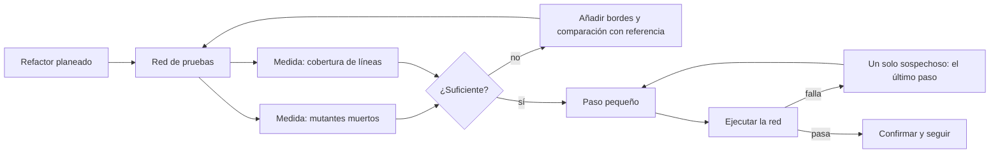
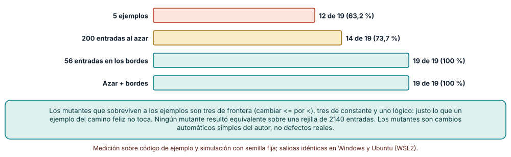
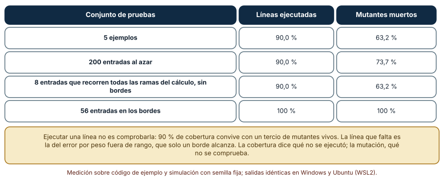
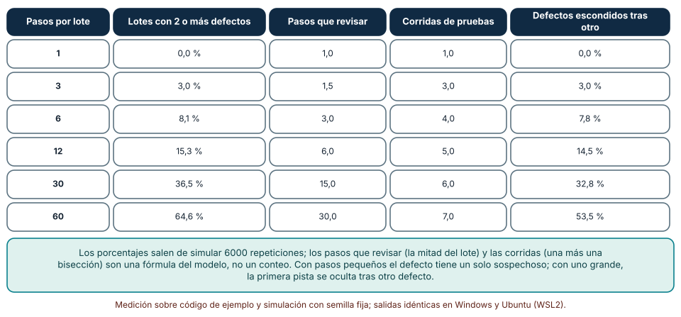

# SE-295 — Refactorización segura apoyada por pruebas

[← SE-294 — Code smells y diagnóstico contextual](https://github.com/vladimiracunadev-create/modern-software-engineering-program/blob/main/classes/part-24-diseno-patrones-y-refactorizacion/se-294-code-smells-y-diagnostico-contextual/README.md) · [↑ Parte 24](https://github.com/vladimiracunadev-create/modern-software-engineering-program/blob/main/classes/part-24-diseno-patrones-y-refactorizacion/README.md) · [📚 Índice completo](https://github.com/vladimiracunadev-create/modern-software-engineering-program/blob/main/classes/README.md) · [🌐 Portal](https://vladimiracunadev-create.github.io/modern-software-engineering-program/classes/SE-295.html) · [SE-296 — Diseño para cambio, prueba y operación →](https://github.com/vladimiracunadev-create/modern-software-engineering-program/blob/main/classes/part-24-diseno-patrones-y-refactorizacion/se-296-diseno-para-cambio-prueba-y-operacion/README.md)

## Punto profesional y fundamento pedagógico

**Punto profesional.** La clase existe para que cambies la estructura de un código sin cambiar lo que hace, con una red de pruebas cuya capacidad de detectar errores hayas medido, y para que elijas el tamaño de cada paso por lo que cuesta encontrar un defecto, no por la prisa.

**Por qué aparece aquí.** Sigue a **Code smells y diagnóstico contextual** (`SE-294`): el diagnóstico decidió qué tratar; aquí se trata de manera segura. La clase prepara el taller de `SE-299` y el proyecto de `SE-300`, donde la red de pruebas deja de ser un ejercicio.

**Error conceptual que debe corregir.** Creer que una cobertura alta o que «las pruebas pasan» demuestran que un refactor conserva el comportamiento: una prueba que ejecuta una línea no comprueba su resultado, y solo se sabe cuánto detecta una red si se le inyectan defectos.

**Secuencia de aprendizaje.** Antes de mirar los resultados, predices qué fracción de cambios automáticos (mutantes) de una función de tarifa matan cinco ejemplos, doscientas entradas al azar y las entradas de los bordes, cuánta cobertura de líneas tienen esas pruebas y cuántos pasos hay que revisar para encontrar un defecto según el tamaño del lote. Después lo mides con mutación real sobre el árbol sintáctico. La secuencia usa predicción, explicación propia, contraste y recuperación. [ICAP](https://icap.education.asu.edu/research) distingue participación de construcción de conocimiento; [How People Learn II](https://nap.nationalacademies.org/catalog/24783/how-people-learn-ii-learners-contexts-and-cultures) exige conectar conocimiento previo, contexto y transferencia; la [práctica de recuperación](https://pubmed.ncbi.nlm.nih.gov/16507066/) respalda producir de nuevo la explicación tras una demora; y [Education for Life and Work](https://nap.nationalacademies.org/resource/13398/dbasse_084153.pdf) exige devolución que explique la causa del error.

**Evidencia de aprendizaje.** `refactor-log.md` con la predicción, la tabla de la puntuación de mutación, la de cobertura frente a mutantes, la de tamaño del paso y una nota que diga qué red protege cada refactor planeado de `tarifas`.

**Límite de la conclusión.** La función de tarifa, los 19 mutantes y la probabilidad de 0,03 por paso son construcciones del autor. Los mutantes son cambios automáticos simples, no defectos observados en un proyecto, y el modelo del tamaño del paso supone defectos independientes.

### Trazabilidad fuente → afirmación

| Fuente primaria u oficial | Afirmación que respalda | Lo que no prueba |
|---|---|---|
| [Fowler, «Refactoring» (2.ª ed.)](https://martinfowler.com/books/refactoring.html) | Define refactorizar como cambiar la estructura sin cambiar el comportamiento observable, en pasos pequeños, apoyado en pruebas. | No da el tamaño de paso óptimo ni garantiza que las pruebas sean suficientes. |
| [DeMillo, Lipton y Sayward, «Hints on Test Data Selection» (IEEE Computer, 1978)](https://doi.org/10.1109/C-M.1978.218136) | Origina la idea de evaluar un conjunto de pruebas inyectando variantes del programa (mutantes) y viendo cuáles detecta. | No dice que los mutantes simples representen los defectos reales de un proyecto. |
| [Jia y Harman, «An Analysis and Survey of the Development of Mutation Testing» (IEEE TSE, 2011)](https://doi.org/10.1109/TSE.2010.62) | Revisa la técnica de pruebas de mutación, sus costos y el problema de los mutantes equivalentes. | No fija una puntuación mínima aceptable. |

## Antes de empezar

Recupera lo aprendido en `SE-294`: un olor se trata si su costo lo justifica. La pregunta activa es: **¿qué prueba fallaría si mi refactor cambiara el comportamiento, y cómo sé que fallaría?**

## Prerrequisitos

- Haber completado `SE-294` o poder explicar la diferencia entre olor y defecto.
- Python 3.11 o posterior y un terminal; todo el código usa solo la biblioteca estándar.
- Haber escrito pruebas con `unittest` o `assert` y haber leído el árbol sintáctico con `ast`.

## Problema auténtico

El equipo de la plataforma de entregas va a refactorizar la función `tarifa` del componente: tiene una validación de rango, un cálculo por peso y zona, un recargo para pesos de más de 20 kilos y dos opciones (urgente y cliente VIP). Tiene cinco ejemplos escritos hace dos años y la cobertura de líneas dice 90 %. Después de un refactor «de estructura», un cliente VIP con exactamente 20 kilos pasó a pagar 9 pesos más (el recargo de 10 con su descuento) y la suite siguió en verde. La cobertura no mentía: las líneas se ejecutaban, pero ningún ejemplo comprobaba la frontera.

## Objetivos observables

Al terminar podrás:

1. generar mutantes de una función con `ast` y calcular cuántos mata una suite;
2. contrastar la cobertura de líneas con la puntuación de mutación y explicar su diferencia;
3. diseñar entradas de borde a partir del código y comprobar que matan lo que los ejemplos no ven;
4. estimar, con una simulación, cuánto cuesta localizar un defecto según el tamaño del paso del refactor;
5. declarar qué red protege cada refactor y qué cambios de comportamiento no vería.

## Mapa conceptual



El mapa tiene dos ciclos: reforzar la red hasta que su medida sea suficiente, y avanzar en pasos que dejan un solo sospechoso cuando algo falla. Sin el primer ciclo, el segundo da una seguridad que no existe.

## Temas y por qué importan

| Tema | Por qué cambia una decisión profesional | Evidencia mínima |
|---|---|---|
| Qué es conservar el comportamiento | Define qué debe seguir igual y qué se admite que cambie. | Predicción, traza causal y contraejemplo de **Qué es conservar el comportamiento** en `refactor-log.md` |
| Red de pruebas y mutación | Mide cuánto detecta la red, no cuánto ejecuta. | Predicción, traza causal y contraejemplo de **Red de pruebas y mutación** en `refactor-log.md` |
| Bordes y referencias | Los casos de frontera y la comparación con la versión anterior cubren lo que el azar no ve. | Predicción, traza causal y contraejemplo de **Bordes y referencias** en `refactor-log.md` |
| Tamaño del paso | Un paso pequeño deja un solo sospechoso. | Predicción, traza causal y contraejemplo de **Tamaño del paso** en `refactor-log.md` |
| Límites de la red | Una red verde no prueba la ausencia de cambios. | Predicción, traza causal y contraejemplo de **Límites de la red** en `refactor-log.md` |

## Conceptos y decisiones

### 1. Qué es conservar el comportamiento

Refactorizar es cambiar la estructura sin cambiar el comportamiento observable. «Observable» hay que definirlo: los valores devueltos, las excepciones, los efectos (escribir, avisar), a veces el orden y el tiempo. Lo que no se declara observable puede cambiar, y lo que alguien usa sin que esté declarado se rompe de todos modos. Por eso el primer paso es escribir qué debe seguir igual: normalmente, para cada entrada válida, la misma salida, y para cada inválida, el mismo error.

### 2. Red de pruebas y mutación

Una red de pruebas es el conjunto que debe fallar si el comportamiento cambia. Su calidad no es cuántas líneas ejecuta, sino cuántos cambios detecta. La **prueba de mutación** lo mide: se generan variantes del programa con un cambio pequeño cada una (un `<=` por un `<`, un `+` por un `-`, una constante más uno) y se cuenta cuántas hace fallar la suite. Los mutantes que sobreviven señalan lo que la red no comprueba. Algunos mutantes son equivalentes (no cambian ninguna salida) y no se pueden matar.

### 3. Bordes y referencias

Los errores de frontera (`>` frente a `>=`) son los que más sobreviven a los ejemplos y al azar, porque el valor exacto de la frontera es un punto entre millones. Las entradas de borde se derivan del código: cada comparación sugiere los valores justo en el límite, uno por debajo y uno por encima. Otra herramienta es la **comparación con una referencia**: ejecutar la versión anterior y la nueva sobre las mismas entradas y exigir resultados idénticos.

### 4. Tamaño del paso

Un refactor se divide en pasos que se pueden ejecutar y comprobar, y se comprueba tras cada uno. Si se hacen sesenta pasos y se prueba al final, un fallo tiene sesenta sospechosos, y si dos defectos coincidieron, uno puede esconder al otro. Con un paso por prueba, el sospechoso es único y deshacerlo cuesta un comando. El precio es ejecutar las pruebas muchas veces, que por eso deben ser rápidas.

### 5. Límites de la red

Una red verde dice que no se encontró un cambio, no que no lo haya. No ve lo que no ejecuta (tiempos, concurrencia, configuración), lo que está fuera de la función (el efecto sobre un cliente que dependía de un detalle) ni los cambios que ningún mutante imita. Por eso las redes se complementan con revisión, con ejecución paralela de la versión vieja y la nueva en producción cuando el riesgo lo justifica y con una vía rápida de reversión.

### Cuántos mutantes mata cada conjunto de pruebas

La función `tarifa(peso, zona, urgente, vip)` valida el rango del peso, calcula `3,0·peso + 2,0·zona`, suma 10 si el peso supera 20, multiplica por 1,5 si es urgente y por 0,9 si es VIP, y redondea. Un transformador de `ast` genera un mutante por cada comparación (`<=`↔`<`, `>`↔`>=`), operador aritmético (`+`↔`-`, `*`↔`/`), operador lógico (`or`↔`and`) y constante numérica (se suma 1 o 0,1). Resultan 19 mutantes (3 de frontera, 6 de operador, 1 lógico y 9 de constante). Sobre una rejilla de 2140 entradas ninguno es equivalente.

```python
def visit_Compare(self, node):
    self.generic_visit(node)
    cambios = {ast.LtE: ast.Lt, ast.Lt: ast.LtE, ast.Gt: ast.GtE, ast.GtE: ast.Gt}
    for i, op in enumerate(node.ops):
        if type(op) in cambios and self._toca():
            node.ops[i] = cambios[type(op)]()
```

| Conjunto de pruebas | Mutantes muertos |
|---|---:|
| 5 ejemplos | 12 de 19 (63,2 %) |
| 200 entradas al azar | 14 de 19 (73,7 %) |
| 56 entradas en los bordes | 19 de 19 (100 %) |
| Azar y bordes | 19 de 19 (100 %) |

Resultado, idéntico en Windows (CPython 3.12.9) y en Ubuntu bajo WSL2 (3.12.3). Los 7 mutantes que sobreviven a los ejemplos son 3 de frontera, 3 de constante y 1 lógico.



**Cómo leer la figura.** Cada barra es el número de mutantes (de 19) que el conjunto de pruebas hace fallar. **Dónde deja de valer:** los mutantes son cambios automáticos y sencillos; un defecto real puede ser una combinación de cambios o un olvido (una regla que nunca se escribió) que ningún mutante imita. Que los bordes maten el 100 % de estos mutantes no prueba que detecten todos los defectos posibles. La puntuación depende de los operadores de mutación que se elijan.

### Cobertura de líneas frente a mutantes muertos

Con `sys.settrace` se registran las líneas de la función que ejecuta cada conjunto. Alcanzables hay 10 (la rejilla de 2140 entradas las recorre todas). Se añade un conjunto de ocho entradas elegido para recorrer todas las ramas del cálculo (pesos 0,5 y 25, zona 1, urgente y VIP en todas sus combinaciones) pero sin tocar la frontera ni el error.

```python
def tr(frame, ev, arg):
    if frame.f_code.co_name == "tarifa" and ev == "line":
        vistas.add(frame.f_lineno)
    return tr
sys.settrace(tr)
```

| Conjunto de pruebas | Líneas ejecutadas | Mutantes muertos |
|---|---:|---:|
| 5 ejemplos | 90,0 % | 63,2 % |
| 200 entradas al azar | 90,0 % | 73,7 % |
| 8 entradas que recorren las ramas, sin bordes | 90,0 % | 63,2 % |
| 56 entradas en los bordes | 100 % | 100 % |



**Cómo leer la figura.** Las tres primeras filas comparten el 90 % de líneas y difieren en lo que detectan. **Dónde deja de valer:** la cobertura de líneas es la más débil de las cobertura (la de ramas o de condiciones diría más) y la línea que falta es la del error por peso fuera de rango, que solo un borde alcanza. La relación entre cobertura y mutación depende de la función: aquí la que no se ejecuta es la excepción. La figura no dice que la cobertura sea inútil; dice que mide qué no se ejecutó, no qué se comprueba.

### Cuántos pasos hay que revisar según el tamaño del lote

Un refactor de 60 pasos. Cada paso introduce un defecto con probabilidad 0,03, independiente de los otros. Se comprueba tras cada lote de *b* pasos (1, 3, 6, 12, 30 o 60) y se simulan 6000 repeticiones con semilla fija. Se cuenta qué fracción de los lotes defectuosos tiene dos o más defectos y qué fracción de los defectos queda escondida tras otro del mismo lote.

```python
defectos = [rng.random() < 0.03 for _ in range(60)]
for i in range(0, 60, b):
    lote = defectos[i:i + b]
    n = sum(lote)
    multi += n >= 2          # lote con dos o mas defectos
```

| Pasos por lote | Lotes con 2 o más defectos | Pasos que revisar | Corridas | Defectos escondidos tras otro |
|---:|---:|---:|---:|---:|
| 1 | 0,0 % | 1,0 | 1,0 | 0,0 % |
| 3 | 3,0 % | 1,5 | 3,0 | 3,0 % |
| 6 | 8,1 % | 3,0 | 4,0 | 7,8 % |
| 12 | 15,3 % | 6,0 | 5,0 | 14,5 % |
| 30 | 36,5 % | 15,0 | 6,0 | 32,8 % |
| 60 | 64,6 % | 30,0 | 7,0 | 53,5 % |



**Cómo leer la figura.** Cada fila es un tamaño de lote; las dos primeras columnas salen de la simulación y las otras dos de una fórmula. **Dónde deja de valer:** los pasos que revisar (la mitad del lote) y las corridas (una más una bisección) son una fórmula del modelo, no un conteo; la independencia de los defectos es un supuesto y en la práctica los pasos se encadenan (un defecto hace fallar al siguiente). Comprobar tras cada paso cuesta tiempo de ejecución que el modelo no cuenta, y exige pruebas rápidas.

## Definiciones de trabajo

- **refactorización:** cambio de la estructura interna de un código sin cambiar su comportamiento observable.
- **mutante:** variante del programa con un cambio pequeño que sirve para evaluar cuánto detecta una suite.
- **puntuación de mutación:** fracción de mutantes no equivalentes que una suite detecta.
- **valor de borde:** valor justo en el límite de una condición, y los vecinos inmediatos.
- **red de pruebas:** conjunto de comprobaciones que debe fallar si el comportamiento cambia.

Las definiciones son operativas para `tarifas`. No convierten términos con una historia más amplia en sinónimos y deben contrastarse con la bibliografía enlazada al final.

## Ejemplo mínimo

El fragmento muestra un mutante de frontera que los ejemplos no matan. Antes de ejecutarlo, predice si el mutante sobrevive.

```python
def original(peso): return 10 if peso > 20 else 0
def mutante(peso): return 10 if peso >= 20 else 0

ejemplos = [5, 30]
assert all(original(p) == mutante(p) for p in ejemplos)       # sobrevive
assert original(20) != mutante(20)                             # un valor de borde lo mata
```

Los ejemplos eligieron valores lejos de la frontera. Registra versión, comando y salida; añade un mutante con 21 en lugar de 20 y predice qué entradas lo matan.

## Ejemplo profesional

Antes de mover una línea, el equipo de `tarifas` mide su red: genera los mutantes de `tarifa`, descubre que la suite de cinco ejemplos mata 12 de 19 y que sobreviven tres mutantes de frontera. Añade siete pesos de borde (−1, 0, 0,5, 20, 20,5, 50 y 50,5) combinados con dos zonas y las cuatro combinaciones de opciones, 56 entradas, y una prueba de comparación con la versión anterior sobre 2000 entradas de semilla fija. La suite sube a 19 de 19. Planifica el refactor en doce pasos, cada uno con un comando de prueba de tres segundos y un commit; si una prueba falla, el sospechoso es el último paso y se revierte antes de seguir.

Compara con el estado anterior: la red es adecuada si cada mutante vivo tiene una razón escrita (equivalente o asumido) y el refactor avanza en pasos que se pueden deshacer de uno en uno; es frágil si la suite solo se ha ejecutado al final o si los mutantes vivos se ignoran.

## Práctica guiada

1. Escribe la función `tarifa` y cinco ejemplos y predice cuántos mutantes matarán.
2. Implementa el transformador de `ast` y genera los mutantes; cuenta cuántos de cada familia salen.
3. Calcula la puntuación de cada conjunto: ejemplos, azar y bordes.
4. Mide la cobertura de líneas con `sys.settrace` y compárala con la puntuación.
5. Deriva los valores de borde de cada comparación del código y compruébalos.
6. Simula 60 pasos de refactor con 3 % de defecto por paso y compara lotes de 1, 6 y 60.
7. Entrega `refactor-log.md` y pide a otra persona que diga qué mutante sobrevive a tu suite y por qué.

## Ejercicios

1. **Mutantes:** añade un operador de mutación que elimine una sentencia y recalcula la puntuación de cada conjunto.
2. **Equivalentes:** construye un mutante equivalente a mano y explica cómo lo reconocerías.
3. **Bordes:** deriva los valores de borde de `if peso > 20 or peso <= 0` y justifica cada uno.
4. **Paso:** cambia la probabilidad de defecto a 0,01 y a 0,10 y describe cómo cambia el mejor tamaño de lote.

## Reto verificable

Entrega `refactor-log.md` con la predicción, la puntuación por suite, la comparación con la cobertura, los valores de borde derivados, la simulación del tamaño del paso y el plan de pasos para refactorizar `tarifa`. Se aprueba si otra persona ejecuta el código desde un checkout limpio, obtiene los mismos números y puede decir qué mutantes sobreviven a cada suite y qué cambio de comportamiento ninguno vería. No se aprueba por afirmar que la cobertura «es alta» ni por refactorizar sin medir la red.

## Caso conductor

El componente `tarifas` conserva el diagnóstico de `SE-294` y gana una red de pruebas con una puntuación de mutación medida, valores de borde derivados del código y una comparación con la versión anterior. `SE-296` examinará cómo diseñar para el cambio, la prueba y la operación desde el principio. Cambia después una sola decisión, el tamaño del paso, y observa cuántos sospechosos tiene el primer fallo.

## Preguntas frecuentes

### ¿La cobertura de líneas no sirve?

Sirve para encontrar lo que no se ejecuta; no dice si lo ejecutado se comprueba. Con 90 % de cobertura, esta suite mataba el 63 % de los mutantes. Se usa junto con otra medida de capacidad de detección.

### ¿Cuántos mutantes debe matar una suite?

No hay una cifra universal: depende del riesgo del código. Lo importante es que cada mutante vivo tenga una razón escrita (equivalente, aceptado o por cubrir). Un objetivo de 100 % sobre mutantes simples no garantiza ausencia de defectos.

### ¿Se puede refactorizar sin pruebas?

Se puede reducir el riesgo con pasos mecánicos que las herramientas ofrecen (renombrar, extraer) y con revisión, y se debe saber que no hay red. Sin red, el tamaño del paso debe ser el menor posible y el cambio debe poder revertirse al instante.

### ¿Por qué comparar con la versión anterior si ya hay pruebas?

Porque la versión anterior es una especificación ejecutable de todo lo que alguien pudo haber usado, incluido lo que nunca se escribió como prueba. Es la red más amplia para un refactor y la que menos esfuerzo de escritura requiere.

## Fallo controlado y diagnóstico

Reproduce el fallo clásico de la clase: **un refactor que cambia una frontera y deja la suite en verde**. Cambia `peso > 20` por `peso >= 20` en la función refactorizada y ejecuta los cinco ejemplos.

Registra síntoma, entrada mínima, hipótesis, observación que descarta cada hipótesis, causa, corrección y prueba de regresión. **Síntoma:** un cliente VIP con 20 kilos paga 9 pesos más después del refactor y la suite sigue en verde. **Hipótesis rivales:** (a) el cliente cambió de tarifa; (b) hay un error de redondeo; (c) la condición de la frontera cambió. **Prueba:** ejecuta la versión anterior y la nueva con `peso = 20`; si difieren y todos los ejemplos coinciden, la causa es (c). **Conclusión:** la red no tenía un valor de borde. **Regresión:** añade los valores 19,9, 20 y 20,1 como pruebas y la comparación con la versión anterior sobre 2000 entradas, y no cambies a la vez la condición y los ejemplos.

## Errores comunes y cómo corregirlos

| Síntoma | Causa probable | Corrección |
|---|---|---|
| El refactor pasó la suite y rompió una frontera | Faltan valores de borde | Derivar bordes de cada comparación |
| Cobertura alta y mutantes vivos | Las líneas se ejecutan, no se comprueban | Medir mutantes muertos además de cobertura |
| Un fallo tiene muchos sospechosos | Pasos grandes sin comprobar | Un paso por comprobación y un commit por paso |
| Un defecto se esconde tras otro | Dos defectos en el mismo lote | Reducir el lote y comprobar tras cada paso |
| Se ignoran los mutantes vivos | Falta una razón escrita por mutante | Registrar equivalente, aceptado o por cubrir |

## Entorno y archivos clave

```text
work/SE-295/
├── README.md
├── mutacion/
│   ├── tarifa.py
│   ├── mutador.py
│   └── suites.py
├── cobertura/
│   └── lineas.py
├── pasos/
│   └── lotes.py
└── evidence/refactor-log.md
```

El `README` declara plataforma, versión de Python, semillas y comandos. Los experimentos usan solo la biblioteca estándar (`ast`, `sys`, `random`, `statistics`, `itertools`) y se ejecutaron con CPython 3.12.9 en Windows 11 y 3.12.3 en Ubuntu bajo WSL2: las salidas fueron idénticas. Si añades una dependencia, fija procedencia y versión.

## Seguridad, ética y accesibilidad

- un refactor de una función que cobra a personas puede cambiar montos sin avisar: la comparación con la versión anterior es una protección económica, no un lujo;
- las pruebas de mutación ejecutan código modificado: hazlo en un entorno de pruebas y nunca contra datos o servicios reales;
- los mensajes de las pruebas deben decir qué entrada falló y qué se esperaba, para que cualquier persona del equipo pueda diagnosticar;
- no uses datos reales de clientes para generar las entradas de comparación;
- respeta las licencias de los textos citados y atribuye lo adaptado.

## Puente hacia el trabajo con agentes

Un agente al que se le pide «refactoriza tarifa y asegura que no se rompe» reorganizará el código y ejecutará las pruebas existentes; si pasan, declarará que el comportamiento se conservó. Pídele en cambio que mida primero la red (mutantes muertos), derive los valores de borde del código, compare la versión anterior con la nueva sobre entradas de semilla fija, avance en pasos con un commit cada uno y liste los mutantes que sobreviven. Revisa especialmente si cambió una comparación, si tocó el redondeo o si modificó las pruebas para que el cambio pasara.

## Transferencia

Traslada el análisis a otra función (por ejemplo, la de cálculo de un reembolso): cambia la lógica y los mutantes, y conserva el procedimiento de medir la red, derivar bordes, comparar con la versión anterior y avanzar en pasos. La transferencia está lograda cuando puedes decir qué cambios de comportamiento tu red no vería, no cuando la puntuación es alta.

## Evaluación y evidencia

| Criterio | Evidencia para aprobar |
|---|---|
| comprensión | explicación de qué significa conservar el comportamiento y cómo se mide la capacidad de una red |
| corrección | mutantes, cobertura y simulación reproducibles con las mismas semillas |
| diseño | red con bordes derivados, comparación con referencia y plan de pasos |
| diagnóstico | reproducción del fallo «frontera cambiada con la suite en verde» con regresión |
| incertidumbre | declaración de que los mutantes son cambios automáticos simples y el modelo de pasos supone independencia |
| reproducibilidad | versiones, comandos, salida y límites declarados |

## Fuentes

- [Fowler, «Refactoring» (2.ª ed.)](https://martinfowler.com/books/refactoring.html) — refactorizar en pasos pequeños con pruebas; autoridad: Martin Fowler.
- [DeMillo, Lipton y Sayward (IEEE Computer, 1978)](https://doi.org/10.1109/C-M.1978.218136) — origen de la prueba de mutación; autoridad: IEEE Computer.
- [Jia y Harman (IEEE TSE, 2011)](https://doi.org/10.1109/TSE.2010.62) — revisión de la prueba de mutación; autoridad: IEEE Transactions on Software Engineering.
- [Fowler, «Test Coverage»](https://martinfowler.com/bliki/TestCoverage.html) — qué dice y qué no dice la cobertura; autoridad: Martin Fowler.
- [Feathers, «Working Effectively with Legacy Code»](https://www.oreilly.com/library/view/working-effectively-with/0131177052/) — pruebas de caracterización y costuras en código heredado; autoridad: su autor (Prentice Hall).
- [Python: `sys.settrace`](https://docs.python.org/3/library/sys.html) — rastreo de líneas ejecutadas; autoridad: documentación de Python.
- [Git: `git bisect`](https://git-scm.com/docs/git-bisect) — búsqueda binaria del commit que introdujo un cambio; autoridad: documentación de Git.

Cada fuente respalda el mecanismo indicado; ninguna demuestra que el 63,2 %, el 90 % de líneas o los 30 pasos por revisar se observen en `tarifas`. Esa afirmación depende de su código, sus pruebas y su historia.

## Límites y siguiente paso

Se ejecutaron tres análisis con código de ejemplo y datos sintéticos en Windows y Ubuntu (WSL2) con resultados idénticos. No se midió ninguna base de código real ni se contrastaron los mutantes con defectos reales; la función, los 19 mutantes y la probabilidad de 0,03 por paso son construcciones del autor. La siguiente clase mira el diseño desde el principio para que el cambio, la prueba y la operación sean baratos.

## Glosario

- **refactorización:** cambio de la estructura interna de un código sin cambiar su comportamiento observable.
- **mutante:** variante del programa con un cambio pequeño que sirve para evaluar cuánto detecta una suite.
- **puntuación de mutación:** fracción de mutantes no equivalentes que una suite detecta.
- **valor de borde:** valor justo en el límite de una condición, y los vecinos inmediatos.
- **red de pruebas:** conjunto de comprobaciones que debe fallar si el comportamiento cambia.

---

[← SE-294 — Code smells y diagnóstico contextual](https://github.com/vladimiracunadev-create/modern-software-engineering-program/blob/main/classes/part-24-diseno-patrones-y-refactorizacion/se-294-code-smells-y-diagnostico-contextual/README.md) · [↑ Parte 24](https://github.com/vladimiracunadev-create/modern-software-engineering-program/blob/main/classes/part-24-diseno-patrones-y-refactorizacion/README.md) · [📚 Índice completo](https://github.com/vladimiracunadev-create/modern-software-engineering-program/blob/main/classes/README.md) · [🌐 Portal](https://vladimiracunadev-create.github.io/modern-software-engineering-program/classes/SE-295.html) · [SE-296 — Diseño para cambio, prueba y operación →](https://github.com/vladimiracunadev-create/modern-software-engineering-program/blob/main/classes/part-24-diseno-patrones-y-refactorizacion/se-296-diseno-para-cambio-prueba-y-operacion/README.md)
