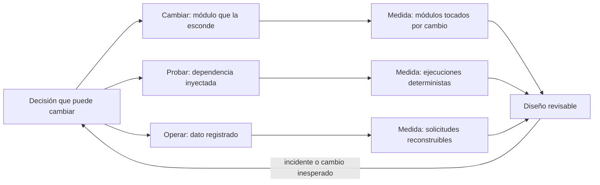
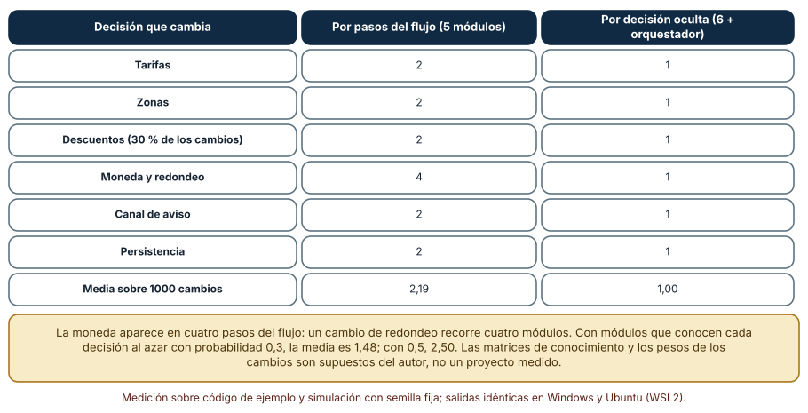
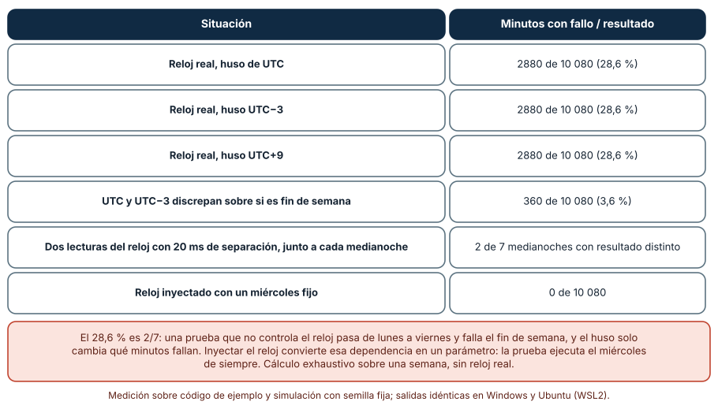
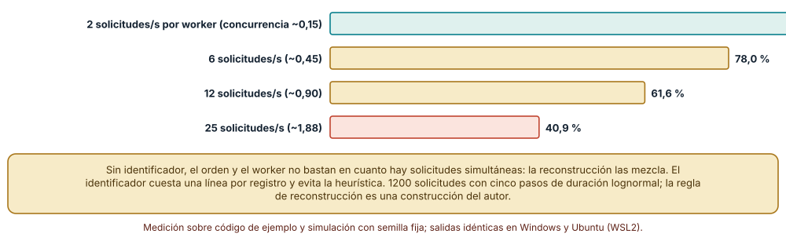

# SE-296 — Diseño para cambio, prueba y operación

[← SE-295 — Refactorización segura apoyada por pruebas](https://github.com/vladimiracunadev-create/modern-software-engineering-program/blob/main/classes/part-24-diseno-patrones-y-refactorizacion/se-295-refactorizacion-segura-apoyada-por-pruebas/README.md) · [↑ Parte 24](https://github.com/vladimiracunadev-create/modern-software-engineering-program/blob/main/classes/part-24-diseno-patrones-y-refactorizacion/README.md) · [📚 Índice completo](https://github.com/vladimiracunadev-create/modern-software-engineering-program/blob/main/classes/README.md) · [🌐 Portal](https://vladimiracunadev-create.github.io/modern-software-engineering-program/classes/SE-296.html) · [SE-297 — Complejidad accidental y esencial →](https://github.com/vladimiracunadev-create/modern-software-engineering-program/blob/main/classes/part-24-diseno-patrones-y-refactorizacion/se-297-complejidad-accidental-y-esencial/README.md)

## Punto profesional y fundamento pedagógico

**Punto profesional.** La clase existe para que diseñes un componente pensando desde el principio en tres personas que lo tocarán después: quien lo cambia, quien lo prueba y quien lo opera de madrugada, y para que conviertas esa intención en decisiones concretas (qué esconde cada módulo, qué se inyecta, qué deja rastro) con una medida cada una.

**Por qué aparece aquí.** Sigue a **Refactorización segura apoyada por pruebas** (`SE-295`): refactorizar corrige un diseño que ya existe; esta clase pregunta qué diseño habría evitado la corrección. Reúne lo visto desde `SE-289`: módulos que esconden decisiones, dependencias que se pueden sustituir y observabilidad suficiente para diagnosticar.

**Error conceptual que debe corregir.** Creer que diseñar para el cambio es prever el futuro: no se predice qué cambiará, se elige cuáles son las decisiones más probables de cambiar, se esconden y se deja el resto simple. Y creer que la testabilidad y la operabilidad son extras de fin de proyecto: son propiedades de las mismas decisiones.

**Secuencia de aprendizaje.** Antes de mirar los resultados, predices cuántos módulos hay que tocar al cambiar una decisión según la descomposición, en qué fracción de una semana falla una prueba que lee el reloj real y qué fracción de solicitudes puede reconstruirse a partir de registros sin identificador. Después lo calculas y lo simulas. La secuencia usa predicción, explicación propia, contraste y recuperación. [ICAP](https://icap.education.asu.edu/research) distingue participación de construcción de conocimiento; [How People Learn II](https://nap.nationalacademies.org/catalog/24783/how-people-learn-ii-learners-contexts-and-cultures) exige conectar conocimiento previo, contexto y transferencia; la [práctica de recuperación](https://pubmed.ncbi.nlm.nih.gov/16507066/) respalda producir de nuevo la explicación tras una demora; y [Education for Life and Work](https://nap.nationalacademies.org/resource/13398/dbasse_084153.pdf) exige devolución que explique la causa del error.

**Evidencia de aprendizaje.** `design-for-change-log.md` con la predicción, la tabla de módulos tocados por decisión, el resultado del reloj real e inyectado, la tabla de reconstrucción de solicitudes y una nota que diga qué decisión de `tarifas` queda escondida, qué dependencia se inyecta y qué dato lleva cada registro de operación.

**Límite de la conclusión.** Las matrices de conocimiento de los módulos, las ponderaciones de los cambios y el modelo de solicitudes son construcciones del autor. El cálculo del reloj es exhaustivo sobre una semana pero no ejecuta un reloj real; la reconstrucción de registros usa una regla de emparejamiento sencilla.

### Trazabilidad fuente → afirmación

| Fuente primaria u oficial | Afirmación que respalda | Lo que no prueba |
|---|---|---|
| [Parnas, «On the criteria to be used in decomposing systems into modules» (CACM, 1972)](https://doi.org/10.1145/361598.361623) | Compara dos descomposiciones de un mismo sistema y muestra que ocultar decisiones de diseño probablemente cambiantes hace los cambios más locales. | No da una cifra aplicable a `tarifas` ni dice cuáles son sus decisiones. |
| [Cockburn, «Hexagonal architecture»](https://alistair.cockburn.us/hexagonal-architecture/) | Propone aislar la lógica de la aplicación de sus entradas y salidas con puertos y adaptadores, de modo que se pueda probar sin ellas. | No dice cuántos puertos conviene definir ni mide el efecto sobre los defectos. |
| [W3C, «Trace Context»](https://www.w3.org/TR/trace-context/) | Especifica cómo propagar un identificador de traza entre servicios para correlacionar la actividad de una misma solicitud. | No dice qué más debe contener un registro ni cómo diagnosticar un incidente. |

## Antes de empezar

Recupera lo aprendido en `SE-295`: una red de pruebas se mide, no se presume. La pregunta activa es: **¿qué tendría que ser distinto en el diseño para que el próximo cambio, la próxima prueba y el próximo incidente cuesten menos?**

## Prerrequisitos

- Haber completado `SE-295` o poder explicar qué es un mutante y qué mide la puntuación de mutación.
- Python 3.11 o posterior y un terminal; todo el código usa solo la biblioteca estándar (`datetime`, `random`, `statistics`).
- Conocer la idea de inyectar una dependencia y haber leído registros de una aplicación.

## Problema auténtico

Tres incidentes de `tarifas` en un trimestre. En el primero, logística pidió cambiar el redondeo de la moneda y hubo que editar cuatro módulos, porque cada uno redondeaba por su cuenta. En el segundo, una prueba que verificaba «sin recargo de fin de semana» pasó todos los días de la semana de trabajo y falló un sábado en la integración continua, que corre a cualquier hora. En el tercero, un cobro duplicado necesitó dos días de diagnóstico porque los registros de los cuatro workers no tenían un identificador de solicitud y no se sabía qué líneas pertenecían a qué petición. Cambio, prueba y operación fallaron por la misma razón: se decidió después de escribir el código.

## Objetivos observables

Al terminar podrás:

1. comparar dos descomposiciones de un componente por los módulos que toca cada decisión que cambia;
2. medir qué fracción del tiempo falla una prueba que depende del reloj real y comprobar que un reloj inyectado la hace determinista;
3. estimar cuánto se degrada la reconstrucción de una solicitud a partir de registros sin identificador cuando crece la concurrencia;
4. decidir qué decisión se esconde, qué dependencia se inyecta y qué dato se registra, y justificarlo con una medida;
5. declarar qué supone cada medida y qué evidencia haría abandonar la decisión.

## Mapa conceptual



El mapa muestra que las tres preocupaciones parten de la misma lista de decisiones: lo que se esconde para cambiar, lo que se inyecta para probar y lo que se registra para operar. El retorno marca que los incidentes revelan decisiones no previstas.

## Temas y por qué importan

| Tema | Por qué cambia una decisión profesional | Evidencia mínima |
|---|---|---|
| Ocultar decisiones | Los cambios se vuelven locales cuando cada decisión vive en un módulo. | Predicción, traza causal y contraejemplo de **Ocultar decisiones** en `design-for-change-log.md` |
| Diseñar para probar | Una dependencia que se puede sustituir hace la prueba rápida y determinista. | Predicción, traza causal y contraejemplo de **Diseñar para probar** en `design-for-change-log.md` |
| Diseñar para operar | Un registro con identificador permite reconstruir qué pasó. | Predicción, traza causal y contraejemplo de **Diseñar para operar** en `design-for-change-log.md` |
| Costos del diseño anticipado | Cada preparación tiene un costo y puede no usarse. | Predicción, traza causal y contraejemplo de **Costos del diseño anticipado** en `design-for-change-log.md` |
| Revisión del diseño | Los incidentes enseñan qué decisión no se escondió. | Predicción, traza causal y contraejemplo de **Revisión del diseño** en `design-for-change-log.md` |

## Conceptos y decisiones

### 1. Ocultar decisiones

La pregunta de Parnas es qué decisiones de diseño son difíciles o probablemente cambiarán, y la respuesta es esconder cada una en un módulo cuya interfaz no la revele. En `tarifas` esas decisiones son, por ejemplo: la fuente de las tarifas, las zonas, la política de descuentos, la moneda y el redondeo, el canal de aviso y la persistencia. Una descomposición por pasos del flujo (leer, calcular, formatear, guardar, avisar) reparte cada decisión entre varios pasos; una por decisión la deja en un solo lugar.

### 2. Diseñar para probar

Una pieza es fácil de probar si sus dependencias se pueden sustituir: el reloj, la fuente de números aleatorios, la red, el disco. Cuando `tarifas` llama a `datetime.now()` dentro de la regla, la prueba depende del momento en que se ejecuta. Si recibe el instante como parámetro, la prueba elige el instante. La arquitectura de puertos y adaptadores generaliza la idea: la lógica del negocio se ejecuta contra puertos abstractos y los adaptadores reales o simulados se conectan en los bordes.

### 3. Diseñar para operar

Operar es responder, con el sistema en marcha, qué pasó, a quién, cuándo y por qué. Eso exige datos que se decidieron al diseñar: un identificador de solicitud que viaje por todos los registros, eventos con campos estructurados y no solo texto, y contadores de lo que nunca debería ocurrir (descartes, reintentos, valores fuera de rango). Sin ellos, el diagnóstico se vuelve arqueología sobre líneas de texto de procesos intercalados.

### 4. Costos del diseño anticipado

Cada preparación tiene costo: un módulo más, una interfaz más, un parámetro más, un campo más en cada registro. Si la decisión no cambia, el costo es puro. La regla práctica es proporcional: preparar lo barato y probable (inyectar el reloj, poner un identificador) y esperar a que se repita lo caro e incierto (un sistema de plugins). Una preparación que nadie ejerce en dos años es candidata a retirarse.

### 5. Revisión del diseño

Un diseño para el cambio es una hipótesis sobre qué cambiará. Los incidentes y los cambios reales la ponen a prueba: si cada cambio nuevo toca varios módulos, la decisión que lo provocó no estaba escondida; si cada incidente exige reconstruir a mano la traza, faltaba un dato en el registro. La revisión actualiza la lista de decisiones y se registra, para que la próxima persona sepa por qué los módulos son así.

### Módulos que hay que editar al cambiar una decisión

Seis decisiones de `tarifas` (tarifas, zonas, descuentos, moneda y redondeo, canal de aviso, persistencia), con pesos de cambio supuestos por el autor (0,2; 0,2; 0,3; 0,1; 0,1; 0,1). Dos descomposiciones: por pasos del flujo (leer, calcular, formatear, guardar, avisar), donde cada paso conoce las decisiones que usa, y por decisión oculta (un módulo por decisión más un orquestador que no conoce ninguna). Se cuenta cuántos módulos conocen cada decisión y la media en 1000 cambios sorteados con semilla fija.

```python
POR_FLUJO = {"leer": {"tarifas", "persistencia", "zonas"}, "calcular": {"zonas", "descuentos", "moneda", "tarifas"},
             "formatear": {"moneda", "canal"}, "guardar": {"persistencia", "moneda"}, "avisar": {"canal", "moneda", "descuentos"}}
tocados = sum(1 for m, ds in mapa.items() if d in ds)
```

| Decisión que cambia | Por pasos del flujo (5 módulos) | Por decisión oculta |
|---|---:|---:|
| Tarifas | 2 | 1 |
| Zonas | 2 | 1 |
| Descuentos (30 % de los cambios) | 2 | 1 |
| Moneda y redondeo | 4 | 1 |
| Canal de aviso | 2 | 1 |
| Persistencia | 2 | 1 |
| Media sobre 1000 cambios | 2,19 | 1,00 |

Resultado, idéntico en Windows (CPython 3.12.9) y en Ubuntu bajo WSL2 (3.12.3). Como sensibilidad, con cinco módulos que conocen cada decisión con probabilidad *p* al azar, la media de módulos tocados por decisión es 0,50 con *p* = 0,1; 1,00 con 0,2; 1,48 con 0,3; 2,50 con 0,5 y 3,49 con 0,7.



**Cómo leer la figura.** Cada fila es una decisión; las columnas dan los módulos que la conocen en cada descomposición. **Dónde deja de valer:** las matrices de conocimiento y los pesos de los cambios son supuestos del autor; con otro reparto de las decisiones el flujo podría salir mejor. El modelo asume además que cada decisión cabe en un módulo, y hay decisiones transversales (la seguridad, la trazabilidad) que no se pueden esconder en un solo sitio. Una decisión que ningún módulo conoce (*p* bajo) no es ocultación, es ausencia.

### El reloj real frente al reloj inyectado

Una regla de recargo de fin de semana recibe un instante y un huso horario. La prueba espera «sin recargo» (un día laborable). Se ejecuta en cada uno de los 10 080 minutos de una semana (de un lunes a las 00:00 UTC) con el reloj real, con husos UTC, UTC−3 y UTC+9, y con un reloj inyectado fijo en un miércoles. Además, una prueba lee el reloj dos veces con 20 milisegundos de separación, justo antes de cada medianoche de la semana.

```python
def regla_dia(ahora, zona_horaria_horas):
    local = ahora + dt.timedelta(hours=zona_horaria_horas)
    return 0.2 if local.weekday() >= 5 else 0.0
```

| Situación | Minutos con fallo / resultado |
|---|---|
| Reloj real, UTC | 2880 de 10 080 (28,6 %) |
| Reloj real, UTC−3 | 2880 de 10 080 (28,6 %) |
| Reloj real, UTC+9 | 2880 de 10 080 (28,6 %) |
| UTC y UTC−3 discrepan sobre si es fin de semana | 360 de 10 080 (3,6 %) |
| Dos lecturas, 20 ms de separación, junto a cada medianoche | 2 de 7 medianoches con resultado distinto |
| Reloj inyectado con un miércoles fijo | 0 de 10 080 |



**Cómo leer la figura.** Las tres primeras filas son la misma prueba con el reloj real en tres husos; las dos siguientes, dos formas de inestabilidad; la última, la prueba con el reloj inyectado. **Dónde deja de valer:** el cálculo recorre minutos de una semana, no ejecuta el reloj del sistema, y las medianoches son las del cálculo. El 28,6 % es 2/7: el huso solo cambia qué minutos fallan. Inyectar el reloj no elimina otras fuentes de no determinismo (aleatoriedad, orden de hilos, red), solo esta; y su costo es pasar el instante por las capas o definir un puerto.

### Reconstruir una solicitud sin identificador

Cuatro workers, 300 solicitudes cada uno, cada solicitud con cinco eventos (recibido, valida, calcula, guarda, responde) de duración lognormal (medias de 5, 20, 40 y 10 ms). Los eventos de todos los workers se mezclan por tiempo y se pierde el identificador. Una regla de reconstrucción abre una solicitud con «recibido» y asigna cada evento siguiente a la solicitud más antigua del mismo worker que va un paso atrás. Se compara con la verdad según la tasa de llegada por worker.

```python
for ent in abiertas[w]:
    if ent[0] == k - 1:                  # la solicitud mas antigua que espera este paso
        ent[0] = k; asign[(rid, paso)] = ent[1]
        break
```

| Solicitudes por segundo y worker | Concurrencia media aproximada | Secuencias bien reconstruidas sin identificador | Con identificador |
|---:|---:|---:|---:|
| 2 | 0,15 | 92,2 % | 100 % |
| 6 | 0,45 | 78,0 % | 100 % |
| 12 | 0,90 | 61,6 % | 100 % |
| 25 | 1,88 | 40,9 % | 100 % |



**Cómo leer la figura.** Cada barra es la fracción de solicitudes bien reconstruidas para una tasa de llegada; con identificador es 100 %. **Dónde deja de valer:** la regla de reconstrucción es sencilla (emparejar por antigüedad); un diagnóstico humano o una regla con más datos (usuario, pedido) reconstruiría mejor. Los tiempos son lognormales con parámetros del autor y los eventos no se pierden ni se reordenan; en un sistema real también hay pérdidas. La figura muestra que la reconstrucción se degrada con la concurrencia, no cuánto.

## Definiciones de trabajo

- **decisión oculta:** decisión de diseño que un módulo encapsula de modo que su interfaz no la revele.
- **inyección de dependencias:** práctica de pasar a un componente sus colaboradores (reloj, aleatoriedad, red) en vez de que los obtenga.
- **identificador de correlación:** valor único de una solicitud que se registra en cada evento que la toca.
- **observabilidad:** capacidad de inferir el estado interno de un sistema a partir de lo que emite.
- **determinismo de una prueba:** propiedad de dar el mismo resultado con las mismas entradas, sin importar cuándo o dónde se ejecute.

Las definiciones son operativas para `tarifas`. No convierten términos con una historia más amplia en sinónimos y deben contrastarse con la bibliografía enlazada al final.

## Ejemplo mínimo

El fragmento muestra una regla que recibe el instante como parámetro. Antes de ejecutarlo, predice el resultado para cada fecha.

```python
import datetime as dt

def recargo(ahora):
    return 0.2 if ahora.weekday() >= 5 else 0.0

assert recargo(dt.datetime(2026, 1, 7, 12, 0)) == 0.0     # miércoles
assert recargo(dt.datetime(2026, 1, 10, 12, 0)) == 0.2    # sábado
```

La prueba elige el instante; el resultado no depende de cuándo se ejecute. Registra versión, comando y salida; llama a la regla con el instante `2026-01-10 23:59` y con `2026-01-11 00:00` y predice qué cambia.

## Ejemplo profesional

El equipo de `tarifas` hace tres cambios de diseño, uno por preocupación. Para el cambio, agrupa en un módulo `moneda` todo lo relativo al redondeo y al formato; los cuatro módulos que redondeaban por su cuenta pasan a pedirle el monto; la próxima petición de cambio solo toca `moneda`. Para la prueba, la regla de recargo recibe el instante y la zona horaria como parámetros y el reloj real solo se llama en el borde; la suite incluye las medianoches de los husos que atiende. Para la operación, cada solicitud lleva un identificador que se registra en los cuatro workers y en cada evento, con un contador de descartes, reintentos y valores fuera de rango.

Compara con el estado anterior: el diseño es adecuado si el siguiente cambio de moneda toca un módulo, la suite pasa a cualquier hora y un cobro duplicado se diagnostica en minutos con el identificador; es frágil si la lista de decisiones no se actualiza tras cada incidente o si el identificador se pierde al cruzar un servicio que no lo propaga.

## Práctica guiada

1. Lista las decisiones de `tarifas` que más probablemente cambien y asigna a cada una una probabilidad estimada con su fuente.
2. Dibuja la descomposición por pasos y por decisión y cuenta cuántos módulos conocen cada decisión.
3. Simula 1000 cambios con tus pesos y calcula la media de módulos tocados.
4. Escribe la regla de recargo con el reloj real y con el instante como parámetro y ejecútala en cada minuto de una semana.
5. Añade la prueba de la medianoche con dos lecturas y confirma cuándo da resultados distintos.
6. Simula las solicitudes de cuatro workers y mide la reconstrucción sin identificador con tasas de 2, 6, 12 y 25 por segundo.
7. Entrega `design-for-change-log.md` y pide a otra persona que diga, para un cambio imaginado, qué módulos tocaría.

## Ejercicios

1. **Ocultar:** elige una decisión transversal (seguridad, trazabilidad) y explica por qué no cabe en un solo módulo y cómo se limita su dispersión.
2. **Probar:** inyecta la fuente de números aleatorios en una función y escribe una prueba que verifique su resultado con una semilla.
3. **Operar:** decide qué campos deben tener los registros de un cobro y qué contadores subirían una alarma.
4. **Costo:** lista tres preparaciones de tu código que nadie ha ejercido en dos años y propone cómo comprobar si se pueden retirar.

## Reto verificable

Entrega `design-for-change-log.md` con la predicción, la tabla de módulos tocados con los supuestos declarados, la ejecución del reloj real e inyectado, la tabla de reconstrucción y la lista de decisiones ocultas, dependencias inyectadas y datos registrados de `tarifas`. Se aprueba si otra persona ejecuta el código desde un checkout limpio, obtiene los mismos números y puede decir qué módulo cambia ante un cambio de moneda. No se aprueba por declarar que el diseño «es mantenible» sin una medida de lo que cuesta un cambio, una prueba o un incidente.

## Caso conductor

El componente `tarifas` conserva lo construido en `SE-289` a `SE-295` y gana tres decisiones de diseño: un módulo de moneda que esconde el redondeo, un reloj inyectado y un identificador de solicitud en todos los registros. `SE-297` distinguirá qué complejidad del componente es esencial y cuál es accidental. Cambia después una sola decisión, el huso horario de la regla de recargo, y observa qué pruebas se mueven.

## Preguntas frecuentes

### ¿Diseñar para el cambio no es sobrediseñar?

Lo es si se prepara todo. Se preparan las decisiones baratas y probables (inyectar el reloj, un identificador) y se espera con las caras e inciertas. La lista de decisiones se revisa con los cambios reales.

### ¿Cuál es la diferencia entre un registro estructurado y uno de texto?

El estructurado tiene campos (identificador, evento, monto) que una herramienta puede filtrar y agrupar sin interpretar frases. El de texto exige expresiones regulares que fallan cuando alguien cambia el mensaje.

### ¿Inyectar el reloj no complica el código?

Añade un parámetro o un puerto. A cambio, la prueba elige el instante y el comportamiento de las medianoches y los husos se puede probar. Si solo hay una decisión que depende del tiempo, un parámetro basta.

### ¿Cómo sé qué decisiones esconder?

Mira dónde han cambiado el código y las peticiones en el último año, y pregunta a quien opera qué le cuesta más. Las decisiones que se repiten en el historial son candidatas; las demás se esconden cuando aparece la primera necesidad.

## Fallo controlado y diagnóstico

Reproduce el fallo clásico de la clase: **un diagnóstico que no se puede hacer porque falta un dato en el registro**. Simula las solicitudes de cuatro workers con 25 por segundo y reconstruye una solicitud que cobró dos veces sin identificador.

Registra síntoma, entrada mínima, hipótesis, observación que descarta cada hipótesis, causa, corrección y prueba de regresión. **Síntoma:** un cliente fue cobrado dos veces y los registros muestran dos «guarda» del mismo worker en 30 ms. **Hipótesis rivales:** (a) el cliente envió dos solicitudes; (b) una solicitud se reintentó; (c) dos solicitudes distintas de clientes distintos se mezclaron en la lectura. **Prueba:** reconstruye las secuencias con la regla de emparejamiento; si dos reconstrucciones plausibles asignan el «guarda» a solicitudes distintas, no hay forma de decidir sin identificador. **Conclusión:** el registro carecía de un dato; la reconstrucción acierta el 40,9 % con esa concurrencia. **Regresión:** añade el identificador de solicitud a cada evento y a las llamadas entre servicios, y una prueba que falle si un evento sale sin él. No cambies a la vez el formato del registro y el identificador.

## Errores comunes y cómo corregirlos

| Síntoma | Causa probable | Corrección |
|---|---|---|
| Un cambio de redondeo toca cuatro módulos | La decisión está repartida entre pasos del flujo | Esconderla en un módulo y hacer que los demás pidan el monto |
| Una prueba pasa de lunes a viernes y falla el sábado | Depende del reloj real | Inyectar el instante y probar los bordes de día y de huso |
| Cada incidente exige reconstruir a mano la secuencia | Los registros no llevan identificador | Añadir un identificador de solicitud a cada registro |
| Aparecen interfaces que nadie usa | Preparación para un cambio que no ocurrió | Revisar la lista de decisiones y retirar lo que no se ejerce |
| El identificador desaparece al cruzar un servicio | No se propaga en las llamadas | Propagarlo con un estándar (por ejemplo, una cabecera) y probarlo |

## Entorno y archivos clave

```text
work/SE-296/
├── README.md
├── cambio/
│   └── decisiones.py
├── prueba/
│   ├── recargo.py
│   └── test_semana.py
├── operacion/
│   ├── solicitudes.py
│   └── reconstruir.py
└── evidence/design-for-change-log.md
```

El `README` declara plataforma, versión de Python, semillas y comandos. Los experimentos usan solo la biblioteca estándar (`datetime`, `random`, `statistics`, `collections`) y se ejecutaron con CPython 3.12.9 en Windows 11 y 3.12.3 en Ubuntu bajo WSL2: las salidas fueron idénticas. Si añades una dependencia, fija procedencia y versión.

## Seguridad, ética y accesibilidad

- un identificador de solicitud permite seguir a una persona a través de los sistemas: no incluyas datos personales en él ni en los registros, y define cuánto tiempo se conservan;
- una regla de recargo según el día afecta a quien paga: documenta el huso que se aplica y cómo se explica el monto en la factura;
- los registros de operación deben poder consultarse por personas con distintas herramientas: usa campos estructurados y descripciones claras;
- no uses registros reales de clientes para probar la reconstrucción;
- respeta las licencias de los textos citados y atribuye lo adaptado.

## Puente hacia el trabajo con agentes

Un agente al que se le pide «hazlo mantenible, testeable y observable» añadirá capas, interfaces, un logger y pruebas con `mock`, y declarará que cumplió. Pídele en cambio la lista de decisiones que probablemente cambien con su fuente, el conteo de módulos que toca cada una antes y después, el reloj inyectado con una prueba de los bordes de día y de huso, y un identificador de solicitud en cada evento con una prueba que lo exija. Revisa especialmente si añadió abstracciones sin un segundo uso, si dejó una llamada a `datetime.now()` dentro de la regla o si registró datos personales en el identificador.

## Transferencia

Traslada el análisis a otro componente (por ejemplo, el de reembolsos): cambia las decisiones, las dependencias y los eventos, y conserva el procedimiento de listar decisiones, contar los módulos que las conocen, inyectar lo que hace la prueba inestable y registrar lo que permite reconstruir. La transferencia está lograda cuando puedes explicar qué decisión dejaste sin esconder y por qué, no cuando el diseño tiene las mismas capas.

## Evaluación y evidencia

| Criterio | Evidencia para aprobar |
|---|---|
| comprensión | explicación de cómo una misma decisión afecta al cambio, a la prueba y a la operación |
| corrección | módulos tocados, minutos de fallo y reconstrucción reproducibles con las mismas semillas |
| diseño | decisiones ocultas, dependencias inyectadas y datos registrados de `tarifas` |
| diagnóstico | reproducción del fallo «falta un dato en el registro» con regresión |
| incertidumbre | declaración de que las matrices, los pesos y el modelo de solicitudes son del autor |
| reproducibilidad | versiones, comandos, salida y límites declarados |

## Fuentes

- [Parnas (CACM, 1972)](https://doi.org/10.1145/361598.361623) — ocultar decisiones probablemente cambiantes; autoridad: Communications of the ACM.
- [Cockburn, «Hexagonal architecture»](https://alistair.cockburn.us/hexagonal-architecture/) — puertos y adaptadores; autoridad: su autor.
- [W3C, «Trace Context»](https://www.w3.org/TR/trace-context/) — propagación de un identificador de traza; autoridad: W3C.
- [OpenTelemetry: registros](https://opentelemetry.io/docs/concepts/signals/logs/) — registros estructurados correlacionables con trazas; autoridad: proyecto OpenTelemetry.
- [Fowler, «Test Double»](https://martinfowler.com/bliki/TestDouble.html) — dobles de prueba; autoridad: Martin Fowler.
- [Python: `datetime`](https://docs.python.org/3/library/datetime.html) — fechas y husos horarios; autoridad: documentación de Python.
- [Python: `logging`](https://docs.python.org/3/library/logging.html) — registro de eventos; autoridad: documentación de Python.

Cada fuente respalda el mecanismo indicado; ninguna demuestra que los 2,19 módulos por cambio, el 28,6 % de minutos con fallo o el 40,9 % de reconstrucción se observen en `tarifas`. Esa afirmación depende de su estructura, su calendario y su carga.

## Límites y siguiente paso

Se ejecutaron tres análisis y modelos con datos sintéticos en Windows y Ubuntu (WSL2) con resultados idénticos. No se usó ningún reloj real ni ningún sistema de registros real; las matrices de conocimiento, los pesos de cambio, los husos y el modelo de solicitudes son construcciones del autor. La siguiente clase separa la complejidad esencial del problema de la que añade el diseño.

## Glosario

- **decisión oculta:** decisión de diseño que un módulo encapsula de modo que su interfaz no la revele.
- **inyección de dependencias:** práctica de pasar a un componente sus colaboradores (reloj, aleatoriedad, red) en vez de que los obtenga.
- **identificador de correlación:** valor único de una solicitud que se registra en cada evento que la toca.
- **observabilidad:** capacidad de inferir el estado interno de un sistema a partir de lo que emite.
- **determinismo de una prueba:** propiedad de dar el mismo resultado con las mismas entradas, sin importar cuándo o dónde se ejecute.

---

[← SE-295 — Refactorización segura apoyada por pruebas](https://github.com/vladimiracunadev-create/modern-software-engineering-program/blob/main/classes/part-24-diseno-patrones-y-refactorizacion/se-295-refactorizacion-segura-apoyada-por-pruebas/README.md) · [↑ Parte 24](https://github.com/vladimiracunadev-create/modern-software-engineering-program/blob/main/classes/part-24-diseno-patrones-y-refactorizacion/README.md) · [📚 Índice completo](https://github.com/vladimiracunadev-create/modern-software-engineering-program/blob/main/classes/README.md) · [🌐 Portal](https://vladimiracunadev-create.github.io/modern-software-engineering-program/classes/SE-296.html) · [SE-297 — Complejidad accidental y esencial →](https://github.com/vladimiracunadev-create/modern-software-engineering-program/blob/main/classes/part-24-diseno-patrones-y-refactorizacion/se-297-complejidad-accidental-y-esencial/README.md)
