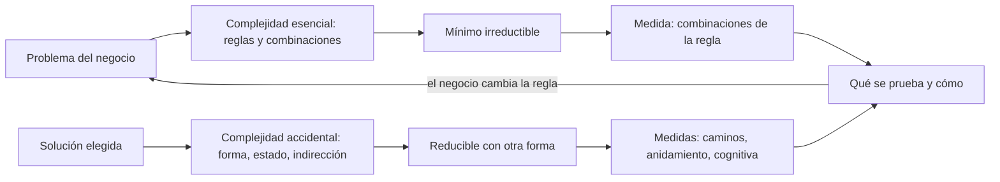
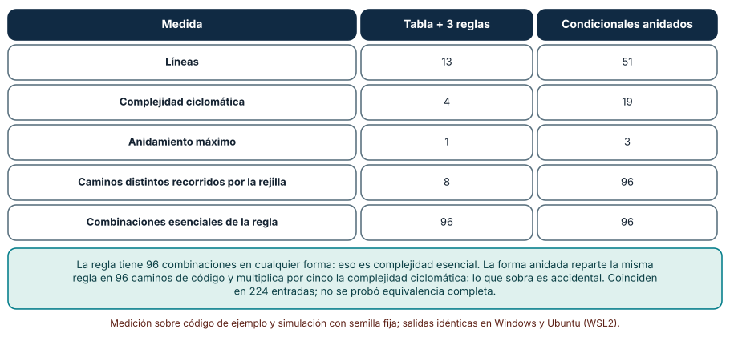
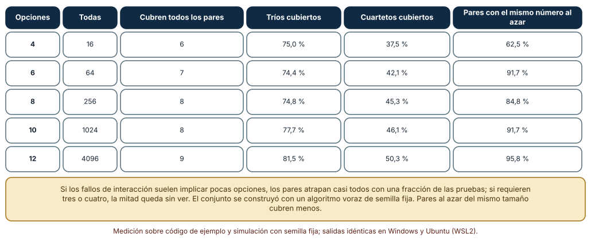
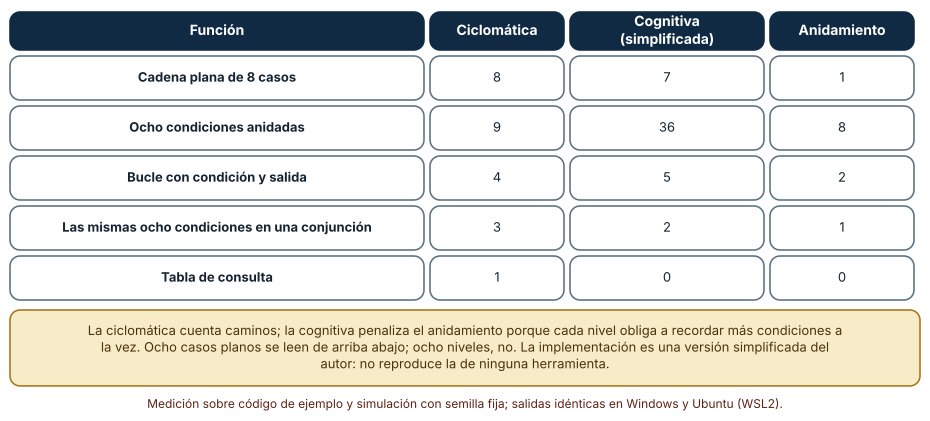

# SE-297 — Complejidad accidental y esencial

[← SE-296 — Diseño para cambio, prueba y operación](https://github.com/vladimiracunadev-create/modern-software-engineering-program/blob/main/classes/part-24-diseno-patrones-y-refactorizacion/se-296-diseno-para-cambio-prueba-y-operacion/README.md) · [↑ Parte 24](https://github.com/vladimiracunadev-create/modern-software-engineering-program/blob/main/classes/part-24-diseno-patrones-y-refactorizacion/README.md) · [📚 Índice completo](https://github.com/vladimiracunadev-create/modern-software-engineering-program/blob/main/classes/README.md) · [🌐 Portal](https://vladimiracunadev-create.github.io/modern-software-engineering-program/classes/SE-297.html) · [SE-298 — Deuda técnica, interés y opciones →](https://github.com/vladimiracunadev-create/modern-software-engineering-program/blob/main/classes/part-24-diseno-patrones-y-refactorizacion/se-298-deuda-tecnica-interes-y-opciones/README.md)

## Punto profesional y fundamento pedagógico

**Punto profesional.** La clase existe para que separes la complejidad que viene del problema (las reglas del negocio, que no se pueden quitar) de la que añade la solución (anidamiento, banderas, combinaciones sin límite), y para que midas la segunda, la reduzcas con una forma mejor y reconozcas el momento en que lo que queda ya es esencial.

**Por qué aparece aquí.** Sigue a **Diseño para cambio, prueba y operación** (`SE-296`): las decisiones de diseño pueden o no añadir complejidad. Aquí se pone nombre a lo que añaden y se miden tres de sus formas en `tarifas`: la misma regla escrita de dos maneras, las combinaciones de opciones y la dificultad de leer un código con la misma cantidad de caminos.

**Error conceptual que debe corregir.** Creer que menos complejidad siempre es mejor o que la complejidad es una sola cosa: parte es esencial y no se elimina sin cambiar el problema, parte es accidental y sí se elimina, y las métricas más conocidas mezclan ambas y no distinguen un camino que el negocio exige de uno que el código inventó.

**Secuencia de aprendizaje.** Antes de mirar los resultados, predices cuántos caminos recorre una regla de 96 combinaciones escrita como tabla y escrita con condicionales anidados, cuántas configuraciones bastan para cubrir todos los pares de doce opciones binarias y qué diferencia hay entre la complejidad ciclomática y la cognitiva de ocho condiciones planas, anidadas o en una conjunción. Después lo mides con `ast`, trazas y un algoritmo voraz de cobertura por pares. La secuencia usa predicción, explicación propia, contraste y recuperación. [ICAP](https://icap.education.asu.edu/research) distingue participación de construcción de conocimiento; [How People Learn II](https://nap.nationalacademies.org/catalog/24783/how-people-learn-ii-learners-contexts-and-cultures) exige conectar conocimiento previo, contexto y transferencia; la [práctica de recuperación](https://pubmed.ncbi.nlm.nih.gov/16507066/) respalda producir de nuevo la explicación tras una demora; y [Education for Life and Work](https://nap.nationalacademies.org/resource/13398/dbasse_084153.pdf) exige devolución que explique la causa del error.

**Evidencia de aprendizaje.** `complexity-log.md` con la predicción, la tabla de las dos formas de la regla, la de cobertura por pares, la de complejidad ciclomática y cognitiva y una nota que diga qué parte de la complejidad de `tarifas` es esencial y por qué.

**Límite de la conclusión.** La regla de tarifa, las opciones binarias y las cinco funciones de muestra son construcciones del autor. La complejidad cognitiva es una implementación simplificada del autor, no la de ninguna herramienta, y la equivalencia de las dos formas de la regla se comprobó en 224 entradas, no en todo el dominio.

### Trazabilidad fuente → afirmación

| Fuente primaria u oficial | Afirmación que respalda | Lo que no prueba |
|---|---|---|
| [Brooks, «No Silver Bullet: Essence and Accidents of Software Engineering» (IEEE Computer, 1987)](https://doi.org/10.1109/MC.1987.1663532) | Distingue la dificultad esencial del software (la complejidad del problema) de las accidentales (las de la representación) y sostiene que la esencial no desaparece con una herramienta. | No da una proporción entre ambas ni mide ningún proyecto. |
| [Moseley y Marks, «Out of the Tar Pit» (2006)](https://curtclifton.net/papers/MoseleyMarks06a.pdf) | Identifica el estado mutable como una fuente principal de complejidad accidental y propone separar el estado esencial del derivado. | Es un argumento de diseño, no una medición de proyectos. |
| [Campbell, «Cognitive Complexity: A new way of measuring understandability» (SonarSource)](https://www.sonarsource.com/docs/CognitiveComplexity.pdf) | Propone una medida que penaliza el anidamiento y las rupturas del flujo lineal, para acercarse a la dificultad de entender el código. | No está validada por esta clase; la implementación usada aquí es simplificada. |

## Antes de empezar

Recupera lo aprendido en `SE-296`: una decisión mal ubicada se paga en cambio, prueba y operación. La pregunta activa es: **¿cuántos de los caminos de este código los exige el negocio y cuántos los inventé yo?**

## Prerrequisitos

- Haber completado `SE-296` o poder explicar qué es una decisión oculta.
- Python 3.11 o posterior y un terminal; todo el código usa solo la biblioteca estándar.
- Conocer la complejidad ciclomática (`SE-294`) y el concepto de prueba de combinaciones.

## Problema auténtico

La función de tarifa de `tarifas` ocupa 51 líneas y su revisor dice que «da miedo tocarla». Tiene cuatro zonas, tres bandas de peso y tres opciones (urgente, frágil, VIP), pero el código está escrito con condicionales anidados que repiten el cálculo de cada zona y cada combinación de opciones. Una persona la reescribe con una tabla y tres reglas y sale de 13 líneas. Al mismo tiempo, el panel de configuración de la plataforma tiene doce interruptores y el equipo de pruebas dice que «no hay tiempo para probar 4096 combinaciones». Y una función de ocho condiciones anidadas tiene casi la misma complejidad ciclomática que otra de ocho casos planos, pero nadie quiere leer la primera. Los tres casos mezclan complejidad esencial con accidental.

## Objetivos observables

Al terminar podrás:

1. escribir la misma regla en dos formas y medir líneas, complejidad, anidamiento y caminos recorridos, y separar lo esencial de lo accidental;
2. construir un conjunto de configuraciones que cubra todos los pares de opciones y calcular lo que deja sin cubrir;
3. comparar la complejidad ciclomática con una medida cognitiva simplificada y explicar en qué funciones divergen;
4. declarar qué complejidad de `tarifas` es esencial (las combinaciones que exige el negocio) y cuál se puede reducir;
5. señalar los límites de cada medida y la evidencia que haría abandonar la conclusión.

## Mapa conceptual



El mapa tiene dos entradas: el problema y la solución. Solo la segunda se puede cambiar sin cambiar el negocio. El retorno marca que una regla nueva cambia lo esencial.

## Temas y por qué importan

| Tema | Por qué cambia una decisión profesional | Evidencia mínima |
|---|---|---|
| Complejidad esencial | Es el mínimo que el problema exige. | Predicción, traza causal y contraejemplo de **Complejidad esencial** en `complexity-log.md` |
| Complejidad accidental | La añade la forma de la solución y se puede reducir. | Predicción, traza causal y contraejemplo de **Complejidad accidental** en `complexity-log.md` |
| Combinaciones y cobertura | Las opciones se multiplican y no se prueban todas. | Predicción, traza causal y contraejemplo de **Combinaciones y cobertura** en `complexity-log.md` |
| Medir la complejidad | Cada métrica ve algo y deja de ver algo. | Predicción, traza causal y contraejemplo de **Medir la complejidad** en `complexity-log.md` |
| Cuándo parar | Más simplificación puede esconder una regla o quitar flexibilidad útil. | Predicción, traza causal y contraejemplo de **Cuándo parar** en `complexity-log.md` |

## Conceptos y decisiones

### 1. Complejidad esencial

Es la que viene del problema: si el negocio tiene cuatro zonas, tres bandas de peso y tres opciones, hay 96 casos distintos y no existe un programa correcto con menos. Se reconoce porque, al quitarla, cambia lo que el sistema hace. Se gestiona, no se elimina: se hace explícita, se escribe en un lugar legible (una tabla, un conjunto de reglas) y se prueba.

### 2. Complejidad accidental

Es la que introduce la solución: estado mutable que hay que seguir, banderas que interactúan, anidamiento que repite casos, capas sin razón, nombres que obligan a traducir. Brooks la separó de la esencial para decir que las herramientas pueden atacar la primera y no la segunda. Se reconoce porque el mismo comportamiento se puede escribir con menos partes que interactúan. Se reduce cambiando la forma, siempre con una red de pruebas (`SE-295`).

### 3. Combinaciones y cobertura

Las opciones independientes se multiplican: doce interruptores binarios dan 4096 configuraciones. Probarlas todas es imposible a partir de cierto tamaño, y las pruebas **combinatorias** aprovechan una observación empírica: la mayoría de los fallos por interacción involucran pocas opciones. Un conjunto que cubra todos los pares garantiza que cada combinación de dos opciones aparece en alguna prueba; los tríos y cuartetos se cubren solo en parte. La técnica no sirve si el fallo requiere cuatro opciones a la vez.

### 4. Medir la complejidad

La complejidad ciclomática cuenta caminos independientes y es fácil de calcular y de relacionar con el número mínimo de pruebas. No distingue un camino plano de uno anidado. Las medidas cognitivas intentan acercarse a la dificultad de leer: penalizan más el anidamiento y las rupturas del flujo. Ninguna distingue lo esencial de lo accidental: una regla de 96 casos bien escrita puede tener una complejidad alta y ser simple de leer.

### 5. Cuándo parar

Simplificar tiene un fondo: lo esencial. Una tabla de reglas puede quedar más corta que el código que reemplaza y, al mismo tiempo, esconder una regla que el negocio quiere ver explícita. Y a veces se ahorra complejidad hoy a costa de flexibilidad mañana (una tabla fija que no admite una regla condicionada a otra). Se para cuando cada parte restante se explica por una regla del negocio, y se anota qué se renunció.

### La misma regla de tarifa en dos formas

La regla: base por zona (2, 3, 5 u 8), más 0, 4 o 10 según la banda de peso (hasta 5, hasta 20, más), por 1,5 si es urgente, más 3 si es frágil, por 0,9 si es VIP, redondeada a dos decimales. Forma A: una tabla de zonas, una lista de límites y tres reglas de opciones. Forma B: condicionales anidados que repiten el cálculo de cada zona y cada combinación de opciones. Se comprueba que coinciden en las 224 entradas de una rejilla (4 zonas, 7 pesos, 8 combinaciones de opciones) y se miden líneas, complejidad ciclomática, anidamiento y caminos distintos (secuencias de líneas ejecutadas con `sys.settrace`).

```python
valor = BASE_ZONA[zona] + BANDA[bisect.bisect_left(LIMITES, peso)]
if urgente: valor *= 1.5
if fragil:  valor += 3.0
if vip:     valor *= 0.9
```

| Medida | Tabla + 3 reglas | Condicionales anidados |
|---|---:|---:|
| Líneas | 13 | 51 |
| Complejidad ciclomática | 4 | 19 |
| Anidamiento máximo | 1 | 3 |
| Caminos distintos recorridos por la rejilla | 8 | 96 |
| Combinaciones esenciales de la regla | 96 | 96 |

Resultado, idéntico en Windows (CPython 3.12.9) y en Ubuntu bajo WSL2 (3.12.3). Ambas formas producen lo mismo en las 224 entradas.



**Cómo leer la figura.** La última fila es la complejidad esencial, igual en ambas; las otras muestran lo que la forma añade. **Dónde deja de valer:** la tabla recorre 8 caminos de código pero la regla sigue teniendo 96 casos: la tabla los mueve a datos, y esos 96 casos hay que probarlos igual. Que la forma anidada recorra 96 caminos significa que cada caso tiene su propio código; no que sea incorrecta. La equivalencia se verificó en 224 entradas, no en todo el dominio, y la forma anidada podría contener una diferencia que la rejilla no cubre.

### Cobertura por pares de doce interruptores

Para *n* opciones binarias se construye con un algoritmo voraz de semilla fija un conjunto de configuraciones que cubra todos los pares de valores de todas las parejas de opciones: en cada paso se prueban 40 candidatas al azar y se elige la que cubre más pares aún sin cubrir. Se mide la fracción de tríos y de cuartetos de valores que el mismo conjunto cubre, y se compara con un conjunto del mismo tamaño elegido al azar.

```python
c = tuple(rng.randint(0, 1) for _ in range(n))
g = sum(1 for (i, j, a, b) in sin_cubrir if c[i] == a and c[j] == b)   # pares nuevos que cubre
```

| Opciones | Todas las configuraciones | Configuraciones para cubrir los pares | Tríos cubiertos | Cuartetos cubiertos | Pares cubiertos por un conjunto al azar del mismo tamaño |
|---:|---:|---:|---:|---:|---:|
| 4 | 16 | 6 | 75,0 % | 37,5 % | 62,5 % |
| 6 | 64 | 7 | 74,4 % | 42,1 % | 91,7 % |
| 8 | 256 | 8 | 74,8 % | 45,3 % | 84,8 % |
| 10 | 1024 | 8 | 77,7 % | 46,1 % | 91,7 % |
| 12 | 4096 | 9 | 81,5 % | 50,3 % | 95,8 % |



**Cómo leer la figura.** Cada fila es un número de opciones; las columnas muestran cuánto cubre el conjunto de pares y qué deja fuera. **Dónde deja de valer:** el conjunto se construyó con un algoritmo voraz y semilla fija; otro algoritmo daría tamaños algo distintos. Cubrir todos los pares no dice que se hayan probado bien: cada configuración debe ejecutarse con una comprobación real. Y los fallos que dependen de tres o cuatro opciones a la vez quedan solo parcialmente cubiertos (81,5 % y 50,3 % con doce opciones).

### Complejidad ciclomática frente a cognitiva

Cinco funciones: una cadena plana de ocho casos, ocho condiciones anidadas, un bucle con una condición y una salida, las mismas ocho condiciones en una conjunción y una tabla de consulta. Se calcula la complejidad ciclomática y una complejidad cognitiva simplificada: cada `if`, bucle o manejador suma uno más el nivel de anidamiento; un `elif` suma uno sin penalizar; cada operador booleano suma uno.

```python
if isinstance(hijo, ast.If):
    es_elif = isinstance(nodo, ast.If) and nodo.orelse == [hijo]
    total += 1 if es_elif else 1 + nivel
    visita(hijo, nivel if es_elif else nivel + 1)
```

| Función | Ciclomática | Cognitiva (simplificada) | Anidamiento |
|---|---:|---:|---:|
| Cadena plana de 8 casos | 8 | 7 | 1 |
| Ocho condiciones anidadas | 9 | 36 | 8 |
| Bucle con condición y salida | 4 | 5 | 2 |
| Las mismas ocho condiciones en una conjunción | 3 | 2 | 1 |
| Tabla de consulta | 1 | 0 | 0 |



**Cómo leer la figura.** Las dos primeras filas tienen ciclomática casi igual y cognitiva muy distinta. **Dónde deja de valer:** la cognitiva es una versión simplificada del autor, no la de ninguna herramienta, y no valida que «36» sea cuatro veces más difícil de leer que «7»; esa afirmación requeriría un estudio con personas. La tabla de consulta con 0 no significa que no tenga complejidad: la trasladó a los datos.

## Definiciones de trabajo

- **complejidad esencial:** la que se deriva del problema que el software resuelve y no puede eliminarse sin cambiar el problema.
- **complejidad accidental:** la que introduce la solución elegida y puede reducirse con otra forma.
- **complejidad ciclomática:** número de caminos independientes de una función.
- **complejidad cognitiva:** medida que intenta aproximar la dificultad de entender una función penalizando el anidamiento.
- **cobertura por pares:** conjunto de pruebas en que cada combinación de valores de cada pareja de opciones aparece al menos una vez.

Las definiciones son operativas para `tarifas`. No convierten términos con una historia más amplia en sinónimos y deben contrastarse con la bibliografía enlazada al final.

## Ejemplo mínimo

El fragmento calcula las combinaciones de una regla. Antes de ejecutarlo, predice cuántas son.

```python
zonas, bandas, opciones = 4, 3, 3
combinaciones = zonas * bandas * 2 ** opciones
assert combinaciones == 96
```

La cuenta es el producto de las zonas, las bandas y las combinaciones de opciones: 4 × 3 × 8. Registra versión, comando y salida; añade una cuarta opción y una quinta zona y predice el nuevo número.

## Ejemplo profesional

El equipo no reduce la función a ciegas. Primero escribe las 96 combinaciones como una tabla en un documento y obtiene de la persona de negocio la confirmación de que son las que quiere. Después escribe la forma de tabla más tres reglas, la compara con la anidada en 2000 entradas de semilla fija además de la rejilla y mueve la tabla a un archivo de datos con una prueba que verifica que cada zona y cada banda aparece. Para el panel de doce interruptores, genera un conjunto de nueve configuraciones que cubre todos los pares y documenta que los tríos y cuartetos están cubiertos en parte; las interacciones conocidas de tres opciones (por ejemplo, moneda, redondeo y descuento) se añaden a mano.

Compara con el estado anterior: la reducción es adecuada si la regla de negocio se puede leer en una tabla, la comparación con la forma anterior pasa y las interacciones conocidas están cubiertas; es frágil si la tabla esconde una regla que dependía de otra o si el conjunto de pares se trata como una garantía.

## Práctica guiada

1. Escribe la regla de tarifa en dos formas y predice cuántos caminos recorre cada una.
2. Comprueba que coinciden en la rejilla de 224 entradas y en 2000 entradas aleatorias.
3. Mide líneas, complejidad, anidamiento y caminos con `ast` y `sys.settrace`.
4. Implementa el algoritmo voraz de cobertura por pares y construye los conjuntos para 4 a 12 opciones.
5. Calcula la cobertura de tríos y cuartetos y compárala con un conjunto aleatorio del mismo tamaño.
6. Implementa la complejidad cognitiva simplificada y calcula las cinco funciones.
7. Entrega `complexity-log.md` y pide a otra persona que diga, de cada parte de tu función, si es esencial o accidental.

## Ejercicios

1. **Esencial:** añade una regla que dependa de la zona y el peso a la vez y decide si cabe en la tabla o la vuelve irreductible.
2. **Combinaciones:** modifica el algoritmo para cubrir también todos los tríos de las tres opciones de la regla y cuenta cuántas configuraciones requiere.
3. **Medida:** escribe una función con complejidad ciclomática baja y cognitiva alta distinta de las del texto y explica por qué.
4. **Parar:** encuentra en tu código una simplificación que quitaría una regla visible para el negocio y decide si hacerla.

## Reto verificable

Entrega `complexity-log.md` con la predicción, la tabla de las dos formas, la de cobertura por pares, la de ciclomática y cognitiva y la clasificación de la complejidad de `tarifas`. Se aprueba si otra persona ejecuta el código desde un checkout limpio, obtiene los mismos números y puede decir cuántos casos tiene la regla y cuáles son los caminos accidentales. No se aprueba por afirmar que el código «es más simple» sin una medida ni por reducir una medida a costa de quitar una regla.

## Caso conductor

El componente `tarifas` conserva lo construido en `SE-289` a `SE-296` y gana la regla de tarifa en forma de tabla con tres reglas, una prueba de equivalencia con la forma anterior y un conjunto de configuraciones que cubre los pares de su panel. `SE-298` pondrá precio a la complejidad que no se redujo. Cambia después una sola decisión, el número de bandas de peso, y observa cuántos casos más tiene la regla.

## Preguntas frecuentes

### ¿Cómo sé si una complejidad es esencial?

Pregúntate si el negocio podría describirla sin mencionar la implementación. Si la tabla de zonas, bandas y opciones es lo que el negocio dicta, es esencial. Si hay banderas, copias de cálculo o estados que solo existen en el código, son accidentales.

### ¿Una tabla siempre es mejor que los condicionales?

No: es mejor cuando los casos son datos homogéneos. Si cada caso tiene lógica propia o una regla depende de otra, la tabla se queda corta o se llena de excepciones y puede ser peor que el código.

### ¿La cobertura por pares garantiza que no hay fallos de interacción?

No: garantiza que cada par de valores aparece en alguna prueba. Si el fallo necesita tres opciones y la combinación exacta no está en el conjunto, no aparece. Se complementa con tríos conocidos y con la historia de defectos.

### ¿Es mejor la complejidad cognitiva que la ciclomática?

Mide otra cosa. La ciclomática da el número mínimo de pruebas de caminos; la cognitiva se acerca a la dificultad de lectura. Conviene mirar ambas y, sobre todo, leer el código.

## Fallo controlado y diagnóstico

Reproduce el fallo clásico de la clase: **simplificar hasta esconder una regla**. Reordena las tres reglas de opciones de la tabla para que el descuento VIP se aplique antes del recargo frágil, porque «queda más legible» con las reglas agrupadas por tipo.

Registra síntoma, entrada mínima, hipótesis, observación que descarta cada hipótesis, causa, corrección y prueba de regresión. **Síntoma:** tras la simplificación, un cliente VIP con envío frágil paga 0,30 más de lo que facturaba antes, y la suite de cinco ejemplos sigue en verde. **Hipótesis rivales:** (a) el redondeo cambió; (b) la tabla perdió una fila; (c) el orden de las reglas era parte de la regla de negocio y se alteró. **Prueba:** compara la forma antigua y la nueva sobre las 224 entradas de la rejilla; si difieren solo cuando VIP y frágil coinciden, la causa es (c). **Conclusión:** la simplificación cambió complejidad esencial, porque el orden de aplicación es una regla. **Regresión:** escribe el orden como parte de la regla (con su razón), añade el caso VIP más frágil como prueba y comprueba la equivalencia sobre todas las combinaciones de las opciones. No cambies a la vez el orden y la tabla.

## Errores comunes y cómo corregirlos

| Síntoma | Causa probable | Corrección |
|---|---|---|
| Una función con 96 caminos de código para 96 casos | Cada caso tiene su propio código | Pasar los casos a una tabla y una regla común |
| Se reduce la complejidad y se pierde una regla | Se simplificó sin la lista de casos del negocio | Escribir los casos antes y comprobar la equivalencia |
| «No hay tiempo para probar 4096 configuraciones» | Se intenta probar todo o nada | Cubrir los pares y añadir las interacciones conocidas |
| Dos funciones con la misma ciclomática no se leen igual | Una está anidada y la otra plana | Mirar también anidamiento y lectura |
| Una tabla crece con excepciones | Los casos no eran datos homogéneos | Volver a código para los casos con lógica |

## Entorno y archivos clave

```text
work/SE-297/
├── README.md
├── regla/
│   ├── tabla.py
│   ├── anidada.py
│   └── test_equivalencia.py
├── pares/
│   └── cobertura.py
├── medidas/
│   └── cognitiva.py
└── evidence/complexity-log.md
```

El `README` declara plataforma, versión de Python, semillas y comandos. Los experimentos usan solo la biblioteca estándar (`ast`, `bisect`, `itertools`, `random`, `sys`) y se ejecutaron con CPython 3.12.9 en Windows 11 y 3.12.3 en Ubuntu bajo WSL2: las salidas fueron idénticas. Si añades una dependencia, fija procedencia y versión.

## Seguridad, ética y accesibilidad

- una regla de cobro que se simplifica sin la lista de casos puede cobrar mal a un grupo de clientes sin que nadie lo vea: la equivalencia con la forma anterior es una protección para ellos;
- una tabla de reglas legible permite que auditoría y soporte entiendan por qué se cobró un monto; mantenla en un formato que lean personas sin programar;
- un panel de configuración con muchos interruptores dificulta su uso con tecnologías de apoyo: agrupa las opciones y documenta las combinaciones no válidas;
- no uses datos reales de clientes para construir las entradas de comparación;
- respeta las licencias de los textos citados y atribuye lo adaptado.

## Puente hacia el trabajo con agentes

Un agente al que se le pide «simplifica la función de tarifa» reducirá líneas y complejidad ciclomática y declarará que mejoró. Pídele en cambio que enumere primero los casos del negocio (zonas, bandas, opciones), que escriba la tabla, que compare la versión nueva con la anterior sobre todas las combinaciones y que informe qué reglas contiene la tabla. Revisa especialmente si eliminó una combinación que parecía redundante, si redujo la medida moviendo la lógica a un archivo de datos que nadie prueba o si presentó un conjunto de pares como cobertura total.

## Transferencia

Traslada el análisis a otra función (por ejemplo, la de elegibilidad de reembolsos): cambia las reglas y las opciones, y conserva el procedimiento de enumerar los casos esenciales, comparar las formas, medir caminos y cubrir pares. La transferencia está lograda cuando puedes explicar qué complejidad de tu función es esencial y cuál quitaste, no cuando la medida baja.

## Evaluación y evidencia

| Criterio | Evidencia para aprobar |
|---|---|
| comprensión | explicación de la diferencia entre complejidad esencial y accidental con ejemplos de `tarifas` |
| corrección | medidas, conjuntos de pares y complejidades reproducibles con las mismas semillas |
| diseño | regla en forma de tabla con la lista de casos del negocio y prueba de equivalencia |
| diagnóstico | reproducción del fallo «simplificar hasta esconder una regla» con regresión |
| incertidumbre | declaración de que la cognitiva es simplificada y la equivalencia se verificó en 224 entradas |
| reproducibilidad | versiones, comandos, salida y límites declarados |

## Fuentes

- [Brooks, «No Silver Bullet» (IEEE Computer, 1987)](https://doi.org/10.1109/MC.1987.1663532) — complejidad esencial y accidental; autoridad: IEEE Computer.
- [Moseley y Marks, «Out of the Tar Pit» (2006)](https://curtclifton.net/papers/MoseleyMarks06a.pdf) — estado y complejidad accidental; autoridad: sus autores.
- [McCabe, «A Complexity Measure» (IEEE TSE, 1976)](https://doi.org/10.1109/TSE.1976.233837) — complejidad ciclomática; autoridad: IEEE Transactions on Software Engineering.
- [Campbell, «Cognitive Complexity» (SonarSource)](https://www.sonarsource.com/docs/CognitiveComplexity.pdf) — medida cognitiva; autoridad: SonarSource.
- [Kuhn, Wallace y Gallo, «Software fault interactions and implications for software testing» (IEEE TSE, 2004)](https://doi.org/10.1109/TSE.2004.24) — interacciones de pocas variables en los fallos; autoridad: IEEE Transactions on Software Engineering.
- [NIST, «Practical Combinatorial Testing»](https://www.nist.gov/publications/practical-combinatorial-testing) — pruebas combinatorias; autoridad: NIST.
- [Python: `ast`](https://docs.python.org/3/library/ast.html) — árbol sintáctico usado para medir; autoridad: documentación de Python.

Cada fuente respalda el mecanismo indicado; ninguna demuestra que las 96 combinaciones, las 9 configuraciones para 12 opciones o la cognitiva de 36 se observen en `tarifas`. Esa afirmación depende de su regla, su panel y su equipo.

## Límites y siguiente paso

Se ejecutaron tres análisis con código de ejemplo y datos sintéticos en Windows y Ubuntu (WSL2) con resultados idénticos. No se midió ningún proyecto real ni se validó la complejidad cognitiva con personas; la regla de tarifa, las opciones binarias y las cinco funciones son construcciones del autor. La siguiente clase pone precio a la complejidad que se decide no reducir.

## Glosario

- **complejidad esencial:** la que se deriva del problema que el software resuelve y no puede eliminarse sin cambiar el problema.
- **complejidad accidental:** la que introduce la solución elegida y puede reducirse con otra forma.
- **complejidad ciclomática:** número de caminos independientes de una función.
- **complejidad cognitiva:** medida que intenta aproximar la dificultad de entender una función penalizando el anidamiento.
- **cobertura por pares:** conjunto de pruebas en que cada combinación de valores de cada pareja de opciones aparece al menos una vez.

---

[← SE-296 — Diseño para cambio, prueba y operación](https://github.com/vladimiracunadev-create/modern-software-engineering-program/blob/main/classes/part-24-diseno-patrones-y-refactorizacion/se-296-diseno-para-cambio-prueba-y-operacion/README.md) · [↑ Parte 24](https://github.com/vladimiracunadev-create/modern-software-engineering-program/blob/main/classes/part-24-diseno-patrones-y-refactorizacion/README.md) · [📚 Índice completo](https://github.com/vladimiracunadev-create/modern-software-engineering-program/blob/main/classes/README.md) · [🌐 Portal](https://vladimiracunadev-create.github.io/modern-software-engineering-program/classes/SE-297.html) · [SE-298 — Deuda técnica, interés y opciones →](https://github.com/vladimiracunadev-create/modern-software-engineering-program/blob/main/classes/part-24-diseno-patrones-y-refactorizacion/se-298-deuda-tecnica-interes-y-opciones/README.md)
