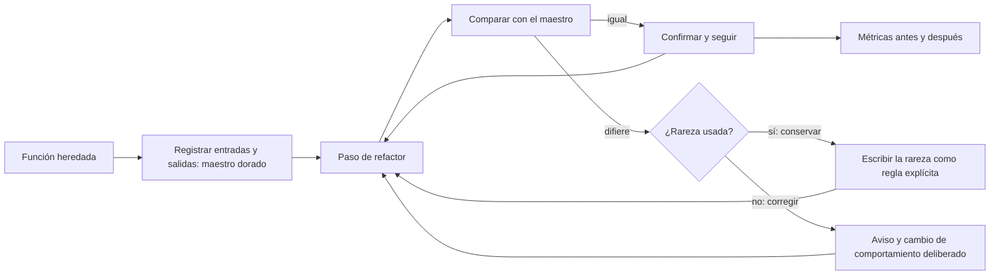
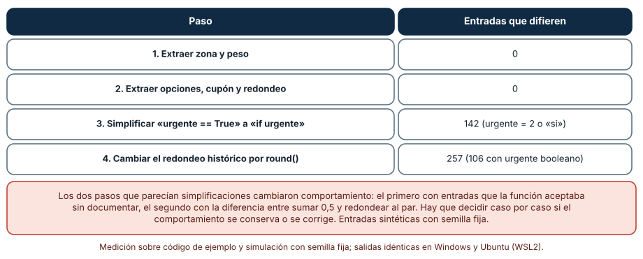
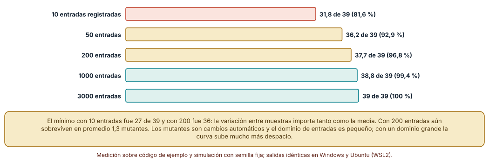
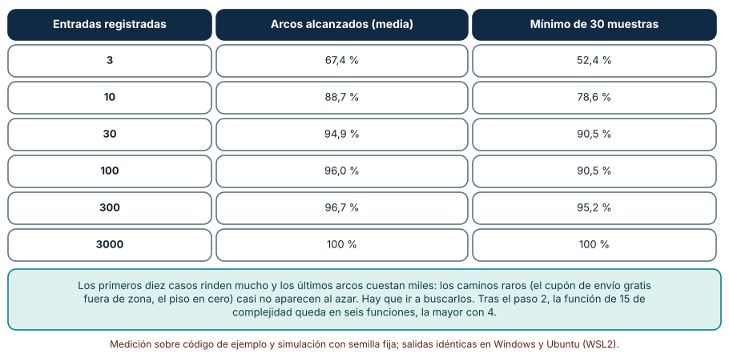

# SE-299 — Taller: refactorizar sin alterar comportamiento

[← SE-298 — Deuda técnica, interés y opciones](https://github.com/vladimiracunadev-create/modern-software-engineering-program/blob/main/classes/part-24-diseno-patrones-y-refactorizacion/se-298-deuda-tecnica-interes-y-opciones/README.md) · [↑ Parte 24](https://github.com/vladimiracunadev-create/modern-software-engineering-program/blob/main/classes/part-24-diseno-patrones-y-refactorizacion/README.md) · [📚 Índice completo](https://github.com/vladimiracunadev-create/modern-software-engineering-program/blob/main/classes/README.md) · [🌐 Portal](https://vladimiracunadev-create.github.io/modern-software-engineering-program/classes/SE-299.html) · [SE-300 — Proyecto: evolución compatible de un componente →](https://github.com/vladimiracunadev-create/modern-software-engineering-program/blob/main/classes/part-24-diseno-patrones-y-refactorizacion/se-300-proyecto-evolucion-compatible-de-un-componente/README.md)

## Punto profesional y fundamento pedagógico

**Punto profesional.** El taller existe para que ejecutes un refactor completo sobre una función heredada de `tarifas` con la técnica que cuida el comportamiento cuando no hay especificación: registrar lo que hace hoy (un maestro dorado), avanzar en pasos que se comparan con ese registro, decidir caso por caso qué rarezas se conservan y cuáles se corrigen, y entregar la evidencia de cada decisión.

**Por qué aparece aquí.** Es el taller de la mitad de la Parte 24 y reúne las clases anteriores: el diagnóstico de `SE-294`, la red de `SE-295`, las decisiones de diseño de `SE-296`, la complejidad de `SE-297` y la estimación de interés de `SE-298`. Prepara el proyecto de `SE-300`, que evoluciona un componente sin romper a sus usuarios.

**Error conceptual que debe corregir.** Creer que, si un refactor «se ve más limpio» y las pruebas existentes pasan, el comportamiento se conservó: en el código heredado hay comportamientos no documentados que alguien usa, y los pasos aparentemente inocentes (simplificar una comparación, cambiar el redondeo) los cambian sin que ninguna prueba lo diga.

**Secuencia de aprendizaje.** Antes de mirar los resultados, predices cuántas entradas registradas cambian de resultado en cada paso de un refactor de cuatro pasos, cuántos de 39 mutantes mata un maestro dorado de 10, 200 o 3000 entradas y qué fracción de los caminos de la función alcanzan 3, 30 o 300 entradas registradas. Después lo ejecutas sobre una función heredada con rarezas. La secuencia usa predicción, explicación propia, contraste y recuperación. [ICAP](https://icap.education.asu.edu/research) distingue participación de construcción de conocimiento; [How People Learn II](https://nap.nationalacademies.org/catalog/24783/how-people-learn-ii-learners-contexts-and-cultures) exige conectar conocimiento previo, contexto y transferencia; la [práctica de recuperación](https://pubmed.ncbi.nlm.nih.gov/16507066/) respalda producir de nuevo la explicación tras una demora; y [Education for Life and Work](https://nap.nationalacademies.org/resource/13398/dbasse_084153.pdf) exige devolución que explique la causa del error.

**Evidencia de aprendizaje.** `workshop-log.md` con la predicción, la tabla de pasos con entradas que difieren, la curva de mutantes muertos, la de caminos alcanzados, las decisiones de conservar o corregir cada rareza y una nota que diga qué comportamiento heredado se conservó y por qué.

**Límite de la conclusión.** La función heredada, su dominio de entradas (con 10 % de valores no booleanos en una bandera) y los 39 mutantes son construcciones del autor. Un maestro dorado solo protege lo que sus entradas ejercen: no se ejecutó ningún cliente real ni se consultó a quienes usaban las rarezas.

### Trazabilidad fuente → afirmación

| Fuente primaria u oficial | Afirmación que respalda | Lo que no prueba |
|---|---|---|
| [Feathers, «Working Effectively with Legacy Code»](https://www.oreilly.com/library/view/working-effectively-with/0131177052/) | Presenta las pruebas de caracterización: registrar lo que el código hace hoy para protegerlo al cambiarlo, aunque ese comportamiento no esté especificado. | No dice cuántas entradas bastan ni cómo decidir qué rarezas conservar. |
| [Fowler, catálogo de refactorizaciones: «Extract Function»](https://refactoring.com/catalog/extractFunction.html) | Describe la extracción de una función como un paso pequeño que conserva el comportamiento, con sus precauciones. | No garantiza que una extracción concreta sea segura sin una red. |
| [Python: `sys.settrace`](https://docs.python.org/3/library/sys.html) | Documenta el rastreo de líneas ejecutadas, que se usa aquí para medir los caminos que alcanza cada conjunto de entradas. | No define qué cobertura es suficiente. |

## Antes de empezar

Recupera lo aprendido en `SE-295` y `SE-298`: una red se mide y un refactor se paga donde hay interés. La pregunta activa es: **¿qué hace hoy esta función que alguien pudo haber usado, y cómo lo sabré después de cada paso?**

## Prerrequisitos

- Haber completado `SE-298` o poder explicar la diferencia entre principal e interés.
- Python 3.11 o posterior y un terminal; todo el código usa solo la biblioteca estándar.
- Haber medido mutantes (`SE-295`) y leído el árbol sintáctico con `ast`.

## Problema auténtico

Dentro de `tarifas` hay una función heredada de 31 líneas, `tarifa(peso, zona, urgente, fragil, vip, cupon)`, escrita hace cuatro años por alguien que ya no está. Sin documentación, mezcla la base por zona, los recargos por peso, las opciones y los cupones, con condicionales en cascada y un redondeo propio (`int(t * 100 + 0.5) / 100`). La complejidad ciclomática es 15, es el módulo que más se cambia (se estima, con `SE-298`, un interés de medio día por cambio) y nadie sabe qué hace con un cupón de envío gratis fuera de la zona 1 y 2, ni con un `urgente` que llega como número o como texto desde un cliente antiguo. La jefatura pide que se limpie «sin cambiar nada».

## Objetivos observables

Al terminar podrás:

1. registrar un maestro dorado de una función heredada con entradas elegidas por semilla y usarlo como oráculo en cada paso;
2. ejecutar un refactor de cuatro pasos y detectar, con una cuenta, qué paso cambió el comportamiento y por qué;
3. medir cuántos mutantes mata el maestro según su tamaño y cuántos caminos de la función alcanza;
4. decidir caso por caso si una rareza se conserva (compatibilidad) o se corrige (con aviso), y dejarlo escrito;
5. entregar las métricas antes y después y el límite de lo que el maestro no cubre.

## Mapa conceptual



El mapa tiene un ciclo (paso, comparación, decisión) y dos salidas distintas ante una diferencia: conservar la rareza como regla o corregirla con un aviso. Ninguna diferencia se acepta sin decisión.

## Temas y por qué importan

| Tema | Por qué cambia una decisión profesional | Evidencia mínima |
|---|---|---|
| Maestro dorado | Convierte el comportamiento actual en un oráculo sin necesitar una especificación. | Predicción, traza causal y contraejemplo de **Maestro dorado** en `workshop-log.md` |
| Pasos y comparación | Cada paso se comprueba con el oráculo y deja un solo sospechoso. | Predicción, traza causal y contraejemplo de **Pasos y comparación** en `workshop-log.md` |
| Rarezas heredadas | Hay que decidir si se conservan o se corrigen. | Predicción, traza causal y contraejemplo de **Rarezas heredadas** en `workshop-log.md` |
| Cobertura del oráculo | El maestro protege solo lo que sus entradas ejercen. | Predicción, traza causal y contraejemplo de **Cobertura del oráculo** en `workshop-log.md` |
| Métricas y cierre | Antes y después, con lo que no se cubrió. | Predicción, traza causal y contraejemplo de **Métricas y cierre** en `workshop-log.md` |

## Conceptos y decisiones

### 1. Maestro dorado

Un maestro dorado (golden master) es un registro de las salidas del programa actual para un conjunto grande de entradas. No afirma que esas salidas sean correctas: afirma que son lo que el código hace hoy. Sirve como oráculo para un refactor, porque cualquier diferencia es un cambio de comportamiento que hay que explicar. Su calidad depende de las entradas: deben cubrir los caminos y los bordes, incluidas las entradas «raras» que los clientes reales envían.

### 2. Pasos y comparación

El refactor se divide en pasos que se pueden comparar con el maestro: extraer la base por zona y el recargo por peso, extraer las opciones, el cupón y el redondeo, simplificar una condición, cambiar el redondeo. Tras cada paso se ejecuta la comparación; si algo difiere, el último paso es el sospechoso único (`SE-295`). Un paso que no cambia nada observable es puro refactor; uno que sí, es un cambio de comportamiento que debe decidirse aparte.

### 3. Rarezas heredadas

Cada diferencia detectada es una decisión. Algunas rarezas son defectos que nadie notó (un cupón que da un monto negativo y se corrige a cero por un piso), otras son acuerdos implícitos con clientes (un `urgente` que llega como `2` o como `"si"` y se trata como falso porque la comparación es con `True`). Conservar una rareza la convierte en una regla explícita con una prueba y un nombre; corregirla es un cambio de comportamiento que se anuncia y se programa. No decidir deja la rareza escondida en una simplificación.

### 4. Cobertura del oráculo

El maestro tiene un tamaño y una distribución. Con pocas entradas, los caminos poco frecuentes (un cupón de envío gratis fuera de las zonas 1 y 2, el piso en cero) no aparecen. La cobertura de caminos se mide con un rastreo de líneas, y se completa con entradas escogidas a mano para los caminos que el azar no alcanza. También hay que incluir los valores que llegan por canales antiguos (números en lugar de booleanos), aunque sean pocos.

### 5. Métricas y cierre

El cierre del taller compara antes y después: funciones, líneas, complejidad total y complejidad de la función mayor. No bastan: la evidencia principal es que el oráculo pasa, que cada diferencia tiene una decisión y que se declara lo que el maestro no ve (concurrencia, rendimiento, efectos laterales, clientes que dependían de un detalle fuera del dominio probado). Un refactor termina cuando otra persona puede continuar sin saber qué hacía la función antes.

### Un refactor de cuatro pasos contra el maestro

La función heredada: base por zona (2, 3, 5 u 8), +4 si el peso pasa de 5, +6 si pasa de 20, +0,125 por kilo, ×1,5 si `urgente == True`, +3 si frágil, ×0,9 si VIP, un cupón (`PRIMERA` resta 2, `ENVIOGRATIS` anula el monto en las zonas 1 y 2 y resta 5 en las demás), piso en cero y el redondeo `int(t * 100 + 0.5) / 100`. El maestro se registra con 3000 entradas de semilla fija: peso de 0,1 a 50, zona 1 a 5, banderas booleanas el 90 % de las veces y valores `1`, `0`, `2` o `"si"` el 10 %, y cupón ausente, `PRIMERA`, `ENVIOGRATIS` u `OTRO`.

Los cuatro pasos: (1) extraer `base_zona` y `recargo_peso`; (2) extraer las opciones, el cupón y un `redondeo_historico` con el piso; (3) cambiar `urgente == True` por `if urgente`; (4) cambiar el redondeo histórico por `round(t, 2)`.

```python
dif = [(x, g, f(*x)) for x, g in zip(MAESTRO, GOLD) if f(*x) != g]
```

| Paso | Entradas que difieren |
|---|---|
| 1. Extraer zona y peso | 0 |
| 2. Extraer opciones, cupón y redondeo | 0 |
| 3. `urgente == True` pasa a `if urgente` | 142 (`urgente` = 2 o `"si"`: 77 y 65) |
| 4. `round()` en vez del redondeo histórico | 257 (106 con `urgente` booleano) |

Resultado, idéntico en Windows (CPython 3.12.9) y en Ubuntu bajo WSL2 (3.12.3). De las 3000 entradas, 315 tienen un `urgente` no booleano; el paso 3 cambia el resultado de las 142 con `2` o `"si"`. Con `1` y `0` el resultado no cambia.



**Cómo leer la figura.** Cada fila es un paso; el número es cuántas de las 3000 entradas registradas dan un resultado distinto. **Dónde deja de valer:** el 10 % de valores no booleanos es un supuesto del autor sobre lo que envían los clientes antiguos; si ninguno los enviara, el paso 3 sería inocuo. El maestro detecta la diferencia, pero no decide si es un defecto o un acuerdo: eso es una decisión. Y el paso 4 cambia el comportamiento en entradas con redondeo de mitades, donde el valor difiere por un centavo.

### Cuántos mutantes mata el maestro según su tamaño

Se parte de la versión tras el paso 2. Un transformador de `ast` genera 39 mutantes (comparaciones, operadores y constantes), todos distinguibles con 3000 entradas de referencia. Se toman muestras aleatorias del maestro de 10, 50, 200, 1000 y 3000 entradas (30 muestras por tamaño, semilla fija) y se cuenta cuántos mutantes dan una salida distinta de la función heredada.

```python
ests.append(sum(1 for m in vivos if any(salida(m, x) != salida(f0, x) for x in sub)))
```

| Entradas registradas | Mutantes muertos (media de 30 muestras) | Mínimo y máximo |
|---:|---:|---|
| 10 | 31,8 de 39 (81,6 %) | 27 y 36 |
| 50 | 36,2 de 39 (92,9 %) | 35 y 38 |
| 200 | 37,7 de 39 (96,8 %) | 36 y 39 |
| 1000 | 38,8 de 39 (99,4 %) | 38 y 39 |
| 3000 | 39 de 39 (100 %) | 39 y 39 |



**Cómo leer la figura.** Cada barra es la media de mutantes muertos con un tamaño de maestro; el mínimo y el máximo de las muestras están en la tabla. **Dónde deja de valer:** el dominio de entradas es pequeño (peso, cinco zonas, banderas, cupón) y los mutantes son cambios automáticos simples; en un dominio con millones de combinaciones, la curva sube mucho más despacio. Con 200 entradas aún sobreviven 1,3 mutantes en promedio y hasta 3 en la peor muestra: un maestro pequeño deja pasar cambios.

### Qué caminos alcanzan las entradas

Con `sys.settrace` se registran los arcos (pares de líneas consecutivas) que recorre la función heredada. El total alcanzable con las 3000 entradas y dos entradas a mano (un cupón de envío gratis fuera de zona y un peso mínimo) es de 42 arcos. Para cada tamaño de muestra se calcula qué fracción de esos arcos se alcanza (30 muestras, semilla fija).

```python
def tr(fr, ev, arg):
    if fr.f_code.co_name == "tarifa" and ev == "line":
        vistos.add((tr.ant, fr.f_lineno)); tr.ant = fr.f_lineno
```

| Entradas registradas | Arcos alcanzados (media) | Mínimo de 30 muestras |
|---:|---:|---:|
| 3 | 67,4 % | 52,4 % |
| 10 | 88,7 % | 78,6 % |
| 30 | 94,9 % | 90,5 % |
| 100 | 96,0 % | 90,5 % |
| 300 | 96,7 % | 95,2 % |
| 3000 | 100 % | 100 % |



**Cómo leer la figura.** Cada fila es un tamaño de maestro; las columnas dan la fracción media y la mínima de arcos alcanzados. **Dónde deja de valer:** los arcos son pares de líneas, una medida de caminos más fina que las líneas pero no tan fina como las condiciones; alcanzar un arco no comprueba su resultado. Los primeros diez casos rinden mucho y los últimos arcos cuestan miles: los caminos raros (cupón de envío gratis fuera de zona, piso en cero) casi no salen al azar y hay que ir a buscarlos. Tras el paso 2 la función de complejidad 15 queda en seis funciones, la mayor con 4.

## Definiciones de trabajo

- **maestro dorado:** registro de las salidas de un programa para un conjunto de entradas, usado como oráculo para detectar cambios de comportamiento.
- **prueba de caracterización:** prueba que fija lo que el código hace hoy, sin afirmar que sea lo correcto.
- **rareza heredada:** comportamiento no documentado del código existente que puede estar en uso.
- **arco:** par de líneas consecutivas ejecutadas, usado como medida de cobertura de caminos.
- **compatibilidad hacia atrás:** propiedad de un cambio que no rompe a quienes usaban la versión anterior.

Las definiciones son operativas para `tarifas`. No convierten términos con una historia más amplia en sinónimos y deben contrastarse con la bibliografía enlazada al final.

## Ejemplo mínimo

El fragmento registra un maestro dorado de una función y detecta un cambio. Antes de ejecutarlo, predice cuántas entradas difieren.

```python
def antes(x): return int(x * 100 + 0.5) / 100
def despues(x): return round(x, 2)

entradas = [0.125, 0.135, 1.005, 2.675, 3.14159]
maestro = [antes(x) for x in entradas]
difieren = [x for x, g in zip(entradas, maestro) if despues(x) != g]
assert len(difieren) >= 1
```

Las entradas con mitades exactas o casi exactas pueden redondear distinto. Registra versión, comando y salida; imprime cuáles difieren y por qué.

## Ejemplo profesional

El equipo de `tarifas` ejecuta el taller con un protocolo de cinco pasos escrito antes de tocar el código. Registra el maestro dorado con 3000 entradas de semilla fija más los casos de borde derivados del código, incluidos los valores no booleanos que, según el registro de solicitudes, llegan del cliente antiguo. Hace los cuatro pasos con un commit y una comparación cada uno. Ante el paso 3, no lo da por inocuo: pregunta al equipo de integración y encuentra que un cliente antiguo envía `2` en lugar de `True`; decide conservar la rareza como una función `urgente_historico(valor)` con una prueba y un aviso de retirada en seis meses. Ante el paso 4, decide conservar el redondeo histórico con un nombre que lo explique, porque cambiaría el monto de un centavo en 106 entradas booleanas.

Compara con el estado anterior: el taller es adecuado si cada diferencia tiene una decisión escrita, el maestro pasa en cada paso y la lista de lo que no cubre está declarada; es frágil si se acepta una diferencia «porque es de un centavo» sin preguntar a quien factura, o si el maestro no contiene las entradas que los clientes reales envían.

## Práctica guiada

1. Escribe la función heredada de 31 líneas y predice su complejidad ciclomática.
2. Registra el maestro dorado con 3000 entradas de semilla fija, incluyendo valores no booleanos en `urgente`.
3. Ejecuta los cuatro pasos y compara con el maestro tras cada uno; anota las diferencias.
4. Para cada diferencia, decide conservar o corregir y escribe la regla o el aviso.
5. Genera 39 mutantes y mide cuántos mata el maestro con 10, 200 y 3000 entradas.
6. Mide con `sys.settrace` los arcos que alcanzan 3, 30 y 300 entradas y completa con entradas a mano los que faltan.
7. Entrega `workshop-log.md` y pide a otra persona que reproduzca el maestro y diga qué rareza conservaste.

## Ejercicios

1. **Rarezas:** encuentra una tercera rareza en la función (por ejemplo, el cupón `OTRO`) y decide si se conserva.
2. **Maestro:** añade entradas de borde derivadas del código y mide si suben los mutantes muertos con 200 entradas.
3. **Paso:** divide el paso 4 en dos (introducir `redondeo` como función y cambiar su cuerpo) y explica qué ganas.
4. **Cierre:** escribe la sección «lo que el maestro no cubre» para esta función.

## Reto verificable

Entrega `workshop-log.md` con la predicción, el maestro dorado (semilla y comando), la tabla de pasos con las diferencias, la decisión por rareza, las curvas de mutantes y arcos y las métricas antes y después. Se aprueba si otra persona ejecuta el código desde un checkout limpio, obtiene los mismos números y puede decir qué rarezas se conservaron y cuáles se corrigieron. No se aprueba por afirmar que «las pruebas pasan» ni por aceptar una diferencia sin una decisión escrita.

## Caso conductor

El componente `tarifas` conserva el diagnóstico, la red, el diseño, la reducción de complejidad y el registro de deuda de `SE-294` a `SE-298`, y gana la función de tarifa refactorizada en seis funciones, con las rarezas conservadas como reglas con nombre y una prueba de maestro dorado. `SE-300` cierra la parte evolucionando el componente sin romper a sus usuarios. Cambia después una sola decisión, el tamaño del maestro, y observa qué mutantes sobreviven.

## Preguntas frecuentes

### ¿Un maestro dorado no consagra los defectos?

Los registra, y eso es lo que se busca al principio: no cambiar nada por accidente. Después se decide, caso por caso, cuáles se corrigen con un aviso y una prueba nueva. Corregir un defecto durante el refactor mezcla dos cambios y hace imposible saber cuál rompió algo.

### ¿Cuántas entradas debe tener el maestro?

Las que alcancen los caminos y los bordes relevantes y las entradas raras que los clientes reales envían. La curva muestra que 200 entradas aún dejan pasar mutantes y que unas pocas entradas dirigidas valen más que cientos al azar.

### ¿Qué hago si una diferencia es de un centavo?

Preguntar quién factura y quién concilia: un centavo en miles de cobros es dinero y un motivo de reclamos. No se acepta por pequeña.

### ¿Puedo cambiar el nombre de las funciones durante el refactor?

Sí, si es un paso mecánico y se comprueba con el maestro. Cambiar la interfaz pública es otro tipo de cambio y se trata en `SE-300`.

## Fallo controlado y diagnóstico

Reproduce el fallo clásico del taller: **una simplificación que cambia el comportamiento para clientes antiguos**. Aplica el paso 3 sin consultar el maestro y despliega.

Registra síntoma, entrada mínima, hipótesis, observación que descarta cada hipótesis, causa, corrección y prueba de regresión. **Síntoma:** un cliente antiguo empieza a recibir tarifas de envío urgente más altas que antes, y la suite de ejemplos sigue en verde. **Hipótesis rivales:** (a) el cliente cambió el peso; (b) la tabla de zonas se actualizó; (c) el parámetro `urgente` llega como `2` y la condición ahora lo trata como verdadero. **Prueba:** ejecuta la versión anterior y la nueva con `urgente = 2`; si difieren y con `True` coinciden, la causa es (c). **Conclusión:** la simplificación cambió un comportamiento no documentado. **Regresión:** añade al maestro entradas con `urgente` en `1`, `0`, `2` y `"si"`, conserva la rareza como `urgente_historico` con su prueba y no cambies a la vez la condición y la lista de valores aceptados.

## Errores comunes y cómo corregirlos

| Síntoma | Causa probable | Corrección |
|---|---|---|
| El refactor pasa las pruebas y rompe a un cliente | El maestro no incluye entradas de canales antiguos | Añadir las entradas reales (valores no booleanos, formatos viejos) |
| No se sabe qué paso cambió el comportamiento | Se hicieron varios pasos antes de comparar | Comparar tras cada paso y hacer un commit por paso |
| Se corrige un defecto durante el refactor | Dos cambios en uno | Separar: primero preservar, luego corregir con aviso |
| El maestro deja pasar mutantes | Pocas entradas o sin bordes | Medir mutantes y completar con entradas dirigidas |
| Se acepta una diferencia «de un centavo» | No se preguntó a quien factura | Tratar cada diferencia como decisión de negocio |

## Entorno y archivos clave

```text
work/SE-299/
├── README.md
├── heredado/
│   ├── tarifa_heredada.py
│   └── maestro.json
├── refactor/
│   ├── paso1.py
│   ├── paso2.py
│   ├── paso3.py
│   └── paso4.py
├── medidas/
│   ├── mutantes.py
│   └── arcos.py
└── evidence/workshop-log.md
```

El `README` declara plataforma, versión de Python, semillas y comandos. Los experimentos usan solo la biblioteca estándar (`ast`, `sys`, `random`, `statistics`, `textwrap`) y se ejecutaron con CPython 3.12.9 en Windows 11 y 3.12.3 en Ubuntu bajo WSL2: las salidas fueron idénticas. Si añades una dependencia, fija procedencia y versión.

## Seguridad, ética y accesibilidad

- un cambio de un centavo en un cobro es un cambio de lo que paga una persona: toda diferencia detectada es una decisión de negocio y se registra con quién la tomó;
- un maestro dorado que se construye con datos reales de clientes contiene información personal: usa entradas sintéticas o anonimizadas y no lo publiques;
- retirar una rareza que un cliente antiguo usa sin avisarle puede impedirle operar: anuncia la retirada con plazo (`SE-300`);
- los mensajes de las pruebas deben decir qué entrada difiere y en cuánto, para que cualquiera pueda decidir;
- respeta las licencias de los textos citados y atribuye lo adaptado.

## Puente hacia el trabajo con agentes

Un agente al que se le pide «refactoriza esta función heredada sin cambiar el comportamiento» la reescribirá con una forma más clara y ejecutará las pruebas que existan. Pídele en cambio que registre primero el maestro dorado con entradas de semilla fija y bordes, que avance en pasos con comparación y commit por paso, que detenga el refactor ante cada diferencia y te la presente con la decisión que necesita, y que liste lo que el maestro no cubre. Revisa especialmente si «arregló» una rareza sin avisar, si cambió el redondeo o una comparación con `True`, o si modificó el maestro para que la diferencia desapareciera.

## Transferencia

Traslada el taller a otra función heredada (por ejemplo, la de conciliación de pagos): cambia la lógica y las rarezas, y conserva el procedimiento de registrar el maestro, avanzar en pasos, decidir cada diferencia y declarar lo no cubierto. La transferencia está lograda cuando puedes explicar qué rarezas conservaste y por qué, no cuando el código queda más corto.

## Evaluación y evidencia

| Criterio | Evidencia para aprobar |
|---|---|
| comprensión | explicación de qué registra un maestro dorado y qué decisiones exige |
| corrección | maestro, pasos y curvas reproducibles con las mismas semillas |
| diseño | función refactorizada en funciones con nombre y rarezas conservadas como reglas |
| diagnóstico | reproducción del fallo «simplificación que cambia el comportamiento para clientes antiguos» con regresión |
| incertidumbre | declaración de que el maestro solo protege las entradas que ejerce |
| reproducibilidad | versiones, comandos, semillas, salida y límites declarados |

## Fuentes

- [Feathers, «Working Effectively with Legacy Code»](https://www.oreilly.com/library/view/working-effectively-with/0131177052/) — pruebas de caracterización; autoridad: su autor (Prentice Hall).
- [Fowler, «Refactoring» (2.ª ed.)](https://martinfowler.com/books/refactoring.html) — refactorizar en pasos pequeños; autoridad: Martin Fowler.
- [Fowler, «Extract Function»](https://refactoring.com/catalog/extractFunction.html) — extracción de una función; autoridad: Martin Fowler.
- [Fowler, «Self Testing Code»](https://martinfowler.com/bliki/SelfTestingCode.html) — código que se comprueba solo; autoridad: Martin Fowler.
- [Jia y Harman (IEEE TSE, 2011)](https://doi.org/10.1109/TSE.2010.62) — revisión de la prueba de mutación; autoridad: IEEE Transactions on Software Engineering.
- [Python: `sys.settrace`](https://docs.python.org/3/library/sys.html) — rastreo de líneas ejecutadas; autoridad: documentación de Python.

Cada fuente respalda el mecanismo indicado; ninguna demuestra que los 142 casos del paso 3, los 31,8 mutantes con 10 entradas o el 67,4 % de arcos con 3 entradas se observen en una función real. Esa afirmación depende de su dominio de entradas y de lo que sus clientes envían.

## Límites y siguiente paso

Se ejecutaron tres análisis sobre una función heredada de ejemplo con datos sintéticos en Windows y Ubuntu (WSL2) con resultados idénticos. No se consultó a ningún cliente real ni se registró un maestro con tráfico real; la función, su dominio de entradas, los valores no booleanos y los 39 mutantes son construcciones del autor. La siguiente clase es el proyecto de la parte: evolucionar un componente sin romper a quienes lo usan.

## Glosario

- **maestro dorado:** registro de las salidas de un programa para un conjunto de entradas, usado como oráculo para detectar cambios de comportamiento.
- **prueba de caracterización:** prueba que fija lo que el código hace hoy, sin afirmar que sea lo correcto.
- **rareza heredada:** comportamiento no documentado del código existente que puede estar en uso.
- **arco:** par de líneas consecutivas ejecutadas, usado como medida de cobertura de caminos.
- **compatibilidad hacia atrás:** propiedad de un cambio que no rompe a quienes usaban la versión anterior.

---

[← SE-298 — Deuda técnica, interés y opciones](https://github.com/vladimiracunadev-create/modern-software-engineering-program/blob/main/classes/part-24-diseno-patrones-y-refactorizacion/se-298-deuda-tecnica-interes-y-opciones/README.md) · [↑ Parte 24](https://github.com/vladimiracunadev-create/modern-software-engineering-program/blob/main/classes/part-24-diseno-patrones-y-refactorizacion/README.md) · [📚 Índice completo](https://github.com/vladimiracunadev-create/modern-software-engineering-program/blob/main/classes/README.md) · [🌐 Portal](https://vladimiracunadev-create.github.io/modern-software-engineering-program/classes/SE-299.html) · [SE-300 — Proyecto: evolución compatible de un componente →](https://github.com/vladimiracunadev-create/modern-software-engineering-program/blob/main/classes/part-24-diseno-patrones-y-refactorizacion/se-300-proyecto-evolucion-compatible-de-un-componente/README.md)
