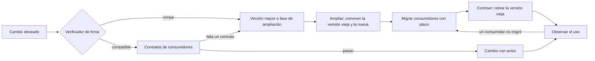
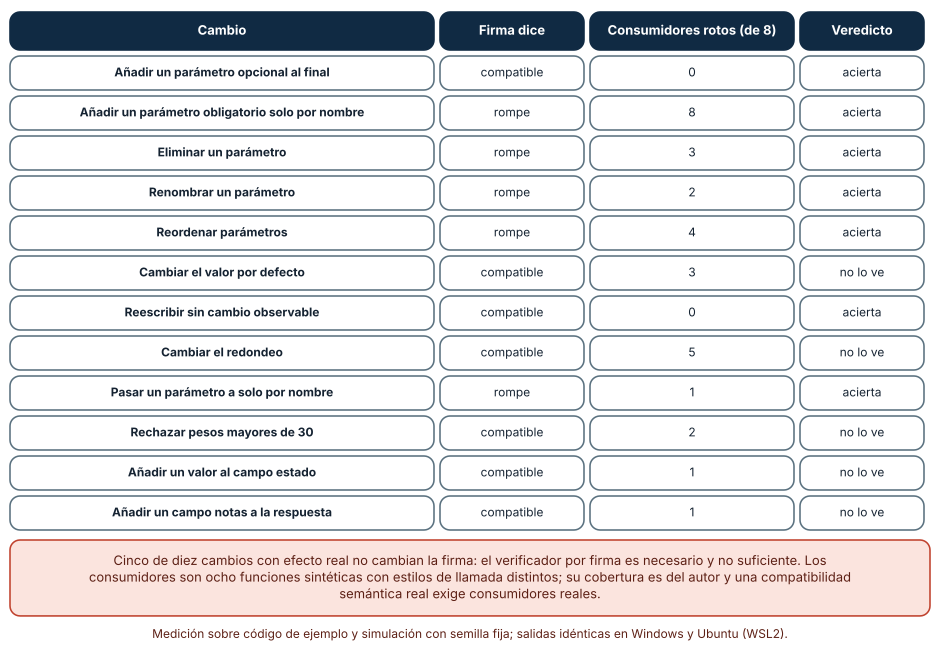
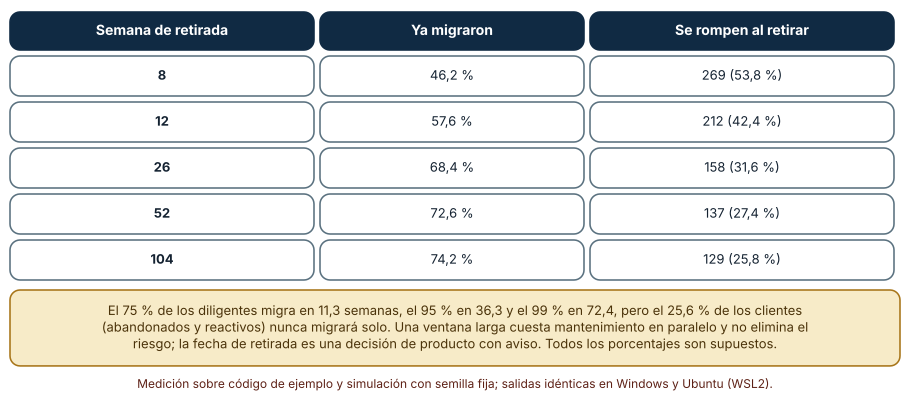
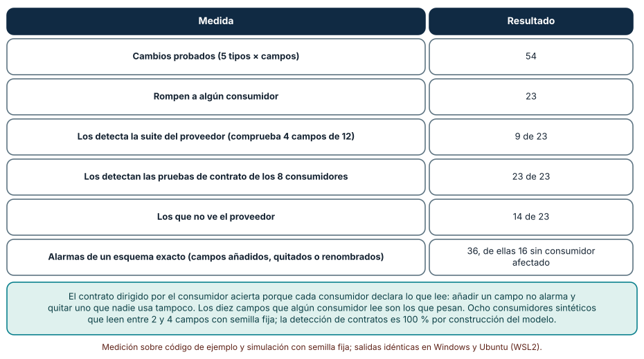

# SE-300 — Proyecto: evolución compatible de un componente

[← SE-299 — Taller: refactorizar sin alterar comportamiento](https://github.com/vladimiracunadev-create/modern-software-engineering-program/blob/main/classes/part-24-diseno-patrones-y-refactorizacion/se-299-taller-refactorizar-sin-alterar-comportamiento/README.md) · [↑ Parte 24](https://github.com/vladimiracunadev-create/modern-software-engineering-program/blob/main/classes/part-24-diseno-patrones-y-refactorizacion/README.md) · [📚 Índice completo](https://github.com/vladimiracunadev-create/modern-software-engineering-program/blob/main/classes/README.md) · [🌐 Portal](https://vladimiracunadev-create.github.io/modern-software-engineering-program/classes/SE-300.html) · [SE-301 — Drivers, restricciones y atributos de arquitectura →](https://github.com/vladimiracunadev-create/modern-software-engineering-program/blob/main/classes/part-25-arquitectura-de-software-y-dominio/se-301-drivers-restricciones-y-atributos-de-arquitectura/README.md)

## Punto profesional y fundamento pedagógico

**Punto profesional.** El proyecto existe para que entregues el cambio de un componente que tiene usuarios sin romperlos: un plan de evolución con un verificador de compatibilidad cuyos límites conoces, contratos de los consumidores, una ventana de deprecación estimada con sus supuestos y la lista de lo que ninguna de esas comprobaciones ve.

**Por qué aparece aquí.** Cierra la **Parte 24**: reúne el diseño de `SE-289` a `SE-293`, el diagnóstico y la refactorización de `SE-294` a `SE-299` y la deuda de `SE-298`, y los lleva al problema que el taller dejó abierto, el de cambiar una interfaz pública. Abre la Parte 25, donde las decisiones de arquitectura cambian el tamaño de lo que puede evolucionar.

**Error conceptual que debe corregir.** Creer que un cambio compatible es el que no cambia la firma: la firma es una parte pequeña de lo que los consumidores usan; los valores por defecto, el redondeo, los rangos aceptados y los campos que se añaden a una respuesta rompen a algunos sin cambiar una sola línea de la interfaz declarada.

**Secuencia de aprendizaje.** Antes de mirar los resultados, predices cuántos de doce cambios de una función pública detecta un verificador que compara solo firmas, cuántos clientes se rompen si se retira la versión antigua a la semana 12, 52 o 104 y cuántos de los cambios de una respuesta de doce campos detecta la suite del proveedor frente a las pruebas de contrato de los consumidores. Después lo ejecutas con consumidores sintéticos. La secuencia usa predicción, explicación propia, contraste y recuperación. [ICAP](https://icap.education.asu.edu/research) distingue participación de construcción de conocimiento; [How People Learn II](https://nap.nationalacademies.org/catalog/24783/how-people-learn-ii-learners-contexts-and-cultures) exige conectar conocimiento previo, contexto y transferencia; la [práctica de recuperación](https://pubmed.ncbi.nlm.nih.gov/16507066/) respalda producir de nuevo la explicación tras una demora; y [Education for Life and Work](https://nap.nationalacademies.org/resource/13398/dbasse_084153.pdf) exige devolución que explique la causa del error.

**Evidencia de aprendizaje.** `evolution-package-log.md` con la predicción, la tabla del verificador por firma frente a los consumidores, la de la ventana de deprecación, la de los contratos, el plan de evolución del componente con sus fases y una lista de lo que el paquete no ve.

**Límite de la conclusión.** Los ocho consumidores, los 500 clientes y su tiempo de migración y los contratos son construcciones del autor. La detección del 100 % de las pruebas de contrato es una propiedad del modelo, no de ninguna herramienta, y no se contrastó con consumidores reales ni con una infraestructura de despliegue.

### Trazabilidad fuente → afirmación

| Fuente primaria u oficial | Afirmación que respalda | Lo que no prueba |
|---|---|---|
| [Semantic Versioning 2.0.0](https://semver.org/) | Define cómo comunicar con el número de versión si un cambio rompe la interfaz pública, añade funcionalidad compatible o corrige errores. | No decide qué es la interfaz pública de un componente ni detecta un cambio incompatible. |
| [Hyrum's Law](https://www.hyrumslaw.com/) | Afirma que, con suficientes usuarios, todos los comportamientos observables del sistema serán usados por alguien, estén o no documentados. | Es una observación de experiencia, no una medición. |
| [Pact: documentación de pruebas de contrato dirigidas por el consumidor](https://docs.pact.io/) | Describe cómo cada consumidor registra lo que espera de un proveedor y cómo el proveedor lo verifica antes de cambiar. | No dice cuántos consumidores hay ni garantiza que su contrato sea completo. |

## Antes de empezar

Recupera lo aprendido en `SE-299`: una rareza heredada puede estar en uso. La pregunta activa es: **¿quién usa qué de esta interfaz, cómo lo sé y cómo cambio lo que no puedo ver sin romperlo?**

## Prerrequisitos

- Haber completado `SE-299` o poder explicar qué es un maestro dorado y qué rarezas conservó.
- Python 3.11 o posterior y un terminal; todo el código usa solo la biblioteca estándar (`inspect`, `json`, `random`, `math`).
- Haber leído el vocabulario de versionado semántico y de contratos de `SE-290`.

## Problema auténtico

`tarifas` se ha vuelto una biblioteca interna que consumen ocho equipos: el cobro, la facturación, el panel de ventas, la app móvil, el exportador, el soporte, un socio externo y el módulo de reembolsos. Tras la parte refactorizada, el equipo quiere cuatro cambios: añadir un parámetro obligatorio de moneda, redondear con `round()`, rechazar pesos de más de 30 kilos y añadir un campo `notas` a la respuesta. Cada equipo tiene su propio calendario de despliegue y nadie sabe qué usa cada uno. Un verificador de firmas automático dice que solo el primero es incompatible; el equipo de la app móvil recuerda que dos veces antes «un cambio compatible» le rompió la pantalla de precios.

## Objetivos observables

Al terminar podrás:

1. construir un verificador de compatibilidad por firma con `inspect` y medir cuántos cambios que rompen consumidores no ve;
2. estimar con un modelo cuántos clientes quedan sin migrar según la fecha de retirada y qué fracción nunca migra por sí sola;
3. escribir contratos de consumidor y medir cuántos cambios de una respuesta detectan frente a la suite del proveedor y frente a un esquema exacto;
4. diseñar un plan de evolución por fases (ampliar, migrar, contraer) con criterios para pasar de una a otra;
5. entregar el paquete con la lista de lo que el verificador, el modelo y los contratos no ven.

## Mapa conceptual



El mapa tiene dos filtros automáticos (firma y contratos) y un recorrido por fases cuando el cambio rompe. El retorno marca que la retirada depende de quién migró, no de la fecha.

## Temas y por qué importan

| Tema | Por qué cambia una decisión profesional | Evidencia mínima |
|---|---|---|
| Qué es compatible | Define cuándo un cambio puede hacerse sin coordinar. | Predicción, traza causal y contraejemplo de **Qué es compatible** en `evolution-package-log.md` |
| Verificar por firma | Es barato y deja fuera los cambios de comportamiento. | Predicción, traza causal y contraejemplo de **Verificar por firma** en `evolution-package-log.md` |
| Contratos de consumidor | Dicen qué usa cada uno y detectan lo que importa. | Predicción, traza causal y contraejemplo de **Contratos de consumidor** en `evolution-package-log.md` |
| Ventana de deprecación | Equilibra el costo de mantener dos versiones con el de romper. | Predicción, traza causal y contraejemplo de **Ventana de deprecación** en `evolution-package-log.md` |
| Evolución por fases | Ampliar, migrar y contraer evita el cambio simultáneo de todos. | Predicción, traza causal y contraejemplo de **Evolución por fases** en `evolution-package-log.md` |

## Conceptos y decisiones

### 1. Qué es compatible

Un cambio es compatible hacia atrás si todo consumidor que funcionaba con la versión anterior sigue funcionando con la nueva. La definición pone la carga en los consumidores, no en la firma: hay cambios de firma que no rompen a nadie (un parámetro opcional al final) y cambios sin tocar la firma que rompen a algunos (un valor por defecto, un redondeo, un rango). El versionado semántico lo comunica con el número, pero solo es tan fiable como la decisión de quien lo asigna.

### 2. Verificar por firma

Un verificador de firmas compara la interfaz declarada: parámetros que desaparecen, que se renombran, que cambian de orden o de tipo, que se vuelven obligatorios. Es barato, automatizable y detecta los cambios más obvios. No ve lo que no está en la firma: valores por defecto, semántica, errores nuevos, campos añadidos, rangos aceptados. Es una condición necesaria, no suficiente; sirve como filtro, no como veredicto.

### 3. Contratos de consumidor

En un contrato dirigido por el consumidor, cada consumidor declara qué usa del proveedor (qué campos lee, qué tipos espera) y esa declaración se ejecuta como prueba contra el proveedor antes de publicar un cambio. Detecta lo que importa a quien consume y no alarma por lo que nadie usa. Su límite es que solo cubre a los consumidores que escribieron contrato y a lo que declararon; un consumidor que lee un campo que no declaró queda fuera. La ley de Hyrum dice que habrá más usos de los declarados.

### 4. Ventana de deprecación

Retirar una versión antigua exige un aviso, un plazo y una forma de saber quién sigue usándola. El plazo equilibra dos costos: mantener dos versiones (que crece con la ventana) y romper a quien no migró (que decrece con ella, pero no llega a cero porque algunos nunca migrarán por sí solos). Las cabeceras de deprecación y retirada de los protocolos de red permiten anunciar el plazo a los clientes en cada respuesta. La fecha de retirada final es una decisión de producto con aviso, no un cálculo.

### 5. Evolución por fases

La técnica general es **ampliar, migrar, contraer** (expand, migrate, contract): primero se añade la forma nueva conviviendo con la vieja, después se migra a los consumidores uno a uno con seguimiento, y solo cuando nadie usa la vieja se retira. Evita el cambio simultáneo de todos y permite revertir en cada fase. Su costo es la convivencia y la disciplina de no olvidar la contracción; el código de dos versiones que no se retira se convierte en deuda (`SE-298`).

### Doce cambios, un verificador por firma y ocho consumidores

La función pública es `calcular(peso, zona, urgente=False)` y devuelve un diccionario con `total`, `moneda` y `estado`. Se escriben doce versiones con un cambio cada una. Un verificador con `inspect.signature` considera que rompe si un parámetro desaparece o se renombra, cambia de orden o de tipo de parámetro, o aparece uno obligatorio nuevo. Ocho consumidores sintéticos llaman a la función de distinta manera (posicional, por nombre, con y sin el parámetro opcional, leyendo `total`, `estado` o todas las claves, con pesos grandes) y se ejecutan contra la versión anterior y contra cada versión nueva; un cambio rompe a un consumidor si su resultado o su excepción difieren.

```python
for n in nb:
    if n not in a and b[n].default is inspect.Parameter.empty:
        return True              # parametro obligatorio nuevo
```

| Cambio | La firma dice | Consumidores rotos (de 8) |
|---|---|---:|
| Añadir un parámetro opcional al final | compatible | 0 |
| Añadir un parámetro obligatorio solo por nombre | rompe | 8 |
| Eliminar un parámetro | rompe | 3 |
| Renombrar un parámetro | rompe | 2 |
| Reordenar parámetros | rompe | 4 |
| Cambiar el valor por defecto | compatible | 3 |
| Reescribir sin cambio observable | compatible | 0 |
| Cambiar el redondeo | compatible | 5 |
| Pasar un parámetro a solo por nombre | rompe | 1 |
| Rechazar pesos mayores de 30 | compatible | 2 |
| Añadir un valor al campo `estado` | compatible | 1 |
| Añadir un campo `notas` a la respuesta | compatible | 1 |

Resultado, idéntico en Windows (CPython 3.12.9) y en Ubuntu bajo WSL2 (3.12.3). El verificador acierta 7 de los 12 y no ve 5 cambios que rompen a entre 1 y 5 consumidores; no hubo falsas alarmas.



**Cómo leer la figura.** Cada fila es un cambio; la segunda columna es el veredicto del verificador y la tercera, cuántos consumidores se rompen de verdad. **Dónde deja de valer:** los ocho consumidores son del autor y están escritos para ejercer estos cambios; un consumidor real ejercería otros o no ejercería ninguno. Que el verificador no tenga falsas alarmas no lo hace suficiente: de diez cambios con efecto real, deja pasar cinco. El «0 de 8» del cambio sin efecto observable es un resultado esperado, no una garantía.

### La ventana de deprecación

Quinientos clientes sintéticos con un tiempo hasta migrar tras el aviso: el 75 % son diligentes (migran en un tiempo lognormal de mediana 6 semanas y sigma 1), el 15 % solo reaccionan cuando se rompe y el 10 % está abandonado y nunca migra. Se calcula, para varias semanas de retirada, cuántos clientes ya migraron y cuántos se rompen.

```python
if u < abandonados: cl.append(("abandonado", math.inf))
elif u < abandonados + reactivos: cl.append(("reactivo", None))
else: cl.append(("diligente", rng.lognormvariate(math.log(mediana), sigma)))
```

| Semana de retirada | Ya migraron | Se rompen al retirar |
|---:|---:|---:|
| 8 | 46,2 % | 269 (53,8 %) |
| 12 | 57,6 % | 212 (42,4 %) |
| 26 | 68,4 % | 158 (31,6 %) |
| 52 | 72,6 % | 137 (27,4 %) |
| 104 | 74,2 % | 129 (25,8 %) |

Entre los diligentes, el 75 % migra en 11,3 semanas, el 95 % en 36,3 y el 99 % en 72,4. Aun esperando indefinidamente, el 25,6 % de los clientes (abandonados y reactivos) no migra solo.



**Cómo leer la figura.** Cada fila es una semana de retirada; las columnas muestran cuántos habían migrado y cuántos se rompen al retirar. **Dónde deja de valer:** las proporciones de diligentes, reactivos y abandonados, la mediana y la sigma son supuestos del autor, sin ningún dato de clientes reales. El modelo no incluye recordatorios, soporte activo ni migraciones asistidas, que mueven a los reactivos antes. Esperar no lleva a cero: la decisión final es de producto, con aviso y con una lista de quién queda.

### Contratos de consumidor frente a la suite del proveedor

La respuesta tiene doce campos. Ocho consumidores sintéticos, cada uno lee entre 2 y 4 campos, con semilla fija. Cinco tipos de cambio aplicados a cada campo: eliminar, renombrar, cambiar el tipo, añadir un campo nuevo y cambiar un valor de un campo de texto. Resultan 54 cambios (el último solo se aplica a los seis campos de texto). Un consumidor se rompe si, al leer sus campos de la respuesta cambiada, falla. La suite del proveedor comprueba cuatro campos; un esquema exacto alarma ante cualquier campo añadido, quitado o renombrado.

```python
for c in usos:
    v = resp[c]                     # lector exigente con los campos que usa
    if c == "total" and not isinstance(v, (int, float)): raise TypeError
```

| Medida | Resultado |
|---|---:|
| Cambios probados | 54 |
| Rompen a algún consumidor | 23 |
| Los detecta la suite del proveedor (4 campos de 12) | 9 de 23 |
| Los detectan los contratos de los 8 consumidores | 23 de 23 |
| Los que no ve el proveedor | 14 de 23 |
| Alarmas de un esquema exacto | 36, de ellas 16 sin consumidor afectado |

Diez de los doce campos los lee algún consumidor.



**Cómo leer la figura.** Cada fila es una medida sobre los 54 cambios; la clave es la comparación entre quien comprueba todo el esquema, quien comprueba cuatro campos y quien comprueba lo que cada consumidor declara. **Dónde deja de valer:** el 100 % de los contratos es una propiedad del modelo, que da a cada consumidor un lector que declara exactamente lo que usa; en la práctica un consumidor lee más de lo que declaró. Dos campos que nadie lee (de doce) dejan cambios sin consumidor afectado. La figura muestra por qué un contrato evita las alarmas inútiles, no que tenga cobertura total.

## Definiciones de trabajo

- **compatibilidad hacia atrás:** propiedad de un cambio por la que todo consumidor que funcionaba con la versión anterior sigue funcionando.
- **prueba de contrato dirigida por el consumidor:** prueba en que cada consumidor declara lo que espera del proveedor y el proveedor la ejecuta antes de publicar.
- **lector tolerante:** consumidor que lee solo los campos que necesita y no falla ante los campos que no conoce.
- **ventana de deprecación:** periodo entre el aviso de retirada de una versión y su retirada efectiva.
- **ampliar, migrar y contraer:** estrategia de cambio en tres fases: añadir la forma nueva, mover a los consumidores y retirar la vieja.

Las definiciones son operativas para `tarifas`. No convierten términos con una historia más amplia en sinónimos y deben contrastarse con la bibliografía enlazada al final.

## Ejemplo mínimo

El fragmento muestra un cambio de firma que parece compatible y que depende del estilo de llamada. Antes de ejecutarlo, predice qué llamadas funcionan.

```python
import inspect

def v1(peso, zona, urgente=False): return 1
def v2(peso, zona, urgente=False, *, moneda="CLP"): return 1

assert list(inspect.signature(v2).parameters) == ["peso", "zona", "urgente", "moneda"]
assert v1(1, 2, True) == v2(1, 2, True) == v2(1, 2, urgente=True, moneda="USD")
```

El parámetro nuevo, opcional y solo por nombre, no rompe ninguna llamada de `v1`. Registra versión, comando y salida; hazlo obligatorio y predice qué llamadas se rompen.

## Ejemplo profesional

El equipo de `tarifas` entrega un paquete de evolución para sus cuatro cambios. Para cada uno aplica el filtro de firma y los contratos de los ocho consumidores, que cada equipo escribió en media hora. El parámetro de moneda obligatorio falla el filtro y se programa en tres fases: ampliar (la moneda es opcional con el valor actual), migrar (cada consumidor pasa la moneda, con seguimiento por una cabecera de uso) y contraer (se hace obligatoria cuando el 95 % migró y los demás recibieron aviso individual). El redondeo con `round()` no cambia la firma pero rompe a cinco consumidores según los contratos; se conserva el redondeo histórico con un nombre y se ofrece el nuevo detrás de un parámetro. El rechazo de pesos de más de 30 kilos se anuncia con cabecera y se aplica en seis meses. El campo `notas` es compatible para lectores tolerantes y se publica con aviso.

Compara con el estado anterior: el plan es adecuado si cada cambio tiene su fase, su responsable y un criterio de paso, y si lo que ni la firma ni los contratos ven está escrito; es frágil si la contracción nunca se ejecuta o si un consumidor sin contrato se descubre solo cuando se rompe.

## Práctica guiada

1. Escribe la función pública y las doce versiones con un cambio cada una; predice cuántas detecta el verificador de firmas.
2. Implementa el verificador con `inspect` y ejecuta los ocho consumidores contra cada versión; completa la tabla.
3. Escribe los contratos de los ocho consumidores (qué campos leen y qué esperan de ellos).
4. Aplica los cinco tipos de cambio a una respuesta de doce campos y mide quién los detecta.
5. Simula la migración de 500 clientes con tus propios supuestos y calcula los rotos por semana de retirada.
6. Diseña el plan por fases de cada uno de los cuatro cambios, con criterios de paso.
7. Entrega `evolution-package-log.md` y pide a otra persona que identifique qué cambio no vería tu paquete.

## Ejercicios

1. **Firma:** añade al verificador la detección de cambios de tipo en las anotaciones y mide si cambia el resultado de la tabla.
2. **Contrato:** escribe un consumidor que lea un campo sin declararlo y muestra qué cambio lo rompe sin que el contrato lo detecte.
3. **Ventana:** modifica los porcentajes de reactivos y abandonados y calcula cómo cambia el número de rotos a la semana 26.
4. **Fases:** diseña el plan ampliar-migrar-contraer para renombrar un campo de la respuesta.

## Reto verificable

Entrega `evolution-package-log.md` con la predicción, la tabla del verificador frente a los consumidores, los contratos de los ocho consumidores, la simulación de migración con sus supuestos, el plan por fases de los cuatro cambios y la lista de lo que el paquete no ve. Se aprueba si otra persona ejecuta el código desde un checkout limpio, obtiene los mismos números y puede decir qué cambio rompería a un consumidor sin que el paquete lo advierta. No se aprueba por declarar «compatible» un cambio porque la firma no cambió ni por fijar una fecha de retirada sin saber quién queda.

## Caso conductor

El componente `tarifas` cierra la Parte 24 con un plan de evolución: un verificador de firmas como filtro, contratos de ocho consumidores, un redondeo histórico conservado con nombre, una ventana de deprecación estimada y las tres fases de cada cambio. Conserva los artefactos de `SE-289` a `SE-299`. La Parte 25 sube de nivel y se pregunta qué restricciones arquitectónicas condicionan lo que un componente puede evolucionar. Cambia después una sola decisión, la fecha de retirada de la versión antigua, y observa cuántos consumidores quedan sin migrar.

## Preguntas frecuentes

### ¿Un parámetro opcional nuevo siempre es compatible?

Para quien llama, sí. Si el parámetro cambia el comportamiento por defecto, o si se añade en medio de los posicionales, o si alguien usa `*args` para reenviar llamadas, puede romper. La firma es un indicio y el contrato de los consumidores, el juez.

### ¿Cuánto debe durar la ventana de deprecación?

Lo que justifique el costo de mantener dos versiones frente al de romper a quienes quedan. Se estima con la historia de migraciones anteriores y se ajusta con el seguimiento de quién usa la versión vieja; el aviso debe llegar a los consumidores, no solo al canal público.

### ¿Los contratos no son más trabajo para los consumidores?

Sí, media hora cada uno en este caso, y a cambio el proveedor sabe qué puede cambiar sin avisar. El contrato es el registro de lo que se usa; sin él, el proveedor adivina o coordina con todos.

### ¿Qué hago con un consumidor que no responde al aviso?

Se identifica por el seguimiento del uso, se le avisa individualmente, se acuerda un plazo y se documenta la decisión de retirar o de mantener una versión congelada. Esperar indefinidamente tiene costo.

## Fallo controlado y diagnóstico

Reproduce el fallo clásico del proyecto: **un cambio «compatible» que rompe a un consumidor**. Cambia el redondeo con `round()` y publica porque el verificador de firmas no detecta ninguna diferencia.

Registra síntoma, entrada mínima, hipótesis, observación que descarta cada hipótesis, causa, corrección y prueba de regresión. **Síntoma:** la conciliación del equipo de facturación empieza a reportar diferencias de un centavo con los cobros, tras una versión «compatible». **Hipótesis rivales:** (a) un error de redondeo del lado de facturación; (b) cambió la moneda; (c) el cambio de redondeo del proveedor alteró un valor en el que la conciliación se apoyaba. **Prueba:** ejecuta el contrato de facturación contra la versión anterior y la nueva con los valores de las mitades; si difiere en esos valores y en ningún otro, la causa es (c). **Conclusión:** la firma no cambió, el comportamiento sí. **Regresión:** añade al paquete el contrato de facturación, conserva el redondeo histórico con un nombre y ofrece el nuevo detrás de un parámetro con aviso. No cambies a la vez el redondeo y el parámetro de moneda.

## Errores comunes y cómo corregirlos

| Síntoma | Causa probable | Corrección |
|---|---|---|
| Un cambio «compatible» rompe a un consumidor | El verificador comprueba solo la firma | Añadir contratos de consumidor |
| La suite del proveedor no ve un cambio que rompe a otros | Comprueba pocos campos | Ejecutar los contratos de los consumidores |
| Un esquema exacto alarma por cada campo añadido | Mide la forma y no el uso | Usar lectores tolerantes y contratos |
| La versión antigua nunca se retira | No hay criterio ni seguimiento de uso | Medir quién usa cada versión y fijar un criterio de contracción |
| Un consumidor se entera de la retirada cuando se rompe | El aviso no le llegó | Avisar con cabeceras y por canal directo, y registrar el acuse |

## Entorno y archivos clave

```text
work/SE-300/
├── README.md
├── api/
│   ├── v1.py
│   ├── cambios.py
│   └── verificador.py
├── consumidores/
│   ├── contratos.py
│   └── simulados.py
├── deprecacion/
│   └── migracion.py
├── plan/
│   └── fases.md
└── evidence/evolution-package-log.md
```

El `README` declara plataforma, versión de Python, semillas y comandos. Los experimentos usan solo la biblioteca estándar (`inspect`, `json`, `math`, `random`, `statistics`) y se ejecutaron con CPython 3.12.9 en Windows 11 y 3.12.3 en Ubuntu bajo WSL2: las salidas fueron idénticas. Si añades una dependencia, fija procedencia y versión.

## Seguridad, ética y accesibilidad

- retirar una versión sin aviso puede impedir que una persona cobre, facture o reciba un reembolso: la fecha, el plazo y la comunicación son parte del cambio, no un trámite;
- un campo nuevo en una respuesta puede exponer datos que antes no se enviaban: revisa su contenido antes de publicarlo, aunque sea compatible;
- los avisos de deprecación deben llegar por más de un canal y ser legibles con tecnologías de apoyo;
- los contratos de los consumidores no deben contener datos reales de clientes;
- respeta las licencias de los textos citados y atribuye lo adaptado.

## Puente hacia el trabajo con agentes

Un agente al que se le pide «cambia la API de tarifas y mantén la compatibilidad» ejecutará un verificador de firmas, añadirá parámetros opcionales y declarará el cambio compatible. Pídele en cambio que escriba los contratos de los consumidores, que ejecute cada cambio contra la versión anterior con las entradas de un maestro dorado, que proponga las fases de ampliar, migrar y contraer con un criterio de paso, y que liste lo que su verificación no ve. Revisa especialmente si cambió un valor por defecto o un redondeo, si añadió una validación nueva o si declaró una fecha de retirada sin conocer quién queda.

## Transferencia

Traslada el proyecto a otro componente con usuarios (por ejemplo, el servicio de notificaciones): cambia la interfaz, los consumidores y las fases, y conserva el procedimiento de filtrar por firma, comprobar con contratos, estimar la ventana y avanzar por fases. La transferencia está lograda cuando puedes decir qué cambio de tu componente rompería a alguien sin que tus comprobaciones lo vean, no cuando el plan tiene las mismas tablas.

## Evaluación y evidencia

| Criterio | Evidencia para aprobar |
|---|---|
| comprensión | explicación de por qué la firma no basta y qué aporta un contrato |
| corrección | verificador, contratos y simulación de migración reproducibles con las mismas semillas |
| diseño | plan por fases con criterios de paso y responsable por cambio |
| diagnóstico | reproducción del fallo «cambio compatible que rompe a un consumidor» con regresión |
| incertidumbre | declaración de que los consumidores, los clientes y los tiempos de migración son del autor |
| reproducibilidad | versiones, comandos, semillas, salida y límites declarados |

## Fuentes

- [Semantic Versioning 2.0.0](https://semver.org/) — versionado para comunicar compatibilidad; autoridad: sus autores.
- [Hyrum's Law](https://www.hyrumslaw.com/) — usos no documentados de una interfaz; autoridad: Hyrum Wright.
- [Pact: documentación](https://docs.pact.io/) — pruebas de contrato dirigidas por el consumidor; autoridad: proyecto Pact.
- [Fowler, «Tolerant Reader»](https://martinfowler.com/bliki/TolerantReader.html) — lectores que toleran campos que no conocen; autoridad: Martin Fowler.
- [Fowler, «Parallel Change»](https://martinfowler.com/bliki/ParallelChange.html) — ampliar, migrar y contraer; autoridad: Martin Fowler.
- [Fowler, «Strangler Fig Application»](https://martinfowler.com/bliki/StranglerFigApplication.html) — sustituir un sistema por partes mientras se usa; autoridad: Martin Fowler.
- [RFC 9745, la cabecera HTTP Deprecation](https://www.rfc-editor.org/rfc/rfc9745.html) — anunciar la deprecación en cada respuesta; autoridad: IETF.
- [RFC 8594, la cabecera HTTP Sunset](https://www.rfc-editor.org/rfc/rfc8594) — anunciar la fecha de retirada; autoridad: IETF.
- [Python: `inspect`](https://docs.python.org/3/library/inspect.html) — firmas de funciones; autoridad: documentación de Python.

Cada fuente respalda el mecanismo indicado; ninguna demuestra que los 5 cambios que la firma no ve, el 25,6 % de clientes que no migra o los 14 de 23 cambios que no ve el proveedor se observen en `tarifas`. Esa afirmación depende de sus consumidores reales y de sus calendarios.

## Límites y siguiente paso

Se ejecutaron tres análisis con consumidores y clientes sintéticos en Windows y Ubuntu (WSL2) con resultados idénticos. No se usó ningún consumidor real, ningún tráfico real ni ninguna infraestructura de despliegue; los ocho consumidores, los 500 clientes, los tiempos de migración y los contratos son construcciones del autor. La siguiente parte pasa a la arquitectura y pregunta qué restricciones condicionan lo que un sistema puede evolucionar.

## Glosario

- **compatibilidad hacia atrás:** propiedad de un cambio por la que todo consumidor que funcionaba con la versión anterior sigue funcionando.
- **prueba de contrato dirigida por el consumidor:** prueba en que cada consumidor declara lo que espera del proveedor y el proveedor la ejecuta antes de publicar.
- **lector tolerante:** consumidor que lee solo los campos que necesita y no falla ante los campos que no conoce.
- **ventana de deprecación:** periodo entre el aviso de retirada de una versión y su retirada efectiva.
- **ampliar, migrar y contraer:** estrategia de cambio en tres fases: añadir la forma nueva, mover a los consumidores y retirar la vieja.

---

[← SE-299 — Taller: refactorizar sin alterar comportamiento](https://github.com/vladimiracunadev-create/modern-software-engineering-program/blob/main/classes/part-24-diseno-patrones-y-refactorizacion/se-299-taller-refactorizar-sin-alterar-comportamiento/README.md) · [↑ Parte 24](https://github.com/vladimiracunadev-create/modern-software-engineering-program/blob/main/classes/part-24-diseno-patrones-y-refactorizacion/README.md) · [📚 Índice completo](https://github.com/vladimiracunadev-create/modern-software-engineering-program/blob/main/classes/README.md) · [🌐 Portal](https://vladimiracunadev-create.github.io/modern-software-engineering-program/classes/SE-300.html) · [SE-301 — Drivers, restricciones y atributos de arquitectura →](https://github.com/vladimiracunadev-create/modern-software-engineering-program/blob/main/classes/part-25-arquitectura-de-software-y-dominio/se-301-drivers-restricciones-y-atributos-de-arquitectura/README.md)
