# Parte 25 — Arquitectura de software y dominio

La Parte 24 enseñó a diseñar y refactorizar dentro de un componente: patrones, acoplamiento, cohesión y evolución compatible. La pregunta ahora sube un nivel y deja de ser «cómo ordeno este código» para ser «qué fuerzas obligan a que el sistema esté partido, replicado o agrupado de una manera y no de otra, y cómo lo sabría quien lo discute». Esta parte trabaja sobre la **plataforma de entregas y corrección de tareas de un curso**, un caso sintético que recibe una ráfaga de archivos cada vez que vence un plazo, y que recorre las doce clases: escenarios de calidad, vistas, formas de agrupar, dependencias hacia adentro, lenguaje del dominio, eventos, estilos de ejecución, pruebas de arquitectura, decisiones registradas, estructura de equipos, una revisión contra escenarios y un dossier verificable.

## Pregunta rectora

> ¿Qué escenario de calidad fuerza esta decisión, qué alternativa se descartó y qué prueba avisaría de que la decisión dejó de sostenerse?

## Antes del recorrido clase por clase

Esta parte no enseña un estilo arquitectónico ni una plataforma. Enseña a escribir un escenario con medida y a simular cuántos trabajadores exige un pico, a calcular la disponibilidad de una ruta en serie con y sin causa común, a descartar alternativas por restricciones y dominancia, a comparar la vista lógica con trazas de ejecución, a calcular qué recorridos rompe la caída de cada nodo y cómo se alarga una cadena de llamadas, a medir cuánto cuesta cruzar una frontera y cuántas operaciones quedan a medias entre servicios, a comprobar fronteras de módulos con análisis estático, a medir qué arrastra cambiar la base de datos según la dirección de las dependencias y qué detecta una suite de contrato, a comparar un modelo único con contextos y a enumerar las intercalaciones que rompen un invariante, a medir consumidores de eventos bajo duplicados y desorden, a dimensionar un proyector, a simular arranques en frío y el punto de equilibrio de costo, a evaluar funciones de aptitud por sus falsas alarmas y regresiones perdidas, a medir la sensibilidad de una matriz de decisión, a medir cuántos cambios cruzan equipos, y a ejecutar un modelo de arquitectura contra doce escenarios. La disciplina es siempre la misma: una afirmación de arquitectura se acompaña de un escenario, un modelo o una prueba que otra persona pueda ejecutar y refutar.

```mermaid
flowchart LR
    A[Drivers y escenarios] --> B[Vistas coherentes]
    B --> C[Agrupar en modulos o servicios]
    C --> D[Dependencias hacia adentro]
    D --> E[Dominio y contextos]
    E --> F[Eventos y consistencia]
    F --> G[Estilos de ejecucion]
    G --> H[Funciones de aptitud]
    H --> I[ADR y alternativas]
    I --> J[Equipos y colas]
    J --> K[Revision contra escenarios]
    K --> L[Dossier verificable]
    L -->|un escenario falla| A
```

El diagrama se lee de izquierda a derecha y no es un proceso obligatorio. El retorno indica que un escenario que falla en la revisión o en una función de aptitud reabre la decisión que lo sostenía; un dossier validado no cierra la arquitectura, la fecha.

## Resultados acumulativos

Podrás escribir cinco escenarios de calidad con medida y simular la capacidad que exige el pico; calcular la disponibilidad de una cadena con y sin causa común; reducir candidatos con restricciones y dominancia; generar vistas desde un modelo único y compararlas con trazas; calcular el radio de explosión de una topología; medir el coste de una llamada local, serializada y por red y la consistencia de una operación entre tres servicios; escribir un comprobador de fronteras con `ast` y declarar lo que no ve; medir qué arrastra cambiar la base de datos, comparar un doble con una base real y escribir una suite de contrato; separar contextos, enumerar las intercalaciones de un agregado y encapsular el redondeo de una nota; escribir consumidores idempotentes, calcular el coste de reconstruir un agregado y dimensionar un proyector; simular arranques en frío, el equilibrio de costo y la difusión por rumor; evaluar funciones de aptitud por su ruido; escribir ADR con un comprobador y calcular cuánto esperar antes de decidir; medir cambios que cruzan equipos, módulos huérfanos y colas; revisar una arquitectura contra doce escenarios con un modelo ejecutable; y entregar un dossier con validador, simulación de un mes, impacto de revertir cada decisión y límites declarados.

Al finalizar podrás defender una arquitectura con sus escenarios, su modelo, sus decisiones registradas, sus pruebas continuas y una lista de lo que ni el modelo ni el validador ven, y podrás indicar qué parte de tu conclusión es observación, cuál es inferencia y cuál es suposición.

## Prerrequisitos enlazados

- [Parte 7 — Estructuras de datos y algoritmos](https://github.com/vladimiracunadev-create/modern-software-engineering-program/blob/main/classes/part-07-estructuras-de-datos-y-algoritmos/): medir, comparar y no confundir un resultado con un modelo.
- [Parte 13 — Especificaciones, contratos y modelos](https://github.com/vladimiracunadev-create/modern-software-engineering-program/blob/main/classes/part-13-especificaciones-contratos-y-modelos/): contratos entre componentes, eventos duplicados y compatibilidad.
- [Parte 15 — Procesos, planificación y estimación](https://github.com/vladimiracunadev-create/modern-software-engineering-program/blob/main/classes/part-15-procesos-planificacion-y-estimacion/): colas, flujo y tiempo de entrega.
- [Parte 20 — Backend, APIs y procesamiento asíncrono](https://github.com/vladimiracunadev-create/modern-software-engineering-program/blob/main/classes/part-20-backend-apis-y-procesamiento-asincrono/): fronteras de confirmación, colas, idempotencia y consistencia eventual.
- [Parte 22 — Embedded, IoT y tiempo real](https://github.com/vladimiracunadev-create/modern-software-engineering-program/blob/main/classes/part-22-embedded-iot-y-tiempo-real/): plazos con el peor caso y fallos con causa común.
- [Parte 24 — Diseño, patrones y refactorización](https://github.com/vladimiracunadev-create/modern-software-engineering-program/blob/main/classes/part-24-diseno-patrones-y-refactorizacion/): acoplamiento, cohesión y evolución compatible dentro de un componente.
- Python 3.11+ y terminal; los experimentos usan solo la biblioteca estándar y datos sintéticos.

## Bloques y progresión

1. **Fuerzas y vistas:** las clases 301–302 convierten necesidades en escenarios medibles y describen el sistema desde vistas que no se contradicen.
2. **Estructura:** las clases 303–305 comparan formas de agrupar, ordenan las dependencias hacia adentro y trazan fronteras de significado.
3. **Comunicación y ejecución:** las clases 306–307 deciden cómo se comunican los contextos y dónde corre cada pieza.
4. **Evolución y decisiones:** las clases 308–310 protegen la arquitectura con pruebas, registran decisiones y miran a los equipos que las ejecutan.
5. **Aplicar e integrar:** las clases 311–312 revisan una arquitectura contra escenarios y entregan un dossier verificable.

## Evidencia medida y límites

Las figuras y los ejemplos de esta parte usan simulaciones y mediciones ejecutadas con CPython 3.12.9 en Windows 11 y repetidas con CPython 3.12.3 en Ubuntu bajo WSL2. Los datos son **sintéticos** y las semillas están fijadas: las salidas de los doce experimentos fueron idénticas en ambos sistemas, salvo dos mediciones reales de tiempo (el coste de una llamada de `SE-303` y la velocidad de las pruebas de `SE-304`), cuyos valores dependen de la máquina y se publican como rangos de cinco ejecuciones en Windows y cuatro en Ubuntu. Ningún experimento mide un sistema, un equipo, una persona ni un proveedor reales: no se usó ningún servicio en la nube, agente de mensajería, almacén de eventos, base de datos de producción ni red; los precios son unidades ficticias y los tiempos de arranque, los tiempos de servicio y las disponibilidades de cada componente son supuestos del autor.

Los experimentos son: la capacidad que exige un pico de entrega, la disponibilidad de una cadena en serie con y sin causa común y los candidatos que sobreviven a restricciones y dominancia (`SE-301`); las dependencias no declaradas que revelan las trazas, el radio de explosión de cuatro topologías y la latencia de una cadena de servicios (`SE-302`); el coste de una llamada en proceso, serializada y por TCP en bucle local, las operaciones inconsistentes entre tres servicios y un comprobador de fronteras con `ast` (`SE-303`); los módulos que arrastra cambiar la base de datos, la velocidad de una prueba con tres implementaciones del puerto y los defectos de un doble que detecta un contrato (`SE-304`); la probabilidad de afectar a otro equipo con un modelo único y con contextos, las intercalaciones que rompen un invariante de agregado y el redondeo de una nota (`SE-305`); consumidores de eventos bajo duplicados y desorden, el coste de reconstruir un agregado con instantáneas y el retraso de un modelo de lectura (`SE-306`); los arranques en frío por patrón de tráfico, el equilibrio de costo entre pago por uso y un servidor fijo y la difusión por rumor (`SE-307`); el coste de corregir una violación según cuándo se detecta, las falsas alarmas y regresiones perdidas de una prueba de rendimiento y tres alarmas sobre una deriva (`SE-308`); el ganador de una matriz según pesos y puntajes, un comprobador de ADR y cuánto esperar antes de decidir (`SE-309`); los cambios que cruzan equipos, los módulos huérfanos y los tiempos de entrega con colas (`SE-310`); la revisión de una arquitectura contra doce escenarios, la cobertura según quién revisa y la sensibilidad por parámetro (`SE-311`); y el validador de un dossier con 200 mutaciones, mil meses simulados de cuatro arquitecturas y el impacto de revertir cada decisión (`SE-312`).

Los parámetros (el pico de 40 peticiones por segundo, el servicio lognormal de mediana 100 ms, las disponibilidades de 99,5 % a 99,99 %, el 30 % de causa común, las probabilidades de arista y de lectura por equipo, el 5 % de duplicados, el arranque en frío de 0,8 s, los precios ficticios, el 3 % de uso nuevo por commit, la deriva de 0,05 por semana, los puntajes de la matriz, el sesgo ×4 de los revisores, las salidas independientes de personas, las caídas exponenciales de 20 minutos y las mutaciones del dossier) son supuestos del autor y se declaran en cada clase. Dos de los validadores (el de ADR y el del dossier) se escribieron mirando los mismos casos con que se evalúan y por eso sus tasas de detección son optimistas; el validador de fronteras detecta las 16 violaciones estáticas que se le propusieron y ninguna de las 10 dinámicas. La parte no tiene laboratorio en `labs/` y no sustituye una revisión por personas con experiencia en arquitectura de sistemas, en operación de plataformas y en el dominio de cada decisión.

## Guía razonada clase por clase

La plataforma de entregas mantiene un caso, un modelo y un dossier estables mientras cambian las decisiones. Cada clase explica qué incertidumbre reduce, qué simulación la muestra, qué no demuestra y qué evidencia permite abandonar la conclusión.

### Bloque 1 — Fuerzas y vistas

#### SE-301 — Drivers, restricciones y atributos de arquitectura

Un estilo arquitectónico solo se evalúa contra algo que se haya dicho en números. La clase simula cuántos trabajadores exige un pico de 40 peticiones por segundo y localiza el umbral de saturación, calcula cuánto cae una ruta de seis componentes con y sin réplicas y con un tercio de causa común, y cuenta qué candidatos sobreviven a restricciones y dominancia antes de ponderar.

El estudiante entrega los drivers, las restricciones y cinco escenarios medibles. `SE-302` los mira desde vistas distintas.

#### SE-302 — Vistas lógica, runtime, datos y despliegue

Cada vista responde una pregunta y omite casi todo lo demás. La clase compara la vista lógica con trazas de ejecución y calcula cuántas peticiones hacen falta para ver una dependencia rara, cuenta los recorridos que rompe la caída de cada nodo en cuatro topologías y mide cómo se alarga una petición que atraviesa ocho servicios en serie y en paralelo.

El estudiante entrega un modelo único del que salen las vistas. `SE-303` decide qué fronteras son de red.

#### SE-303 — Monolito, modular monolith y servicios

Cruzar una frontera cuesta tres cosas distintas y la mayor parte de su beneficio puede obtenerse sin la red. La clase mide una llamada local, serializada y por TCP en bucle local, simula una operación entre tres servicios con y sin compensación y escribe un comprobador de fronteras con análisis estático que detecta 16 de 26 violaciones.

El estudiante entrega la decisión de agrupación con su escenario y su sacrificio. `SE-304` ordena las dependencias dentro de cada módulo.

### Bloque 2 — Estructura

#### SE-304 — Capas, hexagonal, clean y ports and adapters

La dirección de las dependencias, no el número de capas, decide cuánto arrastra un cambio. La clase calcula los módulos que dependen de la base de datos en tres estructuras (17 frente a 2), mide una prueba con un doble y con una base real y compara tres ejemplos con una suite de contrato sobre siete defectos sembrados.

El estudiante entrega un módulo con dependencias hacia adentro y un contrato. `SE-305` define el lenguaje de ese dominio.

#### SE-305 — Domain-Driven Design estratégico y táctico

Una misma palabra significa cosas distintas en equipos distintos. La clase compara la probabilidad de afectar a otro equipo con un modelo único y con contextos, enumera las intercalaciones de comandos concurrentes que rompen un invariante de agregado con y sin control de versión y mide el redondeo de una nota con cuatro representaciones.

El estudiante entrega un mapa de contextos con un contrato mínimo. `SE-306` decide cómo viajan los hechos entre ellos.

### Bloque 3 — Comunicación y ejecución

#### SE-306 — Event-driven, CQRS y event sourcing

Los eventos desacoplan en el tiempo y obligan al consumidor a tolerar duplicados, desorden y retraso. La clase mide cuatro consumidores bajo duplicados y desorden, cuenta los eventos que hay que aplicar para reconstruir un agregado con instantáneas y mide el retraso de un modelo de lectura y la fracción de personas que no ve su propia escritura.

El estudiante entrega el contrato de los eventos y los consumidores. `SE-307` decide dónde corren.

#### SE-307 — Arquitecturas serverless, edge y peer-to-peer

El patrón de tráfico, no la moda, decide el estilo. La clase simula los arranques en frío de tres patrones y su concentración en los primeros segundos de un pico, calcula el tráfico a partir del cual un servidor fijo cuesta menos que pagar por uso y simula la difusión por rumor en una red con pares desconectados.

El estudiante entrega la asignación de piezas a estilos con sus condiciones de invalidez. `SE-308` las convierte en pruebas.

### Bloque 4 — Evolución y decisiones

#### SE-308 — Fitness functions y arquitectura evolutiva

Una función de aptitud se juzga por sus dos errores. La clase mide cuánto crece el coste de corregir una violación según cuándo se detecta, las falsas alarmas y las regresiones perdidas de una prueba de rendimiento con tres tamaños de muestra y tres alarmas (umbral, trinquete y pendiente) sobre una deriva lenta.

El estudiante entrega un catálogo de funciones de aptitud con umbrales justificados. `SE-309` registra las decisiones que defienden.

#### SE-309 — Trade-offs, ADR y evaluación de alternativas

Una matriz no decide, muestra qué supuestos hay que defender. La clase mide quién gana una matriz cuando cambian pesos y puntajes, evalúa un comprobador de ADR contra defectos de forma y de sentido (48 de 48 frente a 0 de 48) y calcula cuánto conviene esperar antes de decidir según el coste de revertir.

El estudiante entrega cuatro ADR con alternativas, sacrificios y condiciones de reapertura. `SE-310` mira a las personas que los ejecutan.

#### SE-310 — Arquitectura socio-técnica y límites de equipo

La estructura de los equipos es parte de la arquitectura. La clase mide qué fracción de los cambios cruza equipos según el reparto de módulos (de 16,3 % a 72,5 %), qué fracción de módulos queda sin nadie que los conozca según cuántas personas los conocen y cuánto se alarga un cambio que pasa por varios equipos ocupados.

El estudiante entrega un reparto de equipos con su sacrificio y su señal de revisión. `SE-311` lo somete a una revisión completa.

### Bloque 5 — Aplicar e integrar

#### SE-311 — Taller: revisar una arquitectura contra escenarios

Una revisión es una evaluación de escenarios contra un modelo, con sesgos conocidos. El taller ejecuta un modelo de arquitectura contra doce escenarios (seis fallan en la variante en servicios), estima la cobertura de las debilidades según cuántas personas revisan y de qué especialidades (de 2,0 % a 89,4 %) y mide qué parámetros invierten algún veredicto (8 de 144).

El estudiante entrega la revisión con riesgos, puntos de sensibilidad y compromisos con dueño. `SE-312` los integra.

#### SE-312 — Proyecto: arquitectura defendible y verificable

Un dossier completo en forma no es una arquitectura defendida. El proyecto valida la forma de un dossier con 200 mutaciones (150 detectadas), simula mil meses de cuatro arquitecturas con picos y caídas y calcula el impacto de revertir cada decisión, que los ADR declaran solo en parte. La Parte 26 lleva las decisiones a los datos.

El estudiante entrega el dossier, el validador, la simulación y la lista de lo que ninguno ve.

## Resumen operativo del recorrido

| Clase | Capacidad que construye | Pregunta que resuelve | Evidencia acumulativa |
|---|---|---|---|
| [SE-301](https://github.com/vladimiracunadev-create/modern-software-engineering-program/blob/main/classes/part-25-arquitectura-de-software-y-dominio/se-301-drivers-restricciones-y-atributos-de-arquitectura/) | Drivers, restricciones y atributos de arquitectura | ¿Qué escenario medible fuerza la estructura? | `drivers.md` con escenarios, capacidad y disponibilidad |
| [SE-302](https://github.com/vladimiracunadev-create/modern-software-engineering-program/blob/main/classes/part-25-arquitectura-de-software-y-dominio/se-302-vistas-logica-runtime-datos-y-despliegue/) | Vistas lógica, runtime, datos y despliegue | ¿Qué vista contesta cada pregunta y se contradicen? | `views.md` con modelo único y comparación con trazas |
| [SE-303](https://github.com/vladimiracunadev-create/modern-software-engineering-program/blob/main/classes/part-25-arquitectura-de-software-y-dominio/se-303-monolito-modular-monolith-y-servicios/) | Monolito, modular monolith y servicios | ¿Qué fronteras deben ser de red? | `boundaries.md` con coste de llamada y comprobador |
| [SE-304](https://github.com/vladimiracunadev-create/modern-software-engineering-program/blob/main/classes/part-25-arquitectura-de-software-y-dominio/se-304-capas-hexagonal-clean-y-ports-and-adapters/) | Capas, hexagonal, clean y ports and adapters | ¿Hacia dónde apuntan las dependencias? | `dependencies.md` con grafos, tiempos y contrato |
| [SE-305](https://github.com/vladimiracunadev-create/modern-software-engineering-program/blob/main/classes/part-25-arquitectura-de-software-y-dominio/se-305-domain-driven-design-estrategico-y-tactico/) | Domain-Driven Design estratégico y táctico | ¿Qué significa cada palabra y qué regla no puede romperse? | `domain.md` con contextos, agregado y nota |
| [SE-306](https://github.com/vladimiracunadev-create/modern-software-engineering-program/blob/main/classes/part-25-arquitectura-de-software-y-dominio/se-306-event-driven-cqrs-y-event-sourcing/) | Event-driven, CQRS y event sourcing | ¿Qué debe saber un consumidor con duplicados y desorden? | `events.md` con consumidores y proyector |
| [SE-307](https://github.com/vladimiracunadev-create/modern-software-engineering-program/blob/main/classes/part-25-arquitectura-de-software-y-dominio/se-307-arquitecturas-serverless-edge-y-peer-to-peer/) | Arquitecturas serverless, edge y peer-to-peer | ¿Dónde corre cada pieza y en qué tráfico cambia? | `runtime-styles.md` con frío, costo y rumor |
| [SE-308](https://github.com/vladimiracunadev-create/modern-software-engineering-program/blob/main/classes/part-25-arquitectura-de-software-y-dominio/se-308-fitness-functions-y-arquitectura-evolutiva/) | Fitness functions y arquitectura evolutiva | ¿Qué prueba avisaría y con qué errores? | `fitness.md` con catálogo y umbrales |
| [SE-309](https://github.com/vladimiracunadev-create/modern-software-engineering-program/blob/main/classes/part-25-arquitectura-de-software-y-dominio/se-309-trade-offs-adr-y-evaluacion-de-alternativas/) | Trade-offs, ADR y evaluación de alternativas | ¿Qué se descartó y cuándo se reabre? | `decisions.md` con ADR y sensibilidad |
| [SE-310](https://github.com/vladimiracunadev-create/modern-software-engineering-program/blob/main/classes/part-25-arquitectura-de-software-y-dominio/se-310-arquitectura-socio-tecnica-y-limites-de-equipo/) | Arquitectura socio-técnica y límites de equipo | ¿Qué coordinación exige este reparto de equipos? | `teams.md` con cruces, huérfanos y colas |
| [SE-311](https://github.com/vladimiracunadev-create/modern-software-engineering-program/blob/main/classes/part-25-arquitectura-de-software-y-dominio/se-311-taller-revisar-una-arquitectura-contra-escenarios/) | Taller: revisar una arquitectura contra escenarios | ¿Qué escenarios falla y qué parámetro lo decide? | `review.md` con veredictos y sensibilidad |
| [SE-312](https://github.com/vladimiracunadev-create/modern-software-engineering-program/blob/main/classes/part-25-arquitectura-de-software-y-dominio/se-312-proyecto-arquitectura-defendible-y-verificable/) | Proyecto: arquitectura defendible y verificable | ¿Puede otra persona refutar el dossier ejecutando algo? | `architecture-dossier/`, validador y simulación |

## Proyecto integrador

El proyecto **SE-312** entrega un dossier de arquitectura con cuatro drivers, doce escenarios medibles, cuatro ADR con alternativas, cuatro vistas generadas desde un modelo único, seis funciones de aptitud y un modelo ejecutable; un validador de forma con 200 mutaciones; la simulación de mil meses de cuatro arquitecturas; el impacto calculado de revertir cada decisión; y la lista de lo que ni el validador ni el modelo ven, con responsable y señal para dejar de ser un supuesto.

## Criterios de salida

- las doce clases explican todos sus temas mediante mecanismos, ejemplos y límites;
- cada decisión de arquitectura cita un escenario con medida y la alternativa descartada;
- cada afirmación de latencia, capacidad o disponibilidad sale de una cuenta o simulación que otra persona puede ejecutar;
- cada frontera de módulo tiene una regla comprobable y una lista de lo que esa regla no ve;
- cada decisión costosa de revertir tiene un ADR con sacrificio, reversibilidad y condición de reapertura;
- los porcentajes y los parámetros se declaran como supuestos y nunca como mediciones de un producto;
- otra persona reproduce comandos y resultados desde un checkout limpio;
- el informe declara lo observado, lo inferido y lo no ejecutado.

## Preguntas de control por bloque

- ¿Qué escenario con medida fuerza esta estructura y qué pasó con las alternativas?
- ¿Qué vista contesta esta pregunta y qué otra podría contradecirla?
- ¿Cuántas llamadas por operación cruzan esta frontera y qué cuesta cada una?
- ¿Hacia dónde apunta cada dependencia y qué comprobación lo garantiza?
- ¿Qué pasa si este mensaje llega dos veces, fuera de orden o tarde?
- ¿Con qué tasa de falsa alarma y de alarma perdida funciona esta prueba?
- ¿Qué señal reabriría esta decisión?

## Fuentes de la parte

- [ISO/IEC 25010:2023](https://www.iso.org/standard/78176.html) — modelo de calidad del producto de software; autoridad: ISO.
- [SEI, «The Architecture Tradeoff Analysis Method»](https://www.sei.cmu.edu/library/the-architecture-tradeoff-analysis-method/) — evaluación de arquitectura contra escenarios; autoridad: Software Engineering Institute (Carnegie Mellon).
- [Kruchten, «The 4+1 View Model of Architecture» (IEEE Software, 1995)](https://doi.org/10.1109/52.469759) — vistas arquitectónicas unidas por escenarios; autoridad: IEEE Software.
- [Parnas, «On the criteria to be used in decomposing systems into modules» (CACM, 1972)](https://doi.org/10.1145/361598.361623) — ocultación de información como criterio de descomposición; autoridad: Communications of the ACM.
- [Cockburn, «Hexagonal architecture»](https://alistair.cockburn.us/hexagonal-architecture/) — puertos y adaptadores; autoridad: Alistair Cockburn.
- [Evans, «Domain-Driven Design Reference»](https://www.domainlanguage.com/wp-content/uploads/2016/05/DDD_Reference_2015-03.pdf) — patrones estratégicos y tácticos; autoridad: Eric Evans.
- [Fowler, «What do you mean by Event-Driven?»](https://martinfowler.com/articles/201701-event-driven.html) — patrones de arquitectura dirigida por eventos; autoridad: Martin Fowler.
- [Vogels, «Eventually consistent» (CACM, 2009)](https://doi.org/10.1145/1435417.1435432) — consistencia eventual; autoridad: Communications of the ACM.
- [Jonas et al., «Cloud Programming Simplified: A Berkeley View on Serverless Computing»](https://arxiv.org/abs/1902.03383) — serverless y sus límites; autoridad: UC Berkeley (preimpresión).
- [Ford, Parsons y Kua, «Building Evolutionary Architectures» (O'Reilly)](https://www.oreilly.com/library/view/building-evolutionary-architectures/9781491986356/) — funciones de aptitud; autoridad: O'Reilly Media.
- [Nygard, «Documenting Architecture Decisions»](https://www.cognitect.com/blog/2011/11/15/documenting-architecture-decisions) — registros de decisión de arquitectura; autoridad: Michael Nygard.
- [Conway, «How Do Committees Invent?» (1968)](https://www.melconway.com/Home/Committees_Paper.html) — estructura de comunicación y diseño; autoridad: Melvin Conway.
- [Dean y Barroso, «The Tail at Scale» (CACM, 2013)](https://doi.org/10.1145/2408776.2408794) — latencia extrema en sistemas con muchas llamadas; autoridad: Communications of the ACM.
- [SWEBOK Guide v4.0a](https://www.computer.org/education/bodies-of-knowledge/software-engineering) — áreas de conocimiento de ingeniería de software; autoridad: IEEE Computer Society.

Las fuentes se vinculan también dentro de cada clase. Definen vocabulario y mecanismos; la adecuación de las decisiones de la plataforma de entregas se demuestra con el caso, la evidencia trazable y la revisión del dossier. Las páginas de ISO bloquean peticiones automáticas y no pudieron comprobarse con `curl`; los DOI se verificaron con la API de Crossref y el resto respondió con éxito a una petición de solo lectura.
