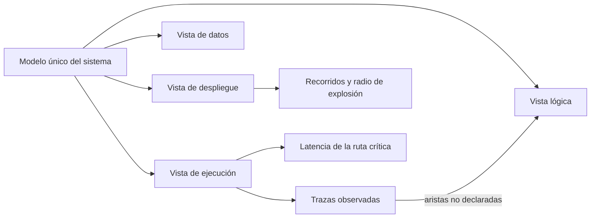
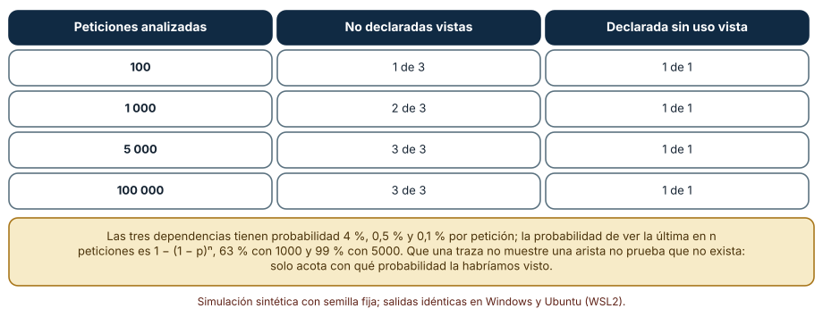
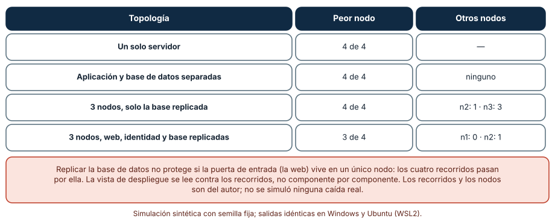
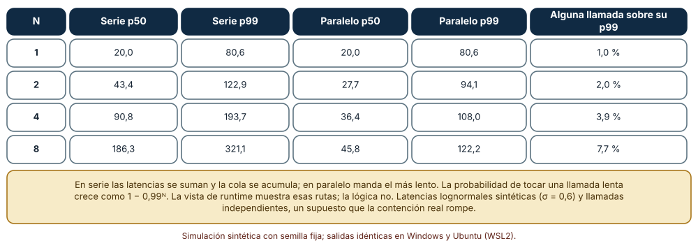

# SE-302 — Vistas lógica, runtime, datos y despliegue

[← SE-301 — Drivers, restricciones y atributos de arquitectura](https://github.com/vladimiracunadev-create/modern-software-engineering-program/blob/main/classes/part-25-arquitectura-de-software-y-dominio/se-301-drivers-restricciones-y-atributos-de-arquitectura/README.md) · [↑ Parte 25](https://github.com/vladimiracunadev-create/modern-software-engineering-program/blob/main/classes/part-25-arquitectura-de-software-y-dominio/README.md) · [📚 Índice completo](https://github.com/vladimiracunadev-create/modern-software-engineering-program/blob/main/classes/README.md) · [🌐 Portal](https://vladimiracunadev-create.github.io/modern-software-engineering-program/classes/SE-302.html) · [SE-303 — Monolito, modular monolith y servicios →](https://github.com/vladimiracunadev-create/modern-software-engineering-program/blob/main/classes/part-25-arquitectura-de-software-y-dominio/se-303-monolito-modular-monolith-y-servicios/README.md)

## Punto profesional y fundamento pedagógico

**Punto profesional.** La clase existe para que describas un sistema desde varias vistas que responden preguntas distintas, para que compruebes que no se contradicen y para que sepas qué pregunta de calidad solo se contesta mirando una vista concreta.

**Por qué aparece aquí.** Continúa la **Parte 25** después de **Drivers, restricciones y atributos de arquitectura**: los escenarios de `SE-301` dicen qué debe cumplirse; las vistas dicen cómo está hecho el sistema para poder comprobarlo. Un escenario de latencia se evalúa en la vista de ejecución; uno de disponibilidad, en la de despliegue; uno de modificabilidad, en la lógica.

**Error conceptual que debe corregir.** Creer que «el diagrama de arquitectura» es una sola imagen: cada vista omite a propósito casi todo lo demás, y un diagrama que mezcla módulos, procesos y servidores no responde bien a ninguna pregunta.

**Secuencia de aprendizaje.** Antes de leer los resultados, predices cuántas dependencias reales faltan en la vista lógica y cuántas trazas hacen falta para verlas, qué recorridos rompe la caída de cada nodo y cuánto se alarga una petición que atraviesa ocho servicios; después lo simulas. La secuencia usa predicción, explicación propia, contraste y recuperación. [ICAP](https://icap.education.asu.edu/research) distingue participación de construcción de conocimiento; [How People Learn II](https://nap.nationalacademies.org/catalog/24783/how-people-learn-ii-learners-contexts-and-cultures) exige conectar conocimiento previo, contexto y transferencia; la [práctica de recuperación](https://pubmed.ncbi.nlm.nih.gov/16507066/) respalda producir de nuevo la explicación tras una demora; y [Education for Life and Work](https://nap.nationalacademies.org/resource/13398/dbasse_084153.pdf) exige devolución que explique la causa del error.

**Evidencia de aprendizaje.** `views.md` con las cuatro vistas de la plataforma generadas desde un único modelo, la comparación de la vista lógica con las trazas, la tabla de radio de explosión por nodo y la cuenta de latencia de la cadena crítica, con una nota sobre qué pregunta contesta cada vista.

**Límite de la conclusión.** Los componentes, las dependencias, las probabilidades de uso, las topologías y las latencias lognormales son construcciones del autor. No se instrumentó ningún sistema ni se simuló una caída real: las simulaciones muestran qué detecta cada vista y cómo se comprueba su coherencia, no cifras de un sistema.

### Trazabilidad fuente → afirmación

| Fuente primaria u oficial | Afirmación que respalda | Lo que no prueba |
|---|---|---|
| [Kruchten, «The 4+1 View Model of Architecture» (IEEE Software, 1995)](https://doi.org/10.1109/52.469759) | Propone describir una arquitectura con vistas lógica, de procesos, de desarrollo y física, unidas por escenarios. | No fija cuántas vistas ni qué notación debe usar un equipo concreto. |
| [Rozanski y Woods, «Viewpoints and Perspectives»](https://www.viewpoints-and-perspectives.info/) | Separa puntos de vista (qué se describe) de perspectivas (qué calidad se garantiza) y los vincula a las preocupaciones de quienes interesan. | No dice qué punto de vista es el correcto para un sistema dado. |
| [C4 model](https://c4model.com/) | Describe un sistema en niveles de contexto, contenedores, componentes y código, con diagramas pensados para públicos distintos. | No resuelve la coherencia entre diagramas: eso exige un modelo único o una comprobación. |
| [Dean y Barroso, «The Tail at Scale» (CACM, 2013)](https://doi.org/10.1145/2408776.2408794) | Muestra que una petición que depende de muchas llamadas hereda la cola de las más lentas y que la latencia extrema de componentes se amplifica en el conjunto. | No cuantifica la latencia de la plataforma de esta clase. |

## Antes de empezar

Recupera lo que `SE-301` dejó: un escenario de calidad con medida. La pregunta activa es: **¿en qué vista se evalúa este escenario y qué otra vista podría contradecirla sin que nadie lo note?**

## Prerrequisitos

- Haber completado `SE-301` o poder escribir un escenario de calidad con medida.
- Python 3.11 o posterior y un terminal; todo el código usa solo la biblioteca estándar.
- Manejar grafos como pares de nodos y percentiles de una distribución.

## Problema auténtico

El equipo de la plataforma tiene un diagrama de cajas y flechas en la pared. En la reunión, una persona de operaciones pregunta qué pasa si cae el servidor donde corre «la aplicación» y el diagrama no lo dice, porque no muestra servidores. Una persona del equipo de datos pregunta quién escribe en la tabla de notas y el diagrama no lo dice, porque no muestra datos. Una tercera descubre que el módulo de notas llama al de archivos, una flecha que nadie dibujó. El diagrama no estaba equivocado: era una vista sin saberlo, y las preguntas se hacían a otra.

## Objetivos observables

Al terminar podrás:

1. describir la plataforma desde cuatro vistas (lógica, de ejecución, de datos y de despliegue) y decir qué pregunta responde cada una y cuál omite;
2. comparar la vista lógica declarada con trazas de ejecución y calcular cuántas trazas hacen falta para ver una dependencia rara;
3. calcular qué recorridos de usuario rompe la caída de cada nodo de una topología de despliegue y detectar puntos únicos de fallo;
4. estimar cómo se alarga una petición que atraviesa N servicios, en serie y en paralelo, y por qué la cola domina;
5. generar las vistas desde un único modelo para que no se contradigan, y declarar lo que ninguna vista muestra.

## Mapa conceptual



El mapa muestra que las vistas son proyecciones de un mismo modelo y que la realidad (las trazas) puede contradecir a la vista lógica. Los recorridos y la latencia salen de cruzar vistas: despliegue con ejecución, ejecución con probabilidades.

## Temas y por qué importan

| Tema | Por qué cambia una decisión profesional | Evidencia mínima |
|---|---|---|
| Qué es una vista y qué omite | Evita mezclar preguntas y producir un diagrama que no responde ninguna. | Predicción, traza causal y contraejemplo de **Qué es una vista y qué omite** en `views.md` |
| Vista lógica | Gobierna la modificabilidad: quién puede depender de quién. | Predicción, traza causal y contraejemplo de **Vista lógica** en `views.md` |
| Vista de ejecución | Gobierna latencia y concurrencia: qué se llama y en qué orden. | Predicción, traza causal y contraejemplo de **Vista de ejecución** en `views.md` |
| Vista de datos | Gobierna consistencia y propiedad: quién escribe qué. | Predicción, traza causal y contraejemplo de **Vista de datos** en `views.md` |
| Vista de despliegue y coherencia | Gobierna disponibilidad: qué cae junto con qué. | Predicción, traza causal y contraejemplo de **Vista de despliegue y coherencia** en `views.md` |

## Conceptos y decisiones

### 1. Qué es una vista y qué omite

Una **vista** es una representación de un sistema desde un conjunto de preocupaciones, con los elementos y relaciones que esas preocupaciones necesitan y nada más. Kruchten propuso cuatro vistas unidas por escenarios; Rozanski y Woods hablan de puntos de vista y perspectivas; el modelo C4 organiza lo mismo en niveles de zoom. Lo común es la regla de que cada vista tiene un público y una pregunta, y que omite lo demás de forma deliberada. Una vista mal escrita mezcla elementos de distinta naturaleza (módulos, procesos, servidores) en la misma caja y obliga al lector a adivinar qué significa una flecha.

### 2. Vista lógica

La **vista lógica** muestra módulos o componentes y las dependencias *permitidas* entre ellos. Responde a «¿qué puedo cambiar sin romper a quién?» y gobierna la modificabilidad. Su defecto característico es que declara lo permitido, no lo que ocurre: con el tiempo, el código acumula dependencias que nadie dibujó. Por eso conviene tratarla como una regla que se verifica contra el código o contra las trazas, no como un dibujo que se acepta. Una arista declarada que nunca se usa es otra señal: o el diagrama está viejo o hay código muerto.

### 3. Vista de ejecución

La **vista de ejecución** (de procesos o de ejecución) muestra qué se llama en tiempo de ejecución, en qué orden, de forma síncrona o asíncrona, y qué concurrencia hay. Responde a «¿qué pasa cuando llega esta petición?» y gobierna la latencia y la capacidad. En ella se ve que una petición que atraviesa ocho servicios en serie suma ocho latencias y hereda la cola de cada una; en paralelo solo espera a la más lenta. Dean y Barroso explican por qué: cuando una petición depende de muchas llamadas, la probabilidad de tocar una lenta crece rápidamente, aunque cada servicio sea rápido casi siempre.

### 4. Vista de datos

La **vista de datos** muestra qué entidades existen, quién las escribe, quién las lee y dónde viven. Responde a «¿quién es dueño de este dato?» y gobierna la consistencia y la privacidad. Dos escritores sobre la misma tabla sin un dueño definido son el origen de la mayoría de las inconsistencias; un dato personal que se copia a tres almacenes multiplica el esfuerzo de borrarlo. Esta vista conecta con la Parte 26, pero aquí importa por una razón: una decisión de despliegue (separar servidores) cambia las garantías de datos (una transacción deja de ser local).

### 5. Vista de despliegue y coherencia entre vistas

La **vista de despliegue** muestra qué corre en qué nodo, qué se replica y qué comunica por qué red. Responde a «¿qué cae junto con qué?» y gobierna la disponibilidad y el coste. La coherencia entre vistas se logra de dos maneras: generarlas desde un modelo único (arquitectura como código) o comprobarlas con pruebas que cruzan dos de ellas (la lógica contra el código, la de despliegue contra los recorridos). Sin una de las dos, las vistas se separan con el tiempo y cada una dice algo distinto de la realidad.

### La vista lógica frente a las trazas de ejecución

El sistema tiene ocho componentes y nueve dependencias declaradas. En la ejecución real hay además tres dependencias no declaradas (`notas → archivos` con probabilidad 4 % por petición, `notif → identidad` con 0,5 % y `web → base de datos` con 0,1 %, un atajo) y una declarada que nunca se usa (`notif → cola`). Se analizan 100, 1000, 5000, 20 000 y 100 000 peticiones sintéticas y se comparan las aristas observadas con las declaradas.

```python
vistas = set(); declaradas = {...}
for _ in range(n):
    for arista, p in aristas_reales.items():
        if p > 0 and rng.random() < p * 0.5:
            vistas.add(arista)
no_declaradas = vistas - declaradas
sin_uso = declaradas - vistas
```

| Peticiones analizadas | No declaradas vistas | Declarada sin uso vista |
|---:|---:|---:|
| 100 | 1 de 3 | 1 de 1 |
| 1 000 | 2 de 3 | 1 de 1 |
| 5 000 | 3 de 3 | 1 de 1 |
| 100 000 | 3 de 3 | 1 de 1 |

Con 100 peticiones solo aparece la dependencia frecuente; la de 0,5 % se ve con 1000 y el atajo de 0,1 % exige unas 5000 trazas para verlo con 99 % de probabilidad (1 − 0,999ⁿ). La arista declarada sin uso aparece desde la primera muestra porque, por construcción, no ocurre nunca.



**Cómo leer la figura.** Cada fila es una muestra de trazas; las columnas cuentan lo que el análisis ve respecto de la vista declarada. **Dónde deja de valer:** que una traza no muestre una arista no prueba que no exista; solo acota con qué probabilidad la habríamos visto. Las probabilidades son del autor, y un sistema real tiene aristas de recuperación (reintentos, rutas de error) que casi nunca se ejercen y que son justo las que importan cuando algo falla.

### Radio de explosión de cada nodo

Cuatro recorridos de usuario (entregar, consultar nota, avisar, iniciar sesión) usan cada uno una lista de componentes. Se comparan cuatro topologías de despliegue y, para cada nodo, se cuenta cuántos recorridos se rompen si ese nodo cae: un recorrido se rompe cuando algún componente necesario solo vive en ese nodo.

```python
for nodo in nodos:
    rotos = 0
    for ruta in recorridos.values():
        if any(all(h == nodo for h in despliegue[c].split("|")) for c in ruta):
            rotos += 1
```

| Topología | Peor nodo | Otros nodos |
|---|---:|---|
| Un solo servidor | 4 de 4 | — |
| Aplicación y base separadas | 4 de 4 | ninguno |
| 3 nodos, solo la base replicada | 4 de 4 | n2: 1 · n3: 3 |
| 3 nodos, web, identidad y base replicadas | 3 de 4 | n1: 0 · n2: 1 |

La web está en el camino de los cuatro recorridos: mientras viva en un único nodo, la caída de ese nodo lo rompe todo, por mucho que se replique la base de datos. Replicar web e identidad deja el nodo 1 sin efecto y el peor caso en 3 de 4 (el nodo 3 aloja la cola y las notificaciones).



**Cómo leer la figura.** Cada fila es una topología; la columna central es el máximo de recorridos rotos por la caída de un nodo. **Dónde deja de valer:** el cálculo es binario (el recorrido funciona o no) y no modela degradación parcial, tiempos de recuperación ni fallos correlacionados entre nodos; los recorridos y las ubicaciones son del autor. Lo que enseña es el método: se cruza despliegue con recorridos, no se mira cada componente por separado.

### La cola de una cadena de servicios

Cada servicio tarda un tiempo lognormal de mediana 20 ms (σ = 0,6). Se simulan 200 000 peticiones que atraviesan N servicios en serie (se suman) o en paralelo (manda el más lento) y se comparan los percentiles 50 y 99.

```python
ser = sum(rng.lognormvariate(math.log(20), 0.6) for _ in range(n))
par = max(rng.lognormvariate(math.log(20), 0.6) for _ in range(n))
```

| N | Serie p50 | Serie p99 | Paralelo p50 | Paralelo p99 | Alguna llamada sobre su p99 |
|---:|---:|---:|---:|---:|---:|
| 1 | 20,0 | 80,6 | 20,0 | 80,6 | 1,0 % |
| 2 | 43,4 | 122,9 | 27,7 | 94,1 | 2,0 % |
| 4 | 90,8 | 193,7 | 36,4 | 108,0 | 3,9 % |
| 8 | 186,3 | 321,1 | 45,8 | 122,2 | 7,7 % |

Con ocho servicios en serie la mediana se multiplica por 9 y el percentil 99 por 4; en paralelo, la mediana crece 2,3 veces y el p99 1,5. La última columna, 1 − 0,99ᴺ, dice cuántas peticiones tocan al menos una llamada en su propio percentil 99: con 32 servicios, el 27,5 %.



**Cómo leer la figura.** Las filas son el número de servicios; las columnas comparan sumar o tomar el máximo. **Dónde deja de valer:** las latencias son independientes y lognormales; en un sistema real la contención las correlaciona, y las llamadas en paralelo comparten red y base de datos. La figura no dice «paralelizar siempre»: dice que la vista de ejecución muestra qué se suma y qué se solapa, y que la cola importa más que la mediana.

## Definiciones de trabajo

- **vista arquitectónica:** representación del sistema desde un conjunto de preocupaciones, con los elementos y relaciones necesarios y nada más.
- **vista lógica:** vista que muestra módulos y las dependencias permitidas entre ellos.
- **vista de ejecución:** vista que muestra qué se llama en tiempo de ejecución, en qué orden y con qué concurrencia.
- **radio de explosión:** conjunto de recorridos o funciones que dejan de funcionar cuando falla un elemento.
- **traza:** registro de los pasos de una petición a través de los componentes del sistema.

Las definiciones son operativas para la plataforma de entregas. No convierten términos con una historia más amplia en sinónimos y deben contrastarse con la documentación primaria enlazada al final.

## Ejemplo mínimo

El fragmento compara dependencias declaradas y observadas. Antes de ejecutarlo, predice qué dependencias aparecerán.

```python
declaradas = {("web", "entregas"), ("entregas", "bd")}
observadas = {("web", "entregas"), ("entregas", "bd"), ("web", "bd")}
assert observadas - declaradas == {("web", "bd")}
assert declaradas - observadas == set()
```

El atajo `web → bd` no estaba en la vista lógica. Registra versión, comando y salida; añade una dependencia declarada que nunca se use y comprueba que aparece en la segunda diferencia.

## Ejemplo profesional

El equipo mantiene un único archivo `modelo.yaml` con componentes, dependencias permitidas, recorridos y topología. Un generador produce las cuatro vistas (diagramas de texto) y una prueba compara la vista lógica con las trazas de una semana: encuentra tres aristas no declaradas y una declarada sin uso. Otra prueba recorre cada nodo de la topología y falla si algún nodo rompe más de la mitad de los recorridos; hoy falla con la web en un solo nodo, y el equipo decide replicarla antes del siguiente periodo de entregas. Para el recorrido de consulta de notas, registra que cuatro servicios en serie dan un p99 de unos 194 ms con estas latencias y decide cuáles pueden llamarse en paralelo.

Compara con el diagrama de la pared: las vistas ya no se contradicen porque salen del mismo modelo, y cada una se comprueba contra la realidad que le corresponde (trazas, recorridos, latencias). Un conjunto de vistas es adecuado cuando una discrepancia con la realidad hace fallar una prueba; es frágil cuando solo se actualiza antes de una presentación.

## Práctica guiada

1. Dibuja la plataforma en las cuatro vistas y marca qué pregunta responde cada una.
2. Escribe `modelo.yaml` con componentes, dependencias permitidas, recorridos y nodos.
3. Genera las vistas desde el modelo con un script y revisa que usen los mismos nombres.
4. Predice cuántas trazas hacen falta para ver una dependencia con probabilidad 0,1 % y simúlalo.
5. Calcula el radio de explosión de cada nodo y marca los puntos únicos de fallo.
6. Simula la latencia de la ruta crítica en serie y con las llamadas que pueden ir en paralelo.
7. Entrega `views.md` y pide a otra persona que encuentre una contradicción entre vistas.

## Ejercicios

1. **Arista rara:** calcula cuántas peticiones hacen falta para ver con 95 % de probabilidad una arista con probabilidad 0,2 % y compáralo con 1 − (1 − p)ⁿ.
2. **Nodo:** diseña una topología de tres nodos en la que ningún nodo rompa más de dos de cuatro recorridos y explica qué replicaste.
3. **Cola:** calcula la probabilidad de que una petición con 16 llamadas toque alguna sobre su percentil 99.
4. **Coherencia:** escribe una prueba que falle cuando un componente aparezca en la vista de despliegue pero no en la lógica.

## Reto verificable

Entrega `views.md` con las cuatro vistas generadas desde un modelo único, la comparación contra las trazas, la tabla de radio de explosión y la simulación de latencia. Se aprueba si otra persona ejecuta el código desde un checkout limpio, obtiene las mismas cifras y puede decir qué vista contestaría una pregunta nueva («¿quién escribe en la tabla de notas?»). No se aprueba por entregar cuatro dibujos sin comprobación de coherencia.

## Caso conductor

La plataforma de entregas y corrección de tareas sigue siendo el caso conductor. Esta clase deja el segundo artefacto: un modelo único del que salen las vistas, y las comprobaciones que lo contrastan con trazas y recorridos. `SE-303` usará esas vistas para comparar tres formas de agrupar el mismo sistema: un monolito, un monolito modular y servicios. Cambia después una sola decisión, replicar la web, y observa qué recorridos dejan de romperse.

## Preguntas frecuentes

### ¿Cuántas vistas hacen falta?

Las que respondan las preguntas de los escenarios de `SE-301`. Cuatro es un punto de partida (lógica, ejecución, datos, despliegue); si no hay un escenario que dependa de una vista, esa vista es opcional.

### ¿Un diagrama C4 ya cubre todo eso?

C4 cubre bien la estructura en niveles de zoom. No sustituye la vista de ejecución con orden y concurrencia ni la de despliegue con la topología real; además, no comprueba por sí mismo que los niveles no se contradigan.

### ¿Cómo evito que las vistas se desactualicen?

Generándolas desde un modelo único o comprobándolas contra la realidad (trazas, código, infraestructura) en cada cambio. Un diagrama que solo se actualiza a mano se desactualiza.

### ¿Las trazas de producción son datos personales?

Pueden serlo si incluyen identificadores o contenido. Para esta comprobación basta con nombres de componentes y conteos; no recojas nada más.

## Fallo controlado y diagnóstico

Reproduce el fallo clásico de la clase: **replicar la base de datos y creer que el sistema ya no tiene un punto único de fallo**. Calcula el radio de explosión de la topología con la base replicada y la web en un solo nodo.

Registra síntoma, entrada mínima, hipótesis, observación que descarta cada hipótesis, causa, corrección y prueba de regresión. **Síntoma:** cae el nodo 1 durante un plazo y el servicio queda inaccesible aunque la base de datos siga viva. **Hipótesis rivales:** (a) la réplica de la base falló; (b) hay un componente único en el camino de todos los recorridos; (c) la red entre nodos se cortó. **Prueba:** para cada nodo, cuenta los recorridos que dependen de un componente que solo vive ahí; si el nodo 1 rompe 4 de 4, la causa es (b). **Conclusión:** la web, presente en todos los recorridos, vive solo en n1. **Regresión:** añade la prueba «ningún nodo rompe más de la mitad de los recorridos» al modelo y replica web e identidad. No cambies a la vez la topología y los recorridos.

## Errores comunes y cómo corregirlos

| Síntoma | Causa probable | Corrección |
|---|---|---|
| El diagrama no responde las preguntas de operaciones | Mezcla módulos, procesos y servidores | Separar vistas y decir qué pregunta responde cada una |
| El código tiene dependencias que nadie dibujó | La vista lógica declara lo permitido y no se verifica | Comparar con trazas o con el código en cada cambio |
| Se replica un componente y el servicio sigue cayendo | Hay un punto único de fallo en el camino de todos los recorridos | Cruzar despliegue con recorridos y replicar lo que está en todos |
| La latencia de una petición sorprende al equipo | Se suman las colas de varias llamadas en serie | Medir percentiles por llamada y paralelizar lo independiente |
| Las vistas se contradicen entre sí | Se mantienen a mano | Generarlas desde un modelo único y comprobarlas |

## Entorno y archivos clave

```text
work/SE-302/
├── README.md
├── modelo.yaml
├── vistas/
│   ├── generar.py
│   └── comprobar.py
├── sim/
│   ├── trazas.py
│   ├── explosion.py
│   └── cadena.py
└── evidence/views.md
```

El `README` declara plataforma, versión de Python, semillas y comandos. Los experimentos usan solo la biblioteca estándar (`random`, `math`) y se ejecutaron con CPython 3.12.9 en Windows 11 y 3.12.3 en Ubuntu bajo WSL2: las salidas fueron idénticas. Si añades una dependencia, fija procedencia y versión.

## Seguridad, ética y accesibilidad

- una vista de despliegue y una de datos describen superficie de ataque y ubicación de datos personales: trátalas como información sensible y no las publiques sin revisión;
- las trazas de producción deben recogerse sin identificadores de personas y con retención limitada;
- los diagramas deben tener texto alternativo y no depender solo del color, para que personas con tecnologías de apoyo puedan usarlos;
- los nombres de nodos y componentes del ejemplo son ficticios; no uses nombres reales de servidores en material público;
- respeta las licencias de las notaciones y atribuye lo adaptado.

## Puente hacia el trabajo con agentes

Un agente al que se le pide «dibuja la arquitectura» producirá un único diagrama atractivo que mezcla vistas. Pídele en cambio un modelo único en texto, las cuatro vistas generadas desde él y una comprobación que compare la vista lógica con el código o con las trazas. Revisa especialmente si inventa componentes que no existen en el repositorio y si declara dependencias que el código no tiene: son los dos defectos que esta clase mostró en la comparación con trazas.

## Transferencia

Traslada el análisis a otro sistema (por ejemplo, una aplicación de reservas de salas): cambia los componentes y conserva el procedimiento de escribir un modelo único, generar las vistas, compararlas con las trazas y calcular el radio de explosión. La transferencia está lograda cuando puedes explicar qué pregunta responde cada vista, no cuando los diagramas se parecen.

## Evaluación y evidencia

| Criterio | Evidencia para aprobar |
|---|---|
| comprensión | explicación de qué pregunta responde y qué omite cada vista |
| corrección | comparación con trazas, radio de explosión y latencia reproducibles con las mismas semillas |
| diseño | modelo único del que salen las vistas y comprobaciones de coherencia |
| diagnóstico | reproducción del fallo «replicar la base y dejar la web sola» con regresión |
| incertidumbre | declaración de que componentes, probabilidades y latencias son supuestos |
| reproducibilidad | versiones, comandos, salida y límites declarados |

## Fuentes

- [Kruchten, «The 4+1 View Model of Architecture» (IEEE Software, 1995)](https://doi.org/10.1109/52.469759) — vistas lógica, de procesos, de desarrollo y física; autoridad: IEEE Software.
- [Rozanski y Woods, «Viewpoints and Perspectives»](https://www.viewpoints-and-perspectives.info/) — puntos de vista y perspectivas arquitectónicas; autoridad: autores del libro.
- [C4 model](https://c4model.com/) — niveles de diagramas de arquitectura; autoridad: Simon Brown.
- [Dean y Barroso, «The Tail at Scale» (CACM, 2013)](https://doi.org/10.1145/2408776.2408794) — latencia extrema en sistemas de muchas llamadas; autoridad: Communications of the ACM.
- [Python: `random`](https://docs.python.org/3/library/random.html) — generador con semilla; autoridad: documentación de Python.
- [SWEBOK Guide v4.0a](https://www.computer.org/education/bodies-of-knowledge/software-engineering) — áreas de conocimiento de ingeniería de software; autoridad: IEEE Computer Society.

Los DOI se comprobaron con la API de Crossref (título, revista y año coinciden) porque el editor bloquea peticiones automáticas; el resto respondió con éxito a una petición de solo lectura. Cada fuente respalda el mecanismo indicado; ninguna demuestra que la web sea un punto único de fallo ni que el p99 de ocho servicios sea 321 ms en la plataforma real. Esa afirmación depende del sistema, de sus despliegues y de sus llamadas.

## Límites y siguiente paso

Se ejecutaron tres simulaciones con datos sintéticos en Windows y Ubuntu (WSL2) con resultados idénticos. No se instrumentó ningún sistema, no se cayó ningún nodo y no se capturó ninguna traza real: componentes, probabilidades, topologías y latencias son construcciones del autor. La siguiente clase compara tres formas de agrupar los mismos componentes.

## Glosario

- **vista arquitectónica:** representación del sistema desde un conjunto de preocupaciones, con los elementos y relaciones necesarios y nada más.
- **vista lógica:** vista que muestra módulos y las dependencias permitidas entre ellos.
- **vista de ejecución:** vista que muestra qué se llama en tiempo de ejecución, en qué orden y con qué concurrencia.
- **radio de explosión:** conjunto de recorridos o funciones que dejan de funcionar cuando falla un elemento.
- **traza:** registro de los pasos de una petición a través de los componentes del sistema.

---

[← SE-301 — Drivers, restricciones y atributos de arquitectura](https://github.com/vladimiracunadev-create/modern-software-engineering-program/blob/main/classes/part-25-arquitectura-de-software-y-dominio/se-301-drivers-restricciones-y-atributos-de-arquitectura/README.md) · [↑ Parte 25](https://github.com/vladimiracunadev-create/modern-software-engineering-program/blob/main/classes/part-25-arquitectura-de-software-y-dominio/README.md) · [📚 Índice completo](https://github.com/vladimiracunadev-create/modern-software-engineering-program/blob/main/classes/README.md) · [🌐 Portal](https://vladimiracunadev-create.github.io/modern-software-engineering-program/classes/SE-302.html) · [SE-303 — Monolito, modular monolith y servicios →](https://github.com/vladimiracunadev-create/modern-software-engineering-program/blob/main/classes/part-25-arquitectura-de-software-y-dominio/se-303-monolito-modular-monolith-y-servicios/README.md)
