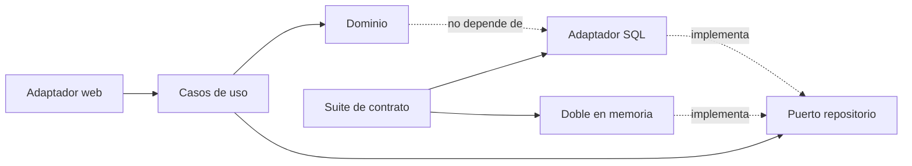
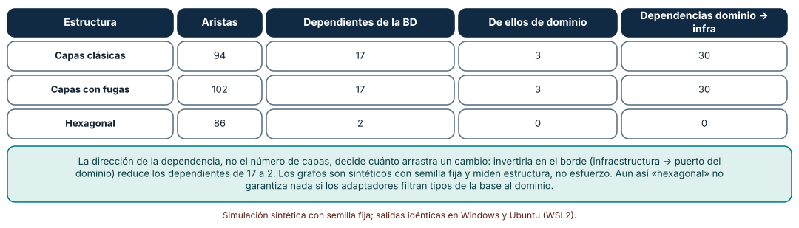
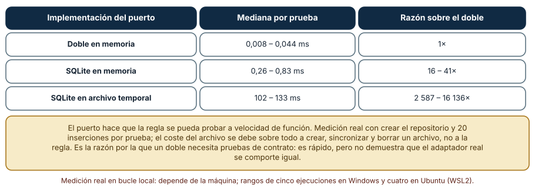
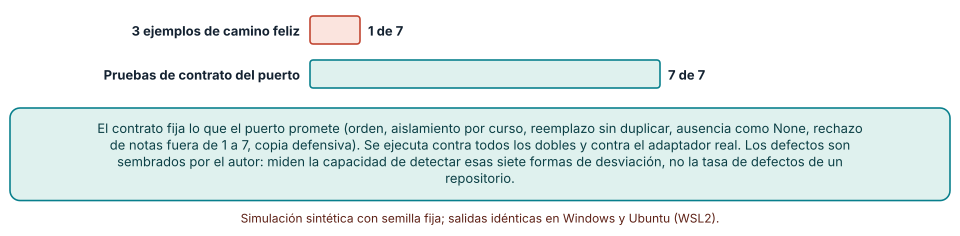

# SE-304 — Capas, hexagonal, clean y ports and adapters

[← SE-303 — Monolito, modular monolith y servicios](https://github.com/vladimiracunadev-create/modern-software-engineering-program/blob/main/classes/part-25-arquitectura-de-software-y-dominio/se-303-monolito-modular-monolith-y-servicios/README.md) · [↑ Parte 25](https://github.com/vladimiracunadev-create/modern-software-engineering-program/blob/main/classes/part-25-arquitectura-de-software-y-dominio/README.md) · [📚 Índice completo](https://github.com/vladimiracunadev-create/modern-software-engineering-program/blob/main/classes/README.md) · [🌐 Portal](https://vladimiracunadev-create.github.io/modern-software-engineering-program/classes/SE-304.html) · [SE-305 — Domain-Driven Design estratégico y táctico →](https://github.com/vladimiracunadev-create/modern-software-engineering-program/blob/main/classes/part-25-arquitectura-de-software-y-dominio/se-305-domain-driven-design-estrategico-y-tactico/README.md)

## Punto profesional y fundamento pedagógico

**Punto profesional.** La clase existe para que ordenes las dependencias dentro de un módulo de modo que la regla de negocio no dependa de la base de datos, del framework web ni del proveedor de correo, y para que puedas medir qué ganas con eso y qué cuesta.

**Por qué aparece aquí.** Continúa la **Parte 25** después de **Monolito, modular monolith y servicios**: `SE-303` decidió dónde van las fronteras entre módulos; esta clase decide en qué dirección apuntan las dependencias dentro de cada uno. Las capas, la arquitectura hexagonal y la limpia son tres formulaciones de la misma idea: las dependencias del código apuntan hacia la regla de negocio.

**Error conceptual que debe corregir.** Creer que tener capas con nombres (presentación, negocio, datos) ya es una arquitectura limpia: una capa «de negocio» que importa el cliente de la base de datos depende de ella igual que si no existiera la capa.

**Secuencia de aprendizaje.** Antes de leer los resultados, predices cuántos módulos arrastra cambiar la base de datos en una estructura por capas y en una hexagonal, cuánto más lenta es una prueba con una base real que con un doble y cuántos defectos de un doble detectan tres ejemplos frente a un contrato; después lo mides. La secuencia usa predicción, explicación propia, contraste y recuperación. [ICAP](https://icap.education.asu.edu/research) distingue participación de construcción de conocimiento; [How People Learn II](https://nap.nationalacademies.org/catalog/24783/how-people-learn-ii-learners-contexts-and-cultures) exige conectar conocimiento previo, contexto y transferencia; la [práctica de recuperación](https://pubmed.ncbi.nlm.nih.gov/16507066/) respalda producir de nuevo la explicación tras una demora; y [Education for Life and Work](https://nap.nationalacademies.org/resource/13398/dbasse_084153.pdf) exige devolución que explique la causa del error.

**Evidencia de aprendizaje.** `dependencies.md` con los grafos de dependencias de tres estructuras, la medición de velocidad de la prueba con tres implementaciones del puerto, la suite de contrato del repositorio con los siete defectos sembrados y una nota sobre qué parte del sistema solo prueba el adaptador real.

**Límite de la conclusión.** Los grafos son sintéticos con semilla fija y miden estructura, no esfuerzo de cambio; los tiempos son una medición real en una máquina concreta y cambian con ella; los defectos de los dobles los sembró el autor. Ninguna conclusión se extiende a un framework o una base de datos de producción.

### Trazabilidad fuente → afirmación

| Fuente primaria u oficial | Afirmación que respalda | Lo que no prueba |
|---|---|---|
| [Cockburn, «Hexagonal architecture»](https://alistair.cockburn.us/hexagonal-architecture/) | Propone una aplicación con puertos que definen sus interacciones y adaptadores que los conectan con tecnologías, de modo que se pueda probar sin ellas. | No dice cuántos puertos ni qué granularidad usar. |
| [Martin, «The Clean Architecture»](https://blog.cleancoder.com/uncle-bob/2012/08/13/the-clean-architecture.html) | Formula la regla de dependencia: las dependencias del código fuente apuntan solo hacia el interior, hacia las políticas de alto nivel. | No demuestra que un diseño con círculos concéntricos sea mejor en todo contexto. |
| [Fowler, «Test Double»](https://martinfowler.com/bliki/TestDouble.html) | Distingue tipos de dobles de prueba (stub, fake, mock, spy) y sus usos. | No garantiza que un doble se comporte como el componente real. |
| [Fowler, «Contract Test»](https://martinfowler.com/bliki/ContractTest.html) | Describe pruebas que verifican que un doble y la implementación real respetan el mismo contrato. | No indica qué casos debe contener el contrato de un puerto concreto. |

## Antes de empezar

Recupera lo que `SE-303` dejó: un módulo con frontera comprobable. La pregunta activa es: **¿qué dependencias dentro de este módulo apuntan hacia lo que más cambia, y qué costaría invertirlas?**

## Prerrequisitos

- Haber completado `SE-303` o poder explicar qué es una API pública de módulo.
- Python 3.11 o posterior y un terminal; todo el código usa solo la biblioteca estándar.
- Conocer clases, interfaces implícitas (protocolos) y `sqlite3` a nivel básico.

## Problema auténtico

El módulo de notas calcula el promedio de un curso. Su código importa el cliente de base de datos para leer las entregas, el framework web para recibir la petición y la biblioteca de correo para avisar. Para probar la regla del promedio hay que levantar una base, un servidor y un servidor de correo falso. Las pruebas tardan 100 ms cada una y el equipo las ejecuta poco. Cuando la universidad pide migrar de base de datos, 17 de los 40 módulos del sistema resultan afectados, entre ellos los de dominio. Nadie había decidido que la regla de negocio dependiera de la tecnología de almacenamiento: simplemente se importó.

## Objetivos observables

Al terminar podrás:

1. dibujar el grafo de dependencias de un módulo por capas y uno hexagonal y calcular cuántos módulos arrastra cambiar la base de datos en cada uno;
2. distinguir un puerto (contrato que el dominio necesita) de un adaptador (implementación con una tecnología) con un ejemplo y un contraejemplo;
3. medir cuánto más lenta es una prueba con una base real que con un doble en memoria, y decir qué se pierde al usar el doble;
4. escribir una suite de contrato para un puerto y medir cuántos defectos de un doble detecta frente a unos ejemplos;
5. decidir cuándo una capa o un puerto añaden coste sin beneficio.

## Mapa conceptual



El mapa muestra el sentido de las dependencias: el adaptador SQL depende del puerto del dominio, no al revés. La suite de contrato se ejecuta contra ambas implementaciones para que el doble rápido no pueda desviarse del real.

## Temas y por qué importan

| Tema | Por qué cambia una decisión profesional | Evidencia mínima |
|---|---|---|
| Arquitectura por capas | Ordena responsabilidades, pero no invierte dependencias por sí sola. | Predicción, traza causal y contraejemplo de **Arquitectura por capas** en `dependencies.md` |
| Regla de dependencia | Hace que lo que más cambia dependa de lo que menos cambia. | Predicción, traza causal y contraejemplo de **Regla de dependencia** en `dependencies.md` |
| Puertos y adaptadores | Permiten sustituir la tecnología y probar sin ella. | Predicción, traza causal y contraejemplo de **Puertos y adaptadores** en `dependencies.md` |
| Dobles y contratos | Hacen rápidas las pruebas sin perder fidelidad. | Predicción, traza causal y contraejemplo de **Dobles y contratos** en `dependencies.md` |
| Coste de la indirección | Cada capa o puerto es código que mantener y puede no justificarse. | Predicción, traza causal y contraejemplo de **Coste de la indirección** en `dependencies.md` |

## Conceptos y decisiones

### 1. Arquitectura por capas

La **arquitectura por capas** divide el sistema en niveles (presentación, aplicación, dominio, datos) y suele permitir que cada capa use las inferiores. Es una buena forma de repartir responsabilidades y de que el equipo se entienda. Su problema es que, en su versión clásica, el dominio queda por encima de la capa de datos y por tanto depende de ella: cambiar el almacenamiento arrastra al dominio. Además, las capas se erosionan: un atajo de la presentación a la base de datos «para ganar tiempo» deja una dependencia que salta capas y nadie la verifica. Las capas son una convención de nombres hasta que una regla comprobable las hace cumplir.

### 2. La regla de dependencia

La **regla de dependencia** (formulada por Martin en la arquitectura limpia) dice que las dependencias del código fuente solo apuntan hacia adentro: hacia las políticas de alto nivel, que cambian poco, y nunca hacia los detalles (base de datos, framework, proveedor), que cambian más. Se logra con inversión de dependencias: el dominio declara la interfaz que necesita y el detalle la implementa. El beneficio es un cambio acotado: reemplazar la base de datos toca el adaptador y el arranque, no el dominio. La regla es fácil de enunciar y fácil de violar; por eso se comprueba con una herramienta de análisis de importaciones, no con la memoria del equipo.

### 3. Puertos y adaptadores

Cockburn llama **puerto** al contrato por el que la aplicación se comunica con el exterior (guardar una entrega, avisar al estudiante) y **adaptador** a la pieza que lo conecta con una tecnología concreta (SQLite, un servicio de correo, una cola). Hay puertos de entrada (los casos de uso, que la web o un trabajo programado invocan) y de salida (lo que la aplicación necesita). La consecuencia práctica es que la aplicación se puede ejecutar con adaptadores de prueba: una base en memoria, un correo que solo guarda mensajes. La arquitectura hexagonal, la limpia y la «cebolla» son variantes de esta misma estructura con vocabularios distintos.

### 4. Dobles y contratos

Un **doble** (fake, stub, mock) reemplaza un adaptador en las pruebas para que sean rápidas y deterministas. Su riesgo es que sea más simple que el real y que las pruebas pasen con un comportamiento que el real no tiene: el doble ordena por inserción y el real por clave, el doble acepta duplicados y el real los rechaza. La defensa es una **suite de contrato**: pruebas escritas contra el puerto, no contra una implementación, que se ejecutan contra el doble y contra el adaptador real. Si el doble pasa y el real falla, el contrato lo dice; si ambos pasan, hay evidencia de que se comportan igual en lo que el contrato cubre.

### 5. Coste de la indirección

Cada puerto, cada capa y cada interfaz es código que hay que escribir, nombrar y mantener. Para un módulo pequeño con una sola base de datos que no va a cambiar y pruebas rápidas contra una base en memoria, un puerto puede ser un coste sin retorno. La pregunta útil es qué cambio concreto se quiere abaratar: si es «cambiar de base de datos», hace falta un puerto de persistencia; si es «probar la regla sin infraestructura», basta un doble; si es «nada», probablemente no hace falta nada. La indirección se justifica por un escenario de modificabilidad o de testabilidad, no por pureza.

### Qué arrastra cambiar la base de datos

Se generan tres grafos de dependencias de 40 módulos (15 de dominio, 10 de aplicación, 8 web y 7 de infraestructura) con semilla fija. En **capas** la web usa la aplicación, la aplicación usa el dominio y el dominio usa la infraestructura. En **capas con fugas** además cinco módulos de aplicación y tres web saltan directo a la infraestructura. En **hexagonal** la infraestructura implementa puertos del dominio (depende de él) y solo el arranque (web) conoce los adaptadores. Se cuentan los módulos que dependen de forma transitiva de un módulo de infraestructura.

```python
def dependientes(edges, target):
    rev = {}
    for a, b in edges: rev.setdefault(b, set()).add(a)
    seen, stack = set(), [target]
    while stack:
        x = stack.pop()
        for y in rev.get(x, ()):
            if y not in seen: seen.add(y); stack.append(y)
    return seen
```

| Estructura | Aristas | Dependientes de la BD | De ellos de dominio | Dependencias dominio → infra |
|---|---:|---:|---:|---:|
| Capas clásicas | 94 | 17 | 3 | 30 |
| Capas con fugas | 102 | 17 | 3 | 30 |
| Hexagonal | 86 | 2 | 0 | 0 |

Cambiar el almacenamiento arrastra 17 módulos en una estructura por capas (3 de dominio, 6 de aplicación) y 2 en la hexagonal; promediando sobre los siete módulos de infraestructura, 17,3 frente a 1,1. Las fugas añaden aristas (102 frente a 94) pero no cambian el alcance de este módulo concreto, porque el dominio ya dependía de la infraestructura.



**Cómo leer la figura.** Cada fila es una estructura; las columnas centrales cuentan los módulos que se verían afectados por un cambio de almacenamiento. **Dónde deja de valer:** los grafos son sintéticos, no miden esfuerzo de cambio, y un adaptador que filtre tipos de la base al dominio recrea la dependencia aunque el grafo de importaciones no la muestre. La figura dice que la dirección de las dependencias, no el número de capas, decide cuánto arrastra un cambio.

### Velocidad de una prueba según el repositorio

La regla del promedio de un curso se prueba con tres implementaciones del puerto `Repositorio`: un doble en memoria (un diccionario), SQLite en memoria y SQLite en un archivo temporal. Cada prueba crea el repositorio, guarda 20 entregas, calcula el promedio y comprueba un valor; se toma la mediana de 60 ejecuciones.

```python
def prueba(repo):
    for i in range(20): repo.guardar({"id": i, "curso": "c1", "nota": 1 + i % 7})
    assert abs(promedio(repo, "c1") - 3.9) < 0.2
```

| Implementación del puerto | Mediana por prueba | Razón sobre el doble |
|---|---:|---:|
| Doble en memoria | 0,008 – 0,044 ms | 1× |
| SQLite en memoria | 0,26 – 0,83 ms | 16 – 41× |
| SQLite en archivo temporal | 102 – 133 ms | 2 587 – 16 136× |

Rangos de cinco ejecuciones en Windows (CPython 3.12.9) y cuatro en Ubuntu bajo WSL2 (3.12.3). La prueba con archivo es de cuatro a cinco órdenes de magnitud más lenta que con el doble; con 500 pruebas, unos 5 ms con el doble y unos 50 s con el archivo.



**Cómo leer la figura.** Cada fila es una implementación del mismo puerto; la última columna dice cuántas veces más lenta es la prueba. **Dónde deja de valer:** el coste de la prueba con archivo se debe sobre todo a crear, sincronizar y borrar un archivo en un sistema operativo concreto, no a la regla; cambia con el disco y el antivirus. No dice «usa siempre dobles»: dice que el puerto permite elegir, y que el doble necesita una suite de contrato para no desviarse.

### Una suite de contrato frente a tres ejemplos

El puerto `Repositorio` promete: reemplazar por identificador sin duplicar, listar por curso en orden de identificador sin mezclar cursos, devolver `None` ante un identificador inexistente, rechazar notas fuera de 1 a 7 y devolver copias (no referencias compartidas). Se siembran siete defectos en dobles (`duplica`, `no_reemplaza`, `mezcla`, `sin_orden`, `excepcion`, `sin_validacion`, `alias`) y se comprueba qué defectos detecta cada suite sobre cada doble.

```python
def contrato(repo):
    repo.guardar({"id": 2, ...}); repo.guardar({"id": 1, ...}); repo.guardar({"id": 3, "curso": "c2", ...})
    assert [e["id"] for e in repo.entregas("c1")] == [1, 2]      # orden
    assert [e["id"] for e in repo.entregas("c2")] == [3]         # aislamiento
    assert repo.buscar(99) is None                               # inexistente
```

Tres ejemplos de camino feliz (guardar dos entregas, listarlas, buscar una y comprobar que otro curso está vacío) detectan 1 de los 7 defectos (`mezcla`); la suite de contrato los detecta los 7. El doble correcto pasa ambas suites sin falsos positivos.



**Cómo leer la figura.** Cada barra es el número de los siete defectos que detecta una suite. **Dónde deja de valer:** los defectos son sembrados por el autor y miden la capacidad de detectar esas siete formas de desviación, no la tasa de defectos de un repositorio real; además un contrato solo cubre lo que se escribió en él. La figura dice que los ejemplos de camino feliz casi no ven desviaciones de un doble y que un contrato ejecutado contra los dos lados es lo que mantiene el doble honesto.

## Definiciones de trabajo

- **puerto:** contrato que el dominio o la aplicación declara para comunicarse con lo que está fuera de ellos.
- **adaptador:** implementación de un puerto con una tecnología concreta.
- **regla de dependencia:** las dependencias del código fuente apuntan hacia las políticas de alto nivel y no hacia los detalles.
- **doble de prueba:** sustituto de un componente real que hace las pruebas más rápidas o deterministas.
- **prueba de contrato:** prueba escrita contra un puerto y ejecutada contra todas sus implementaciones.

Las definiciones son operativas para la plataforma de entregas. No convierten términos con una historia más amplia en sinónimos y deben contrastarse con la documentación primaria enlazada al final.

## Ejemplo mínimo

El fragmento muestra la inversión de una dependencia. Antes de ejecutarlo, predice qué clase importa a cuál.

```python
from typing import Protocol

class Repositorio(Protocol):            # lo declara el dominio
    def entregas(self, curso: str) -> list[dict]: ...

def promedio(repo: Repositorio, curso: str) -> float:   # el dominio no importa SQLite
    notas = [e["nota"] for e in repo.entregas(curso)]
    return sum(notas) / len(notas) if notas else 0.0

class Memoria:                          # implementa el puerto sin importar nada del dominio
    def __init__(self, datos): self.datos = datos
    def entregas(self, curso): return [e for e in self.datos if e["curso"] == curso]

assert promedio(Memoria([{"curso": "c", "nota": 6}, {"curso": "c", "nota": 4}]), "c") == 5.0
```

El dominio declara el contrato y el doble lo cumple por estructura; ningún módulo del dominio importa un adaptador. Registra versión, comando y salida; añade un adaptador SQLite y comprueba que `promedio` no cambia.

## Ejemplo profesional

El equipo de la plataforma reorganiza el módulo de notas: `notas/dominio` contiene las reglas y el puerto `Repositorio`; `notas/aplicacion` los casos de uso; `notas/adaptadores` el adaptador SQLite y el doble en memoria. Un comprobador de importaciones (el de `SE-303`) falla si `dominio` importa `adaptadores`, `sqlite3` o el framework web. La suite de contrato corre contra el doble y contra SQLite en cada commit; las pruebas de regla usan el doble (0,01 ms) y solo una docena de pruebas de integración usan SQLite en archivo (100 ms). Cuando la universidad migra de base de datos, el equipo escribe un adaptador nuevo, ejecuta el contrato contra él y cambia una línea en el arranque.

Compara con el estado inicial: 17 módulos afectados por un cambio de almacenamiento, ahora 2. La estructura es adecuada cuando un cambio de tecnología toca el adaptador y el arranque; es frágil cuando basta un `import` en el dominio para deshacerla sin que ninguna prueba falle.

## Práctica guiada

1. Dibuja el grafo de dependencias de un módulo tuyo y marca las aristas del dominio hacia infraestructura.
2. Calcula cuántos módulos arrastra cambiar la tecnología de almacenamiento.
3. Extrae un puerto para el almacenamiento y escribe un doble en memoria.
4. Mide la prueba de una regla con el doble, con una base en memoria y con una base en archivo.
5. Escribe una suite de contrato con cinco comportamientos y ejecútala contra el doble y el adaptador real.
6. Siembra siete defectos en el doble y cuenta cuántos detectan tres ejemplos y cuántos el contrato.
7. Entrega `dependencies.md` y pide a otra persona que encuentre una dependencia hacia adentro que no estés comprobando.

## Ejercicios

1. **Alcance:** en un grafo de 10 módulos que dibujes, calcula los dependientes transitivos de dos módulos de infraestructura y explica la diferencia.
2. **Puerto:** decide si el reloj del sistema necesita un puerto en el módulo de notas; justifica con un escenario de prueba.
3. **Contrato:** añade al contrato del repositorio un comportamiento sobre concurrencia y explica por qué un doble en memoria quizá no pueda cumplirlo igual que el real.
4. **Coste:** propón un módulo del sistema en el que un puerto no se justifique y qué evidencia te haría cambiar de opinión.

## Reto verificable

Entrega `dependencies.md` con el grafo antes y después, la medición de la prueba con tres implementaciones, la suite de contrato con los siete defectos y la decisión sobre qué puertos mantener. Se aprueba si otra persona ejecuta el código desde un checkout limpio, obtiene las mismas cifras estructurales (y tiempos del mismo orden) y puede decir qué defecto del doble detectaría el contrato y no los ejemplos. No se aprueba por afirmar que el diseño es «limpio» sin un comprobador.

## Caso conductor

La plataforma de entregas y corrección de tareas sigue siendo el caso conductor. Esta clase deja el cuarto artefacto: el módulo de notas con dependencias hacia adentro, un puerto con contrato y pruebas rápidas. `SE-305` pondrá nombres y límites al lenguaje del dominio dentro de esos módulos. Cambia después una sola decisión, qué adaptador usa el arranque, y observa qué pruebas no se enteran.

## Preguntas frecuentes

### ¿Capas, hexagonal y clean son cosas distintas?

Comparten la idea central de que las dependencias apuntan hacia la regla de negocio y los detalles se enchufan por puertos. Difieren en vocabulario y en cuántos círculos o capas nombran. Lo que importa es que el sentido de las dependencias se compruebe, no el nombre.

### ¿Hace falta un puerto para todo?

No: solo para lo que cambia por razones distintas a la regla (almacenamiento, correo, reloj, red) o lo que estorba a las pruebas. Un puerto para una función pura es indirección sin beneficio.

### ¿Es mejor un doble o una base de datos real en las pruebas?

Ambos. El doble para la mayor parte de las pruebas de regla (rápido y determinista) y la base real para el contrato y para unas pocas pruebas de integración. El contrato es lo que mantiene a los dos de acuerdo.

### ¿Cómo evito que el dominio dependa de un tipo de la base?

Con una comprobación de importaciones y revisando que las entidades del dominio no hereden de clases del ORM ni lleven anotaciones de persistencia. Si el adaptador necesita mapeo, el mapeo vive en el adaptador.

## Fallo controlado y diagnóstico

Reproduce el fallo clásico de la clase: **un doble en memoria que pasa las pruebas y oculta un defecto del adaptador real**. Usa el doble `sin_orden` (devuelve las entregas en orden de inserción) y el repositorio real que ordena por identificador.

Registra síntoma, entrada mínima, hipótesis, observación que descarta cada hipótesis, causa, corrección y prueba de regresión. **Síntoma:** la lista de entregas aparece desordenada en producción aunque las pruebas pasen. **Hipótesis rivales:** (a) la base devuelve filas sin orden; (b) el caso de uso no ordena; (c) el doble de las pruebas se comporta distinto del real. **Prueba:** ejecuta una suite de contrato (guardar 2, 1 y 3 y esperar [1, 2]) contra el doble y contra el adaptador; si el doble falla y el real pasa, la causa es el doble. **Conclusión:** los tres ejemplos de camino feliz guardaban en orden creciente y no mostraban la diferencia. **Regresión:** añade el comportamiento de orden al contrato y ejecútalo contra todas las implementaciones. No cambies a la vez el doble y el adaptador.

## Errores comunes y cómo corregirlos

| Síntoma | Causa probable | Corrección |
|---|---|---|
| Cambiar la base de datos toca decenas de módulos | El dominio depende de la infraestructura | Invertir la dependencia con un puerto y comprobar las importaciones |
| Las capas existen en los nombres pero el código salta capas | No hay una regla comprobable | Añadir un comprobador de importaciones al CI |
| Las pruebas pasan y el sistema real falla | El doble se desvió del adaptador real | Escribir una suite de contrato ejecutada contra ambos |
| Hay interfaces con una sola implementación y sin motivo | Indirección por pureza | Quitar el puerto o escribir el escenario que lo justifica |
| Las pruebas de regla tardan segundos | Usan infraestructura real para todo | Usar dobles para reglas y reservar la infraestructura para el contrato |

## Entorno y archivos clave

```text
work/SE-304/
├── README.md
├── dependencies.md
├── notas/
│   ├── dominio/
│   ├── aplicacion/
│   └── adaptadores/
├── tests/
│   ├── test_reglas.py
│   └── test_contrato.py
├── sim/grafos.py
└── evidence/dependencies-log.md
```

El `README` declara plataforma, versión de Python, semillas y comandos. Los experimentos usan solo la biblioteca estándar (`sqlite3`, `random`, `statistics`, `tempfile`) y se ejecutaron con CPython 3.12.9 en Windows 11 y 3.12.3 en Ubuntu bajo WSL2: las cifras estructurales y los resultados de contrato fueron idénticos; los tiempos cambian con la máquina y se dan como rangos. Las bases temporales se crean y se borran en el directorio temporal del sistema.

## Seguridad, ética y accesibilidad

- un adaptador de persistencia debe usar consultas parametrizadas: la comodidad de un puerto no justifica concatenar texto en una consulta;
- el doble de pruebas no debe contener datos reales de estudiantes;
- un puerto de notificaciones debe permitir canales alternativos para personas que no pueden usar uno de ellos;
- las pruebas con archivos deben limpiar lo que crean y no dejar datos en rutas compartidas;
- respeta las licencias de las fuentes y atribuye lo adaptado.

## Puente hacia el trabajo con agentes

Un agente al que se le pide «aplica arquitectura limpia» creará carpetas con nombres solemnes y una interfaz por cada clase, muchas con una sola implementación, y es probable que el dominio siga importando el ORM. Pídele en cambio que identifique qué cambio quieres abaratar, que cree un puerto solo para eso, que escriba un doble y una suite de contrato y que añada un comprobador de importaciones. Revisa especialmente si el dominio hereda de clases del framework y si el doble se comporta distinto del adaptador: son los dos defectos que esta clase mostró.

## Transferencia

Traslada el análisis a otro módulo (por ejemplo, el de notificaciones por correo): cambia el puerto y conserva el procedimiento de medir el alcance de un cambio, aislar con un puerto, probar con un doble y mantenerlo honesto con un contrato. La transferencia está lograda cuando puedes decir qué cambio abarataste y qué cuesta la indirección, no cuando las carpetas se llaman igual.

## Evaluación y evidencia

| Criterio | Evidencia para aprobar |
|---|---|
| comprensión | explicación de puerto, adaptador y regla de dependencia con ejemplos del módulo |
| corrección | grafos, tiempos y contrato reproducibles con las mismas semillas |
| diseño | módulo con dependencias hacia adentro y comprobador de importaciones |
| diagnóstico | reproducción del fallo «doble desviado» con regresión |
| incertidumbre | declaración de que los grafos son sintéticos y los tiempos dependen de la máquina |
| reproducibilidad | versiones, comandos, salida y límites declarados |

## Fuentes

- [Cockburn, «Hexagonal architecture»](https://alistair.cockburn.us/hexagonal-architecture/) — puertos y adaptadores; autoridad: Alistair Cockburn.
- [Martin, «The Clean Architecture»](https://blog.cleancoder.com/uncle-bob/2012/08/13/the-clean-architecture.html) — regla de dependencia; autoridad: Robert C. Martin.
- [Fowler, «Test Double»](https://martinfowler.com/bliki/TestDouble.html) — tipos de dobles de prueba; autoridad: Martin Fowler.
- [Fowler, «Contract Test»](https://martinfowler.com/bliki/ContractTest.html) — pruebas que mantienen de acuerdo a un doble y a la implementación real; autoridad: Martin Fowler.
- [Python: `sqlite3`](https://docs.python.org/3/library/sqlite3.html) — base usada en la medición; autoridad: documentación de Python.
- [Python: `statistics`](https://docs.python.org/3/library/statistics.html) — mediana de los tiempos; autoridad: documentación de Python.
- [SWEBOK Guide v4.0a](https://www.computer.org/education/bodies-of-knowledge/software-engineering) — áreas de conocimiento de ingeniería de software; autoridad: IEEE Computer Society.

Todas las páginas respondieron con éxito a una petición de solo lectura. Cada fuente respalda el mecanismo indicado; ninguna demuestra que 17 módulos sean afectados por un cambio de almacenamiento en un sistema real ni que un archivo temporal cueste 100 ms en tu equipo. Esa afirmación depende del código, del sistema operativo y del disco.

## Límites y siguiente paso

Se ejecutaron tres experimentos en Windows y Ubuntu (WSL2): dos con datos sintéticos y cifras idénticas y una medición real de tiempos cuyos valores varían y se dan como rangos. No se usó ningún framework, ORM ni base de datos de producción; los grafos y los defectos sembrados son construcciones del autor. La siguiente clase pone nombre y límites al lenguaje del dominio dentro de esos módulos.

## Glosario

- **puerto:** contrato que el dominio o la aplicación declara para comunicarse con lo que está fuera de ellos.
- **adaptador:** implementación de un puerto con una tecnología concreta.
- **regla de dependencia:** las dependencias del código fuente apuntan hacia las políticas de alto nivel y no hacia los detalles.
- **doble de prueba:** sustituto de un componente real que hace las pruebas más rápidas o deterministas.
- **prueba de contrato:** prueba escrita contra un puerto y ejecutada contra todas sus implementaciones.

---

[← SE-303 — Monolito, modular monolith y servicios](https://github.com/vladimiracunadev-create/modern-software-engineering-program/blob/main/classes/part-25-arquitectura-de-software-y-dominio/se-303-monolito-modular-monolith-y-servicios/README.md) · [↑ Parte 25](https://github.com/vladimiracunadev-create/modern-software-engineering-program/blob/main/classes/part-25-arquitectura-de-software-y-dominio/README.md) · [📚 Índice completo](https://github.com/vladimiracunadev-create/modern-software-engineering-program/blob/main/classes/README.md) · [🌐 Portal](https://vladimiracunadev-create.github.io/modern-software-engineering-program/classes/SE-304.html) · [SE-305 — Domain-Driven Design estratégico y táctico →](https://github.com/vladimiracunadev-create/modern-software-engineering-program/blob/main/classes/part-25-arquitectura-de-software-y-dominio/se-305-domain-driven-design-estrategico-y-tactico/README.md)
