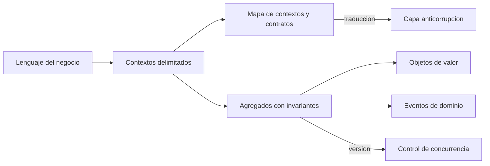
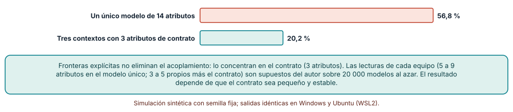
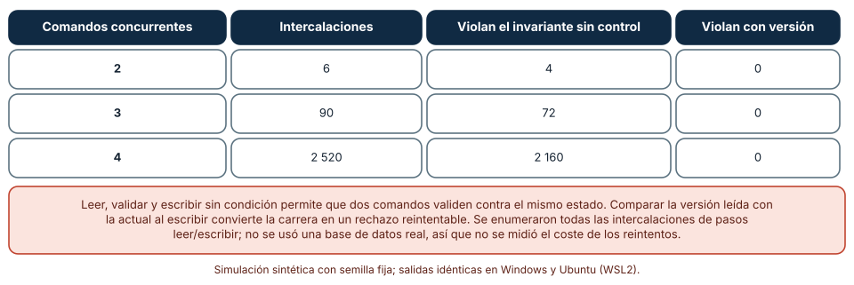
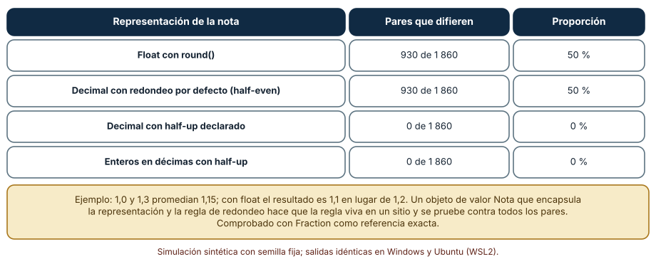

# SE-305 — Domain-Driven Design estratégico y táctico

[← SE-304 — Capas, hexagonal, clean y ports and adapters](https://github.com/vladimiracunadev-create/modern-software-engineering-program/blob/main/classes/part-25-arquitectura-de-software-y-dominio/se-304-capas-hexagonal-clean-y-ports-and-adapters/README.md) · [↑ Parte 25](https://github.com/vladimiracunadev-create/modern-software-engineering-program/blob/main/classes/part-25-arquitectura-de-software-y-dominio/README.md) · [📚 Índice completo](https://github.com/vladimiracunadev-create/modern-software-engineering-program/blob/main/classes/README.md) · [🌐 Portal](https://vladimiracunadev-create.github.io/modern-software-engineering-program/classes/SE-305.html) · [SE-306 — Event-driven, CQRS y event sourcing →](https://github.com/vladimiracunadev-create/modern-software-engineering-program/blob/main/classes/part-25-arquitectura-de-software-y-dominio/se-306-event-driven-cqrs-y-event-sourcing/README.md)

## Punto profesional y fundamento pedagógico

**Punto profesional.** La clase existe para que traces fronteras de significado entre equipos (diseño estratégico) y para que protejas las reglas que no pueden romperse dentro de cada frontera (diseño táctico), con una medida de qué ganas y qué te cuesta.

**Por qué aparece aquí.** Continúa la **Parte 25** después de **Capas, hexagonal, clean y ports and adapters**: `SE-304` ordenó las dependencias dentro de un módulo; esta clase decide qué significa cada palabra del negocio dentro de ese módulo y dónde dejan de significar lo mismo. El «lenguaje ubicuo» no es un glosario: es una frontera de modelo.

**Error conceptual que debe corregir.** Creer que un único modelo de «Entrega» o de «Estudiante» para toda la organización es una virtud: un modelo único obliga a que todos los equipos se pongan de acuerdo sobre cada atributo y acopla sus cambios.

**Secuencia de aprendizaje.** Antes de leer los resultados, predices qué fracción de los cambios de un atributo afecta a otro equipo con un modelo único y con contextos, cuántas intercalaciones de comandos concurrentes rompen un invariante de agregado y cuántos promedios de dos notas se redondean mal con `float`; después lo calculas. La secuencia usa predicción, explicación propia, contraste y recuperación. [ICAP](https://icap.education.asu.edu/research) distingue participación de construcción de conocimiento; [How People Learn II](https://nap.nationalacademies.org/catalog/24783/how-people-learn-ii-learners-contexts-and-cultures) exige conectar conocimiento previo, contexto y transferencia; la [práctica de recuperación](https://pubmed.ncbi.nlm.nih.gov/16507066/) respalda producir de nuevo la explicación tras una demora; y [Education for Life and Work](https://nap.nationalacademies.org/resource/13398/dbasse_084153.pdf) exige devolución que explique la causa del error.

**Evidencia de aprendizaje.** `domain.md` con el mapa de contextos de la plataforma y su glosario por contexto, la comparación del alcance de un cambio con modelo único y con contextos, la enumeración de intercalaciones de un comando sobre un agregado con y sin control de versión y la tabla de redondeo de notas con la representación elegida.

**Límite de la conclusión.** Las lecturas de atributos por equipo, el contrato de tres atributos y las intercalaciones son un modelo del autor; el redondeo de notas es un cálculo exacto sobre una escala de 1,0 a 7,0 que no es la de todas las instituciones. Ninguna cifra mide un equipo real ni una organización.

### Trazabilidad fuente → afirmación

| Fuente primaria u oficial | Afirmación que respalda | Lo que no prueba |
|---|---|---|
| [Evans, «Domain-Driven Design Reference»](https://www.domainlanguage.com/wp-content/uploads/2016/05/DDD_Reference_2015-03.pdf) | Resume contexto delimitado, lenguaje ubicuo, mapa de contextos, entidad, objeto de valor y agregado con sus reglas. | No prueba que DDD convenga a todo sistema: la propia obra lo reserva a dominios complejos. |
| [Fowler, «Bounded Context»](https://martinfowler.com/bliki/BoundedContext.html) | Explica que un término como «cliente» significa cosas distintas en contextos distintos y que cada contexto tiene su modelo. | No dice cuántos contextos tendrá un sistema. |
| [Fowler, «DDD Aggregate»](https://martinfowler.com/bliki/DDD_Aggregate.html) | Define el agregado como grupo de objetos tratado como unidad para cambios de datos, con una raíz que garantiza la consistencia. | No fija el tamaño correcto de un agregado. |
| [Python: `decimal`](https://docs.python.org/3/library/decimal.html) | Documenta aritmética decimal con redondeo configurable, útil para valores donde el redondeo es una regla de negocio. | No decide cuál es el redondeo correcto de una institución. |

## Antes de empezar

Recupera lo que `SE-304` dejó: un módulo con el dominio aislado de la infraestructura. La pregunta activa es: **¿dentro de ese dominio, qué palabras significan cosas distintas para equipos distintos y qué regla no puede romperse nunca?**

## Prerrequisitos

- Haber completado `SE-304` o poder explicar qué es un puerto.
- Python 3.11 o posterior y un terminal; todo el código usa solo la biblioteca estándar.
- Conocer clases con estado, igualdad por valor y nociones básicas de concurrencia.

## Problema auténtico

En la plataforma, «Entrega» significa tres cosas: para quien aprende, el archivo que sube; para quien evalúa, la unidad que se califica con una rúbrica; para administración, un registro con fecha y estado que cuenta para el cierre del periodo. Hay una sola clase `Entrega` con catorce atributos que los tres equipos modifican. Una semana, el equipo de evaluación añade «nota ponderada» y el de administración cambia el formato del estado: se rompen las dos cosas. Además, dos reenvíos simultáneos de una estudiante que tenía un solo intento restante han sido aceptados, y el promedio de dos notas 1,0 y 1,3 se muestra como 1,1 en vez de 1,2.

## Objetivos observables

Al terminar podrás:

1. dibujar un mapa de contextos de la plataforma con el significado de «Entrega» en cada uno y las relaciones entre ellos;
2. calcular qué fracción de los cambios de un atributo afecta a otro equipo con un modelo único y con contextos de contrato pequeño;
3. identificar el invariante de un agregado y enumerar las intercalaciones de comandos concurrentes que lo rompen, con y sin control de versión;
4. elegir una representación para un objeto de valor (la nota) y probarla contra una referencia exacta;
5. decidir cuándo DDD no compensa su coste y qué evidencia te haría cambiar de opinión.

## Mapa conceptual



El mapa separa lo estratégico (contextos y sus relaciones) de lo táctico (agregados, valores, eventos). Entre contextos hay traducción explícita; dentro de un agregado hay un control que protege el invariante.

## Temas y por qué importan

| Tema | Por qué cambia una decisión profesional | Evidencia mínima |
|---|---|---|
| Contexto delimitado y lenguaje ubicuo | Cada término tiene un único significado dentro de su frontera. | Predicción, traza causal y contraejemplo de **Contexto delimitado y lenguaje ubicuo** en `domain.md` |
| Mapa de contextos | Declara cómo se relacionan los equipos y qué se traduce. | Predicción, traza causal y contraejemplo de **Mapa de contextos** en `domain.md` |
| Agregados e invariantes | Definen qué debe ser consistente al instante y qué puede esperar. | Predicción, traza causal y contraejemplo de **Agregados e invariantes** en `domain.md` |
| Entidades y objetos de valor | Ponen la regla de igualdad y de redondeo en un solo sitio. | Predicción, traza causal y contraejemplo de **Entidades y objetos de valor** en `domain.md` |
| Cuándo DDD no compensa | Evita aplicar un coste alto a un dominio simple. | Predicción, traza causal y contraejemplo de **Cuándo DDD no compensa** en `domain.md` |

## Conceptos y decisiones

### 1. Contexto delimitado y lenguaje ubicuo

Un **contexto delimitado** es una frontera dentro de la cual un modelo y su lenguaje tienen un significado preciso y único. Fuera de ella, la misma palabra puede significar otra cosa. «Entrega» en aprendizaje es el archivo y su historial de versiones; en evaluación, la unidad calificable con una rúbrica; en administración, un registro con fecha límite y estado. El **lenguaje ubicuo** no es un glosario global: es el vocabulario que comparten quienes trabajan *dentro* de un contexto y que aparece en el código, las pruebas y las conversaciones con esas mismas palabras. Intentar un único significado para toda la organización produce una definición tan vaga que no sirve a nadie.

### 2. Mapa de contextos

El **mapa de contextos** dibuja los contextos y la naturaleza de cada relación: socios que coordinan cambios, cliente y proveedor donde uno depende de otro, un contexto conformista que acepta el modelo del vecino, o una **capa anticorrupción** que traduce el modelo ajeno al propio para que no lo contamine. Lo importante es que cada relación se declare, porque define quién debe coordinar con quién. Un contrato pequeño y estable entre contextos (tres atributos compartidos, no catorce) concentra el acoplamiento donde puede gestionarse y deja el resto libre para cambiar.

### 3. Agregados e invariantes

Un **agregado** es un grupo de objetos que se trata como una unidad en los cambios, con una **raíz** por la que pasan todos los comandos. Existe para proteger un **invariante**: una regla que debe cumplirse siempre dentro de esa unidad («una entrega admite como máximo tres reenvíos»). La consistencia dentro del agregado es inmediata (una transacción); entre agregados es eventual. El tamaño del agregado es una decisión de concurrencia: uno muy grande bloquea a todos los que lo tocan; uno muy pequeño no puede garantizar su invariante. Dos comandos que leen el mismo estado y escriben después pueden violarlo si no hay control.

### 4. Entidades y objetos de valor

Una **entidad** tiene identidad y ciclo de vida (la entrega 4711 sigue siendo la misma aunque cambie su estado); un **objeto de valor** no tiene identidad y se define por sus atributos (la nota 5,5 es igual a otra nota 5,5), es inmutable y encapsula sus reglas. Una nota modelada como `float` deja el redondeo, el rango y la comparación repartidos por todo el código; una clase `Nota` los reúne en un lugar que se prueba una vez. Esa es la razón práctica del objeto de valor: convertir una regla repetida en un solo sitio con pruebas.

### 5. Cuándo DDD no compensa

DDD tiene un coste: conversaciones con expertos, un modelo que mantener, fronteras que defender. Se justifica en dominios con reglas complejas que cambian y con varios equipos que las interpretan distinto. En un CRUD con reglas triviales o en un componente de apoyo (envío de correos, subida de archivos genéricos) un modelo anémico bien probado puede bastar. Evans mismo reserva el trabajo de diseño más profundo al **dominio central**, la parte que diferencia al negocio, y recomienda comprar o simplificar el resto. Decidir qué parte es central es la primera decisión estratégica.

### Un modelo único frente a tres contextos

Cada uno de tres equipos (aprendizaje, evaluación, administración) lee un subconjunto de los atributos de `Entrega`. En el **modelo único** hay 14 atributos y cada equipo lee entre 5 y 9 al azar. Con **contextos**, cada equipo lee entre 3 y 5 de sus atributos propios más un contrato compartido de 3 atributos. Se sortean 20 000 modelos y, para un atributo cambiado al azar, se calcula la probabilidad de que lo lea más de un equipo (y por tanto el cambio requiera coordinación).

```python
lee = [set(rng.sample(range(14), rng.randint(5, 9))) for _ in range(3)]   # modelo único
cambio = rng.randrange(14)
afecta = sum(cambio in l for l in lee) > 1
```

Con el modelo único, el 56,8 % de los cambios de un atributo que alguien lee afecta a más de un equipo; con tres contextos y un contrato de tres atributos, el 20,2 %. Las cifras son idénticas en Windows (CPython 3.12.9) y en Ubuntu bajo WSL2 (3.12.3).



**Cómo leer la figura.** Cada barra es la probabilidad de que un cambio al azar de un atributo (leído por alguien) requiera coordinar con otro equipo. **Dónde deja de valer:** las lecturas de cada equipo son supuestos del autor y el resultado depende de que el contrato sea pequeño y estable; si el contrato crece hasta incluir casi todo, la ventaja desaparece. La figura no dice «más contextos es mejor»: dice que las fronteras concentran el acoplamiento en un contrato y que ese contrato es lo que hay que cuidar.

### Un invariante de agregado y todas las intercalaciones

La entrega admite tres reenvíos y lleva dos: solo cabe uno más. Cada comando de reenvío hace dos pasos: *leer* el contador y la versión y *escribir* contador + 1 si el contador leído era menor que 3. Con n comandos concurrentes se enumeran todas las intercalaciones que respetan el orden interno de cada uno (6, 90 y 2520 para n = 2, 3 y 4) y se cuentan las que aceptan más de un reenvío. Se repite con una comprobación de versión: el comando escribe solo si la versión actual sigue siendo la que leyó.

```python
if kind == "leer":
    local[cid] = (estado["cont"], estado["ver"])
else:
    c, v = local[cid]
    if c >= 3: continue
    if modo == "version" and estado["ver"] != v: continue   # conflicto: se rechaza
    estado["cont"] = c + 1; estado["ver"] += 1; aceptados += 1
```

| Comandos concurrentes | Intercalaciones | Violan el invariante sin control | Violan con versión |
|---:|---:|---:|---:|
| 2 | 6 | 4 | 0 |
| 3 | 90 | 72 | 0 |
| 4 | 2 520 | 2 160 | 0 |

Sin control, 4 de las 6 intercalaciones de dos comandos aceptan los dos (ambos leen antes de que el otro escriba); con cuatro comandos son el 85,7 %. Con la comprobación de versión el invariante se cumple en todas, a costa de rechazar y reintentar a los demás.



**Cómo leer la figura.** Cada fila es un número de comandos concurrentes; las columnas cuentan intercalaciones que violan el invariante con y sin control de versión. **Dónde deja de valer:** se enumeraron pasos abstractos leer y escribir, sin una base de datos real; no se midió el coste de los reintentos ni la contención. Lo que enseña es el mecanismo: la carrera entre leer y escribir existe en cuanto el invariante se comprueba fuera de la escritura, y se cierra comparando la versión al escribir.

### La nota como objeto de valor

La plataforma promedia dos notas de 1,0 a 7,0 con una cifra decimal y redondea «medio hacia arriba». Se recorren los 61 × 61 pares de notas y, para los 1860 cuyo promedio cae exactamente en medio de dos décimas (por ejemplo, 1,0 y 1,3 dan 1,15), se compara cuatro representaciones con una referencia exacta calculada con `Fraction`.

```python
fr = Fraction(a + b, 20)                                # promedio exacto
ref = Fraction((fr * 10 + Fraction(1, 2)).__floor__(), 10)   # half-up exacto
```

| Representación de la nota | Pares que difieren | Proporción |
|---|---:|---:|
| Float con `round()` | 930 de 1 860 | 50 % |
| Decimal con redondeo por defecto (half-even) | 930 de 1 860 | 50 % |
| Decimal con half-up declarado | 0 de 1 860 | 0 % |
| Enteros en décimas con half-up | 0 de 1 860 | 0 % |

El caso 1,0 y 1,3 da 1,1 con `float` y con `Decimal` por defecto (el redondeo del lenguaje no es «medio hacia arriba»), y 1,2 con la regla de la institución. Con tres notas no aparecen empates exactos (la suma dividida por tres nunca cae en la mitad), de modo que el defecto solo se ve con promedios de dos notas o con ponderaciones que los produzcan.



**Cómo leer la figura.** Cada fila es una representación; la columna central cuenta los pares en que el resultado se aparta de la regla de la institución. **Dónde deja de valer:** la regla «medio hacia arriba» y la escala de 1,0 a 7,0 son las de este caso, no las de todas las instituciones; algunas usan otro redondeo o más decimales. La figura dice que una regla de redondeo es una decisión de negocio que debe vivir en un objeto de valor probado contra una referencia exacta, no en la aritmética por defecto del lenguaje.

## Definiciones de trabajo

- **contexto delimitado:** frontera dentro de la cual un modelo y su lenguaje tienen un significado único y preciso.
- **mapa de contextos:** descripción de los contextos y de la naturaleza de cada relación entre ellos.
- **agregado:** grupo de objetos que se modifica como una unidad a través de una raíz que protege un invariante.
- **invariante:** regla que debe cumplirse siempre dentro de un agregado.
- **objeto de valor:** objeto inmutable sin identidad que se define por sus atributos y encapsula sus reglas.

Las definiciones son operativas para la plataforma de entregas. No convierten términos con una historia más amplia en sinónimos y deben contrastarse con la documentación primaria enlazada al final.

## Ejemplo mínimo

El fragmento muestra un objeto de valor con la regla de redondeo en un solo sitio. Antes de ejecutarlo, predice el promedio de 1,0 y 1,3.

```python
from dataclasses import dataclass

@dataclass(frozen=True)
class Nota:
    decimas: int                      # 10..70
    def __post_init__(self):
        if not 10 <= self.decimas <= 70: raise ValueError("nota fuera de 1,0 a 7,0")
    def promedio(self, otra: "Nota") -> "Nota":
        return Nota((self.decimas + otra.decimas + 1) // 2)   # medio hacia arriba en décimas

assert Nota(10).promedio(Nota(13)) == Nota(12)
```

El resultado es 1,2, no 1,1. Registra versión, comando y salida; añade una comparación contra `Fraction` para los 3721 pares.

## Ejemplo profesional

El equipo de la plataforma dibuja tres contextos (Aprendizaje, Evaluación, Administración) y un contrato de tres atributos entre ellos (identificador, estudiante, estado resumido), con una capa anticorrupción en Administración que traduce el estado de Evaluación. En Evaluación, `Entrega` es un agregado cuya raíz protege «como máximo tres reenvíos»; el repositorio guarda con comprobación de versión y el caso de uso reintenta una vez ante conflicto. La nota es un objeto de valor en décimas enteras con la regla «medio hacia arriba» y una prueba que compara los 3721 pares contra `Fraction`. Antes, el 56,8 % de los cambios de un atributo afectaba a más de un equipo; ahora, con el contrato pequeño, un 20,2 %.

Compara con la clase única de catorce atributos: cada equipo cambia lo suyo sin pedir permiso y el invariante de reenvíos se cumple aun con comandos concurrentes. Un modelo es adecuado cuando sus reglas fuertes están en un sitio probado; es frágil cuando el redondeo y el tope de intentos se repiten en cinco lugares.

## Práctica guiada

1. Lista cinco palabras del negocio de la plataforma y escribe qué significa cada una en tres contextos.
2. Dibuja el mapa de contextos con las relaciones y marca qué se traduce.
3. Define el contrato entre dos contextos con el menor número de atributos posible.
4. Identifica un invariante de agregado y enumera las intercalaciones de dos comandos.
5. Añade una comprobación de versión y vuelve a enumerar.
6. Escribe un objeto de valor para la nota y pruébalo contra una referencia exacta.
7. Entrega `domain.md` y pide a otra persona que encuentre una palabra que cambie de significado entre dos contextos.

## Ejercicios

1. **Contexto:** elige un término de otro dominio (por ejemplo, «cuenta» en un banco) y escribe su significado en tres contextos.
2. **Contrato:** calcula cómo cambia la probabilidad de afectar a otro equipo si el contrato pasa de 3 a 8 atributos con el mismo código.
3. **Invariante:** escribe un invariante de un agregado distinto («un curso no puede tener más de 60 inscritos») y enumera las intercalaciones de dos comandos.
4. **Valor:** diseña un objeto de valor para «fecha límite con zona horaria» y lista las reglas que concentraría.

## Reto verificable

Entrega `domain.md` con el mapa de contextos, la comparación del alcance de un cambio, la enumeración de intercalaciones con y sin control de versión y el objeto de valor con su prueba exacta. Se aprueba si otra persona ejecuta el código desde un checkout limpio, obtiene las mismas cifras y puede decir qué cambiaría si el contrato fuera de 8 atributos. No se aprueba por dibujar un mapa sin explicar qué se traduce ni por afirmar que el agregado «es consistente» sin enumerar casos.

## Caso conductor

La plataforma de entregas y corrección de tareas sigue siendo el caso conductor. Esta clase deja el quinto artefacto: un mapa de contextos con un contrato pequeño, un agregado con su invariante protegido y la nota como objeto de valor. `SE-306` usará esos límites para decidir qué se comunica por eventos entre contextos. Cambia después una sola decisión, el tamaño del contrato, y observa cuánto crece el acoplamiento.

## Preguntas frecuentes

### ¿Cada contexto tiene que ser un servicio?

No. Un contexto delimitado es una frontera de modelo y de lenguaje; puede vivir como módulos de un monolito modular. Que además se despliegue por separado es una decisión de `SE-303`, no una consecuencia de DDD.

### ¿Un agregado equivale a una tabla?

No. Un agregado es una unidad de consistencia que puede abarcar varias tablas (la entrega y su historial) y su raíz es el único punto de entrada. Una tabla es un detalle de almacenamiento.

### ¿Cómo sé qué parte es el dominio central?

Es la que diferencia al negocio y justifica el esfuerzo: en la plataforma, probablemente la evaluación con rúbricas. Lo genérico (autenticación, correo) se compra o se simplifica. La respuesta es una hipótesis que se revisa con el negocio.

### ¿Qué hago si dos equipos discuten el significado de una palabra?

Es la señal de que hay dos contextos. Escribe ambos significados, decide si cada uno vive en un contexto y define qué atributos cruzan la frontera.

## Fallo controlado y diagnóstico

Reproduce el fallo clásico de la clase: **comprobar un invariante fuera de la escritura y aceptar dos reenvíos concurrentes**. Enumera las intercalaciones de dos comandos sobre una entrega con un reenvío restante, sin control de versión.

Registra síntoma, entrada mínima, hipótesis, observación que descarta cada hipótesis, causa, corrección y prueba de regresión. **Síntoma:** una estudiante con un intento restante consigue dos reenvíos aceptados. **Hipótesis rivales:** (a) el cliente envió dos veces; (b) la regla de tope tiene un error de borde; (c) dos comandos leyeron el mismo contador antes de escribir. **Prueba:** enumera las seis intercalaciones; si cuatro aceptan ambos comandos y la regla de tope es correcta en las dos que no, la causa es (c). **Conclusión:** leer y escribir no son atómicos juntos. **Regresión:** añade la comparación de versión al guardar y una prueba que enumere las intercalaciones y exija cero violaciones. No cambies a la vez la regla y el control.

## Errores comunes y cómo corregirlos

| Síntoma | Causa probable | Corrección |
|---|---|---|
| Cada cambio de un atributo exige coordinar a tres equipos | Un modelo único compartido | Separar contextos y reducir el contrato a lo necesario |
| La misma palabra significa cosas distintas en reuniones | Hay varios contextos sin declarar | Escribir el significado en cada contexto y el mapa de relaciones |
| Un invariante se rompe bajo concurrencia | La comprobación se hace fuera de la escritura | Comparar versión al escribir o usar una restricción de la base |
| El redondeo difiere entre pantallas | La regla vive repetida en el código | Encapsular en un objeto de valor y probar contra una referencia exacta |
| Un modelo rico para un CRUD trivial | DDD aplicado sin dominio complejo | Simplificar y reservar el esfuerzo al dominio central |

## Entorno y archivos clave

```text
work/SE-305/
├── README.md
├── domain.md
├── dominio/
│   ├── nota.py
│   └── entrega.py
├── sim/
│   ├── contextos.py
│   ├── intercalaciones.py
│   └── redondeo.py
└── evidence/domain-log.md
```

El `README` declara plataforma, versión de Python, semillas y comandos. Los experimentos usan solo la biblioteca estándar (`random`, `decimal`, `fractions`, `itertools`) y se ejecutaron con CPython 3.12.9 en Windows 11 y 3.12.3 en Ubuntu bajo WSL2: las salidas fueron idénticas. Si añades una dependencia, fija procedencia y versión.

## Seguridad, ética y accesibilidad

- una nota afecta a personas: el redondeo y los topes deben ser reglas publicadas y revisables, no efectos de la aritmética del lenguaje;
- la capa anticorrupción también filtra: no debe pasar a otro contexto más datos personales de los que necesita;
- los mensajes sobre reenvíos rechazados deben explicar el motivo y el camino de apelación, en lenguaje claro y accesible;
- los datos de los ejemplos son sintéticos; no uses calificaciones reales;
- respeta las licencias de las fuentes y atribuye lo adaptado.

## Puente hacia el trabajo con agentes

Un agente al que se le pide «aplica DDD» generará carpetas llamadas `domain`, `entities` y `value_objects` y una clase por sustantivo, sin preguntar qué significa cada palabra en cada equipo. Pídele en cambio que enumere los significados de cada término por contexto, que proponga un contrato mínimo entre contextos y que escriba una prueba que enumere las intercalaciones de un agregado. Revisa especialmente si deja un único `Entrega` para todos y si calcula notas con `float`: son los dos defectos que esta clase mostró con cifras.

## Transferencia

Traslada el análisis a otro dominio (por ejemplo, reservas de salas con aprobación): cambia los términos y conserva el procedimiento de escribir el significado por contexto, reducir el contrato, enumerar las intercalaciones del agregado y encapsular las reglas de valor. La transferencia está lograda cuando puedes explicar qué palabra cambia de significado y qué invariante protegiste, no cuando las carpetas se llaman igual.

## Evaluación y evidencia

| Criterio | Evidencia para aprobar |
|---|---|
| comprensión | explicación de contexto, agregado y objeto de valor con ejemplos de la plataforma |
| corrección | comparación de alcance, enumeración de intercalaciones y redondeo exacto reproducibles |
| diseño | mapa de contextos con contrato mínimo y agregado con control de concurrencia |
| diagnóstico | reproducción del fallo «invariante fuera de la escritura» con regresión |
| incertidumbre | declaración de que las lecturas por equipo son supuestos y la regla de redondeo es de este caso |
| reproducibilidad | versiones, comandos, salida y límites declarados |

## Fuentes

- [Evans, «Domain-Driven Design Reference»](https://www.domainlanguage.com/wp-content/uploads/2016/05/DDD_Reference_2015-03.pdf) — resumen de patrones estratégicos y tácticos; autoridad: Eric Evans.
- [Fowler, «Bounded Context»](https://martinfowler.com/bliki/BoundedContext.html) — contexto delimitado; autoridad: Martin Fowler.
- [Fowler, «DDD Aggregate»](https://martinfowler.com/bliki/DDD_Aggregate.html) — agregado como unidad de consistencia; autoridad: Martin Fowler.
- [Fowler, «Value Object»](https://martinfowler.com/bliki/ValueObject.html) — objetos de valor; autoridad: Martin Fowler.
- [Python: `decimal`](https://docs.python.org/3/library/decimal.html) — aritmética decimal y modos de redondeo; autoridad: documentación de Python.
- [Python: `fractions`](https://docs.python.org/3/library/fractions.html) — referencia exacta para el redondeo; autoridad: documentación de Python.
- [SWEBOK Guide v4.0a](https://www.computer.org/education/bodies-of-knowledge/software-engineering) — áreas de conocimiento de ingeniería de software; autoridad: IEEE Computer Society.

Todas las páginas respondieron con éxito a una petición de solo lectura. Cada fuente respalda el mecanismo indicado; ninguna demuestra que el 56,8 % de los cambios afecte a otro equipo en una organización real ni que la regla «medio hacia arriba» sea la de tu institución. Esa afirmación depende del código y de la normativa académica.

## Límites y siguiente paso

Se ejecutaron tres cálculos con datos sintéticos en Windows y Ubuntu (WSL2) con resultados idénticos. No se observó ningún equipo ni se tocó una base de datos: las lecturas por equipo, el contrato, las intercalaciones abstractas y la escala de notas son construcciones del autor. La siguiente clase usa estos límites para decidir qué se comunica por eventos entre contextos.

## Glosario

- **contexto delimitado:** frontera dentro de la cual un modelo y su lenguaje tienen un significado único y preciso.
- **mapa de contextos:** descripción de los contextos y de la naturaleza de cada relación entre ellos.
- **agregado:** grupo de objetos que se modifica como una unidad a través de una raíz que protege un invariante.
- **invariante:** regla que debe cumplirse siempre dentro de un agregado.
- **objeto de valor:** objeto inmutable sin identidad que se define por sus atributos y encapsula sus reglas.

---

[← SE-304 — Capas, hexagonal, clean y ports and adapters](https://github.com/vladimiracunadev-create/modern-software-engineering-program/blob/main/classes/part-25-arquitectura-de-software-y-dominio/se-304-capas-hexagonal-clean-y-ports-and-adapters/README.md) · [↑ Parte 25](https://github.com/vladimiracunadev-create/modern-software-engineering-program/blob/main/classes/part-25-arquitectura-de-software-y-dominio/README.md) · [📚 Índice completo](https://github.com/vladimiracunadev-create/modern-software-engineering-program/blob/main/classes/README.md) · [🌐 Portal](https://vladimiracunadev-create.github.io/modern-software-engineering-program/classes/SE-305.html) · [SE-306 — Event-driven, CQRS y event sourcing →](https://github.com/vladimiracunadev-create/modern-software-engineering-program/blob/main/classes/part-25-arquitectura-de-software-y-dominio/se-306-event-driven-cqrs-y-event-sourcing/README.md)
