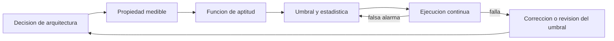
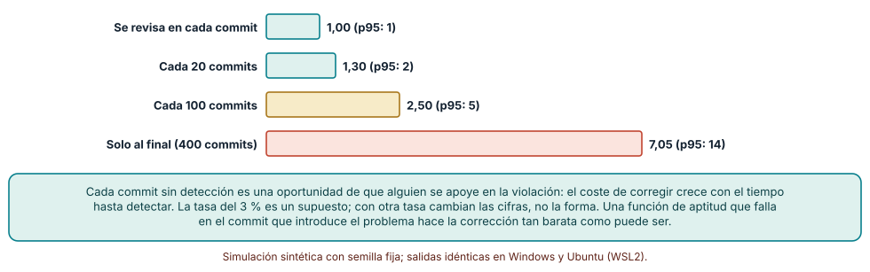
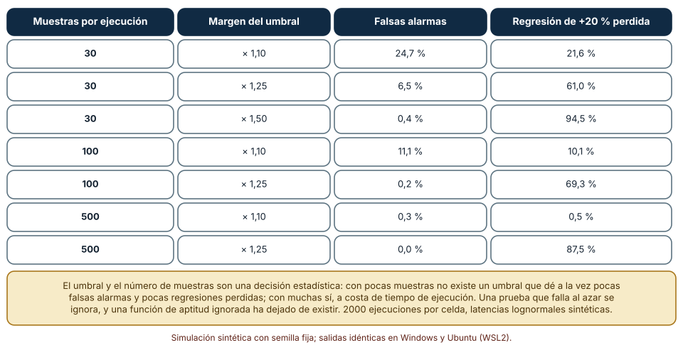
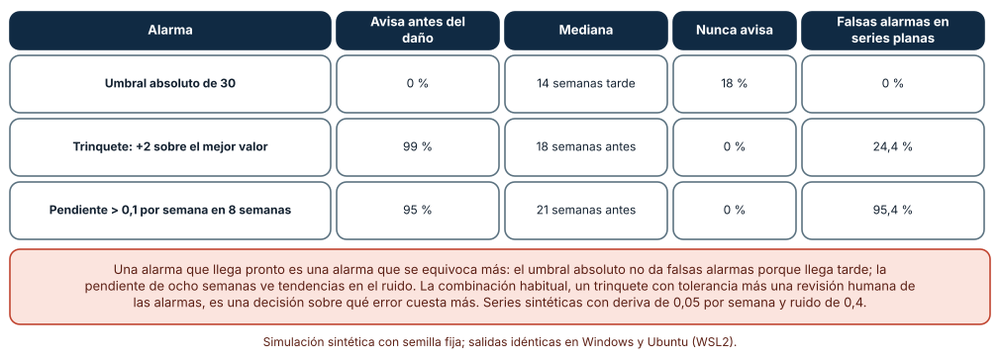

# SE-308 — Fitness functions y arquitectura evolutiva

[← SE-307 — Arquitecturas serverless, edge y peer-to-peer](https://github.com/vladimiracunadev-create/modern-software-engineering-program/blob/main/classes/part-25-arquitectura-de-software-y-dominio/se-307-arquitecturas-serverless-edge-y-peer-to-peer/README.md) · [↑ Parte 25](https://github.com/vladimiracunadev-create/modern-software-engineering-program/blob/main/classes/part-25-arquitectura-de-software-y-dominio/README.md) · [📚 Índice completo](https://github.com/vladimiracunadev-create/modern-software-engineering-program/blob/main/classes/README.md) · [🌐 Portal](https://vladimiracunadev-create.github.io/modern-software-engineering-program/classes/SE-308.html) · [SE-309 — Trade-offs, ADR y evaluación de alternativas →](https://github.com/vladimiracunadev-create/modern-software-engineering-program/blob/main/classes/part-25-arquitectura-de-software-y-dominio/se-309-trade-offs-adr-y-evaluacion-de-alternativas/README.md)

## Punto profesional y fundamento pedagógico

**Punto profesional.** La clase existe para que conviertas una decisión de arquitectura en una prueba automática que la defienda a lo largo del tiempo, y para que sepas elegir su umbral y su frecuencia sin que falle al azar ni deje pasar el deterioro.

**Por qué aparece aquí.** Continúa la **Parte 25** después de **Arquitecturas serverless, edge y peer-to-peer**: `SE-307` terminó con umbrales («si el tráfico supera 22 rps, la revisión vuelve a un servidor»); una decisión con umbral que nadie comprueba es un deseo. Una arquitectura evolutiva es la que cambia de forma guiada, y la guía son pruebas que miden las propiedades que importan.

**Error conceptual que debe corregir.** Creer que una función de aptitud es «un test más»: es una medida de una propiedad arquitectónica con un umbral, una frecuencia y una estadística, y su calidad se juzga por dos errores (falsas alarmas y alarmas perdidas), no solo por si «pasa».

**Secuencia de aprendizaje.** Antes de leer los resultados, predices cuánto crece el coste de corregir una violación según cuándo se detecta, cuántas falsas alarmas da una prueba de rendimiento con pocas muestras y cuánto adelanta una alarma de tendencia a un umbral fijo; después lo simulas. La secuencia usa predicción, explicación propia, contraste y recuperación. [ICAP](https://icap.education.asu.edu/research) distingue participación de construcción de conocimiento; [How People Learn II](https://nap.nationalacademies.org/catalog/24783/how-people-learn-ii-learners-contexts-and-cultures) exige conectar conocimiento previo, contexto y transferencia; la [práctica de recuperación](https://pubmed.ncbi.nlm.nih.gov/16507066/) respalda producir de nuevo la explicación tras una demora; y [Education for Life and Work](https://nap.nationalacademies.org/resource/13398/dbasse_084153.pdf) exige devolución que explique la causa del error.

**Evidencia de aprendizaje.** `fitness.md` con el catálogo de funciones de aptitud de la plataforma (propiedad, medida, umbral, frecuencia, responsable), la comparación del coste de corregir según el momento de detección, la tabla de falsas alarmas y alarmas perdidas de una prueba de rendimiento y la comparación de tres alarmas sobre una deriva.

**Límite de la conclusión.** La probabilidad de un 3 % de que un nuevo uso se apoye en una violación, las latencias lognormales, la deriva de 0,05 por semana con ruido de 0,4 y los saltos al azar son construcciones del autor. No se midió ningún repositorio ni sistema real: las simulaciones muestran el compromiso entre detectar pronto y equivocarse, no cifras de un equipo.

### Trazabilidad fuente → afirmación

| Fuente primaria u oficial | Afirmación que respalda | Lo que no prueba |
|---|---|---|
| [Ford, Parsons y Kua, «Building Evolutionary Architectures» (O'Reilly)](https://www.oreilly.com/library/view/building-evolutionary-architectures/9781491986356/) | Define una función de aptitud arquitectónica como un mecanismo que evalúa de forma objetiva la conformidad de una propiedad con un objetivo, y propone ejecutarlas de forma continua. | No fija qué propiedades ni qué umbrales usar en un sistema. |
| [Thoughtworks Technology Radar, «Architectural fitness function»](https://www.thoughtworks.com/radar/techniques/architectural-fitness-function) | Presenta la técnica de funciones de aptitud como parte de un pipeline de entrega. | No demuestra que reduzcan la erosión arquitectónica. |
| [Google SRE, «Service Level Objectives»](https://sre.google/sre-book/service-level-objectives/) | Distingue indicadores, objetivos y acuerdos y explica elegir percentiles y umbrales con criterio. | No fija el objetivo de la plataforma de esta clase. |
| [Python: `statistics`](https://docs.python.org/3/library/statistics.html) | Documenta las funciones de mediana y cuantiles usadas en las simulaciones. | No valida el modelo estadístico de una prueba de rendimiento real. |

## Antes de empezar

Recupera lo que `SE-307` dejó: cada pieza con una condición que invalida su elección. La pregunta activa es: **¿qué prueba automática avisaría a tiempo de que esa condición se cumple, y con qué probabilidad se equivocaría?**

## Prerrequisitos

- Haber completado `SE-307` o poder escribir la condición de invalidez de una decisión.
- Python 3.11 o posterior y un terminal; todo el código usa solo la biblioteca estándar.
- Manejar percentiles, series temporales simples y la noción de falsa alarma.

## Problema auténtico

La plataforma tiene un ADR que dice «los módulos de dominio no dependen de infraestructura» y un objetivo de «p95 de entrega bajo 800 ms». Seis meses después un módulo de dominio importa el cliente de la base de datos y el p95 va por 1100 ms. Nadie lo notó porque el ADR vive en un documento y la medición en un panel que se mira de vez en cuando. Cuando alguien lo ve, ya hay 7 usos de la dependencia indebida. El equipo pone una prueba de rendimiento que falla una de cada cuatro ejecuciones sin que haya cambiado nada y la ignora a la semana.

## Objetivos observables

Al terminar podrás:

1. escribir una función de aptitud con propiedad, medida, umbral, frecuencia y responsable, y distinguir una atómica de una holística;
2. medir cuánto crece el coste de corregir una violación según cuándo se detecta;
3. calcular las falsas alarmas y las regresiones no detectadas de una prueba de rendimiento según el umbral y el número de muestras;
4. comparar un umbral absoluto, un trinquete y una alarma por tendencia sobre una deriva lenta y elegir con criterio;
5. decidir qué decisiones merecen una función de aptitud y cuáles se cubren con revisión.

## Mapa conceptual



El mapa muestra que la función de aptitud conecta la decisión con la entrega continua. Un umbral mal calibrado vuelve por el retorno: una prueba que da falsas alarmas se ignora, y una ignorada ha dejado de existir.

## Temas y por qué importan

| Tema | Por qué cambia una decisión profesional | Evidencia mínima |
|---|---|---|
| Qué es una función de aptitud | Convierte una propiedad arquitectónica en una prueba objetiva. | Predicción, traza causal y contraejemplo de **Qué es una función de aptitud** en `fitness.md` |
| Detección temprana | Abarata la corrección al limitar cuánto se apoya el resto en la violación. | Predicción, traza causal y contraejemplo de **Detección temprana** en `fitness.md` |
| Umbrales y ruido | Una prueba con ruido se convierte en una prueba ignorada. | Predicción, traza causal y contraejemplo de **Umbrales y ruido** en `fitness.md` |
| Tendencias y trinquetes | Detectan el deterioro lento que un umbral fijo no ve. | Predicción, traza causal y contraejemplo de **Tendencias y trinquetes** en `fitness.md` |
| Evolución guiada | Decide qué propiedades se protegen y cuáles se dejan cambiar. | Predicción, traza causal y contraejemplo de **Evolución guiada** en `fitness.md` |

## Conceptos y decisiones

### 1. Qué es una función de aptitud

Una **función de aptitud arquitectónica** es cualquier mecanismo que evalúa de forma objetiva qué tan bien cumple el sistema una propiedad que importa (acoplamiento, latencia, tamaño de un paquete, cobertura de un contrato). Puede ser **atómica** (una sola propiedad: ningún módulo de dominio importa infraestructura) u **holística** (varias interacciones: la latencia de un recorrido completo bajo carga). Puede ejecutarse en cada commit, cada noche o continuamente en producción. Lo que la define no es la herramienta sino que tenga una medida, un umbral y una consecuencia: si no pasa, algo ocurre. Una métrica en un panel que nadie mira no es una función de aptitud.

### 2. Detección temprana

Una violación de arquitectura crece con el tiempo: cada commit posterior es una oportunidad de que alguien se apoye en la dependencia indebida y de que corregirla cueste más. Por eso la frecuencia de la función es parte del diseño. Detectar en el mismo commit limita el daño a un punto; revisar cada trimestre lo deja crecer. La relación es aproximadamente lineal en el número de commits hasta la detección, con una tasa que depende del equipo. El coste de ejecutar la función también cuenta: una prueba de carga completa en cada commit puede ser inviable, y se compensa con pruebas atómicas baratas en cada commit y holísticas caras de forma periódica.

### 3. Umbrales y ruido

Las propiedades de ejecución (latencia, uso de memoria) son aleatorias. Una prueba que compara una medición con un umbral falla por el ruido aunque nada haya cambiado (falsa alarma) o pasa aunque haya empeorado (alarma perdida). Ambos errores dependen del umbral relativo al ruido y del número de muestras: más muestras estrechan la distribución del estadístico y permiten un umbral más cercano al valor esperado. Un margen holgado casi elimina las falsas alarmas y deja pasar regresiones considerables. La elección es una decisión estadística y de coste: cuántas muestras puedo pagar por ejecución.

### 4. Tendencias y trinquetes

Un umbral absoluto avisa cuando el daño ya está hecho. Dos alternativas avisan antes. El **trinquete** impide empeorar: la alarma salta si la medida supera el mejor valor histórico más una tolerancia, de modo que el listón solo sube. La **alarma por tendencia** mira la pendiente en una ventana y avisa del deterioro lento. Ambas adelantan la detección y ambas tienen un coste: son sensibles al ruido y generan más falsas alarmas. La combinación habitual es un trinquete con tolerancia más una revisión humana de las alarmas, y un umbral absoluto como red de seguridad de último recurso.

### 5. Evolución guiada

Una **arquitectura evolutiva** soporta cambios guiados e incrementales en varias dimensiones. Las funciones de aptitud son la guía: protegen lo que no debe cambiar (el sentido de las dependencias, la latencia de los recorridos críticos) y dejan libre lo demás. No se escribe una por cada decisión: se escriben para las que, si se violan, cuestan caro y son medibles. Las demás se cubren con revisión de diseño, y el equipo debe poder decir cuáles son y por qué. Una función de aptitud también tiene ciclo de vida: cuando la decisión cambia, el umbral o la prueba se retiran con el ADR correspondiente.

### Cuánto cuesta corregir una violación según cuándo se detecta

Una dependencia indebida entra en el commit `t`, con `t` al azar entre los commits 20 y 380 de una serie de 400. Cada commit posterior tiene un 3 % de probabilidad de que un código nuevo se apoye en ella (un «punto de uso» más que corregir). Se compara detectar en el mismo commit, cada 20, cada 100 o solo al final, con 2000 repeticiones.

```python
fin = t if det == "cada commit" else ((t // 20) + 1) * 20     # según la política
usuarios = 1 + sum(1 for _ in range(fin - t) if rng.random() < 0.03)
```

| Política de revisión | Puntos de uso, media | Percentil 95 | Máximo |
|---|---:|---:|---:|
| En cada commit | 1,00 | 1 | 1 |
| Cada 20 commits | 1,30 | 2 | 5 |
| Cada 100 commits | 2,50 | 5 | 12 |
| Solo al final (400 commits) | 7,05 | 14 | 21 |

Detectar en el commit que la introduce deja un solo punto de uso; revisar cada 100 commits lo multiplica por 2,5 y esperar al final por 7. Las cifras son idénticas en Windows (CPython 3.12.9) y en Ubuntu bajo WSL2 (3.12.3).



**Cómo leer la figura.** Cada barra es el número medio de puntos de uso que habrá que corregir con esa frecuencia de revisión. **Dónde deja de valer:** la tasa del 3 % por commit es un supuesto y los usos reales se agrupan en ciertos módulos; con otra tasa cambian las cifras, no la forma creciente. La figura no dice «ejecuta todo en cada commit»: dice que el coste de corregir depende del tiempo hasta la detección, y que ese tiempo se diseña.

### Una prueba de rendimiento: falsas alarmas y regresiones perdidas

La latencia de la entrega es lognormal con mediana de 100 ms y σ = 0,35. La prueba toma n muestras, calcula su percentil 95 y falla si supera `margen × (percentil 95 esperado sin regresión)`. Se mide la fracción de ejecuciones sin cambio que fallan (falsas alarmas) y la de ejecuciones con una regresión del 20 % que no fallan (alarmas perdidas), con 2000 ejecuciones por celda.

```python
p95 = q(muestras, 0.95)
alarma = p95 > margen * p95_esperado
```

| Muestras por ejecución | Margen del umbral | Falsas alarmas | Regresión de +20 % perdida |
|---:|---:|---:|---:|
| 30 | × 1,10 | 24,7 % | 21,6 % |
| 30 | × 1,25 | 6,5 % | 61,0 % |
| 30 | × 1,50 | 0,4 % | 94,5 % |
| 100 | × 1,10 | 11,1 % | 10,1 % |
| 100 | × 1,25 | 0,2 % | 69,3 % |
| 500 | × 1,10 | 0,3 % | 0,5 % |
| 500 | × 1,25 | 0,0 % | 87,5 % |

Con 30 muestras no existe un margen que dé a la vez pocas falsas alarmas y pocas regresiones perdidas: con ×1,10 falla casi una de cada cuatro ejecuciones sin cambio; con ×1,25 se pierde el 61 % de las regresiones. Con 500 muestras y ×1,10 las dos cifras bajan a 0,3 % y 0,5 %.



**Cómo leer la figura.** Cada fila combina el número de muestras y el margen; las dos últimas columnas son los dos errores posibles. **Dónde deja de valer:** las latencias son lognormales e independientes entre muestras; las reales se agrupan, tienen colas más pesadas y deriva del entorno de ejecución. La figura dice que el umbral y las muestras son una decisión estadística y que una prueba con falsas alarmas se desactiva: el coste de las muestras suficientes es parte del coste de la función de aptitud.

### Tres alarmas sobre una deriva de acoplamiento

Una métrica de acoplamiento parte de 20 y cada semana suma una deriva de 0,05 más ruido gaussiano (σ = 0,4), con un 4 % de probabilidad semanal de un salto de 2 a 4 por una decisión puntual, durante 80 semanas. El daño real empieza cuando la métrica pasa de 26. Se comparan: un umbral absoluto de 30; un trinquete que alarma si la medida supera el mínimo histórico más 2; y una alarma por pendiente (pendiente de mínimos cuadrados > 0,1 por semana en una ventana de 8). Se usan 1000 series, de las cuales 926 alcanzan el daño real, y 1000 series planas sin deriva para medir las falsas alarmas.

```python
trinquete = next((w for w in range(1, 80) if xs[w] > min(xs[:w]) + 2), None)
```

| Alarma | Avisa antes del daño | Mediana | Nunca avisa | Falsas alarmas en series planas |
|---|---:|---:|---:|---:|
| Umbral absoluto de 30 | 0 % | 14 semanas tarde | 18 % | 0 % |
| Trinquete: +2 sobre el mejor valor | 99 % | 18 semanas antes | 0 % | 24,4 % |
| Pendiente > 0,1 por semana en 8 semanas | 95 % | 21 semanas antes | 0 % | 95,4 % |

El umbral absoluto avisa 14 semanas después de que empiece el daño y deja sin aviso al 18 % de las series. El trinquete avisa antes en el 99 % de los casos, una mediana de 18 semanas antes, pero se equivoca en el 24,4 % de las series planas; la pendiente avisa aún antes, y da falsa alarma en el 95,4 % de las series sin deriva, porque con ruido de 0,4 una ventana de ocho semanas ve pendientes que no existen.



**Cómo leer la figura.** Cada fila es una alarma; las columnas dan cuánto adelanta, cuántas veces falla en avisar y cuántas falsas alarmas da cuando no pasa nada. **Dónde deja de valer:** la deriva, el ruido y los saltos son construcciones del autor, y el daño real en 26 es un umbral arbitrario; en un sistema real la medida tiene estacionalidad (cierres, lanzamientos). La figura dice que una alarma que llega pronto se equivoca más y que elegir es decidir qué error cuesta más.

## Definiciones de trabajo

- **función de aptitud arquitectónica:** mecanismo que evalúa de forma objetiva el cumplimiento de una propiedad de la arquitectura frente a un umbral.
- **falsa alarma:** aviso de la función cuando la propiedad se cumple.
- **alarma perdida:** ausencia de aviso cuando la propiedad se ha degradado.
- **trinquete:** regla que impide que una medida empeore respecto de su mejor valor histórico más una tolerancia.
- **erosión arquitectónica:** deterioro gradual de la estructura por cambios que violan las decisiones originales.

Las definiciones son operativas para la plataforma de entregas. No convierten términos con una historia más amplia en sinónimos y deben contrastarse con la documentación primaria enlazada al final.

## Ejemplo mínimo

El fragmento es una función de aptitud atómica sobre las importaciones de un módulo. Antes de ejecutarlo, predice si pasa.

```python
import ast

def importa_infra(fuente: str) -> list[str]:
    arbol = ast.parse(fuente)
    prohibidos = {"sqlite3", "requests", "psycopg2"}
    return [n.names[0].name for n in ast.walk(arbol)
            if isinstance(n, ast.Import) and n.names[0].name.split(".")[0] in prohibidos]

assert importa_infra("import json\ndef f(): return 1") == []
assert importa_infra("import sqlite3\ndef f(): return 1") == ["sqlite3"]
```

La segunda comprobación detecta la violación. Registra versión, comando y salida; añade `from requests import get` y comprueba que esta función no lo ve (es una `ImportFrom`).

## Ejemplo profesional

El equipo de la plataforma escribe un catálogo de siete funciones de aptitud: cuatro atómicas en cada commit (dominio sin importaciones de infraestructura, sin ciclos entre módulos, tamaño máximo del paquete, endpoints sin cambios incompatibles) y tres holísticas nocturnas (p95 del recorrido de entrega bajo 800 ms con 5 peticiones por segundo, capacidad en el pico, y tiempo de restauración). Para la de latencia usa 500 muestras y margen ×1,10, porque con 30 las falsas alarmas eran del 25 %; para el acoplamiento usa un trinquete con tolerancia 2 y una revisión semanal de las alarmas. Cada función lleva su responsable y el ADR que la origina, y cuando se acepta un ADR que cambia el umbral se actualiza la función en el mismo cambio.

Compara con el punto de partida: la violación de dominio se detecta en el commit que la introduce (un punto de uso, no siete) y las pruebas de rendimiento ya no se ignoran. Un catálogo es adecuado cuando cada función tiene un dueño, un umbral con justificación estadística y un ADR; es frágil cuando hay pruebas que nadie sabe por qué existen.

## Práctica guiada

1. Elige cinco decisiones de arquitectura de la plataforma y escribe su propiedad medible.
2. Para cada una, define medida, umbral, frecuencia y responsable.
3. Simula el coste de corregir una violación con tres frecuencias de revisión.
4. Simula una prueba de rendimiento con 30, 100 y 500 muestras y elige umbral y muestras.
5. Genera una deriva y compara un umbral absoluto con un trinquete y una pendiente.
6. Marca cuáles de tus decisiones no merecen función de aptitud y por qué.
7. Entrega `fitness.md` y pide a otra persona que proponga una violación que tus funciones no detecten.

## Ejercicios

1. **Coste:** calcula el coste medio esperado de corregir con revisión cada 50 commits y una tasa del 5 % por commit y compáralo con una simulación.
2. **Muestras:** busca con una simulación el número mínimo de muestras para que el margen ×1,10 dé menos del 5 % de falsas alarmas y menos del 5 % de regresiones perdidas.
3. **Trinquete:** ajusta la tolerancia del trinquete para bajar las falsas alarmas por debajo del 10 % y mide cuánto adelanto pierdes.
4. **Alcance:** amplía la función atómica del ejemplo mínimo para detectar `ImportFrom` y menciona un caso que seguiría sin ver.

## Reto verificable

Entrega `fitness.md` con el catálogo, las tres simulaciones y la justificación estadística de cada umbral. Se aprueba si otra persona ejecuta el código desde un checkout limpio, obtiene las mismas cifras y puede decir qué función ignoraría primero un equipo por sus falsas alarmas. No se aprueba por listar «métricas» sin umbral, frecuencia ni responsable.

## Caso conductor

La plataforma de entregas y corrección de tareas sigue siendo el caso conductor. Esta clase deja el octavo artefacto: un catálogo de funciones de aptitud con umbrales justificados estadísticamente. `SE-309` pondrá por escrito las decisiones que esas funciones defienden y comparará alternativas con sus costes. Cambia después una sola decisión, el número de muestras de la prueba de latencia, y observa cómo cambian las dos tasas de error.

## Preguntas frecuentes

### ¿Una función de aptitud es lo mismo que un test unitario?

No exactamente: un test unitario comprueba el comportamiento de una unidad; una función de aptitud comprueba una propiedad del sistema o de su estructura frente a un umbral (a veces con una medición estadística). Se parecen en que corren de forma automática.

### ¿Todas las decisiones necesitan una función de aptitud?

No: solo las que cuesta caro violar y se pueden medir. El resto se cubre con revisión de diseño. Un exceso de funciones produce ruido y mantenimiento sin protección real.

### ¿Cómo evito que una prueba de rendimiento sea inestable?

Con más muestras, un entorno de ejecución estable, un estadístico robusto (percentil en lugar de máximo) y un umbral calibrado con la variabilidad medida. Si aun así falla al azar, no la ignores: arréglala o retírala de forma explícita.

### ¿Un trinquete no impide mejorar?

No: impide empeorar. Si la medida mejora, el listón baja y la nueva marca pasa a ser la referencia; lo que se bloquea es el retroceso.

## Fallo controlado y diagnóstico

Reproduce el fallo clásico de la clase: **una prueba con falsas alarmas que el equipo desactiva y que no vuelve a proteger nada**. Simula 30 muestras con margen ×1,10 sin ningún cambio real y cuenta cuántas ejecuciones fallan.

Registra síntoma, entrada mínima, hipótesis, observación que descarta cada hipótesis, causa, corrección y prueba de regresión. **Síntoma:** la prueba de latencia falla una de cada cuatro ejecuciones sin que haya cambiado nada. **Hipótesis rivales:** (a) el último cambio empeoró el rendimiento; (b) el entorno está inestable; (c) el umbral está demasiado cerca del valor esperado para 30 muestras. **Prueba:** repite la prueba 2000 veces sobre el mismo código; si falla el 24,7 % de las veces, la causa es (c). **Conclusión:** el percentil 95 de 30 muestras fluctúa tanto como el margen del 10 %. **Regresión:** sube a 500 muestras y comprueba que las falsas alarmas bajan a 0,3 % y las regresiones del 20 % perdidas a 0,5 %. No cambies a la vez el margen y el número de muestras.

## Errores comunes y cómo corregirlos

| Síntoma | Causa probable | Corrección |
|---|---|---|
| Se descubren violaciones meses después | Revisión infrecuente | Funciones atómicas baratas en cada commit |
| La prueba de rendimiento falla al azar y se ignora | Umbral cerca del valor esperado con pocas muestras | Más muestras o margen calibrado con la variabilidad |
| Una regresión del 20 % pasa sin aviso | Margen demasiado holgado | Reducir el margen y aumentar las muestras |
| La alarma por tendencia avisa constantemente | Ventana corta frente al ruido | Ventana más larga, trinquete con tolerancia y revisión humana |
| Hay funciones que nadie sabe por qué existen | Sin ADR ni responsable | Vincular cada función a un ADR y un dueño, y retirarlas con él |

## Entorno y archivos clave

```text
work/SE-308/
├── README.md
├── fitness.md
├── fitness/
│   ├── dominio_sin_infra.py
│   └── latencia_entrega.py
├── sim/
│   ├── deteccion.py
│   ├── ruido.py
│   └── deriva.py
└── evidence/fitness-log.md
```

El `README` declara plataforma, versión de Python, semillas y comandos. Los experimentos usan solo la biblioteca estándar (`random`, `math`, `statistics`) y se ejecutaron con CPython 3.12.9 en Windows 11 y 3.12.3 en Ubuntu bajo WSL2: las salidas fueron idénticas. Si añades una dependencia, fija procedencia y versión.

## Seguridad, ética y accesibilidad

- una función de aptitud de seguridad (dependencias vulnerables, secretos en el código) protege a personas reales: no la desactives por comodidad sin una decisión escrita;
- las pruebas de carga no deben ejecutarse contra sistemas ajenos ni producción sin autorización;
- las alarmas deben llegar por canales accesibles y no depender solo del color o del sonido;
- las mediciones de rendimiento de un entorno de pruebas no deben incluir datos de personas;
- respeta las licencias de las fuentes y atribuye lo adaptado.

## Puente hacia el trabajo con agentes

Un agente al que se le pide «añade fitness functions» escribirá una docena de pruebas con umbrales redondos («latencia < 200 ms») y pocas muestras. Pídele en cambio que parta de un ADR, que defina medida, umbral, frecuencia y responsable, que calibre el umbral simulando el ruido y que indique sus tasas de falsa alarma y alarma perdida. Revisa especialmente si el umbral sale de un número redondo y si la prueba usa una sola medición: son los dos defectos que esta clase mostró con cifras.

## Transferencia

Traslada el análisis a otro sistema (por ejemplo, una biblioteca con una API pública): cambia las propiedades (compatibilidad, tamaño) y conserva el procedimiento de elegir frecuencia, calibrar el umbral contra el ruido y comparar alarmas. La transferencia está lograda cuando puedes decir qué error cuesta más en tu caso (falsa alarma o alarma perdida), no cuando el catálogo se parece.

## Evaluación y evidencia

| Criterio | Evidencia para aprobar |
|---|---|
| comprensión | explicación de función de aptitud atómica y holística con ejemplos de la plataforma |
| corrección | simulaciones de detección, ruido y deriva reproducibles con las mismas semillas |
| diseño | catálogo con medida, umbral, frecuencia, responsable y ADR |
| diagnóstico | reproducción del fallo «prueba con falsas alarmas» con regresión |
| incertidumbre | declaración de que tasas, ruido y deriva son supuestos |
| reproducibilidad | versiones, comandos, salida y límites declarados |

## Fuentes

- [Ford, Parsons y Kua, «Building Evolutionary Architectures» (O'Reilly)](https://www.oreilly.com/library/view/building-evolutionary-architectures/9781491986356/) — funciones de aptitud y arquitectura evolutiva; autoridad: O'Reilly Media.
- [Thoughtworks Technology Radar, «Architectural fitness function»](https://www.thoughtworks.com/radar/techniques/architectural-fitness-function) — técnica de funciones de aptitud en la entrega; autoridad: Thoughtworks.
- [Google SRE, «Service Level Objectives»](https://sre.google/sre-book/service-level-objectives/) — indicadores, objetivos y percentiles; autoridad: Google SRE.
- [Python: `ast`](https://docs.python.org/3/library/ast.html) — análisis de importaciones del ejemplo mínimo; autoridad: documentación de Python.
- [Python: `statistics`](https://docs.python.org/3/library/statistics.html) — mediana y cuantiles; autoridad: documentación de Python.
- [SWEBOK Guide v4.0a](https://www.computer.org/education/bodies-of-knowledge/software-engineering) — áreas de conocimiento de ingeniería de software; autoridad: IEEE Computer Society.

Todas las páginas respondieron con éxito a una petición de solo lectura. Cada fuente respalda el mecanismo indicado; ninguna demuestra que el 24,7 % de falsas alarmas o las 18 semanas de adelanto del trinquete ocurran en un equipo real. Esa afirmación depende del ruido de la medición y de la deriva real del sistema.

## Límites y siguiente paso

Se ejecutaron tres simulaciones con datos sintéticos en Windows y Ubuntu (WSL2) con resultados idénticos. No se midió ningún repositorio, pipeline ni sistema: la tasa de uso, las latencias lognormales, la deriva y los saltos son construcciones del autor. La siguiente clase registra las decisiones que estas funciones defienden y compara sus alternativas.

## Glosario

- **función de aptitud arquitectónica:** mecanismo que evalúa de forma objetiva el cumplimiento de una propiedad de la arquitectura frente a un umbral.
- **falsa alarma:** aviso de la función cuando la propiedad se cumple.
- **alarma perdida:** ausencia de aviso cuando la propiedad se ha degradado.
- **trinquete:** regla que impide que una medida empeore respecto de su mejor valor histórico más una tolerancia.
- **erosión arquitectónica:** deterioro gradual de la estructura por cambios que violan las decisiones originales.

---

[← SE-307 — Arquitecturas serverless, edge y peer-to-peer](https://github.com/vladimiracunadev-create/modern-software-engineering-program/blob/main/classes/part-25-arquitectura-de-software-y-dominio/se-307-arquitecturas-serverless-edge-y-peer-to-peer/README.md) · [↑ Parte 25](https://github.com/vladimiracunadev-create/modern-software-engineering-program/blob/main/classes/part-25-arquitectura-de-software-y-dominio/README.md) · [📚 Índice completo](https://github.com/vladimiracunadev-create/modern-software-engineering-program/blob/main/classes/README.md) · [🌐 Portal](https://vladimiracunadev-create.github.io/modern-software-engineering-program/classes/SE-308.html) · [SE-309 — Trade-offs, ADR y evaluación de alternativas →](https://github.com/vladimiracunadev-create/modern-software-engineering-program/blob/main/classes/part-25-arquitectura-de-software-y-dominio/se-309-trade-offs-adr-y-evaluacion-de-alternativas/README.md)
