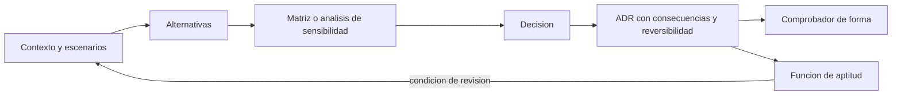
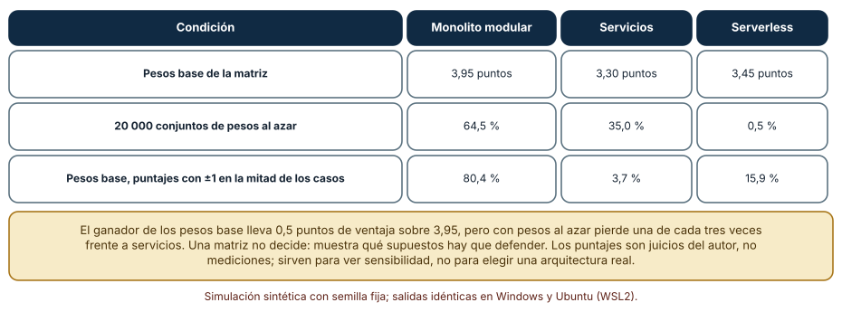
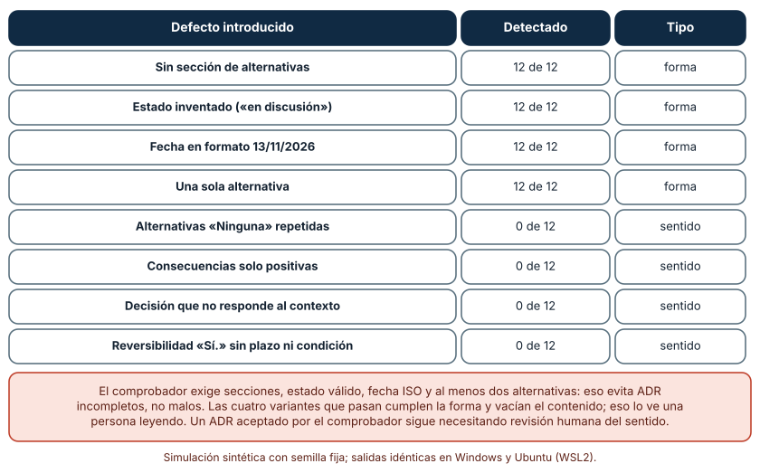
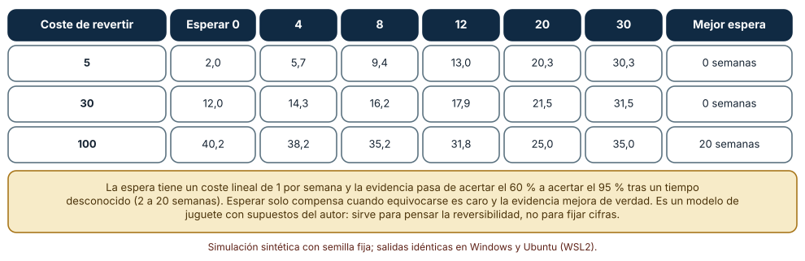

# SE-309 — Trade-offs, ADR y evaluación de alternativas

[← SE-308 — Fitness functions y arquitectura evolutiva](https://github.com/vladimiracunadev-create/modern-software-engineering-program/blob/main/classes/part-25-arquitectura-de-software-y-dominio/se-308-fitness-functions-y-arquitectura-evolutiva/README.md) · [↑ Parte 25](https://github.com/vladimiracunadev-create/modern-software-engineering-program/blob/main/classes/part-25-arquitectura-de-software-y-dominio/README.md) · [📚 Índice completo](https://github.com/vladimiracunadev-create/modern-software-engineering-program/blob/main/classes/README.md) · [🌐 Portal](https://vladimiracunadev-create.github.io/modern-software-engineering-program/classes/SE-309.html) · [SE-310 — Arquitectura socio-técnica y límites de equipo →](https://github.com/vladimiracunadev-create/modern-software-engineering-program/blob/main/classes/part-25-arquitectura-de-software-y-dominio/se-310-arquitectura-socio-tecnica-y-limites-de-equipo/README.md)

## Punto profesional y fundamento pedagógico

**Punto profesional.** La clase existe para que registres una decisión de arquitectura con sus alternativas, sus consecuencias y su reversibilidad, para que sepas cuánto confiar en una matriz de comparación y para que decidas cuándo conviene esperar más evidencia antes de decidir.

**Por qué aparece aquí.** Continúa la **Parte 25** después de **Fitness functions y arquitectura evolutiva**: `SE-308` dejó pruebas que defienden decisiones; esas pruebas necesitan un registro de la decisión que las origina. Un ADR sin alternativas ni consecuencias no se puede cuestionar, y una decisión que no se puede cuestionar tampoco puede revisarse cuando cambia el contexto.

**Error conceptual que debe corregir.** Creer que una matriz de decisión ponderada produce una respuesta: produce una presentación de supuestos, y su resultado cambia con pesos y puntajes que son juicios.

**Secuencia de aprendizaje.** Antes de leer los resultados, predices quién gana una matriz cuando cambian los pesos o los puntajes, qué defectos de un ADR detecta un comprobador de formato y cuánto conviene esperar antes de decidir según lo caro que sea revertir; después lo simulas. La secuencia usa predicción, explicación propia, contraste y recuperación. [ICAP](https://icap.education.asu.edu/research) distingue participación de construcción de conocimiento; [How People Learn II](https://nap.nationalacademies.org/catalog/24783/how-people-learn-ii-learners-contexts-and-cultures) exige conectar conocimiento previo, contexto y transferencia; la [práctica de recuperación](https://pubmed.ncbi.nlm.nih.gov/16507066/) respalda producir de nuevo la explicación tras una demora; y [Education for Life and Work](https://nap.nationalacademies.org/resource/13398/dbasse_084153.pdf) exige devolución que explique la causa del error.

**Evidencia de aprendizaje.** `decisions.md` con la matriz de tres alternativas y su análisis de sensibilidad, cuatro ADR de la plataforma validados por un comprobador con lo que este no ve, y la simulación de cuánto esperar según el coste de revertir con una recomendación escrita.

**Límite de la conclusión.** Los puntajes de la matriz son juicios del autor, no mediciones; los doce ADR y sus defectos los escribió el autor; el modelo de espera, con coste lineal de 1 por semana y evidencia que mejora de 60 % a 95 %, es un juguete. Nada de esto decide una arquitectura real: muestra qué preguntas hacerle a la propia decisión.

### Trazabilidad fuente → afirmación

| Fuente primaria u oficial | Afirmación que respalda | Lo que no prueba |
|---|---|---|
| [Nygard, «Documenting Architecture Decisions»](https://www.cognitect.com/blog/2011/11/15/documenting-architecture-decisions) | Propone registros cortos de decisiones con título, estado, contexto, decisión y consecuencias, guardados junto al código. | No dice cuántas decisiones merecen un registro. |
| [MADR, Markdown Architectural Decision Records](https://adr.github.io/madr/) | Ofrece una plantilla con opciones consideradas, pros y contras y resultado de la decisión. | No garantiza que las opciones listadas sean todas las relevantes. |
| [SEI, «The Architecture Tradeoff Analysis Method»](https://www.sei.cmu.edu/library/the-architecture-tradeoff-analysis-method/) | Propone analizar la arquitectura contra escenarios para identificar puntos de sensibilidad, de compromiso y riesgos. | No cuantifica la incertidumbre de los juicios de quienes puntúan. |
| [Fowler, «Architecture Decision Record»](https://martinfowler.com/bliki/ArchitectureDecisionRecord.html) | Resume la práctica de ADR numerados e inmutables, con estado y reemplazo por otro ADR. | No demuestra que reduzcan el retrabajo. |

## Antes de empezar

Recupera lo que `SE-308` dejó: funciones de aptitud con un ADR de origen. La pregunta activa es: **¿qué dice exactamente ese ADR sobre lo que se descartó y sobre cuándo habría que volver a decidir?**

## Prerrequisitos

- Haber completado `SE-308` o poder explicar qué es una función de aptitud.
- Python 3.11 o posterior y un terminal; todo el código usa solo la biblioteca estándar.
- Manejar probabilidades, expresiones regulares básicas y archivos Markdown.

## Problema auténtico

Hace un año el equipo decidió separar la revisión de archivos. En la reunión de este mes nadie recuerda por qué: unos dicen que fue por el antivirus, otros por el coste, y la persona que lo decidió ya no está. En la carpeta `docs/` hay un archivo `arquitectura-final-v3.md` con la decisión y sin alternativas. Otra propuesta de cambio llega con una hoja de cálculo que da a «servicios» un 4,1 y a «monolito modular» un 3,9; al cambiar un peso, el orden se invierte. El equipo discute la hoja en vez de la decisión.

## Objetivos observables

Al terminar podrás:

1. escribir un ADR con estado, contexto, decisión, alternativas, consecuencias y reversibilidad, y reconocer cuándo una decisión no lo necesita;
2. calcular con una simulación quién gana una matriz ponderada cuando cambian los pesos o los puntajes, y qué margen la hace confiable;
3. escribir un comprobador de ADR y declarar qué defectos de sentido no puede ver;
4. calcular cuánto conviene esperar antes de decidir según el coste de revertir y la velocidad con que mejora la evidencia;
5. registrar los supuestos y las condiciones que obligarían a reabrir una decisión.

## Mapa conceptual



El mapa muestra que la matriz es una entrada de la decisión, no la decisión, y que el ADR se vincula a funciones de aptitud y a una condición de revisión. La decisión se reabre por el contexto, no por antigüedad.

## Temas y por qué importan

| Tema | Por qué cambia una decisión profesional | Evidencia mínima |
|---|---|---|
| Registro de decisiones | Conserva el porqué cuando las personas cambian. | Predicción, traza causal y contraejemplo de **Registro de decisiones** en `decisions.md` |
| Alternativas y trade-offs | Una decisión sin alternativas no es una decisión. | Predicción, traza causal y contraejemplo de **Alternativas y trade-offs** en `decisions.md` |
| Matrices y sensibilidad | Muestran qué supuestos sostienen el resultado. | Predicción, traza causal y contraejemplo de **Matrices y sensibilidad** en `decisions.md` |
| Calidad de un ADR | Un registro completo en forma puede estar vacío en contenido. | Predicción, traza causal y contraejemplo de **Calidad de un ADR** en `decisions.md` |
| Reversibilidad y momento de decidir | Decide cuándo esperar y cuándo actuar. | Predicción, traza causal y contraejemplo de **Reversibilidad y momento de decidir** en `decisions.md` |

## Conceptos y decisiones

### 1. Registro de decisiones

Un **ADR** (registro de decisión de arquitectura) es un documento corto sobre una decisión significativa: título, estado (propuesta, aceptada, reemplazada), fecha, contexto, decisión, alternativas consideradas y consecuencias. Se guarda junto al código, se numera y no se edita para borrar el pasado: si la decisión cambia, un ADR nuevo reemplaza al anterior y el anterior queda con el estado «reemplazada». Su valor aparece cuando alguien pregunta por qué: la respuesta está escrita, con las fuerzas que había en ese momento. Registrar todo es ruido; registrar lo costoso de revertir es memoria.

### 2. Alternativas y trade-offs

Una decisión elige una alternativa y sacrifica algo: por eso un ADR sin alternativas ni consecuencias negativas es sospechoso de una decisión ya tomada y justificada después. Las alternativas deben ser reales (algo que se habría podido hacer) y deben incluir «no hacer nada» o «hacer menos» cuando corresponde. Un **trade-off** es la pareja ganancia-sacrificio de una alternativa: separar la revisión de archivos gana aislamiento y escalado, y sacrifica la transacción local y suma operación. Escribir el sacrificio es lo que permite reabrir la decisión cuando ese sacrificio deja de ser aceptable.

### 3. Matrices y sensibilidad

Una **matriz de decisión ponderada** puntúa cada alternativa contra criterios con pesos y suma. Es útil para ordenar la conversación y para hacer visibles los criterios; es engañosa si se toma por una medida. Los puntajes son juicios y los pesos son prioridades; cambiar cualquiera mueve el resultado. El **análisis de sensibilidad** pregunta cuánto tienen que cambiar los pesos o los puntajes para que gane otra alternativa: si hay que moverlos mucho, la decisión es robusta; si basta un cambio pequeño, la matriz no discrimina y la decisión debe sostenerse con otro argumento (un escenario, un riesgo, una restricción).

### 4. Calidad de un ADR

Un comprobador automático puede exigir secciones, estados válidos, fechas en formato y un mínimo de alternativas. Eso evita ADR incompletos, no malos. Un ADR puede tener todas las secciones y decir «Alternativas: ninguna», «Consecuencias: todo mejora» o una decisión que no responde al contexto. Esos defectos de sentido solo los ve una persona que lee. La práctica razonable es combinar ambos: el comprobador en el CI para la forma y una revisión por pares del contenido antes de aceptar. Un ADR que pasa el comprobador y no ha sido leído por nadie es solo burocracia.

### 5. Reversibilidad y momento de decidir

Decidir pronto evita el coste de la indecisión; decidir tarde permite aprender. Con una decisión **reversible y barata de revertir** conviene decidir ya y corregir si hace falta. Con una **costosa de revertir** y una evidencia que mejorará pronto, conviene esperar hasta el último momento responsable, el punto en que seguir esperando cuesta más que el riesgo de equivocarse. Esperar tiene un coste (retraso, equipos bloqueados) y solo compensa si la evidencia mejora de verdad: esperar sin aprender es solo demora. El ADR debe decir qué se sabrá después y cuándo.

### Quién gana la matriz: sensibilidad a pesos y puntajes

Tres alternativas (monolito modular, servicios, serverless) se puntúan de 1 a 5 contra cinco criterios (latencia, disponibilidad, costo, simplicidad operativa, autonomía de equipos) con pesos base 0,25, 0,25, 0,20, 0,20 y 0,10; los puntajes son del autor. Se calcula el resultado con los pesos base, con 20 000 conjuntos de pesos al azar (Dirichlet uniforme) y con los pesos base pero puntajes que cambian en ±1 en la mitad de los casos.

```python
w = [rng.expovariate(1) for _ in crit]; w = [x / sum(w) for x in w]     # pesos al azar
ganador = max(alt, key=lambda k: sum(a * b for a, b in zip(w, alt[k])))
```

| Condición | Monolito modular | Servicios | Serverless |
|---|---:|---:|---:|
| Pesos base de la matriz | 3,95 puntos | 3,30 puntos | 3,45 puntos |
| 20 000 conjuntos de pesos al azar | 64,5 % | 35,0 % | 0,5 % |
| Pesos base, puntajes con ±1 en la mitad de los casos | 80,4 % | 3,7 % | 15,9 % |

Con los pesos base, el monolito modular saca 0,50 puntos de ventaja sobre 3,95. Con pesos al azar gana el 64,5 % de las veces; servicios gana una de cada tres. Con ruido en los puntajes, serverless pasa de 0,5 % a 15,9 %. Las cifras son idénticas en Windows (CPython 3.12.9) y en Ubuntu bajo WSL2 (3.12.3).



**Cómo leer la figura.** Cada fila es una condición de incertidumbre; las columnas dan los puntos o el porcentaje de victorias de cada alternativa. **Dónde deja de valer:** los puntajes son juicios del autor, no mediciones; con otros criterios o puntajes, ganará otra alternativa. La figura no recomienda el monolito: enseña que el ganador de los pesos base puede perder una de cada tres veces cuando se admite que los pesos son inciertos, y que la decisión debe defender sus supuestos más que su suma.

### Un comprobador de ADR frente a defectos de forma y de sentido

Se escriben 12 ADR sintéticos válidos (secciones Estado, Fecha, Contexto, Decisión, Alternativas, Consecuencias y Reversibilidad) y, de cada uno, ocho variantes con un defecto: cuatro de forma (sin sección de alternativas, estado inventado, fecha en formato `13/11/2026`, una sola alternativa) y cuatro de sentido (alternativas «Ninguna» repetidas, consecuencias solo positivas, una decisión que no responde al contexto, reversibilidad «Sí.» sin plazo ni condición). El comprobador usa expresiones regulares para exigir las siete secciones, un estado válido, una fecha ISO y al menos dos alternativas con viñeta.

```python
if not re.search(rf"^## {h}\s*$", txt, re.M): err.append("falta " + h)
if len(re.findall(r"^- ", m.group(1), re.M)) < 2: err.append("menos de 2 alternativas")
```

| Defecto introducido | Detectado | Tipo |
|---|---:|---|
| Sin sección de alternativas | 12 de 12 | forma |
| Estado inventado («en discusión») | 12 de 12 | forma |
| Fecha en formato 13/11/2026 | 12 de 12 | forma |
| Una sola alternativa | 12 de 12 | forma |
| Alternativas «Ninguna» repetidas | 0 de 12 | sentido |
| Consecuencias solo positivas | 0 de 12 | sentido |
| Decisión que no responde al contexto | 0 de 12 | sentido |
| Reversibilidad «Sí.» sin plazo ni condición | 0 de 12 | sentido |

Los doce ADR válidos pasan sin falsos positivos. El comprobador detecta las 48 variantes de forma y ninguna de las 48 de sentido: las dos alternativas «Ninguna» cumplen la regla de «al menos dos viñetas».



**Cómo leer la figura.** Cada fila es un defecto introducido en los doce ADR; la segunda columna cuenta los casos que el comprobador detecta. **Dónde deja de valer:** los doce ADR son sintéticos y las variantes las eligió el autor; un comprobador más inteligente (lista de palabras, longitud mínima) detectaría algunas, y sería a su vez burlable. La figura dice que la forma se automatiza y el sentido se lee: la validación automática no sustituye la revisión.

### Cuánto esperar antes de decidir

Se simulan 10 000 proyectos. La verdad (A o B es mejor) se conoce con certeza tras T semanas de uso (T entre 2 y 20); antes de T, la señal acierta el 60 % de las veces y después el 95 %. Esperar `e` semanas cuesta 1 por semana; elegir mal cuesta `rev` semanas-equipo de revertir. Se compara el coste esperado de decidir tras esperar 0, 4, 8, 12, 20 o 30 semanas con tres costes de revertir.

```python
acierta = rng.random() < (0.6 if e < T else 0.95)
coste = (rev if elegida != verdad else 0) + e
```

| Coste de revertir | Esperar 0 | 4 | 8 | 12 | 20 | 30 | Mejor espera |
|---:|---:|---:|---:|---:|---:|---:|---|
| 5 | 2,0 | 5,7 | 9,4 | 13,0 | 20,3 | 30,3 | 0 semanas |
| 30 | 12,0 | 14,3 | 16,2 | 17,9 | 21,5 | 31,5 | 0 semanas |
| 100 | 40,2 | 38,2 | 35,2 | 31,8 | 25,0 | 35,0 | 20 semanas |

Si revertir cuesta 5 o 30 semanas-equipo, conviene decidir ya (coste esperado de 2,0 y 12,0). Si cuesta 100, esperar 20 semanas, hasta que la evidencia sea fiable, baja el coste de 40,2 a 25,0; esperar 30 ya lo sube a 35,0 porque la espera ha dejado de aportar información.



**Cómo leer la figura.** Cada fila es un coste de revertir; las columnas dan el coste esperado total según cuánto se espera. **Dónde deja de valer:** el coste de la espera es lineal, la precisión de la evidencia salta de 60 % a 95 % en un instante y las T son uniformes: un modelo de juguete con supuestos del autor, no un método de decisión. La figura dice que esperar compensa solo cuando equivocarse es caro y la evidencia mejora de verdad.

## Definiciones de trabajo

- **ADR:** registro corto de una decisión de arquitectura con contexto, alternativas, decisión y consecuencias.
- **trade-off:** pareja de ganancia y sacrificio que implica elegir una alternativa.
- **análisis de sensibilidad:** estudio de cuánto cambian los pesos o los supuestos para que otra alternativa gane.
- **reversibilidad:** coste y plazo de volver atrás tras una decisión.
- **último momento responsable:** punto en el que seguir esperando cuesta más que el riesgo de decidir con la evidencia disponible.

Las definiciones son operativas para la plataforma de entregas. No convierten términos con una historia más amplia en sinónimos y deben contrastarse con la documentación primaria enlazada al final.

## Ejemplo mínimo

El fragmento es un ADR mínimo y un comprobador de una regla. Antes de ejecutarlo, predice si pasa.

```python
import re

ADR = """# ADR-007 Separar la revisión de archivos

## Estado
aceptada

## Alternativas
- Escalar el servidor
- Separar la revisión
"""

def alternativas(txt):
    m = re.search(r"^## Alternativas\s*\n(.*?)(?=^## |\Z)", txt, re.M | re.S)
    return len(re.findall(r"^- ", m.group(1), re.M)) if m else 0

assert alternativas(ADR) == 2
```

Hay dos alternativas. Registra versión, comando y salida; sustituye la segunda por «- Ninguna» y observa que el comprobador sigue contando dos.

## Ejemplo profesional

El equipo de la plataforma escribe cuatro ADR (subir archivos por URL firmada, monolito modular, revisión asíncrona con cola, tres instancias de la aplicación) con la plantilla MADR y un comprobador de forma en el CI. Para el de servicios frente a monolito modular ejecuta el análisis de sensibilidad: el monolito gana con los pesos base y con 64,5 % de los pesos al azar, de modo que la decisión se apoya en el escenario de despliegue (un equipo de seis) y no en la suma. En el ADR de la revisión asíncrona escribe la reversibilidad («volver a síncrona cuesta una semana»), el sacrificio (la transacción local con la entrega) y la condición de revisión («si el tráfico medio de la revisión supera 7,8 peticiones por segundo, ver `SE-307`»). Para la decisión de subir los archivos directamente al almacenamiento, de reversión cara, decide esperar dos semanas a medir con un prototipo.

Compara con el archivo `arquitectura-final-v3.md`: ahora cada decisión tiene su porqué, su sacrificio y la señal que la reabriría. Un registro es adecuado cuando alguien nuevo puede discrepar con él por escrito; es frágil cuando solo afirma.

## Práctica guiada

1. Elige las cuatro decisiones de arquitectura más caras de revertir de la plataforma.
2. Escribe un ADR de cada una con alternativas reales y el sacrificio de la elegida.
3. Construye una matriz de tres alternativas y calcula su sensibilidad a los pesos.
4. Escribe el comprobador de forma y pásalo a tus ADR.
5. Pide a otra persona que lea los ADR y marque los defectos de sentido que el comprobador no ve.
6. Estima el coste de revertir de cada decisión y decide cuáles conviene esperar.
7. Entrega `decisions.md` y pide a otra persona que reabra una decisión usando solo el ADR.

## Ejercicios

1. **Matriz:** cambia un puntaje de la matriz y calcula cuánto debe cambiar un peso para que cambie el ganador.
2. **Comprobador:** amplía el comprobador para detectar «Consecuencias» sin ningún aspecto negativo y describe cuántos falsos positivos introduce.
3. **Espera:** calcula el coste esperado de esperar 6 semanas si revertir cuesta 60 y el coste de la espera es 2 por semana.
4. **Reapertura:** escribe la condición de revisión de una decisión de la plataforma en términos medibles.

## Reto verificable

Entrega `decisions.md` con cuatro ADR, la matriz con su sensibilidad, el comprobador con sus límites y la decisión de cuánto esperar. Se aprueba si otra persona ejecuta el código desde un checkout limpio, obtiene las mismas cifras y puede decir qué decisión reabriría primero y qué señal la reabriría. No se aprueba por un ADR sin alternativas ni por afirmar que una matriz «demuestra» la elección.

## Caso conductor

La plataforma de entregas y corrección de tareas sigue siendo el caso conductor. Esta clase deja el noveno artefacto: los ADR de las decisiones más costosas con sus alternativas, sacrificios y condiciones de revisión. `SE-310` mirará a las personas que toman y ejecutan esas decisiones: cómo la estructura de los equipos condiciona la arquitectura. Cambia después una sola decisión, el coste de revertir, y observa cuándo deja de convenir decidir ya.

## Preguntas frecuentes

### ¿Cuántos ADR debo escribir?

Los de decisiones costosas de revertir o que afectan a varios equipos. Un ADR por cada elección menor es ruido. Una regla práctica: si un nuevo integrante preguntaría «¿por qué esto es así?» y la respuesta no es obvia, merece un ADR.

### ¿Se edita un ADR aceptado?

No se reescribe para borrar el pasado. Se puede corregir una errata o añadir una nota de seguimiento; si la decisión cambia, un ADR nuevo lo reemplaza y el anterior queda con estado «reemplazada».

### ¿Sirve una matriz si no sé puntuar bien?

Sirve para hacer visibles los criterios y para ver la sensibilidad. Puntúa en grupo, anota quién discrepa y calcula cuánto debe cambiar un puntaje para que gane otra alternativa. Si basta una pequeña variación, la matriz no decide.

### ¿Y si nadie quiere escribir las alternativas?

Es una señal de que la decisión ya estaba tomada. Pide al menos una alternativa real y el sacrificio de la elegida; si no hay ninguna defendible, quizá no haya una decisión que registrar.

## Fallo controlado y diagnóstico

Reproduce el fallo clásico de la clase: **un ADR que pasa todas las comprobaciones de forma y no dice nada**. Usa la variante con alternativas «Ninguna» repetidas.

Registra síntoma, entrada mínima, hipótesis, observación que descarta cada hipótesis, causa, corrección y prueba de regresión. **Síntoma:** un ADR aceptado se cuestiona un año después y nadie encuentra qué se descartó. **Hipótesis rivales:** (a) el comprobador no se ejecutó; (b) se ejecutó y el ADR incumplía la forma; (c) cumplía la forma y el contenido de las alternativas estaba vacío. **Prueba:** ejecuta el comprobador sobre el ADR; si pasa y la sección «Alternativas» contiene dos viñetas «Ninguna», la causa es (c). **Conclusión:** el comprobador detecta 12 de 12 defectos de forma y 0 de 12 de sentido. **Regresión:** añade al flujo una revisión por pares con una lista de comprobación de sentido (alternativas reales, un sacrificio explícito, reversibilidad con plazo) y conserva el comprobador solo para la forma. No cambies a la vez el comprobador y la revisión.

## Errores comunes y cómo corregirlos

| Síntoma | Causa probable | Corrección |
|---|---|---|
| Nadie recuerda por qué se decidió algo | No hay registro de la decisión | Escribir un ADR con contexto, alternativas y consecuencias |
| El ganador de la matriz cambia al mover un peso | La matriz no discrimina | Calcular la sensibilidad y sostener la decisión con un escenario |
| Los ADR pasan el comprobador y están vacíos | El comprobador solo ve la forma | Añadir revisión por pares de sentido |
| Se decide pronto algo caro de revertir | Se ignoró el coste de la reversión | Estimarlo y esperar al último momento responsable |
| Se espera sin aprender | La espera no tiene un plan de evidencia | Decir qué se medirá, cómo y para cuándo |

## Entorno y archivos clave

```text
work/SE-309/
├── README.md
├── decisions.md
├── adr/
│   ├── ADR-001.md
│   └── ADR-004.md
├── tools/lint_adr.py
├── sim/
│   ├── matriz.py
│   └── espera.py
└── evidence/decisions-log.md
```

El `README` declara plataforma, versión de Python, semillas y comandos. Los experimentos usan solo la biblioteca estándar (`random`, `re`, `math`) y se ejecutaron con CPython 3.12.9 en Windows 11 y 3.12.3 en Ubuntu bajo WSL2: las salidas fueron idénticas. Si añades una dependencia, fija procedencia y versión.

## Seguridad, ética y accesibilidad

- un ADR de seguridad o de privacidad debe registrar qué riesgos se aceptan y quién los acepta; no los entierres en «consecuencias»;
- los ADR de un sistema público no deben incluir datos personales, credenciales ni rutas internas;
- una matriz con pesos que ignoran a un grupo de usuarios (accesibilidad, conectividad limitada) esconde una decisión ética: hazla visible como criterio;
- guarda el historial de decisiones con control de versiones y retención clara;
- respeta las licencias de las plantillas y atribuye lo adaptado.

## Puente hacia el trabajo con agentes

Un agente al que se le pide «escribe un ADR» producirá un texto fluido con alternativas genéricas y consecuencias solo positivas, y una matriz que da la victoria a lo que ya propuso. Pídele en cambio que use una plantilla fija, que liste alternativas que habrías podido elegir, que escriba al menos un sacrificio y una condición de reapertura medible, y que calcule la sensibilidad de la matriz. Revisa especialmente si las alternativas son reales y si la reversibilidad tiene un plazo: son los defectos de sentido que el comprobador de esta clase no veía.

## Transferencia

Traslada el análisis a otra decisión (por ejemplo, elegir una base de datos): cambia las alternativas y conserva el procedimiento de escribir el ADR, medir la sensibilidad de la matriz, pasar el comprobador y decidir cuánto esperar. La transferencia está lograda cuando puedes decir qué señal reabriría la decisión, no cuando el ADR se parece a otro.

## Evaluación y evidencia

| Criterio | Evidencia para aprobar |
|---|---|
| comprensión | explicación de ADR, trade-off y reversibilidad con ejemplos de la plataforma |
| corrección | sensibilidad, comprobador y simulación de espera reproducibles con las mismas semillas |
| diseño | cuatro ADR con alternativas reales, sacrificio y condición de reapertura |
| diagnóstico | reproducción del fallo «ADR correcto en forma y vacío» con regresión |
| incertidumbre | declaración de que los puntajes son juicios y el modelo de espera es un juguete |
| reproducibilidad | versiones, comandos, salida y límites declarados |

## Fuentes

- [Nygard, «Documenting Architecture Decisions»](https://www.cognitect.com/blog/2011/11/15/documenting-architecture-decisions) — origen de los ADR; autoridad: Michael Nygard.
- [MADR, Markdown Architectural Decision Records](https://adr.github.io/madr/) — plantilla de ADR; autoridad: comunidad ADR.
- [SEI, «The Architecture Tradeoff Analysis Method»](https://www.sei.cmu.edu/library/the-architecture-tradeoff-analysis-method/) — análisis de compromisos contra escenarios; autoridad: Software Engineering Institute (Carnegie Mellon).
- [Fowler, «Architecture Decision Record»](https://martinfowler.com/bliki/ArchitectureDecisionRecord.html) — práctica de ADR; autoridad: Martin Fowler.
- [Python: `re`](https://docs.python.org/3/library/re.html) — expresiones regulares del comprobador; autoridad: documentación de Python.
- [SWEBOK Guide v4.0a](https://www.computer.org/education/bodies-of-knowledge/software-engineering) — áreas de conocimiento de ingeniería de software; autoridad: IEEE Computer Society.

Todas las páginas respondieron con éxito a una petición de solo lectura. Cada fuente respalda el mecanismo indicado; ninguna demuestra que el monolito gane el 64,5 % de las matrices ni que convenga esperar 20 semanas en un caso real. Esa afirmación depende de los puntajes, los pesos y los costes de tu propia decisión.

## Límites y siguiente paso

Se ejecutaron tres cálculos con datos sintéticos en Windows y Ubuntu (WSL2) con resultados idénticos. No se evaluó ninguna arquitectura real: los puntajes, los ADR, sus defectos y el modelo de espera son construcciones del autor. La siguiente clase mira a las personas y a los equipos que toman y ejecutan estas decisiones.

## Glosario

- **ADR:** registro corto de una decisión de arquitectura con contexto, alternativas, decisión y consecuencias.
- **trade-off:** pareja de ganancia y sacrificio que implica elegir una alternativa.
- **análisis de sensibilidad:** estudio de cuánto cambian los pesos o los supuestos para que otra alternativa gane.
- **reversibilidad:** coste y plazo de volver atrás tras una decisión.
- **último momento responsable:** punto en el que seguir esperando cuesta más que el riesgo de decidir con la evidencia disponible.

---

[← SE-308 — Fitness functions y arquitectura evolutiva](https://github.com/vladimiracunadev-create/modern-software-engineering-program/blob/main/classes/part-25-arquitectura-de-software-y-dominio/se-308-fitness-functions-y-arquitectura-evolutiva/README.md) · [↑ Parte 25](https://github.com/vladimiracunadev-create/modern-software-engineering-program/blob/main/classes/part-25-arquitectura-de-software-y-dominio/README.md) · [📚 Índice completo](https://github.com/vladimiracunadev-create/modern-software-engineering-program/blob/main/classes/README.md) · [🌐 Portal](https://vladimiracunadev-create.github.io/modern-software-engineering-program/classes/SE-309.html) · [SE-310 — Arquitectura socio-técnica y límites de equipo →](https://github.com/vladimiracunadev-create/modern-software-engineering-program/blob/main/classes/part-25-arquitectura-de-software-y-dominio/se-310-arquitectura-socio-tecnica-y-limites-de-equipo/README.md)
