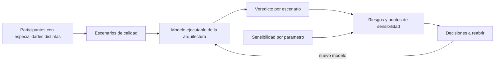
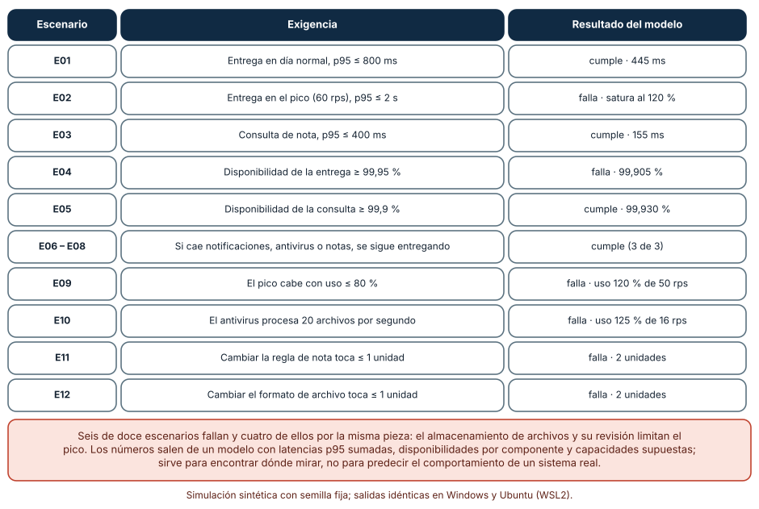
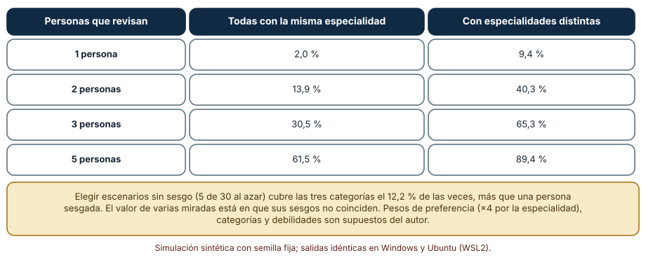

# SE-311 — Taller: revisar una arquitectura contra escenarios

[← SE-310 — Arquitectura socio-técnica y límites de equipo](https://github.com/vladimiracunadev-create/modern-software-engineering-program/blob/main/classes/part-25-arquitectura-de-software-y-dominio/se-310-arquitectura-socio-tecnica-y-limites-de-equipo/README.md) · [↑ Parte 25](https://github.com/vladimiracunadev-create/modern-software-engineering-program/blob/main/classes/part-25-arquitectura-de-software-y-dominio/README.md) · [📚 Índice completo](https://github.com/vladimiracunadev-create/modern-software-engineering-program/blob/main/classes/README.md) · [🌐 Portal](https://vladimiracunadev-create.github.io/modern-software-engineering-program/classes/SE-311.html) · [SE-312 — Proyecto: arquitectura defendible y verificable →](https://github.com/vladimiracunadev-create/modern-software-engineering-program/blob/main/classes/part-25-arquitectura-de-software-y-dominio/se-312-proyecto-arquitectura-defendible-y-verificable/README.md)

## Punto profesional y fundamento pedagógico

**Punto profesional.** El taller existe para que revises una arquitectura completa contra escenarios con un modelo ejecutable, para que sepas cuánto se puede fiar de esa revisión según quién la haga y para que distingas los parámetros que de verdad deciden un veredicto de los que solo parecen importar.

**Por qué aparece aquí.** Es el taller de la **Parte 25** y reúne las diez clases anteriores: escenarios (`SE-301`), vistas (`SE-302`), agrupación (`SE-303`), contratos y dominio (`SE-304`, `SE-305`), eventos (`SE-306`), estilos de ejecución (`SE-307`), funciones de aptitud (`SE-308`), ADR (`SE-309`) y equipos (`SE-310`). Se aplican a una arquitectura concreta para ver dónde falla antes de construirla.

**Error conceptual que debe corregir.** Creer que una revisión de arquitectura es una reunión de opiniones: una revisión es una evaluación de escenarios contra un modelo, con un método que dice qué se evalúa, quién participa y qué se concluye, y con sesgos que hay que conocer.

**Secuencia de aprendizaje.** Antes de leer los resultados, predices cuántos de doce escenarios falla la arquitectura en servicios, qué fracción de las debilidades descubre una revisión según quién la haga y qué parámetros cambian un veredicto; después lo ejecutas. La secuencia usa predicción, explicación propia, contraste y recuperación. [ICAP](https://icap.education.asu.edu/research) distingue participación de construcción de conocimiento; [How People Learn II](https://nap.nationalacademies.org/catalog/24783/how-people-learn-ii-learners-contexts-and-cultures) exige conectar conocimiento previo, contexto y transferencia; la [práctica de recuperación](https://pubmed.ncbi.nlm.nih.gov/16507066/) respalda producir de nuevo la explicación tras una demora; y [Education for Life and Work](https://nap.nationalacademies.org/resource/13398/dbasse_084153.pdf) exige devolución que explique la causa del error.

**Evidencia de aprendizaje.** `review.md` con el modelo de la arquitectura bajo revisión (componentes, latencias, disponibilidades, capacidades y despliegue), los doce escenarios con su resultado, la estimación de cobertura según quién revisa, la tabla de sensibilidad por parámetro y la lista de riesgos, puntos de sensibilidad y compromisos que salen de ellas.

**Límite de la conclusión.** El modelo (latencias p95 que se suman, disponibilidades por componente, 30 % de causa común, capacidades por instancia) y los pesos de sesgo de los revisores son supuestos del autor. Es un modelo de revisión, no un sistema: no se midió ninguna arquitectura real ni se observó a ningún revisor.

### Trazabilidad fuente → afirmación

| Fuente primaria u oficial | Afirmación que respalda | Lo que no prueba |
|---|---|---|
| [SEI, «The Architecture Tradeoff Analysis Method»](https://www.sei.cmu.edu/library/the-architecture-tradeoff-analysis-method/) | Evalúa una arquitectura contra escenarios para descubrir riesgos, puntos de sensibilidad y de compromiso, con participación de varios interesados. | No garantiza que se descubran todos los riesgos. |
| [ISO/IEC 25010:2023](https://www.iso.org/standard/78176.html) | Aporta el vocabulario de características de calidad para clasificar los escenarios. | No indica qué escenarios hay que evaluar. |
| [Kruchten, «The 4+1 View Model of Architecture» (IEEE Software, 1995)](https://doi.org/10.1109/52.469759) | Usa escenarios para unir las vistas y validar que la arquitectura las soporta. | No fija el número de escenarios necesarios. |
| [Google SRE, «Embracing Risk»](https://sre.google/sre-book/embracing-risk/) | Presenta el riesgo aceptable como objetivo con costo y justifica medir disponibilidad frente a un presupuesto de error. | No define el presupuesto de error de la plataforma. |

## Antes de empezar

Recupera los artefactos de la parte: drivers y escenarios (`SE-301`), modelo de vistas (`SE-302`), decisión de agrupación (`SE-303`), ADR (`SE-309`) y reparto de equipos (`SE-310`). La pregunta activa es: **¿qué escenarios falla esta arquitectura, por qué componente y qué decisión habría que reabrir?**

## Prerrequisitos

- Haber completado `SE-301` a `SE-310` o poder presentar sus artefactos.
- Python 3.11 o posterior y un terminal; todo el código usa solo la biblioteca estándar.
- Manejar probabilidades, percentiles y la idea de un modelo con parámetros.

## Problema auténtico

El equipo de la plataforma va a decidir si construye la versión en servicios que propone una parte de la organización. Se convoca una revisión de arquitectura de dos horas. Tres personas del equipo de backend eligen los escenarios que mejor conocen (latencia de la API), la persona de operaciones pregunta por la disponibilidad y nadie pregunta por el cambio de una regla de notas. La reunión termina con «parece bien». Cuando se construye, el pico de entrega satura el almacenamiento de archivos y el cambio más habitual toca dos unidades de despliegue.

## Objetivos observables

Al terminar podrás:

1. ejecutar un modelo de arquitectura contra doce escenarios de latencia, disponibilidad, aislamiento, capacidad y cambio y leer sus veredictos;
2. identificar el componente que explica la mayoría de las fallas y la decisión que habría que reabrir;
3. estimar la probabilidad de que una revisión cubra las categorías débiles según cuántas personas participan y cuán distintas son sus especialidades;
4. hacer un análisis de sensibilidad de un parámetro a la vez y distinguir veredictos robustos de frágiles;
5. escribir riesgos, puntos de sensibilidad y compromisos como una lista priorizada con un responsable.

## Mapa conceptual



El mapa muestra que la revisión empieza por los escenarios (y por quién los elige), pasa por un modelo ejecutable y termina en decisiones que se reabren. El retorno indica que cada cambio de decisión se vuelve a evaluar contra el mismo conjunto de escenarios.

## Temas y por qué importan

| Tema | Por qué cambia una decisión profesional | Evidencia mínima |
|---|---|---|
| Revisión basada en escenarios | Convierte opiniones en veredictos sobre casos concretos. | Predicción, traza causal y contraejemplo de **Revisión basada en escenarios** en `review.md` |
| Modelo ejecutable de la arquitectura | Permite repetir la revisión tras cada cambio. | Predicción, traza causal y contraejemplo de **Modelo ejecutable de la arquitectura** en `review.md` |
| Sesgo y cobertura de los revisores | Decide qué debilidades se descubren y cuáles no. | Predicción, traza causal y contraejemplo de **Sesgo y cobertura de los revisores** en `review.md` |
| Sensibilidad por parámetro | Separa lo que decide un veredicto de lo que solo lo acompaña. | Predicción, traza causal y contraejemplo de **Sensibilidad por parámetro** en `review.md` |
| Riesgos, sensibilidades y compromisos | Convierte hallazgos en acciones con responsable. | Predicción, traza causal y contraejemplo de **Riesgos, sensibilidades y compromisos** en `review.md` |

## Conceptos y decisiones

### 1. Revisión basada en escenarios

Un método como ATAM evalúa una arquitectura contra escenarios de calidad en lugar de contra una lista de buenas prácticas. Se presentan los drivers, se genera y prioriza un conjunto de escenarios (un árbol de utilidad), se analiza cómo responde la arquitectura a cada uno y se concluye con tres tipos de hallazgo: **riesgos** (decisiones que pueden causar problemas), **puntos de sensibilidad** (parámetros de los que depende mucho un atributo) y **compromisos** (decisiones que mejoran un atributo a costa de otro). La ventaja es que cada afirmación se apoya en un escenario concreto y se puede discutir y repetir.

### 2. Modelo ejecutable de la arquitectura

Una revisión se repite cada vez que cambia una decisión; hacerla a mano es lento y desigual. Un modelo ejecutable captura la arquitectura en datos (componentes con latencia p95, disponibilidad, capacidad e instancias; la unidad de despliegue de cada uno; los saltos de red) y evalúa cada escenario con reglas simples: la latencia de un recorrido suma las de sus componentes más los saltos entre unidades; la disponibilidad es el producto de las de las unidades que atraviesa; la capacidad es la menor de la ruta; el aislamiento depende de si un componente comparte unidad con la ruta; el cambio, de cuántas unidades toca. Es una aproximación, y por eso se declara como tal.

### 3. Sesgo y cobertura de los revisores

Quien revisa elige los escenarios que le resultan naturales: una persona de rendimiento propone escenarios de latencia; una de operaciones, de disponibilidad. Una revisión hecha por personas con la misma especialidad concentra su cobertura donde coinciden y deja huecos donde nadie mira. La cobertura mejora con la diversidad de especialidades más que con el número de personas: tres revisores con perfiles distintos cubren más que cinco con el mismo. Por eso un taller de revisión define los perfiles que deben estar y pide a cada uno escenarios fuera de su zona de confort.

### 4. Sensibilidad por parámetro

Con un modelo se puede variar un parámetro a la vez (la latencia de un componente, su capacidad, sus instancias, su tasa de fallo) y ver qué veredictos cambian. Un parámetro cuya variación no cambia ningún veredicto es **robusto** para esos escenarios; uno cuyo cambio lo invierte es un **punto de sensibilidad** y merece medirse con cuidado. Un margen pequeño en un escenario no implica sensibilidad a un parámetro concreto: puede ser el efecto acumulado de varios componentes, y arreglarlo exige cambiar la estructura, no un valor.

### 5. Riesgos, sensibilidades y compromisos

Los hallazgos de la revisión se escriben de forma que se puedan actuar: cada **riesgo** con el escenario que lo muestra, el componente implicado y la decisión que habría que reabrir; cada **punto de sensibilidad** con el parámetro que hay que medir; cada **compromiso** con el atributo que se gana y el que se sacrifica. Se priorizan por impacto en los escenarios más importantes y se asigna un responsable y una fecha. Lo que no se resuelve se registra como riesgo aceptado con su dueño: un riesgo aceptado sin nombre es un riesgo ignorado.

### El modelo y el veredicto de la arquitectura en servicios

El modelo tiene nueve componentes (web, identidad, entregas, archivos, notas, base de datos, cola, antivirus y notificaciones) con latencia p95 de 6 a 900 ms, disponibilidad de 99,5 % a 99,99 %, capacidad de 8 a 500 peticiones por segundo por instancia y de 1 a 2 instancias. En la variante «servicios», cada componente es una unidad de despliegue y cada salto añade 8 ms. La disponibilidad efectiva de una unidad con `n` instancias es `1 − (1 − d)·(0,3 + 0,7·(1 − d)ⁿ⁻¹)`, con un 30 % de causa común. Se evalúan doce escenarios: tres de latencia, dos de disponibilidad, tres de aislamiento, dos de capacidad y dos de cambio.

```python
def lat(a, ruta):
    saltos = sum(1 for x, y in zip(ruta, ruta[1:]) if a["desp"][x] != a["desp"][y])
    return sum(a["comp"][x]["lat"] for x in ruta) + a["hop"] * saltos
```

| Escenario | Exigencia | Resultado del modelo |
|---|---|---|
| E01 | Entrega en día normal, p95 ≤ 800 ms | cumple · 445 ms |
| E02 | Entrega en el pico (60 rps), p95 ≤ 2 s | falla · satura al 120 % |
| E03 | Consulta de nota, p95 ≤ 400 ms | cumple · 155 ms |
| E04 | Disponibilidad de la entrega ≥ 99,95 % | falla · 99,905 % |
| E05 | Disponibilidad de la consulta ≥ 99,9 % | cumple · 99,930 % |
| E06 – E08 | Si cae notificaciones, antivirus o notas, se sigue entregando | cumple (3 de 3) |
| E09 | El pico cabe con uso ≤ 80 % | falla · uso 120 % de 50 rps |
| E10 | El antivirus procesa 20 archivos por segundo | falla · uso 125 % de 16 rps |
| E11 | Cambiar la regla de nota toca ≤ 1 unidad | falla · 2 unidades |
| E12 | Cambiar el formato de archivo toca ≤ 1 unidad | falla · 2 unidades |

Seis de doce escenarios fallan (E02, E04, E09, E10, E11, E12). Cuatro de ellos tienen la misma raíz: el almacenamiento de archivos (50 peticiones por segundo con dos instancias) y la revisión antivirus (16 por segundo) no cubren el pico de 60 y 20. Los componentes más frecuentes en las rutas que fallan son archivos (4), web, identidad y entregas (3 cada uno). Las cifras son idénticas en Windows (CPython 3.12.9) y en Ubuntu bajo WSL2 (3.12.3).



**Cómo leer la figura.** Cada fila es un escenario con su exigencia y el resultado del modelo; las filas que fallan señalan el componente y la decisión a reabrir. **Dónde deja de valer:** las latencias p95 se suman (una cota pesimista), las disponibilidades y capacidades son supuestos y el modelo no representa degradación parcial ni reintentos. Sirve para encontrar dónde mirar, no para predecir el comportamiento de un sistema real.

### Cuánto cubre una revisión según quién la hace

Hay 30 escenarios candidatos en seis categorías (latencia 10, disponibilidad 6, aislamiento 4, capacidad 4, cambio 3, seguridad 3). Cada revisor elige 5 con una preferencia ×4 por su categoría favorita. La arquitectura tiene debilidades en tres categorías (capacidad, disponibilidad y cambio). Se simulan 20 000 revisiones por celda y se mide la probabilidad de que el conjunto de escenarios elegidos cubra las tres, con revisores que comparten especialidad (latencia) o con especialidades distintas.

```python
w = [4.0 if c == favorita else 1.0 for c in pool]
elegidos = {rng.choices(range(30), weights=w)[0] for _ in range(...)}   # 5 distintos
```

| Personas que revisan | Todas con la misma especialidad | Con especialidades distintas |
|---|---:|---:|
| 1 persona | 2,0 % | 9,4 % |
| 2 personas | 13,9 % | 40,3 % |
| 3 personas | 30,5 % | 65,3 % |
| 5 personas | 61,5 % | 89,4 % |

Una persona sesgada hacia la latencia cubre las tres categorías débiles el 2,0 % de las veces; cinco personas con la misma especialidad, el 61,5 %; tres con especialidades distintas, el 65,3 %. Elegir 5 de 30 escenarios al azar, sin sesgo, cubre el 12,2 %.



**Cómo leer la figura.** Cada fila es el número de personas; las columnas comparan equipos con la misma especialidad y con especialidades distintas. **Dónde deja de valer:** el sesgo ×4, las categorías y las debilidades son supuestos del autor; los revisores reales discuten y se influyen. La figura dice que la diversidad de miradas aporta más que su número, y que conviene decidir de antemano qué perfiles deben estar en la sala.

### Qué parámetros deciden un veredicto

Sobre la arquitectura «monolito + archivos asíncronos» (cuatro escenarios fallan en la línea base), se varía de uno en uno cada parámetro de cada componente (latencia, capacidad, instancias, tasa de fallo) por 0,5, 0,7, 1,3 y 2,0, y se cuenta cuántos veredictos cambian. Son 9 componentes × 16 variaciones = 144 perturbaciones.

```python
a = copy.deepcopy(base); a["comp"][comp][par] *= f
flips = sum(1 for x, y in zip(v0, veredictos(a)) if x != y)
```

| Parámetro | Variación | Veredictos que se invierten |
|---|---|---|
| Capacidad de archivos | × 0,5 | E02 y E09 |
| Capacidad de web, identidad, entregas o notas (cada una) | × 0,5 | E09 |
| Instancias del antivirus | × 1,3 o × 2 | E10 |
| Capacidad del antivirus | × 2 | E10 |
| Latencia de cualquier componente | × 0,5 a × 2 | ninguno |
| Tasa de fallo de cualquier componente | × 0,5 a × 2 | ninguno |

Solo 8 de 144 perturbaciones cambian algún veredicto: ninguna variación de latencia ni de tasa de fallo lo hace. El escenario E04 falla por 0,015 puntos porcentuales de disponibilidad y ninguna mejora individual de un componente lo corrige: su causa es la suma de componentes y la causa común, no un parámetro.


**Cómo leer la figura.** Cada fila agrupa perturbaciones de un parámetro; la tercera columna lista los escenarios cuyo veredicto cambia. **Dónde deja de valer:** se varía un parámetro a la vez, sin interacciones, y con rangos del autor; un fallo que combina dos componentes no aparecería. La figura dice que los veredictos son robustos a latencia y fallos y frágiles a capacidad, y que un margen pequeño no siempre se arregla moviendo un parámetro.

## Definiciones de trabajo

- **riesgo arquitectónico:** decisión que, con los escenarios dados, puede producir problemas.
- **punto de sensibilidad:** parámetro del que depende de forma notable un atributo de calidad.
- **compromiso (trade-off):** decisión que mejora un atributo a costa de otro.
- **árbol de utilidad:** jerarquía de atributos y escenarios ordenados por importancia y dificultad.
- **modelo ejecutable de arquitectura:** descripción de la arquitectura en datos que permite evaluar escenarios con reglas.

Las definiciones son operativas para la plataforma de entregas. No convierten términos con una historia más amplia en sinónimos y deben contrastarse con la documentación primaria enlazada al final.

## Ejemplo mínimo

El fragmento evalúa un escenario de latencia sobre un recorrido. Antes de ejecutarlo, predice si cumple.

```python
comp = {"web": 20, "entregas": 60, "bd": 12}      # p95 en ms
desp = {"web": "a", "entregas": "b", "bd": "c"}
ruta = ["web", "entregas", "bd"]
saltos = sum(1 for x, y in zip(ruta, ruta[1:]) if desp[x] != desp[y])
latencia = sum(comp[x] for x in ruta) + 8 * saltos
assert latencia == 108 and latencia <= 200
```

Cumple con 108 ms (92 de componentes más 16 de dos saltos). Registra versión, comando y salida; pon web y entregas en la misma unidad y predice el nuevo valor.

## Ejemplo profesional

El equipo convoca la revisión con tres perfiles (rendimiento, operaciones, evolución del negocio) y pide a cada uno cinco escenarios fuera de su zona. Ejecuta el modelo sobre la propuesta en servicios: seis fallas, cuatro con raíz en archivos y antivirus. Propone tres variantes (monolito modular, monolito con archivos asíncronos y una tercera con más instancias) y las evalúa contra los mismos escenarios. La segunda cumple el pico (120 peticiones por segundo de capacidad) y arregla E02 y E09; deja E04, E08, E10 y E12. Escribe en el informe un riesgo por cada falla, dos puntos de sensibilidad (capacidad de archivos y del antivirus), un compromiso (aislamiento de notas frente a simplicidad) y un riesgo aceptado con su dueño (E12, cambiar el formato de archivo toca dos unidades).

Compara con «parece bien»: el informe nombra los escenarios que se fallan y el parámetro que habría que medir primero. Una revisión es adecuada cuando otra persona puede repetirla con el modelo y obtener los mismos veredictos; es frágil cuando depende de quién estuvo en la sala.

## Práctica guiada

1. Escribe el modelo de la plataforma (componentes, latencias, disponibilidades, capacidades, unidades de despliegue).
2. Escribe los doce escenarios con su medida y su ruta.
3. Ejecuta el modelo y lista los veredictos con su margen.
4. Identifica el componente más frecuente en las rutas que fallan.
5. Define los perfiles de la sala y simula la cobertura con y sin diversidad.
6. Varía un parámetro a la vez y lista los que invierten algún veredicto.
7. Escribe riesgos, puntos de sensibilidad y compromisos y pide a otra persona que añada un escenario que tu modelo no cubra.

## Ejercicios

1. **Escenario:** añade un escenario de seguridad (por ejemplo, «un archivo con macros no llega a manos del corrector») y di qué parte del modelo habría que extender.
2. **Cobertura:** calcula con la simulación cuántas personas con especialidades distintas hacen falta para cubrir las tres categorías débiles con 95 %.
3. **Sensibilidad:** en la arquitectura en servicios, encuentra el valor de capacidad de archivos a partir del cual E02 y E09 pasan y explica por qué ese valor y no otro.
4. **Compromiso:** elige una decisión de la parte y escribe su compromiso con una frase que nombre qué se gana y qué se sacrifica.

## Reto verificable

Entrega `review.md` con el modelo, los doce escenarios, los veredictos, la estimación de cobertura, la sensibilidad y la lista de riesgos, puntos de sensibilidad y compromisos con responsables. Se aprueba si otra persona ejecuta el código desde un checkout limpio, obtiene los mismos veredictos y puede decir qué decisión reabriría primero. No se aprueba por una lista de buenas prácticas sin escenarios ni por conclusiones que el modelo no respalda.

## Caso conductor

La plataforma de entregas y corrección de tareas sigue siendo el caso conductor. Este taller deja el undécimo artefacto: la revisión ejecutable de la arquitectura propuesta con sus riesgos y decisiones a reabrir. `SE-312` integra todo en un dossier defendible y verificable con una arquitectura revisada. Cambia después una sola decisión, la capacidad de archivos, y observa qué escenarios pasan a cumplirse.

## Preguntas frecuentes

### ¿Hace falta un método formal como ATAM?

No necesariamente: lo esencial es evaluar contra escenarios, con varios perfiles y producir riesgos, sensibilidades y compromisos. ATAM ofrece una estructura probada y puede simplificarse para un equipo pequeño.

### ¿Un modelo tan simple sirve?

Sirve para encontrar dónde mirar y para repetir la revisión cuando cambia algo. No sirve para predecir cifras reales: para eso hay que medir. Un modelo simple que se actualiza vale más que uno detallado que nadie ejecuta.

### ¿Quién debe participar en una revisión?

Quienes construyen, quienes operan, quienes tienen la responsabilidad de negocio y alguien que no haya participado en el diseño. Lo importante es la diversidad de especialidades, no el número.

### ¿Qué hago con un riesgo que decidimos aceptar?

Regístralo con su dueño, el escenario y la señal que lo reabriría. Un riesgo aceptado sin nombre y sin señal se convierte en uno ignorado.

## Fallo controlado y diagnóstico

Reproduce el fallo clásico del taller: **revisar con un solo perfil y quedarse sin ver las debilidades de otra categoría**. Simula 20 000 revisiones con una persona cuya categoría favorita es la latencia.

Registra síntoma, entrada mínima, hipótesis, observación que descarta cada hipótesis, causa, corrección y prueba de regresión. **Síntoma:** la revisión declara «sin riesgos relevantes» y, al construir, fallan la capacidad, la disponibilidad y el cambio. **Hipótesis rivales:** (a) los escenarios eran demasiado fáciles; (b) el modelo era incorrecto; (c) nadie propuso escenarios de esas categorías. **Prueba:** cuenta las categorías cubiertas por los escenarios elegidos; si solo aparecen latencia y aislamiento, la causa es (c). **Conclusión:** una persona sesgada cubre las tres categorías débiles el 2,0 % de las veces. **Regresión:** exige tres perfiles distintos y cinco escenarios fuera de la zona propia por persona, y mide la cobertura antes de cerrar la revisión. No cambies a la vez el modelo y los participantes.

## Errores comunes y cómo corregirlos

| Síntoma | Causa probable | Corrección |
|---|---|---|
| La revisión termina en «parece bien» | No hay escenarios ni veredictos | Evaluar un conjunto de escenarios con un modelo ejecutable |
| Se descubren fallas al construir | Los revisores compartían especialidad | Exigir perfiles distintos y escenarios fuera de la zona propia |
| Se optimiza un parámetro que no cambia nada | Falta de análisis de sensibilidad | Variar un parámetro a la vez y medir solo los que invierten veredictos |
| Un escenario falla por poco y nadie sabe por qué | Efecto acumulado de varios componentes | Revisar la estructura (componentes en serie, causa común), no un valor |
| Los riesgos aceptados se olvidan | Sin dueño ni señal | Registrar dueño, escenario y condición de reapertura |

## Entorno y archivos clave

```text
work/SE-311/
├── README.md
├── review.md
├── modelo/
│   ├── arquitectura.py
│   └── escenarios.py
├── sim/
│   ├── cobertura.py
│   └── sensibilidad.py
└── evidence/review-log.md
```

El `README` declara plataforma, versión de Python, semillas y comandos. Los experimentos usan solo la biblioteca estándar (`random`, `copy`, `collections`) y se ejecutaron con CPython 3.12.9 en Windows 11 y 3.12.3 en Ubuntu bajo WSL2: las salidas fueron idénticas. Si añades una dependencia, fija procedencia y versión.

## Seguridad, ética y accesibilidad

- un escenario de seguridad debe revisarse con alguien especializado: un modelo de latencia y disponibilidad no ve amenazas;
- la revisión no debe señalar a personas por decisiones pasadas: evalúa decisiones y escenarios, no individuos;
- incluye al menos un escenario de accesibilidad o de conectividad limitada: un conjunto de escenarios sin ellos omite a usuarios reales;
- los informes de revisión pueden revelar debilidades de seguridad: limita su difusión a quienes deben actuar;
- respeta las licencias de las fuentes y atribuye lo adaptado.

## Puente hacia el trabajo con agentes

Un agente al que se le pide «revisa esta arquitectura» generará una lista de buenas prácticas y una conclusión amable. Pídele en cambio que proponga escenarios por categoría (incluidas las que menos le gustan), que ejecute un modelo que tú le proporciones y que indique qué parámetros cambian cada veredicto. Revisa especialmente si omite categorías (seguridad, accesibilidad) y si su informe concluye sin ejecutar nada: son los dos defectos que este taller mostró con números.

## Transferencia

Traslada el taller a otra arquitectura (por ejemplo, la de una aplicación de reservas): cambia los componentes y los escenarios y conserva el procedimiento de ejecutar un modelo, estimar la cobertura de los revisores y hacer la sensibilidad. La transferencia está lograda cuando puedes decir qué decisión reabrirías primero y con qué escenario, no cuando el informe se parece.

## Evaluación y evidencia

| Criterio | Evidencia para aprobar |
|---|---|
| comprensión | explicación de riesgo, punto de sensibilidad y compromiso con ejemplos de la revisión |
| corrección | veredictos, cobertura y sensibilidad reproducibles con las mismas semillas |
| diseño | informe con riesgos, sensibilidades y compromisos con dueño y señal |
| diagnóstico | reproducción del fallo «revisión con un solo perfil» con regresión |
| incertidumbre | declaración de que el modelo, el sesgo y los parámetros son supuestos |
| reproducibilidad | versiones, comandos, salida y límites declarados |

## Fuentes

- [SEI, «The Architecture Tradeoff Analysis Method»](https://www.sei.cmu.edu/library/the-architecture-tradeoff-analysis-method/) — evaluación de arquitectura contra escenarios; autoridad: Software Engineering Institute (Carnegie Mellon).
- [ISO/IEC 25010:2023](https://www.iso.org/standard/78176.html) — características de calidad del producto; autoridad: ISO.
- [Kruchten, «The 4+1 View Model of Architecture» (IEEE Software, 1995)](https://doi.org/10.1109/52.469759) — escenarios que unen las vistas; autoridad: IEEE Software.
- [Google SRE, «Embracing Risk»](https://sre.google/sre-book/embracing-risk/) — riesgo aceptable y presupuesto de error; autoridad: Google SRE.
- [Python: `copy`](https://docs.python.org/3/library/copy.html) — copias profundas para la sensibilidad; autoridad: documentación de Python.
- [SWEBOK Guide v4.0a](https://www.computer.org/education/bodies-of-knowledge/software-engineering) — áreas de conocimiento de ingeniería de software; autoridad: IEEE Computer Society.

La página de ISO bloquea peticiones automáticas y no pudo verificarse con `curl`; el DOI se comprobó con la API de Crossref; el resto respondió con éxito a una petición de solo lectura. Cada fuente respalda el mecanismo indicado; ninguna demuestra que la arquitectura en servicios falle seis de doce escenarios en la plataforma real ni que una persona sesgada cubra el 2 % de las debilidades. Esa afirmación depende del sistema y de quienes lo revisen.

## Límites y siguiente paso

Se ejecutaron tres análisis con datos sintéticos en Windows y Ubuntu (WSL2) con resultados idénticos. No se evaluó ninguna arquitectura real ni se observó a ningún revisor: el modelo, sus parámetros y los pesos de sesgo son construcciones del autor. La siguiente clase integra todo en un dossier de arquitectura defendible y verificable.

## Glosario

- **riesgo arquitectónico:** decisión que, con los escenarios dados, puede producir problemas.
- **punto de sensibilidad:** parámetro del que depende de forma notable un atributo de calidad.
- **compromiso (trade-off):** decisión que mejora un atributo a costa de otro.
- **árbol de utilidad:** jerarquía de atributos y escenarios ordenados por importancia y dificultad.
- **modelo ejecutable de arquitectura:** descripción de la arquitectura en datos que permite evaluar escenarios con reglas.

---

[← SE-310 — Arquitectura socio-técnica y límites de equipo](https://github.com/vladimiracunadev-create/modern-software-engineering-program/blob/main/classes/part-25-arquitectura-de-software-y-dominio/se-310-arquitectura-socio-tecnica-y-limites-de-equipo/README.md) · [↑ Parte 25](https://github.com/vladimiracunadev-create/modern-software-engineering-program/blob/main/classes/part-25-arquitectura-de-software-y-dominio/README.md) · [📚 Índice completo](https://github.com/vladimiracunadev-create/modern-software-engineering-program/blob/main/classes/README.md) · [🌐 Portal](https://vladimiracunadev-create.github.io/modern-software-engineering-program/classes/SE-311.html) · [SE-312 — Proyecto: arquitectura defendible y verificable →](https://github.com/vladimiracunadev-create/modern-software-engineering-program/blob/main/classes/part-25-arquitectura-de-software-y-dominio/se-312-proyecto-arquitectura-defendible-y-verificable/README.md)
