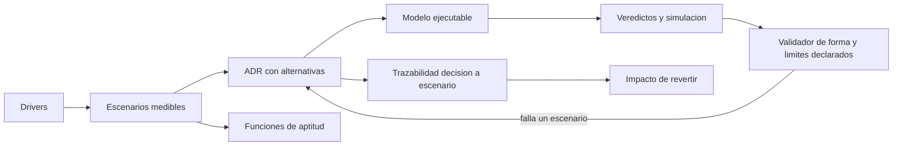
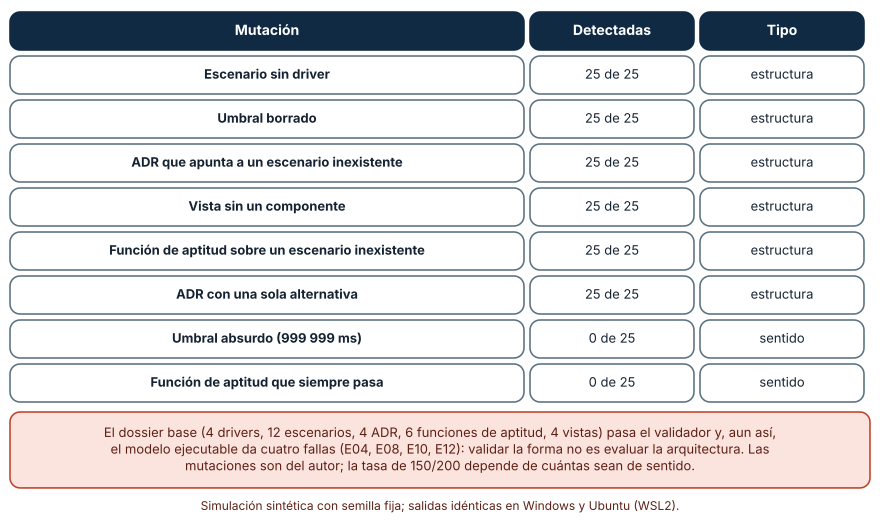
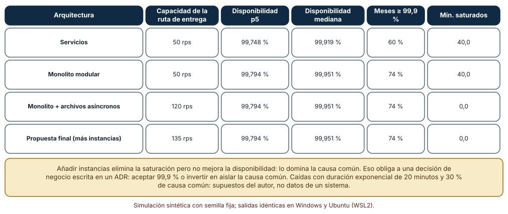
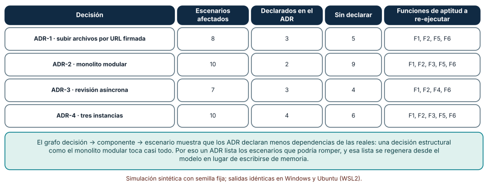

# SE-312 — Proyecto: arquitectura defendible y verificable

[← SE-311 — Taller: revisar una arquitectura contra escenarios](https://github.com/vladimiracunadev-create/modern-software-engineering-program/blob/main/classes/part-25-arquitectura-de-software-y-dominio/se-311-taller-revisar-una-arquitectura-contra-escenarios/README.md) · [↑ Parte 25](https://github.com/vladimiracunadev-create/modern-software-engineering-program/blob/main/classes/part-25-arquitectura-de-software-y-dominio/README.md) · [📚 Índice completo](https://github.com/vladimiracunadev-create/modern-software-engineering-program/blob/main/classes/README.md) · [🌐 Portal](https://vladimiracunadev-create.github.io/modern-software-engineering-program/classes/SE-312.html) · [SE-313 — Modelado conceptual, lógico y físico →](https://github.com/vladimiracunadev-create/modern-software-engineering-program/blob/main/classes/part-26-datos-persistencia-y-recuperacion/se-313-modelado-conceptual-logico-y-fisico/README.md)

## Punto profesional y fundamento pedagógico

**Punto profesional.** El proyecto existe para que entregues un dossier de arquitectura que otra persona pueda comprobar: con escenarios medibles, decisiones registradas, un modelo ejecutable, un validador de la forma del dossier y la lista honesta de lo que ni el modelo ni el validador ven.

**Por qué aparece aquí.** Cierra la **Parte 25** después de **Taller: revisar una arquitectura contra escenarios**: el taller encontró fallas; el proyecto las corrige con decisiones registradas, repite la evaluación y entrega un conjunto verificable. Integra drivers (`SE-301`), vistas (`SE-302`), agrupación (`SE-303`), dominio y puertos (`SE-304`, `SE-305`), eventos (`SE-306`), estilos (`SE-307`), funciones de aptitud (`SE-308`), ADR (`SE-309`), equipos (`SE-310`) y revisión (`SE-311`).

**Error conceptual que debe corregir.** Creer que un dossier completo en forma es una arquitectura defendida: el validador puede aprobar un dossier cuyo modelo ejecutable falla cuatro escenarios, y un modelo puede cumplirlo todo con parámetros que nadie ha medido.

**Secuencia de aprendizaje.** Antes de leer los resultados, predices qué mutaciones de un dossier detecta un validador estructural, cuántos meses de cuatro arquitecturas cumplen 99,9 % y qué decisiones quedan tocadas si se revierte un ADR; después los ejecutas. La secuencia usa predicción, explicación propia, contraste y recuperación. [ICAP](https://icap.education.asu.edu/research) distingue participación de construcción de conocimiento; [How People Learn II](https://nap.nationalacademies.org/catalog/24783/how-people-learn-ii-learners-contexts-and-cultures) exige conectar conocimiento previo, contexto y transferencia; la [práctica de recuperación](https://pubmed.ncbi.nlm.nih.gov/16507066/) respalda producir de nuevo la explicación tras una demora; y [Education for Life and Work](https://nap.nationalacademies.org/resource/13398/dbasse_084153.pdf) exige devolución que explique la causa del error.

**Evidencia de aprendizaje.** `architecture-dossier/` con cuatro drivers, doce escenarios, cuatro ADR, cuatro vistas, seis funciones de aptitud y un modelo ejecutable; el validador con sus 200 mutaciones; la simulación de mil meses de cuatro arquitecturas; la tabla de impacto de revertir cada decisión y la lista de lo que el validador no ve.

**Límite de la conclusión.** El dossier, las mutaciones, las caídas exponenciales de 20 minutos, el 30 % de causa común, los picos de 60 a 90 peticiones por segundo y el grafo decisión-componente-escenario son construcciones del autor. No se midió ninguna plataforma ni se desplegó nada: el proyecto es una arquitectura verificable sobre un modelo, no un sistema en producción.

### Trazabilidad fuente → afirmación

| Fuente primaria u oficial | Afirmación que respalda | Lo que no prueba |
|---|---|---|
| [arc42](https://arc42.org/) | Ofrece una plantilla de documentación de arquitectura con secciones para contexto, restricciones, vistas, decisiones y riesgos. | No garantiza que lo documentado sea cierto. |
| [Ford, Parsons y Kua, «Building Evolutionary Architectures» (O'Reilly)](https://www.oreilly.com/library/view/building-evolutionary-architectures/9781491986356/) | Propone proteger las propiedades de la arquitectura con funciones de aptitud que se ejecutan de forma continua. | No dice qué propiedades proteger en una plataforma concreta. |
| [SEI, «The Architecture Tradeoff Analysis Method»](https://www.sei.cmu.edu/library/the-architecture-tradeoff-analysis-method/) | Estructura la evaluación de una arquitectura contra escenarios y la trazabilidad de hallazgos. | No prueba que la arquitectura evaluada funcione en producción. |
| [Nygard, «Documenting Architecture Decisions»](https://www.cognitect.com/blog/2011/11/15/documenting-architecture-decisions) | Propone registros de decisión cortos, numerados y con estado. | No fija cuántas decisiones merecen un registro. |

## Antes de empezar

Reúne los artefactos de la parte: `drivers.md`, `views.md`, `boundaries.md`, `dependencies.md`, `domain.md`, `events.md`, `runtime-styles.md`, `fitness.md`, `decisions.md`, `teams.md` y `review.md`. La pregunta activa es: **¿qué afirma este dossier, con qué medida, y qué haría fallar a alguien que lo cuestionara con mala fe?**

## Prerrequisitos

- Haber completado `SE-301` a `SE-311` o poder presentar sus artefactos.
- Python 3.11 o posterior y un terminal; todo el código usa solo la biblioteca estándar.
- Manejar estructuras de datos anidadas, grafos como pares de nodos y percentiles.

## Problema auténtico

La plataforma va a presentar su arquitectura ante un comité de la universidad. El equipo tiene un documento de 40 páginas con diagramas. Una persona del comité pregunta: «¿qué pasa con las entregas si cae el servicio de archivos durante el cierre?» y otra, «¿quién ha comprobado que los diagramas dicen lo mismo?». El documento no responde ninguna de las dos con una cifra ni con una prueba. El comité no pide más páginas: pide algo que pueda ejecutarse y que falle cuando algo no coincide.

## Objetivos observables

Al terminar podrás:

1. reunir drivers, escenarios, decisiones, vistas y funciones de aptitud en un dossier estructurado con referencias cruzadas válidas;
2. escribir un validador de la forma del dossier y medir qué mutaciones detecta y cuáles no;
3. ejecutar el modelo sobre cuatro arquitecturas candidatas con un mes simulado de tráfico y de caídas y comparar capacidad, disponibilidad y saturación;
4. calcular el impacto de revertir cada decisión y comprobar que cada ADR declara los escenarios que realmente podría romper;
5. escribir la lista de lo que ni el validador ni el modelo ven y quién debe vigilarlo.

## Mapa conceptual



El mapa muestra que el dossier se sostiene en referencias cruzadas (driver → escenario → decisión → función de aptitud) y en un modelo que las evalúa. El validador comprueba la forma de esas referencias; el modelo, los veredictos; y la lista de límites, lo que ninguno comprueba.

## Temas y por qué importan

| Tema | Por qué cambia una decisión profesional | Evidencia mínima |
|---|---|---|
| Dossier con referencias cruzadas | Hace visible qué sostiene a cada decisión. | Predicción, traza causal y contraejemplo de **Dossier con referencias cruzadas** en `architecture-dossier/` |
| Validador de forma | Impide dossiers rotos sin pretender evaluarlos. | Predicción, traza causal y contraejemplo de **Validador de forma** en `architecture-dossier/` |
| Simulación de operación | Contrasta las arquitecturas con picos y caídas. | Predicción, traza causal y contraejemplo de **Simulación de operación** en `architecture-dossier/` |
| Impacto de revertir una decisión | Muestra dependencias que los ADR no declaran. | Predicción, traza causal y contraejemplo de **Impacto de revertir una decisión** en `architecture-dossier/` |
| Límites declarados | Separa lo comprobado de lo supuesto. | Predicción, traza causal y contraejemplo de **Límites declarados** en `architecture-dossier/` |

## Conceptos y decisiones

### 1. Dossier con referencias cruzadas

El dossier tiene cinco tipos de elementos con identificadores: **drivers** (D1…), **escenarios** (E01…, cada uno con driver, estímulo, métrica, umbral, unidad y prioridad), **ADR** (con escenarios a los que responde, alternativas y estado), **vistas** (con los componentes que muestran) y **funciones de aptitud** (con el escenario que protegen). Las referencias forman una cadena de trazabilidad: ningún escenario sin driver, ninguna decisión sin escenario, ningún escenario de prioridad alta sin función de aptitud ni excepción declarada. La plantilla arc42 sugiere secciones; el dossier de esta clase las convierte en datos que se pueden validar.

### 2. Validador de forma

Un validador comprueba reglas locales y de referencia: identificadores únicos, referencias que existen, umbrales numéricos con unidad, al menos dos alternativas por ADR, estados válidos, vistas con los mismos componentes, y cobertura (todo driver tiene un escenario, todo escenario una decisión, todo escenario alto una función de aptitud o una excepción). Es barato y se ejecuta en cada cambio. Su límite está en el nombre: valida la *forma*. No sabe si un umbral es razonable, si una función de aptitud comprueba lo que dice o si una decisión contradice a otra.

### 3. Simulación de operación

El modelo ejecutable (`SE-311`) responde si un escenario se cumple en un punto del espacio de parámetros. Una simulación de operación responde cómo se comporta la arquitectura durante un mes: caídas de cada unidad de despliegue con una duración aleatoria, picos de carga de 10 minutos y saturación cuando la carga supera la capacidad de la ruta. Se repite muchas veces (mil meses) para obtener una distribución: no «la disponibilidad es 99,9 %» sino «el 74 % de los meses cumple 99,9 % y el percentil 5 es 99,79 %». La distribución es lo que permite hablar de presupuesto de error.

### 4. Impacto de revertir una decisión

Cada ADR dice a qué escenarios responde, pero lo que importa al revertirlo son los escenarios que dependen de los componentes que toca. El **impacto** se calcula cruzando el grafo decisión → componentes → rutas de escenarios. Comparar el impacto calculado con los escenarios declarados en el ADR revela dependencias no escritas: una decisión estructural como el monolito modular toca casi todos los recorridos, aunque su ADR cite solo dos escenarios. El impacto también dice qué funciones de aptitud hay que volver a ejecutar tras el cambio.

### 5. Límites declarados

Un dossier defendible dice también qué no cubre. Tres grupos: lo que el **validador** no ve (el sentido de los umbrales, funciones de aptitud triviales, contradicciones entre ADR); lo que el **modelo** no ve (degradación parcial, reintentos, colas reales, seguridad, correlaciones de fallos); y lo que **nadie ha medido** (latencias reales, disponibilidades reales, carga real). Cada límite lleva un responsable y una señal para dejar de ser un supuesto (una prueba de carga, un mes de telemetría). Declarar el límite no debilita el dossier: es lo que permite que otra persona lo cuestione con precisión.

### Un validador de forma frente a 200 mutaciones

El dossier base tiene 4 drivers, 12 escenarios, 4 ADR, 4 vistas con los 9 componentes y 6 funciones de aptitud; los escenarios de prioridad alta sin función de aptitud (si los hay) tienen una excepción declarada. El validador comprueba la forma como se describe arriba. Se aplican 200 mutaciones (8 tipos × 25): seis de estructura (escenario sin driver, umbral borrado, ADR que apunta a un escenario inexistente, vista sin un componente, función de aptitud sobre un escenario inexistente, ADR con una sola alternativa) y dos de sentido (un umbral absurdo de 999 999 ms y una función de aptitud con `exit 0`).

```python
def validar(d):
    err = []
    for e in d["escenarios"]:
        if e["driver"] not in ids: err.append("escenario sin driver " + e["id"])
        if not isinstance(e.get("umbral"), (int, float)) or not e.get("unidad"): err.append("respuesta no medible " + e["id"])
    ...
```

| Mutación | Detectadas | Tipo |
|---|---:|---|
| Escenario sin driver | 25 de 25 | estructura |
| Umbral borrado | 25 de 25 | estructura |
| ADR que apunta a un escenario inexistente | 25 de 25 | estructura |
| Vista sin un componente | 25 de 25 | estructura |
| Función de aptitud sobre un escenario inexistente | 25 de 25 | estructura |
| ADR con una sola alternativa | 25 de 25 | estructura |
| Umbral absurdo (999 999 ms) | 0 de 25 | sentido |
| Función de aptitud que siempre pasa | 0 de 25 | sentido |

El validador detecta 150 de 200; las 50 que no ve son las de sentido. El dossier base pasa el validador y aun así el modelo ejecutable da cuatro fallas (E04, E08, E10, E12): validar la forma no es evaluar la arquitectura. Un driver nuevo sin escenario sí se detecta («driver sin escenario D5»). Las cifras son idénticas en Windows (CPython 3.12.9) y en Ubuntu bajo WSL2 (3.12.3).



**Cómo leer la figura.** Cada fila es un tipo de mutación aplicado 25 veces; la segunda columna cuenta cuántas detecta el validador. **Dónde deja de valer:** las mutaciones son del autor y el 150/200 depende de cuántas sean de sentido; el validador se escribió mirando las mismas mutaciones que lo evalúan, así que su resultado en mutaciones nuevas sería peor. La figura dice que la forma se automatiza y el sentido no, y que un dossier aprobado por el validador sigue necesitando una lectura humana.

### Mil meses de cuatro arquitecturas

Se simulan mil meses de 30 días para cuatro arquitecturas: servicios, monolito modular, monolito con archivos asíncronos y una propuesta final con más instancias de archivos, antivirus y entregas. En cada mes, las unidades de despliegue de la ruta de entrega sufren interrupciones con duración exponencial de media 20 minutos, con la tasa que corresponde a su disponibilidad efectiva (30 % de causa común), y hay cuatro picos de 10 minutos con carga uniforme de 60 a 90 peticiones por segundo. Se miden capacidad de la ruta, disponibilidad mensual y minutos saturados.

```python
rate = (1 - e) * 43200 / 20          # interrupciones esperadas por mes en una unidad
for _ in range(n): ini = rng.randrange(43200); dur = max(1, int(rng.expovariate(1 / 20)))
sat += 10 if rng.uniform(60, 90) > capacidad else 0
```

| Arquitectura | Capacidad de la ruta de entrega | Disponibilidad p5 | Disponibilidad mediana | Meses ≥ 99,9 % | Min. saturados |
|---|---:|---:|---:|---:|---:|
| Servicios | 50 rps | 99,748 % | 99,919 % | 60 % | 40,0 |
| Monolito modular | 50 rps | 99,794 % | 99,951 % | 74 % | 40,0 |
| Monolito + archivos asíncronos | 120 rps | 99,794 % | 99,951 % | 74 % | 0,0 |
| Propuesta final (más instancias) | 135 rps | 99,794 % | 99,951 % | 74 % | 0,0 |

Las arquitecturas con capacidad de 50 peticiones por segundo pasan 40 minutos al mes saturadas durante los picos; las de 120 y 135, ninguno. Añadir instancias elimina la saturación pero no mejora la disponibilidad: la mediana sigue en 99,951 % y solo el 74 % de los meses llega a 99,9 %. La causa común domina; reducirla exige aislar lo que comparten las unidades.



**Cómo leer la figura.** Cada fila es una arquitectura; las columnas comparan capacidad, disponibilidad y saturación en mil meses. **Dónde deja de valer:** las caídas exponenciales de 20 minutos, el 30 % de causa común y los picos uniformes son supuestos del autor, no datos de un sistema. La figura obliga a una decisión escrita en un ADR: aceptar 99,9 % como objetivo o invertir en aislar la causa común; no sirve para predecir la disponibilidad real.

### Qué se toca al revertir una decisión

Cuatro ADR (subir archivos por URL firmada, monolito modular, revisión asíncrona con cola y tres instancias de la aplicación) se asocian a los componentes que modifican. Se calcula, para cada uno, qué escenarios usan alguno de esos componentes en su ruta, cuántos declara el ADR y qué funciones de aptitud habría que volver a ejecutar.

```python
afectados = [e for e in ESCENARIOS if set(ruta(e)) & set(componentes_del_adr)]
sin_declarar = set(afectados) - set(adr["escenarios"])
```

| Decisión | Escenarios afectados | Declarados en el ADR | Sin declarar | Funciones de aptitud a re-ejecutar |
|---|---:|---:|---:|---|
| ADR-1 · subir archivos por URL firmada | 8 | 3 | 5 | F1, F2, F5, F6 |
| ADR-2 · monolito modular | 10 | 2 | 9 | F1, F2, F3, F5, F6 |
| ADR-3 · revisión asíncrona | 7 | 3 | 4 | F1, F2, F4, F6 |
| ADR-4 · tres instancias | 10 | 4 | 6 | F1, F2, F3, F5, F6 |

El ADR del monolito modular declara 2 escenarios y toca 10; el de la URL firmada declara 3 y toca 8. En todos los casos los escenarios sin declarar son la mayoría o casi: los ADR escritos a mano declaran menos dependencias que el grafo. La lista de funciones a re-ejecutar sale del mismo cálculo.



**Cómo leer la figura.** Cada fila es un ADR; las columnas centrales comparan el impacto calculado con lo que el ADR declara. **Dónde deja de valer:** el grafo une decisiones, componentes y rutas de escenarios con asignaciones del autor; una decisión puede tener efectos que no pasan por un componente (un cambio de equipo, de proceso). La figura dice que la lista de escenarios de un ADR conviene generarla desde el modelo y no escribirla de memoria.

## Definiciones de trabajo

- **dossier de arquitectura:** conjunto estructurado de drivers, escenarios, decisiones, vistas, funciones de aptitud y límites con referencias cruzadas verificables.
- **validador de forma:** programa que comprueba la estructura y las referencias de un dossier, no su sentido.
- **impacto de una decisión:** conjunto de escenarios y funciones de aptitud que dependen de los componentes que la decisión modifica.
- **riesgo aceptado:** riesgo registrado con dueño, escenario y señal de reapertura que el equipo decide no corregir ahora.
- **límite declarado:** afirmación explícita de lo que ni el modelo ni el validador cubren.

Las definiciones son operativas para la plataforma de entregas. No convierten términos con una historia más amplia en sinónimos y deben contrastarse con la documentación primaria enlazada al final.

## Ejemplo mínimo

El fragmento valida una referencia cruzada. Antes de ejecutarlo, predice qué errores devuelve.

```python
escenarios = {"E01", "E02"}
adr = {"id": "ADR-1", "escenarios": ["E01", "E99"]}
errores = [f"{adr['id']} apunta a {e}" for e in adr["escenarios"] if e not in escenarios]
assert errores == ["ADR-1 apunta a E99"]
```

El ADR apunta a un escenario que no existe. Registra versión, comando y salida; añade el caso de un escenario sin ADR y escribe la comprobación inversa.

## Ejemplo profesional

El equipo entrega `architecture-dossier/` con un `modelo.yaml` del que se generan las cuatro vistas, doce escenarios, cuatro ADR y seis funciones de aptitud que corren en CI (dominio sin importaciones de infraestructura, p95 del recorrido de entrega, capacidad del pico, presupuesto de disponibilidad, uso por unidad y fallo inyectado del antivirus). El validador de forma corre en cada cambio y rechaza referencias rotas. La arquitectura propuesta final (monolito con archivos asíncronos, instancias adicionales de archivos, antivirus y entregas) elimina la saturación en el pico (135 rps de capacidad) y deja tres riesgos aceptados con dueño: la disponibilidad en el pico (99,9 % mensual en el 74 % de los meses, a la espera de aislar la causa común), el aislamiento de notas (comparten unidad con la aplicación) y el cambio de formato de archivo (toca dos unidades). Cada ADR lista los escenarios que su impacto calculado muestra, no los que su autor recordó.

Compara con el documento de 40 páginas: ahora hay una cifra y una prueba por cada pregunta del comité, y una lista de lo que el dossier no comprueba. Un dossier es adecuado cuando cualquier afirmación puede refutarse ejecutando algo; es frágil cuando las afirmaciones solo se leen.

## Práctica guiada

1. Reúne los artefactos de la parte en un `modelo.yaml` con drivers, escenarios, decisiones, vistas y funciones de aptitud.
2. Escribe el validador de forma y hazlo pasar sobre el dossier.
3. Escribe 200 mutaciones (seis de estructura y dos de sentido) y mide cuántas detecta.
4. Ejecuta el modelo sobre tus candidatas y simula mil meses de cada una.
5. Calcula el impacto de revertir cada decisión y completa los escenarios declarados en los ADR.
6. Escribe la lista de límites con responsable y señal para dejar de ser un supuesto.
7. Entrega el dossier y pide a otra persona que escriba una mutación de sentido que tu validador no vea.

## Ejercicios

1. **Validador:** añade la regla «todo escenario de prioridad alta tiene una función de aptitud o una excepción declarada» y escribe una mutación que la viole.
2. **Simulación:** cambia la duración media de las caídas a 60 minutos y estima cuánto cambia el 74 % de meses con 99,9 %.
3. **Impacto:** añade un quinto ADR (por ejemplo, un caché de notas) y calcula su impacto y las funciones a re-ejecutar.
4. **Límites:** escribe tres límites del modelo con el responsable de levantarlos y la medida que los convertiría en dato.

## Reto verificable

Entrega `architecture-dossier/` con el modelo, los doce escenarios, los ADR con impacto calculado, las funciones de aptitud, el validador con sus 200 mutaciones, la simulación de mil meses y la lista de límites. Se aprueba si otra persona ejecuta el código desde un checkout limpio, obtiene las mismas cifras y puede escribir una mutación de sentido que el validador no vea y un escenario que el modelo no cubra. No se aprueba por un documento largo sin pruebas ni por declarar la arquitectura «validada» porque el validador pasa.

## Caso conductor

La plataforma de entregas y corrección de tareas cierra aquí su recorrido por la Parte 25. El proyecto deja el duodécimo artefacto: un dossier de arquitectura ejecutable, con decisiones registradas, simulación de operación, impacto de revertir y límites declarados. La Parte 26 lleva esas decisiones a los datos: modelado, persistencia, consistencia y recuperación. Cambia después una sola decisión, el objetivo de disponibilidad, y observa qué ADR y qué funciones de aptitud deben tocarse.

## Preguntas frecuentes

### ¿Un dossier ejecutable no es demasiado trabajo para un equipo pequeño?

Es más trabajo que un documento de 40 páginas durante una semana y menos durante el año, porque cada cambio se evalúa con un comando. Se puede empezar por lo mínimo: escenarios medibles, ADR con alternativas y un validador de referencias.

### ¿Quién debe revisar el dossier?

Quienes construyen, quienes operan y alguien que no haya participado en el diseño, con perfiles distintos (`SE-311`). El validador no sustituye esa revisión.

### ¿Qué pasa si el modelo y la medición real discrepan?

Gana la medición: se corrigen los parámetros del modelo y se repite la evaluación. Que el modelo discrepe de la realidad no es un fracaso; es la señal para la que se declaró el límite.

### ¿Cuándo se reabre una decisión?

Cuando se cumple su condición de revisión (un umbral de tráfico, un cambio de equipo, un incidente) o cuando una función de aptitud falla de forma persistente. El ADR dice cuál de ellas la reabre.

## Fallo controlado y diagnóstico

Reproduce el fallo clásico del proyecto: **un dossier que pasa el validador y esconde un umbral absurdo**. Cambia el umbral de un escenario de latencia a 999 999 ms y ejecuta el validador y el modelo.

Registra síntoma, entrada mínima, hipótesis, observación que descarta cada hipótesis, causa, corrección y prueba de regresión. **Síntoma:** el dossier se aprueba y el escenario de latencia pasa siempre. **Hipótesis rivales:** (a) la arquitectura es excelente; (b) el escenario no se evalúa; (c) el umbral es tan alto que ningún valor puede incumplirlo. **Prueba:** compara el umbral con el valor del modelo y con el rango plausible; si 999 999 ms es miles de veces el p95 modelado y nadie lo había visto, la causa es (c). **Conclusión:** el validador detecta 0 de 25 umbrales absurdos porque solo exige que el umbral sea un número con unidad. **Regresión:** añade al validador una regla de rango plausible por unidad (por ejemplo, un p95 de entrega entre 50 ms y 30 s) y una revisión humana de cada umbral antes de aceptar el dossier. No cambies a la vez el umbral y el validador.

## Errores comunes y cómo corregirlos

| Síntoma | Causa probable | Corrección |
|---|---|---|
| El comité pregunta por una caída y no hay respuesta | Documento sin escenarios ni modelo | Escenarios medibles y un modelo que los evalúa |
| Los diagramas se contradicen | Vistas mantenidas a mano | Generarlas desde un modelo único y validarlas |
| El validador pasa un dossier que falla en el modelo | Valida forma, no sentido | Ejecutar el modelo en CI y revisar sentido por pares |
| Un ADR no menciona escenarios que su reversión rompería | Declaración de memoria | Generar el impacto desde el grafo decisión-componente-escenario |
| La disponibilidad prometida no se cumple | La causa común no estaba en la cuenta | Simular distribución mensual y declarar el límite |

## Entorno y archivos clave

```text
work/SE-312/
├── README.md
├── architecture-dossier/
│   ├── modelo.yaml
│   ├── drivers.md
│   ├── escenarios.md
│   ├── adr/
│   ├── vistas/
│   └── limites.md
├── tools/
│   ├── validar.py
│   └── mutar.py
├── sim/
│   ├── mes.py
│   └── impacto.py
└── evidence/dossier-log.md
```

El `README` declara plataforma, versión de Python, semillas y comandos. Los experimentos usan solo la biblioteca estándar (`random`, `copy`, `math`, `statistics`) y se ejecutaron con CPython 3.12.9 en Windows 11 y 3.12.3 en Ubuntu bajo WSL2: las salidas fueron idénticas. Si añades una dependencia, fija procedencia y versión.

## Seguridad, ética y accesibilidad

- el dossier describe topología, datos y puntos únicos de fallo: trátalo como información sensible y limita su difusión;
- los riesgos aceptados deben decir quién los asume (equipo, universidad, estudiantes) y comunicarse a quien resulta afectado;
- incluye al menos un escenario de accesibilidad y de conectividad limitada: una arquitectura que cumple todo para quien tiene buena conexión puede fallar a quien no;
- los datos del modelo son sintéticos; no uses entregas ni datos de estudiantes para calibrarlo;
- respeta las licencias de las plantillas y atribuye lo adaptado.

## Puente hacia el trabajo con agentes

Un agente al que se le pide «documenta la arquitectura» producirá un documento largo, bien escrito y no verificable. Pídele en cambio que genere las vistas desde un `modelo.yaml`, que escriba el validador y sus mutaciones, que ejecute el modelo y que liste lo que ni uno ni otro comprueban. Revisa especialmente si el documento afirma cifras que no salen del modelo y si el validador se ha afinado con las mismas mutaciones que lo evalúan: son los dos defectos que este proyecto dejó a la vista.

## Transferencia

Traslada el proyecto a otro sistema (por ejemplo, una aplicación de turnos de un hospital): cambia drivers, componentes y escenarios y conserva el procedimiento de reunir un dossier con referencias cruzadas, validar su forma, simular la operación, calcular el impacto de cada decisión y declarar los límites. La transferencia está lograda cuando otra persona puede refutar una afirmación del dossier ejecutando algo, no cuando el documento se parece.

## Evaluación y evidencia

| Criterio | Evidencia para aprobar |
|---|---|
| comprensión | explicación de la cadena driver, escenario, decisión y función de aptitud |
| corrección | validador, simulación e impacto reproducibles con las mismas semillas |
| diseño | dossier con modelo único, ADR con impacto calculado y riesgos aceptados con dueño |
| diagnóstico | reproducción del fallo «umbral absurdo que el validador no ve» con regresión |
| incertidumbre | lista de límites del validador, del modelo y de lo no medido |
| reproducibilidad | versiones, comandos, salida y límites declarados |

## Fuentes

- [arc42](https://arc42.org/) — plantilla de documentación de arquitectura; autoridad: arc42.
- [Ford, Parsons y Kua, «Building Evolutionary Architectures» (O'Reilly)](https://www.oreilly.com/library/view/building-evolutionary-architectures/9781491986356/) — funciones de aptitud continuas; autoridad: O'Reilly Media.
- [SEI, «The Architecture Tradeoff Analysis Method»](https://www.sei.cmu.edu/library/the-architecture-tradeoff-analysis-method/) — evaluación de arquitectura contra escenarios; autoridad: Software Engineering Institute (Carnegie Mellon).
- [Nygard, «Documenting Architecture Decisions»](https://www.cognitect.com/blog/2011/11/15/documenting-architecture-decisions) — registros de decisión; autoridad: Michael Nygard.
- [C4 model](https://c4model.com/) — niveles de diagramas de arquitectura; autoridad: Simon Brown.
- [Python: `copy`](https://docs.python.org/3/library/copy.html) — copias profundas para las mutaciones; autoridad: documentación de Python.
- [SWEBOK Guide v4.0a](https://www.computer.org/education/bodies-of-knowledge/software-engineering) — áreas de conocimiento de ingeniería de software; autoridad: IEEE Computer Society.

Todas las páginas respondieron con éxito a una petición de solo lectura. Cada fuente respalda el mecanismo indicado; ninguna demuestra que el 74 % de los meses cumpla 99,9 % en la plataforma real ni que el validador detecte 150 de 200 mutaciones en un dossier ajeno. Esa afirmación depende del sistema, de sus caídas reales y del dossier.

## Límites y siguiente paso

Se ejecutaron tres análisis con datos sintéticos en Windows y Ubuntu (WSL2) con resultados idénticos. No se desplegó ni se midió ningún sistema: el dossier, las mutaciones, las caídas, el 30 % de causa común, los picos y el grafo de impacto son construcciones del autor, y el validador se escribió mirando las mismas mutaciones que lo evalúan. La siguiente parte lleva estas decisiones a los datos: modelado, persistencia, consistencia y recuperación.

## Glosario

- **dossier de arquitectura:** conjunto estructurado de drivers, escenarios, decisiones, vistas, funciones de aptitud y límites con referencias cruzadas verificables.
- **validador de forma:** programa que comprueba la estructura y las referencias de un dossier, no su sentido.
- **impacto de una decisión:** conjunto de escenarios y funciones de aptitud que dependen de los componentes que la decisión modifica.
- **riesgo aceptado:** riesgo registrado con dueño, escenario y señal de reapertura que el equipo decide no corregir ahora.
- **límite declarado:** afirmación explícita de lo que ni el modelo ni el validador cubren.

---

[← SE-311 — Taller: revisar una arquitectura contra escenarios](https://github.com/vladimiracunadev-create/modern-software-engineering-program/blob/main/classes/part-25-arquitectura-de-software-y-dominio/se-311-taller-revisar-una-arquitectura-contra-escenarios/README.md) · [↑ Parte 25](https://github.com/vladimiracunadev-create/modern-software-engineering-program/blob/main/classes/part-25-arquitectura-de-software-y-dominio/README.md) · [📚 Índice completo](https://github.com/vladimiracunadev-create/modern-software-engineering-program/blob/main/classes/README.md) · [🌐 Portal](https://vladimiracunadev-create.github.io/modern-software-engineering-program/classes/SE-312.html) · [SE-313 — Modelado conceptual, lógico y físico →](https://github.com/vladimiracunadev-create/modern-software-engineering-program/blob/main/classes/part-26-datos-persistencia-y-recuperacion/se-313-modelado-conceptual-logico-y-fisico/README.md)
