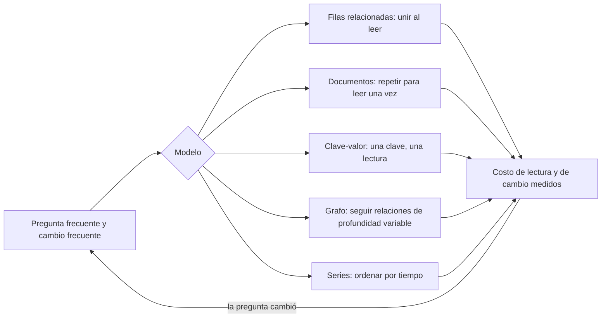
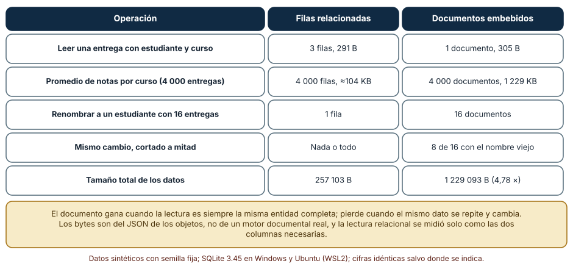
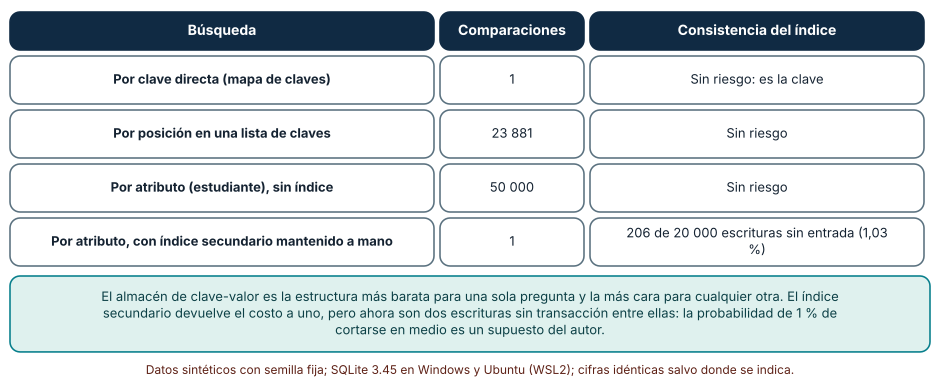
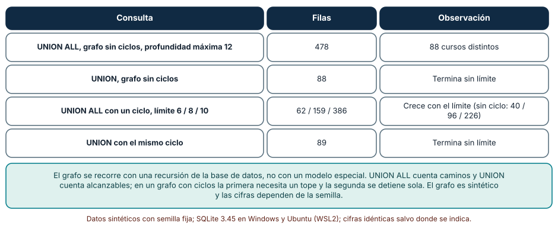

# SE-314 — Relacional, documental, clave-valor, grafos y series

[← SE-313 — Modelado conceptual, lógico y físico](https://github.com/vladimiracunadev-create/modern-software-engineering-program/blob/main/classes/part-26-datos-persistencia-y-recuperacion/se-313-modelado-conceptual-logico-y-fisico/README.md) · [↑ Parte 26](https://github.com/vladimiracunadev-create/modern-software-engineering-program/blob/main/classes/part-26-datos-persistencia-y-recuperacion/README.md) · [📚 Índice completo](https://github.com/vladimiracunadev-create/modern-software-engineering-program/blob/main/classes/README.md) · [🌐 Portal](https://vladimiracunadev-create.github.io/modern-software-engineering-program/classes/SE-314.html) · [SE-315 — Transacciones, aislamiento y concurrencia →](https://github.com/vladimiracunadev-create/modern-software-engineering-program/blob/main/classes/part-26-datos-persistencia-y-recuperacion/se-315-transacciones-aislamiento-y-concurrencia/README.md)

## Punto profesional y fundamento pedagógico

**Punto profesional.** La clase existe para que elijas un modelo de almacenamiento por las preguntas que tendrá que contestar y por los cambios que tendrá que soportar, no por la moda de un motor, y para que midas qué se gana y qué se paga al sacar los mismos datos de las tablas.

**Por qué aparece aquí.** Sigue a **Modelado conceptual, lógico y físico**: `SE-313` fijó que cada hecho vive en un solo lugar; esta clase mira qué ocurre cuando una lectura frecuente empuja a repetirlo (documentos), a reducirlo a una clave (clave-valor), a seguir relaciones de profundidad variable (grafos) o a ordenar por tiempo (series).

**Error conceptual que debe corregir.** Creer que «relacional», «documental», «clave-valor» y «grafo» son productos intercambiables con distinta sintaxis: son decisiones sobre qué consulta es barata y qué cambio es caro, y cada una desplaza el costo a otro sitio.

**Secuencia de aprendizaje.** Antes de leer los resultados, predices cuántos documentos hay que reescribir para renombrar a un estudiante cuando está embebido en cada entrega y cuántas comparaciones cuesta buscar por un atributo en un almacén de claves; después mides ambas cosas y observas qué hace una consulta recursiva con un ciclo. La secuencia usa predicción, explicación propia, contraste y recuperación. [ICAP](https://icap.education.asu.edu/research) distingue participación de construcción de conocimiento; [How People Learn II](https://nap.nationalacademies.org/catalog/24783/how-people-learn-ii-learners-contexts-and-cultures) exige conectar conocimiento previo, contexto y transferencia; la [práctica de recuperación](https://pubmed.ncbi.nlm.nih.gov/16507066/) respalda producir de nuevo la explicación tras una demora; y [Education for Life and Work](https://nap.nationalacademies.org/resource/13398/dbasse_084153.pdf) exige devolución que explique la causa del error.

**Evidencia de aprendizaje.** `modelos-log.md` con la predicción, la tabla de operaciones por modelo, la medida de la búsqueda por clave y por atributo, la consulta recursiva con y sin ciclo y una matriz de pregunta frecuente contra modelo elegido.

**Límite de la conclusión.** Los bytes son los del JSON de los objetos y las operaciones se cuentan como filas, documentos o comparaciones: no se usó ningún motor documental, de clave-valor ni de grafos. Los datos son sintéticos y el fallo del 1 % entre dos escrituras es un supuesto del autor.

### Trazabilidad fuente → afirmación

| Fuente primaria u oficial | Afirmación que respalda | Lo que no prueba |
|---|---|---|
| [Kleppmann, «Designing Data-Intensive Applications»](https://dataintensive.net/) | Compara modelos de datos (relacional, documental, de grafos) por el tipo de relaciones y de consultas que soportan, y explica el costo de la unión y de la repetición. | No dice cuál es mejor para una plataforma concreta. |
| [PostgreSQL: tipos JSON](https://www.postgresql.org/docs/current/datatype-json.html) | Muestra que un motor relacional puede guardar y consultar documentos JSON, de modo que la frontera entre modelos no es de producto. | No mide el rendimiento de JSON frente a tablas. |
| [SQLite: consultas recursivas (WITH)](https://www.sqlite.org/lang_with.html) | Define la consulta recursiva, la diferencia entre UNION y UNION ALL y la forma de acotarla. | No cubre los operadores de recorrido de motores de grafos. |
| [Codd (1970)](https://dl.acm.org/doi/10.1145/362384.362685) | Explica por qué separar los datos de su representación reduce la dependencia de las rutas de acceso. | No habla de documentos ni de grafos. |

## Antes de empezar

Recupera lo aprendido en `SE-313`: la anomalía de actualización aparecía cuando un hecho vivía en 112 lugares. La pregunta activa es: **¿qué pregunta frecuente de la plataforma justificaría repetir un dato, y qué mecanismo lo mantendría igual en todas las copias?**

## Prerrequisitos

- Haber completado `SE-313` o poder explicar qué es una dependencia funcional y una anomalía de actualización.
- Python 3.11 o posterior; los experimentos usan `sqlite3`, `json`, `random` y `collections`.
- Leer un `SELECT` con `JOIN` y un diccionario de Python.

## Problema auténtico

La plataforma de entregas necesita tres cosas que parecen pedir tres sistemas: mostrar una entrega con su estudiante y su curso en una sola lectura, promediar notas por curso para un informe y listar todos los prerrequisitos de un curso. Alguien propone un almacén de documentos para la primera, una caché de clave-valor para la segunda y una base de grafos para la tercera. Antes de incorporar tres tecnologías, el equipo quiere saber cuánto cuesta cada pregunta con cada modelo, cuánto cuesta cambiar un dato repetido y qué se rompe si el índice que mantiene a mano se desincroniza.

## Objetivos observables

Al terminar podrás:

1. describir un modelo relacional, documental, de clave-valor, de grafos y de series con la pregunta que abarata y la que encarece;
2. medir lecturas y reescrituras para las mismas operaciones con datos relacionados y con datos embebidos;
3. calcular el costo de buscar por clave y por atributo, y el riesgo de un índice secundario mantenido a mano;
4. escribir una consulta recursiva para un grafo de prerrequisitos y explicar qué hacen UNION, UNION ALL y un ciclo;
5. elegir y defender un modelo para una pregunta dada con una medida y un criterio de reversión.

## Mapa conceptual



El mapa muestra que el modelo se elige después de la pregunta y vuelve a ella: si la pregunta frecuente cambia, la elección se reabre.

## Temas y por qué importan

| Tema | Por qué cambia una decisión profesional | Evidencia mínima |
|---|---|---|
| Filas relacionadas | Una unión paga el costo al leer y evita repetir. | Predicción, traza causal y contraejemplo de **Filas relacionadas** en `modelos-log.md` |
| Documentos | Un documento paga el costo al escribir y simplifica la lectura de una entidad completa. | Predicción, traza causal y contraejemplo de **Documentos** en `modelos-log.md` |
| Clave-valor | Es la estructura más barata para una sola pregunta y la más cara para cualquier otra. | Predicción, traza causal y contraejemplo de **Clave-valor** en `modelos-log.md` |
| Grafos | La profundidad variable de las relaciones decide si una unión fija basta. | Predicción, traza causal y contraejemplo de **Grafos** en `modelos-log.md` |
| Series temporales | Orden y ventana de tiempo cambian cómo se agregan y cómo se retienen. | Predicción, traza causal y contraejemplo de **Series temporales** en `modelos-log.md` |

## Conceptos y decisiones

### 1. Filas relacionadas

En el modelo relacional cada hecho vive en una tabla y las relaciones se reconstruyen al consultar con uniones. Es la opción que mejor protege la consistencia: cambiar el nombre de un estudiante es cambiar una fila. Su costo se paga al leer: una entrega con su estudiante y su curso exige tres búsquedas, y un motor con buenos índices las hace baratas, pero no gratis. Es el modelo por defecto cuando las preguntas son variadas y no se conocen de antemano, que es el caso de una plataforma en crecimiento.

### 2. Documentos

Un modelo documental guarda una entidad completa en una unidad: la entrega con los datos del estudiante y del curso dentro. Leerla es una sola operación y la unidad coincide con lo que la pantalla muestra. El costo se paga al escribir y al mantener: el nombre del estudiante vive en tantos documentos como entregas tiene, y cambiarlo exige reescribirlos todos, sin una transacción que los cubra siempre. Es razonable cuando la lectura de una entidad completa domina, los datos repetidos cambian poco y existe un proceso que los actualiza y se puede probar.

### 3. Clave-valor

Un almacén de clave-valor devuelve el valor de una clave en un solo acceso y no sabe nada de su contenido. Para una sola pregunta («dame la entrega 123») es insuperable; para cualquier otra («las entregas del estudiante 17») hay que recorrerlo todo o mantener a mano un índice secundario. Ese índice son dos escrituras que el almacén no puede hacer atómicas, así que una interrupción en medio deja un índice que no refleja los datos. Es una buena opción para cachés y sesiones (`SE-320`) y una mala para datos que se consultan por varios atributos.

### 4. Grafos

Un grafo representa entidades y relaciones como ciudadanos de primera clase y es natural cuando importa seguir relaciones de profundidad variable: los prerrequisitos de un curso, las dependencias entre tareas, las recomendaciones. Una unión con profundidad fija no basta cuando el camino puede tener tres o treinta pasos. Un motor relacional con consultas recursivas resuelve muchos casos sin otro sistema; un motor de grafos especializado se justifica cuando el recorrido es la consulta dominante y su volumen lo exige. En ambos casos el recorrido necesita proteger contra ciclos.

### 5. Series temporales

Una serie guarda observaciones ordenadas por tiempo: entregas por hora, tiempos de respuesta, lecturas de un sensor. Las preguntas típicas son rangos, agregaciones por ventana y retención («cuánto tiempo guardo el detalle»). El modelo físico privilegia insertar al final y descartar lo antiguo por bloques; el modelo lógico a menudo reduce el detalle con el tiempo (agregados por hora, luego por día). El criterio de elección no es la marca sino si el patrón de acceso es de añadir al final, leer por rango y borrar por antigüedad; en ese caso el diseño por tiempo importa más que la forma de las filas.

### La misma lectura con filas y con documentos

Se generan 100 cursos con una rúbrica de cuatro criterios, 600 estudiantes y 4 000 entregas. El modelo relacional guarda tres tipos de fila; el documental guarda cada entrega con el estudiante y el curso (y su rúbrica) embebidos. Se cuenta lo que cada operación toca y los bytes del JSON.

```python
doc = {e["id"]: {**e, "estudiante": est[e["est"]], "curso": cursos[e["curso"]]} for e in ent}
tot_doc = sum(len(json.dumps(d, ensure_ascii=False).encode()) for d in doc.values())
```

| Operación | Filas relacionadas | Documentos embebidos |
|---|---|---|
| Leer una entrega con estudiante y curso | 3 filas, 291 B | 1 documento, 305 B |
| Promedio de notas por curso | 4 000 filas, ≈104 KB | 4 000 documentos, 1 229 KB |
| Renombrar a un estudiante con 16 entregas | 1 fila | 16 documentos |
| El mismo cambio, cortado a mitad | Nada o todo | 8 de 16 con el nombre viejo |
| Tamaño total | 257 103 B | 1 229 093 B (4,78 ×) |

El documento no ahorra bytes en la lectura de una entidad (305 frente a 291) y sí ahorra operaciones (1 frente a 3). Cobra al agregar, porque cada documento arrastra la rúbrica y el estudiante, y al cambiar un dato repetido.



**Cómo leer la figura.** Cada fila es una operación; las columnas comparan lo que toca cada modelo. **Dónde deja de valer:** los bytes son del JSON de objetos de Python, no de un motor documental con compresión; un motor real puede indexar campos embebidos y actualizar en lugar. Y el modelo relacional se midió con solo las columnas necesarias, lo que favorece a la lectura de columnas. La figura no dice que el documento sea peor, sino que su ventaja es una lectura y su precio una repetición.

### Buscar por clave, por posición y por atributo

Se llena un almacén con 50 000 entregas indexadas por clave. Se hacen 1 000 búsquedas: por clave directa, recorriendo la lista de claves hasta la posición, y por un atributo (el estudiante) sin índice. Después se mantiene a mano un índice secundario por estudiante con dos escrituras por entrega y una interrupción del 1 % entre ellas.

```python
store[i] = est_i
if r.random() < 0.01:    # se cae entre las dos escrituras
    continue
idx.setdefault(est_i, set()).add(i)
```

| Búsqueda | Comparaciones por consulta | Consistencia del índice |
|---|---:|---|
| Por clave directa | 1 | Sin riesgo |
| Por posición en una lista de claves | 23 881 | Sin riesgo |
| Por atributo, sin índice | 50 000 | Sin riesgo |
| Por atributo, con índice a mano | 1 | 206 de 20 000 escrituras sin entrada (1,03 %) |

El índice devuelve el costo a uno y lo paga con una invariante que el almacén no mantiene: tras 20 000 escrituras, 206 entregas no se encuentran por estudiante. Nadie recibe un error; la entrega simplemente no aparece.



**Cómo leer la figura.** Las filas son formas de buscar; la última columna dice qué riesgo trae. **Dónde deja de valer:** el 1 % entre las dos escrituras es un supuesto del autor, y un motor con transacciones o con índices secundarios propios no tendría ese riesgo. La lección es que cada índice mantenido fuera del motor es una promesa que hay que probar, por ejemplo con una tarea que compare periódicamente el índice con los datos.

### Prerrequisitos con una consulta recursiva

Se genera un grafo de 200 cursos con 291 relaciones «curso exige a curso» (cada curso exige a uno o dos anteriores). Se pregunta por todos los prerrequisitos del curso 200 con una consulta recursiva, con `UNION ALL` (una fila por ruta) y con `UNION` (una fila por curso alcanzable). Después se añade un ciclo: un prerrequisito del curso 200 pasa a exigir al propio 200.

```python
q_all = "with recursive a(curso, req, d) as (select curso, req, 1 from pre where curso=200 union all select a.curso, p.req, d+1 from a join pre p on p.curso=a.req where d<12) select count(*) from a"
q_uni = "with recursive a(req) as (select req from pre where curso=200 union select p.req from a join pre p on p.curso=a.req) select count(*) from a"
```

| Consulta | Filas | Observación |
|---|---:|---|
| `UNION ALL`, sin ciclos, profundidad ≤ 12 | 478 | 88 cursos distintos |
| `UNION`, sin ciclos | 88 | Termina sin límite |
| `UNION ALL` con ciclo, límite 6 / 8 / 10 | 62 / 159 / 386 | Crece con el límite (sin ciclo: 40 / 96 / 226) |
| `UNION` con el mismo ciclo | 89 | Termina sin límite |

`UNION ALL` cuenta caminos, no cursos: 478 filas para 88 cursos. Con un ciclo no se detiene sola y las filas aumentan con el tope. `UNION` elimina los duplicados en cada paso y por eso termina: añade como máximo cada curso una vez.



**Cómo leer la figura.** Las filas son variantes de la consulta; la columna central son las filas producidas. **Dónde deja de valer:** el grafo es pequeño y disperso; en un grafo denso las rutas explotan mucho antes. Y para recorridos largos sobre millones de nodos un motor especializado puede ser mejor: esta medida no lo compara, solo muestra que el recorrido relacional existe y que necesita un criterio de parada.

## Definiciones de trabajo

- **documento embebido:** entidad relacionada copiada dentro de otra para poder leerla en una sola operación.
- **índice secundario:** estructura adicional que permite buscar por un atributo distinto de la clave.
- **consulta recursiva:** consulta que se define en términos de su propio resultado parcial y se repite hasta que no añade filas.
- **ciclo:** recorrido que vuelve a un nodo ya visitado.
- **retención:** política que decide cuánto tiempo se conserva el detalle de los datos.

Las definiciones son operativas para la plataforma de entregas. No convierten términos con una historia más amplia en sinónimos y deben contrastarse con la documentación primaria enlazada al final.

## Ejemplo mínimo

El fragmento muestra por qué un índice secundario manual no es seguro. Antes de ejecutarlo, predice cuántas entradas faltarán si la tercera escritura se interrumpe.

```python
store, idx = {}, {}
for i, est in enumerate([5, 7, 5]):
    store[i] = est
    if i == 2: break                       # se corta antes de actualizar el índice
    idx.setdefault(est, set()).add(i)
assert set(store) - set().union(*idx.values()) == {2}
```

Falta una entrada: el dato existe y no se encuentra por estudiante. Registra versión, comando y salida; después reconstruye el índice desde los datos y comprueba que cuadra.

## Ejemplo profesional

El equipo de la plataforma mide antes de elegir. Mantiene el modelo relacional para entregas, estudiantes y cursos porque las preguntas son variadas y los datos repetidos cambian (un estudiante renombrado). Para la pantalla «mis entregas», que se pide miles de veces por minuto y siempre igual, construye una vista materializada que repite lo necesario y se regenera cuando cambian los datos de origen, con una prueba que compara la vista con las tablas. Para los prerrequisitos usa una consulta recursiva con `UNION`, porque el grafo tiene cientos de cursos y no justifica otro sistema; fija un criterio de revisión: si el recorrido pasa de 100 ms o los nodos de un millón, se reevalúa. La caché de sesiones va en un almacén de clave-valor, con su índice por estudiante reconstruible. La decisión queda en `modelos-log.md` con las cifras de esta clase y la condición que la cambiaría.

## Práctica guiada

1. Escribe tres preguntas frecuentes de la plataforma y predice qué modelo abarataría cada una.
2. Genera los datos sintéticos con semilla fija y mide lo que toca cada operación en filas y en documentos.
3. Cambia el nombre de un estudiante en el modelo documental, interrumpe a mitad y cuenta los documentos inconsistentes.
4. Mide las comparaciones de buscar por clave, por posición y por atributo en 50 000 valores.
5. Mantén un índice secundario a mano, interrumpe el 1 % de las escrituras y escribe la tarea que lo repara.
6. Resuelve los prerrequisitos de un curso con `UNION ALL` y con `UNION`, añade un ciclo y observa la diferencia.
7. Entrega `modelos-log.md` y pide a otra persona que diga qué pregunta cambiaría la elección.

## Ejercicios

1. **Embebido:** decide si el docente debe embeberse en la entrega y calcula cuántos documentos cambian si el docente cambia de nombre.
2. **Índice:** diseña una comprobación que detecte entradas faltantes en el índice secundario y estima su costo.
3. **Ciclo:** escribe una consulta que detecte si un curso es prerrequisito de sí mismo.
4. **Series:** propón qué agregar por hora, por día y por mes de las entregas y cuánto detalle conservar, y qué pregunta dejarías de poder contestar.

## Reto verificable

Entrega `modelos-log.md` con la predicción, las tres tablas de resultados, la matriz de pregunta contra modelo y la condición que reabre la elección. Se aprueba si otra persona ejecuta el código, obtiene los mismos números y puede decir qué se pierde al embeber el estudiante en la entrega. No se aprueba por afirmar que un modelo «escala mejor» sin una medida ni por elegir un producto sin una pregunta.

## Caso conductor

La capa de datos de la plataforma de entregas sigue siendo el caso conductor. Esta clase deja el segundo artefacto: la matriz de preguntas frecuentes contra modelos, con lo medido. `SE-315` pregunta qué garantías necesita cada cambio cuando varias personas escriben a la vez. Cambia después una sola decisión, embeber o referenciar al estudiante, y observa qué otros cambios (la consistencia, la actualización) se ven afectados.

## Preguntas frecuentes

### ¿Cuándo conviene un motor de grafos en lugar de consultas recursivas?

Cuando el recorrido es la consulta dominante y se hace sobre un volumen tal que la recursión relacional no cumple el plazo. Con cientos de nodos, una consulta recursiva bien acotada basta. La clase mide el caso pequeño; el umbral del caso grande hay que medirlo con los datos propios.

### ¿Un almacén de documentos evita las uniones?

Las evita al leer y las traslada al escribir: la repetición es la unión hecha de antemano. Si el dato repetido cambia con frecuencia o debe ser consistente de inmediato, el costo de mantenerlo supera al ahorro.

### ¿Por qué no usar clave-valor para todo?

Porque solo responde bien a una pregunta. Cada pregunta adicional exige recorrer o mantener un índice a mano, y esa carga de consistencia pasa del motor al equipo.

### ¿Qué es una serie temporal frente a una tabla con una columna de fecha?

La diferencia es el patrón de acceso: añadir al final, consultar por rango y descartar por antigüedad. Una tabla con fecha sirve si el volumen es pequeño; con mucho volumen, el diseño por bloques de tiempo evita borrar fila a fila.

## Fallo controlado y diagnóstico

Reproduce el fallo clásico de la clase: **actualizar un dato embebido en muchos documentos y cortarse a la mitad**. Renombra a un estudiante con 16 entregas y detén el proceso tras 8.

Registra síntoma, entrada mínima, hipótesis, observación que descarta cada hipótesis, causa, corrección y prueba de regresión. **Síntoma:** la pantalla de un docente muestra el nombre viejo y el nuevo según la entrega que abre. **Hipótesis rivales:** (a) la caché del navegador sirve una versión vieja; (b) hay dos estudiantes con el mismo nombre; (c) la actualización de los documentos embebidos quedó a medias. **Prueba:** busca todos los documentos con ese `estudiante.id` y cuenta cuántos tienen cada nombre; si 8 tienen el viejo, la causa es la actualización parcial. **Conclusión:** el nombre está embebido en 16 documentos y el proceso no es atómico. **Regresión:** añade una tarea idempotente que recorra y complete los documentos pendientes y una prueba que la interrumpa y la repita. No cambies a la vez el modelo y la tarea.

## Errores comunes y cómo corregirlos

| Síntoma | Causa probable | Corrección |
|---|---|---|
| El mismo dato aparece con valores distintos según la pantalla | Dato embebido actualizado a medias | Tarea idempotente de propagación y comprobación periódica |
| Una entrega no se encuentra por estudiante | Índice secundario manual desincronizado | Reconstruirlo desde los datos y comprobarlo con una tarea periódica |
| La consulta recursiva no termina o crece sin control | Ciclo en el grafo con `UNION ALL` sin límite | `UNION` o un tope de profundidad y una detección de ciclos |
| El informe lee todos los documentos para promediar | Documento pensado para una lectura distinta | Una vista o tabla de agregados para esa pregunta |
| Se eligió un motor por la moda y no por una pregunta | No hubo matriz de preguntas | Escribir las tres preguntas frecuentes y medir cada una |

## Entorno y archivos clave

```text
work/SE-314/
├── README.md
├── modelos/
│   ├── documentos.py
│   ├── clave_valor.py
│   └── prerrequisitos.py
├── tests/test_modelos.py
└── evidence/modelos-log.md
```

El `README` declara plataforma, versiones de Python y de SQLite, semillas y comandos. Los experimentos usan solo la biblioteca estándar (`sqlite3`, `json`, `random`) y se ejecutaron con CPython 3.12.9 en Windows 11 (SQLite 3.45.3) y 3.12.3 en Ubuntu bajo WSL2 (SQLite 3.45.1): las salidas fueron idénticas. Si añades una dependencia, fija procedencia y versión.

## Seguridad, ética y accesibilidad

- los documentos embebidos copian datos personales: cada copia es una copia más que borrar o corregir (`SE-322`);
- un índice secundario desincronizado puede ocultar entregas a un estudiante: es un fallo de equidad, no solo técnico;
- los grafos de prerrequisitos pueden usarse para decidir quién avanza: documenta quién puede cambiarlos y cómo se audita;
- la consulta recursiva sin límite es un vector de denegación de servicio si recibe entradas externas: acota la profundidad;
- los datos de prueba son sintéticos y los diagramas deben tener un equivalente textual para lectores de pantalla.

## Puente hacia el trabajo con agentes

Un agente al que se le pide «elige la base de datos para la plataforma» recomendará un producto con una lista de ventajas. Pídele en cambio la matriz de tres preguntas frecuentes contra modelos, el costo medido de cada pregunta con datos sintéticos y la condición que reabriría la elección. Revisa especialmente si propone repetir un dato sin un mecanismo que lo mantenga y si mantiene un índice fuera del motor sin una comprobación: son los dos defectos que esta clase mostró sin aviso.

## Transferencia

Traslada el análisis a otro dominio (por ejemplo, un servicio de reservas de salas): elige tres preguntas, mide lo que cuesta cada una con filas, con documentos y con una clave, y conserva el procedimiento de buscar qué dato se repite y qué lo mantiene. La transferencia está lograda cuando puedes explicar qué cambio se encarece con cada modelo, no cuando la lista de productos se parece.

## Evaluación y evidencia

| Criterio | Evidencia para aprobar |
|---|---|
| comprensión | explicación de qué pregunta abarata y cuál encarece cada modelo |
| corrección | lecturas, reescrituras, comparaciones y filas recursivas reproducibles con las mismas semillas |
| diseño | matriz de preguntas frecuentes contra modelo con condición de reversión |
| diagnóstico | reproducción del fallo «actualización parcial de documentos» con regresión |
| incertidumbre | declaración de que no se usó ningún motor documental ni de grafos |
| reproducibilidad | versiones, comandos, salida y límites declarados |

## Fuentes

- [Kleppmann, «Designing Data-Intensive Applications»](https://dataintensive.net/) — modelos de datos y sus compromisos; autoridad: autor del libro.
- [PostgreSQL: tipos JSON](https://www.postgresql.org/docs/current/datatype-json.html) — documentos dentro de un motor relacional; autoridad: documentación oficial de PostgreSQL.
- [SQLite: WITH recursivo](https://www.sqlite.org/lang_with.html) — consultas recursivas, UNION y UNION ALL; autoridad: documentación oficial de SQLite.
- [Codd, «A relational model of data for large shared data banks»](https://dl.acm.org/doi/10.1145/362384.362685) — independencia entre datos y representación; autoridad: artículo original (1970).
- [Python: json](https://docs.python.org/3/library/json.html) — serialización usada para medir los bytes; autoridad: documentación de Python.

Cada fuente respalda el mecanismo indicado; ninguna demuestra que el factor de 4,78 en el tamaño, los 206 elementos sin índice o las 478 rutas se observen en una plataforma real. Esa afirmación depende del motor, de los datos y de la carga.

## Límites y siguiente paso

Se ejecutaron tres experimentos con datos sintéticos en Windows y Ubuntu (WSL2) con resultados idénticos. No se usó ningún motor documental, de clave-valor ni de grafos: los documentos son diccionarios de Python y los bytes son los del JSON; el fallo del 1 % entre dos escrituras y la estructura del grafo son construcciones del autor. No se midieron series temporales; el apartado correspondiente describe un criterio, no una medida. La siguiente clase mira qué garantías necesitan los cambios cuando varias personas escriben a la vez.

## Glosario

- **documento embebido:** entidad relacionada copiada dentro de otra para poder leerla en una sola operación.
- **índice secundario:** estructura adicional que permite buscar por un atributo distinto de la clave.
- **consulta recursiva:** consulta que se define en términos de su propio resultado parcial y se repite hasta que no añade filas.
- **ciclo:** recorrido que vuelve a un nodo ya visitado.
- **retención:** política que decide cuánto tiempo se conserva el detalle de los datos.

---

[← SE-313 — Modelado conceptual, lógico y físico](https://github.com/vladimiracunadev-create/modern-software-engineering-program/blob/main/classes/part-26-datos-persistencia-y-recuperacion/se-313-modelado-conceptual-logico-y-fisico/README.md) · [↑ Parte 26](https://github.com/vladimiracunadev-create/modern-software-engineering-program/blob/main/classes/part-26-datos-persistencia-y-recuperacion/README.md) · [📚 Índice completo](https://github.com/vladimiracunadev-create/modern-software-engineering-program/blob/main/classes/README.md) · [🌐 Portal](https://vladimiracunadev-create.github.io/modern-software-engineering-program/classes/SE-314.html) · [SE-315 — Transacciones, aislamiento y concurrencia →](https://github.com/vladimiracunadev-create/modern-software-engineering-program/blob/main/classes/part-26-datos-persistencia-y-recuperacion/se-315-transacciones-aislamiento-y-concurrencia/README.md)
