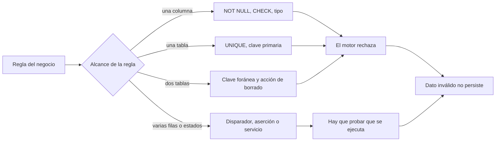
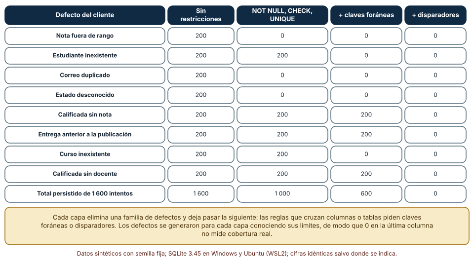
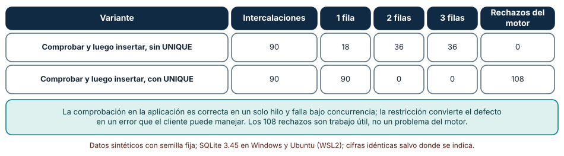
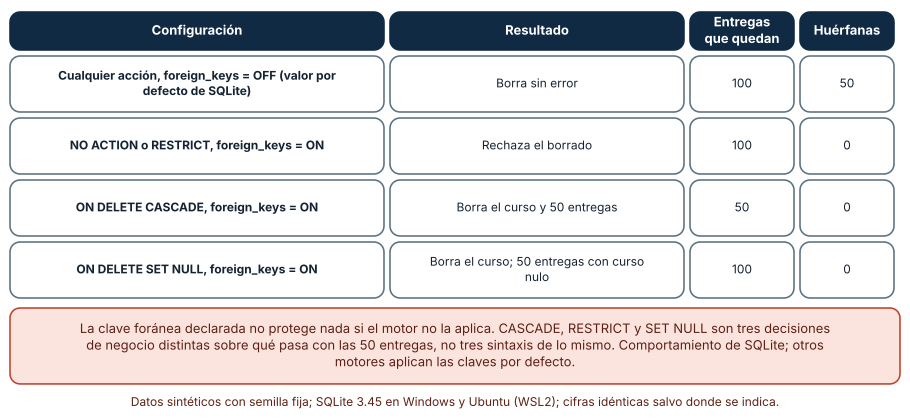

# SE-316 — Restricciones, invariantes y consistencia

[← SE-315 — Transacciones, aislamiento y concurrencia](https://github.com/vladimiracunadev-create/modern-software-engineering-program/blob/main/classes/part-26-datos-persistencia-y-recuperacion/se-315-transacciones-aislamiento-y-concurrencia/README.md) · [↑ Parte 26](https://github.com/vladimiracunadev-create/modern-software-engineering-program/blob/main/classes/part-26-datos-persistencia-y-recuperacion/README.md) · [📚 Índice completo](https://github.com/vladimiracunadev-create/modern-software-engineering-program/blob/main/classes/README.md) · [🌐 Portal](https://vladimiracunadev-create.github.io/modern-software-engineering-program/classes/SE-316.html) · [SE-317 — Consultas, índices y patrones de acceso →](https://github.com/vladimiracunadev-create/modern-software-engineering-program/blob/main/classes/part-26-datos-persistencia-y-recuperacion/se-317-consultas-indices-y-patrones-de-acceso/README.md)

## Punto profesional y fundamento pedagógico

**Punto profesional.** La clase existe para que decidas qué invariantes del negocio las impone el motor y cuáles quedan en la aplicación, y para que midas cuántos datos inválidos deja pasar cada capa antes de que una persona los encuentre en un informe.

**Por qué aparece aquí.** Sigue a **Transacciones, aislamiento y concurrencia**: allí una invariante se rompía por el orden de las operaciones; aquí se pregunta quién la vigila cuando el cliente se equivoca, olvida la regla o llega tarde. La restricción es el último punto en el que un dato inválido puede detenerse.

**Error conceptual que debe corregir.** Creer que validar en la aplicación basta: la aplicación tiene varios clientes, varias versiones y varios scripts de carga, y cada uno puede olvidar una regla o hacer la comprobación y la inserción en dos pasos que otro intercala.

**Secuencia de aprendizaje.** Antes de leer los resultados, predices cuántas de 1 600 filas inválidas llegan a la base con solo comprobaciones de la aplicación y con cada capa de restricciones; después enumeras las 90 intercalaciones de tres clientes que registran la misma entrega y observas qué pasa al borrar un curso con la clave foránea apagada. La secuencia usa predicción, explicación propia, contraste y recuperación. [ICAP](https://icap.education.asu.edu/research) distingue participación de construcción de conocimiento; [How People Learn II](https://nap.nationalacademies.org/catalog/24783/how-people-learn-ii-learners-contexts-and-cultures) exige conectar conocimiento previo, contexto y transferencia; la [práctica de recuperación](https://pubmed.ncbi.nlm.nih.gov/16507066/) respalda producir de nuevo la explicación tras una demora; y [Education for Life and Work](https://nap.nationalacademies.org/resource/13398/dbasse_084153.pdf) exige devolución que explique la causa del error.

**Evidencia de aprendizaje.** `invariantes-log.md` con la predicción, la matriz de defectos contra capas, el recuento de intercalaciones con y sin restricción de unicidad, la tabla de acciones de borrado y la lista de invariantes de la plataforma con quién las vigila.

**Límite de la conclusión.** Los defectos se generaron conociendo lo que cada capa detecta; por eso el 0 de la última capa no mide cobertura real. Los experimentos son de SQLite, que tiene valores por defecto distintos a otros motores (las claves foráneas vienen apagadas); no se probó ningún otro motor ni datos reales.

### Trazabilidad fuente → afirmación

| Fuente primaria u oficial | Afirmación que respalda | Lo que no prueba |
|---|---|---|
| [SQLite: claves foráneas](https://www.sqlite.org/foreignkeys.html) | Documenta que las claves foráneas se aplican solo si se activan con `PRAGMA foreign_keys`, y las acciones `CASCADE`, `SET NULL`, `RESTRICT` y `NO ACTION`. | No describe motores que las aplican siempre. |
| [PostgreSQL: restricciones](https://www.postgresql.org/docs/current/ddl-constraints.html) | Define `CHECK`, `NOT NULL`, `UNIQUE`, claves primarias y foráneas y su semántica, incluidas las diferidas. | No dice qué invariante conviene convertir en restricción. |
| [SQLite: disparadores](https://www.sqlite.org/lang_createtrigger.html) | Explica los disparadores `BEFORE` y `AFTER` y `RAISE` para rechazar una operación. | No compara el costo de un disparador frente a una restricción. |
| [Kleppmann, «Designing Data-Intensive Applications»](https://dataintensive.net/) | Trata la integridad de extremo a extremo y por qué la validación en un solo punto no basta en sistemas con varios escritores. | No mide los defectos de una plataforma concreta. |

## Antes de empezar

Recupera lo aprendido en `SE-315`: dos retiradas de guardia rompían «siempre queda alguien». La pregunta activa es: **¿qué reglas debe hacer cumplir la base aunque el cliente falle, y qué reglas no puede expresar?**

## Prerrequisitos

- Haber completado `SE-315` o poder explicar por qué comprobar y luego insertar no es atómico.
- Python 3.11 o posterior con `sqlite3`, `itertools` y `random`.
- Leer `CREATE TABLE` con `NOT NULL`, `UNIQUE`, `CHECK` y `REFERENCES`.

## Problema auténtico

La plataforma de entregas recibe datos de una aplicación web, de una aplicación móvil, de un script de importación y de una integración con un tercero. Un viernes, el informe de calificaciones muestra notas de 9,5 en una escala de 1 a 7, entregas de estudiantes que no existen y dos entregas idénticas para el mismo estudiante y la misma tarea. Cada cliente validaba por su cuenta, con reglas ligeramente distintas. El equipo quiere saber cuántas de esas filas habría detenido cada tipo de restricción, qué se escapa a todas y qué pasa con las claves foráneas que alguien declaró y nadie activó.

## Objetivos observables

Al terminar podrás:

1. clasificar una invariante como de columna, de fila, de tabla, de relación entre tablas o de negocio, y decir qué mecanismo puede expresarla;
2. medir cuántas filas inválidas persiste cada capa de restricciones y cuáles requieren un disparador o una regla de la aplicación;
3. demostrar con intercalaciones por qué comprobar y luego insertar falla bajo concurrencia y qué lo corrige;
4. explicar `CASCADE`, `RESTRICT` y `SET NULL` como decisiones de negocio y comprobar si el motor las aplica;
5. escribir un conjunto de invariantes de la plataforma con su mecanismo, su responsable y su prueba.

## Mapa conceptual



El mapa ordena las reglas por su alcance y muestra que cuanto más amplio es el alcance, menos mecanismos nativos hay y más hay que probar que la regla se ejecuta.

## Temas y por qué importan

| Tema | Por qué cambia una decisión profesional | Evidencia mínima |
|---|---|---|
| Invariantes y su alcance | Define dónde puede vivir cada regla. | Predicción, traza causal y contraejemplo de **Invariantes y su alcance** en `invariantes-log.md` |
| Restricciones de columna y fila | Rechazan lo imposible sin código de la aplicación. | Predicción, traza causal y contraejemplo de **Restricciones de columna y fila** en `invariantes-log.md` |
| Unicidad y concurrencia | La única comprobación segura es la que hace el motor. | Predicción, traza causal y contraejemplo de **Unicidad y concurrencia** en `invariantes-log.md` |
| Claves foráneas y borrado | El borrado elige entre rechazar, propagar y dejar huérfano. | Predicción, traza causal y contraejemplo de **Claves foráneas y borrado** en `invariantes-log.md` |
| Consistencia eventual y reconciliación | Lo que no se puede imponer se detecta y repara. | Predicción, traza causal y contraejemplo de **Consistencia eventual y reconciliación** en `invariantes-log.md` |

## Conceptos y decisiones

### 1. Invariantes y su alcance

Una **invariante** es una afirmación que debe ser verdadera siempre que no haya una operación en curso: «una nota está entre 1 y 7», «cada entrega pertenece a un estudiante que existe», «un estudiante entrega una tarea una vez». Se clasifican por su alcance porque el alcance decide el mecanismo: lo que afecta a una columna lo expresa un `CHECK`; a una tabla, un `UNIQUE`; a dos tablas, una clave foránea; a varias filas o a una secuencia de estados («una entrega calificada tiene nota y docente»), un disparador o un servicio. Cuanto más amplia, más cara de imponer y más tentador dejarla a la aplicación.

### 2. Restricciones de columna y fila

`NOT NULL`, `CHECK` y los tipos rechazan lo imposible sin que ningún cliente lo recuerde. Son baratas, se evalúan en cada inserción y modificación y documentan la regla en el esquema. Tienen un límite: una restricción que mira solo la fila no ve otras filas ni otras tablas. Es útil recordar que una restricción que falla en una migración es información: dice que hay datos inválidos ya guardados que alguien aceptó antes (`SE-318`, `SE-323`).

### 3. Unicidad y concurrencia

«Un estudiante entrega una tarea una vez» se comprueba con `SELECT` antes de insertar o con una restricción `UNIQUE`. La primera parece suficiente y no lo es: entre la lectura y la inserción otro cliente puede insertar. La restricción convierte la carrera en un error del motor, que el cliente maneja (informando, reintentando o ignorando la repetición). Es el mismo principio de `SE-315` aplicado a una regla: la comprobación fiable es la que hace quien serializa los escritores.

### 4. Claves foráneas y borrado

Una clave foránea impone que una entrega referencie a un curso que existe, y la acción de borrado decide qué pasa con las entregas cuando el curso desaparece: `RESTRICT` o `NO ACTION` rechazan, `CASCADE` borra las entregas, `SET NULL` las deja sin curso. No son sintaxis de lo mismo sino tres decisiones de negocio distintas, y una de ellas puede ser un desastre (borrar en cascada 50 entregas calificadas). Además, en SQLite la clave foránea declarada no se aplica salvo que se active en cada conexión; un motor con la restricción apagada acepta el borrado y deja filas huérfanas sin error.

### 5. Consistencia eventual y reconciliación

Hay reglas que el motor no puede imponer: las que cruzan sistemas (la plataforma y el sistema de calificaciones de la institución), las que dependen de datos externos o las que se aplican en procesos asíncronos. Para esas, la consistencia es eventual y la defensa es la **reconciliación**: una tarea periódica que compara las dos fuentes, cuenta las diferencias y las repara o las reporta. Una invariante sin restricción y sin reconciliación es una esperanza. Declararlo en el diseño («esta regla se verifica cada noche y el desfase máximo aceptado es de 24 horas») convierte la esperanza en un compromiso medible.

### Cuántas filas inválidas deja pasar cada capa

Se simula un cliente que envía 200 filas con cada uno de ocho defectos (1 600 en total) a cuatro esquemas: sin restricciones, con `NOT NULL`, `CHECK` y `UNIQUE`, añadiendo claves foráneas activas y añadiendo disparadores para las reglas entre columnas. Se cuenta qué filas se persisten.

```python
c.execute("pragma foreign_keys=%s" % ("on" if nivel >= 2 else "off"))
c.execute("create trigger t1 before insert on entrega when new.estado='calificada' and (new.nota is null or new.docente is null) begin select raise(abort,'calificada incompleta'); end")
```

| Defecto del cliente | Sin restricciones | `NOT NULL`, `CHECK`, `UNIQUE` | + claves foráneas | + disparadores |
|---|---:|---:|---:|---:|
| Nota fuera de rango | 200 | 0 | 0 | 0 |
| Estudiante inexistente | 200 | 200 | 0 | 0 |
| Correo duplicado | 200 | 0 | 0 | 0 |
| Estado desconocido | 200 | 0 | 0 | 0 |
| Calificada sin nota | 200 | 200 | 200 | 0 |
| Entrega anterior a la publicación | 200 | 200 | 200 | 0 |
| Curso inexistente | 200 | 200 | 0 | 0 |
| Calificada sin docente | 200 | 200 | 200 | 0 |
| **Total persistido de 1 600** | **1 600** | **1 000** | **600** | **0** |

Sin restricciones llegan todas; cada capa elimina una familia. Con restricciones de columna, 600 siguen quedando fuera; las reglas que cruzan columnas o tablas (una calificada necesita nota y docente; una entrega no puede preceder a la publicación del curso) exigen un disparador o una regla de la aplicación. La última columna no significa «cobertura total»: los defectos se escribieron sabiendo qué detecta cada capa.



**Cómo leer la figura.** Cada fila es un tipo de defecto; las columnas son capas acumulativas. **Dónde deja de valer:** el cero final es una propiedad de la construcción, no de la realidad: un defecto que no se pensó (una nota de 6,95 que debería ser 7,0, un correo con otro formato) pasaría todas las capas. La figura muestra qué mecanismo cubre qué familia, no que cuatro capas lo cubran todo.

### Comprobar y luego insertar

Tres clientes registran la misma entrega (mismo estudiante y misma tarea). Cada uno primero lee si existe y, si no existe, inserta. Se enumeran las 90 intercalaciones de los seis pasos y se cuenta cuántas filas quedan, sin y con una restricción `UNIQUE(est, tarea)`.

```python
if pos[i] == 0: seen[i] = cons[i].execute("select count(*) from e where est=1 and tarea=1").fetchone()[0]
elif seen[i] == 0:
    try: cons[i].execute("insert into e values(1,1)")
    except sqlite3.IntegrityError: err += 1
```

| Variante | Intercalaciones | 1 fila | 2 filas | 3 filas | Rechazos del motor |
|---|---:|---:|---:|---:|---:|
| Sin `UNIQUE` | 90 | 18 | 36 | 36 | 0 |
| Con `UNIQUE` | 90 | 90 | 0 | 0 | 108 |

Sin restricción, solo en 18 de 90 órdenes queda una fila; en los otros 72 hay duplicados. Con ella, todas quedan en una y el motor rechaza 108 inserciones. Esos 108 rechazos no son un defecto: son el trabajo que hacía falta y que la comprobación previa no podía hacer.



**Cómo leer la figura.** Cada fila es una variante; las columnas cuentan intercalaciones por número de filas finales. **Dónde deja de valer:** el orden se fuerza en un hilo con tres conexiones; un servidor real no recorre uniformemente los órdenes. La proporción 18/90 no es una probabilidad de producción. Lo que sí es general es la dirección: con la restricción, la corrección no depende del orden.

### Borrar un curso con la clave foránea apagada

Se crea una tabla de entregas con 100 filas, 50 del curso 1 y 50 del curso 2, y se borra el curso 1 con cuatro acciones de borrado, con las claves foráneas apagadas y encendidas.

```python
c.execute("pragma foreign_keys=%s" % pragma)
c.execute("create table entrega(id integer primary key, curso int references curso(id) %s)" % accion)
c.execute("delete from curso where id=1")
```

| Configuración | Resultado | Entregas que quedan | Huérfanas |
|---|---|---:|---:|
| Cualquier acción, `foreign_keys = OFF` (valor por defecto de SQLite) | Borra sin error | 100 | 50 |
| `NO ACTION` o `RESTRICT`, `ON` | Rechaza el borrado | 100 | 0 |
| `ON DELETE CASCADE`, `ON` | Borra el curso y 50 entregas | 50 | 0 |
| `ON DELETE SET NULL`, `ON` | Borra el curso; 50 entregas con curso nulo | 100 | 0 |

Con la clave apagada, las cuatro declaraciones se comportan igual: el borrado pasa y quedan 50 entregas que apuntan a un curso inexistente, sin ningún aviso. Con la clave activa, cada acción hace algo distinto con las mismas 50 entregas.



**Cómo leer la figura.** Cada fila es una configuración; las columnas dicen qué ocurre y cuántas entregas quedan huérfanas. **Dónde deja de valer:** es el comportamiento de SQLite; otros motores aplican las claves declaradas siempre y no tienen ese interruptor. El resultado sí vale como aviso general: una restricción declarada y no comprobada con una prueba es una restricción que puede no existir, y la prueba mínima es insertar un dato inválido y esperar el rechazo.

## Definiciones de trabajo

- **invariante:** afirmación sobre los datos que debe ser verdadera siempre que no haya una operación en curso.
- **restricción de integridad:** regla declarada en el esquema que el motor hace cumplir en cada cambio.
- **clave foránea:** restricción que obliga a que un valor referencie una fila existente de otra tabla.
- **disparador:** código que el motor ejecuta antes o después de un cambio y que puede rechazarlo.
- **reconciliación:** comparación periódica entre dos fuentes para detectar y reparar diferencias que ninguna restricción impide.

Las definiciones son operativas para la plataforma de entregas. No convierten términos con una historia más amplia en sinónimos y deben contrastarse con la documentación primaria enlazada al final.

## Ejemplo mínimo

El fragmento comprueba que una restricción existe de verdad. Antes de ejecutarlo, predice si se rechazará la segunda inserción.

```python
import sqlite3
c = sqlite3.connect(":memory:")
c.execute("create table e(est int, tarea int, unique(est, tarea))")
c.execute("insert into e values(1,1)")
try: c.execute("insert into e values(1,1)"); rechazada = False
except sqlite3.IntegrityError: rechazada = True
assert rechazada
```

Se rechaza. Registra versión, comando y salida; después comenta la restricción y comprueba que ahora pasa: así sabes que la prueba detecta su ausencia.

## Ejemplo profesional

El equipo de la plataforma escribe cada invariante en una línea con su alcance, su mecanismo y su prueba. «La nota está entre 1 y 7» es un `CHECK`; «un estudiante entrega una tarea una vez» es un `UNIQUE`; «una entrega pertenece a un curso existente» es una clave foránea con `RESTRICT` (borrar un curso con entregas es decisión humana); «una entrega calificada tiene nota y docente» es un disparador con una prueba que intenta insertar la entrega incompleta; y «las notas coinciden con el sistema de la institución» es una reconciliación nocturna con un desfase máximo de 24 horas y una alarma. En el arranque de cada conexión se activa `foreign_keys` y una prueba de humo verifica el rechazo de un dato inválido. Las migraciones que añaden restricciones se ensayan primero con una consulta que cuenta cuántas filas existentes las violan.

## Práctica guiada

1. Lista diez reglas de la plataforma y clasifícalas por alcance (columna, tabla, relación, negocio).
2. Predice cuántas filas inválidas llegan con solo validación en la aplicación y escribe el número.
3. Genera los defectos, ejecútalos contra los cuatro esquemas y reproduce la matriz.
4. Enumera las 90 intercalaciones de tres clientes que registran la misma entrega, con y sin `UNIQUE`.
5. Borra un curso con las cuatro acciones de borrado y con las claves foráneas apagadas y encendidas.
6. Escribe una prueba de humo por restricción: inserta un dato inválido y espera el rechazo.
7. Entrega `invariantes-log.md` y pide a otra persona que diga qué regla no tiene ni restricción ni reconciliación.

## Ejercicios

1. **Alcance:** clasifica «el total de la rúbrica suma 100» y justifica por qué un `CHECK` de columna no basta.
2. **Cascada:** decide qué acción de borrado corresponde a entrega-curso y a calificación-entrega, y escribe la consecuencia de equivocarte en cada una.
3. **Unicidad:** diseña la restricción para que un estudiante pueda corregir una entrega (varias versiones) pero tenga una sola activa.
4. **Reconciliación:** escribe la consulta que compara las notas de la plataforma con las del sistema de la institución y el criterio para repararlas.

## Reto verificable

Entrega `invariantes-log.md` con la predicción, la matriz de defectos, la tabla de intercalaciones, la tabla de acciones de borrado y la lista de invariantes con su mecanismo. Se aprueba si otra persona ejecuta el código, obtiene los mismos números y puede decir qué prueba de humo detectaría que alguien olvidó activar las claves foráneas. No se aprueba por afirmar que «la base valida» ni por una lista de reglas sin pruebas.

## Caso conductor

La capa de datos de la plataforma de entregas sigue siendo el caso conductor. Esta clase deja el cuarto artefacto: el catálogo de invariantes con su mecanismo y su prueba de humo. `SE-317` pregunta cómo se consulta eficientemente lo que ya está protegido. Cambia después una sola decisión, `CASCADE` por `RESTRICT` en una relación, y observa qué proceso humano aparece o desaparece.

## Preguntas frecuentes

### ¿Las restricciones frenan las escrituras?

Tienen un costo, que es pequeño frente al de un dato inválido que llega al informe. Una restricción de unicidad usa un índice (`SE-317` mide el costo de los índices); el costo de un `CHECK` es mínimo. Si una medida muestra un problema, se mide, no se elimina la regla por precaución.

### ¿Hay que validar también en la aplicación?

Sí, por usabilidad: el cliente debe explicar el error antes de enviar. La restricción es la última defensa y la que no depende de cada cliente; la validación de la aplicación es la primera y la que mejora el mensaje.

### ¿Cuándo conviene un disparador en lugar de código de la aplicación?

Cuando la regla debe cumplirse para todos los clientes, incluidos scripts de carga y herramientas administrativas, y no se puede expresar con restricciones. El costo es que la lógica queda en la base y hay que probarla y versionarla como código.

### ¿Qué hago con las filas que ya violan una restricción nueva?

No añadas la restricción a ciegas: cuenta las filas que la violan, decide si se corrigen, se archivan o se acepta una excepción, y entonces la añades. Es el caso que `SE-323` trabaja como taller.

## Fallo controlado y diagnóstico

Reproduce el fallo clásico de la clase: **declarar una clave foránea y no activarla**. Con `foreign_keys` apagada, borra un curso con 50 entregas.

Registra síntoma, entrada mínima, hipótesis, observación que descarta cada hipótesis, causa, corrección y prueba de regresión. **Síntoma:** el informe de entregas por curso muestra 50 filas con un curso sin nombre. **Hipótesis rivales:** (a) el nombre del curso no se cargó; (b) las entregas se importaron con un identificador equivocado; (c) el curso se borró y la clave foránea no se aplicó. **Prueba:** busca entregas con un `curso` que no esté en la tabla de cursos y revisa el valor de `PRAGMA foreign_keys`; si es 0 y hay 50 huérfanas, la causa es la clave apagada. **Conclusión:** la restricción estaba declarada y no se aplicaba. **Regresión:** activa el `PRAGMA` en cada conexión, añade una prueba de humo que intente insertar una entrega con un curso inexistente y espere el rechazo, y una consulta periódica de huérfanos. No cambies a la vez la acción de borrado y la activación.

## Errores comunes y cómo corregirlos

| Síntoma | Causa probable | Corrección |
|---|---|---|
| Aparecen notas fuera de rango en un informe | Validación solo en un cliente | `CHECK` en el esquema y prueba de rechazo |
| Hay entregas duplicadas bajo carga | Comprobar y luego insertar | `UNIQUE` y manejo del error de unicidad |
| Quedan filas que apuntan a un registro inexistente | Clave foránea sin activar o ausente | Activarla por conexión y probar el rechazo |
| Se borran calificaciones al borrar un curso | `CASCADE` elegido sin pensar | `RESTRICT` y un proceso humano de archivado |
| Una migración falla al añadir la restricción | Datos previos que la violan | Contar las violaciones antes y decidir qué hacer con ellas |

## Entorno y archivos clave

```text
work/SE-316/
├── README.md
├── invariantes/
│   ├── esquema_por_capas.py
│   ├── unicidad.py
│   └── borrado.py
├── tests/test_invariantes.py
└── evidence/invariantes-log.md
```

El `README` declara plataforma, versiones de Python y de SQLite, semillas y comandos. Los experimentos usan solo la biblioteca estándar (`sqlite3`, `itertools`, `random`, `collections`) y se ejecutaron con CPython 3.12.9 en Windows 11 (SQLite 3.45.3) y 3.12.3 en Ubuntu bajo WSL2 (SQLite 3.45.1): las salidas fueron idénticas. Si añades una dependencia, fija procedencia y versión.

## Seguridad, ética y accesibilidad

- una restricción que rechaza datos de personas debe devolver un mensaje comprensible: un nombre con un apóstrofo o un correo poco común no deben bloquear el registro de alguien;
- las reglas de validación pueden excluir sin querer: un `CHECK` que exige un formato de nombre o de documento puede dejar fuera a personas legítimas, y debe revisarse con casos reales;
- un `CASCADE` en datos académicos puede borrar evidencia de calificaciones: decide quién lo autoriza y cómo se audita;
- registra los rechazos del motor: un aumento súbito indica un cliente defectuoso o un intento de abuso;
- documenta las invariantes en texto, no solo en el diagrama, para que sean revisables con tecnologías de apoyo.

## Puente hacia el trabajo con agentes

Un agente al que se le pide «valida los datos de las entregas» escribirá comprobaciones en la aplicación y declarará el problema resuelto. Pídele en cambio un catálogo de invariantes con alcance, mecanismo y prueba, las restricciones en `schema.sql` y una prueba de humo que inserte un dato inválido por cada una y espere el rechazo. Revisa especialmente si comprueba y luego inserta sin `UNIQUE` y si declara claves foráneas sin activarlas: son los dos defectos que esta clase mostró sin aviso.

## Transferencia

Traslada el análisis a otro dominio (por ejemplo, un sistema de reservas de salas con horarios no solapados): clasifica sus reglas por alcance, decide cuáles imponer en el motor, enumera las intercalaciones de dos reservas simultáneas y prueba el rechazo. La transferencia está lograda cuando puedes explicar qué regla no se puede imponer con una restricción y cómo la verificarías, no cuando el esquema se parece.

## Evaluación y evidencia

| Criterio | Evidencia para aprobar |
|---|---|
| comprensión | explicación de qué mecanismo corresponde a cada alcance de invariante |
| corrección | matriz de defectos, recuento de intercalaciones y acciones de borrado reproducibles |
| diseño | catálogo de invariantes con mecanismo, prueba de humo y reconciliación |
| diagnóstico | reproducción del fallo «clave foránea sin activar» con regresión |
| incertidumbre | declaración de que los defectos se construyeron conociendo cada capa |
| reproducibilidad | versiones, comandos, salida y límites declarados |

## Fuentes

- [SQLite: claves foráneas](https://www.sqlite.org/foreignkeys.html) — activación y acciones de borrado; autoridad: documentación oficial de SQLite.
- [SQLite: disparadores](https://www.sqlite.org/lang_createtrigger.html) — rechazo de operaciones con `RAISE`; autoridad: documentación oficial de SQLite.
- [PostgreSQL: restricciones](https://www.postgresql.org/docs/current/ddl-constraints.html) — restricciones declarativas y diferidas; autoridad: documentación oficial de PostgreSQL.
- [Kleppmann, «Designing Data-Intensive Applications»](https://dataintensive.net/) — integridad de extremo a extremo; autoridad: autor del libro.
- [Python: sqlite3](https://docs.python.org/3/library/sqlite3.html) — excepciones de integridad usadas en las pruebas; autoridad: documentación de Python.

Cada fuente respalda el mecanismo indicado; ninguna demuestra que los 1 000 y 600 defectos persistidos, los 108 rechazos o las 50 entregas huérfanas se observen en la base de una plataforma real. Esa afirmación depende del motor, de sus valores por defecto y de los clientes.

## Límites y siguiente paso

Se ejecutaron tres experimentos con datos sintéticos en Windows y Ubuntu (WSL2) con resultados idénticos. Los defectos se generaron conociendo lo que cada capa detecta, por lo que la cobertura real es desconocida; las intercalaciones se forzaron en un hilo con SQLite; no se probó otro motor y el comportamiento de las claves foráneas apagadas es específico de SQLite. La siguiente clase pregunta cómo se consultan estos datos con eficiencia y qué cuesta cada índice.

## Glosario

- **invariante:** afirmación sobre los datos que debe ser verdadera siempre que no haya una operación en curso.
- **restricción de integridad:** regla declarada en el esquema que el motor hace cumplir en cada cambio.
- **clave foránea:** restricción que obliga a que un valor referencie una fila existente de otra tabla.
- **disparador:** código que el motor ejecuta antes o después de un cambio y que puede rechazarlo.
- **reconciliación:** comparación periódica entre dos fuentes para detectar y reparar diferencias que ninguna restricción impide.

---

[← SE-315 — Transacciones, aislamiento y concurrencia](https://github.com/vladimiracunadev-create/modern-software-engineering-program/blob/main/classes/part-26-datos-persistencia-y-recuperacion/se-315-transacciones-aislamiento-y-concurrencia/README.md) · [↑ Parte 26](https://github.com/vladimiracunadev-create/modern-software-engineering-program/blob/main/classes/part-26-datos-persistencia-y-recuperacion/README.md) · [📚 Índice completo](https://github.com/vladimiracunadev-create/modern-software-engineering-program/blob/main/classes/README.md) · [🌐 Portal](https://vladimiracunadev-create.github.io/modern-software-engineering-program/classes/SE-316.html) · [SE-317 — Consultas, índices y patrones de acceso →](https://github.com/vladimiracunadev-create/modern-software-engineering-program/blob/main/classes/part-26-datos-persistencia-y-recuperacion/se-317-consultas-indices-y-patrones-de-acceso/README.md)
