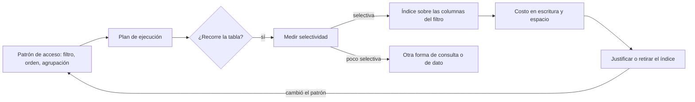
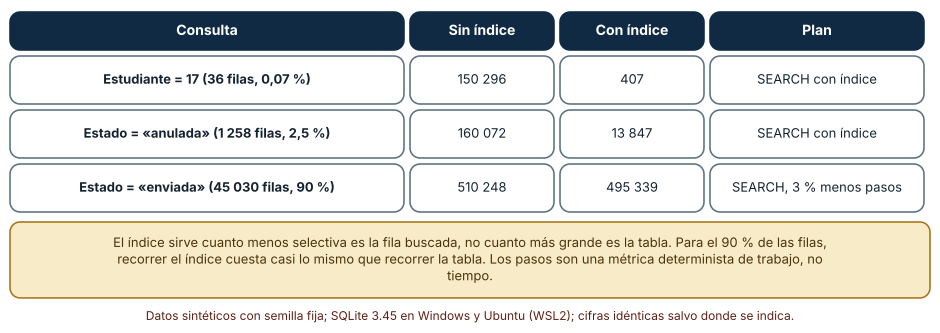
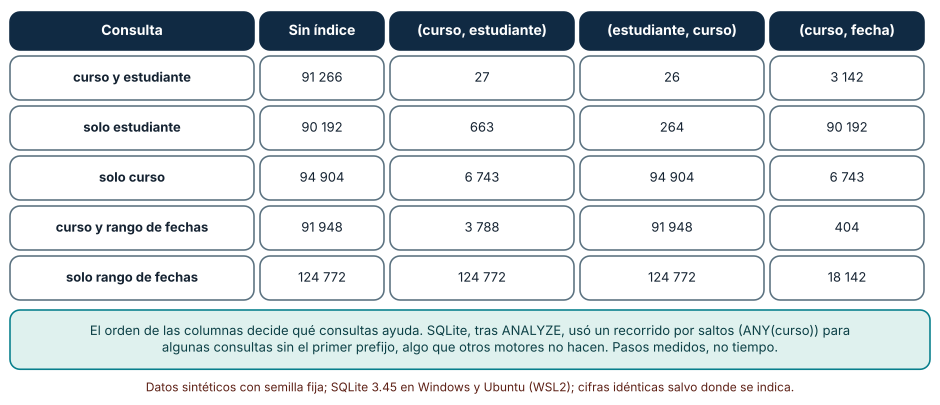
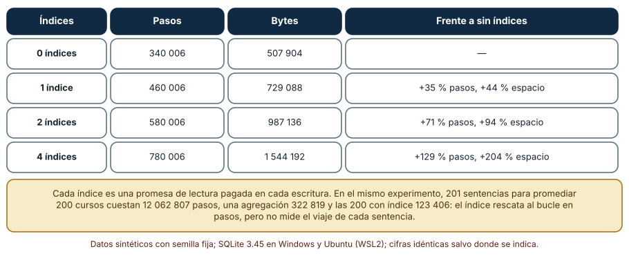

# SE-317 — Consultas, índices y patrones de acceso

[← SE-316 — Restricciones, invariantes y consistencia](https://github.com/vladimiracunadev-create/modern-software-engineering-program/blob/main/classes/part-26-datos-persistencia-y-recuperacion/se-316-restricciones-invariantes-y-consistencia/README.md) · [↑ Parte 26](https://github.com/vladimiracunadev-create/modern-software-engineering-program/blob/main/classes/part-26-datos-persistencia-y-recuperacion/README.md) · [📚 Índice completo](https://github.com/vladimiracunadev-create/modern-software-engineering-program/blob/main/classes/README.md) · [🌐 Portal](https://vladimiracunadev-create.github.io/modern-software-engineering-program/classes/SE-317.html) · [SE-318 — Migraciones compatibles y evolución de esquema →](https://github.com/vladimiracunadev-create/modern-software-engineering-program/blob/main/classes/part-26-datos-persistencia-y-recuperacion/se-318-migraciones-compatibles-y-evolucion-de-esquema/README.md)

## Punto profesional y fundamento pedagógico

**Punto profesional.** La clase existe para que diseñes índices a partir de los patrones de acceso reales y los justifiques con un plan de ejecución y una medida de trabajo, no con la intuición de que «un índice acelera», y para que cuentes lo que cada índice cobra en cada escritura.

**Por qué aparece aquí.** Sigue a **Restricciones, invariantes y consistencia**: los datos ya están protegidos; ahora hay que leerlos sin que la plataforma se arrastre. La pregunta rectora de la parte incluye el rendimiento como una condición de supervivencia: una consulta lenta bajo carga se parece mucho a una caída.

**Error conceptual que debe corregir.** Creer que un índice es una mejora gratuita que se añade cuando «va lento»: un índice ayuda solo a las consultas cuya forma coincide con la suya, no ayuda cuando la condición selecciona casi todo, y cada uno encarece cada inserción y consume espacio.

**Secuencia de aprendizaje.** Antes de leer los resultados, predices cuántos pasos ahorra un índice sobre el estado de una entrega cuando el 90 % tiene el mismo estado; después mides tres órdenes de un índice compuesto frente a cinco consultas y el costo de insertar con cero, uno, dos y cuatro índices. La secuencia usa predicción, explicación propia, contraste y recuperación. [ICAP](https://icap.education.asu.edu/research) distingue participación de construcción de conocimiento; [How People Learn II](https://nap.nationalacademies.org/catalog/24783/how-people-learn-ii-learners-contexts-and-cultures) exige conectar conocimiento previo, contexto y transferencia; la [práctica de recuperación](https://pubmed.ncbi.nlm.nih.gov/16507066/) respalda producir de nuevo la explicación tras una demora; y [Education for Life and Work](https://nap.nationalacademies.org/resource/13398/dbasse_084153.pdf) exige devolución que explique la causa del error.

**Evidencia de aprendizaje.** `acceso-log.md` con la predicción, el plan de cada consulta, los pasos con y sin índice, la matriz de consultas contra índices compuestos, el costo de escritura por número de índices y la justificación de cada índice del esquema.

**Límite de la conclusión.** Los pasos son los de la máquina virtual de SQLite, una métrica determinista de trabajo y no de tiempo; los datos son sintéticos (50 000 o 30 000 filas). No se midió el tiempo de reloj, ni el efecto de la memoria caché del sistema operativo, ni otro motor: el planificador de PostgreSQL tomaría decisiones distintas.

### Trazabilidad fuente → afirmación

| Fuente primaria u oficial | Afirmación que respalda | Lo que no prueba |
|---|---|---|
| [SQLite: planificador de consultas](https://www.sqlite.org/queryplanner.html) | Explica cómo un índice permite buscar en tiempo logarítmico, los índices de varias columnas y el costo de recorrer la tabla entera. | No describe otros motores. |
| [SQLite: EXPLAIN QUERY PLAN](https://www.sqlite.org/eqp.html) | Documenta cómo leer el plan (`SCAN`, `SEARCH ... USING INDEX`). | No dice cuál es el plan óptimo de una consulta. |
| [SQLite: optimizador y recorrido por saltos](https://www.sqlite.org/optoverview.html) | Describe cómo el optimizador usa las estadísticas y el recorrido por saltos sobre un índice cuyo primer prefijo tiene pocos valores. | No garantiza que otro motor lo haga. |
| [SQLite: ANALYZE](https://www.sqlite.org/lang_analyze.html) | Explica que `ANALYZE` recoge estadísticas que el planificador usa para elegir entre planes. | No mide el efecto de las estadísticas viejas. |
| [PostgreSQL: índices de varias columnas](https://www.postgresql.org/docs/current/indexes-multicolumn.html) | Explica que el orden de las columnas determina qué consultas puede resolver un índice compuesto. | No cubre el planificador de SQLite. |

## Antes de empezar

Recupera lo aprendido en `SE-316`: una restricción `UNIQUE` usa un índice. La pregunta activa es: **¿qué consultas de la plataforma son frecuentes, qué forma tienen y qué índice mínimo las resuelve sin cobrarles demasiado a las escrituras?**

## Prerrequisitos

- Haber completado `SE-316` o poder explicar por qué una restricción de unicidad necesita una estructura de búsqueda.
- Python 3.11 o posterior con `sqlite3`.
- Leer `SELECT` con `WHERE` y `GROUP BY` y la salida de `EXPLAIN QUERY PLAN`.

## Problema auténtico

La pantalla «mis entregas» de la plataforma se vuelve lenta cuando el año avanza. El equipo propone añadir un índice sobre cada columna que aparece en un `WHERE`. Alguien sospecha que el índice sobre el estado no servirá, otra persona recuerda que el panel del docente filtra por curso y por rango de fechas, y una tercera nota que el informe nocturno hace una consulta por curso, doscientas veces, con un bucle. Antes de crear nada, el equipo quiere medir qué hace cada consulta, qué índice la ayuda y qué paga la escritura de entregas por cada índice añadido.

## Objetivos observables

Al terminar podrás:

1. leer un plan de ejecución y distinguir recorrer la tabla de buscar con un índice;
2. medir el trabajo de una consulta con y sin índice y explicar por qué un índice sobre una columna poco selectiva casi no ayuda;
3. decidir el orden de las columnas de un índice compuesto a partir de las consultas que debe resolver;
4. medir el costo en pasos y en espacio de cada índice adicional sobre las inserciones;
5. detectar y corregir el patrón de una consulta por elemento (N+1) y justificar un índice por consulta real.

## Mapa conceptual



El mapa parte del patrón de acceso y no del índice: el índice es una respuesta, y su costo lo paga cada escritura. Si el patrón cambia, el índice deja de justificarse.

## Temas y por qué importan

| Tema | Por qué cambia una decisión profesional | Evidencia mínima |
|---|---|---|
| Plan de ejecución | Dice qué hace el motor en lugar de lo que se supone. | Predicción, traza causal y contraejemplo de **Plan de ejecución** en `acceso-log.md` |
| Selectividad | Decide si un índice ahorra trabajo o solo lo reparte. | Predicción, traza causal y contraejemplo de **Selectividad** en `acceso-log.md` |
| Índices compuestos | El orden de las columnas decide qué consultas ayudan. | Predicción, traza causal y contraejemplo de **Índices compuestos** en `acceso-log.md` |
| Costo de escritura | Cada índice se actualiza en cada inserción y modificación. | Predicción, traza causal y contraejemplo de **Costo de escritura** en `acceso-log.md` |
| Forma de la consulta | Una consulta por elemento cuesta más que cualquier índice. | Predicción, traza causal y contraejemplo de **Forma de la consulta** en `acceso-log.md` |

## Conceptos y decisiones

### 1. Plan de ejecución

El plan es la decisión del motor sobre cómo ejecutar una consulta: recorrer toda la tabla (`SCAN`), buscar con un índice (`SEARCH ... USING INDEX`), ordenar aparte, usar un índice como cobertura. Se lee con `EXPLAIN QUERY PLAN` en SQLite y `EXPLAIN` en PostgreSQL. La regla es mirar el plan antes de creer en un índice y después de crearlo: el motor puede decidir no usarlo, usarlo de forma parcial o elegir otro. Un plan cambia con las estadísticas, el volumen y la forma de los parámetros.

### 2. Selectividad

La **selectividad** de una condición es la fracción de filas que deja pasar. Un índice sobre una columna ayuda cuando la condición selecciona pocas filas: buscar un estudiante entre 2 000 devuelve una fracción mínima y el índice evita recorrer el resto. Cuando una condición selecciona la mayoría (el 90 % de las entregas están «enviadas»), recorrer el índice y luego leer casi todas las filas cuesta casi lo mismo que recorrer la tabla. Un índice sobre una columna con pocos valores distintos solo es útil para sus valores raros.

### 3. Índices compuestos

Un índice sobre `(curso, estudiante)` ordena las entradas primero por curso y, dentro, por estudiante. Resuelve bien `curso = ? AND estudiante = ?` y `curso = ?`, porque el prefijo coincide; resuelve mal `estudiante = ?` solo, porque las entradas de un estudiante están dispersas entre los cursos. El orden inverso hace lo contrario. Como regla, se ponen primero las columnas de igualdad más selectivas o las que siempre aparecen, y después las de rango. SQLite, con estadísticas, puede usar un recorrido por saltos sobre el primer prefijo cuando tiene pocos valores, algo que otros motores no hacen: verificar el plan en el motor propio es parte del trabajo.

### 4. Costo de escritura

Cada índice es una estructura que el motor debe mantener: una inserción escribe la fila y una entrada en cada índice, y una modificación de una columna indexada actualiza el índice. Por eso un índice «por si acaso» tiene un costo cierto frente a un beneficio incierto. El espacio crece también: cuatro índices triplican el archivo de una tabla pequeña. La disciplina es que cada índice tenga una consulta que lo justifique, nombrada en el esquema, y una revisión que lo retire cuando esa consulta desaparezca.

### 5. Forma de la consulta

A veces el problema no es la falta de un índice sino la forma de pedir los datos. Una consulta lanzada una vez por curso dentro de un bucle (el patrón N+1) paga el costo de preparar y ejecutar una sentencia por cada elemento; una sola consulta con agregación lo hace en una pasada. El índice ayuda a cada consulta individual, pero no elimina los 200 viajes. Por eso el orden de trabajo es primero la forma de la consulta, luego el índice y solo después la desnormalización.

### Un índice sobre la columna equivocada

Se generan 50 000 entregas con 2 000 estudiantes, 50 cursos y cinco estados, en los que el 90 % está «enviada». Se mide el trabajo (pasos de la máquina virtual de SQLite, contados con un manejador de progreso) de tres consultas con y sin índice, tras `ANALYZE`.

```python
def steps(c, sql, args=()):
    box = [0]
    c.set_progress_handler(lambda: box.__setitem__(0, box[0] + 1), 1)
    rows = c.execute(sql, args).fetchall()
    c.set_progress_handler(None, 1)
    return len(rows), box[0]
```

| Consulta | Sin índice | Con índice | Plan |
|---|---:|---:|---|
| Estudiante = 17 (36 filas, 0,07 %) | 150 296 | 407 | `SEARCH` con índice |
| Estado = «anulada» (1 258 filas, 2,5 %) | 160 072 | 13 847 | `SEARCH` con índice |
| Estado = «enviada» (45 030 filas, 90 %) | 510 248 | 495 339 | `SEARCH`, 3 % menos pasos |

Para una fila entre 1 400, el índice baja el trabajo 370 veces. Para el 2,5 % de las filas lo baja 12 veces. Para el 90 %, el motor sigue usando el índice y ahorra un 3 %: el índice no es una herramienta equivocada, pero la consulta pide casi todo.



**Cómo leer la figura.** Cada fila es una consulta; las columnas comparan el trabajo con y sin índice. **Dónde deja de valer:** los pasos son una métrica determinista de trabajo, no tiempo: el costo de una lectura de disco frente a una de memoria cambia la proporción. La figura no dice que el índice sobre el estado sea inútil, sino que su ganancia depende del valor buscado: ayuda a encontrar las entregas anuladas y no ayuda a listar las enviadas.

### El orden de las columnas decide

Con 30 000 entregas se definen cuatro configuraciones —sin índice y tres índices compuestos distintos— y se miden cinco consultas por los pasos de trabajo: por curso y estudiante, solo estudiante, solo curso, curso con rango de fechas y solo rango de fechas.

```python
for name, idx in (("(curso, est)", ["curso, est"]), ("(est, curso)", ["est, curso"]), ("(curso, fecha)", ["curso, fecha"])):
    c = mk(idx, n=30000)
```

| Consulta | Sin índice | `(curso, estudiante)` | `(estudiante, curso)` | `(curso, fecha)` |
|---|---:|---:|---:|---:|
| curso y estudiante | 91 266 | 27 | 26 | 3 142 |
| solo estudiante | 90 192 | 663 | 264 | 90 192 |
| solo curso | 94 904 | 6 743 | 94 904 | 6 743 |
| curso y rango de fechas | 91 948 | 3 788 | 91 948 | 404 |
| solo rango de fechas | 124 772 | 124 772 | 124 772 | 18 142 |

Cada índice resuelve en una veintena de pasos la consulta para la que fue pensado y deja a las demás como estaban o casi. `(curso, estudiante)` ayuda a solo curso (prefijo) y no al rango de fechas; `(estudiante, curso)` ayuda a solo estudiante y no a solo curso; `(curso, fecha)` ayuda al rango de un curso y, de forma sorprendente, al rango a secas (18 142 pasos): con estadísticas, SQLite recorre cada uno de los 50 valores del primer prefijo (`ANY(curso)`), lo que ahorra el 85 % pero cuesta unas cien veces más que buscarlo por prefijo.



**Cómo leer la figura.** Cada fila es una consulta y cada columna un conjunto de índices. **Dónde deja de valer:** el recorrido por saltos es una propiedad de SQLite tras `ANALYZE`; PostgreSQL y MySQL tienen otras reglas, y el plan puede cambiar con el volumen y los valores. La regla general que se conserva es que el orden de las columnas decide qué consultas ayuda, y que no se deduce: se mide en el motor propio.

### Cuánto cobra cada índice a las escrituras

Se insertan 20 000 filas con cero, uno, dos y cuatro índices y se mide el trabajo y el tamaño del archivo. Aparte, se compara calcular el promedio de notas de 200 cursos con una consulta por curso, con una sola consulta agregada y con la consulta por curso más un índice.

```python
c.executemany("insert into e values(?,?,?,?,?,?)", filas)    # con 0, 1, 2 o 4 índices creados antes
c.execute("select avg(nota) from e where curso=?", (cid,))   # 200 veces
```

| Índices | Pasos | Bytes | Frente a sin índices |
|---|---:|---:|---|
| 0 | 340 006 | 507 904 | — |
| 1 | 460 006 | 729 088 | +35 % pasos, +44 % espacio |
| 2 | 580 006 | 987 136 | +71 % pasos, +94 % espacio |
| 4 | 780 006 | 1 544 192 | +129 % pasos, +204 % espacio |

Cada índice añade unos 120 000 pasos a 20 000 inserciones (unos 6 por fila) y entre 220 y 280 KB de espacio. En el otro experimento, 201 sentencias para promediar 200 cursos cuestan 12 062 807 pasos; una sola consulta agregada, 322 819; y las 200 consultas con un índice sobre `curso`, 123 406. Aquí el índice sí ayuda al bucle (98 veces menos pasos que sin índice) y lo deja por debajo de la agregación en pasos de la máquina virtual (123 406 frente a 322 819), porque cada consulta toca solo las entradas de un curso. Lo que esta métrica no ve es el costo de las 201 sentencias: en una base accedida por red, cada una añade un viaje de ida y vuelta y una preparación. La conclusión honesta es que sin índice la forma de pedir domina (37 veces más pasos que la agregada) y que con índice la comparación pasa a depender de lo que cuesta cada sentencia, que hay que medir con la latencia real.



**Cómo leer la figura.** Cada fila es un número de índices; las columnas cuentan pasos y bytes de las inserciones. **Dónde deja de valer:** son inserciones en una sola transacción de una tabla en memoria con índices simples; con índices más anchos, con una escritura por transacción o con un disco real, la proporción cambia. La nota de la figura añade la comparación de N+1: el índice rescata al bucle en pasos, pero esa métrica no incluye el viaje de cada sentencia.

## Definiciones de trabajo

- **plan de ejecución:** secuencia de operaciones que el motor elige para resolver una consulta.
- **selectividad:** fracción de las filas que cumple una condición.
- **índice compuesto:** índice sobre varias columnas ordenado por la primera, luego por la segunda, y así sucesivamente.
- **recorrido por saltos (skip scan):** técnica que usa un índice compuesto sin condición sobre su primera columna recorriendo cada uno de sus valores.
- **N+1:** patrón de una consulta inicial más una consulta por cada elemento de su resultado.

Las definiciones son operativas para la plataforma de entregas. No convierten términos con una historia más amplia en sinónimos y deben contrastarse con la documentación primaria enlazada al final.

## Ejemplo mínimo

El fragmento comprueba que un índice cambia el plan. Antes de ejecutarlo, predice si el plan será `SCAN` o `SEARCH` con el índice creado.

```python
import sqlite3
c = sqlite3.connect(":memory:")
c.execute("create table e(id integer primary key, est int)")
c.executemany("insert into e(est) values(?)", [(i % 100,) for i in range(1000)])
antes = c.execute("explain query plan select * from e where est=5").fetchone()[3]
c.execute("create index i on e(est)")
despues = c.execute("explain query plan select * from e where est=5").fetchone()[3]
assert antes.startswith("SCAN") and despues.startswith("SEARCH")
```

El plan pasa de recorrer la tabla a buscar con el índice. Registra versión, comando y salida; después busca `est > -1` y observa qué decide el motor.

## Ejemplo profesional

El equipo de la plataforma crea un catálogo de patrones de acceso, uno por consulta frecuente, con su frecuencia, su filtro y su plazo: «mis entregas» (por estudiante, ordenadas por fecha, cada pantalla), «panel del docente» (por curso y rango de fechas) y «informe nocturno» (promedios por curso). Para cada una anota el plan antes y después, los pasos medidos y el índice que la justifica. El resultado son tres índices —`(estudiante, fecha)`, `(curso, fecha)` y ninguno para el informe, que se reescribe como una sola consulta agregada—, cada uno con un comentario en `schema.sql` que enlaza a la consulta. Una tarea revisa cada trimestre los índices que ninguna consulta registrada usa y propone retirarlos. Los pasos se miden con un conjunto sintético que conserva la distribución de la plataforma, y el plan se revisa de nuevo cuando el volumen se multiplica por diez.

## Práctica guiada

1. Lista las cinco consultas más frecuentes de la plataforma con su filtro y su orden.
2. Predice qué consultas ayudaría un índice y cuáles no, y escribe la predicción.
3. Genera 50 000 entregas con semilla fija, ejecuta `ANALYZE` y mide los pasos de cada consulta con y sin índice.
4. Crea tres índices compuestos que difieren en el orden y mide las cinco consultas con cada uno.
5. Mide el costo de insertar con cero, uno, dos y cuatro índices y calcula pasos y bytes por fila.
6. Reescribe un bucle de una consulta por curso como una sola consulta agregada y compara el trabajo.
7. Entrega `acceso-log.md` y pide a otra persona que diga qué índice retiraría y por qué.

## Ejercicios

1. **Selectividad:** calcula la selectividad de cada columna de `entrega` y ordénalas de más a menos útil como primer prefijo de un índice.
2. **Cobertura:** diseña un índice que contenga todas las columnas que lee la consulta de «mis entregas» y explica qué ahorra y qué cuesta.
3. **Orden:** para las consultas «por curso y estado» y «por estado», decide el orden de las columnas del índice y justifícalo con el plan.
4. **Retirada:** escribe la consulta que lista los índices cuyo nombre no aparece en ningún plan registrado.

## Reto verificable

Entrega `acceso-log.md` con la predicción, el catálogo de patrones de acceso, las tablas de pasos y de escritura y la justificación de cada índice. Se aprueba si otra persona ejecuta el código, obtiene los mismos pasos con las mismas semillas y puede decir qué consulta dejaría de estar ayudada si se invierte el orden de las columnas de un índice. No se aprueba por mostrar que «con índice va más rápido» sin un plan y sin una medida de qué cuesta.

## Caso conductor

La capa de datos de la plataforma de entregas sigue siendo el caso conductor. Esta clase deja el quinto artefacto: el catálogo de patrones de acceso con sus índices justificados. `SE-318` pregunta cómo cambiar el esquema, incluidos estos índices, sin detener a nadie. Cambia después una sola decisión, el orden de las columnas de un índice, y observa qué consulta deja de estar ayudada.

## Preguntas frecuentes

### ¿Cuántos índices es razonable tener?

Los que tengan una consulta frecuente que los justifique y un costo de escritura aceptable. No hay un número: hay una lista de consultas y una medida del costo. Un índice sin consulta nombrada se retira.

### ¿Por qué el motor no usa mi índice?

Porque estimó que no ayudaba (condición poco selectiva), porque la forma de la consulta no coincide (una función sobre la columna, un tipo distinto, el prefijo equivocado) o porque las estadísticas están viejas. Se mira el plan, se comparan los pasos y se comprueba con las estadísticas actualizadas.

### ¿Un índice compuesto sustituye a dos simples?

No siempre: ayuda a las consultas que usan su prefijo. Para dos consultas con columnas distintas hacen falta dos índices o un compuesto que cubra una y el prefijo de la otra.

### ¿Pasos de la máquina virtual son tiempo?

No: son una métrica determinista de trabajo que permite comparar en equipos distintos, y se corresponde con el tiempo solo de forma aproximada. Para decidir en producción hay que medir tiempos con la carga real.

## Fallo controlado y diagnóstico

Reproduce el fallo clásico de la clase: **añadir un índice sobre una columna poco selectiva y esperar una mejora**. Crea un índice sobre el estado y consulta las entregas «enviadas».

Registra síntoma, entrada mínima, hipótesis, observación que descarta cada hipótesis, causa, corrección y prueba de regresión. **Síntoma:** tras crear el índice, la consulta sigue tardando casi lo mismo y las escrituras son más lentas. **Hipótesis rivales:** (a) el motor no usa el índice; (b) las estadísticas están viejas; (c) la condición selecciona casi todas las filas. **Prueba:** mira el plan (¿usa el índice?), actualiza las estadísticas y compara los pasos con y sin índice, y calcula la fracción de filas que cumple; si el plan usa el índice, el ahorro es del 3 % y la fracción es el 90 %, la causa es la baja selectividad. **Conclusión:** el índice se usa y casi no ahorra. **Regresión:** retira el índice, añade una prueba que mida los pasos de la consulta y falle si el ahorro es menor que el costo declarado, y documenta que para esta consulta la solución es otra (paginar, filtrar por el valor raro). No cambies a la vez el índice y la consulta.

## Errores comunes y cómo corregirlos

| Síntoma | Causa probable | Corrección |
|---|---|---|
| Se crea un índice y la consulta no mejora | Condición poco selectiva o forma que no coincide con el prefijo | Mirar el plan y la selectividad antes y después |
| Las escrituras se vuelven lentas con el tiempo | Índices acumulados sin consulta que los justifique | Catálogo de patrones y revisión periódica |
| Una consulta usa un índice y otra equivalente no | Orden de columnas, función sobre la columna o tipo distinto | Alinear la consulta con el prefijo y comprobar el plan |
| Un informe tarda minutos y cada consulta es rápida | Patrón N+1 | Una sola consulta agregada o un `JOIN` |
| El plan cambia sin tocar el código | Estadísticas o volumen distintos | Actualizar las estadísticas y revisar los planes críticos |

## Entorno y archivos clave

```text
work/SE-317/
├── README.md
├── acceso/
│   ├── catalogo_consultas.md
│   ├── pasos.py
│   └── schema.sql
├── tests/test_acceso.py
└── evidence/acceso-log.md
```

El `README` declara plataforma, versiones de Python y de SQLite, semillas y comandos. Los experimentos usan solo la biblioteca estándar (`sqlite3`, `random`) y se ejecutaron con CPython 3.12.9 en Windows 11 (SQLite 3.45.3) y 3.12.3 en Ubuntu bajo WSL2 (SQLite 3.45.1): las salidas fueron idénticas. Si añades una dependencia, fija procedencia y versión.

## Seguridad, ética y accesibilidad

- una consulta lenta que se repite puede convertirse en un vector de denegación de servicio: acota los resultados y exige filtros;
- los índices sobre datos personales duplican datos personales: inclúyelos en el inventario de copias (`SE-322`);
- una consulta que ordena por un campo personal puede revelar información por la forma del resultado: revisa qué se expone;
- la lentitud afecta más a quien tiene conexiones o dispositivos lentos: mide también el peso de las respuestas;
- documenta el plan esperado de cada consulta crítica para que sea revisable.

## Puente hacia el trabajo con agentes

Un agente al que se le pide «optimiza esta consulta» propondrá un índice sobre cada columna del `WHERE`. Pídele en cambio el plan antes y después, la medida de trabajo, el costo en escrituras y la consulta que justifica cada índice, con la condición de retirarlo. Revisa especialmente si propone un índice sobre una columna poco selectiva y si deja un bucle de una consulta por elemento: son los dos defectos que esta clase mostró sin aviso.

## Transferencia

Traslada el análisis a otro dominio (por ejemplo, un registro de visitas a un museo): lista sus consultas, mide la selectividad de cada columna, diseña un índice compuesto y cuenta su costo de escritura. La transferencia está lograda cuando puedes explicar qué consulta ayuda cada índice y cuál no, no cuando los índices se parecen.

## Evaluación y evidencia

| Criterio | Evidencia para aprobar |
|---|---|
| comprensión | explicación de la selectividad y del orden de un índice compuesto |
| corrección | planes y pasos reproducibles con las mismas semillas |
| diseño | catálogo de patrones de acceso con índices justificados y costo de escritura |
| diagnóstico | reproducción del fallo «índice sobre una columna poco selectiva» con regresión |
| incertidumbre | declaración de que los pasos no son tiempo y de que el plan depende del motor |
| reproducibilidad | versiones, comandos, salida y límites declarados |

## Fuentes

- [SQLite: planificador de consultas](https://www.sqlite.org/queryplanner.html) — índices y planes; autoridad: documentación oficial de SQLite.
- [SQLite: EXPLAIN QUERY PLAN](https://www.sqlite.org/eqp.html) — lectura de un plan; autoridad: documentación oficial de SQLite.
- [SQLite: optimizador](https://www.sqlite.org/optoverview.html) — uso de índices y recorrido por saltos; autoridad: documentación oficial de SQLite.
- [SQLite: ANALYZE](https://www.sqlite.org/lang_analyze.html) — estadísticas del planificador; autoridad: documentación oficial de SQLite.
- [PostgreSQL: índices de varias columnas](https://www.postgresql.org/docs/current/indexes-multicolumn.html) — orden de columnas; autoridad: documentación oficial de PostgreSQL.
- [PostgreSQL: usar EXPLAIN](https://www.postgresql.org/docs/current/using-explain.html) — lectura de planes y costos; autoridad: documentación oficial de PostgreSQL.

Cada fuente respalda el mecanismo indicado; ninguna demuestra que los 407 pasos, los 18 142 del recorrido por saltos o el 129 % de sobrecoste de cuatro índices se observen en la base y la carga de la plataforma. Esa afirmación depende del motor, de los datos y de las estadísticas.

## Límites y siguiente paso

Se ejecutaron tres experimentos con datos sintéticos en Windows y Ubuntu (WSL2) con resultados idénticos en pasos y planes. No se midió tiempo de reloj ni se usó otro motor; el recorrido por saltos y las decisiones del planificador son de SQLite 3.45 tras `ANALYZE` y pueden cambiar con otra versión o sin estadísticas. La distribución de los datos (90 % de entregas «enviadas», 2 000 estudiantes, 50 cursos) es una construcción del autor. La siguiente clase pregunta cómo cambiar el esquema, con sus índices, sin detener a nadie.

## Glosario

- **plan de ejecución:** secuencia de operaciones que el motor elige para resolver una consulta.
- **selectividad:** fracción de las filas que cumple una condición.
- **índice compuesto:** índice sobre varias columnas ordenado por la primera, luego por la segunda, y así sucesivamente.
- **recorrido por saltos (skip scan):** técnica que usa un índice compuesto sin condición sobre su primera columna recorriendo cada uno de sus valores.
- **N+1:** patrón de una consulta inicial más una consulta por cada elemento de su resultado.

---

[← SE-316 — Restricciones, invariantes y consistencia](https://github.com/vladimiracunadev-create/modern-software-engineering-program/blob/main/classes/part-26-datos-persistencia-y-recuperacion/se-316-restricciones-invariantes-y-consistencia/README.md) · [↑ Parte 26](https://github.com/vladimiracunadev-create/modern-software-engineering-program/blob/main/classes/part-26-datos-persistencia-y-recuperacion/README.md) · [📚 Índice completo](https://github.com/vladimiracunadev-create/modern-software-engineering-program/blob/main/classes/README.md) · [🌐 Portal](https://vladimiracunadev-create.github.io/modern-software-engineering-program/classes/SE-317.html) · [SE-318 — Migraciones compatibles y evolución de esquema →](https://github.com/vladimiracunadev-create/modern-software-engineering-program/blob/main/classes/part-26-datos-persistencia-y-recuperacion/se-318-migraciones-compatibles-y-evolucion-de-esquema/README.md)
