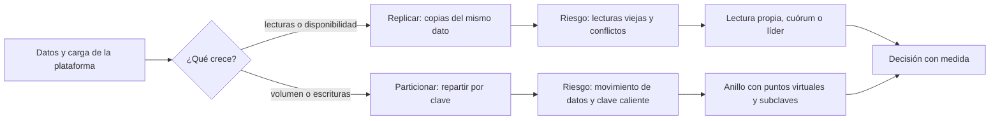
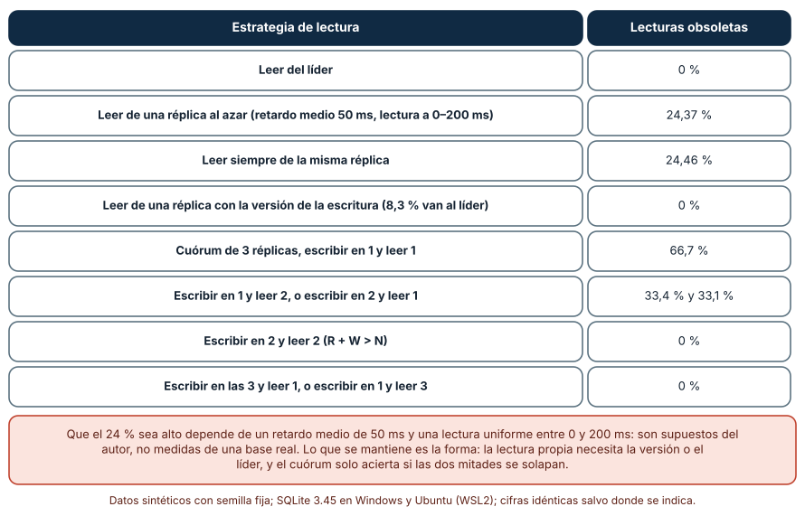
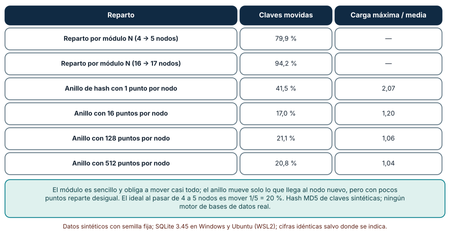
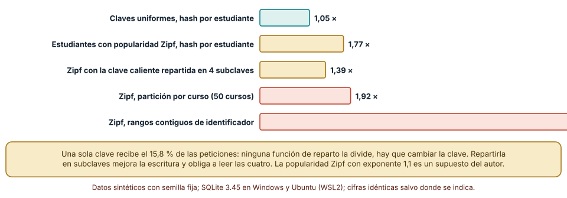

# SE-319 — Replicación, partición y distribución

[← SE-318 — Migraciones compatibles y evolución de esquema](https://github.com/vladimiracunadev-create/modern-software-engineering-program/blob/main/classes/part-26-datos-persistencia-y-recuperacion/se-318-migraciones-compatibles-y-evolucion-de-esquema/README.md) · [↑ Parte 26](https://github.com/vladimiracunadev-create/modern-software-engineering-program/blob/main/classes/part-26-datos-persistencia-y-recuperacion/README.md) · [📚 Índice completo](https://github.com/vladimiracunadev-create/modern-software-engineering-program/blob/main/classes/README.md) · [🌐 Portal](https://vladimiracunadev-create.github.io/modern-software-engineering-program/classes/SE-319.html) · [SE-320 — Cachés y consistencia entre capas →](https://github.com/vladimiracunadev-create/modern-software-engineering-program/blob/main/classes/part-26-datos-persistencia-y-recuperacion/se-320-caches-y-consistencia-entre-capas/README.md)

## Punto profesional y fundamento pedagógico

**Punto profesional.** La clase existe para que decidas cuándo copiar datos entre máquinas (replicar) y cuándo repartirlos (particionar), qué garantías de lectura pierdes en cada caso y cómo elegir una clave de reparto que no concentre la carga en una sola máquina.

**Por qué aparece aquí.** Sigue a **Migraciones compatibles y evolución de esquema**: hasta ahora la base vivía en una máquina; cuando crece el volumen o se exige disponibilidad, los datos viven en varias. Cada solución resuelve un problema (disponibilidad, lectura, volumen) y crea otro (lecturas viejas, movimiento de datos, desequilibrio).

**Error conceptual que debe corregir.** Creer que replicar o particionar «escala» sin más: la replicación asíncrona devuelve lecturas viejas justo cuando alguien acaba de escribir, y la partición mueve casi todos los datos si se elige mal la función de reparto y concentra la carga si se elige mal la clave.

**Secuencia de aprendizaje.** Antes de leer los resultados, predices qué fracción de lecturas inmediatas a una escritura devuelve el valor viejo si lees de una réplica con 50 ms de retardo medio y qué fracción de claves se mueve al añadir un quinto nodo con un reparto por módulo; después mides ambos y observas qué ocurre con una clave que recibe el 15,8 % de las peticiones. La secuencia usa predicción, explicación propia, contraste y recuperación. [ICAP](https://icap.education.asu.edu/research) distingue participación de construcción de conocimiento; [How People Learn II](https://nap.nationalacademies.org/catalog/24783/how-people-learn-ii-learners-contexts-and-cultures) exige conectar conocimiento previo, contexto y transferencia; la [práctica de recuperación](https://pubmed.ncbi.nlm.nih.gov/16507066/) respalda producir de nuevo la explicación tras una demora; y [Education for Life and Work](https://nap.nationalacademies.org/resource/13398/dbasse_084153.pdf) exige devolución que explique la causa del error.

**Evidencia de aprendizaje.** `distribucion-log.md` con la predicción, la tabla de lecturas obsoletas y de cuórum, la tabla de claves movidas, la medida del desequilibrio por clave y una decisión escrita de replicar, particionar o ninguna de las dos para la plataforma.

**Límite de la conclusión.** Todo es una simulación con semilla fija: el retardo exponencial de 50 ms, la lectura uniforme entre 0 y 200 ms y la popularidad Zipf de las peticiones son supuestos del autor. No se usó ninguna base de datos distribuida, red ni réplica real, y no se midió latencia, particiones de red ni fallos de nodos.

### Trazabilidad fuente → afirmación

| Fuente primaria u oficial | Afirmación que respalda | Lo que no prueba |
|---|---|---|
| [PostgreSQL: servidores en espera y replicación](https://www.postgresql.org/docs/current/warm-standby.html) | Describe la replicación por envío de registros, la diferencia entre replicación síncrona y asíncrona y que una réplica puede ir por detrás del primario. | No mide el retardo de ninguna instalación. |
| [PostgreSQL: particionado de tablas](https://www.postgresql.org/docs/current/ddl-partitioning.html) | Describe el particionado por rango, lista y hash y sus limitaciones. | No cubre el reparto entre máquinas distintas. |
| [Karger et al., «Consistent hashing and random trees»](https://dl.acm.org/doi/10.1145/258533.258660) | Propone una función de reparto en la que añadir o quitar un nodo mueve solo una fracción de las claves. | No fija el número de puntos virtuales de una instalación. |
| [DeCandia et al., «Dynamo: Amazon's Highly Available Key-value Store»](https://www.allthingsdistributed.com/2007/10/amazons_dynamo.html) | Describe el uso de hashing consistente, nodos virtuales y cuórum de lectura y escritura (R + W > N) en un almacén distribuido. | No dice que la configuración de Dynamo sirva a una plataforma educativa. |
| [Jepsen: modelos de consistencia](https://jepsen.io/consistency) | Presenta un mapa de modelos de consistencia y qué anomalías permite cada uno. | No clasifica ningún producto concreto en esta clase. |

## Antes de empezar

Recupera lo aprendido en `SE-318`: una migración necesita saber qué versión lee qué. La pregunta activa es: **¿qué lecturas pueden ser viejas si hay copias, y qué clave de reparto evita que una sola máquina soporte casi todo?**

## Prerrequisitos

- Haber completado `SE-318` o poder explicar qué estado intermedio permite que dos versiones convivan.
- Python 3.11 o posterior con `random`, `hashlib`, `bisect`, `math` y `collections`.
- Leer una función hash y una distribución de probabilidad básica.

## Problema auténtico

La plataforma de entregas crece: en época de cierre de semestre, la pantalla «mis entregas» se pide miles de veces por minuto y la base única no da abasto. El equipo propone dos cambios: añadir réplicas de lectura para aliviar la carga, y repartir las entregas entre cuatro nodos por el identificador del estudiante. Una semana después, estudiantes se quejan de que «subí mi entrega y no aparece», y un docente que sube la nota de un curso muy popular ve que un nodo está al 90 % mientras los otros están ociosos. Cada síntoma tiene una causa distinta: el retardo de la replicación y la elección de la clave de reparto.

## Objetivos observables

Al terminar podrás:

1. distinguir replicar de particionar con el problema que resuelve cada uno y el que introduce;
2. medir qué fracción de lecturas inmediatas a una escritura devuelve un valor viejo según de dónde se lea;
3. calcular la probabilidad de una lectura obsoleta con un cuórum de lectura y escritura y la condición para evitarla;
4. comparar el reparto por módulo con un anillo de hash consistente por el número de claves que se mueven y por el equilibrio;
5. detectar una clave caliente y proponer una clave de reparto o un cambio de modelo que la reparta.

## Mapa conceptual



El mapa separa los dos problemas: replicar copia el mismo dato en varias máquinas; particionar reparte datos distintos. Ambos pueden combinarse y cada uno tiene su propio riesgo.

## Temas y por qué importan

| Tema | Por qué cambia una decisión profesional | Evidencia mínima |
|---|---|---|
| Replicación asíncrona | Una réplica puede ir por detrás del líder. | Predicción, traza causal y contraejemplo de **Replicación asíncrona** en `distribucion-log.md` |
| Lectura de la propia escritura | Quien escribe espera ver su dato. | Predicción, traza causal y contraejemplo de **Lectura de la propia escritura** en `distribucion-log.md` |
| Cuórum | R + W > N garantiza que una lectura vea la última escritura. | Predicción, traza causal y contraejemplo de **Cuórum** en `distribucion-log.md` |
| Función y clave de reparto | Decide cuántos datos se mueven y quién recibe la carga. | Predicción, traza causal y contraejemplo de **Función y clave de reparto** en `distribucion-log.md` |
| Clave caliente | Una clave muy popular no se reparte con ninguna función. | Predicción, traza causal y contraejemplo de **Clave caliente** en `distribucion-log.md` |

## Conceptos y decisiones

### 1. Replicación asíncrona

El líder acepta las escrituras y las envía a las réplicas, que las aplican con retardo. En la replicación **asíncrona** el líder confirma sin esperar a las réplicas: es rápido y tolera que una réplica esté lenta, pero si el líder se cae antes de enviar, esa escritura se pierde, y una lectura en una réplica puede devolver un valor viejo. En la **síncrona** el líder espera a una o más réplicas: no pierde lo confirmado y cobra latencia y disponibilidad (si la réplica no responde, la escritura espera). Elegir es elegir qué se sacrifica, y cada institución decide según el costo de perder o de retrasar.

### 2. Lectura de la propia escritura

La consecuencia más visible para una persona es «subí mi entrega y no aparece». La garantía de **leer lo que uno escribió** se puede lograr de varias formas: leer del líder durante unos segundos tras escribir, leer de una réplica solo si ya aplicó la versión de la escritura (un número de versión o posición que el cliente conserva) y, si ninguna la tiene, ir al líder. Cada una cobra algo: la primera carga al líder, la segunda exige llevar la versión, la tercera sigue enviando algunas lecturas al líder.

### 3. Cuórum

En un sistema sin líder fijo, cada dato vive en N réplicas. Una escritura se confirma al llegar a W réplicas y una lectura consulta R, y se queda con la versión más nueva. Si **R + W > N**, los conjuntos de lectura y de escritura siempre se solapan y la lectura ve la última escritura confirmada; si no, puede no verla. Con N = 3, W = 2 y R = 2 se cumple y se tolera la caída de una réplica; con W = 1 y R = 1 es el más rápido y el que más lecturas viejas devuelve. El cuórum no garantiza consistencia fuerte en todos los casos (hay detalles de escrituras parciales y relojes) pero da una condición clara y medible.

### 4. Función y clave de reparto

Para particionar hay que decidir una **clave** (qué campo decide dónde va una fila) y una **función** (cómo se traduce la clave en un nodo). El reparto por **módulo** (`hash(clave) mod N`) es sencillo y tiene un defecto grave: al cambiar N, casi todas las claves cambian de nodo, y mover los datos es costoso. Un **anillo de hash consistente** coloca nodos y claves en un círculo; al añadir un nodo, solo se mueven las claves que caen en su tramo. Con pocos puntos por nodo el reparto es desigual; con puntos virtuales (muchos por nodo) se equilibra. La clave decide además qué consultas tocan un solo nodo y cuáles hay que lanzar a todos.

### 5. Clave caliente

Si la popularidad de las claves no es uniforme (unos pocos estudiantes o cursos concentran muchas peticiones), una sola partición recibe una fracción desproporcionada, y añadir nodos no la alivia. Las salidas son cambiar la clave (repartir por un campo más fino), dividir la clave caliente en subclaves (lecturas a todas, a costa de complejidad) o servirla desde una caché (`SE-320`). Un rango contiguo de identificadores es la peor opción cuando los identificadores recientes son los populares, porque todo el tráfico va a la última partición.

### Lecturas viejas y cuórum

Se simulan 100 000 escrituras seguidas de una lectura a un tiempo uniforme entre 0 y 200 ms. Cada una de tres réplicas aplica la escritura tras un retardo exponencial de 50 ms de media. La lectura va al líder, a una réplica al azar, siempre a la misma réplica, o a una réplica que ya haya aplicado la versión (si ninguna, al líder). Además se simulan 60 000 escrituras y lecturas de cuórum con N = 3.

```python
lag = [r.expovariate(1 / 50.0) for _ in range(3)]       # ms hasta que cada réplica aplica la escritura
dt = r.uniform(0, 200)                                   # ms entre la escritura y la lectura
visto = [l <= dt for l in lag]
```

| Estrategia de lectura | Lecturas obsoletas |
|---|---:|
| Leer del líder | 0 % |
| Réplica al azar | 24,37 % |
| Siempre la misma réplica | 24,46 % |
| Réplica con la versión de la escritura (8,3 % van al líder) | 0 % |
| Cuórum N = 3, W = 1, R = 1 | 66,7 % |
| W = 1, R = 2 o W = 2, R = 1 | 33,4 % y 33,1 % |
| W = 2, R = 2 (R + W > N) | 0 % |
| W = 3, R = 1 o W = 1, R = 3 | 0 % |

Con estos supuestos, una de cada cuatro lecturas inmediatas devuelve el valor viejo desde una réplica cualquiera. La lectura con versión las elimina y envía al líder el 8,3 % (las que ocurren antes de que ninguna réplica lo tenga). En el cuórum, la simulación coincide con el cálculo exacto C(N−W, R)/C(N, R): 2/3, 1/3 y 0, y la condición R + W > N las vuelve cero.



**Cómo leer la figura.** Cada fila es una estrategia de lectura o una combinación de cuórum; la columna da la fracción de lecturas que no ven la última escritura. **Dónde deja de valer:** el 24 % es consecuencia directa de un retardo medio de 50 ms y de una lectura entre 0 y 200 ms: con otro retardo o con lecturas más tardías el número cambia por completo. El cuórum del modelo escoge réplicas al azar sin fallos ni escrituras parciales; no demuestra la consistencia de ningún motor. Lo que se conserva es la forma: la propia escritura necesita líder o versión, y el solapamiento exige R + W > N.

### Cuántas claves se mueven al añadir un nodo

Con 100 000 claves sintéticas se compara el reparto por `hash mod N` con un anillo de hash con 1, 16, 128 y 512 puntos por nodo, al pasar de 4 a 5 nodos (y de 16 a 17 en el caso del módulo). También se mide el desequilibrio: la carga del nodo más cargado frente a la media.

```python
mov = sum(1 for k in keys if h(k) % N != h(k) % (N + 1))
rg4, rg5 = ring(nodos4, v), ring(nodos5, v)
mov = sum(1 for k in keys if owner(rg4, k) != owner(rg5, k))
```

| Reparto | Claves movidas | Carga máxima / media |
|---|---:|---:|
| Módulo N (4 → 5 nodos) | 79,9 % | — |
| Módulo N (16 → 17 nodos) | 94,2 % | — |
| Anillo con 1 punto por nodo | 41,5 % | 2,07 |
| Anillo con 16 puntos por nodo | 17,0 % | 1,20 |
| Anillo con 128 puntos por nodo | 21,1 % | 1,06 |
| Anillo con 512 puntos por nodo | 20,8 % | 1,04 |

El ideal al pasar de 4 a 5 nodos es mover 1/5 = 20 %. El módulo mueve cuatro de cada cinco claves (y cuanto mayor es N, más cerca del 100 %). El anillo con puntos virtuales se acerca al ideal y equilibra: con 128 puntos la carga máxima es 1,06 veces la media.



**Cómo leer la figura.** Cada fila es un reparto; las columnas dan las claves que cambian de nodo y el desequilibrio entre nodos. **Dónde deja de valer:** el hash MD5 de claves sintéticas reparte bien; con claves reales y un hash débil el equilibrio sería peor. No se simuló la copia de datos ni su duración: mover el 80 % de las claves es un costo de ancho de banda y de lecturas incorrectas durante el traspaso que esta figura no mide.

### Una clave que recibe el 15,8 %

Se generan 100 000 peticiones sobre 5 000 estudiantes con popularidad Zipf (exponente 1,1), y se reparten en 8 particiones con cinco claves de reparto: el estudiante con hash, el curso (50 cursos) con hash, rangos contiguos de identificador, el estudiante con la clave más caliente dividida en cuatro subclaves, y como contraste, peticiones uniformes.

```python
w = [1 / (i ** 1.1) for i in range(1, 5001)]
reqs = r.choices(range(5000), weights=w, k=100000)
```

| Clave y función de reparto | Carga máxima / media |
|---|---:|
| Peticiones uniformes, hash por estudiante | 1,05 |
| Popularidad Zipf, hash por estudiante | 1,77 |
| Zipf, hash con la clave caliente repartida en 4 subclaves | 1,39 |
| Zipf, partición por curso (50 cursos) | 1,92 |
| Zipf, rangos contiguos de identificador | 6,76 |

El estudiante más pedido recibe el 15,8 % de las peticiones: con 8 particiones, su nodo ya recibe más que el doble de la parte ideal (12,5 %) solo por esa clave. Repartirla en cuatro subclaves baja el máximo a 1,39 y obliga a leer las cuatro. Los rangos contiguos concentran el tráfico en la primera partición (6,76 veces la media), porque la popularidad cae con el identificador.



**Cómo leer la figura.** Cada barra es el cociente entre la carga de la partición más cargada y la media para una clave de reparto. **Dónde deja de valer:** la distribución Zipf con exponente 1,1 es un supuesto del autor; la popularidad real de una plataforma educativa tiene picos de fechas de entrega que esta simulación no recoge. Y la partición por curso tiene la ventaja de que las consultas por curso tocan un solo nodo: la figura mide carga, no costo de las consultas entre particiones.

## Definiciones de trabajo

- **replicación asíncrona:** copia de los datos a otras máquinas sin esperar su confirmación antes de responder al cliente.
- **retardo de replicación:** tiempo entre que el líder confirma una escritura y una réplica la aplica.
- **cuórum:** número mínimo de réplicas que deben responder para dar una operación por válida; R + W > N asegura el solapamiento.
- **hash consistente:** función de reparto en un círculo en la que cambiar el número de nodos mueve solo una fracción de las claves.
- **clave caliente:** clave que recibe una fracción desproporcionada de las peticiones.

Las definiciones son operativas para la plataforma de entregas. No convierten términos con una historia más amplia en sinónimos y deben contrastarse con la documentación primaria enlazada al final.

## Ejemplo mínimo

El fragmento calcula la probabilidad de una lectura obsoleta en un cuórum. Antes de ejecutarlo, predice el resultado para N = 3, W = 1, R = 2.

```python
from math import comb
N, W, R = 3, 1, 2
p_obsoleta = comb(N - W, R) / comb(N, R)
assert abs(p_obsoleta - 1 / 3) < 1e-12 and (R + W > N) is False
```

Un tercio de las lecturas no vería la escritura. Registra versión, comando y salida; cambia a W = 2 y comprueba que la probabilidad es cero y R + W > N.

## Ejemplo profesional

El equipo de la plataforma decide con medidas. Para «mis entregas» elige una réplica de lectura con la garantía de leer lo propio: el cliente guarda el número de versión de su última escritura y la réplica solo responde si ya lo aplicó; si no, la petición va al líder, y se vigila que esa fracción se mantenga por debajo del 10 %. No particiona todavía: con 100 000 entregas por año, un nodo basta y el costo de mover datos no se justifica; define el umbral que reabriría la decisión (una tabla de más de 100 GB o una escritura sostenida por encima de la capacidad de un nodo) y deja escrita la clave candidata, el estudiante, con la consecuencia: el informe por curso tocaría todos los nodos. Si algún día se particiona, usará un anillo con puntos virtuales y revisará las claves calientes con la medida de esta clase aplicada a las peticiones reales.

## Práctica guiada

1. Escribe tres lecturas de la plataforma y qué retardo tolera cada una.
2. Predice qué fracción de lecturas inmediatas devuelve un valor viejo y escribe el número.
3. Simula 100 000 escrituras con tres réplicas y mide las cuatro estrategias de lectura.
4. Calcula el cuórum exacto para N = 3 con todas las combinaciones de R y W y compáralo con la simulación.
5. Mide las claves movidas con módulo y con anillo con 1, 16, 128 y 512 puntos al añadir un nodo.
6. Genera peticiones con popularidad Zipf y mide el desequilibrio con cuatro claves de reparto.
7. Entrega `distribucion-log.md` y pide a otra persona que diga qué clave de reparto elegiría y qué consulta se encarece.

## Ejercicios

1. **Cuórum:** para N = 5, lista las combinaciones de R y W que garantizan solapamiento y la que tolera dos nodos caídos con lectura y escritura.
2. **Anillo:** calcula cuántos puntos virtuales por nodo mantienen el desequilibrio por debajo de 1,1 con 5 nodos, a partir de la tabla.
3. **Caliente:** propone cómo repartir las lecturas del estudiante más popular sin cambiar la clave de los demás y qué cuesta.
4. **Versión:** diseña el contrato por el cual una réplica decide si puede responder a una lectura con versión.

## Reto verificable

Entrega `distribucion-log.md` con la predicción, las tres tablas, la decisión de replicar o particionar y el umbral que la reabriría. Se aprueba si otra persona ejecuta el código, obtiene los mismos números con las mismas semillas y puede decir qué parámetro del modelo cambiaría más la fracción de lecturas obsoletas. No se aprueba por afirmar que «las réplicas escalan las lecturas» sin una medida de las lecturas viejas ni por elegir una clave sin mirar su popularidad.

## Caso conductor

La capa de datos de la plataforma de entregas sigue siendo el caso conductor. Esta clase deja el séptimo artefacto: la decisión de réplicas y partición con su garantía de lectura propia y su clave candidata. `SE-320` pregunta cómo mantener coherentes las copias que se guardan en cachés entre capas. Cambia después una sola decisión, el retardo de replicación, y observa cómo cambia la fracción de lecturas obsoletas.

## Preguntas frecuentes

### ¿Particionar y replicar son alternativas?

No: resuelven problemas distintos y suelen combinarse. Replicar copia el mismo dato para disponibilidad y lecturas; particionar reparte datos distintos para volumen y escrituras. Cada partición suele estar replicada.

### ¿Un cuórum garantiza consistencia fuerte?

Garantiza que una lectura se solape con la última escritura confirmada en el modelo simple. En la práctica hay escrituras parciales, relojes y reparaciones que lo complican; la condición R + W > N es necesaria, no suficiente para todas las garantías.

### ¿Cuántos puntos virtuales debo usar?

Los que den un desequilibrio aceptable sin una tabla de rutas enorme: la medida de esta clase muestra que entre 16 y 128 se acercan al ideal con 5 nodos. El número concreto depende del número de nodos y de la tolerancia al desequilibrio.

### ¿Se puede evitar la clave caliente?

No con la función de reparto: hay que cambiar la clave, dividirla o servirla con una caché. Medirla con peticiones reales es la única forma de saber si existe.

## Fallo controlado y diagnóstico

Reproduce el fallo clásico de la clase: **leer de una réplica justo después de escribir**. Simula una escritura y una lectura a 10 ms desde una réplica con retardo medio de 50 ms.

Registra síntoma, entrada mínima, hipótesis, observación que descarta cada hipótesis, causa, corrección y prueba de regresión. **Síntoma:** un estudiante sube una entrega, vuelve a «mis entregas» y no aparece; al refrescar, sí. **Hipótesis rivales:** (a) la subida falló y se reintentó sola; (b) una caché sirve una lista vieja; (c) la lectura fue a una réplica que aún no aplicó la escritura. **Prueba:** compara la versión de la escritura con la de la réplica en el momento de la lectura y consulta al líder; si el líder la tiene y la réplica no, la causa es el retardo. **Conclusión:** la lectura fue a una réplica con retardo. **Regresión:** añade la garantía de leer lo propio (versión o líder durante unos segundos) y una prueba que escriba y lea de inmediato con una réplica retrasada artificialmente. No cambies a la vez la caché y la réplica.

## Errores comunes y cómo corregirlos

| Síntoma | Causa probable | Corrección |
|---|---|---|
| El usuario no ve lo que acaba de guardar | Lectura de una réplica con retardo | Leer lo propio: versión o líder durante unos segundos |
| Al añadir un nodo se mueve casi todo | Reparto por módulo | Anillo de hash consistente con puntos virtuales |
| Un nodo está saturado y los demás ociosos | Clave caliente o rango contiguo | Cambiar la clave, repartir en subclaves o usar caché |
| Las consultas por curso se vuelven lentas | La clave de reparto es el estudiante | Elegir la clave según la consulta dominante o mantener una vista |
| Se confía en R + W > N sin comprobarlo | Combinaciones de R y W no medidas | Calcular y simular las combinaciones configuradas |

## Entorno y archivos clave

```text
work/SE-319/
├── README.md
├── distribucion/
│   ├── replicas.py
│   ├── anillo.py
│   └── claves_calientes.py
├── tests/test_distribucion.py
└── evidence/distribucion-log.md
```

El `README` declara plataforma, versión de Python, semillas y comandos. Los experimentos usan solo la biblioteca estándar (`random`, `hashlib`, `bisect`, `math`, `collections`) y se ejecutaron con CPython 3.12.9 en Windows 11 y 3.12.3 en Ubuntu bajo WSL2: las salidas fueron idénticas. Si añades una dependencia, fija procedencia y versión.

## Seguridad, ética y accesibilidad

- cada réplica y cada partición es una copia de datos personales con sus propios controles de acceso: protégelas y replica solo lo necesario;
- una lectura obsoleta de una nota o de una entrega puede perjudicar a una persona: define qué lecturas exigen la última versión;
- una clave caliente puede ser un estudiante o un curso concreto: no uses la carga como criterio para tratar distinto a una persona;
- documenta dónde residen los datos (región, proveedor) y qué normas de residencia aplican;
- los mensajes de «aún no aparece» deben ser claros y accesibles para quien reintenta.

## Puente hacia el trabajo con agentes

Un agente al que se le pide «escala la base de datos» propondrá réplicas de lectura y una partición por identificador sin medir. Pídele en cambio la lectura que hay que proteger, la garantía de leer lo propio, la clave de reparto con la medida de las peticiones y el umbral que justificaría particionar. Revisa especialmente si lee de una réplica justo después de escribir y si reparte con un módulo del número de nodos: son los dos defectos que esta clase mostró sin aviso.

## Transferencia

Traslada el análisis a otro dominio (por ejemplo, un catálogo de reservas de salas): decide qué lecturas toleran retardo, calcula un cuórum, mide las claves movidas al añadir un nodo y busca la clave caliente. La transferencia está lograda cuando puedes explicar qué garantía pierdes con cada decisión, no cuando el diagrama de nodos se parece.

## Evaluación y evidencia

| Criterio | Evidencia para aprobar |
|---|---|
| comprensión | explicación de la diferencia entre replicar y particionar y del riesgo de cada uno |
| corrección | lecturas obsoletas, claves movidas y desequilibrio reproducibles con las mismas semillas |
| diseño | decisión con garantía de lectura propia, clave de reparto y umbral de revisión |
| diagnóstico | reproducción del fallo «leer de una réplica justo después de escribir» con regresión |
| incertidumbre | declaración de que todo es simulación con parámetros del autor |
| reproducibilidad | versiones, comandos, salida y límites declarados |

## Fuentes

- [PostgreSQL: replicación y servidores en espera](https://www.postgresql.org/docs/current/warm-standby.html) — replicación síncrona y asíncrona; autoridad: documentación oficial de PostgreSQL.
- [PostgreSQL: particionado](https://www.postgresql.org/docs/current/ddl-partitioning.html) — particionado por rango, lista y hash; autoridad: documentación oficial de PostgreSQL.
- [Karger et al., «Consistent hashing and random trees»](https://dl.acm.org/doi/10.1145/258533.258660) — hash consistente; autoridad: artículo original (1997).
- [DeCandia et al., «Dynamo»](https://www.allthingsdistributed.com/2007/10/amazons_dynamo.html) — cuórum, nodos virtuales y reparto; autoridad: artículo de los autores.
- [Jepsen: modelos de consistencia](https://jepsen.io/consistency) — mapa de modelos de consistencia; autoridad: proyecto Jepsen.

Cada fuente respalda el mecanismo indicado; ninguna demuestra que el 24,37 %, el 79,9 % o el 1,77 se observen en una base distribuida real. Esa afirmación depende del retardo, de la función de reparto y de la popularidad de las claves.

## Límites y siguiente paso

Se ejecutaron tres simulaciones con semilla fija en Windows y Ubuntu (WSL2) con resultados idénticos. No se usó ninguna base de datos distribuida ni red: el retardo exponencial, la lectura uniforme y la popularidad Zipf son supuestos del autor, el cuórum no modela fallos de nodos ni escrituras parciales y no se midió latencia ni el costo de mover datos. La siguiente clase pregunta cómo mantener coherentes las copias que viven en cachés entre capas.

## Glosario

- **replicación asíncrona:** copia de los datos a otras máquinas sin esperar su confirmación antes de responder al cliente.
- **retardo de replicación:** tiempo entre que el líder confirma una escritura y una réplica la aplica.
- **cuórum:** número mínimo de réplicas que deben responder para dar una operación por válida; R + W > N asegura el solapamiento.
- **hash consistente:** función de reparto en un círculo en la que cambiar el número de nodos mueve solo una fracción de las claves.
- **clave caliente:** clave que recibe una fracción desproporcionada de las peticiones.

---

[← SE-318 — Migraciones compatibles y evolución de esquema](https://github.com/vladimiracunadev-create/modern-software-engineering-program/blob/main/classes/part-26-datos-persistencia-y-recuperacion/se-318-migraciones-compatibles-y-evolucion-de-esquema/README.md) · [↑ Parte 26](https://github.com/vladimiracunadev-create/modern-software-engineering-program/blob/main/classes/part-26-datos-persistencia-y-recuperacion/README.md) · [📚 Índice completo](https://github.com/vladimiracunadev-create/modern-software-engineering-program/blob/main/classes/README.md) · [🌐 Portal](https://vladimiracunadev-create.github.io/modern-software-engineering-program/classes/SE-319.html) · [SE-320 — Cachés y consistencia entre capas →](https://github.com/vladimiracunadev-create/modern-software-engineering-program/blob/main/classes/part-26-datos-persistencia-y-recuperacion/se-320-caches-y-consistencia-entre-capas/README.md)
