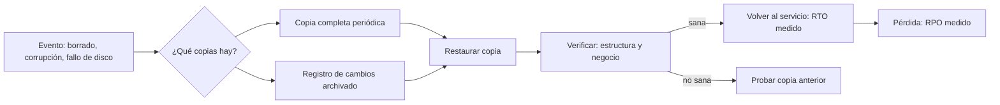
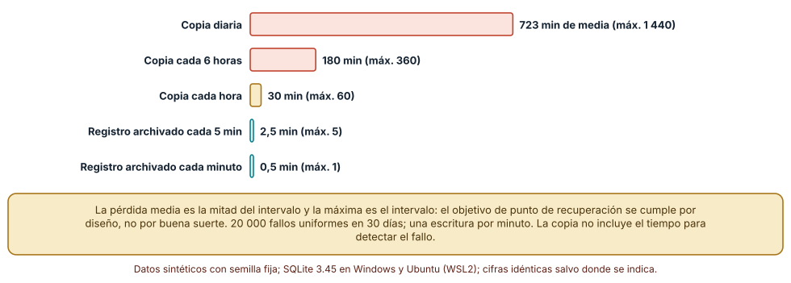
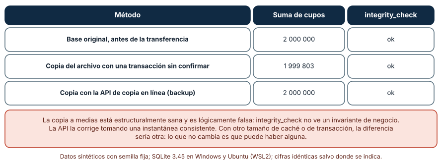
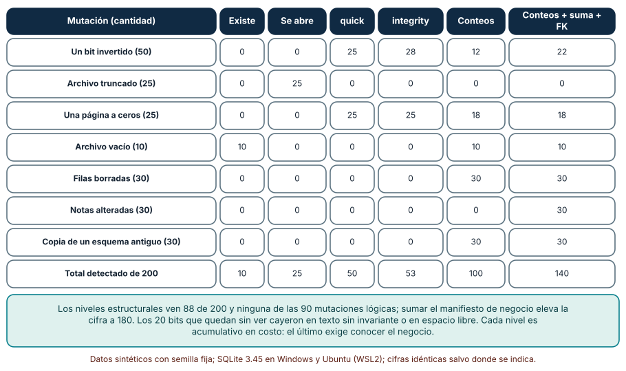

# SE-321 — Backups, restauración y pruebas de recuperación

[← SE-320 — Cachés y consistencia entre capas](https://github.com/vladimiracunadev-create/modern-software-engineering-program/blob/main/classes/part-26-datos-persistencia-y-recuperacion/se-320-caches-y-consistencia-entre-capas/README.md) · [↑ Parte 26](https://github.com/vladimiracunadev-create/modern-software-engineering-program/blob/main/classes/part-26-datos-persistencia-y-recuperacion/README.md) · [📚 Índice completo](https://github.com/vladimiracunadev-create/modern-software-engineering-program/blob/main/classes/README.md) · [🌐 Portal](https://vladimiracunadev-create.github.io/modern-software-engineering-program/classes/SE-321.html) · [SE-322 — Privacidad, retención y ciclo de vida del dato →](https://github.com/vladimiracunadev-create/modern-software-engineering-program/blob/main/classes/part-26-datos-persistencia-y-recuperacion/se-322-privacidad-retencion-y-ciclo-de-vida-del-dato/README.md)

## Punto profesional y fundamento pedagógico

**Punto profesional.** La clase existe para que definas cuánto dato puedes perder y cuánto tardas en volver, que midas si una copia se puede restaurar y no solo si existe, y que conozcas lo que cada nivel de verificación de una restauración ve y lo que deja pasar.

**Por qué aparece aquí.** Sigue a **Cachés y consistencia entre capas**: una caché se puede vaciar sin pérdida, una réplica copia también un borrado accidental; el respaldo es la única copia que está separada en el tiempo del error. Es la respuesta a la pregunta rectora de la parte sobre qué sobrevive a una restauración.

**Error conceptual que debe corregir.** Creer que «tenemos backups» significa «podemos recuperar»: una copia que no se ha restaurado en una prueba es una hipótesis, y una restauración que «terminó sin error» puede entregar una base estructuralmente sana y lógicamente falsa.

**Secuencia de aprendizaje.** Antes de leer los resultados, predices cuánto dato pierde en promedio una plataforma con copia diaria y cuántas de 200 copias alteradas detectaría una comprobación de integridad; después mides la pérdida según el intervalo, comparas copiar el archivo con la copia en línea de una base en uso y cuentas qué detecta cada nivel de verificación. La secuencia usa predicción, explicación propia, contraste y recuperación. [ICAP](https://icap.education.asu.edu/research) distingue participación de construcción de conocimiento; [How People Learn II](https://nap.nationalacademies.org/catalog/24783/how-people-learn-ii-learners-contexts-and-cultures) exige conectar conocimiento previo, contexto y transferencia; la [práctica de recuperación](https://pubmed.ncbi.nlm.nih.gov/16507066/) respalda producir de nuevo la explicación tras una demora; y [Education for Life and Work](https://nap.nationalacademies.org/resource/13398/dbasse_084153.pdf) exige devolución que explique la causa del error.

**Evidencia de aprendizaje.** `recuperacion-log.md` con la predicción, la tabla de pérdida por intervalo, la comparación de copia de archivo y copia en línea, la matriz de mutaciones contra niveles de verificación, los objetivos de punto y tiempo de recuperación de la plataforma y el procedimiento de restauración probado.

**Límite de la conclusión.** Las bases son pequeñas (5 000 filas en el experimento de verificación, 20 000 en el de copia en caliente), de SQLite y sintéticas; las 200 mutaciones las generó el autor y cubren familias conocidas. No se midió el tiempo de restauración ni se probó con bases de producción, discos reales, nubes ni cifrado, y la pérdida por intervalo es un modelo con fallos uniformes.

### Trazabilidad fuente → afirmación

| Fuente primaria u oficial | Afirmación que respalda | Lo que no prueba |
|---|---|---|
| [SQLite: API de copia en línea](https://www.sqlite.org/backup.html) | Describe cómo copiar una base en uso a otra de forma consistente y los casos en los que la copia debe reiniciarse. | No cubre el cifrado ni el almacenamiento remoto de las copias. |
| [SQLite: cómo se corrompe una base](https://www.sqlite.org/howtocorrupt.html) | Enumera causas de corrupción, entre ellas copiar el archivo mientras se escribe sin respetar el diario. | No cuantifica la frecuencia de cada causa. |
| [SQLite: PRAGMA integrity_check y quick_check](https://www.sqlite.org/pragma.html) | Documenta qué comprueban estas instrucciones (estructura y orden) y que no verifican las reglas del negocio. | No dice qué invariantes de la plataforma comprobar. |
| [PostgreSQL: archivado continuo y recuperación a un punto en el tiempo](https://www.postgresql.org/docs/current/continuous-archiving.html) | Describe copias base más archivo del registro de escritura para restaurar a un instante. | No es un procedimiento aplicable tal cual a la plataforma. |
| [NIST SP 800-34 Rev. 1: Contingency Planning Guide](https://csrc.nist.gov/pubs/sp/800/34/r1/upd1/final) | Define el análisis de impacto, objetivos de recuperación y la necesidad de probar los planes. | No fija valores de RPO y RTO para una plataforma educativa. |

## Antes de empezar

Recupera lo aprendido en `SE-320`: una caché es una copia sin garantías y se vacía sin pérdida. La pregunta activa es: **¿qué evento perdería datos que ninguna réplica ni caché recuperan, y qué prueba demuestra que sé volver?**

## Prerrequisitos

- Haber completado `SE-320` o poder explicar por qué una copia en tiempo real no protege de un borrado accidental.
- Python 3.11 o posterior con `sqlite3`, `shutil`, `random` y `tempfile`.
- Leer la diferencia entre una copia del archivo y una copia lógica.

## Problema auténtico

La plataforma de entregas hace una copia diaria de su base a las 3:00 y la deja en el mismo servidor. Tres sucesos ocurren en un trimestre: un docente ejecuta un `DELETE` sin `WHERE` a las 15:00 y se pierden 12 horas de trabajo de todo el curso; el disco falla y la copia, que estaba en él, falla también; y un respaldo que parecía sano se restaura en un ensayo y el informe de notas da otra suma. La dirección pregunta cuánto dato se pierde y cuánto se tarda en volver; el equipo descubre que nunca lo había medido, que nunca había restaurado una copia y que no sabría decir si la última está sana.

## Objetivos observables

Al terminar podrás:

1. definir el objetivo de punto de recuperación (RPO) y el de tiempo de recuperación (RTO) de la plataforma y calcular la pérdida esperada de una estrategia;
2. explicar por qué copiar el archivo de una base en uso puede producir una copia lógicamente falsa y qué mecanismo lo evita;
3. medir qué mutaciones de una copia detecta cada nivel de verificación y cuáles quedan sin ver;
4. diseñar una prueba de restauración con una verificación que combine estructura e invariantes de negocio;
5. declarar el procedimiento de restauración y el punto a partir del cual los respaldos dejan de cubrir.

## Mapa conceptual



El mapa muestra que un respaldo solo es una promesa hasta que se restaura y se verifica: el RPO y el RTO se miden en la restauración, no se declaran en el diseño.

## Temas y por qué importan

| Tema | Por qué cambia una decisión profesional | Evidencia mínima |
|---|---|---|
| RPO y RTO | Definen cuánto se pierde y cuánto se tarda, y por tanto qué estrategia se necesita. | Predicción, traza causal y contraejemplo de **RPO y RTO** en `recuperacion-log.md` |
| Copia completa e incremental | Cambia el costo de almacenar y lo que hay que encadenar al restaurar. | Predicción, traza causal y contraejemplo de **Copia completa e incremental** en `recuperacion-log.md` |
| Copia consistente | Copiar un archivo en uso puede dar un estado a medias. | Predicción, traza causal y contraejemplo de **Copia consistente** en `recuperacion-log.md` |
| Verificación de la copia | La estructura sana no es lo mismo que el contenido correcto. | Predicción, traza causal y contraejemplo de **Verificación de la copia** en `recuperacion-log.md` |
| Prueba de restauración | Una copia sin restaurar es una hipótesis. | Predicción, traza causal y contraejemplo de **Prueba de restauración** en `recuperacion-log.md` |

## Conceptos y decisiones

### 1. RPO y RTO

El **RPO** (objetivo de punto de recuperación) es cuántos datos puede permitirse perder la institución, medido en tiempo: «hasta 15 minutos». El **RTO** (objetivo de tiempo de recuperación) es cuánto puede estar el servicio caído: «hasta 2 horas». No son técnicos sino de negocio, y los fija quien asume el daño (una nota de cierre de semestre no se puede perder; un historial de accesos de hace un mes, sí). De ellos se deduce la estrategia: un RPO de un día se cumple con una copia diaria; uno de 15 minutos exige archivar el registro de cambios; uno de segundos exige replicación, que no sustituye al respaldo.

### 2. Copia completa e incremental

Una copia **completa** contiene todo y se restaura con un solo artefacto; es la más sencilla y la más grande. Una **incremental** guarda lo que cambió desde la anterior: ahorra espacio y tiempo de copia y obliga a encadenar la completa con todos los incrementos al restaurar, de modo que cada eslabón es un punto de fallo. Un esquema habitual combina una completa semanal con incrementos o registros diarios. El ahorro depende de cómo cambian los datos: si las actualizaciones tocan filas dispersas, un incremental por páginas puede contener la mayor parte de la base (`SE-324` lo mide).

### 3. Copia consistente

Copiar el archivo de una base mientras otra transacción escribe puede producir una copia con parte de los cambios y no el resto: cada página es válida, el conjunto no corresponde a ningún momento. Hay tres caminos: parar las escrituras, usar un mecanismo del motor que tome una instantánea consistente (la API de copia en línea de SQLite, `pg_dump` o la copia base con archivado de PostgreSQL) o copiar a nivel del sistema de archivos con una instantánea atómica. Lo que no es seguro es la copia ingenua con la base en uso, que además puede dar «éxito» y pasar una comprobación estructural.

### 4. Verificación de la copia

Hay niveles de verificación y cada uno ve cosas distintas. Que el archivo **exista y no esté vacío** descubre el desastre más grosero. Que la base **se abra** detecta archivos truncados o ilegibles. Las comprobaciones de **integridad del motor** (`quick_check`, `integrity_check`) detectan corrupción de estructura. Los **conteos contra un manifiesto** detectan filas borradas o una copia de otro esquema. Las **invariantes de negocio** (sumas de control de las notas, claves foráneas) detectan alteraciones del contenido que dejan la estructura intacta. Cada nivel cuesta más y ve más; ninguno ve lo que no se espera ver.

### 5. Prueba de restauración

La prueba de restauración es la única que prueba la hipótesis de que se puede volver. Consiste en restaurar una copia reciente en un entorno aislado, ejecutar la verificación, medir el tiempo y registrar quién lo hizo y qué falló. Se hace periódicamente (una copia no ensayada en el último trimestre se considera no verificada) y después de cada cambio que afecte al respaldo (una migración, un cambio de proveedor). También hay que ensayar el caso inverso: qué pasa cuando la última copia está dañada y hay que usar la anterior, y cuántos datos más se pierden.

### Cuánto se pierde según el punto recuperable

Se simulan 20 000 fallos a una hora uniforme dentro de 30 días, con una escritura por minuto. Cada estrategia deja un punto recuperable cada cierto intervalo (una copia, o un archivo de registro de cambios); la pérdida es el tiempo desde el último punto hasta el fallo.

```python
falla = [r.uniform(0, 30 * 24 * 60) for _ in range(20000)]
perdida = [f % intervalo_min for f in falla]            # minutos de datos desde el último punto recuperable
```

| Estrategia | Pérdida media (min) | Pérdida máxima observada (min) |
|---|---:|---:|
| Copia diaria | 723,1 | 1 439,9 |
| Copia cada 6 horas | 180,4 | 360,0 |
| Copia cada hora | 30,0 | 60,0 |
| Registro archivado cada 5 minutos | 2,5 | 5,0 |
| Registro archivado cada minuto | 0,5 | 1,0 |

La pérdida media es la mitad del intervalo y la máxima es el intervalo: con una copia diaria y una escritura por minuto, el fallo medio pierde 723 escrituras. Para cumplir un RPO de 15 minutos hace falta un intervalo menor que 15, y la cifra se garantiza por diseño, no por suerte. La pérdida no incluye el tiempo en detectar el fallo: un borrado descubierto 6 horas después obliga a elegir una copia anterior al error.



**Cómo leer la figura.** Cada barra es la pérdida media en minutos; el texto añade la máxima. **Dónde deja de valer:** el modelo es de fallos uniformes y de una escritura constante por minuto; en una plataforma real las escrituras se concentran en las fechas de entrega y un fallo en ese momento pierde más. No mide el tiempo de restauración (el RTO) ni qué pasa si la copia está dañada.

### Copiar el archivo de una base en uso

Una base con 20 000 cupos de 100 cada uno (suma 2 000 000) tiene una transacción abierta que mueve una unidad en cada fila: resta 1 a 10 000 y suma 1 a otros 10 000, por lo que la suma debe seguir en 2 000 000. Con una caché pequeña, el motor escribe páginas en el archivo antes de confirmar. En ese instante se copia el archivo con `shutil.copyfile` y se compara con una copia hecha con la API de copia en línea.

```python
shutil.copyfile(p, copia)                      # copia ingenua del archivo con una transacción a medias
c.backup(dst)                                   # copia en línea que respeta las transacciones
```

| Método | Suma de cupos | `integrity_check` |
|---|---:|---|
| Base original | 2 000 000 | ok |
| Copia del archivo con una transacción sin confirmar | 1 999 803 | ok |
| Copia con la API de copia en línea | 2 000 000 | ok |

La copia ingenua dio «ok» en la comprobación de integridad y una suma 197 unidades menor: contiene páginas escritas por la transacción a medias y no el diario que las desharía. Es estructuralmente sana y lógicamente falsa. La API toma el estado confirmado y su suma es exacta.



**Cómo leer la figura.** Cada fila es un método de copia; la segunda columna es una invariante de negocio y la tercera, la comprobación estructural. **Dónde deja de valer:** el valor 1 999 803 depende del tamaño de la caché, de la transacción y del momento exacto de la copia; con otros parámetros sería otro y podría ser igual al original. Lo que no cambia es que puede haber alguna diferencia y que `integrity_check` no la ve. Otros motores usan mecanismos distintos y tienen otros modos de fallo.

### Qué ve cada nivel de verificación

Se crea una base de referencia con 500 estudiantes y 5 000 entregas y se generan 200 copias alteradas: 50 con un bit invertido, 25 truncadas, 25 con una página a ceros, 10 vacías, 30 con filas borradas, 30 con notas alteradas y 30 que son la copia de un esquema antiguo. Cada una pasa por seis niveles de verificación y se cuenta cuántas detecta cada uno.

```python
det["L3 integrity_check"] = c.execute("pragma integrity_check").fetchone()[0] != "ok"
det["L5 conteos + suma + claves foráneas"] = (e, t) != (500, 5000) or s != manifiesto["suma"] or fk > 0
```

| Mutación (cantidad) | Existe | Se abre | `quick` | `integrity` | Conteos | Conteos + suma + FK |
|---|---:|---:|---:|---:|---:|---:|
| Un bit invertido (50) | 0 | 0 | 25 | 28 | 12 | 22 |
| Archivo truncado (25) | 0 | 25 | 0 | 0 | 0 | 0 |
| Una página a ceros (25) | 0 | 0 | 25 | 25 | 18 | 18 |
| Archivo vacío (10) | 10 | 0 | 0 | 0 | 10 | 10 |
| Filas borradas (30) | 0 | 0 | 0 | 0 | 30 | 30 |
| Notas alteradas (30) | 0 | 0 | 0 | 0 | 0 | 30 |
| Copia de un esquema antiguo (30) | 0 | 0 | 0 | 0 | 30 | 30 |
| **Total detectado de 200** | 10 | 25 | 50 | 53 | 100 | 140 |

Cada nivel ve una familia y es ciego a otras: las comprobaciones de estructura ven la corrupción física y ninguna de las 90 alteraciones lógicas; los conteos ven filas borradas y esquema distinto pero no notas cambiadas, que solo ve la suma. Combinando los niveles estructurales se detectan 88 de 200; con todos, 180. Veinte inversiones de un bit no se detectan en ninguno: cayeron en texto sin invariante o en espacio libre.



**Cómo leer la figura.** Cada fila es una familia de alteración; cada columna, un nivel de verificación, y las celdas cuentan cuántas copias detecta. **Dónde deja de valer:** las 200 mutaciones las generó el autor y reflejan las familias que imaginó; una corrupción real tiene formas que no están. El 0 de una celda no significa que el nivel sea inútil, sino que la familia no es de su competencia. Y el último nivel depende de un manifiesto de negocio que alguien tiene que mantener.

## Definiciones de trabajo

- **RPO:** cantidad máxima de datos, medida en tiempo, que la institución acepta perder.
- **RTO:** tiempo máximo que la institución acepta que el servicio esté caído.
- **copia consistente:** copia que corresponde a un único instante confirmado de la base.
- **registro de cambios archivado:** secuencia de registros de escritura que permite avanzar una copia hasta un instante posterior.
- **prueba de restauración:** ejercicio que restaura una copia en un entorno aislado y verifica su contenido y su tiempo.

Las definiciones son operativas para la plataforma de entregas. No convierten términos con una historia más amplia en sinónimos y deben contrastarse con la documentación primaria enlazada al final.

## Ejemplo mínimo

El fragmento hace una copia en línea y la verifica. Antes de ejecutarlo, predice qué pasa si cambias un byte de la copia.

```python
import sqlite3
a = sqlite3.connect(":memory:"); a.execute("create table e(n int)"); a.executemany("insert into e values(?)", [(i,) for i in range(100)]); a.commit()
b = sqlite3.connect(":memory:"); a.backup(b)
assert b.execute("select count(*), sum(n) from e").fetchone() == (100, 4950)
```

La copia tiene 100 filas y suma 4 950. Registra versión, comando y salida; después guarda el manifiesto (conteo y suma) y compáralo con una copia en la que hayas borrado una fila.

## Ejemplo profesional

El equipo de la plataforma fija con la dirección un RPO de 15 minutos para entregas y calificaciones y de 24 horas para registros de acceso, y un RTO de 2 horas. De ahí deriva la estrategia: una copia completa diaria con la API del motor, el registro de cambios archivado cada 5 minutos a un almacén en otra región, y una retención de 14 días para las copias y de 7 para el registro. Cada noche, un trabajo restaura la última copia en un entorno aislado, ejecuta la verificación completa (integridad, conteos del manifiesto, suma de notas y claves foráneas) y publica el resultado y el tiempo; si falla, avisa y prueba la copia anterior. Cada trimestre se ensaya un incidente completo (borrado accidental con restauración a un instante) con una persona que no hizo el diseño, y el tiempo medido se compara con el RTO. El manifiesto de negocio se actualiza con cada migración y forma parte de su lista de verificación (`SE-318`).

## Práctica guiada

1. Pregunta a quien represente al negocio cuánto dato y cuánto tiempo se puede perder, y escribe el RPO y el RTO por tipo de dato.
2. Predice la pérdida media de una copia diaria y escribe el número.
3. Simula 20 000 fallos con cinco estrategias y reproduce la tabla de pérdida.
4. Copia el archivo de una base con una transacción abierta y con la API de copia, y compara la suma de cupos.
5. Genera 200 copias alteradas de siete familias y cuenta qué detecta cada nivel de verificación.
6. Escribe el manifiesto de negocio de la plataforma (conteos, sumas, claves) y ejecútalo contra una copia restaurada.
7. Entrega `recuperacion-log.md` y pide a otra persona que restaure una copia siguiendo tu procedimiento sin tu ayuda.

## Ejercicios

1. **RPO:** para un RPO de 15 minutos, calcula el intervalo máximo de archivado del registro y cuántas escrituras se perderían en el peor caso con 10 escrituras por minuto.
2. **Cadena:** calcula cuántos eslabones hay que aplicar para restaurar un instante a las 17:40 con una copia completa a las 3:00, incrementos cada hora y registro cada 5 minutos.
3. **Manifiesto:** define tres invariantes de negocio que un manifiesto debería comprobar y cuál de las siete familias de alteración detecta cada una.
4. **Detección:** estima cuánto se pierde si un borrado se descubre 6 horas después y las copias son diarias; cómo cambia con un registro archivado.

## Reto verificable

Entrega `recuperacion-log.md` con la predicción, las tres tablas, los objetivos y el procedimiento de restauración con su tiempo medido. Se aprueba si otra persona ejecuta el código, obtiene los mismos recuentos con las mismas semillas, restaura una copia con tu procedimiento y puede decir qué familia de alteración no ve tu verificación. No se aprueba por afirmar que «hay copias diarias» sin una restauración probada ni por una verificación que solo comprueba que el archivo existe.

## Caso conductor

La capa de datos de la plataforma de entregas sigue siendo el caso conductor. Esta clase deja el noveno artefacto: los objetivos de recuperación, el procedimiento de restauración y la verificación con su manifiesto de negocio. `SE-322` pregunta qué parte de estos datos y de estas copias no debería existir ya, o no debería existir con esta forma. Cambia después una sola decisión, el intervalo del registro archivado, y observa qué cambia en la pérdida máxima.

## Preguntas frecuentes

### ¿Una réplica es un respaldo?

No: la réplica copia también el borrado accidental y la corrupción lógica. Protege de la caída de una máquina, no de un error humano; un respaldo está separado en el tiempo.

### ¿Cada cuánto debo probar la restauración?

Con la frecuencia que permita saber que la última copia es utilizable: lo ideal es automática y diaria sobre la última copia, y completa con una persona cada trimestre. Una copia que no se ha restaurado en el último periodo se considera no verificada.

### ¿Para qué sirve `integrity_check` si no ve las notas alteradas?

Para lo que es: detecta corrupción de estructura. Es barato y útil, y debe complementarse con una verificación de negocio. Ninguna de las dos por separado basta.

### ¿Dónde guardo las copias?

En un lugar independiente del origen (otro disco, otra región, otro proveedor), con acceso restringido y, si contienen datos personales, cifradas y con su propia retención (`SE-322`). Guardarlas en el mismo servidor es el fallo de la situación inicial.

## Fallo controlado y diagnóstico

Reproduce el fallo clásico de la clase: **una copia que pasa la comprobación de integridad y tiene datos erróneos**. Copia el archivo de la base con una transacción abierta y verifica con `integrity_check`.

Registra síntoma, entrada mínima, hipótesis, observación que descarta cada hipótesis, causa, corrección y prueba de regresión. **Síntoma:** tras restaurar una copia, el informe de cupos suma 1 999 803 y debería sumar 2 000 000, aunque la restauración «terminó bien». **Hipótesis rivales:** (a) un error en la restauración; (b) un dato corrupto en el disco; (c) la copia se hizo con una transacción a medias. **Prueba:** ejecuta `integrity_check` (ok), compara la suma con el manifiesto y revisa si la copia se tomó con el archivo en uso; si la estructura es sana y la suma no cuadra, la causa es la copia inconsistente. **Conclusión:** la copia ingenua del archivo no corresponde a ningún instante confirmado. **Regresión:** cambia a la API de copia en línea, añade la suma al manifiesto de verificación y una prueba que copie con una transacción abierta y espere que la suma sea la confirmada. No cambies a la vez el método de copia y el manifiesto.

## Errores comunes y cómo corregirlos

| Síntoma | Causa probable | Corrección |
|---|---|---|
| La restauración termina bien y los datos son erróneos | Copia ingenua con la base en uso | API de copia consistente y verificación de negocio |
| Se pierden horas de trabajo tras un borrado accidental | Solo copia diaria y sin registro de cambios | Archivar el registro para recuperar a un instante |
| La copia está en el mismo servidor que la base | No se separó el almacenamiento | Otro disco, otra región o proveedor |
| Nadie sabe cuánto tarda en volver | Nunca se restauró una copia | Prueba periódica con tiempo medido |
| La verificación pasa y las notas están cambiadas | Solo comprobaciones de estructura | Manifiesto de negocio con sumas y claves |

## Entorno y archivos clave

```text
work/SE-321/
├── README.md
├── recuperacion/
│   ├── perdida_por_intervalo.py
│   ├── copia_en_caliente.py
│   └── verificar_copia.py
├── tests/test_recuperacion.py
└── evidence/recuperacion-log.md
```

El `README` declara plataforma, versiones de Python y de SQLite, semillas y comandos. Los experimentos usan solo la biblioteca estándar (`sqlite3`, `shutil`, `random`, `tempfile`) y se ejecutaron con CPython 3.12.9 en Windows 11 (SQLite 3.45.3) y 3.12.3 en Ubuntu bajo WSL2 (SQLite 3.45.1): las salidas fueron idénticas. Si añades una dependencia, fija procedencia y versión.

## Seguridad, ética y accesibilidad

- una copia contiene los mismos datos personales que la base y debe tener el mismo nivel de protección: acceso mínimo, cifrado y registro de quién la lee;
- el cifrado de las copias no sirve si la clave está junto a ellas o solo la conoce una persona: define quién la custodia y cómo se recupera;
- ensaya la restauración con datos sintéticos o con una copia a la que el equipo tenga derecho a acceder;
- comunica a las personas afectadas qué se perdió y qué se recuperó tras un incidente, con un lenguaje claro y accesible;
- documenta el procedimiento de restauración paso a paso y en un formato que se pueda seguir bajo presión y con tecnologías de apoyo.

## Puente hacia el trabajo con agentes

Un agente al que se le pide «configura los backups» escribirá una tarea que copia el archivo cada noche y declarará el problema resuelto. Pídele en cambio el RPO y el RTO por tipo de dato, el método de copia consistente, la verificación con manifiesto de negocio, la restauración automática en un entorno aislado y el tiempo medido. Revisa especialmente si copia el archivo con la base en uso y si da por buena una copia porque terminó sin error: son los dos defectos que esta clase mostró sin aviso.

## Transferencia

Traslada el análisis a otro sistema (por ejemplo, el registro de visitas de un museo): define su RPO y su RTO, elige una estrategia, genera alteraciones de una copia y mide qué detecta cada nivel de verificación. La transferencia está lograda cuando puedes explicar qué familia de daño no ve tu verificación, no cuando el script de copia se parece.

## Evaluación y evidencia

| Criterio | Evidencia para aprobar |
|---|---|
| comprensión | explicación de RPO, RTO y de la diferencia entre copia, réplica y caché |
| corrección | pérdida por intervalo, copia en caliente y detección por nivel reproducibles con las mismas semillas |
| diseño | objetivos, método de copia consistente, verificación de negocio y procedimiento de restauración |
| diagnóstico | reproducción del fallo «copia sana de estructura y falsa de contenido» con regresión |
| incertidumbre | declaración de que las alteraciones son del autor y de que no se midió el tiempo de restauración |
| reproducibilidad | versiones, comandos, salida y límites declarados |

## Fuentes

- [SQLite: API de copia en línea](https://www.sqlite.org/backup.html) — copia consistente de una base en uso; autoridad: documentación oficial de SQLite.
- [SQLite: cómo se corrompe una base](https://www.sqlite.org/howtocorrupt.html) — causas de corrupción; autoridad: documentación oficial de SQLite.
- [SQLite: PRAGMA](https://www.sqlite.org/pragma.html) — `integrity_check`, `quick_check` y `foreign_key_check`; autoridad: documentación oficial de SQLite.
- [PostgreSQL: archivado continuo](https://www.postgresql.org/docs/current/continuous-archiving.html) — copia base y registro para recuperar a un instante; autoridad: documentación oficial de PostgreSQL.
- [NIST SP 800-34 Rev. 1](https://csrc.nist.gov/pubs/sp/800/34/r1/upd1/final) — planes de contingencia, objetivos de recuperación y pruebas; autoridad: NIST.

Cada fuente respalda el mecanismo indicado; ninguna demuestra que los 723 minutos de pérdida, la diferencia de 197 unidades o los 180 de 200 se observen en la base de la plataforma. Esa afirmación depende del motor, del volumen y de los fallos reales.

## Límites y siguiente paso

Se ejecutaron tres experimentos con datos sintéticos en Windows y Ubuntu (WSL2) con resultados idénticos. Las bases son pequeñas y de SQLite; las 200 mutaciones son construcciones del autor y los fallos de la primera simulación son uniformes con una escritura constante. No se midió el tiempo de restauración ni se probó cifrado, almacenamiento remoto, otro motor o datos de producción. La siguiente clase pregunta qué datos y copias no deberían conservarse y durante cuánto tiempo.

## Glosario

- **RPO:** cantidad máxima de datos, medida en tiempo, que la institución acepta perder.
- **RTO:** tiempo máximo que la institución acepta que el servicio esté caído.
- **copia consistente:** copia que corresponde a un único instante confirmado de la base.
- **registro de cambios archivado:** secuencia de registros de escritura que permite avanzar una copia hasta un instante posterior.
- **prueba de restauración:** ejercicio que restaura una copia en un entorno aislado y verifica su contenido y su tiempo.

---

[← SE-320 — Cachés y consistencia entre capas](https://github.com/vladimiracunadev-create/modern-software-engineering-program/blob/main/classes/part-26-datos-persistencia-y-recuperacion/se-320-caches-y-consistencia-entre-capas/README.md) · [↑ Parte 26](https://github.com/vladimiracunadev-create/modern-software-engineering-program/blob/main/classes/part-26-datos-persistencia-y-recuperacion/README.md) · [📚 Índice completo](https://github.com/vladimiracunadev-create/modern-software-engineering-program/blob/main/classes/README.md) · [🌐 Portal](https://vladimiracunadev-create.github.io/modern-software-engineering-program/classes/SE-321.html) · [SE-322 — Privacidad, retención y ciclo de vida del dato →](https://github.com/vladimiracunadev-create/modern-software-engineering-program/blob/main/classes/part-26-datos-persistencia-y-recuperacion/se-322-privacidad-retencion-y-ciclo-de-vida-del-dato/README.md)
