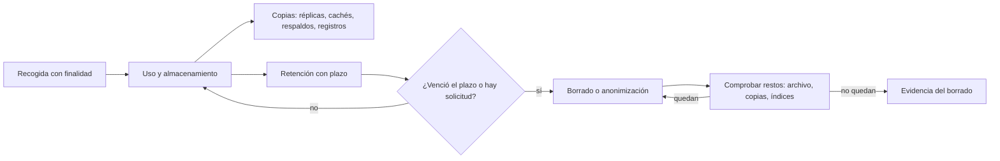
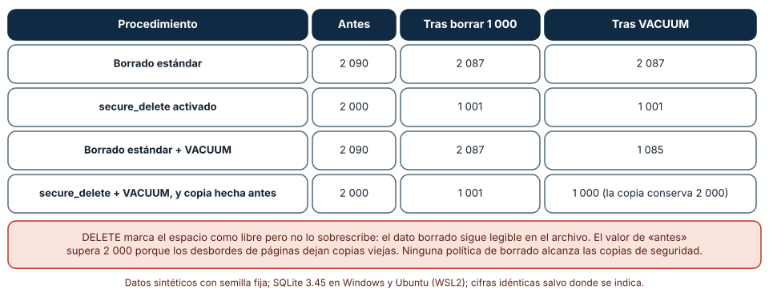
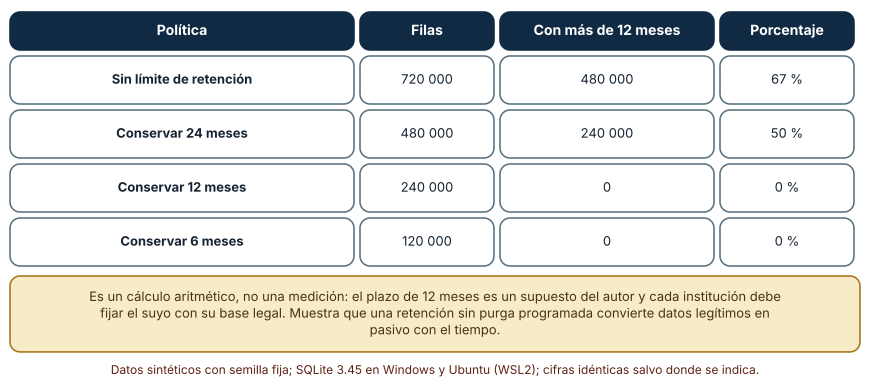
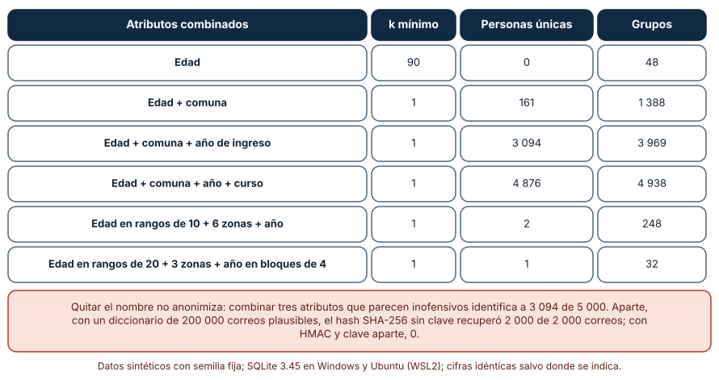

# SE-322 — Privacidad, retención y ciclo de vida del dato

[← SE-321 — Backups, restauración y pruebas de recuperación](https://github.com/vladimiracunadev-create/modern-software-engineering-program/blob/main/classes/part-26-datos-persistencia-y-recuperacion/se-321-backups-restauracion-y-pruebas-de-recuperacion/README.md) · [↑ Parte 26](https://github.com/vladimiracunadev-create/modern-software-engineering-program/blob/main/classes/part-26-datos-persistencia-y-recuperacion/README.md) · [📚 Índice completo](https://github.com/vladimiracunadev-create/modern-software-engineering-program/blob/main/classes/README.md) · [🌐 Portal](https://vladimiracunadev-create.github.io/modern-software-engineering-program/classes/SE-322.html) · [SE-323 — Taller: corregir una migración peligrosa →](https://github.com/vladimiracunadev-create/modern-software-engineering-program/blob/main/classes/part-26-datos-persistencia-y-recuperacion/se-323-taller-corregir-una-migracion-peligrosa/README.md)

## Punto profesional y fundamento pedagógico

**Punto profesional.** La clase existe para que diseñes el ciclo de vida de los datos personales de la plataforma (qué se recoge, cuánto se conserva, cómo se borra y cómo se reduce el riesgo de lo que queda), y para que verifiques con una medida si un dato «borrado» o «anonimizado» realmente dejó de ser recuperable o identificable.

**Por qué aparece aquí.** Sigue a **Backups, restauración y pruebas de recuperación**: la clase anterior multiplicó las copias de cada dato para poder volver; esta pregunta qué copias no deberían existir, o no con esta forma. La conservación y el borrado son dos requisitos que tiran en direcciones opuestas y el diseño tiene que hacerse cargo de ambos.

**Error conceptual que debe corregir.** Creer que borrar una fila, quitar el nombre o aplicar un hash a un correo elimina el dato personal: el borrado deja el contenido legible en el archivo y en las copias, quitar el nombre no impide reidentificar por la combinación de atributos y un hash sin clave se invierte con una lista de candidatos.

**Secuencia de aprendizaje.** Antes de leer los resultados, predices cuántas de 2 000 cadenas identificables siguen en el archivo tras borrar la mitad de las filas, cuántas de 5 000 personas quedan únicas con tres atributos que parecen inofensivos y cuántos correos recupera un diccionario de un hash sin clave; después los mides. La secuencia usa predicción, explicación propia, contraste y recuperación. [ICAP](https://icap.education.asu.edu/research) distingue participación de construcción de conocimiento; [How People Learn II](https://nap.nationalacademies.org/catalog/24783/how-people-learn-ii-learners-contexts-and-cultures) exige conectar conocimiento previo, contexto y transferencia; la [práctica de recuperación](https://pubmed.ncbi.nlm.nih.gov/16507066/) respalda producir de nuevo la explicación tras una demora; y [Education for Life and Work](https://nap.nationalacademies.org/resource/13398/dbasse_084153.pdf) exige devolución que explique la causa del error.

**Evidencia de aprendizaje.** `ciclo-vida-log.md` con la predicción, el inventario de datos personales con su finalidad, plazo y copias, la tabla de restos tras borrar, la de retención, la de unicidad y la política de borrado y anonimización de la plataforma.

**Límite de la conclusión.** Los datos son sintéticos y los plazos de retención son supuestos del autor: ninguno es una interpretación de una ley ni de una norma institucional. No se evaluó el cumplimiento legal de ninguna plataforma, no se usaron datos personales reales y el análisis de unicidad es una demostración de un mecanismo, no una evaluación de riesgo de reidentificación de un conjunto real.

### Trazabilidad fuente → afirmación

| Fuente primaria u oficial | Afirmación que respalda | Lo que no prueba |
|---|---|---|
| [Reglamento (UE) 2016/679 (RGPD)](https://eur-lex.europa.eu/eli/reg/2016/679/oj) | Establece los principios de minimización, limitación de la finalidad y limitación del plazo de conservación, y el derecho de supresión. | No dice qué plazo de retención corresponde a una plataforma educativa concreta ni es asesoría legal. |
| [NIST SP 800-88 Rev. 1: Guidelines for Media Sanitization](https://csrc.nist.gov/pubs/sp/800/88/r1/final) | Distingue limpiar, depurar y destruir los medios y explica por qué borrar un archivo no elimina su contenido. | No cubre el borrado dentro de una base de datos ni de las copias de seguridad. |
| [SQLite: PRAGMA secure_delete](https://www.sqlite.org/pragma.html) | Documenta que `secure_delete` sobrescribe el contenido borrado con ceros y su costo. | No garantiza el borrado de copias del archivo ni de los registros de escritura anticipada. |
| [SQLite: VACUUM](https://www.sqlite.org/lang_vacuum.html) | Explica que `VACUUM` reconstruye el archivo y recupera el espacio libre. | No cubre las copias hechas antes. |
| [Sweeney, «k-anonymity: a model for protecting privacy»](https://doi.org/10.1142/S0218488502001648) | Define k-anonimato y muestra que combinar atributos aparentemente inofensivos puede identificar a una persona. | No prueba que k-anonimato proteja ante todos los ataques. |

## Antes de empezar

Recupera lo aprendido en `SE-321`: cada copia contiene los mismos datos personales que la base. La pregunta activa es: **¿qué datos personales guarda la plataforma, durante cuánto tiempo y en cuántos lugares, y cómo demuestro que dejaron de estar donde ya no deben?**

## Prerrequisitos

- Haber completado `SE-321` o poder explicar por qué una copia de seguridad es una copia más de cada dato.
- Python 3.11 o posterior con `sqlite3`, `hashlib`, `hmac`, `random` y `collections`.
- Leer una consulta `DELETE` y una función hash.

## Problema auténtico

Una exestudiante pide que se eliminen sus datos de la plataforma. El equipo ejecuta un `DELETE` sobre su fila y responde que está hecho. Tres semanas después, el área de calidad abre el archivo de la base con un editor y encuentra su correo; la copia de seguridad de la semana anterior lo contiene; el archivo de eventos de acceso lo registra con su identificador; y un informe «anonimizado» para un investigador, con edad, comuna y año de ingreso, permite a una persona que conoce al grupo saber quién es. Cada hallazgo es un nivel distinto del mismo problema: el borrado no es el final del ciclo de vida.

## Objetivos observables

Al terminar podrás:

1. inventariar los datos personales de la plataforma con su finalidad, su plazo y los lugares donde viven;
2. medir qué queda de un dato tras `DELETE`, `secure_delete`, `VACUUM` y una copia previa;
3. calcular la retención de una tabla de eventos con y sin política y la cantidad de datos vencidos;
4. medir la unicidad de personas según los atributos combinados y explicar por qué quitar el nombre no anonimiza;
5. demostrar que un hash sin clave se invierte con un diccionario y qué lo evita.

## Mapa conceptual



El mapa muestra el ciclo completo y el bucle de verificación: el borrado solo termina cuando se comprueba dónde quedan restos, y las copias son parte del sistema.

## Temas y por qué importan

| Tema | Por qué cambia una decisión profesional | Evidencia mínima |
|---|---|---|
| Inventario y minimización | No se puede proteger ni borrar lo que no se sabe que existe. | Predicción, traza causal y contraejemplo de **Inventario y minimización** en `ciclo-vida-log.md` |
| Retención | Un plazo sin purga programada convierte el dato en pasivo. | Predicción, traza causal y contraejemplo de **Retención** en `ciclo-vida-log.md` |
| Borrado | Borrar una fila no sobrescribe su contenido ni toca las copias. | Predicción, traza causal y contraejemplo de **Borrado** en `ciclo-vida-log.md` |
| Anonimización y seudonimización | Quitar un identificador no impide identificar por combinación. | Predicción, traza causal y contraejemplo de **Anonimización y seudonimización** en `ciclo-vida-log.md` |
| Copias y registros | Los respaldos, cachés y registros guardan lo que la base ya olvidó. | Predicción, traza causal y contraejemplo de **Copias y registros** en `ciclo-vida-log.md` |

## Conceptos y decisiones

### 1. Inventario y minimización

El primer paso es una lista de qué datos personales hay, para qué se recogen (la **finalidad**), quién accede, cuánto tiempo se conservan y en qué lugares viven: base, índices, cachés, respaldos, registros, exportaciones. La **minimización** pregunta si hace falta cada dato: el que no se recoge no se puede filtrar ni hay que borrarlo. En la plataforma, el correo es necesario para el acceso; la fecha de nacimiento completa quizá no, y un rango de edad podría bastar. Cada dato que se añade al esquema debería llegar con su finalidad escrita; el inventario es un artefacto vivo.

### 2. Retención

La **retención** fija cuánto tiempo se conserva cada tipo de dato, según su finalidad y las obligaciones aplicables, que decide la institución con asesoría y no el equipo técnico solo. Una retención sin ejecución es un deseo: hace falta un trabajo programado que purgue lo vencido, una medida de cuánto hay vencido y un plazo para cada copia. Un registro de accesos que se conserva «por si acaso» crece sin límite, aumenta el daño de una filtración y puede dejar de tener base para conservarse. El plazo también cubre los respaldos: una copia con datos vencidos los conserva hasta que ella misma expira.

### 3. Borrado

En una base de datos, `DELETE` marca el espacio como libre y no lo sobrescribe: el contenido sigue en el archivo hasta que otra escritura lo reutilice. `secure_delete` hace que el motor sobrescriba el contenido al borrar, a costa de escrituras adicionales, y `VACUUM` reconstruye el archivo sin el espacio libre. Ninguno de los dos alcanza las copias ya hechas, los registros de escritura anticipada, las cachés ni las exportaciones. Eliminar datos de verdad es un proceso con varios lugares, cada uno con su mecanismo y su plazo, y el diseño honesto declara el plazo en el que el dato desaparece de las copias («en 14 días, cuando expire el último respaldo que lo contiene»).

### 4. Anonimización y seudonimización

**Seudonimizar** es sustituir un identificador por otro valor (un código, un hash) manteniendo la posibilidad de volver con información adicional guardada aparte: reduce el riesgo, no lo elimina, y el dato sigue siendo personal. **Anonimizar** exige que no se pueda identificar a la persona con medios razonables, y es difícil: los atributos que parecen inofensivos (edad, comuna, año) se combinan hasta identificar. El **k-anonimato** mide cuántas personas comparten la misma combinación de atributos; si alguna combinación pertenece a una sola, esa persona está identificada. Generalizar los atributos (rangos de edad, zonas) sube el k y baja el detalle, y aun así no protege de todos los ataques.

### 5. Copias y registros

Los respaldos, las réplicas, las cachés, las colas, los registros de aplicación y las exportaciones a hojas de cálculo son copias del dato que el `DELETE` no toca. El diseño de ciclo de vida las trata como parte del sistema: se inventarían, se les asigna un plazo no mayor que el del dato original y se decide qué pasa cuando se atiende una solicitud de supresión (se borra de la base y se anota la solicitud para no restaurar el dato si una copia vieja se usa; esa anotación misma es un dato que hay que minimizar). Un registro que guarda el correo completo en cada línea es una base de datos sin controles.

### Qué queda en el archivo tras borrar

Se crea una base con 2 000 filas, cada una con un correo identificable (`marca-0000@ejemplo.test`), y se cuenta cuántas veces aparece la cadena `marca-` en los bytes del archivo en cuatro situaciones: borrado estándar, con `secure_delete`, con `VACUUM` y con una copia hecha antes del borrado. Se borran las 1 000 primeras filas.

```python
c.execute("pragma secure_delete=on")                 # sobrescribe el contenido borrado
c.execute("delete from e where id < 1000")
c.execute("vacuum")                                   # reconstruye el archivo
n = open(p, "rb").read().count(b"marca-")
```

| Procedimiento | Antes | Tras borrar 1 000 | Tras `VACUUM` |
|---|---:|---:|---:|
| Borrado estándar | 2 090 | 2 087 | 2 087 |
| `secure_delete` activado | 2 000 | 1 001 | 1 001 |
| Borrado estándar + `VACUUM` | 2 090 | 2 087 | 1 085 |
| `secure_delete` + `VACUUM`, y copia previa | 2 000 | 1 001 | 1 000 (la copia conserva 2 000) |

Con el borrado estándar, después de borrar la mitad de las filas siguen legibles 2 087 de las 2 090 ocurrencias: el borrado no sobrescribe. `secure_delete` deja 1 001 (la mitad, y una más). `VACUUM` solo no basta porque conserva 1 085. Y la copia hecha antes conserva las 2 000 intactas. El valor de «antes» supera 2 000 porque, al dividir páginas durante las inserciones, SQLite deja copias viejas de algunas filas que ni siquiera se habían borrado.



**Cómo leer la figura.** Cada fila es un procedimiento de borrado; las columnas cuentan cuántas veces aparece la cadena en el archivo. **Dónde deja de valer:** es el archivo de SQLite con una cadena de longitud fija; en otros motores, formatos y sistemas de archivos (con diarios, instantáneas o discos de estado sólido que mueven bloques), los restos están en otros sitios. Esta medida solo muestra la dirección: el borrado lógico no es un borrado físico y las copias son aparte.

### Retención y datos vencidos

Una tabla de eventos de acceso recibe 20 000 eventos al mes durante 36 meses. Se calcula cuántas filas hay y cuántas superan un plazo de 12 meses según cuatro políticas de retención.

```python
filas = mensual * (36 if ret is None else min(36, ret))
vencidas = max(0, (36 if ret is None else min(36, ret)) - 12) * mensual
```

| Política | Filas | Con más de 12 meses | Porcentaje |
|---|---:|---:|---:|
| Sin límite | 720 000 | 480 000 | 67 % |
| Conservar 24 meses | 480 000 | 240 000 | 50 % |
| Conservar 12 meses | 240 000 | 0 | 0 % |
| Conservar 6 meses | 120 000 | 0 | 0 % |

Es un cálculo aritmético y no una medición: sin purga, dos tercios de la tabla ya no tienen justificación al cabo de tres años, y cada fila vencida aumenta el daño de una filtración sin aportar valor. La retención de 24 meses «por precaución» conserva la mitad vencida. Lo que la tabla no puede decir es cuál es el plazo correcto, que decide la institución.



**Cómo leer la figura.** Cada fila es una política de conservación; las columnas dan las filas totales y las que superan el plazo. **Dónde deja de valer:** el plazo de 12 meses, la tasa de 20 000 eventos al mes y la ausencia de purgas parciales son supuestos del autor; un plazo distinto por finalidad (seguridad frente a analítica) cambiaría las filas vencidas. Y no incluye las copias: un respaldo con 36 meses de eventos conserva lo vencido.

### Quitar el nombre no anonimiza

Se generan 5 000 personas sintéticas con edad (18 a 65), comuna (30), año de ingreso (2020–2026) y curso (20), uniformes e independientes. Se calcula el k mínimo y cuántas personas son únicas al combinar atributos, y al generalizarlos. Aparte, se prueba un diccionario de 200 000 correos plausibles contra el hash SHA-256 de 2 000 correos, y contra un HMAC con clave aparte.

```python
c = collections.Counter(keyf(x) for x in pers)
k_min, unicas = min(c.values()), sum(1 for x in pers if c[keyf(x)] == 1)
```

| Atributos combinados | k mínimo | Personas únicas | Grupos |
|---|---:|---:|---:|
| Edad | 90 | 0 | 48 |
| Edad + comuna | 1 | 161 | 1 388 |
| Edad + comuna + año de ingreso | 1 | 3 094 | 3 969 |
| Edad + comuna + año + curso | 1 | 4 876 | 4 938 |
| Edad en rangos de 10 + 6 zonas + año | 1 | 2 | 248 |
| Edad en rangos de 20 + 3 zonas + año en bloques de 4 | 1 | 1 | 32 |

Con solo la edad, nadie es único (el grupo más pequeño tiene 90 personas). Con tres atributos aparentemente inofensivos, 3 094 de 5 000 personas son únicas: el 62 %. Generalizar los atributos reduce la unicidad a 2 y a 1 personas, pero el k mínimo sigue siendo 1: basta una persona única para que el conjunto no sea k-anónimo. En el otro experimento, el hash SHA-256 sin clave de 2 000 correos se invirtió completo con el diccionario (2 000 de 2 000); con HMAC y una clave guardada aparte, el mismo diccionario recuperó 0.



**Cómo leer la figura.** Cada fila es una combinación de atributos; las columnas dan el tamaño del grupo más pequeño, las personas únicas y el número de grupos. **Dónde deja de valer:** las personas sintéticas son uniformes e independientes, lo que hace aparecer pocas coincidencias; en una población real, los atributos están correlacionados y hay grupos naturalmente pequeños, de modo que la unicidad real sería distinta. La prueba del diccionario usa correos con un patrón predecible; con correos reales la tasa dependería de la calidad del diccionario. La figura no evalúa el riesgo de reidentificación de ningún conjunto real.

## Definiciones de trabajo

- **dato personal:** información sobre una persona identificada o que puede identificarse.
- **minimización:** principio de recoger y conservar solo los datos necesarios para una finalidad declarada.
- **retención:** plazo durante el cual se conserva cada tipo de dato.
- **seudonimización:** sustitución de un identificador por otro valor de modo que se pueda volver con información adicional guardada aparte.
- **k-anonimato:** propiedad de un conjunto en el que cada combinación de atributos identificadores pertenece al menos a k personas.

Las definiciones son operativas para la plataforma de entregas. No convierten términos con una historia más amplia ni con definiciones legales en sinónimos y deben contrastarse con la normativa y con la documentación primaria enlazada al final.

## Ejemplo mínimo

El fragmento comprueba que un borrado deja el contenido en el archivo. Antes de ejecutarlo, predice si la cadena aparece tras el `DELETE`.

```python
import sqlite3, tempfile, os
d = tempfile.mkdtemp(); p = os.path.join(d, "x.db")
c = sqlite3.connect(p); c.execute("create table t(v text)")
c.execute("insert into t values('marca-unica@ejemplo.test')"); c.commit()
c.execute("delete from t"); c.commit(); c.close()
assert b"marca-unica" in open(p, "rb").read()
```

La cadena sigue en el archivo. Registra versión, comando y salida; activa `secure_delete` antes del borrado y comprueba que desaparece.

## Ejemplo profesional

El equipo de la plataforma mantiene un inventario con cada dato personal, su finalidad, su plazo y las copias donde vive: el correo (acceso, mientras la cuenta esté activa y 12 meses después), las entregas (finalidad académica, 5 años por la normativa de la institución), los eventos de acceso (seguridad, 12 meses) y las exportaciones (solo bajo petición y 30 días). Un trabajo mensual purga lo vencido y publica cuántas filas borró y cuántas quedan fuera de plazo; si el número no es cero, avisa. Para una solicitud de supresión, el proceso borra de la base con `secure_delete`, vacía la caché, elimina el dato de las exportaciones, anota la solicitud con un identificador sin datos personales y declara el plazo de desaparición de las copias («14 días»), al término del cual otra tarea verifica que no se restauró. Los informes para investigadores se generalizan hasta un k mínimo de 10 y se revisan las combinaciones únicas antes de entregarlos; los identificadores se sustituyen por un HMAC con una clave custodiada fuera de ese equipo.

## Práctica guiada

1. Inventaría los datos personales de la plataforma: cuál es la finalidad de cada uno y dónde vive.
2. Predice cuántas ocurrencias de un valor siguen en el archivo tras borrar la mitad y escribe el número.
3. Reproduce los cuatro procedimientos de borrado y cuenta las ocurrencias en cada uno.
4. Calcula las filas vencidas con cuatro políticas de retención y escribe el trabajo de purga.
5. Mide el k mínimo y las personas únicas con cuatro combinaciones de atributos, y con generalización.
6. Invierte un hash sin clave con un diccionario y comprueba que un HMAC con clave aparte resiste.
7. Entrega `ciclo-vida-log.md` y pide a otra persona que diga qué copia del dato no está en el inventario.

## Ejercicios

1. **Inventario:** para la entrega con un comentario de texto libre, lista las copias del comentario (base, índice, caché, respaldo, exportación, registro) y su plazo.
2. **Retención:** diseña la consulta de purga por lotes (`SE-318`) para eventos con más de 12 meses y calcula cuántas transacciones son con lotes de 5 000.
3. **Generalización:** elige una generalización de edad y comuna que lleve el k mínimo a 10 con los datos sintéticos y estima lo que se pierde en detalle.
4. **Seudónimos:** explica por qué un HMAC con una clave que se pierde hace imposible volver al identificador y qué política de custodia de la clave propondrías.

## Reto verificable

Entrega `ciclo-vida-log.md` con la predicción, el inventario, las tres tablas y la política de borrado con el plazo en que el dato desaparece de las copias. Se aprueba si otra persona ejecuta el código, obtiene los mismos recuentos con las mismas semillas y puede decir en qué lugar permanece un dato borrado. No se aprueba por afirmar que «se borró la fila» ni por llamar anonimizado a un conjunto sin medir su unicidad.

## Caso conductor

La capa de datos de la plataforma de entregas sigue siendo el caso conductor. Esta clase deja el décimo artefacto: el inventario de datos personales con su retención, su procedimiento de borrado y su política de anonimización. `SE-323` pone a prueba lo aprendido sobre migraciones con un taller. Cambia después una sola decisión, el plazo de retención de los eventos de acceso, y observa qué cambia en el volumen, en el riesgo y en las copias.

## Preguntas frecuentes

### ¿Basta con borrar la fila para atender una solicitud de supresión?

No: el contenido puede seguir en el archivo, en índices, en cachés, en exportaciones y en las copias. El proceso debe tratar cada lugar y declarar el plazo en que desaparece de los que no se pueden editar, como los respaldos.

### ¿Un hash del correo es anónimo?

No: sin clave, se invierte con una lista de candidatos y sigue siendo un identificador estable que permite enlazar registros. Con una clave guardada aparte reduce el riesgo, pero sigue siendo un seudónimo, es decir, un dato personal.

### ¿Quién decide el plazo de retención?

La institución, con asesoría sobre las obligaciones aplicables. El equipo técnico implementa el plazo y mide su cumplimiento; no lo define por conveniencia técnica ni lo toma de esta clase.

### ¿Cómo sé si un conjunto es suficientemente anónimo?

Midiendo la unicidad con los atributos que podría conocer quien lo reciba, generalizando hasta un k acordado y revisando los atributos que quedan. Ninguna cifra garantiza que no haya reidentificación: se declara el riesgo residual.

## Fallo controlado y diagnóstico

Reproduce el fallo clásico de la clase: **dar por borrado un dato que sigue en el archivo**. Borra una fila con un correo identificable y busca la cadena en los bytes del archivo.

Registra síntoma, entrada mínima, hipótesis, observación que descarta cada hipótesis, causa, corrección y prueba de regresión. **Síntoma:** una persona cuyos datos «se borraron» aparece al abrir el archivo de la base o una copia de seguridad. **Hipótesis rivales:** (a) el borrado no se ejecutó; (b) el dato se reinsertó por una sincronización; (c) el borrado se ejecutó pero el contenido sigue en el espacio libre del archivo o en una copia. **Prueba:** consulta la tabla (sin la fila), busca la cadena en el archivo y en la copia previa; si la tabla no la tiene y el archivo sí, la causa es el borrado lógico. **Conclusión:** `DELETE` no sobrescribe y las copias son aparte. **Regresión:** activa `secure_delete`, ejecuta la limpieza del archivo cuando proceda, borra o expira las copias según la política y añade una prueba que busque la cadena en el archivo tras el borrado. No cambies a la vez el borrado y el respaldo.

## Errores comunes y cómo corregirlos

| Síntoma | Causa probable | Corrección |
|---|---|---|
| El dato borrado aparece en el archivo o en un respaldo | Borrado lógico y copias no tratadas | `secure_delete`, `VACUUM` si procede y plazo de expiración de las copias |
| La tabla de eventos crece sin parar | Retención sin purga programada | Trabajo de purga con medida de lo vencido |
| El informe «anonimizado» permite identificar a alguien | Combinación de atributos únicos | Generalizar, medir el k mínimo y revisar las combinaciones |
| Los correos «hasheados» se recuperan | Hash sin clave y un diccionario | HMAC con clave aparte y política de custodia |
| Nadie sabe dónde está un dato | No hay inventario | Inventario con finalidad, plazo y copias |

## Entorno y archivos clave

```text
work/SE-322/
├── README.md
├── ciclo_vida/
│   ├── inventario.md
│   ├── restos_tras_borrar.py
│   └── unicidad_y_hash.py
├── tests/test_ciclo_vida.py
└── evidence/ciclo-vida-log.md
```

El `README` declara plataforma, versiones de Python y de SQLite, semillas y comandos. Los experimentos usan solo la biblioteca estándar (`sqlite3`, `hashlib`, `hmac`, `random`, `collections`) y se ejecutaron con CPython 3.12.9 en Windows 11 (SQLite 3.45.3) y 3.12.3 en Ubuntu bajo WSL2 (SQLite 3.45.1): las salidas fueron idénticas. Los generadores pseudoaleatorios de Python se usaron solo para simular; no son criptográficos. Si añades una dependencia, fija procedencia y versión.

## Seguridad, ética y accesibilidad

- los datos de una plataforma educativa pueden incluir menores de edad y calificaciones: aplica la protección más estricta y consulta a quien asesora a la institución;
- no uses datos personales reales en experimentos: este material usa datos sintéticos y un dominio reservado para pruebas;
- la clave de un HMAC debe custodiarse aparte y rotarse con un procedimiento; si se pierde, no hay vuelta y si se filtra, el seudónimo se invierte;
- las solicitudes de las personas sobre sus datos deben poder hacerse con un canal accesible, con respuesta en un plazo claro y sin pedir más datos de los necesarios;
- documenta qué no se puede borrar (obligaciones de conservación) y por qué, para que no parezca una negativa arbitraria.

## Puente hacia el trabajo con agentes

Un agente al que se le pide «implementa el derecho al olvido» escribirá un `DELETE` por identificador y declarará el requisito cumplido; ante «anonimiza el informe», quitará el nombre y calculará un hash del correo. Pídele en cambio el inventario con las copias, el procedimiento por lugar con su plazo, una prueba que busque el dato en el archivo, la medida del k mínimo y un HMAC con una clave fuera del código. Revisa especialmente si da por borrado un dato por haber borrado la fila y si llama anonimizado a un conjunto sin medir su unicidad: son los dos defectos que esta clase mostró sin aviso.

## Transferencia

Traslada el análisis a otro sistema (por ejemplo, el registro de socios de una biblioteca): inventaría sus datos, fija una retención, mide qué queda tras un borrado y calcula la unicidad de los atributos que se publican. La transferencia está lograda cuando puedes decir en qué lugares permanece un dato tras atender una solicitud y qué plazo declaras para cada uno, no cuando la política se parece.

## Evaluación y evidencia

| Criterio | Evidencia para aprobar |
|---|---|
| comprensión | explicación de la diferencia entre borrar, seudonimizar y anonimizar |
| corrección | restos, filas vencidas, unicidad y recuperación por diccionario reproducibles con las mismas semillas |
| diseño | inventario, retención con purga, borrado por lugar y política de anonimización |
| diagnóstico | reproducción del fallo «dato borrado que sigue en el archivo» con regresión |
| incertidumbre | declaración de que los plazos son supuestos y de que no hay evaluación legal ni de riesgo real |
| reproducibilidad | versiones, comandos, salida y límites declarados |

## Fuentes

- [Reglamento (UE) 2016/679](https://eur-lex.europa.eu/eli/reg/2016/679/oj) — principios de minimización, limitación del plazo y supresión; autoridad: texto oficial de la Unión Europea.
- [NIST SP 800-88 Rev. 1](https://csrc.nist.gov/pubs/sp/800/88/r1/final) — saneamiento de medios; autoridad: NIST.
- [SQLite: PRAGMA](https://www.sqlite.org/pragma.html) — `secure_delete`; autoridad: documentación oficial de SQLite.
- [SQLite: VACUUM](https://www.sqlite.org/lang_vacuum.html) — reconstrucción del archivo; autoridad: documentación oficial de SQLite.
- [Sweeney, «k-anonymity»](https://doi.org/10.1142/S0218488502001648) — k-anonimato; autoridad: artículo original (2002).
- [Python: hmac](https://docs.python.org/3/library/hmac.html) — HMAC usado en el experimento; autoridad: documentación de Python.

Cada fuente respalda el mecanismo indicado; ninguna demuestra que los 2 087 restos, el 62 % de personas únicas o los 2 000 correos recuperados se observen en la plataforma. Esa afirmación depende del motor, de los datos y de las copias. Los textos legales deben interpretarse con asesoría; esta clase no lo hace.

## Límites y siguiente paso

Se ejecutaron tres experimentos con datos sintéticos en Windows y Ubuntu (WSL2) con resultados idénticos. El análisis de retención es aritmético y su plazo es un supuesto; el de unicidad usa atributos uniformes e independientes; el del borrado es de SQLite y de una cadena fija; y el del diccionario usa correos predecibles. No se evaluó el cumplimiento de ninguna norma, no se usaron datos reales, no se examinaron discos de estado sólido, sistemas de archivos con instantáneas ni respaldos cifrados. La siguiente clase es un taller que pone a prueba las migraciones.

## Glosario

- **dato personal:** información sobre una persona identificada o que puede identificarse.
- **minimización:** principio de recoger y conservar solo los datos necesarios para una finalidad declarada.
- **retención:** plazo durante el cual se conserva cada tipo de dato.
- **seudonimización:** sustitución de un identificador por otro valor de modo que se pueda volver con información adicional guardada aparte.
- **k-anonimato:** propiedad de un conjunto en el que cada combinación de atributos identificadores pertenece al menos a k personas.

---

[← SE-321 — Backups, restauración y pruebas de recuperación](https://github.com/vladimiracunadev-create/modern-software-engineering-program/blob/main/classes/part-26-datos-persistencia-y-recuperacion/se-321-backups-restauracion-y-pruebas-de-recuperacion/README.md) · [↑ Parte 26](https://github.com/vladimiracunadev-create/modern-software-engineering-program/blob/main/classes/part-26-datos-persistencia-y-recuperacion/README.md) · [📚 Índice completo](https://github.com/vladimiracunadev-create/modern-software-engineering-program/blob/main/classes/README.md) · [🌐 Portal](https://vladimiracunadev-create.github.io/modern-software-engineering-program/classes/SE-322.html) · [SE-323 — Taller: corregir una migración peligrosa →](https://github.com/vladimiracunadev-create/modern-software-engineering-program/blob/main/classes/part-26-datos-persistencia-y-recuperacion/se-323-taller-corregir-una-migracion-peligrosa/README.md)
