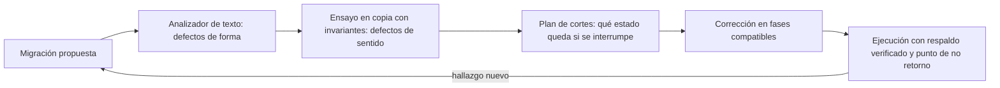
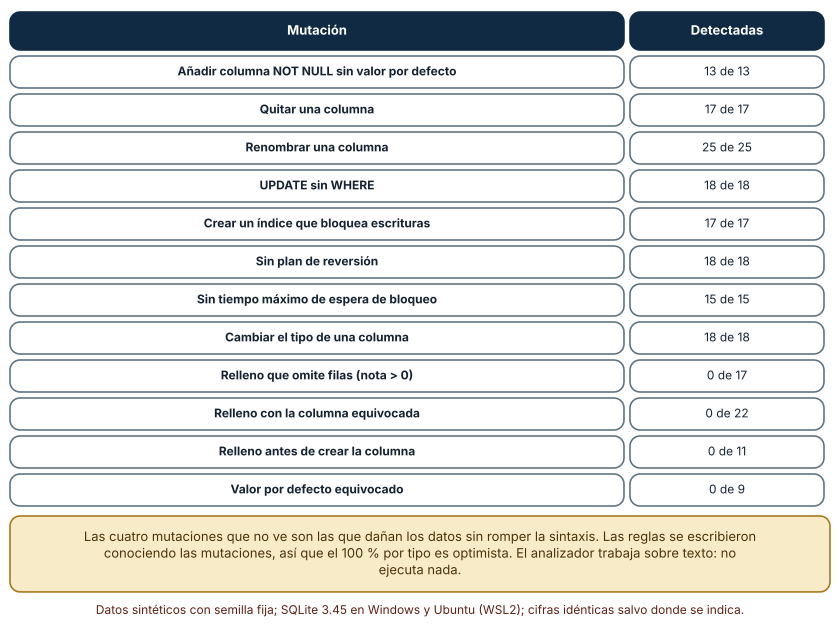
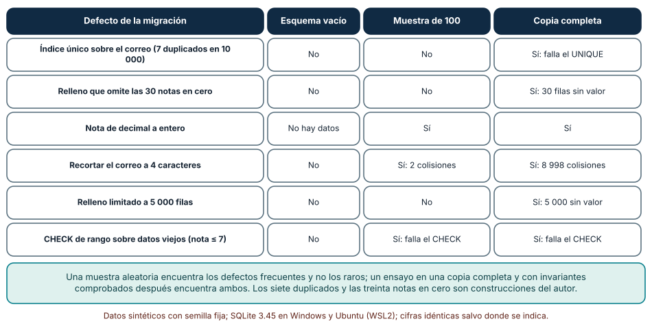
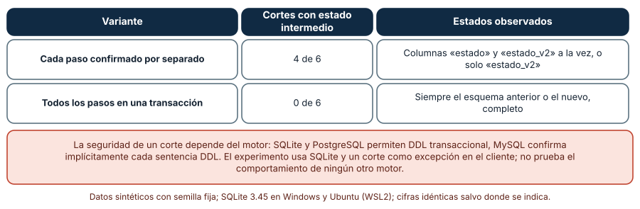

# SE-323 — Taller: corregir una migración peligrosa

[← SE-322 — Privacidad, retención y ciclo de vida del dato](https://github.com/vladimiracunadev-create/modern-software-engineering-program/blob/main/classes/part-26-datos-persistencia-y-recuperacion/se-322-privacidad-retencion-y-ciclo-de-vida-del-dato/README.md) · [↑ Parte 26](https://github.com/vladimiracunadev-create/modern-software-engineering-program/blob/main/classes/part-26-datos-persistencia-y-recuperacion/README.md) · [📚 Índice completo](https://github.com/vladimiracunadev-create/modern-software-engineering-program/blob/main/classes/README.md) · [🌐 Portal](https://vladimiracunadev-create.github.io/modern-software-engineering-program/classes/SE-323.html) · [SE-324 — Proyecto: capa de datos recuperable →](https://github.com/vladimiracunadev-create/modern-software-engineering-program/blob/main/classes/part-26-datos-persistencia-y-recuperacion/se-324-proyecto-capa-de-datos-recuperable/README.md)

## Punto profesional y fundamento pedagógico

**Punto profesional.** El taller existe para que revises una migración antes de ejecutarla con tres instrumentos de potencia distinta (un analizador de texto, un ensayo en una copia de los datos y un plan de cortes) y para que sepas qué defectos ve cada uno, cuáles ninguno y por qué no basta con que «pase en la base de pruebas».

**Por qué aparece aquí.** Es el taller de la parte: integra las migraciones compatibles (`SE-318`), las restricciones (`SE-316`), los índices (`SE-317`) y la recuperación (`SE-321`) en un solo caso. Se hace sobre una migración con defectos conocidos, que es la manera más segura de aprender a verlos.

**Error conceptual que debe corregir.** Creer que una migración que se ejecutó sin error en una base vacía o de ejemplo es una migración correcta: los defectos más caros dependen de pocas filas, de los datos reales y del orden de los pasos, y no producen ningún error de sintaxis.

**Secuencia de aprendizaje.** Antes de usar los instrumentos, escribes una predicción de cuántos defectos detectará cada uno sobre seis migraciones defectuosas; después ejecutas un analizador sobre 200 mutaciones, ensayas seis migraciones en tres entornos con 0, 100 y 10 000 filas y cortas una migración de cinco pasos en cada punto. La secuencia usa predicción, explicación propia, contraste y recuperación. [ICAP](https://icap.education.asu.edu/research) distingue participación de construcción de conocimiento; [How People Learn II](https://nap.nationalacademies.org/catalog/24783/how-people-learn-ii-learners-contexts-and-cultures) exige conectar conocimiento previo, contexto y transferencia; la [práctica de recuperación](https://pubmed.ncbi.nlm.nih.gov/16507066/) respalda producir de nuevo la explicación tras una demora; y [Education for Life and Work](https://nap.nationalacademies.org/resource/13398/dbasse_084153.pdf) exige devolución que explique la causa del error.

**Evidencia de aprendizaje.** `taller-log.md` con la migración original, su versión corregida en fases, la salida del analizador, la matriz de entornos de ensayo, la tabla de cortes, las invariantes comprobadas tras el ensayo y el plan de ejecución con su punto de no retorno.

**Límite de la conclusión.** Las migraciones y los datos son sintéticos y los defectos (siete correos duplicados, treinta notas en cero, nombres sin coma) los puso el autor; las reglas del analizador se escribieron conociendo las mutaciones, de modo que su exactitud real es desconocida. Se ejecutó en SQLite, que admite DDL transaccional; no se probó PostgreSQL, MySQL ni una migración con tráfico concurrente.

### Trazabilidad fuente → afirmación

| Fuente primaria u oficial | Afirmación que respalda | Lo que no prueba |
|---|---|---|
| [PostgreSQL: ALTER TABLE](https://www.postgresql.org/docs/current/sql-altertable.html) | Indica qué operaciones toman bloqueos fuertes o reescriben la tabla y qué cambios son baratos. | No mide el bloqueo de la plataforma. |
| [PostgreSQL: CREATE INDEX](https://www.postgresql.org/docs/current/sql-createindex.html) | Documenta `CONCURRENTLY` y que un índice normal bloquea las escrituras. | No cubre otros motores. |
| [SQLite: ALTER TABLE](https://www.sqlite.org/lang_altertable.html) | Describe qué admite (`ADD`, `RENAME`, `DROP COLUMN`) y las restricciones, y el procedimiento de reconstrucción de la tabla. | No generaliza a motores que confirman el DDL de forma implícita. |
| [SQLite: transacciones atómicas](https://www.sqlite.org/atomiccommit.html) | Explica cómo SQLite garantiza que una transacción se aplica entera o no se aplica ante un corte. | No dice nada de otros motores. |
| [Fowler, «Parallel Change»](https://martinfowler.com/bliki/ParallelChange.html) | Aporta el patrón de fases compatibles con el que se corrige la migración. | No ensaya ninguna migración concreta. |

## Antes de empezar

Recupera lo aprendido en `SE-318`: un `down` no devuelve los datos y un paso destructivo es un punto de no retorno. La pregunta activa es: **¿qué instrumento ve cada defecto de esta migración, cuál se me escapa y qué ensayo me daría confianza antes del viernes?**

## Prerrequisitos

- Haber completado `SE-316`, `SE-317`, `SE-318` y `SE-321`, o poder explicar qué es una restricción, un índice, una migración por fases y una restauración verificada.
- Python 3.11 o posterior con `sqlite3`, `re`, `random` y `collections`.
- Leer una migración en SQL y la salida de una comprobación de invariantes.

## Problema auténtico

Una persona del equipo propone, un jueves por la tarde, una migración para el viernes: añadir una columna de estado nuevo, crear un índice, rellenarla desde la antigua, y de paso quitar una columna vieja, recortar un campo y cambiar el tipo de la nota. Pasa en la base de desarrollo, que tiene cien filas. Quien revisa tiene una hora. En producción hay 10 000 entregas por curso, siete correos duplicados que nadie ha visto, treinta notas en cero y nombres sin coma. El taller consiste en revisar la migración con instrumentos, descubrir qué defectos hay, corregirla en fases y decidir con qué evidencia se ejecuta.

## Objetivos observables

Al terminar podrás:

1. clasificar los defectos de una migración en de forma (visibles en el texto) y de sentido (que solo muestran los datos);
2. medir qué fracción de 200 migraciones mutadas detecta un analizador de texto y qué familias le son invisibles;
3. ensayar una migración en un esquema vacío, en una muestra y en una copia completa y ver qué defectos aparece en cada uno;
4. cortar una migración en cada paso y distinguir el efecto de confirmar cada paso por separado y de hacerlo todo en una transacción;
5. entregar una migración corregida en fases con invariantes de datos comprobadas, punto de no retorno y plan de ejecución.

## Mapa conceptual



El mapa ordena los instrumentos por el costo y por lo que ven: el analizador es barato y solo ve la forma; el ensayo en copia ve los datos; el plan de cortes ve la interrupción. Ninguno sustituye a los otros.

## Temas y por qué importan

| Tema | Por qué cambia una decisión profesional | Evidencia mínima |
|---|---|---|
| Defectos de forma y de sentido | Un analizador solo ve lo que el texto muestra. | Predicción, traza causal y contraejemplo de **Defectos de forma y de sentido** en `taller-log.md` |
| Ensayo en una copia | Los defectos que dependen de pocas filas exigen los datos completos. | Predicción, traza causal y contraejemplo de **Ensayo en una copia** en `taller-log.md` |
| Invariantes tras el ensayo | Sin una comprobación de datos, «sin error» no significa «correcta». | Predicción, traza causal y contraejemplo de **Invariantes tras el ensayo** en `taller-log.md` |
| Cortes y atomicidad | Una migración interrumpida deja un estado que hay que prever. | Predicción, traza causal y contraejemplo de **Cortes y atomicidad** en `taller-log.md` |
| Fases y punto de no retorno | Dividir la migración permite revertir lo que aún no es destructivo. | Predicción, traza causal y contraejemplo de **Fases y punto de no retorno** en `taller-log.md` |

## Conceptos y decisiones

### 1. Defectos de forma y de sentido

Un defecto de **forma** se ve en el texto: una columna `NOT NULL` sin valor por defecto, un `UPDATE` sin `WHERE`, un índice que bloquea las escrituras, una migración sin plan de reversión, un renombrado. Un analizador de reglas los encuentra, es barato y debe ejecutarse siempre. Un defecto de **sentido** tiene la forma correcta y el contenido equivocado: un relleno que omite las filas con nota cero, que copia la columna equivocada o que corre antes de que exista la columna destino. No hay regla de texto que los vea, porque lo que está mal es la relación entre la sentencia y los datos.

### 2. Ensayo en una copia

El ensayo ejecuta la migración sobre una copia de los datos reales (o de una muestra representativa) y comprueba el resultado. Lo que encuentra depende de los datos: un esquema vacío no ve ningún defecto que dependa de las filas; una muestra de cien filas ve los defectos frecuentes y no los raros (siete correos duplicados entre 10 000); una copia completa ve los dos. Es la herramienta con mejor relación entre costo y confianza, y la que más se omite porque exige una copia, tiempo y datos sin información personal real (`SE-322`).

### 3. Invariantes tras el ensayo

Que el ensayo termine sin error no prueba nada sobre los datos: un relleno que omite 30 filas no lanza ningún aviso. Hay que comprobar **invariantes**: cuántas filas quedaron sin valor, si el conteo antes y después coincide, si las claves únicas siguen únicas, si la suma de las notas no cambió. Cada defecto sospechado se convierte en una consulta con un resultado esperado, y el ensayo falla si no se cumple. Las invariantes de la migración son parte de la migración, se versionan con ella y se ejecutan en cada entorno.

### 4. Cortes y atomicidad

Una migración de cinco pasos puede interrumpirse en cualquiera: un fallo de red, un tiempo de espera, un reinicio. Si cada paso se confirma por separado, un corte deja un estado intermedio (con las dos columnas, o solo con la nueva) en el que ni el código viejo ni el nuevo saben funcionar. Si todo va en una transacción y el motor admite el DDL transaccional, el corte deja el estado anterior intacto. No todos los motores lo admiten: en los que confirman cada sentencia de definición de forma implícita, hay que diseñar cada paso como idempotente y reanudable.

### 5. Fases y punto de no retorno

La corrección de una migración peligrosa casi siempre es dividirla: una primera fase solo expande (añade lo nuevo, nullable, sin índice bloqueante), otra rellena por lotes con invariantes, otra cambia al código nuevo y la última contrae. Cada fase se puede ejecutar, ensayar y revertir por separado hasta la contracción. El plan dice cuál es el punto de no retorno (el paso que quita datos), qué respaldo verificado lo precede y quién autoriza cruzarlo.

### El analizador frente a 200 mutaciones

La migración base es segura: un tiempo máximo de espera de bloqueo, una columna nueva nullable, un índice creado de forma concurrente, un relleno acotado por rango y un comentario con el plan de reversión. Se generan 200 mutaciones con doce tipos de defecto, ocho de forma y cuatro de sentido, y un analizador de reglas sobre el texto las examina. La migración sin mutar no debe producir hallazgos.

```python
if re.search(r"^(UPDATE|DELETE)(?![^;]*WHERE)[^;]*;", t, re.I | re.M): hall.append("UPDATE sin WHERE")
if re.search(r"^CREATE (UNIQUE )?INDEX (?!CONCURRENTLY)", t, re.I | re.M): hall.append("índice bloqueante")
```

| Mutación | Detectadas |
|---|---:|
| Añadir columna `NOT NULL` sin valor por defecto | 13 de 13 |
| Quitar una columna | 17 de 17 |
| Renombrar una columna | 25 de 25 |
| `UPDATE` sin `WHERE` | 18 de 18 |
| Crear un índice que bloquea escrituras | 17 de 17 |
| Sin plan de reversión | 18 de 18 |
| Sin tiempo máximo de espera de bloqueo | 15 de 15 |
| Cambiar el tipo de una columna | 18 de 18 |
| Relleno que omite filas (nota > 0) | 0 de 17 |
| Relleno con la columna equivocada | 0 de 22 |
| Relleno antes de crear la columna | 0 de 11 |
| Valor por defecto equivocado | 0 de 9 |

El analizador detecta 141 de 200 mutaciones: las ocho familias de forma, todas. Y ninguna de las 59 de sentido. Son las que dañan los datos sin romper la sintaxis. El resultado es optimista: las reglas se escribieron sabiendo qué mutaciones se generarían, y cada tipo sale al 100 % o al 0 %, como corresponde a una regla que existe o no.



**Cómo leer la figura.** Cada fila es un tipo de defecto; la columna da cuántas de las mutaciones de ese tipo detectó el analizador. **Dónde deja de valer:** las mutaciones y las reglas las diseñó el autor con la misma lista; con defectos de otro tipo la exactitud sería otra y desconocida. No dice que 141 de 200 sea un buen resultado, sino que la mitad de la columna es cero por construcción: el texto no contiene lo que está mal.

### El mismo defecto en tres entornos de ensayo

Se prepara una tabla de 10 000 entregas con siete correos duplicados, treinta notas en cero (de un total de 10 000), 40 nombres nulos y notas decimales, y seis migraciones defectuosas. Cada una se ejecuta en un esquema vacío, en una muestra de 100 filas y en la copia completa; después se comprueba una invariante propia de cada defecto.

```python
"índice único sobre el correo": lambda c: c.execute("create unique index u on e(correo)"),
"relleno que omite las notas en cero": lambda c: (c.execute("alter table e add column n2 int"), c.execute("update e set n2 = cast(nota*10 as int) where nota > 0")),
```

| Defecto de la migración | Esquema vacío | Muestra de 100 | Copia completa |
|---|---|---|---|
| Índice único sobre el correo (7 duplicados en 10 000) | No | No | Sí: falla el `UNIQUE` |
| Relleno que omite las 30 notas en cero | No | No | Sí: 30 filas sin valor |
| Nota de decimal a entero | No hay datos | Sí | Sí |
| Recortar el correo a 4 caracteres | No | Sí: 2 colisiones | Sí: 8 998 colisiones |
| Relleno limitado a 5 000 filas | No | No | Sí: 5 000 sin valor |
| `CHECK` de rango sobre datos viejos (nota ≤ 7) | No | Sí: falla el `CHECK` | Sí: falla el `CHECK` |

Sobre un esquema vacío no se ve nada. La muestra de 100 filas ve tres de seis, los que afectan a muchas filas; no ve los siete duplicados ni las 30 notas en cero ni el límite de 5 000, que no se alcanza con 100. La copia completa ve las seis. El detalle del recorte del correo es instructivo: la muestra ve 2 colisiones y la copia 8 998; el mismo defecto parece menor de lo que es.



**Cómo leer la figura.** Cada fila es una migración defectuosa; las columnas indican si el ensayo en ese entorno la detecta. **Dónde deja de valer:** los siete duplicados y las treinta notas en cero son construcciones del autor; que la muestra de 100 no los vea depende de que sean raros, y una muestra distinta podría verlos. La copia completa que ve todo es el caso favorable de datos disponibles y sin información personal real: en una plataforma, conseguir esa copia es parte del trabajo (`SE-322`).

### Cortar la migración en cada paso

Una migración de cinco pasos (añadir `estado_v2`, copiar, crear un índice, quitar `estado`, renombrar `estado_v2` a `estado`) se interrumpe antes de cada paso (seis puntos de corte, incluido el último sin interrumpir) con cada paso confirmado por separado y con todos dentro de una transacción.

```python
if transaccional: c.execute("begin")
for k, s in enumerate(pasos):
    if k == corte: raise RuntimeError("corte")
    c.execute(s)
if transaccional: c.execute("commit")
```

| Variante | Cortes con estado intermedio | Estados observados |
|---|---:|---|
| Cada paso confirmado por separado | 4 de 6 | Columnas `estado` y `estado_v2` a la vez, o solo `estado_v2` |
| Todos los pasos en una transacción | 0 de 6 | Siempre el esquema anterior o el nuevo, completo |

Con los pasos confirmados por separado, cuatro de seis cortes dejan un estado en el que la aplicación vieja ni la nueva funcionan: dos columnas (una vacía), o solo la nueva sin la que la versión vieja necesita. Con una transacción, ninguno. El caso más peligroso es el último intermedio (tras quitar `estado` y antes de renombrar): el esquema queda sin la columna que usa cualquier versión.



**Cómo leer la figura.** Cada fila es una forma de ejecutar la migración; la columna central cuenta cuántos de los seis cortes dejan un estado intermedio. **Dónde deja de valer:** SQLite y PostgreSQL permiten DDL transaccional; MySQL confirma implícitamente cada sentencia de definición, y allí la fila inferior no se puede lograr y hay que diseñar pasos idempotentes y reanudables. El corte es una excepción del cliente y no un apagón del servidor, y una transacción larga sobre una tabla grande bloquea; combinar ambas exige las fases de `SE-318`.

## Definiciones de trabajo

- **defecto de forma:** defecto de una migración visible en el texto de sus sentencias.
- **defecto de sentido:** defecto de una migración que solo se aprecia al comparar su efecto con los datos.
- **ensayo en copia:** ejecución de una migración sobre una copia de los datos con invariantes comprobadas después.
- **DDL transaccional:** propiedad de un motor en la que los cambios de esquema pueden confirmarse o revertirse junto con una transacción.
- **invariante de migración:** consulta con un resultado esperado que se ejecuta tras la migración para demostrar que los datos son correctos.

Las definiciones son operativas para el taller. No convierten términos con una historia más amplia en sinónimos y deben contrastarse con la documentación primaria enlazada al final.

## Ejemplo mínimo

El fragmento muestra un defecto de sentido que no produce error. Antes de ejecutarlo, predice cuántas filas quedan sin valor.

```python
import sqlite3
c = sqlite3.connect(":memory:")
c.execute("create table e(id integer primary key, nota real)")
c.executemany("insert into e(nota) values(?)", [(0.0,), (5.0,), (6.0,)])
c.execute("alter table e add column n2 int")
c.execute("update e set n2 = cast(nota*10 as int) where nota > 0")
assert c.execute("select count(*) from e where n2 is null").fetchone()[0] == 1
```

Una fila queda sin valor y no hubo ningún error. Registra versión, comando y salida; corrige el `WHERE` y añade la invariante «ninguna fila queda sin valor».

## Ejemplo profesional

El equipo de la plataforma convierte la migración del jueves en cuatro migraciones numeradas. La 0050 fija `lock_timeout`, añade `estado_v2` como nullable y crea el índice de forma concurrente; no toca datos. La 0051 rellena por lotes de 1 000 filas, con un script idempotente que registra el último lote procesado y, al final, ejecuta las invariantes: cero filas con `estado_v2` nulo salvo las que lo tenían nulo de origen, mismo conteo de entregas, mismo conjunto de correos únicos y misma suma de notas. La 0052 despliega el código que usa solo la columna nueva, y la 0053 quita la vieja, marcada como punto de no retorno: exige un respaldo verificado (`SE-321`) de menos de 24 horas y la firma de la persona responsable. Antes de cada fase, un trabajo corre el analizador sobre el texto y el ensayo sobre una copia completa con datos sintéticos que conservan la distribución real, incluidos los casos raros que ya se conocen (duplicados, ceros, nombres sin coma). Los cortes se ensayan con el DDL transaccional donde el motor lo admite; donde no, cada paso es idempotente.

## Práctica guiada

1. Lee la migración del jueves y escribe, sin ejecutarla, los defectos que ves y de qué tipo son.
2. Predice cuántos defectos de los seis encontraría cada entorno de ensayo y escribe el número.
3. Ejecuta el analizador sobre la migración y sobre las 200 mutaciones y cuenta las detectadas.
4. Ensaya las seis migraciones defectuosas en el esquema vacío, en una muestra de 100 y en la copia completa.
5. Escribe una invariante por defecto sospechado y ejecútalas tras el ensayo.
6. Corta la migración antes de cada paso con y sin transacción y anota el estado.
7. Divide la migración en fases y entrega `taller-log.md` con el punto de no retorno. Pide a otra persona que diga qué defecto de sentido no tiene invariante.

## Ejercicios

1. **Regla:** escribe una regla del analizador para «`DROP TABLE` sin una copia previa» y los falsos positivos que daría.
2. **Muestra:** estima cuántas filas debe tener una muestra aleatoria para ver con probabilidad del 95 % un defecto que afecta a 7 de 10 000 filas.
3. **Invariante:** escribe la invariante que detectaría el relleno con la columna equivocada y explica por qué ninguna regla de texto la ve.
4. **Motor:** indica qué cambiaría del plan de cortes si el motor no admite DDL transaccional.

## Reto verificable

Entrega `taller-log.md` con la migración original, la corregida en fases, la salida del analizador, la matriz de ensayos, la tabla de cortes, las invariantes y el plan con su punto de no retorno. Se aprueba si otra persona ejecuta el código, obtiene las mismas detecciones con las mismas semillas y puede decir qué defecto de sentido pasaría el analizador y la muestra de 100. No se aprueba por afirmar que «la migración pasó en desarrollo» ni por entregar un analizador sin las mutaciones que lo evalúan.

## Caso conductor

La capa de datos de la plataforma de entregas sigue siendo el caso conductor. Esta clase deja el undécimo artefacto: una migración corregida en fases con analizador, ensayo, invariantes y plan de cortes. `SE-324` reúne todas las piezas de la parte en un paquete de capa de datos que otra persona pueda operar y recuperar. Cambia después una sola decisión, el tamaño de la muestra del ensayo, y observa qué defectos aparecen o se esconden.

## Preguntas frecuentes

### ¿Un analizador de migraciones reemplaza la revisión humana?

No: encuentra defectos de forma con constancia y sin cansancio, y deja pasar los de sentido. La revisión humana y el ensayo con invariantes cubren lo que el texto no muestra.

### ¿Cuántas filas necesita una muestra?

Depende de la frecuencia del defecto: para ver con 95 % de probabilidad algo que afecta a 7 de 10 000 filas hacen falta unas 3 500 filas (el 35 % de la tabla). Un defecto raro exige casi la copia completa o una búsqueda dirigida (consultas que cuentan duplicados, ceros y nulos antes de migrar).

### ¿Por qué no hacer todo en una sola transacción?

Porque una transacción larga bloquea y retiene espacio, y algunos motores no admiten el DDL transaccional. Las fases permiten transacciones cortas con un punto de reanudación; la transacción única es una opción para migraciones cortas en motores que la soportan.

### ¿Qué se hace con los datos que ya violan una restricción nueva?

Se cuentan antes de migrar, se decide con la persona dueña del dato si se corrigen, se archivan o se aceptan como excepción documentada, y solo entonces se añade la restricción. Añadirla a ciegas es la causa de la migración que falla a mitad.

## Fallo controlado y diagnóstico

Reproduce el fallo clásico del taller: **un relleno que omite filas y pasa todos los ensayos pequeños**. Ejecuta el relleno con `WHERE nota > 0` en el esquema vacío, en la muestra de 100 y en la copia completa.

Registra síntoma, entrada mínima, hipótesis, observación que descarta cada hipótesis, causa, corrección y prueba de regresión. **Síntoma:** tras la migración, 30 entregas quedan sin el valor nuevo y el informe las omite, aunque en el ensayo no hubo errores. **Hipótesis rivales:** (a) un fallo de la carga de datos; (b) las 30 filas tienen otro estado; (c) el relleno las excluye por la condición. **Prueba:** cuenta las filas con el valor nulo y revisa qué tienen en común (¿nota cero?); si todas cumplen `nota = 0`, la causa es el filtro del relleno. **Conclusión:** el `WHERE nota > 0` excluye las notas en cero, que son válidas. **Regresión:** corrige la condición, añade la invariante «cero filas con el valor nulo salvo que el origen lo fuera» y ensaya en la copia completa. No cambies a la vez el relleno y el tamaño del lote.

## Errores comunes y cómo corregirlos

| Síntoma | Causa probable | Corrección |
|---|---|---|
| La migración pasa en desarrollo y falla en producción | Ensayo sin datos reales o con muestra pequeña | Ensayo en copia completa con datos sintéticos que conserven los casos raros |
| Quedan filas sin valor tras un relleno | Condición que omite casos válidos | Invariante de nulos y revisión de la condición |
| Una interrupción deja el esquema inservible | Pasos confirmados por separado sin idempotencia | Transacción única o pasos idempotentes y reanudables |
| El analizador no vio un defecto grave | Defecto de sentido, no de forma | Invariantes de datos y revisión humana |
| La restricción nueva rompe la migración | Datos previos que la violan | Contar y decidir antes de añadirla |

## Entorno y archivos clave

```text
work/SE-323/
├── README.md
├── taller/
│   ├── migracion_original.sql
│   ├── migraciones_corregidas/
│   ├── analizador.py
│   ├── ensayo.py
│   └── cortes.py
├── tests/test_taller.py
└── evidence/taller-log.md
```

El `README` declara plataforma, versiones de Python y de SQLite, semillas y comandos. Los experimentos usan solo la biblioteca estándar (`sqlite3`, `re`, `random`, `collections`) y se ejecutaron con CPython 3.12.9 en Windows 11 (SQLite 3.45.3) y 3.12.3 en Ubuntu bajo WSL2 (SQLite 3.45.1): las salidas fueron idénticas. Si añades una dependencia, fija procedencia y versión.

## Seguridad, ética y accesibilidad

- una migración mal ejecutada puede dejar sin acceso a sus entregas a estudiantes; avisa con antelación, ofrece un canal accesible y planifica la ventana fuera de las fechas de cierre;
- los ensayos usan datos sintéticos o una copia anonimizada y con acceso restringido: una copia completa de producción es una copia de datos personales (`SE-322`);
- registra quién aprobó y ejecutó cada fase y el resultado de las invariantes: es evidencia en un incidente;
- una migración que borra datos exige una decisión humana y un respaldo verificado, no solo una prueba automática;
- documenta el plan de reversión de forma que otra persona pueda ejecutarlo bajo presión y con tecnologías de apoyo.

## Puente hacia el trabajo con agentes

Un agente al que se le pide «escribe la migración» la entregará en un solo script con un `down` simétrico, y quizá añada una prueba que corre sobre una base vacía. Pídele en cambio las fases con sus invariantes, el analizador que ejecuta antes, el ensayo en una copia con los casos raros y el plan de cortes con el punto de no retorno. Revisa especialmente si el relleno omite casos válidos y si todo el cambio va en un solo paso confirmado: son los dos defectos que este taller mostró sin aviso.

## Transferencia

Traslada el taller a otra migración (por ejemplo, partir una columna de dirección en varias): escribe el analizador de forma, genera mutaciones de sentido, ensaya en tres entornos y corta cada paso. La transferencia está lograda cuando puedes decir qué instrumento ve cada defecto y cuál no, no cuando el plan de fases se parece.

## Evaluación y evidencia

| Criterio | Evidencia para aprobar |
|---|---|
| comprensión | explicación de la diferencia entre defectos de forma y de sentido |
| corrección | detecciones del analizador, ensayos y cortes reproducibles con las mismas semillas |
| diseño | migración en fases con invariantes, punto de no retorno y respaldo |
| diagnóstico | reproducción del fallo «relleno que omite filas» con regresión |
| incertidumbre | declaración de que las reglas se escribieron conociendo las mutaciones y de que el motor es SQLite |
| reproducibilidad | versiones, comandos, salida y límites declarados |

## Fuentes

- [PostgreSQL: ALTER TABLE](https://www.postgresql.org/docs/current/sql-altertable.html) — bloqueos y reescrituras; autoridad: documentación oficial de PostgreSQL.
- [PostgreSQL: CREATE INDEX](https://www.postgresql.org/docs/current/sql-createindex.html) — creación concurrente; autoridad: documentación oficial de PostgreSQL.
- [SQLite: ALTER TABLE](https://www.sqlite.org/lang_altertable.html) — cambios admitidos; autoridad: documentación oficial de SQLite.
- [SQLite: commit atómico](https://www.sqlite.org/atomiccommit.html) — atomicidad ante cortes; autoridad: documentación oficial de SQLite.
- [Fowler, «Parallel Change»](https://martinfowler.com/bliki/ParallelChange.html) — migración en fases; autoridad: autor del texto.
- [Python: re](https://docs.python.org/3/library/re.html) — expresiones regulares del analizador; autoridad: documentación de Python.

Cada fuente respalda el mecanismo indicado; ninguna demuestra que los 141 de 200, los seis de seis en copia completa o los cuatro de seis cortes se observen con las migraciones y los datos de la plataforma. Esa afirmación depende del motor, de los datos y del tráfico.

## Límites y siguiente paso

Se ejecutaron tres experimentos con datos sintéticos en Windows y Ubuntu (WSL2) con resultados idénticos. Las migraciones, los defectos y las mutaciones son construcciones del autor; las reglas del analizador se ajustaron con las mismas mutaciones que lo evalúan, por lo que su exactitud real es desconocida; se usó SQLite, con DDL transaccional y sin tráfico concurrente, y no se probó ningún otro motor ni el bloqueo bajo carga. La siguiente clase reúne todas las piezas de la parte en un paquete de capa de datos que otra persona pueda operar y recuperar.

## Glosario

- **defecto de forma:** defecto de una migración visible en el texto de sus sentencias.
- **defecto de sentido:** defecto de una migración que solo se aprecia al comparar su efecto con los datos.
- **ensayo en copia:** ejecución de una migración sobre una copia de los datos con invariantes comprobadas después.
- **DDL transaccional:** propiedad de un motor en la que los cambios de esquema pueden confirmarse o revertirse junto con una transacción.
- **invariante de migración:** consulta con un resultado esperado que se ejecuta tras la migración para demostrar que los datos son correctos.

---

[← SE-322 — Privacidad, retención y ciclo de vida del dato](https://github.com/vladimiracunadev-create/modern-software-engineering-program/blob/main/classes/part-26-datos-persistencia-y-recuperacion/se-322-privacidad-retencion-y-ciclo-de-vida-del-dato/README.md) · [↑ Parte 26](https://github.com/vladimiracunadev-create/modern-software-engineering-program/blob/main/classes/part-26-datos-persistencia-y-recuperacion/README.md) · [📚 Índice completo](https://github.com/vladimiracunadev-create/modern-software-engineering-program/blob/main/classes/README.md) · [🌐 Portal](https://vladimiracunadev-create.github.io/modern-software-engineering-program/classes/SE-323.html) · [SE-324 — Proyecto: capa de datos recuperable →](https://github.com/vladimiracunadev-create/modern-software-engineering-program/blob/main/classes/part-26-datos-persistencia-y-recuperacion/se-324-proyecto-capa-de-datos-recuperable/README.md)
