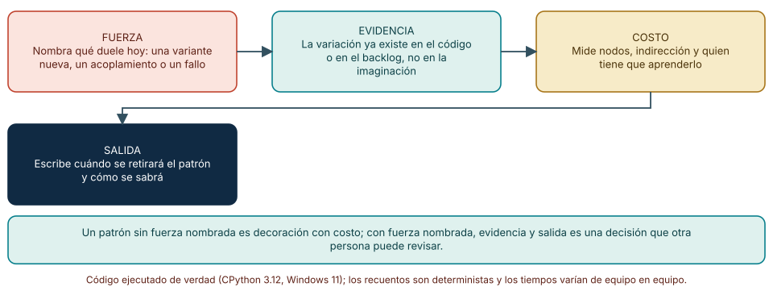

# SE-313 — Criterios para usar un catálogo de patrones

[← SE-312 — Proyecto: evolución compatible de un componente](https://github.com/vladimiracunadev-create/modern-software-engineering-program/blob/main/classes/part-25-diseno-patrones-y-refactorizacion/se-312-proyecto-evolucion-compatible-de-un-componente/README.md) · [↑ Parte 26](https://github.com/vladimiracunadev-create/modern-software-engineering-program/blob/main/classes/part-26-patrones-de-diseno-empresariales-y-de-resiliencia/README.md) · [📚 Índice completo](https://github.com/vladimiracunadev-create/modern-software-engineering-program/blob/main/classes/README.md) · [🌐 Portal](https://vladimiracunadev-create.github.io/modern-software-engineering-program/classes/SE-313.html) · [SE-314 — GoF creacionales: Factory, Builder, Singleton y Prototype →](https://github.com/vladimiracunadev-create/modern-software-engineering-program/blob/main/classes/part-26-patrones-de-diseno-empresariales-y-de-resiliencia/se-314-gof-creacionales-factory-builder-singleton-y-prototype/README.md)

## Punto profesional y fundamento pedagógico

**Punto profesional.** La clase existe para que uses un catálogo de patrones como lo que es: un conjunto de **soluciones con nombre a problemas recurrentes, cada una con consecuencias**. La habilidad profesional no es conocer los veintitrés patrones de la Gang of Four ni reconocerlos en un código ajeno; es poder decir, ante un problema concreto, qué fuerza lo causa, qué patrón la ataca, cuánto cuesta tenerlo y cuándo se retira. Quien aplica un patrón sin esa cadena está decorando; quien la tiene puede aplicar un patrón, no aplicarlo o aplicar uno más simple, y defender la decisión ante otra persona.

**Por qué aparece aquí.** Es la primera clase de la [Parte 26](../README.md) porque las once siguientes la reutilizan: cada patrón se somete a la misma pregunta. La [Parte 25](../../part-25-diseno-patrones-y-refactorizacion/README.md) enseñó los patrones como vocabulario y la [Parte 45](../../part-45-metodologias-de-desarrollo-de-tdd-a-odd/README.md) enseñó a tratar una práctica como un oráculo con costo y punto ciego; esta clase une ambas ideas y establece el criterio.

**Error conceptual que debe corregir.** Creer que un diseño con más patrones es un mejor diseño. El catálogo de la Gang of Four describe cada patrón con una sección de **consecuencias** que enumera ventajas y costos, precisamente porque ninguno es gratuito. El error aparece con dos caras: el programador que acaba de aprender el catálogo y lo ve en todas partes, y el equipo que usa los nombres de los patrones como señal de calidad en una revisión de código sin comprobar la estructura.

**Secuencia de aprendizaje.** Antes de ejecutar, predices si una función de tarifas escrita con `Strategy` tendrá más o menos nodos de sintaxis que la misma función con una cadena de `if/elif`, y cómo cambia la complejidad de cada función al crecer de 2 a 12 variantes. Después ejecutas el experimento, mides lo que cuesta añadir la quinta variante en cada forma, y escribes el criterio de uso con una condición de salida.

**Evidencia de aprendizaje.** Un `criterio-de-patron.md` que, para un patrón de tu código real o de *Avisos*, nombre la fuerza, muestre la evidencia de que la variación existe, contenga una medida de costo y diga cuándo se retira.

**Límite de la conclusión.** Las funciones comparadas son generadas con una plantilla del autor y miden nodos de sintaxis y complejidad ciclomática, no mantenibilidad percibida ni productividad. La clase **mide** el costo estructural de un patrón en un caso controlado; **no mide** si un equipo entiende mejor un diseño con patrones, ni cuántas variantes se necesitan en general para que el patrón compense. No se invocó ningún modelo de lenguaje.

### Trazabilidad fuente → afirmación

| Fuente primaria u oficial | Afirmación que respalda | Lo que no prueba |
|---|---|---|
| [Gamma, Helm, Johnson y Vlissides, «Design Patterns»](https://www.informit.com/store/design-patterns-elements-of-reusable-object-oriented-9780201633610) | Define el catálogo y presenta cada patrón con nombre, problema, solución y consecuencias. | No dice cuándo conviene aplicarlo en un proyecto dado. |
| [Fowler, «Catalog of Patterns of Enterprise Application Architecture»](https://martinfowler.com/eaaCatalog/) | Extiende el formato de catálogo a la arquitectura de aplicaciones empresariales. | No mide el costo de ningún patrón. |
| [Norvig, «Design Patterns in Dynamic Languages»](https://norvig.com/design-patterns/) | Sostiene que varios patrones se vuelven invisibles o más simples cuando el lenguaje tiene funciones de primera clase. | Es una tesis sobre un lenguaje y una época; no sustituye medir en el lenguaje propio. |
| [Python, módulo `ast`](https://docs.python.org/3/library/ast.html) | Documenta el árbol de sintaxis con el que se cuentan nodos y puntos de decisión. | No define qué es «complejidad» ni cuánta es tolerable. |
| [McCabe, «A Complexity Measure»](https://doi.org/10.1109/TSE.1976.233837) | Es el origen de la complejidad ciclomática como número de caminos independientes. | No prueba que menos complejidad implique menos defectos en un caso concreto. |

## Antes de empezar

Recupera lo aprendido en la [Parte 45](../../part-45-metodologias-de-desarrollo-de-tdd-a-odd/README.md): una práctica se evalúa por lo que decide, lo que no ve y lo que cuesta. La pregunta activa es: **¿cuál es el último patrón que aplicaste o viste aplicar, qué dolor concreto resolvía y qué evidencia tienes de que el dolor existía antes del patrón?**

## Prerrequisitos

- Haber leído la [Parte 25](../../part-25-diseno-patrones-y-refactorizacion/README.md) (diseño, patrones y refactorización) y conocer la idea de costura y de inyección de dependencias.
- Haber completado la [Parte 45](../../part-45-metodologias-de-desarrollo-de-tdd-a-odd/README.md) y recordar el núcleo de *Avisos* y la idea de medir con variantes.
- Python 3.11 o posterior; el experimento usa `ast`, `difflib` y `timeit`.

## Problema auténtico

*Avisos* calcula la tarifa de cada aviso según el canal: correo, mensaje de texto, notificación push y voz. Hoy es una función de veinte líneas con una cadena de `if/elif`. Una persona del equipo propone convertirla en un `Strategy`, con una clase por canal y un registro, porque «así es el patrón correcto». Otra persona objeta que son cuatro canales que casi no cambian y que se triplica el código. La discusión se alarga porque cada una habla de gusto: ninguna aporta un dato. La clase da a la discusión un método: nombrar la fuerza, medir el costo y escribir la salida.

Lo que se verá es incómodo para ambos lados. El patrón **cuesta** más código en todos los tamaños medidos y **mantiene plana** la complejidad de cada función; la cadena de condiciones es más corta y su complejidad crece una unidad por variante. Ninguna de las dos ganancias es una razón por sí sola: lo que decide es cuántas variantes habrá, quién las añade y cuánto se quiere tocar lo ya probado.

## Objetivos observables

Al terminar podrás:

1. explicar los cinco componentes de un patrón (nombre, contexto, fuerza, solución, consecuencias) y señalar cuál falta cuando se aplica por costumbre;
2. medir el costo de un patrón en nodos de sintaxis y su efecto en la complejidad por función con `ast`;
3. identificar las funciones existentes que cambian al añadir una variante, con y sin el patrón;
4. decidir con la regla «fuerza, evidencia, costo, salida» si un patrón se justifica y escribir la condición de salida;
5. reconocer cuándo el lenguaje ya resuelve el problema sin el patrón (funciones de primera clase, argumentos con nombre).

## Mapa conceptual


El mapa tiene dos salidas hacia el diseño simple: antes de aplicar, si la variación no existe, y después, si la fuerza desapareció. Un patrón que no puede retirarse se vuelve parte del problema.

## Temas y por qué importan

| Tema | Por qué cambia una decisión profesional | Evidencia mínima |
|---|---|---|
| Qué es un patrón | Sin contexto y consecuencias, un patrón es solo una forma | Los cinco componentes escritos para un caso |
| Fuerza antes que forma | La forma sin fuerza se aplica por costumbre | Una frase que nombra el dolor |
| Costo del patrón | Todo patrón añade código e indirección | Nodos y complejidad antes y después |
| Variación existente frente a imaginada | Diseñar para variantes que no vendrán es deuda | Variantes reales en el código o el backlog |
| Lenguaje y patrones invisibles | En Python, un diccionario de funciones puede ser el Strategy | Una versión sin clases que haga lo mismo |
| Condición de salida | Un patrón que no se puede retirar acumula costo | Una regla de retirada con una señal medible |
| Vocabulario y su riesgo | El nombre comprime la conversación y puede mentir | Una comprobación de estructura, no de nombre |

## Conceptos y decisiones

### 1. Un patrón son cinco cosas, no una forma

El formato del catálogo de la Gang of Four fija lo que debe llevar un patrón: un **nombre** que permita conversar, el **problema** y su contexto, la **solución** como estructura de clases y colaboraciones, y las **consecuencias** con sus ventajas y costos. Cuando se aplica un patrón sin contexto ni consecuencias, queda solo la forma: una jerarquía de clases cuyo propósito nadie recuerda. Por eso el criterio de esta clase obliga a escribir las cinco partes aunque la solución sea conocida. El esfuerzo no es burocrático: la segunda y la cuarta suelen revelar que el contexto no es el del catálogo.

### 2. La fuerza es el dolor que se puede observar

Una **fuerza** es la presión de diseño que empuja en dos direcciones: «quiero añadir canales sin tocar lo probado» y «quiero que el código sea corto». El patrón es una forma de resolver el conflicto, no de eliminarlo. Si no puedes decir la fuerza en una frase con un dato (por ejemplo «cada canal nuevo ha tocado la función de tarifas, y en el último trimestre se tocó cuatro veces»), todavía no hay una razón. Una fuerza que existe solo en el futuro imaginado («podríamos necesitar más canales») es la razón con la que se justifican los diseños que nunca se usan.

### 3. El costo de un patrón se mide

El experimento genera dos versiones de la misma función de tarifas con 2, 3, 4, 6, 8 y 12 variantes: una cadena de `if/elif` y un `Strategy` con una clase base abstracta, una clase por variante y un registro. Con `ast` cuenta los nodos de sintaxis y la complejidad ciclomática máxima de cualquier función. Con dos variantes, la cadena tiene 41 nodos y el `Strategy` 85; con ocho, 131 y 205; con doce, 191 y 285. El patrón usa entre 1,5 y 2,1 veces los nodos en todos los tamaños. La complejidad máxima crece de 3 a 13 en la cadena y se queda en 2 en el patrón.


**Cómo leer la figura.** El eje horizontal es el número de variantes y el vertical, en escala logarítmica, los nodos de sintaxis o la complejidad máxima. Las dos líneas de nodos suben en paralelo, con Strategy siempre por encima, y las de complejidad se separan: la de if/elif sube de 3 a 13 y la de Strategy se queda en 2. Mira la pendiente, no el nivel: el patrón cuesta código y compra una complejidad plana. **Dónde deja de valer:** las funciones son generadas con una plantilla del autor, las variantes son triviales (un multiplicador) y la complejidad ciclomática no mide la dificultad de entender una jerarquía de clases. En un caso real, cada variante tiene lógica propia y las proporciones cambian; la figura muestra el método de medir, no una proporción universal.

### 4. Qué cambia cuando se añade la quinta variante

Más útil que el tamaño total es la pregunta «¿qué existente tengo que modificar?». El experimento compara la versión con cuatro variantes con la de cinco usando el árbol de sintaxis: con la cadena, cambia la función `fee` (la que ya estaba probada); con `Strategy`, no cambia ninguna función ni clase existente, solo aparece una clase nueva y una entrada en un diccionario de datos. Esa es la ganancia real del patrón: **cerrar lo probado a la modificación**. Es valiosa cuando lo probado es caro de volver a validar, cuando varias personas añaden variantes en paralelo o cuando el riesgo de romper una variante al tocar otra es real. No lo es si cuatro canales no han cambiado en tres años.

### 5. Variación existente frente a variación imaginada

Una regla práctica y discutible dice que se espera a tener tres casos antes de abstraer. No es una ley, es una forma de forzar evidencia: dos ejemplos admiten muchas generalizaciones y tres empiezan a distinguirlas. La pregunta equivalente para un patrón es «¿cuántas variantes existen **hoy** en el código o en el backlog, con nombre y dueño?». Cuatro canales con un quinto planificado justifican otra conversación que cuatro canales congelados. Esto no prohíbe el diseño anticipado; exige que el costo de anticipar se compare con la probabilidad de que la variación llegue.

### 6. El lenguaje puede hacer invisible el patrón

Norvig observó en 1996 que, en un lenguaje con funciones de primera clase, varios patrones del catálogo se vuelven invisibles o mucho más simples. En Python, un `Strategy` puede ser un diccionario de funciones, y un `Builder` puede ser un constructor con argumentos solo con nombre. El experimento incluye la forma con registro de objetos; una forma con un diccionario de funciones sería más corta que ambas y conservaría la propiedad de no tocar lo existente. Conclusión práctica: antes de pedir una jerarquía de clases, comprueba si el lenguaje ya da la propiedad que buscas con menos piezas.

### 7. La condición de salida

Todo patrón aplicado debe tener una **condición de salida**: la señal medible que dirá que ya no compensa. Para el `Strategy` de tarifas puede ser «si quedan dos canales, volver a una función con un `if`», o «si en un año no se añadió ninguna variante». Escribirla obliga a nombrar la fuerza (si no hay forma de saber cuándo dejó de importar, probablemente nunca fue clara) y evita que el patrón se vuelva un monumento. La condición de salida se registra junto al patrón en el catálogo de `SE-324`.



**Cómo leer la figura.** Las cuatro cajas son los cuatro pasos del criterio, en el orden en que se hacen. **Dónde deja de valer:** el orden es una simplificación; la medida del costo puede cambiar la fuerza que se nombró, y entonces se vuelve a la primera caja. El diagrama no dice cuánta evidencia es suficiente: eso es una decisión del equipo.

### 8. Vocabulario compartido y su riesgo

Un nombre de patrón comprime una conversación: «el remitente es un Decorator» dice en tres palabras cómo está hecho. El riesgo es el inverso: llamar `Strategy` a una clase que no tiene la estructura, o no reconocer un patrón real con otro nombre. `SE-324` mide este riesgo con un corpus etiquetado: un detector por nombre de clase acierta menos que uno por estructura. La regla de la clase: **el nombre no es evidencia; la estructura y la medida sí**.


**Cómo leer la figura.** A la izquierda está el catálogo y a la derecha sus cuatro aportes, cada uno con cuándo funciona y cómo se estropea. Léelas como pares: lo que aporta un patrón es justamente lo que se pierde si se usa el nombre sin la fuerza que lo justifica. **Dónde deja de valer:** la tabla es un resumen del argumento de la clase y no una medición; el riesgo de que el nombre mienta se mide en `SE-324`.

## Definiciones de trabajo

- **Patrón:** solución con nombre a un problema recurrente en un contexto, con sus consecuencias.
- **Fuerza:** presión de diseño con dolor observable que el patrón equilibra.
- **Consecuencia:** efecto del patrón, favorable o costoso, sobre otras cualidades.
- **Costo estructural:** código e indirección añadidos por el patrón; se mide en nodos, clases o saltos.
- **Condición de salida:** señal medible que indica cuándo retirar o simplificar el patrón.

## Ejemplo mínimo

Dos funciones que hacen lo mismo con dos canales:

```python
def fee(kind, amount):
    if kind == "email":
        return amount * 1 / 100
    elif kind == "sms":
        return amount * 2 / 100
    raise ValueError(kind)

FEES = {"email": 0.01, "sms": 0.02}
def fee2(kind, amount):
    return amount * FEES[kind]
```

La segunda no es un patrón con nombre y resuelve la fuerza «añadir un canal sin tocar la función» con una línea de datos. Es el diseño más barato que da la propiedad buscada, y por eso el patrón completo con clases solo se justifica si cada canal necesita **comportamiento** propio y no solo un número.

## Ejemplo profesional

*Escenario ilustrativo: las cifras de este ejemplo son supuestos de la narración, no mediciones.*

El equipo de *Avisos* revisa el cálculo de tarifas antes de añadir el canal de mensajería instantánea. Escribe en el `criterio-de-patron.md`: fuerza («cada canal nuevo ha obligado a editar `precio_aviso` y a repasar las pruebas de los otros»), evidencia («tres canales nuevos en seis meses y dos más en el backlog con responsable»), costo («el Strategy usa un 44 % más de nodos y añade un salto de indirección; la complejidad por función baja»), alternativa («un diccionario de funciones haría lo mismo con menos piezas, pero las tarifas de voz necesitan estado») y salida («si en un año no entra un canal nuevo, se vuelve a la función simple»). Con eso la discusión pasa de gusto a evidencia, y la decisión queda registrada para quien la revise.

## Práctica guiada

1. Escribe tu predicción: ¿en qué número de variantes el `Strategy` usaría menos nodos que el `if/elif`?
2. Ejecuta `python scripts/experiments_part26_a.py 517` y compara con tu predicción.
3. Añade una tercera versión con un diccionario de funciones y mide sus nodos y su complejidad.
4. Escribe el `criterio-de-patron.md` para un patrón de tu código real o de *Avisos*, con las cinco partes y la condición de salida.
5. Pide a otra persona que lo lea y diga qué cambiaría su decisión.

## Ejercicios

1. **Básico.** Explica por qué un patrón con más nodos puede ser la mejor decisión, y por qué puede ser la peor.
2. **Intermedio.** Mide con `ast` el costo de tres patrones de tu código y ordénalos por costo y por dolor resuelto.
3. **Avanzado.** Diseña una condición de salida medible para un `Observer` que conecta dos módulos, y define la señal que se registraría.

## Reto verificable

Entrega `criterio-de-patron.md` con la fuerza, la evidencia de la variación, una medida de costo con el comando que la produce y la condición de salida. Es válido si otra persona puede repetir la medida y llegar al mismo número, y si la condición de salida permite decidir sin volver a discutir.

## Caso conductor

*Avisos* es el servicio de recordatorios de entregas de la plataforma. Esta clase fija el criterio con el que `SE-314` a `SE-321` examinan cada patrón sobre el mismo servicio; `SE-323` aplica el criterio a un refactor completo y `SE-324` lo convierte en el formato de un catálogo.

## Preguntas frecuentes

### ¿Es malo usar un patrón aunque no haya variaciones todavía?

No es malo por principio; es una apuesta con un costo medido. Si la variación es probable y el costo de añadirla después es alto, anticipar puede compensar. Lo que no debe hacerse es anticipar sin escribir la apuesta, porque entonces nadie puede decidir cuándo perdió.

### ¿Los patrones de GoF siguen siendo relevantes si mi lenguaje tiene funciones de primera clase?

Sí, como vocabulario y como estructura de problemas, pero muchas implementaciones con clases se reducen a funciones o a datos. El criterio no cambia: nombra la fuerza y busca la solución más barata que da la propiedad.

### ¿Cómo se discute un patrón en una revisión de código?

Con las cinco partes: contexto, fuerza, solución, consecuencias y salida. Una revisión que pregunta «¿qué dolor resuelve esto hoy?» es más útil que una que pregunta «¿es el patrón correcto?».

### ¿Puede un agente de código elegir el patrón?

Puede proponer candidatos y escribir la implementación, pero la fuerza y la condición de salida dependen de un contexto que está en las personas y en el código; un agente que elige el patrón sin ese contexto reproduce la costumbre. El puente con agentes de la clase muestra cómo pedirle el criterio y no el patrón.

## Fallo controlado y diagnóstico

**Fallo.** Una persona nueva aplica `Strategy` a una función de dos ramas porque lo vio en el libro. El código crece, la revisión lo aprueba por la corrección de la forma y seis meses después nadie sabe por qué existe una jerarquía de tres clases para dos números.

**Diagnóstico paso a paso.** (1) Se mide el costo con `ast`: tres veces los nodos y una indirección. (2) Se busca la fuerza en el historial: no hay ningún cambio que haya tocado la función por una variante. (3) Se busca la condición de salida: no se escribió. La causa es que la decisión no tuvo evidencia ni salida.

**Corrección.** Se revierte a una función con un diccionario de datos, se escribe en el `criterio-de-patron.md` qué señal justificaría volver a proponer el patrón y se añade a la lista de revisión la pregunta «¿qué dolor existe hoy?».

## Errores comunes y cómo corregirlos

- **Síntoma: jerarquías de clases con una sola implementación.** Causa: se aplicó la forma sin variación. Solución: volver a una función y esperar variantes reales.
- **Síntoma: el patrón se discute por su nombre.** Causa: falta la fuerza. Solución: escribir la fuerza con un dato antes de la discusión.
- **Síntoma: nadie sabe cómo retirar un patrón.** Causa: no se escribió la salida. Solución: registrar la condición de salida junto al patrón.
- **Síntoma: «es un Decorator» y no lo es.** Causa: el nombre se usó como evidencia. Solución: comprobar la estructura, no el nombre.
- **Síntoma: diseño con diez patrones y complejidad más alta.** Causa: se sumaron costos sin medirlos. Solución: medir nodos e indirección y retirar los que no compensan.

## Entorno y archivos clave

- `scripts/experiments_part26_a.py`: generadores de las funciones, medidas con `ast` y comparación de funciones cambiadas; `python scripts/experiments_part26_a.py 517`.
- `content/part-26/figures/`: figuras de la clase.
- Sin dependencias fuera de la biblioteca estándar; Python 3.11 o posterior.

## Seguridad, ética y accesibilidad

Un patrón añade indirección, y la indirección dificulta auditar quién llama a qué: en código sensible (autorización, pagos), una jerarquía que oculta el camino de una decisión puede ocultar también un fallo de seguridad. Ética: el costo de un diseño sobrecargado lo pagan las personas que mantienen el código después; elegir con evidencia es una forma de respeto por su tiempo. Accesibilidad: las figuras tienen texto alternativo completo y no dependen solo del color; las tablas se pueden leer sin la imagen.

## Puente hacia el trabajo con agentes

Un agente de código aplica patrones con facilidad, porque el catálogo está bien representado en lo que ha leído; por eso tiende a proponerlos aunque no haya fuerza. Con el criterio de esta clase, la petición útil cambia: en lugar de «aplica el patrón Strategy», se pide «nombra la fuerza, mide el costo con `ast` y propone la alternativa más simple que dé la misma propiedad». El resultado se revisa con las cinco partes y la condición de salida. Si la respuesta no trae una medida reproducible, no entra.

## Transferencia

Aplica el criterio a un patrón de un proyecto propio: registra la fuerza, mide el costo con el análisis que prefieras y escribe la salida. La habilidad se transfiere a cualquier decisión de diseño con costo, no solo a patrones: una dependencia nueva, una capa más, un framework.

## Evaluación y evidencia

- Se reconocen los cinco componentes de un patrón y se identifica cuál falta en un caso.
- La medida de costo es reproducible y se informa con su comando y su limitación.
- La condición de salida es medible y permite decidir sin una nueva discusión.
- La alternativa más simple se considera y se justifica su descarte.
- La afirmación final distingue lo medido (nodos, complejidad) de lo no medido (comprensión del equipo).

## Fuentes

- Gamma, E., Helm, R., Johnson, R. y Vlissides, J. [«Design Patterns: Elements of Reusable Object-Oriented Software»](https://www.informit.com/store/design-patterns-elements-of-reusable-object-oriented-9780201633610).
- Fowler, M. [«Catalog of Patterns of Enterprise Application Architecture»](https://martinfowler.com/eaaCatalog/).
- Norvig, P. [«Design Patterns in Dynamic Languages»](https://norvig.com/design-patterns/).
- Python Software Foundation. [«ast — Abstract Syntax Trees»](https://docs.python.org/3/library/ast.html).
- McCabe, T. [«A Complexity Measure»](https://doi.org/10.1109/TSE.1976.233837).

## Límites y siguiente paso

Las funciones comparadas son del autor y las medidas son estructurales; no se midió comprensión ni productividad de ningún equipo. El siguiente paso, `SE-314`, aplica el criterio a los patrones que crean objetos, donde el costo más frecuente no es el tamaño sino el estado compartido.

## Glosario

| Término | Definición breve |
|---|---|
| Patrón | Solución con nombre a un problema recurrente, con sus consecuencias |
| Fuerza | Presión de diseño con dolor observable |
| Strategy | Algoritmo intercambiable detrás de una interfaz |
| Complejidad ciclomática | Número de caminos independientes de una función |
| Condición de salida | Señal medible para retirar un patrón |
| Costo estructural | Código e indirección que el patrón añade |

---

[← SE-312 — Proyecto: evolución compatible de un componente](https://github.com/vladimiracunadev-create/modern-software-engineering-program/blob/main/classes/part-25-diseno-patrones-y-refactorizacion/se-312-proyecto-evolucion-compatible-de-un-componente/README.md) · [↑ Parte 26](https://github.com/vladimiracunadev-create/modern-software-engineering-program/blob/main/classes/part-26-patrones-de-diseno-empresariales-y-de-resiliencia/README.md) · [📚 Índice completo](https://github.com/vladimiracunadev-create/modern-software-engineering-program/blob/main/classes/README.md) · [🌐 Portal](https://vladimiracunadev-create.github.io/modern-software-engineering-program/classes/SE-313.html) · [SE-314 — GoF creacionales: Factory, Builder, Singleton y Prototype →](https://github.com/vladimiracunadev-create/modern-software-engineering-program/blob/main/classes/part-26-patrones-de-diseno-empresariales-y-de-resiliencia/se-314-gof-creacionales-factory-builder-singleton-y-prototype/README.md)
