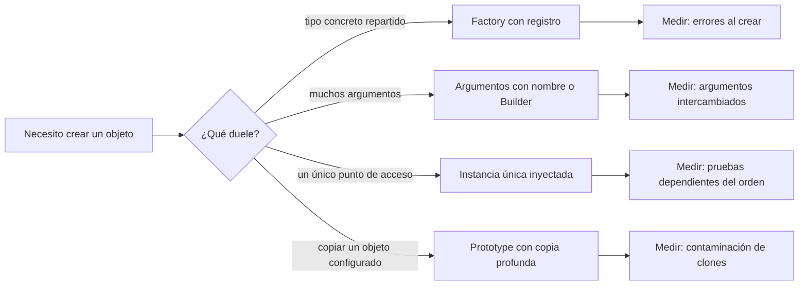
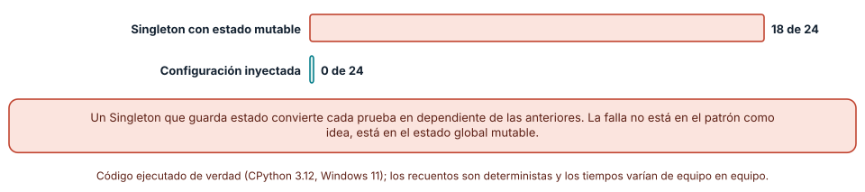

# SE-314 — GoF creacionales: Factory, Builder, Singleton y Prototype

[← SE-313 — Criterios para usar un catálogo de patrones](https://github.com/vladimiracunadev-create/modern-software-engineering-program/blob/main/classes/part-26-patrones-de-diseno-empresariales-y-de-resiliencia/se-313-criterios-para-usar-un-catalogo-de-patrones/README.md) · [↑ Parte 26](https://github.com/vladimiracunadev-create/modern-software-engineering-program/blob/main/classes/part-26-patrones-de-diseno-empresariales-y-de-resiliencia/README.md) · [📚 Índice completo](https://github.com/vladimiracunadev-create/modern-software-engineering-program/blob/main/classes/README.md) · [🌐 Portal](https://vladimiracunadev-create.github.io/modern-software-engineering-program/classes/SE-314.html) · [SE-315 — GoF estructurales: Adapter, Decorator, Facade, Proxy y Composite →](https://github.com/vladimiracunadev-create/modern-software-engineering-program/blob/main/classes/part-26-patrones-de-diseno-empresariales-y-de-resiliencia/se-315-gof-estructurales-adapter-decorator-facade-proxy-y-composite/README.md)

## Punto profesional y fundamento pedagógico

**Punto profesional.** La clase existe para que decidas **cómo se crean los objetos de un sistema** sabiendo qué problema resuelve cada patrón creacional y cuál introduce. Crear objetos parece trivial hasta que el tipo concreto se decide en cien lugares, un constructor tiene siete argumentos del mismo tipo, una configuración global hace que las pruebas dependan del orden o una plantilla copiada comparte una lista con todos sus clones. La habilidad profesional es reconocer cuál de esos cuatro problemas se tiene y elegir la solución más barata que lo resuelve, que en Python no siempre es el patrón del libro.

**Por qué aparece aquí.** Sigue a `SE-313` porque cada patrón creacional se somete al mismo criterio (fuerza, costo, salida) y precede a los estructurales y conductuales porque trabaja con el paso previo: antes de envolver o encadenar objetos hay que crearlos bien.

**Error conceptual que debe corregir.** Creer que el Singleton es «un patrón para tener una sola instancia» y que eso es inocuo. El patrón combina dos propiedades distintas: **una única instancia** y **acceso global** a ella. La primera es a veces una restricción legítima del dominio; la segunda convierte a cada colaborador en dependiente de un estado compartido que no aparece en su firma. La falla que se mide aquí no es de la instancia única sino del estado global mutable.

**Secuencia de aprendizaje.** Antes de ejecutar, predices cuántas de las 24 ordenaciones posibles de cuatro pruebas fallan con una configuración Singleton con estado y cuántas con la misma configuración inyectada, y cuántos de mil clones quedan contaminados al copiar una plantilla con una copia superficial. Después ejecutas el experimento, mides el costo de la copia profunda y corriges cada defecto.

**Evidencia de aprendizaje.** Un `creacionales-log.md` con una tabla de los cuatro patrones (fuerza, alternativa más simple, costo medido), los resultados del experimento y la decisión para cada punto de creación de un componente propio.

**Límite de la conclusión.** Las cuatro pruebas, la configuración, los mil clones y las 500 construcciones son del autor y los tiempos son de un equipo. La clase **mide** defectos concretos de cada patrón en un caso pequeño; **no mide** cuántos proyectos reales los sufren ni el efecto de cada patrón en la mantenibilidad. No se invocó ningún modelo de lenguaje.

### Trazabilidad fuente → afirmación

| Fuente primaria u oficial | Afirmación que respalda | Lo que no prueba |
|---|---|---|
| [Gamma, Helm, Johnson y Vlissides, «Design Patterns»](https://www.informit.com/store/design-patterns-elements-of-reusable-object-oriented-9780201633610) | Define Abstract Factory, Factory Method, Builder, Prototype y Singleton y sus consecuencias. | No mide la frecuencia ni el costo de sus fallos. |
| [Python, módulo `copy`](https://docs.python.org/3/library/copy.html) | Documenta la diferencia entre copia superficial y profunda y el riesgo de objetos compuestos que comparten referencias. | No dice qué copia conviene en un diseño dado. |
| [Python, módulo `dataclasses`](https://docs.python.org/3/library/dataclasses.html) | Documenta `kw_only` y la generación del constructor. | No dice que sustituya a todo Builder. |
| [Norvig, «Design Patterns in Dynamic Languages»](https://norvig.com/design-patterns/) | Sostiene que ciertos patrones creacionales se simplifican en lenguajes dinámicos. | Es una tesis sobre un conjunto de lenguajes, no una medida. |

## Antes de empezar

Recupera lo aprendido en `SE-313`: un patrón se justifica por una fuerza, un costo medido y una condición de salida. La pregunta activa es: **¿en tu proyecto, cuántos lugares conocen el tipo concreto de un objeto que otro módulo podría pedir por nombre, y cuántas pruebas dependen de un valor global que alguien cambió antes?**

## Prerrequisitos

- Haber completado `SE-313` y conocer el criterio fuerza-costo-salida.
- Haber visto la inyección de dependencias en la Parte 25 y los dobles de prueba en la Parte 35.
- Python 3.11 o posterior con `copy`, `dataclasses`, `itertools` y `timeit`.

## Problema auténtico

*Avisos* tiene cuatro puntos de creación que duelen. Los canales (correo, mensaje de texto, push) se crean con un `if` repetido en tres módulos; el objeto `Aviso` tiene cuatro cadenas seguidas en su constructor y una persona ya los intercambió dos veces; la configuración de «horas de silencio» es un objeto global que cambia una prueba y rompe otra; y la plantilla de «recordatorio de entrega» se copia para crear avisos sin que nadie recuerde si la lista de destinatarios se comparte. Cada uno corresponde a un patrón creacional, y cada patrón tiene un modo de estropearse.

La clase ataca los cuatro con medidas: cuántas peticiones de canales inexistentes se rechazan al crear, cuántas construcciones con argumentos intercambiados se aceptan, cuántas ordenaciones de pruebas fallan con la configuración global y cuántos clones quedan contaminados.

## Objetivos observables

Al terminar podrás:

1. elegir entre Factory Method, Abstract Factory y un registro según la fuerza (tipos concretos repartidos, familias de objetos, extensión por terceros);
2. decidir cuándo un Builder se justifica y cuándo bastan argumentos solo con nombre;
3. separar «instancia única» de «acceso global» y demostrar cómo el estado global mutable hace depender las pruebas del orden;
4. explicar la diferencia entre copia superficial y profunda y medir la contaminación de clones;
5. escribir para cada punto de creación la alternativa más simple y la condición de salida del patrón.

## Mapa conceptual



El mapa parte de lo que duele y no del patrón: cada rama termina en una medida distinta, porque cada patrón se estropea de un modo diferente.

## Temas y por qué importan

| Tema | Por qué cambia una decisión profesional | Evidencia mínima |
|---|---|---|
| Factory con registro | Centraliza el conocimiento del tipo concreto y rechaza lo desconocido al crear | Peticiones inválidas rechazadas antes de usarse |
| Builder frente a argumentos con nombre | En Python los nombres evitan el constructor telescópico con menos piezas | Construcciones con argumentos intercambiados aceptadas |
| Singleton: instancia única y acceso global | Separarlas evita acoplar todo a un estado compartido | Ordenaciones de pruebas que fallan |
| Prototype y copia profunda | La copia superficial comparte referencias y contamina | Clones afectados por un cambio local |
| Costo de cada técnica | Copiar profundo cuesta más que construir | Tiempo por operación |
| Alternativa más simple | A veces un diccionario o un módulo basta | Una versión sin el patrón |

## Conceptos y decisiones

### 1. Factory: un lugar que sabe qué clase crear

La **fuerza** de una fábrica es que el conocimiento de qué clase concreta crear está repartido: tres módulos repiten el mismo `if canal == "email"`. Un **Factory Method** mueve la decisión a un método que las subclases redefinen; un **Abstract Factory** crea familias de objetos que deben ser coherentes entre sí (por ejemplo, el cliente HTTP y el serializador de un mismo proveedor); y un **registro** (un diccionario de nombres a constructores) permite añadir tipos sin tocar la fábrica. La ventaja medible del registro es el **error temprano**: de cinco peticiones de canales (`email`, `sms`, `push`, `emial`, `sms`) con un registro que solo conoce dos, dos se rechazan al crear, no más adelante cuando se intenta enviar. Una fábrica que devuelve `None` o crea un objeto por defecto convierte el error de escritura en un fallo silencioso.

### 2. Builder: del constructor telescópico a los argumentos con nombre

El Builder ataca el **constructor telescópico**: muchos argumentos, varios del mismo tipo, algunos opcionales. En el experimento, 500 construcciones de un `Aviso` con asunto y cuerpo intercambiados son aceptadas **las 500** por un constructor posicional, porque ambos son cadenas y nada distingue un orden de otro. Con `dataclass(kw_only=True)` las 500 llamadas posicionales se rechazan: el intercambio exige escribir mal un nombre, y esa falla es visible. El Builder clásico sigue justificándose cuando hay **pasos con orden** o validaciones entre campos que solo se pueden hacer al final (`build()` comprueba que un aviso por SMS tenga teléfono), o cuando el objeto se construye por partes en distintos lugares. Con argumentos con nombre y un método de validación se obtiene el 80 % del beneficio con la mitad de las piezas.

### 3. Singleton: dos propiedades que conviene separar

El patrón garantiza **una instancia** y da **acceso global** a ella. El segundo es el que cuesta. En el experimento, cuatro pruebas leen y modifican una configuración con estado (silencio, contador de envíos). Con un Singleton que conserva su estado entre pruebas, **18 de las 24 ordenaciones posibles fallan**: cada prueba pasa o falla según cuáles se ejecutaron antes. Con la misma lógica y una configuración que se crea para cada prueba y se inyecta, fallan 0 de 24. La propiedad de la instancia única no es el problema; lo es que cualquier código la alcance sin que su firma lo diga.



**Cómo leer la figura.** Cada barra cuenta, de las 24 ordenaciones de las cuatro pruebas, cuántas producen al menos un fallo. **Dónde deja de valer:** las cuatro pruebas y la configuración son del autor; con otra configuración o con estado inmutable, el recuento cambia (un Singleton inmutable no sufre este fallo). El 18 de 24 no es una frecuencia de proyectos reales; muestra el mecanismo.

La alternativa más barata en Python es crear la configuración **una vez**, en la composición raíz del programa, e **inyectarla**: la unicidad se conserva por construcción y el acceso global desaparece. Un módulo de Python ya es un Singleton de hecho (se importa una vez); por eso un objeto global de módulo con estado mutable arrastra el mismo defecto y se resuelve igual.

### 4. Prototype: copiar sin compartir

El Prototype crea objetos copiando uno configurado; en Python, `copy.copy` y `copy.deepcopy`. El defecto es la **copia superficial**: copia el objeto pero comparte las referencias a sus componentes mutables. En el experimento, una plantilla de aviso tiene una lista de destinatarios; se crean 1000 clones con `copy.copy`, se añade «ana» a la lista de uno y **1000 de 1000** la tienen, porque comparten la misma lista. Con `copy.deepcopy`, la tiene 1 de 1000. La copia profunda tiene un costo: unos 11 µs frente a unos 0,6 µs de construir el objeto (cerca de 17 veces más). La decisión es de fuerza: si construir exige consultas o cálculos caros y la plantilla es inmutable salvo por los campos que se cambian, copiar compensa; si construir es barato, no hay razón para copiar.


**Cómo leer la figura.** Cada barra es una forma de obtener 1 000 avisos desde una plantilla y su longitud los clones afectados al añadir un destinatario a uno; el costo por copia está en la etiqueta. Mira la barra completa de la copia superficial frente a las casi vacías: la más barata comparte la lista con todos los clones. **Dónde deja de valer:** los tiempos son de un equipo y de un objeto trivial; con un objeto grande, la copia profunda puede dominar el costo. La cifra de 1000 de 1000 depende de que la lista sea compartida: con tuplas inmutables, la copia superficial bastaría.

### 5. Elegir entre los cuatro

Los cuatro patrones responden a fuerzas distintas y se pueden combinar: una fábrica con registro que entrega objetos construidos con argumentos con nombre y una configuración inyectada. La tabla de decisión de la clase pregunta primero qué duele (tipo concreto repartido, argumentos, acceso global, copia) y luego busca la solución más barata. En lenguajes con funciones de primera clase, varias de esas soluciones son un diccionario o una función, y el patrón con clases se justifica solo cuando el objeto creado tiene comportamiento propio.


**Cómo leer la figura.** A la izquierda están los cuatro patrones y a la derecha la fuerza que atacan con lo que se midió. Las cajas turquesa muestran un efecto medido que rechaza algo antes de tiempo, la coral una fragilidad (el Singleton con estado mutable) y la dorada el riesgo de copiar de forma superficial. **Dónde deja de valer:** las cuatro medidas se tomaron con ejemplos del autor y no son comparables entre sí; no se puede decir cuál patrón es «más importante». La figura resume lo medido y no sustituye la decisión de cada caso.

## Definiciones de trabajo

- **Factory:** punto único que decide qué clase concreta crear.
- **Registro:** diccionario de nombres a constructores que permite extender sin tocar la fábrica.
- **Builder:** objeto o secuencia de pasos que construye un objeto complejo y valida al final.
- **Singleton:** garantía de una instancia con acceso global; en este curso se separa de la unicidad.
- **Copia superficial:** copia que comparte las referencias a los componentes mutables.
- **Copia profunda:** copia recursiva que no comparte componentes mutables.

## Ejemplo mínimo

```python
import copy
from dataclasses import dataclass, field

@dataclass(kw_only=True)
class Aviso:
    asunto: str
    cuerpo: str
    destinatarios: list = field(default_factory=list)

plantilla = Aviso(asunto="Recordatorio", cuerpo="Tu entrega vence", destinatarios=["lista-base"])
a = copy.copy(plantilla)
b = copy.deepcopy(plantilla)
a.destinatarios.append("ana")
print(plantilla.destinatarios, b.destinatarios)   # la plantilla quedó contaminada por a
```

La plantilla contiene «ana» porque `a` comparte la lista; `b` no. Con `kw_only=True`, escribir `Aviso("Recordatorio", "Tu entrega vence")` falla al instante.

## Ejemplo profesional

*Escenario ilustrativo: las cifras de este ejemplo son supuestos de la narración, no mediciones.*

El equipo de *Avisos* revisa sus cuatro puntos de creación con `criterio-de-patron.md`. Para los canales adopta un registro con un decorador que añade clases al diccionario, y los tres `if` desaparecen; para `Aviso` pasa a argumentos solo con nombre y un `validar()` que rechaza un SMS sin teléfono; para la configuración elimina el objeto global y crea una por proceso, que se entrega a los servicios en el arranque; y para la plantilla usa `deepcopy` con una prueba que añade un destinatario a un clon y comprueba que los demás no cambian. Cada decisión lleva su condición de salida: el registro se simplifica si queda un solo canal, la prueba de clon se mantiene mientras haya listas en la plantilla.

## Práctica guiada

1. Escribe tu predicción: de las 24 ordenaciones de las cuatro pruebas, ¿cuántas fallarán con el Singleton y cuántas con la configuración inyectada?
2. Ejecuta `python scripts/experiments_part26_a.py 518` y compara.
3. Cambia el experimento para que la configuración sea inmutable (una tupla o un `frozen=True`) y explica el resultado.
4. Añade un campo de tupla a la plantilla y comprueba si la copia superficial deja de contaminar.
5. Revisa en un proyecto propio dos puntos de creación y completa la tabla de fuerza, alternativa y salida.

## Ejercicios

1. **Básico.** Explica la diferencia entre instancia única y acceso global y da un ejemplo donde la primera sea válida sin la segunda.
2. **Intermedio.** Escribe un registro con un decorador de registro y una prueba que compruebe que un canal desconocido se rechaza al crear.
3. **Avanzado.** Diseña una prueba que detecte un Singleton con estado mutable sin conocer su implementación, ejecutando las pruebas en distintos órdenes.

## Reto verificable

Entrega `creacionales-log.md` con la tabla de los cuatro patrones sobre un componente propio, el resultado de las 24 ordenaciones, la prueba de contaminación de clones y la decisión final por punto de creación. Es válido si otra persona puede ejecutar las pruebas y obtener los mismos recuentos, y si cada decisión incluye una alternativa más simple considerada.

## Caso conductor

*Avisos* conserva el mismo servicio y sus cuatro puntos de creación. `SE-315` envuelve los objetos que aquí se crean con un decorador de reintentos y `SE-316` modela su ciclo de vida con una máquina de estados; el registro de canales reaparece en `SE-323` cuando se refactoriza la tarifa.

## Preguntas frecuentes

### ¿Un módulo de Python con variables globales es un Singleton?

En la práctica sí: se importa una vez y comparte estado. Tiene el mismo riesgo si el estado es mutable. Lo seguro es que el módulo no guarde estado y que quien lo necesite lo cree y lo inyecte.

### ¿Cuándo sigue valiendo un Builder en Python?

Cuando los pasos tienen orden o dependencias (no se puede fijar el canal antes que el destinatario), cuando el objeto se construye en varios lugares o cuando la validación solo puede hacerse con el objeto completo. Si solo hay muchos argumentos, bastan los nombres.

### ¿Por qué no usar siempre `deepcopy`?

Porque cuesta más y puede copiar de más (conexiones, cachés). Se usa cuando el objeto tiene componentes mutables que no deben compartirse y cuando construir es más caro que copiar.

### ¿Puede un agente de código escribir una fábrica con registro?

Sí, y es una tarea apropiada si se le pide la prueba de rechazo temprano y la comprobación del registro duplicado. Hay que revisar que no cree un objeto por defecto ante un nombre desconocido.

## Fallo controlado y diagnóstico

**Fallo.** Una prueba de silencio pasa sola y falla en la suite completa; en otra máquina falla al revés. Alguien «arregla» el orden de los archivos de prueba y la falla reaparece cuando se añade una prueba nueva.

**Diagnóstico paso a paso.** (1) Se ejecutan las pruebas en distintas ordenaciones y se mide cuántas fallan: 18 de 24. (2) Se busca qué estado comparten: la configuración global, que una prueba modifica y no restablece. (3) La causa no es el orden de los archivos sino el estado compartido sin restablecer.

**Corrección.** Se crea una configuración por prueba y se inyecta, se elimina el acceso global y se añade una comprobación que ejecuta las pruebas en orden aleatorio con una semilla registrada.

## Errores comunes y cómo corregirlos

- **Síntoma: pruebas que pasan solas y fallan en conjunto.** Causa: estado global mutable. Solución: crear y pasar la configuración por prueba.
- **Síntoma: un destinatario aparece en todos los avisos.** Causa: copia superficial de una plantilla. Solución: `deepcopy` o estructuras inmutables.
- **Síntoma: asunto y cuerpo intercambiados sin error.** Causa: argumentos posicionales del mismo tipo. Solución: `kw_only` y validación.
- **Síntoma: canal desconocido que «funciona» con un valor por defecto.** Causa: fábrica que no rechaza. Solución: error temprano con mensaje que nombre el canal.
- **Síntoma: Builder de diez métodos para un objeto de tres campos.** Causa: patrón sin fuerza. Solución: argumentos con nombre.

## Entorno y archivos clave

- `scripts/experiments_part26_a.py`: Singleton con 24 ordenaciones, construcción con argumentos intercambiados, Prototype con copia superficial y profunda, y fábrica con registro; `python scripts/experiments_part26_a.py 518`.
- `content/part-26/figures/`: figuras.
- Sin dependencias fuera de la biblioteca estándar.

## Seguridad, ética y accesibilidad

Una fábrica que instancia clases a partir de un nombre recibido de fuera (un archivo de configuración, una petición) es un punto de ataque: si el registro se llena con cualquier clase importable, quien controla el nombre controla el código que corre. El registro debe ser una lista cerrada de constructores conocidos. Una copia profunda de objetos con credenciales duplica secretos en memoria; excluye lo sensible de la plantilla. Ética: la configuración global oculta quién cambió qué; inyectarla deja trazable la decisión. Accesibilidad: las figuras tienen texto alternativo completo y las tablas se leen sin color.

## Puente hacia el trabajo con agentes

Un agente de código escribe un Singleton con soltura porque el patrón aparece en todos los tutoriales; conviene pedirle explícitamente la alternativa inyectada y la prueba de orden. Para una fábrica, la tarea acotada es «registro cerrado, error temprano, prueba de nombre desconocido». Para copias, «prueba que modifique un clon y compruebe que los demás no cambian». El agente propone; la prueba decide.

## Transferencia

Revisa los puntos de creación de un proyecto propio y clasifícalos con la tabla de la clase: ¿qué duele? ¿cuál es la alternativa más barata? Lo que aprendiste sobre estado global se transfiere a cualquier caché, cliente HTTP o conexión compartida.

## Evaluación y evidencia

- Se distingue instancia única de acceso global y se demuestra el efecto con ordenaciones de pruebas.
- La copia superficial y la profunda se miden con una prueba de contaminación.
- Cada decisión de creación incluye la alternativa más simple y una condición de salida.
- La afirmación final separa lo medido (ordenaciones, clones, tiempos) de lo no medido (frecuencia en proyectos reales).

## Fuentes

- Gamma, E., Helm, R., Johnson, R. y Vlissides, J. [«Design Patterns: Elements of Reusable Object-Oriented Software»](https://www.informit.com/store/design-patterns-elements-of-reusable-object-oriented-9780201633610).
- Python Software Foundation. [«copy — Shallow and deep copy operations»](https://docs.python.org/3/library/copy.html).
- Python Software Foundation. [«dataclasses — Data Classes»](https://docs.python.org/3/library/dataclasses.html).
- Norvig, P. [«Design Patterns in Dynamic Languages»](https://norvig.com/design-patterns/).

## Límites y siguiente paso

Las pruebas, la configuración y las copias son del autor y los tiempos son de un equipo; no se midió la frecuencia de estos fallos en proyectos reales. El siguiente paso, `SE-315`, trata los patrones que envuelven y componen objetos ya creados, donde el orden de las envolturas es una decisión de política.

## Glosario

| Término | Definición breve |
|---|---|
| Factory | Punto que decide qué clase concreta crear |
| Registro | Diccionario de nombres a constructores |
| Builder | Construcción por pasos con validación final |
| Singleton | Una instancia con acceso global |
| Copia superficial | Copia que comparte los componentes mutables |
| Inyección de dependencias | Entregar un colaborador desde fuera en lugar de buscarlo |

---

[← SE-313 — Criterios para usar un catálogo de patrones](https://github.com/vladimiracunadev-create/modern-software-engineering-program/blob/main/classes/part-26-patrones-de-diseno-empresariales-y-de-resiliencia/se-313-criterios-para-usar-un-catalogo-de-patrones/README.md) · [↑ Parte 26](https://github.com/vladimiracunadev-create/modern-software-engineering-program/blob/main/classes/part-26-patrones-de-diseno-empresariales-y-de-resiliencia/README.md) · [📚 Índice completo](https://github.com/vladimiracunadev-create/modern-software-engineering-program/blob/main/classes/README.md) · [🌐 Portal](https://vladimiracunadev-create.github.io/modern-software-engineering-program/classes/SE-314.html) · [SE-315 — GoF estructurales: Adapter, Decorator, Facade, Proxy y Composite →](https://github.com/vladimiracunadev-create/modern-software-engineering-program/blob/main/classes/part-26-patrones-de-diseno-empresariales-y-de-resiliencia/se-315-gof-estructurales-adapter-decorator-facade-proxy-y-composite/README.md)
