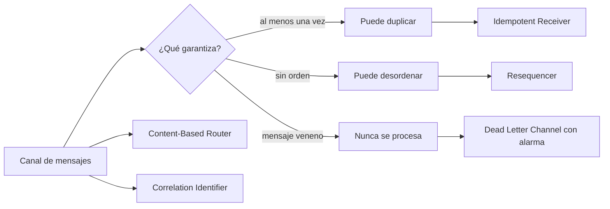

# SE-319 — Enterprise Integration Patterns como lenguaje común

[← SE-318 — Repository, Unit of Work y Active Record](https://github.com/vladimiracunadev-create/modern-software-engineering-program/blob/main/classes/part-26-patrones-de-diseno-empresariales-y-de-resiliencia/se-318-repository-unit-of-work-y-active-record/README.md) · [↑ Parte 26](https://github.com/vladimiracunadev-create/modern-software-engineering-program/blob/main/classes/part-26-patrones-de-diseno-empresariales-y-de-resiliencia/README.md) · [📚 Índice completo](https://github.com/vladimiracunadev-create/modern-software-engineering-program/blob/main/classes/README.md) · [🌐 Portal](https://vladimiracunadev-create.github.io/modern-software-engineering-program/classes/SE-319.html) · [SE-320 — Resiliencia: timeout, retry con jitter y circuit breaker →](https://github.com/vladimiracunadev-create/modern-software-engineering-program/blob/main/classes/part-26-patrones-de-diseno-empresariales-y-de-resiliencia/se-320-resiliencia-timeout-retry-con-jitter-y-circuit-breaker/README.md)

## Punto profesional y fundamento pedagógico

**Punto profesional.** La clase existe para que uses los patrones de integración como un **lenguaje para razonar sobre garantías**: qué promete un canal de mensajes, qué obligación traslada esa promesa al receptor y qué patrón la cumple. El catálogo de Hohpe y Woolf nombra problemas que cada generación de herramientas (colas, buses, flujos de eventos, funciones sin servidor) vuelve a encontrar con otro nombre. Quien conoce el vocabulario reconoce que un «evento duplicado» es un problema de receptor idempotente, que un «mensaje que nunca se procesa» es una cola de cartas muertas sin alarma y que «llegó desordenado» es un caso de reordenador, y puede discutirlo con una frase.

**Por qué aparece aquí.** Sigue a Repository y Unit of Work (`SE-318`) porque un mensaje es otro modo de cambiar estado y su atomicidad no la da una base de datos, y precede a los patrones de resiliencia (`SE-320`, `SE-321`), que tratan qué pasa cuando el receptor falla o se enlentece.

**Error conceptual que debe corregir.** Creer que un sistema de mensajería entrega «exactamente una vez». La garantía habitual y barata es **al menos una vez**: el mensaje llega, puede llegar dos veces. «Exactamente una vez» se logra, cuando se logra, con **entrega al menos una vez más un receptor idempotente**; trasladar la expectativa al canal sin construir el receptor es un defecto de diseño que aparece como cifras inflacionadas semanas después.

**Secuencia de aprendizaje.** Antes de ejecutar, predices cuánto se infla la suma de pagos de mil mensajes cuando el canal duplica una quinta parte y qué error queda con un receptor idempotente. Después simulas un canal con duplicados, desorden y mensajes veneno y compruebas cuatro patrones: receptor idempotente, enrutador por contenido, canal de cartas muertas y reordenador.

**Evidencia de aprendizaje.** Un `mensajeria-log.md` con la tabla de garantías de un canal propio (entrega, orden, duplicados, veneno) y el patrón que compensa cada una, el resultado de la simulación y una prueba de idempotencia.

**Límite de la conclusión.** El canal es un modelo con semilla fija en un solo proceso, los duplicados son del 20 % por elección del autor y el reordenamiento ocurre en ventanas de 6. La clase **mide** el efecto de cada patrón en un modelo; **no mide** un broker real (Kafka, RabbitMQ, una cola gestionada) ni su comportamiento bajo particiones. No se invocó ningún modelo de lenguaje.

### Trazabilidad fuente → afirmación

| Fuente primaria u oficial | Afirmación que respalda | Lo que no prueba |
|---|---|---|
| [Hohpe y Woolf, «Enterprise Integration Patterns»](https://www.enterpriseintegrationpatterns.com/patterns/messaging/) | Cataloga los patrones de mensajería con nombre, problema y solución. | No dice qué garantías ofrece un producto concreto. |
| [EIP, «Idempotent Receiver»](https://www.enterpriseintegrationpatterns.com/patterns/messaging/IdempotentReceiver.html) | Describe cómo diseñar un receptor que tolere mensajes duplicados. | No define cómo guardar las claves a escala. |
| [EIP, «Dead Letter Channel»](https://www.enterpriseintegrationpatterns.com/patterns/messaging/DeadLetterChannel.html) | Describe qué hacer con un mensaje que no puede entregarse o procesarse. | No dice cómo operar la cola de cartas muertas. |
| [EIP, «Resequencer»](https://www.enterpriseintegrationpatterns.com/patterns/messaging/Resequencer.html) | Describe cómo reordenar mensajes recibidos fuera de orden. | No dice cuánto buffer es suficiente. |
| [EIP, «Correlation Identifier»](https://www.enterpriseintegrationpatterns.com/patterns/messaging/CorrelationIdentifier.html) | Describe cómo asociar una respuesta con su solicitud. | No fija el formato del identificador. |
| [EIP, «Guaranteed Delivery»](https://www.enterpriseintegrationpatterns.com/patterns/messaging/GuaranteedMessaging.html) | Describe la persistencia de mensajes para que sobrevivan a un fallo del sistema de mensajería. | No es una garantía de procesamiento único. |

## Antes de empezar

Recupera lo aprendido en `SE-318`: una operación de varios pasos necesita una frontera atómica. La pregunta activa es: **si tu servicio recibe el mismo mensaje dos veces, ¿qué ocurre, y cómo lo sabes sin esperar a que alguien reclame?**

## Prerrequisitos

- Haber completado `SE-318` y conocer la idea de transacción y de efecto repetido.
- Haber visto en la Parte 31 (integración, eventos y mensajería) qué es una cola y un evento, y en la Parte 32 qué es un fallo parcial.
- Python 3.11 o posterior con `random` y `collections`.

## Problema auténtico

Los pagos de las inscripciones de *Avisos* llegan como mensajes. A fin de mes, contabilidad reporta que el total de pagos recibidos supera en un 19 % lo que muestra el banco. El equipo revisa el código de suma, que es correcto; el canal no pierde mensajes (el proveedor garantiza que cada uno llegará), y en eso está el problema: lo garantiza **al menos una vez**, y cuando un acuse de recibo se pierde, reenvía. Nadie escribió un receptor idempotente porque nadie leyó la garantía como una obligación propia.

La clase reproduce el defecto con una simulación de mil mensajes, lo corrige con una clave de idempotencia y recorre tres patrones más que compensan las otras garantías débiles.

## Objetivos observables

Al terminar podrás:

1. leer la garantía de un canal (entrega, orden, duplicados) y decir qué obligación traslada al receptor;
2. implementar un receptor idempotente con una clave estable y comprobar con una suma de control que los duplicados no cambian el resultado;
3. enrutar por contenido, aislar mensajes veneno con un tope de intentos y una cola de cartas muertas con alarma;
4. reordenar mensajes con un buffer acotado y decir cuándo no es posible;
5. correlacionar solicitudes y respuestas por identificador en lugar de por posición.

## Mapa conceptual



Cada garantía débil se corresponde con un patrón en el receptor. El enrutador y el identificador de correlación no compensan una garantía: dan forma al flujo.

## Temas y por qué importan

| Tema | Por qué cambia una decisión profesional | Evidencia mínima |
|---|---|---|
| Garantías de entrega | Elegir una garantía es elegir qué patrón se escribe | Una tabla de garantías de un canal |
| Receptor idempotente | Convierte entrega al menos una vez en efecto único | Suma con duplicados frente a suma real |
| Enrutador por contenido | Reparte por el contenido del mensaje | Mensajes por ruta |
| Cartas muertas | Aísla lo que nunca se procesará | Mensajes apartados e intentos totales |
| Reordenador | Restaura un orden cuando importa | Pares fuera de orden antes y después |
| Identificador de correlación | Asocia respuesta y solicitud sin depender del orden | Asociaciones correctas por id y por posición |

## Conceptos y decisiones

### 1. Las garantías como obligaciones del receptor

El catálogo parte de una observación: un canal real es más débil que el canal ideal. Puede **perder** mensajes (como mucho una vez), **duplicarlos** (al menos una vez) o **entregarlos en otro orden**. Cada debilidad traslada una obligación al receptor. Si un canal garantiza al menos una vez, el receptor debe ser idempotente; si no garantiza el orden y el orden importa, el receptor debe reordenar; si un mensaje puede no procesarse nunca, debe haber un lugar donde acabe y una alarma. Leer la garantía del producto (y no suponerla) es la primera tarea de un diseño de integración.

### 2. Receptor idempotente: el efecto, no el mensaje, es único

El experimento simula 1000 mensajes (60 % pagos, 20 % avisos, 20 % bajas) con un canal al menos una vez que duplica un 20 % y reordena en ventanas de 6. Se entregan 1208 mensajes (208 duplicados). La suma real de pagos es **15.682**; sin receptor idempotente, el consumidor suma **18.759**, un error de **+3.077**; con un receptor que guarda los identificadores vistos y descarta los repetidos, suma **15.682**. La clave es que el identificador del mensaje es **estable** (el mismo en cada reenvío); un identificador generado en el receptor no sirve. Guardar los identificadores plantea otra decisión: cuánto tiempo conservarlos. Una ventana finita (por ejemplo, 7 días) acota la memoria y exige que el canal no reenvíe más tarde de esa ventana.


**Cómo leer la figura.** Cada fila es un receptor; el círculo hueco es la suma real de los pagos, el relleno la suma calculada y el segmento que los une es el error, con su valor a la derecha. Mira que sin receptor idempotente el círculo se desplaza 3 077 hacia la derecha y con él coincide con la suma real. **Dónde deja de valer:** el canal duplica con una tasa del 20 % elegida por el autor y la clave siempre es estable; en un sistema real, la tasa de duplicados es mucho menor y variable, y las claves pueden faltar o cambiar entre reenvíos. El mecanismo es general; la magnitud no.

### 3. Enrutador por contenido y correlación

Un **Content-Based Router** decide el destino por el contenido del mensaje: en la simulación reparte 1000 mensajes en 601 pagos, 206 avisos y 193 bajas. Su riesgo es el de cualquier condicional sobre un esquema: un tipo nuevo sin ruta debe ir a algún lugar (las cartas muertas), no desaparecer. Un **Correlation Identifier** asocia una respuesta con su solicitud: en el experimento, 20 respuestas llegan en orden aleatorio; por identificador, **20 de 20** se asocian bien; por posición, **1 de 20**. Depender del orden de llegada para correlacionar es el error equivalente al de suponer entrega ordenada.

### 4. Cartas muertas: lo que nunca se procesa necesita un destino y una alarma

Un mensaje **veneno** es el que falla siempre (un formato inesperado, una regla que no puede cumplirse). Si el consumidor lo reintenta sin límite, bloquea la cola o gasta recursos sin fin. Un **Dead Letter Channel** impone un tope de intentos y mueve el mensaje a otra cola. En el experimento, de los primeros 200 mensajes, 2 son veneno (se sembraron 25 en los 1000); con un tope de 3 intentos, se procesan **198**, se apartan **2** y se hacen **204** intentos en total; sin tope, cada veneno exigiría reintentos sin fin. La cola de cartas muertas **sin alarma** es un cementerio: lo que importa no es que exista sino que alguien reciba un aviso cuando crece y tenga un procedimiento para revisar, corregir y reinyectar.

### 5. Reordenador: restaurar el orden con un buffer acotado

Un **Resequencer** guarda los mensajes que llegan antes de tiempo hasta recibir el que falta. Con una entrada con **977 pares fuera de orden** (tras eliminar los duplicados), el reordenador entrega una salida con **0** inversiones en los primeros 300 mensajes. El costo es la memoria del buffer y la latencia: un mensaje no se entrega hasta que llegan los anteriores. Y hay una condición que no se puede evitar: si un mensaje intermedio **nunca llega**, el reordenador espera sin fin; por eso necesita un plazo y una política (saltar el hueco, alarmar). Si el orden no importa para el efecto (sumas de pagos, por ejemplo), reordenar es un costo innecesario.


**Cómo leer la figura.** A la izquierda están los cuatro patrones de mensajería y a la derecha el escenario y lo que se midió en el canal simulado. Las cuatro cajas son resultados medidos con cifras exactas: cuántos mensajes se enrutan, se procesan, se reordenan o se asocian. **Dónde deja de valer:** los mensajes veneno son 25 sembrados por semilla, el desorden es local a ventanas de 6 y la correlación usa 20 respuestas; un broker real tiene particiones, reintentos propios y colas de tamaño acotado que la simulación no modela. Los resultados son demostraciones de mecanismos.

### 6. De la garantía al patrón

La figura siguiente resume la regla de diseño de la clase: cada garantía débil exige una compensación en el receptor, y elegir un canal es elegir qué patrones habrá que escribir. Un sistema que declara «usamos eventos» sin decir qué garantía asume ha dejado esa decisión sin dueño.


**Cómo leer la figura.** Cada caja une una garantía débil con la obligación que traslada y el patrón que la cumple. **Dónde deja de valer:** el diagrama separa cuatro garantías que en un producto real se combinan y tienen matices (orden por partición, entrega transaccional de algunos brokers). La regla útil es leer la documentación del producto y completar esta tabla para él.

## Definiciones de trabajo

- **Entrega al menos una vez:** el mensaje llega una o más veces; no se pierde, puede duplicarse.
- **Receptor idempotente:** receptor para el que procesar un mensaje repetido no cambia el resultado.
- **Mensaje veneno:** mensaje que falla en cada intento de proceso.
- **Cola de cartas muertas:** destino de los mensajes que no se pueden procesar tras un tope de intentos.
- **Reordenador:** componente que restaura el orden de una secuencia con un buffer.
- **Identificador de correlación:** valor que enlaza una respuesta con su solicitud.

## Ejemplo mínimo

```python
vistos = set()
total = 0
for m in entregados:
    if m["id"] in vistos:
        continue
    vistos.add(m["id"])
    if m["tipo"] == "pago":
        total += m["monto"]
```

El conjunto `vistos` convierte «procesar cada entrega» en «procesar cada mensaje una vez». En un sistema real el conjunto vive en una base de datos con la misma transacción que el efecto (`SE-318`), para que registrar el identificador y aplicar el pago sean atómicos.

## Ejemplo profesional

*Escenario ilustrativo: las cifras de este ejemplo son supuestos de la narración, no mediciones.*

Tras el incidente de contabilidad, el equipo de *Avisos* escribe una tabla de garantías del canal de pagos: entrega al menos una vez, sin orden entre particiones, mensajes veneno posibles por cambios del proveedor. Para cada fila elige un patrón: tabla de identificadores procesados con ventana de 14 días y transacción conjunta, reordenamiento innecesario porque la suma es conmutativa (decisión explícita), cola de cartas muertas con alarma cuando supera diez mensajes y un procedimiento de reinyección. Añade una prueba de idempotencia que envía cada mensaje tres veces y compara con la suma esperada, y una prueba de veneno que comprueba que el consumidor sigue procesando.

## Práctica guiada

1. Escribe tu predicción del error de la suma sin receptor idempotente.
2. Ejecuta `python scripts/experiments_part26_b.py 523` y compara.
3. Cambia la tasa de duplicados a 5 % y a 50 % y observa cómo escala el error.
4. Añade una ventana de memoria finita para los identificadores y mide qué pasa con duplicados tardíos.
5. Escribe la tabla de garantías de un canal de tu proyecto y asigna un patrón a cada fila.

## Ejercicios

1. **Básico.** Explica por qué «exactamente una vez» es un efecto construido y no una garantía del canal.
2. **Intermedio.** Escribe una prueba de idempotencia para un consumidor propio que envíe cada mensaje tres veces.
3. **Avanzado.** Diseña la política de un reordenador cuando un mensaje intermedio no llega nunca: plazo, alarma y qué se entrega.

## Reto verificable

Entrega `mensajeria-log.md` con la tabla de garantías de un canal, la suma con y sin receptor idempotente con la semilla registrada, la prueba de veneno y la alarma de la cola de cartas muertas. Es válido si otra persona repite la simulación y obtiene los mismos totales y si la prueba de idempotencia falla al quitar la comprobación de identificadores.

## Caso conductor

*Avisos* publica el estado de cada aviso como mensaje para el módulo de métricas y recibe los pagos del proveedor. `SE-320` toma al proveedor de pagos y mide qué pasa cuando sus respuestas tardan; aquí los pagos entran idempotentes.

## Preguntas frecuentes

### ¿Si mi broker dice «exactly once», no necesito un receptor idempotente?

Esas garantías suelen aplicarse dentro de un alcance acotado (por ejemplo, entre dos operaciones del mismo sistema); en cuanto el efecto sale del sistema (una base ajena, un correo, un cobro), el receptor debe poder tolerar repeticiones. Lee el alcance de la garantía.

### ¿De dónde sale una clave de idempotencia?

La produce quien origina el mensaje y se conserva en cada reenvío: un identificador del evento o un hash estable del contenido. Una clave generada en el receptor cambia en cada intento y no sirve.

### ¿Cuánto tiempo guardo los identificadores?

Más que el mayor retraso posible de un reenvío. Depende del canal; se documenta como parte del contrato.

### ¿Puede un agente escribir el consumidor?

Puede escribirlo con idempotencia si se le pide con la prueba de «cada mensaje tres veces». Sin esa prueba, tiende a escribir el camino feliz. Revisa que la clave y el efecto compartan transacción.

## Fallo controlado y diagnóstico

**Fallo.** Contabilidad reporta que la suma de pagos supera a la del banco en un 19 %. El código de suma no cambió.

**Diagnóstico paso a paso.** (1) Se cuenta cuántos identificadores de mensaje aparecen más de una vez: 208 de 1208 entregas. (2) Se comprueba la garantía del proveedor: al menos una vez. (3) La causa no es el código de suma sino la ausencia de un receptor idempotente: el canal hizo lo que prometía.

**Corrección.** Se añade una tabla de identificadores procesados en la misma transacción que el efecto, se añade la prueba de idempotencia con tres envíos por mensaje y se documenta la ventana de conservación.

## Errores comunes y cómo corregirlos

- **Síntoma: totales inflados.** Causa: duplicados sin receptor idempotente. Solución: clave estable y registro transaccional.
- **Síntoma: la cola se detiene.** Causa: un mensaje veneno reintentado sin límite. Solución: tope de intentos y cartas muertas.
- **Síntoma: la cola de cartas muertas crece sin que nadie lo sepa.** Causa: no hay alarma. Solución: alarma por tamaño y procedimiento de reinyección.
- **Síntoma: respuestas asociadas a la solicitud equivocada.** Causa: correlación por posición. Solución: identificador de correlación.
- **Síntoma: el reordenador se queda esperando.** Causa: un mensaje intermedio nunca llegó. Solución: plazo y política de salto.

## Entorno y archivos clave

- `scripts/experiments_part26_b.py`: canal simulado con semilla 523, receptor idempotente, enrutador, cartas muertas, reordenador y correlación; `python scripts/experiments_part26_b.py 523`.
- `content/part-26/figures/`: figuras.
- Sin dependencias fuera de la biblioteca estándar.

## Seguridad, ética y accesibilidad

Un identificador de idempotencia que un atacante puede predecir permite que repita o bloquee operaciones ajenas; debe ser inadivinable cuando cruza una frontera de confianza. La cola de cartas muertas conserva mensajes con datos personales: define retención y acceso. La reinyección de mensajes veneno puede reintroducir un ataque si no se valida de nuevo. Ética: un pago duplicado o perdido afecta a una persona real; la idempotencia es una forma de respetar su dinero. Accesibilidad: las figuras tienen texto alternativo completo y no dependen del color.

## Puente hacia el trabajo con agentes

Un agente que escribe un consumidor de mensajes suele escribir el camino feliz y asumir entrega única. La petición útil nombra la garantía («al menos una vez, sin orden») y exige: clave estable, registro transaccional, prueba de «cada mensaje tres veces», tope de intentos y cartas muertas con alarma. Se revisa que ninguna de las pruebas dependa de un orden o de una sola entrega.

## Transferencia

Escribe la tabla de garantías de un canal de tu proyecto (una cola, un webhook, un evento de un tercero) y comprueba con una prueba que el receptor tolera tres envíos del mismo mensaje. La idea se transfiere a cualquier llamada que pueda repetirse: reintentos de cliente, `POST` repetidos, trabajos programados que se solapan.

## Evaluación y evidencia

- La tabla de garantías del canal está escrita y se justifica con su documentación.
- La prueba de idempotencia envía cada mensaje varias veces y compara con la suma esperada.
- Existe un tope de intentos, una cola de cartas muertas y una alarma.
- La afirmación final distingue lo simulado de lo medido en un broker real.

## Fuentes

- Hohpe, G. y Woolf, B. [«Enterprise Integration Patterns: Messaging Patterns»](https://www.enterpriseintegrationpatterns.com/patterns/messaging/).
- Hohpe, G. y Woolf, B. [«Idempotent Receiver»](https://www.enterpriseintegrationpatterns.com/patterns/messaging/IdempotentReceiver.html).
- Hohpe, G. y Woolf, B. [«Dead Letter Channel»](https://www.enterpriseintegrationpatterns.com/patterns/messaging/DeadLetterChannel.html).
- Hohpe, G. y Woolf, B. [«Resequencer»](https://www.enterpriseintegrationpatterns.com/patterns/messaging/Resequencer.html).
- Hohpe, G. y Woolf, B. [«Correlation Identifier»](https://www.enterpriseintegrationpatterns.com/patterns/messaging/CorrelationIdentifier.html).
- Hohpe, G. y Woolf, B. [«Guaranteed Delivery»](https://www.enterpriseintegrationpatterns.com/patterns/messaging/GuaranteedMessaging.html).

## Límites y siguiente paso

El canal es un modelo con semilla fija, con tasas elegidas por el autor; no se midió ningún broker real. El siguiente paso, `SE-320`, trata qué hace el emisor cuando el receptor no responde: plazos, reintentos con jitter y un interruptor que deja de llamar a lo que no puede contestar.

## Glosario

| Término | Definición breve |
|---|---|
| Al menos una vez | Entrega que puede duplicar pero no perder |
| Idempotencia | Repetir una operación no cambia el resultado |
| Mensaje veneno | Mensaje que falla siempre |
| Cartas muertas | Destino de los mensajes no procesables |
| Reordenador | Restaura el orden con un buffer |
| Correlación | Enlace entre solicitud y respuesta |

---

[← SE-318 — Repository, Unit of Work y Active Record](https://github.com/vladimiracunadev-create/modern-software-engineering-program/blob/main/classes/part-26-patrones-de-diseno-empresariales-y-de-resiliencia/se-318-repository-unit-of-work-y-active-record/README.md) · [↑ Parte 26](https://github.com/vladimiracunadev-create/modern-software-engineering-program/blob/main/classes/part-26-patrones-de-diseno-empresariales-y-de-resiliencia/README.md) · [📚 Índice completo](https://github.com/vladimiracunadev-create/modern-software-engineering-program/blob/main/classes/README.md) · [🌐 Portal](https://vladimiracunadev-create.github.io/modern-software-engineering-program/classes/SE-319.html) · [SE-320 — Resiliencia: timeout, retry con jitter y circuit breaker →](https://github.com/vladimiracunadev-create/modern-software-engineering-program/blob/main/classes/part-26-patrones-de-diseno-empresariales-y-de-resiliencia/se-320-resiliencia-timeout-retry-con-jitter-y-circuit-breaker/README.md)
