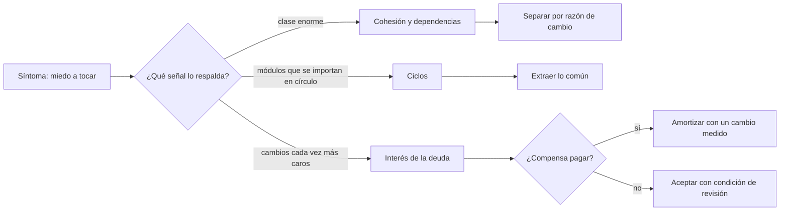

# SE-322 — Antipatrones y deuda de diseño

[← SE-321 — Resiliencia: bulkhead, sidecar, ambassador y degradación](https://github.com/vladimiracunadev-create/modern-software-engineering-program/blob/main/classes/part-26-patrones-de-diseno-empresariales-y-de-resiliencia/se-321-resiliencia-bulkhead-sidecar-ambassador-y-degradacion/README.md) · [↑ Parte 26](https://github.com/vladimiracunadev-create/modern-software-engineering-program/blob/main/classes/part-26-patrones-de-diseno-empresariales-y-de-resiliencia/README.md) · [📚 Índice completo](https://github.com/vladimiracunadev-create/modern-software-engineering-program/blob/main/classes/README.md) · [🌐 Portal](https://vladimiracunadev-create.github.io/modern-software-engineering-program/classes/SE-322.html) · [SE-323 — Taller: refactorizar con patrones y medir su costo →](https://github.com/vladimiracunadev-create/modern-software-engineering-program/blob/main/classes/part-26-patrones-de-diseno-empresariales-y-de-resiliencia/se-323-taller-refactorizar-con-patrones-y-medir-su-costo/README.md)

## Punto profesional y fundamento pedagógico

**Punto profesional.** La clase existe para que reconozcas un diseño que se ha vuelto caro de cambiar **con una medida y no con una impresión**, y para que distingas entre un antipatrón (una estructura recurrente que produce daño), un olor de código (una señal que merece revisión) y una incomodidad (algo que molesta pero no cuesta). También para que hables de **deuda de diseño** con un modelo explícito de cuánto interés se paga y cuándo conviene amortizarla, sin recurrir a la metáfora como argumento de autoridad. La habilidad profesional es traer a una discusión de diseño una tabla de números que cualquiera pueda repetir.

**Por qué aparece aquí.** Cierra el recorrido por los patrones: después de ver qué problema resuelve cada uno, se mira lo que ocurre cuando se aplican mal o no se aplican. Precede al taller (`SE-323`), que refactoriza con un patrón y mide, y al proyecto (`SE-324`), que decide con evidencia qué patrones se conservan.

**Error conceptual que debe corregir.** Creer que un diseño sano es el que tiene métricas buenas. Una métrica es una señal sobre un aspecto: en el experimento de esta clase, la **complejidad ciclomática máxima no cambia** (4 antes y 4 después) cuando se separa una clase de dios en tres, y habría declarado sano un diseño con diez razones para cambiar. Elegir la métrica equivocada es peor que no medir, porque da confianza falsa. Lo contrario también es un error: descartar toda medida por imperfecta y volver a la opinión.

**Secuencia de aprendizaje.** Antes de ejecutar, predices qué fracción de los pares de métodos de una clase de diez métodos y ocho dependencias comparte algún atributo, y si la complejidad ciclomática la distingue de su versión separada. Después ejecutas un análisis con `ast`, detectas un ciclo de dependencias con componentes fuertemente conexos y recorres un modelo ilustrativo del interés de la deuda con sus supuestos a la vista.

**Evidencia de aprendizaje.** Un `deuda-de-diseno.md` con un informe de métricas de un módulo propio (cohesión aproximada, dependencias, ciclos, complejidad) y la lectura de cada una con su límite, una lista de antipatrones con el síntoma observado y una decisión de amortizar o aceptar con una condición de revisión.

**Límite de la conclusión.** Las dos versiones de la clase y los grafos de dependencias son del autor; las métricas son aproximaciones. El modelo del interés de la deuda es una **ilustración con supuestos del autor** (un atajo cada dos cambios, interés lineal) y no una medición de ningún equipo. La clase **mide** señales estructurales sobre código pequeño; **no mide** la mantenibilidad percibida ni el costo real de la deuda en un equipo. No se invocó ningún modelo de lenguaje.

### Trazabilidad fuente → afirmación

| Fuente primaria u oficial | Afirmación que respalda | Lo que no prueba |
|---|---|---|
| [Fowler, «Code Smell»](https://martinfowler.com/bliki/CodeSmell.html) | Define un olor de código como una señal superficial que suele corresponder a un problema más profundo y que no siempre lo es. | No convierte un olor en un defecto. |
| [Fowler, «Technical Debt»](https://martinfowler.com/bliki/TechnicalDebt.html) | Explica la metáfora de la deuda técnica: un atajo que acelera hoy y cobra intereses en cambios futuros. | No da un modelo cuantitativo. |
| [Fowler, «Technical Debt Quadrant»](https://martinfowler.com/bliki/TechnicalDebtQuadrant.html) | Distingue la deuda deliberada de la inadvertida y la prudente de la imprudente. | No dice cuánta deuda es aceptable. |
| [Foote y Yoder, «Big Ball of Mud»](https://www.laputan.org/mud/) | Describe cómo sistemas sin estructura clara crecen por acumulación y por qué persisten. | No es una medición de frecuencia. |
| [Fowler, «Catalog of Refactorings»](https://refactoring.com/catalog/) | Cataloga los refactorizaciones que corrigen cada olor. | No dice cuándo conviene aplicarlas. |
| [McCabe, «A Complexity Measure»](https://doi.org/10.1109/TSE.1976.233837) | Define la complejidad ciclomática como número de caminos independientes. | No mide la cohesión ni las razones de cambio. |

## Antes de empezar

Recupera lo aprendido en `SE-317`: la cohesión y el acoplamiento tiran en direcciones opuestas. La pregunta activa es: **¿cuál es el módulo de tu proyecto que nadie quiere tocar, qué número lo describe y qué número habría que mirar para saber si empeora?**

## Prerrequisitos

- Haber completado `SE-317` (GRASP) y `SE-313` (criterio de patrón).
- Conocer la idea de olor de código y de refactorización de la [Parte 25](../../part-25-diseno-patrones-y-refactorizacion/README.md) y de mantenimiento de la [Parte 43](../../part-43-mantenimiento-y-modernizacion-legacy/README.md).
- Python 3.11 o posterior con `ast` y `random`.

## Problema auténtico

*Avisos* tiene una clase `Servicio` de 600 líneas que nadie quiere tocar. Cada cambio pasa por ella: registrar un aviso, enviar un correo, enviar un SMS, limpiar la caché, migrar datos. En la revisión de diseño, una persona la llama «clase de dios» y otra responde que «funciona y está probada». La discusión no avanza porque ninguna trae una medida. Además, los módulos `avisos`, `cursos` y `usuarios` se importan entre sí en círculo, de modo que probar uno exige cargar los tres, y el equipo describe su situación con «tenemos mucha deuda técnica» sin decir cuánta ni de qué clase.

La clase mide las tres cosas (clase grande, ciclo de módulos, deuda) y muestra cuál de las métricas habituales habría dado falsa tranquilidad.

## Objetivos observables

Al terminar podrás:

1. distinguir un antipatrón, un olor y una incomodidad con un criterio y un ejemplo cada uno;
2. medir la cohesión aproximada y las dependencias de una clase con `ast` y leer el resultado con su límite;
3. detectar ciclos de dependencias con componentes fuertemente conexos y proponer cómo romperlos;
4. explicar por qué una métrica puede declarar sano un diseño enfermo y combinar señales para evitarlo;
5. usar un modelo explícito del interés de la deuda para decidir si amortizar, con sus supuestos a la vista.

## Mapa conceptual



El mapa parte de un síntoma humano («miedo a tocar») y lo convierte en tres preguntas medibles. La última rama deja explícito que aceptar la deuda también es una decisión y tiene su condición.

## Temas y por qué importan

| Tema | Por qué cambia una decisión profesional | Evidencia mínima |
|---|---|---|
| Antipatrón, olor e incomodidad | Cada uno pide una respuesta distinta | Una clasificación con ejemplo |
| Clase de dios y cohesión | Muchas razones de cambio en un lugar | Pares de métodos sin estado compartido y dependencias |
| Elección de métrica | Una métrica puede dar falsa tranquilidad | Dos métricas sobre la misma clase con resultados distintos |
| Ciclos de dependencia | Impiden probar y desplegar por separado | Componentes fuertemente conexos |
| Deuda deliberada e inadvertida | Cambia cómo se decide amortizar | Una decisión registrada con su condición |
| Modelo del interés | Convierte la metáfora en una cuenta con supuestos | Costos con y sin pago |

## Conceptos y decisiones

### 1. Tres cosas que se confunden: antipatrón, olor, incomodidad

Un **antipatrón** es una estructura recurrente con un daño conocido (la «bola de barro» de Foote y Yoder, la clase de dios). Un **olor de código** es una señal superficial que a menudo corresponde a un problema más profundo, y a veces no (Fowler lo describe así: una indicación que merece investigarse). Una **incomodidad** es algo que molesta a quien lo lee sin costo medido. Distinguirlos importa porque piden respuestas distintas: el antipatrón se corrige con un refactor planificado, el olor se investiga con una medida, la incomodidad se deja o se arregla cuando se pasa cerca. Llamar «antipatrón» a toda incomodidad es la forma habitual de gastar tiempo de refactor sin retorno.

### 2. La clase de dios, medida

El experimento analiza con `ast` una clase `Servicio` con diez métodos que registran avisos, envían correo y SMS, limpian la caché, migran y exportan datos, y un constructor con **ocho dependencias**. Para cada par de métodos pregunta si comparten algún atributo de la instancia: **37 de los 45 pares** no comparten ninguno. Los métodos de envío de correo, de limpieza de caché y de migración casi no se tocan entre sí; viven juntos por historia, no por cohesión. Separada en tres clases (`Registro`, `Notificador`, `Migracion`), con 2, 2 y 3 métodos y 1, 3 y 1 dependencias, **ningún par queda sin compartir** estado. El número de clases subió de 1 a 3: la tensión entre cohesión y número de piezas de `SE-317`.


**Cómo leer la figura.** Cada grupo es una clase y tiene tres barras: los métodos (gris), las dependencias (dorada) y los pares sin estado compartido (coral). Mira la barra coral del servicio original, de 37, frente a cero en las tres clases en que se separa. **Dónde deja de valer:** «no comparten atributos» es una aproximación (LCOM) que puede dar falsos positivos (dos métodos coherentes por dominio) y falsos negativos (dos métodos acoplados por un atributo accidental); las clases son del autor y pequeñas. El resultado de la nota, **la complejidad no cambia**, es el hallazgo: la métrica de ramas no veía el problema.

### 3. La métrica que tranquiliza y no mide lo que importa

La complejidad ciclomática máxima por función es **4 antes y 4 después**. Cada método del `Servicio` es pequeño: ninguno tiene muchas ramas. Si el equipo solo vigilara la complejidad ciclomática (una práctica habitual porque se calcula fácil), la clase de dios pasaría todos los umbrales. El problema de la clase no es de ramas dentro de un método sino de **razones para cambiar** repartidas en una misma unidad. Las dos métricas miden aspectos distintos; ninguna sustituye a la otra. La regla de la clase: **ninguna decisión de diseño se apoya en una sola métrica**, y cada métrica se informa con la pregunta que contesta y la que no.

### 4. Ciclos de dependencias

Cuando `avisos` importa `cursos`, `cursos` importa `usuarios` y `usuarios` importa `cursos` y `avisos`, ningún módulo del grupo se puede probar, entender ni desplegar sin los otros. El análisis de **componentes fuertemente conexos** (el algoritmo de Tarjan) los detecta: en el grafo del experimento devuelve un componente de tamaño tres, `['avisos', 'cursos', 'usuarios']`. Se rompe **extrayendo lo compartido** a un módulo del que todos dependan (`dominio`), no moviendo la importación de un lado a otro: con tres módulos que dependen de `dominio` y ninguno de los otros, el análisis devuelve **cero** ciclos.


**Cómo leer la figura.** La primera fila es el grafo con ciclo y el resultado del análisis; la segunda, el grafo corregido y su resultado. **Dónde deja de valer:** los grafos son de cuatro módulos escritos a mano; un sistema real tiene cientos de módulos, ciclos entre paquetes y dependencias dinámicas que el análisis estático no ve (importaciones en tiempo de ejecución, inyección por configuración). Un análisis real debe incorporarse al CI para que un ciclo nuevo falle la integración.

### 5. La deuda como una cuenta, con sus supuestos

La metáfora de la deuda dice que un atajo ahorra tiempo hoy y cobra intereses en cada cambio posterior. Fowler distingue la deuda **deliberada** (se toma sabiendo que se paga más tarde) de la **inadvertida** (se descubre después) y la **prudente** de la **imprudente**. Para pasar de metáfora a decisión hace falta una cuenta. El modelo de la clase es una **ilustración**: cada cambio cuesta 4 horas de base más un interés proporcional a la deuda acumulada, se acumula 1,5 unidades de deuda cada dos cambios y hay una variación aleatoria de ±20 % con semilla fija. Sin pagar, las horas por cambio crecen de 4,0 a 10,3 y suman 70,4 horas en diez cambios. Con un pago de 6 horas en el cambio cinco, el cambio cinco cuesta 13,1 (el costo del pago) y luego los cambios vuelven a 4,0 hasta que la deuda se acumula de nuevo; el total es 55,2 horas.


**Cómo leer la figura.** El eje horizontal es el cambio sucesivo y el vertical las horas que cuesta. La línea coral es no pagar la deuda y la turquesa pagarla con 6 horas en el cambio 5. Mira el pico del cambio 5, el pago, y cómo la línea turquesa vuelve a 4,0 mientras la otra sigue subiendo: el modelo es ilustrativo, no medido. **Dónde deja de valer:** todo el modelo es un supuesto del autor (el atajo cada dos cambios, el interés lineal, la deuda que se paga por completo en una vez); no es una medición. Su valor es que **muestra la forma de la decisión**: pagar tiene un costo inmediato visible (13,1 frente a 5,4) y un beneficio diferido que solo aparece si se hacen suficientes cambios después. Para medir el interés real hay que registrar el tiempo de cambio de un equipo.

### 6. Decidir: amortizar, aceptar o convivir

Con las tres medidas, la decisión no es «refactorizar todo» sino elegir **qué pagar y cuándo**: la parte de la clase de dios que más se cambia, el ciclo que bloquea las pruebas, la métrica que se degrada. Una deuda aceptada se registra con su **condición de revisión** («revisar si el módulo se toca más de cuatro veces al trimestre»). La deuda sin registrar es la imprudente de Fowler: no se decidió, se acumuló.

## Definiciones de trabajo

- **Antipatrón:** estructura recurrente con un daño conocido.
- **Olor de código:** señal superficial que merece investigarse.
- **Clase de dios:** clase con muchas razones para cambiar y muchas dependencias.
- **Cohesión (aproximada):** fracción de pares de métodos que comparten estado.
- **Componente fuertemente conexo:** grupo de módulos que se alcanzan entre sí.
- **Deuda de diseño:** diferencia entre el diseño que se tiene y el que haría barato el próximo cambio.
- **Interés:** costo extra por cambio debido a la deuda acumulada.

## Ejemplo mínimo

```python
import ast

def pares_sin_estado(src: str) -> tuple[int, int]:
    cls = next(n for n in ast.parse(src).body if isinstance(n, ast.ClassDef))
    metodos = [m for m in cls.body if isinstance(m, ast.FunctionDef) and m.name != "__init__"]
    attrs = {m.name: {n.attr for n in ast.walk(m)
                      if isinstance(n, ast.Attribute) and isinstance(n.value, ast.Name) and n.value.id == "self"}
             for m in metodos}
    pares = [(a, b) for i, a in enumerate(metodos) for b in metodos[i + 1:]]
    return sum(1 for a, b in pares if not attrs[a.name] & attrs[b.name]), len(pares)
```

Devuelve cuántos pares de métodos no comparten atributos y cuántos pares hay. Es una señal para revisar y no un veredicto.

## Ejemplo profesional

*Escenario ilustrativo: las cifras de este ejemplo son supuestos de la narración, no mediciones.*

El equipo de *Avisos* ejecuta el análisis sobre sus diez módulos más cambiados: dos tienen más de 30 pares de métodos sin estado compartido y un ciclo de tres paquetes. Registra la decisión de cada uno: separar `Servicio` en tres (la parte de notificaciones se toca cada semana), aceptar el ciclo de `reportes` por ahora con la condición de revisarlo cuando se toque, y añadir al CI una comprobación que falla si aparece un ciclo nuevo. Para justificar el esfuerzo ante producto presenta la tabla de tiempos de los últimos diez cambios en `Servicio` (promedio de 9 horas frente a 4 en otros módulos, un dato propio del equipo) y la compara con el costo estimado del refactor.

## Práctica guiada

1. Escribe tu predicción de la fracción de pares sin estado compartido en la clase de dios.
2. Ejecuta `python scripts/experiments_part26_b.py 526` y compara.
3. Cambia la clase separada para que `Notificador` use también la base y observa cómo cambia la cohesión.
4. Añade una dependencia que cree un ciclo de cuatro módulos y comprueba que se detecta.
5. Ejecuta el análisis sobre un módulo propio y escribe la lectura de cada número con su límite.

## Ejercicios

1. **Básico.** Clasifica tres problemas de tu código como antipatrón, olor o incomodidad y justifica cada clasificación.
2. **Intermedio.** Busca una clase de tu código con un resultado de cohesión alto en pares sin estado compartido y revisa si de verdad tiene varias razones de cambio.
3. **Avanzado.** Diseña una comprobación de CI que impida ciclos nuevos sin bloquear los existentes y registre los existentes con una fecha de revisión.

## Reto verificable

Entrega `deuda-de-diseno.md` con las métricas de un módulo propio (cohesión aproximada, dependencias, ciclos y complejidad) con la lectura y el límite de cada una, la clasificación de tres problemas y una decisión de amortizar o aceptar con su condición de revisión. Es válido si otra persona repite las métricas con el mismo comando y obtiene los mismos números.

## Caso conductor

*Avisos* tiene su clase `Servicio` de 600 líneas y el ciclo entre `avisos`, `cursos` y `usuarios`. Esta clase los mide; `SE-323` refactoriza otro punto doloroso (la tarifa) con un patrón y medidas; `SE-324` pone cada patrón y cada deuda en un catálogo con su condición de salida o de revisión.

## Preguntas frecuentes

### ¿Es toda la deuda técnica mala?

No. Una deuda deliberada y prudente puede ser la decisión correcta (entregar antes para aprender) si se registra y se paga. Lo dañino es la deuda inadvertida o la imprudente: la que se acumula sin que nadie la decida.

### ¿Qué umbral de complejidad ciclomática debo imponer?

El que tu equipo pueda justificar con sus datos. Los números que circulan (10, 15, 20) son convenciones. Más útil que un umbral es vigilar la tendencia por módulo y combinarla con otras señales.

### ¿Los ciclos de dependencia son siempre un problema?

Entre módulos que se despliegan y prueban juntos, un ciclo pequeño puede ser tolerable. Entre paquetes que deberían ser independientes, impide probar y desplegar por separado. La condición depende de lo que se quiere poder hacer.

### ¿Puede un agente detectar antipatrones?

Puede señalar candidatos, pero sin medida tiende a confirmar el nombre («esto parece una clase de dios»). La petición útil pide la medida (pares sin estado, dependencias, ciclos) y la clasificación con su límite.

## Fallo controlado y diagnóstico

**Fallo.** El equipo añade una regla de CI que falla si la complejidad ciclomática de una función supera 10. Se cumple en toda la base de código y la clase `Servicio` sigue siendo intocable.

**Diagnóstico paso a paso.** (1) Se mide la complejidad máxima de `Servicio`: 4, bajo el umbral. (2) Se mide la cohesión aproximada: 37 de 45 pares sin estado compartido. (3) La causa no es la regla sino la métrica elegida: mide un aspecto (ramas por función) que no es el problema (razones de cambio).

**Corrección.** Se añade la métrica de cohesión y de dependencias al informe, con una lectura y un límite, se separa la clase por razón de cambio y se conserva la complejidad como señal complementaria.

## Errores comunes y cómo corregirlos

- **Síntoma: una sola métrica en verde y el módulo intocable.** Causa: métrica que no mide el problema. Solución: combinar señales y declarar la pregunta de cada una.
- **Síntoma: todo es «antipatrón».** Causa: sin criterio de clasificación. Solución: distinguir antipatrón, olor e incomodidad.
- **Síntoma: refactor que no baja el costo de cambio.** Causa: se separó por tamaño y no por razón de cambio. Solución: separar por razón de cambio medida.
- **Síntoma: un ciclo «arreglado» que reaparece.** Causa: se movió la importación sin extraer lo común. Solución: extraer un módulo base y añadir la comprobación al CI.
- **Síntoma: deuda que nadie decidió.** Causa: acumulación sin registro. Solución: registrar cada atajo con su condición de revisión.

## Entorno y archivos clave

- `scripts/experiments_part26_b.py`: dos versiones de la clase como texto, métricas con `ast`, análisis de componentes fuertemente conexos y modelo ilustrativo del interés con semilla 526; `python scripts/experiments_part26_b.py 526`.
- `content/part-26/figures/`: figuras.
- Sin dependencias fuera de la biblioteca estándar.

## Seguridad, ética y accesibilidad

Una clase de dios con permisos amplios es una superficie de ataque grande: el código que puede enviar correos, migrar datos y limpiar cachés tiene demasiado alcance; separarlo permite aplicar mínimo privilegio. Medir a personas con métricas de código (quién tiene la clase más grande) es un abuso: las métricas describen el código y se usan para decidir sobre el código. Ética: la deuda que se descarga sobre quien mantiene después es una decisión que debe tomarse con conocimiento de quién la pagará. Accesibilidad: las figuras tienen texto alternativo completo y las tablas se leen sin color.

## Puente hacia el trabajo con agentes

Un agente puede proponer refactores de una clase grande con facilidad y sin saber qué razones de cambio la unen. La petición útil le entrega las medidas (cohesión, dependencias, historial de cambios por método) y pide: separación por razón de cambio, comprobación de que el comportamiento no cambió (un maestro dorado, `SE-323`) y el cálculo de las mismas métricas después. Los agentes también agilizan la detección de ciclos, que se comprueba con un análisis determinista y no con la lectura del modelo.

## Transferencia

Ejecuta las métricas sobre el módulo más cambiado de un proyecto propio y compáralas con su historial de cambios. La idea se transfiere a cualquier dominio donde un número tranquiliza: cobertura de pruebas, tamaño de archivos, número de dependencias.

## Evaluación y evidencia

- Cada problema se clasifica como antipatrón, olor o incomodidad con un criterio.
- Las métricas se informan con la pregunta que contestan y la que no.
- Los ciclos se detectan con un análisis reproducible.
- La deuda se decide con un modelo de supuestos explícitos y una condición de revisión.
- La afirmación final distingue señales estructurales de medidas del costo real.

## Fuentes

- Fowler, M. [«Code Smell»](https://martinfowler.com/bliki/CodeSmell.html).
- Fowler, M. [«Technical Debt»](https://martinfowler.com/bliki/TechnicalDebt.html).
- Fowler, M. [«Technical Debt Quadrant»](https://martinfowler.com/bliki/TechnicalDebtQuadrant.html).
- Foote, B. y Yoder, J. [«Big Ball of Mud»](https://www.laputan.org/mud/).
- Fowler, M. [«Catalog of Refactorings»](https://refactoring.com/catalog/).
- McCabe, T. [«A Complexity Measure»](https://doi.org/10.1109/TSE.1976.233837).

## Límites y siguiente paso

Las clases, los grafos y el modelo de deuda son del autor; las métricas son aproximaciones y el interés es una ilustración. No se midió ningún equipo ni su historial real de cambios. El siguiente paso, `SE-323`, toma un punto doloroso concreto y lo refactoriza con un patrón con un maestro dorado, midiendo antes y después y decidiendo si el patrón se queda.

## Glosario

| Término | Definición breve |
|---|---|
| Antipatrón | Estructura recurrente con daño conocido |
| Olor de código | Señal que merece investigarse |
| Clase de dios | Clase con muchas razones para cambiar |
| Cohesión | Propósito común de los métodos de una clase |
| Ciclo de dependencias | Módulos que se alcanzan entre sí |
| Deuda de diseño | Distancia entre el diseño actual y el que abarataría el cambio |

---

[← SE-321 — Resiliencia: bulkhead, sidecar, ambassador y degradación](https://github.com/vladimiracunadev-create/modern-software-engineering-program/blob/main/classes/part-26-patrones-de-diseno-empresariales-y-de-resiliencia/se-321-resiliencia-bulkhead-sidecar-ambassador-y-degradacion/README.md) · [↑ Parte 26](https://github.com/vladimiracunadev-create/modern-software-engineering-program/blob/main/classes/part-26-patrones-de-diseno-empresariales-y-de-resiliencia/README.md) · [📚 Índice completo](https://github.com/vladimiracunadev-create/modern-software-engineering-program/blob/main/classes/README.md) · [🌐 Portal](https://vladimiracunadev-create.github.io/modern-software-engineering-program/classes/SE-322.html) · [SE-323 — Taller: refactorizar con patrones y medir su costo →](https://github.com/vladimiracunadev-create/modern-software-engineering-program/blob/main/classes/part-26-patrones-de-diseno-empresariales-y-de-resiliencia/se-323-taller-refactorizar-con-patrones-y-medir-su-costo/README.md)
