# Parte 27 — Integración, eventos y mensajería

La Parte 26 dejó una capa de datos correcta dentro de un servicio. La pregunta cambia de «qué pasa con los datos de un servicio» a «qué pasa cuando varios sistemas deben ponerse de acuerdo sin compartir una transacción, un reloj ni un horario de despliegue». Esta parte trabaja sobre **el flujo de la plataforma de entregas de tareas**, un caso sintético: una entrega llega, se guarda, se califica, se avisa al estudiante y se registra para análisis, con un calificador, un servicio de avisos, una analítica y un sistema académico externo. Recorre la elección entre esperar una respuesta y dejar un mensaje, la diferencia entre comandos, eventos y documentos, las colas, los tópicos y los logs, las semánticas de entrega, orden y duplicación, el outbox, la inbox y las sagas, la captura de cambios y la sincronización de bases, los webhooks y el sondeo, la compatibilidad de esquemas, la traducción entre modelos, la observabilidad y la seguridad de las integraciones, un taller para provocar y contener duplicados y un proyecto de flujo tolerante a reintentos.

## Pregunta rectora

> ¿Qué debe seguir siendo verdad del flujo cuando un mensaje se pierde, llega dos veces, llega tarde o llega con otra forma, y cómo lo sabría quien opera el sistema?

## Antes del recorrido clase por clase

Esta parte no enseña un corredor de mensajes ni un producto. Enseña a decidir con criterios medibles si una interacción espera o deja un mensaje, a distinguir lo que significa un comando de lo que significa un evento, a elegir entre cola, tópico y log por lo que ocurre con el mensaje tras leerse, a asumir que entre procesos solo se elige entre perder y duplicar y construir el efecto exactamente una vez en el receptor, a guardar un cambio y su mensaje en la misma transacción, a ordenar los pasos de una saga para que lo irreversible vaya al final, a llevar el estado de una base a otra sin perder los borrados, a recibir avisos de un tercero verificando firma, marca de tiempo e identificador, a cambiar la forma de un mensaje sin romper a quien lo lee, a traducir un modelo ajeno en una frontera propia, a ver y proteger el flujo sin copiar datos personales a los registros, y a provocar fallas combinadas para comprobar que las defensas funcionan juntas. Cada clase ejecuta experimentos con datos sintéticos que muestran un mecanismo (una cadena de cinco dependencias que completa el 95,2 % de las peticiones, un consumidor idempotente que convierte 1 476 efectos duplicados en cero, un hash de contenido que descarta 635 mensajes distintos) y declara lo que esa medida no demuestra.

```mermaid
flowchart LR
    A[Síncrono o asíncrono] --> B[Mensajes, eventos y comandos]
    B --> C[Colas, tópicos y logs]
    C --> D[Entrega, orden y duplicación]
    D --> E[Outbox, inbox y sagas]
    E --> F[CDC, ETL y sincronización]
    F --> G[Webhooks y sondeo]
    G --> H[Compatibilidad de esquemas]
    H --> I[Capa anticorrupción]
    I --> J[Observabilidad y seguridad]
    J --> K[Taller de duplicados]
    K --> L[Proyecto de flujo tolerante]
    L -->|incidente o hallazgo| A
```

El diagrama se lee de izquierda a derecha y no es un proceso obligatorio. El retorno indica que un incidente, un hallazgo del ensayo con fallas o un cambio de requisito reabre la decisión inicial; un paquete aprobado no cierra el diseño, lo fecha.

## Resultados acumulativos

Podrás calcular cómo cae la disponibilidad de una petición síncrona con cada dependencia, medir la amplificación de carga de reintentos apilados y el tiempo que tarda una cola en vaciarse tras una caída; medir qué cuesta equivocar el contenido de un evento (llamadas de vuelta frente a lecturas del instante equivocado), qué hace un bus con un comando y con un evento según los manejadores registrados y qué capacidades pierde un consumidor al quitar un campo del sobre; comparar una cola de trabajo, un tópico y un log por lo que reciben un suscriptor tardío y un reproceso, medir la carga por consumidor con una clave popular y qué estado se reconstruye con retención o con compactación; cuantificar los mensajes perdidos y los efectos duplicados de tres semánticas de entrega, los estados equivocados que deja el desorden y los duplicados que deja pasar una ventana de deduplicación; comparar tres formas de escribir y publicar, el orden del relevo de un outbox y el orden de los pasos de una saga; contar qué filas faltan, sobran o están viejas según el método de detección de cambios, el ahorro de lectura frente al costo de escritura de registrar cambios y el efecto de aplicar eventos repetidos y desordenados con y sin versión; medir el costo de sondear, qué ataque cierra cada capa de verificación de un webhook y qué pierde un emisor que reintenta poco; construir la matriz de compatibilidad de siete cambios de esquema, medir los fallos de un despliegue gradual y comparar cuatro políticas ante un valor nuevo de una enumeración; medir qué entra y qué se rompe sin una capa anticorrupción y cuánta información se pierde al traducir; medir las trazas que sobreviven a la pérdida de correlación, la señal que detecta cada falla de un consumidor y lo que filtra cada política de registro; provocar cinco causas de duplicados, contener cada una con la defensa adecuada y mostrar dos formas en que una defensa falla al revés; y entregar un paquete de integración con un validador cuyos puntos ciegos conoces, una simulación con fallas combinadas y el pico de carga de una recuperación.

Al finalizar podrás defender un flujo integrado con sus invariantes, su contrato de mensajes, su política de reintentos coherente con su ventana de deduplicación, su mecanismo de sincronización, su política de esquemas, su frontera de traducción, sus señales y sus límites, y podrás indicar qué parte de tu conclusión es observación, cuál es inferencia y cuál es suposición.

## Prerrequisitos enlazados

- [Parte 13 — Especificaciones, contratos y modelos](https://github.com/vladimiracunadev-create/modern-software-engineering-program/blob/main/classes/part-13-especificaciones-contratos-y-modelos/): contratos, compatibilidad entre versiones y pruebas de contrato.
- [Parte 19 — Web, front-end y aplicaciones progresivas](https://github.com/vladimiracunadev-create/modern-software-engineering-program/blob/main/classes/part-19-web-frontend-y-aplicaciones-progresivas/): entradas no confiables, firmas y seguridad de interfaces.
- [Parte 20 — Backend, APIs y procesamiento asíncrono](https://github.com/vladimiracunadev-create/modern-software-engineering-program/blob/main/classes/part-20-backend-apis-y-procesamiento-asincrono/): idempotencia, reintentos y trabajo asíncrono.
- [Parte 25 — Arquitectura de software y dominio](https://github.com/vladimiracunadev-create/modern-software-engineering-program/blob/main/classes/part-25-arquitectura-de-software-y-dominio/): contextos delimitados y decisiones registradas.
- [Parte 26 — Datos, persistencia y recuperación](https://github.com/vladimiracunadev-create/modern-software-engineering-program/blob/main/classes/part-26-datos-persistencia-y-recuperacion/): transacciones, migraciones compatibles y copias de seguridad.
- Python 3.11+ y terminal; los experimentos usan solo la biblioteca estándar (incluido `sqlite3`) y datos sintéticos.

## Bloques y progresión

1. **Decidir cómo hablan:** las clases 325 y 326 miden el costo de esperar y de reintentar y lo que cuesta equivocar la forma de un mensaje.
2. **Transportar y garantizar:** las clases 327 y 328 comparan colas, tópicos y logs y miden qué pierde, duplica o desordena cada semántica de entrega.
3. **Atomicidad y coordinación:** las clases 329 y 330 resuelven la doble escritura con un outbox y miden qué detecta cada método de sincronización.
4. **Fronteras con terceros:** las clases 331, 332 y 333 miden el costo del sondeo y la verificación de un webhook, la compatibilidad de esquemas y la pérdida de información al traducir un modelo ajeno.
5. **Operar y proteger:** la clase 334 mide la correlación, las señales de un consumidor y las fugas de datos en los registros.
6. **Aplicar e integrar:** las clases 335 y 336 provocan y contienen duplicados y entregan un flujo tolerante a reintentos con su paquete y sus límites.

## Evidencia medida y límites

Las figuras y los ejemplos de esta parte usan experimentos ejecutados con CPython 3.12.9 en Windows 11 (SQLite 3.45.3) y repetidos con CPython 3.12.3 en Ubuntu bajo WSL2 (SQLite 3.45.1). Los datos son **sintéticos** y las semillas están fijadas: las salidas de los doce experimentos fueron idénticas en ambos sistemas en todas las cifras salvo una excepción del entorno y no del método: los pasos de la máquina virtual de SQLite del costo de registrar cambios de `SE-330` difirieron un 5 % o menos entre las dos versiones del motor con la misma proporción (210 006 y 560 001 pasos en Windows, 220 006 y 570 001 en Ubuntu). Ninguno mide tiempo de reloj. Todo el código usa solo la biblioteca estándar y está en `scripts/experiments_part27_a.py` (`SE-325` a `SE-330`) y `scripts/experiments_part27_b.py` (`SE-331` a `SE-336`), con una función por experimento.

Los experimentos son: una cadena síncrona de una a cinco dependencias frente a una cola, tres niveles de reintentos apilados con y sin presupuesto y una cola tras una caída de 600 s con cuatro capacidades de recuperación (`SE-325`); una notificación mínima frente a un evento con el estado completo para cinco consumidores, un bus con cero, uno y tres manejadores para un comando y un evento y las capacidades que pierde un consumidor sin identificador, sin secuencia o sin correlación (`SE-326`); una cola de trabajo, un tópico y un log ante dos consumidores, un suscriptor tardío y un reproceso, la carga de seis combinaciones de particiones y consumidores con una clave popular y tres estrategias de retención de un log de 100 000 eventos (`SE-327`); tres semánticas de entrega con 20 000 mensajes y una tabla de mensajes vistos en SQLite, el efecto del desorden con y sin guarda de versión y seis ventanas de deduplicación frente a las reentregas de un día (`SE-328`); tres órdenes de escribir y publicar con y sin outbox en SQLite, un relevo que publica y marca en dos órdenes con una inbox y una saga de cuatro pasos con dos órdenes (`SE-329`); tres métodos de detección de cambios sobre un origen de SQLite con 2 000 operaciones, el ahorro de lectura de una copia incremental con el costo de escritura de un disparador medido en pasos de la máquina virtual y la aplicación de 5 000 eventos desordenados y repetidos con y sin versión (`SE-330`); el costo de sondear a seis intervalos, siete entregas de un webhook frente a cuatro políticas de verificación con una prueba en un servidor HTTP del bucle local y tres calendarios de reintento ante una caída de dos horas (`SE-331`); siete cambios de esquema frente a lectores tolerantes y estrictos, un despliegue gradual de cinco pasos y cuatro políticas ante un valor nuevo de una enumeración (`SE-332`); 5 000 registros de un sistema externo sintético frente a una conversión directa y a una capa anticorrupción, seis funciones ante un campo renombrado y la fidelidad de dos traducciones con pérdida (`SE-333`); trazas de tres saltos con pérdida de la correlación, cuatro fallas de un consumidor frente a cuatro señales y cuatro políticas de registro sobre 2 000 mensajes con datos sensibles sintéticos (`SE-334`); cinco causas de duplicados, cinco defensas y dos defensas mal colocadas con SQLite (`SE-335`); y un validador sobre 200 mutaciones de un paquete, un flujo de 3 000 entregas con fallas combinadas en variante ingenua y tolerante y la carga de 600 reintentos simultáneos con tres políticas (`SE-336`).

Los parámetros (el 1 % de fallo por llamada, un envío por segundo, la caída de 600 s, el presupuesto de reintentos del 10 %, el 30 % de entidades que cambian antes de leerse, la popularidad Zipf con exponentes 1,0 y 1,1, el 2 % de pérdida, el 5 % de acuses perdidos y el 2 % de caídas, las reentregas con media de 60 s y una cola larga del 1 %, el 3 % de caídas del relevo, el 8 % de fallo por paso de una saga y el 10 % por intento de compensación, la resolución de un segundo con cinco operaciones por segundo, los 12 eventos por hora, la pérdida de respuesta del 5 % por intento, el despliegue en cinco pasos del 20 %, el 6 % de valores nuevos de una enumeración, los cuatro formatos de nota y la asignación de nueve estados a cuatro, las pérdidas de correlación de 0, 1, 5 y 20 %, los umbrales de las señales, el plazo de visibilidad de 30 s con proceso lognormal de mediana 16 s, las fallas inyectadas del flujo completo y el fallo simultáneo de los 600 mensajes) son supuestos del autor, no datos de una plataforma, una institución, un proveedor ni de personas reales. Las reglas léxicas del validador de `SE-336` y las de normalización de `SE-333` se ajustaron con los mismos casos que las evalúan: su exactitud real es desconocida. El bus, las colas, los tópicos, los logs, el corredor y el relevo son modelos del autor de unas pocas líneas y no reproducen ningún producto. Los generadores de números pseudoaleatorios de Python se usaron solo para simular; no son criptográficos, y el secreto de las firmas de `SE-331` es un valor de ensayo. El servidor HTTP de la prueba real escucha solo en la interfaz de bucle local y en un puerto efímero. No se usó ningún corredor, broker, proveedor de nube, servicio de terceros, herramienta de trazado o de métricas, formato de serialización binario ni registro de esquemas; no se midió latencia, rendimiento, concurrencia ni tiempo de recuperación; y no se evaluó el cumplimiento de ninguna norma. Esta parte no tiene laboratorio propio en `labs/`; el proyecto integrador `SE-336` define el paquete y la evidencia. Cada clase termina con un puente hacia el trabajo con agentes.

## Guía razonada clase por clase

El flujo de la plataforma mantiene un contrato, un paquete y una simulación estables mientras cambian las decisiones. Cada clase explica qué incertidumbre reduce, qué experimento la muestra, qué no demuestra y qué evidencia permite abandonar la conclusión.

### Bloque 1 — Decidir cómo hablan

#### SE-325 — Integración síncrona y asíncrona

Una cola no elimina el fallo: lo traslada y cambia errores inmediatos por retraso. La clase calcula cómo cae la disponibilidad de una petición con cada dependencia, mide cuántas llamadas recibe un servicio caído cuando varias capas reintentan y obtiene el tiempo que tarda una cola en vaciarse según el margen de capacidad.

El estudiante entrega la clasificación de las interacciones de la plataforma con su contrato de respuesta y la política de una llamada síncrona. `SE-326` pregunta qué viaja en el mensaje.

#### SE-326 — Mensajes, eventos, comandos y documentos

El tipo y el contenido de un mensaje son un contrato que otros ya usan. La clase mide qué lecturas equivocadas produce una notificación mínima y un evento con el estado completo, qué hace un bus con un comando y con un evento cuando no hay manejadores o hay varios y qué pierde un consumidor cuando el sobre no lleva identificador, secuencia o correlación.

El estudiante entrega el catálogo de mensajes con tipo, sobre y contenido justificado. `SE-327` pregunta por dónde viajan.

### Bloque 2 — Transportar y garantizar

#### SE-327 — Brokers, colas, topics y logs distribuidos

La estructura decide qué ocurre con un mensaje después de leerlo. La clase compara cola, tópico y log ante un suscriptor tardío y un reproceso, mide la carga por consumidor con una clave popular y qué estado se reconstruye desde un log con retención o con compactación.

El estudiante entrega la asignación de cada flujo a una estructura con su clave y su retención. `SE-328` pregunta qué garantías ofrecen.

#### SE-328 — Entrega, orden, duplicación y semánticas

Entre procesos que fallan solo se elige entre perder y duplicar. La clase mide los mensajes perdidos y los efectos duplicados de tres semánticas, los estados equivocados que deja el desorden con y sin guarda de versión y los duplicados que deja pasar una ventana de deduplicación según el tiempo que tarda en volver una reentrega.

El estudiante entrega la tabla de garantías de cada consumidor. `SE-329` pregunta cómo publicar de forma atómica.

### Bloque 3 — Atomicidad y coordinación

#### SE-329 — Outbox, inbox, sagas y compensación

No existe un orden seguro de dos escrituras en sistemas distintos. La clase compara escribir y publicar en tres estrategias con caídas intermedias, mide por qué el relevo del outbox debe preferir duplicar a perder y cuenta cuántas sagas dejan un residuo irreversible según el orden de los pasos.

El estudiante entrega el esquema de outbox e inbox y la saga con su pivote. `SE-330` pregunta cómo llevar el estado de una base a otra.

#### SE-330 — CDC, ETL, ELT y sincronización

Sincronizar es elegir qué cambios se ven y cómo se aplican. La clase mide qué filas faltan, sobran o están viejas según el método de detección, compara el ahorro de lectura de la copia incremental con el costo de escritura de registrar cambios y aplica eventos repetidos y desordenados con y sin versión.

El estudiante entrega el mecanismo de sincronización de cada destino con su arranque y su reconciliación. `SE-331` pregunta cómo avisarse con sistemas ajenos.

### Bloque 4 — Fronteras con terceros

#### SE-331 — Webhooks, polling y suscripciones

Empujar o tirar reparte la disponibilidad entre emisor y receptor. La clase mide el costo y el retraso de sondear a seis intervalos, qué ataque cierra cada capa de verificación de un webhook (firma, marca de tiempo, identificador visto) y cuántos eventos se pierden o se repiten según el calendario de reintentos del emisor.

El estudiante entrega el contrato de recepción y la decisión de webhook, sondeo o ambos. `SE-332` pregunta qué pasa cuando cambia la forma de los mensajes.

#### SE-332 — Compatibilidad de esquemas y registros

La compatibilidad depende de quién lee y de cómo. La clase clasifica siete cambios de esquema para un lector tolerante y uno estricto, mide los fallos de un despliegue gradual según qué lado se actualiza primero y compara cuatro políticas del consumidor ante un valor nuevo de una enumeración.

El estudiante entrega las reglas de evolución, las fases de un cambio incompatible y la política ante lo desconocido. `SE-333` pregunta cómo protegerse de un modelo ajeno.

#### SE-333 — Anti-corruption layers y traducción de modelos

Traducir también es resumir. La clase mide cuántos registros rompe y cuántos deja entrar con otro significado una conversión directa de un sistema externo, cuántas funciones fallan cuando el proveedor renombra un campo con y sin capa y qué fracción de los registros no se recupera tras traducir nueve estados a cuatro.

El estudiante entrega el mapa de traducción y la política de cuarentena. `SE-334` pregunta cómo ver y proteger el flujo.

### Bloque 5 — Operar y proteger

#### SE-334 — Observabilidad y seguridad de integraciones

Lo que no se puede seguir no se puede arreglar, y lo que se registra se copia. La clase mide qué fracción de las trazas sobrevive a la pérdida de correlación, qué señal detecta cada falla de un consumidor y cuál da una falsa alarma, y cuántos datos sensibles filtra cada política de registro.

El estudiante entrega las alarmas con su acción, la política de registro y la tabla de amenazas. `SE-335` pone todo a prueba con duplicados provocados.

### Bloque 6 — Aplicar e integrar

#### SE-335 — Taller: provocar y contener mensajes duplicados

Un duplicado tiene al menos cinco causas y cada una se contiene en un lugar distinto. El taller las provoca, mide qué defensa contiene cuál y muestra que guardar la clave y el efecto por separado pierde o duplica y que una clave demasiado gruesa descarta operaciones legítimas.

El estudiante entrega la matriz de defensas por causas y un procedimiento de diagnóstico de seis pasos. `SE-336` los integra en un flujo.

#### SE-336 — Proyecto: flujo integrado tolerante a reintentos

Un paquete completo no es un paquete correcto. El proyecto mide qué detecta un validador sobre 200 mutaciones, compara un flujo ingenuo con uno tolerante bajo fallas combinadas y calcula el pico de carga de 600 reintentos simultáneos con y sin aleatoriedad.

El estudiante entrega el paquete de integración, el validador, la simulación y `LIMITES.md`. La Parte 28 lleva estas ideas a la concurrencia y a los sistemas distribuidos.

## Fuentes

- [Hohpe y Woolf, «Enterprise Integration Patterns»](https://www.enterpriseintegrationpatterns.com/) — catálogo de patrones de mensajería; autoridad: autores del libro.
- [Kleppmann, «Designing Data-Intensive Applications»](https://dataintensive.net/) — mensajería, captura de cambios y sistemas derivados como compromisos de diseño; autoridad: autor del libro.
- [Helland, «Life beyond distributed transactions»](https://www.cidrdb.org/cidr2007/papers/cidr07p15.pdf) — diseño con mensajes entre entidades sin transacción compartida; autoridad: artículo del autor (CIDR 2007).
- [Apache Kafka: documentación](https://kafka.apache.org/documentation/) y [Amazon SQS: colas estándar](https://docs.aws.amazon.com/AWSSimpleQueueService/latest/SQSDeveloperGuide/standard-queues.html) — logs, particiones, semánticas de entrega y colas; autoridad: documentación oficial de cada proyecto.
- [Garcia-Molina y Salem, «Sagas»](https://dl.acm.org/doi/10.1145/38713.38742) y [microservices.io: Transactional outbox](https://microservices.io/patterns/data/transactional-outbox.html) — compensaciones y publicación atómica; autoridad: artículo original y catálogo de Chris Richardson.
- [Lamport, «Time, clocks, and the ordering of events in a distributed system»](https://dl.acm.org/doi/10.1145/359545.359563) — orden causal entre procesos; autoridad: artículo original.
- [Debezium: documentación](https://debezium.io/documentation/) y [PostgreSQL: decodificación lógica](https://www.postgresql.org/docs/current/logicaldecoding.html) — captura de cambios sobre el registro de la base; autoridad: proyecto Debezium y PostgreSQL.
- [Stripe: webhooks](https://docs.stripe.com/webhooks), [GitHub: validar entregas](https://docs.github.com/en/webhooks/using-webhooks/validating-webhook-deliveries) y [RFC 2104: HMAC](https://www.rfc-editor.org/rfc/rfc2104) — firmas, marcas de tiempo y reintentos de webhooks; autoridad: documentación oficial de cada proveedor e IETF.
- [Confluent: evolución de esquemas](https://docs.confluent.io/platform/current/schema-registry/fundamentals/schema-evolution.html) y [Apache Avro: especificación](https://avro.apache.org/docs/current/specification/) — compatibilidad de esquemas; autoridad: documentación de Confluent y de Apache Avro.
- [Microsoft: patrón Anti-Corruption Layer](https://learn.microsoft.com/en-us/azure/architecture/patterns/anti-corruption-layer) y [Evans, «Domain-Driven Design Reference»](https://www.domainlanguage.com/ddd/reference/) — traducción entre contextos; autoridad: documentación de Microsoft y autor del libro.
- [W3C Trace Context](https://www.w3.org/TR/trace-context/), [OpenTelemetry: mensajería](https://opentelemetry.io/docs/specs/semconv/messaging/) y [OWASP: Logging Cheat Sheet](https://cheatsheetseries.owasp.org/cheatsheets/Logging_Cheat_Sheet.html) — correlación, trazas de mensajes y registros seguros; autoridad: W3C, OpenTelemetry y OWASP.
- [AWS Builders' Library: tiempos de espera, reintentos y retroceso con jitter](https://aws.amazon.com/builders-library/timeouts-retries-and-backoff-with-jitter/) y [Google SRE: fallos en cascada](https://sre.google/sre-book/addressing-cascading-failures/) — reintentos, aleatoriedad y presupuestos; autoridad: Amazon Web Services y Google.

Las fuentes se vinculan también dentro de cada clase. Definen vocabulario y mecanismos; la adecuación de las decisiones del flujo se demuestra con el caso, la evidencia trazable y la revisión de otra persona, no con la autoridad de la fuente. Los enlaces de las editoriales ACM bloquean las peticiones automáticas: sus metadatos (título, revista, año y autores) se verificaron con Crossref.

## Criterios de aceptación de la parte

- cada clase conecta mecanismo, medida y límite en una conclusión revisable;
- cada medida puede reproducirse desde un checkout limpio con las mismas semillas;
- ninguna afirmación sobre un corredor, un proveedor o una carga real se apoya en una simulación;
- los límites declarados permiten a otra persona decidir qué comprobar antes de confiar.

[Volver al índice de clases](https://github.com/vladimiracunadev-create/modern-software-engineering-program/blob/main/classes/README.md)
