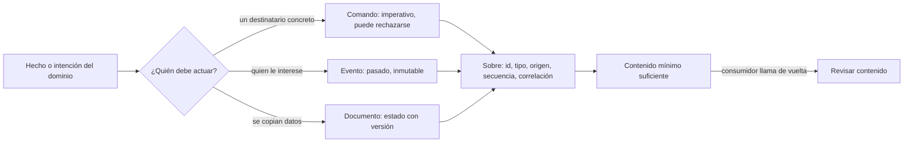

# SE-326 — Mensajes, eventos, comandos y documentos

[← SE-325 — Integración síncrona y asíncrona](https://github.com/vladimiracunadev-create/modern-software-engineering-program/blob/main/classes/part-27-integracion-eventos-y-mensajeria/se-325-integracion-sincrona-y-asincrona/README.md) · [↑ Parte 27](https://github.com/vladimiracunadev-create/modern-software-engineering-program/blob/main/classes/part-27-integracion-eventos-y-mensajeria/README.md) · [📚 Índice completo](https://github.com/vladimiracunadev-create/modern-software-engineering-program/blob/main/classes/README.md) · [🌐 Portal](https://vladimiracunadev-create.github.io/modern-software-engineering-program/classes/SE-326.html) · [SE-327 — Brokers, colas, topics y logs distribuidos →](https://github.com/vladimiracunadev-create/modern-software-engineering-program/blob/main/classes/part-27-integracion-eventos-y-mensajeria/se-327-brokers-colas-topics-y-logs-distribuidos/README.md)

## Punto profesional y fundamento pedagógico

**Punto profesional.** La clase existe para que distingas cuatro cosas que se llaman «mensaje» en los equipos y se comportan de forma distinta: una orden dirigida a alguien (comando), un hecho que ya ocurrió (evento), una copia de datos (documento) y el sobre que acompaña a cualquiera de ellas, y para que midas qué cuesta equivocar el tipo o el contenido antes de que haya consumidores que dependan de él.

**Por qué aparece aquí.** Sigue a **Integración síncrona y asíncrona**: una vez decidido que la entrega, la calificación y el aviso hablan por mensajes, hay que decidir qué dice cada mensaje, a quién va dirigido y cuánto lleva dentro. La respuesta cambia lo que cada consumidor puede hacer sin volver a preguntar y lo que ocurre cuando el mensaje llega tarde.

**Error conceptual que debe corregir.** Creer que cualquier mensaje es un «evento» y que el nombre no importa. Un comando mal nombrado como evento pierde al destinatario sin ruido; un evento tratado como comando acopla al emisor con sus oyentes; un documento sin versión hace que dos copias del mismo dato discrepen sin que nadie lo note.

**Secuencia de aprendizaje.** Antes de leer los resultados, predices cuántas lecturas del dato equivocado producen una notificación mínima y un evento con el estado completo cuando el 30 % de las entidades cambia entre emisión y lectura, qué pasa con un comando y con un evento cuando no hay manejadores, y qué capacidad pierdes si quitas el identificador, la secuencia o la correlación del sobre. La secuencia usa predicción, explicación propia, contraste y recuperación. [ICAP](https://icap.education.asu.edu/research) distingue participación de construcción de conocimiento; [How People Learn II](https://nap.nationalacademies.org/catalog/24783/how-people-learn-ii-learners-contexts-and-cultures) exige conectar conocimiento previo, contexto y transferencia; la [práctica de recuperación](https://pubmed.ncbi.nlm.nih.gov/16507066/) respalda producir de nuevo la explicación tras una demora; y [Education for Life and Work](https://nap.nationalacademies.org/resource/13398/dbasse_084153.pdf) exige devolución que explique la causa del error.

**Evidencia de aprendizaje.** `mensajes-log.md` con las predicciones, las tres figuras reproducidas, un catálogo de los mensajes de la plataforma clasificados como comando, evento o documento, con su sobre y su contenido, y una nota que justifique por qué cada uno lleva lo que lleva y no más.

**Límite de la conclusión.** El bus es un diccionario de Python en un solo proceso; los consumidores, los tamaños de mensaje (78 y 246 bytes) y el 30 % de cambios entre emisión y lectura son supuestos del autor. No se usó ningún corredor, formato binario ni serialización real distinta de JSON: los experimentos muestran mecanismos, no tamaños de producción.

### Trazabilidad fuente → afirmación

| Fuente primaria u oficial | Afirmación que respalda | Lo que no prueba |
|---|---|---|
| [EIP: Command Message](https://www.enterpriseintegrationpatterns.com/patterns/messaging/CommandMessage.html) | Define un mensaje que invoca un procedimiento en otra aplicación, con un destinatario esperado. | No indica cómo nombrar los comandos de la plataforma. |
| [EIP: Event Message](https://www.enterpriseintegrationpatterns.com/patterns/messaging/EventMessage.html) | Describe un mensaje que notifica que algo ocurrió, sin esperar que el receptor haga algo concreto. | No mide cuántos consumidores terminan llamando de vuelta. |
| [EIP: Document Message](https://www.enterpriseintegrationpatterns.com/patterns/messaging/DocumentMessage.html) | Describe un mensaje que transfiere datos y deja al receptor decidir qué hacer con ellos. | No fija qué datos de la entrega conviene incluir. |
| [Fowler, «What do you mean by Event-Driven?»](https://martinfowler.com/articles/201701-event-driven.html) | Separa notificación de eventos, transferencia de estado en el evento, abastecimiento de eventos y CQRS como cuatro significados distintos de «dirigido por eventos». | No dice cuál conviene a la plataforma de entregas. |
| [CloudEvents: especificación](https://github.com/cloudevents/spec/blob/main/cloudevents/spec.md) | Define atributos comunes de un evento (identificador, origen, tipo, versión de la especificación, hora) para describir eventos de forma interoperable. | No obliga a usar CloudEvents ni cubre la secuencia o la correlación como atributos obligatorios. |

## Antes de empezar

Recupera lo aprendido en `SE-325`: elegir una cola cambia el contrato de respuesta, pero no dice qué viaja por ella. Recupera también de la Parte 13 la idea de contrato: lo que el consumidor puede asumir sin volver a preguntar. La pregunta activa es: **¿qué sabe el receptor al recibir este mensaje, qué necesita preguntar y a quién?**

## Prerrequisitos

- Haber completado `SE-325` o poder explicar qué cambia al pasar una interacción a una cola.
- Python 3.11 o posterior; los experimentos usan solo la biblioteca estándar y generadores con semilla fija.
- Leer y producir JSON; entender qué es una clave de identificación y un número de versión.

## Problema auténtico

La plataforma publica un mensaje cuando llega una entrega. El primer equipo lo llamó `EntregaRecibida` y le puso solo el identificador; la analítica y el calificador tuvieron que llamar de vuelta al servicio de entregas para saber de qué curso era y qué archivo contenía. El segundo equipo añadió todo el registro de la entrega al mensaje para evitar esas llamadas; semanas después, cuando se corrige una nota, los consumidores siguen operando con la copia vieja que viaja en el mensaje. Alguien más creó `CalificarEntrega`, pensando que era un evento para cualquiera que quisiera calificar, y al registrar dos calificadores cada entrega se calificó dos veces. Cada uno de los tres problemas tiene su origen en confundir lo que el mensaje significa con lo que contiene.

## Objetivos observables

Al terminar podrás:

1. clasificar un mensaje como comando, evento o documento con un criterio operativo y explicar qué falla si se clasifica mal;
2. medir cuántas lecturas del dato equivocado causa cada forma de evento cuando la entidad cambia entre emisión y lectura;
3. comprobar qué ocurre con un comando y con un evento según el número de manejadores registrados;
4. identificar qué capacidades (deduplicar, ordenar, seguir) pierde un consumidor si el sobre no lleva ciertos campos;
5. escribir el catálogo de mensajes de la plataforma con tipo, nombre, sobre, contenido y política de versión.

## Mapa conceptual



El mapa separa la **intención** del mensaje (quién debe actuar) del **sobre** (lo que cualquiera necesita para manejarlo) y del **contenido** (lo que solo el tipo concreto conoce). El retorno recuerda que un consumidor que llama de vuelta señala un contenido insuficiente o un tipo mal elegido.

## Temas y por qué importan

| Tema | Por qué cambia una decisión profesional | Evidencia mínima |
|---|---|---|
| Comando | Dirige una intención a un destinatario y puede ser rechazada. | Predicción, traza causal y contraejemplo de **Comando** en `mensajes-log.md` |
| Evento | Afirma un hecho pasado sin saber quién escuchará. | Predicción, traza causal y contraejemplo de **Evento** en `mensajes-log.md` |
| Documento y estado en el mensaje | Evita llamadas de vuelta a costa de copias que envejecen. | Predicción, traza causal y contraejemplo de **Documento y estado en el mensaje** en `mensajes-log.md` |
| Sobre del mensaje | Permite deduplicar, ordenar y seguir sin leer el cuerpo. | Predicción, traza causal y contraejemplo de **Sobre del mensaje** en `mensajes-log.md` |
| Nombres, versiones y tamaño | El nombre y la forma son un contrato que otros ya usan. | Predicción, traza causal y contraejemplo de **Nombres, versiones y tamaño** en `mensajes-log.md` |

## Conceptos y decisiones

### 1. Comando

Un **comando** expresa una intención dirigida: «califica esta entrega». Tiene un destinatario esperado, se nombra en imperativo y puede ser rechazado (la entrega no existe, el plazo venció). Por eso el emisor suele necesitar saber si se aceptó, y un comando sin manejador es un error que debería ser visible. La confusión habitual es difundirlo a todos los oyentes: entonces cada uno lo ejecuta y la acción ocurre varias veces. Un comando es adecuado cuando el emisor sabe qué quiere que ocurra y quién debe hacerlo.

### 2. Evento

Un **evento** afirma que algo ocurrió: «la entrega 4721 fue recibida». Se nombra en pasado, es inmutable (no se puede «desrecibir»: se emite otro evento) y no conoce a sus oyentes. Eso permite agregar un consumidor nuevo sin tocar al emisor, que es su gran ventaja, y también significa que, si no hay ningún oyente, nadie se entera. El evento no ordena nada: lo que el receptor haga con él es decisión suya. Confundirlo con un comando disfrazado («EntregaRecibida» que en realidad dispara el calificador y nadie más debe reaccionar) acopla al emisor con la lógica de otro y esconde una dependencia.

### 3. Documento y estado en el mensaje

Un **documento** transfiere datos: «este es el estado actual de la entrega». Un evento puede incluir el estado (transferencia de estado en el evento) para que los consumidores no llamen de vuelta, o llevar solo un identificador y dejar que consulten. Cada opción tiene un costo opuesto. Con el estado dentro, los consumidores son autónomos y no cargan al emisor, pero leen la versión del instante de emisión, que puede ya no ser la vigente. Con solo el identificador, leen la versión actual, pero acoplan su disponibilidad a la del emisor y le devuelven toda la carga. No hay una respuesta correcta; hay una pregunta por consumidor: ¿necesita el valor del instante o el valor de ahora?

### 4. Sobre del mensaje

El **sobre** son los atributos comunes a cualquier mensaje: un identificador único, el tipo, el origen, la hora de emisión, un número de secuencia por origen o por entidad, un identificador de correlación y la versión del esquema. Existen para que la infraestructura y los consumidores puedan **deduplicar** (identificador), **enrutar** (tipo), **ordenar** (secuencia), **seguir** una operación entre servicios (correlación) y **interpretar** (versión) sin entender el contenido. CloudEvents estandariza una parte de este sobre para eventos. Cuando falta un campo, los consumidores lo sustituyen con heurísticas (hash del cuerpo, hora del reloj, ventanas de tiempo) que funcionan en demostraciones y fallan bajo concurrencia.

### 5. Nombres, versiones y tamaño

El nombre es una promesa. Un evento en pasado (`EntregaRecibida`) puede ser consumido por cualquiera; un comando en imperativo (`CalificarEntrega`) pertenece a un destinatario. El mensaje se versiona desde el primer día, porque en cuanto hay un consumidor el esquema es un contrato (`SE-332`). Y el tamaño importa por dos razones distintas: el contenido que viaja se copia en cada cola, registro y consumidor (el costo de datos personales y de almacenamiento se multiplica), y el contenido grande puede sustituirse por una referencia que se consulta después. Un mensaje debe llevar lo mínimo que haga falta para ser interpretado sin ambigüedad, no todo lo que hoy se sabe.

### Qué lleva el mensaje cuando la entidad cambia

Se generan 1 000 eventos de entrega con semilla fija y se sabe, por azar con probabilidad 0,3, que la entidad cambia entre la emisión y la lectura. Se comparan una notificación mínima (identificador, tipo y hora: 78 bytes de JSON compacto) y un evento con el estado completo (246 bytes). Cinco consumidores tienen necesidades distintas: dos quieren el estado **de ahora**, dos el **del instante** y uno solo necesita el identificador.

```python
b_not = len(json.dumps(notif, separators=(",", ":")))   # 78
b_st = len(json.dumps(estado, separators=(",", ":")))   # 246
cambiaron = sum(1 for _ in range(N) if r.random() < 0.3)  # 299
wrong_not = cambiaron if necesita == "instante" else 0
wrong_st = cambiaron if necesita == "actual" else 0
```

| Consumidor | Llamadas de vuelta (notificación) | Instante equivocado (notificación) | Desactualizadas (estado en el evento) |
|---|---:|---:|---:|
| Notificaciones (quieren el estado actual) | 1 000 | 0 | 299 |
| Auditoría (quiere el estado del instante) | 1 000 | 299 | 0 |
| Analítica (quiere curso y estado actuales) | 1 000 | 0 | 299 |
| Calificador (quiere el archivo del instante) | 1 000 | 299 | 0 |
| Facturación (solo necesita el identificador) | 0 | 0 | 0 |

Con la notificación, cuatro consumidores hacen mil llamadas cada uno y dos de ellos leen un valor distinto del que motivó el evento en 299 casos. Con el estado dentro, nadie llama, pero los dos que querían el valor actual quedan desactualizados en esos mismos 299. El evento más grande (3,2 veces) ahorra 4 000 llamadas y traslada el error de un par de consumidores al otro.


**Cómo leer la figura.** Cada grupo de barras es un consumidor con una necesidad distinta y el color de la barra dice qué mide: verde azulado, llamadas de vuelta de la notificación; coral, lecturas del instante equivocado de la notificación; dorado, lecturas desactualizadas con el estado dentro del evento. Mira primero que las barras verdes azuladas son las más largas y que cada consumidor solo tropieza con una de las otras dos. **Dónde deja de valer:** el 30 % de cambios es un supuesto y el cambio ocurre siempre antes de la lectura; con entidades casi inmutables (un archivo entregado) la diferencia desaparece, y con entidades que cambian a cada segundo ninguna de las dos formas basta y hace falta un número de versión. Los bytes son de JSON compacto, no de un formato binario.

### El mismo mensaje como comando y como evento

Se registran 0, 1 o 3 manejadores en un bus de memoria y se envían 1 000 mensajes de dos maneras: como comando (el bus exige exactamente un manejador y rechaza el resto o, en la variante difundida, lo entrega a todos) y como evento (se entrega a todos los registrados, sin error si no hay ninguno).

```python
def enviar_comando(msg):
    if len(manejadores) != 1:
        raise ErrorDeDestino(len(manejadores))    # falla a la vista
    manejador, = manejadores
    manejador(msg)

def publicar_evento(msg):
    for h in manejadores:                          # cero o muchos, sin error
        h(msg)
```

| Manejadores | Comando exigido: rechazos | Comando difundido: ejecuciones | Evento: entregas | Evento: pérdidas |
|---:|---:|---:|---:|---:|
| 0 | 1 000 | 0 | 0 | 1 000 sin aviso |
| 1 | 0 | 1 000 | 1 000 | 0 |
| 3 | 1 000 | 3 000 | 3 000 | 0 |

Con cero manejadores, el comando falla en voz alta 1 000 veces y el evento desaparece 1 000 veces sin ruido. Con tres, un comando exigido se rechaza por ambiguo y uno difundido se ejecuta 3 000 veces: tres calificaciones por entrega. Para un evento tres entregas son exactamente lo esperado. La diferencia de contrato no está en el cuerpo del mensaje sino en cuántos destinatarios se espera.


**Cómo leer la figura.** Cada grupo es un número de manejadores registrados (0, 1 y 3) y cada color, un resultado de los 1 000 mensajes: rechazos del comando exigido, ejecuciones del comando difundido, entregas del evento y eventos perdidos sin aviso. Mira primero el grupo de cero manejadores, donde el comando falla a gritos y el evento falla en silencio, y después el de tres, donde el comando difundido se ejecuta tres veces y el evento se entrega tres veces. **Dónde deja de valer:** el bus de un diccionario no modela fallos, reintentos ni orden; en un corredor real un tópico sin suscriptores puede retener o descartar según su configuración. La figura es una forma de ver la diferencia de contrato, no un modelo de un corredor.

### Qué campos del sobre sostienen qué capacidades

Se generan 2 300 mensajes de 80 estudiantes: 2 100 distintos, 200 duplicados exactos y 100 reenvíos legítimos (mismo contenido, otro identificador, por ejemplo una segunda entrega del mismo archivo). Se comparan tres capacidades con y sin el campo del sobre que las respalda: quitar duplicados (identificador frente a hash del contenido), ordenar los eventos de cada estudiante (secuencia por origen frente a marca de tiempo con resolución de una unidad para cuatro mensajes) y unir los mensajes de una misma operación (correlación frente a mismo estudiante en una ventana de una unidad).

```python
con_id = {m["id"] for m in stream}                       # 2 100 distintos
por_cuerpo = {(m["est"], m["body"]) for m in stream}      # descarta distintos con el mismo contenido
orden_t = sorted(lst, key=lambda m: m["t"])              # ties con 4 mensajes por unidad
```

| Capacidad | Con el campo | Sin el campo (heurística) |
|---|---|---|
| Quitar duplicados exactos | `id`: 200 quitados, 0 distintos perdidos | Por contenido: 835 quitados, 635 distintos perdidos |
| Ordenar los eventos de un estudiante | Secuencia: 0 fuera de lugar | Marca de tiempo: 992 de 2 100 fuera de lugar |
| Seguir una operación | Correlación: 2 302 pares correctos | Estudiante y ventana: 254 pares, 128 correctos |

Deduplicar por contenido quita los 200 duplicados y además 635 mensajes distintos que casualmente comparten estudiante y cuerpo, entre ellos los reenvíos legítimos. Ordenar por reloj deja casi la mitad de los mensajes en el lugar equivocado porque varios comparten la misma marca. La reconstrucción por ventana propone 254 pares de los cuales la mitad son correctos y encuentra 128 de los 2 302 que existen: precisión del 50 % y cobertura del 5,6 %.


**Cómo leer la figura.** Cada fila es una capacidad y la mancuerna une los errores con el campo en el sobre (a la izquierda, siempre cero) con los de la heurística improvisada; la longitud del segmento es el daño. Mira primero que el punto con campo está siempre en cero y que el costo de prescindir del campo cambia de tamaño según la capacidad. **Dónde deja de valer:** el reparto de reenvíos legítimos (100 de 2 300), el tamaño de la ventana y la resolución del reloj son decisiones del autor, y un reloj sincronizado con resolución de nanosegundos mejoraría el orden sin eliminar los empates entre procesos. La figura no prueba que haya que usar CloudEvents: prueba que hay que decidir un sobre.

## Definiciones de trabajo

- **comando:** mensaje que expresa una intención dirigida a un destinatario esperado y que puede ser rechazada.
- **evento:** mensaje que afirma un hecho ya ocurrido, inmutable y sin destinatario conocido.
- **documento:** mensaje que transfiere el estado de una entidad para que el receptor decida qué hacer con él.
- **sobre:** conjunto de atributos comunes a todo mensaje que permiten manejarlo sin interpretar su contenido.
- **transferencia de estado en el evento:** diseño en el que el evento incluye los datos que los consumidores necesitan, para que no tengan que consultar al emisor.

Las definiciones son operativas para la plataforma de entregas. No convierten términos con una historia más amplia en sinónimos y deben contrastarse con la documentación primaria enlazada al final.

## Ejemplo mínimo

El fragmento muestra un bus con un manejador y otro mensaje enviado sin manejador. Antes de ejecutarlo, predice qué ocurre con el comando y con el evento cuando no hay manejador.

```python
manejadores = []
def comando(m):
    if len(manejadores) != 1: raise RuntimeError("destinatario")
    manejador, = manejadores
    manejador(m)
def evento(m):
    for h in manejadores: h(m)
try: comando({"tipo": "CalificarEntrega"})
except RuntimeError as e: print("comando rechazado:", e)
evento({"tipo": "EntregaRecibida"}); print("evento sin oyentes: nada ocurrió")
```

El comando falla de forma visible y el evento se pierde en silencio. Registra versión de Python y salida; después añade un manejador y repite.

## Ejemplo profesional

El equipo de la plataforma escribe el catálogo de mensajes antes de implementarlos. `CalificarEntrega` es un **comando** con un único destinatario, el calificador, que puede rechazarlo (entrega inexistente, plazo vencido). `EntregaRecibida` es un **evento** con sobre completo (identificador, tipo, origen, hora, secuencia por entrega, correlación) y un contenido mínimo: identificador de la entrega, de estudiante y de curso. `CalificacionPublicada` es un **documento** con la nota y su versión, porque el aviso y la analítica quieren el estado **del instante**. Dejan fuera del evento los archivos y el texto de la entrega (se consultan por referencia) y cualquier dato de contacto, que el servicio de avisos obtiene con el identificador del estudiante. Cada mensaje declara su versión de esquema y la regla de cambio compatible. Compara con el diseño inicial: dos consumidores dejan de llamar de vuelta y ningún mensaje lleva más datos personales de los necesarios.

## Práctica guiada

1. Lista cinco mensajes de la plataforma y clasifica cada uno como comando, evento o documento con una justificación de una línea.
2. Predice cuántas lecturas del dato equivocado producen la notificación y el estado en el evento con 30 % de cambios y escribe el número.
3. Reproduce la tabla de consumidores y comprueba que 299 aparece en las columnas esperadas.
4. Implementa el bus con 0, 1 y 3 manejadores y verifica las seis salidas de la tabla.
5. Quita el identificador, la secuencia y la correlación del sobre uno a uno y mide lo que pierde cada consumidor.
6. Escribe el catálogo con tipo, nombre, sobre, contenido, versión y quién consume cada mensaje.
7. Entrega `mensajes-log.md` y pide a otra persona que encuentre un mensaje cuyo tipo no coincide con su nombre.

## Ejercicios

1. **Clasificación:** `ActualizarNota`, `NotaActualizada` y `EstadoDeNota`; indica cuál es comando, evento y documento y qué problema habría si se difundieran todos por igual.
2. **Contenido:** el servicio de avisos necesita el correo del estudiante; compara incluirlo en el evento, incluir su identificador y consultar, y razona qué dato personal se copia en cada caso.
3. **Sobre:** diseña el sobre de la plataforma con siete campos y elige, para cada uno, qué capacidad pierde un consumidor si falta.
4. **Nombre:** `ProcesarEntrega` aparece como evento en el código; propón un nombre y un tipo correctos y razona qué cambia para los consumidores.

## Reto verificable

Entrega `mensajes-log.md` con las predicciones, las tablas reproducidas con las mismas semillas, el catálogo de mensajes con tipo, sobre y contenido, y la justificación del contenido de cada uno. Se aprueba si otra persona ejecuta el código desde un checkout limpio, obtiene 299 lecturas equivocadas con 30 % de cambios, 3 000 ejecuciones con tres manejadores en el comando difundido y 835 mensajes quitados al deduplicar por contenido, y puede decir qué consumidor se rompe si el evento pasa de llevar el estado a llevar solo el identificador. No se aprueba por llamar «evento» a todo ni por añadir campos al mensaje sin decir quién los usa.

## Caso conductor

El flujo de entrega, calificación, aviso y registro de la plataforma es el caso conductor de la Parte 27. Esta clase deja el segundo artefacto: el catálogo de mensajes con sobre y contenido. `SE-327` pregunta por dónde viajan: colas, tópicos y logs. Cambia después una sola decisión, el contenido del evento `EntregaRecibida`, y observa qué consumidores dejan de llamar de vuelta y cuáles empiezan a leer datos viejos.

## Preguntas frecuentes

### ¿Cuál es la diferencia real entre comando y evento si ambos son mensajes?

El número de destinatarios que se espera y la reacción ante su ausencia. Un comando espera uno y falla si no está; un evento acepta cero o muchos. La diferencia se nota al añadir un segundo oyente: al evento se le suma sin tocar al emisor, al comando se le multiplica la acción.

### ¿Debe un evento llevar todos los datos de la entidad?

Depende de cada consumidor: si necesita el valor del instante y la entidad cambia, el estado en el evento es lo correcto; si necesita el valor vigente, la notificación con consulta lo es. Una opción intermedia es llevar el estado mínimo y una versión, para que el consumidor detecte que su copia envejeció.

### ¿Hace falta un sobre estandarizado como CloudEvents?

No siempre, pero sí un sobre decidido. Un estándar ayuda cuando muchos equipos o herramientas deben interpretar los mensajes sin conocimiento previo; para una plataforma pequeña un sobre propio con los mismos campos cumple. Lo que no se negocia es el identificador, el tipo y la versión.

### ¿Puede un evento contener datos personales?

Puede, pero cada copia en una cola, un registro o un consumidor es un lugar más donde el dato debe protegerse y borrarse (`SE-322`). Conviene llevar identificadores y que los consumidores autorizados consulten los datos, salvo que la autonomía del consumidor justifique la copia.

## Fallo controlado y diagnóstico

Reproduce el fallo clásico de la clase: **un comando difundido como evento que se ejecuta varias veces**. Registra dos calificadores y publica `CalificarEntrega` como si fuera un evento.

Registra síntoma, entrada mínima, hipótesis, observación que descarta cada hipótesis, causa, corrección y prueba de regresión. **Síntoma:** cada entrega recibe dos calificaciones y los estudiantes ven dos avisos. **Hipótesis rivales:** (a) el calificador procesa dos veces por un reintento; (b) un error del productor que publica dos veces; (c) dos manejadores registrados para un mensaje con semántica de comando. **Prueba:** cuenta las ejecuciones por mensaje y los manejadores registrados; si las ejecuciones por mensaje igualan los manejadores, la causa es la difusión. **Conclusión:** un comando se trató como evento. **Regresión:** el bus rechaza un comando cuando no hay exactamente un manejador y una prueba registra dos y comprueba que se rechaza. No cambies a la vez el nombre del mensaje y el comportamiento del bus.

## Errores comunes y cómo corregirlos

| Síntoma | Causa probable | Corrección |
|---|---|---|
| Una acción se ejecuta varias veces | Un comando se difundió a varios oyentes | Un destinatario por comando y rechazo si no hay uno |
| Nadie reacciona a un evento y no hay error | Ningún oyente registrado y el bus descarta en silencio | Alarma por eventos sin consumidor donde importe |
| Los consumidores llaman todos de vuelta | El evento solo lleva un identificador | Incluir el contenido mínimo que casi todos necesitan |
| Los consumidores operan con datos viejos | El evento lleva el estado y la entidad cambió | Incluir una versión y comparar con la vigente donde importe |
| Los duplicados no se detectan o se descartan mensajes válidos | El sobre no tiene identificador único | Identificador único en el sobre desde el primer mensaje |

## Entorno y archivos clave

```text
work/SE-326/
├── README.md
├── mensajes/
│   ├── catalogo.md
│   ├── sobre.py
│   └── bus.py
├── tests/test_mensajes.py
└── evidence/mensajes-log.md
```

El `README` declara plataforma, versión de Python, semillas y comandos. El código de los tres experimentos está en `scripts/experiments_part27_a.py` (funciones `e326_contenido`, `e326_destinatarios` y `e326_sobre`) y se ejecuta con `python scripts/experiments_part27_a.py`. Solo usa la biblioteca estándar y se ejecutó con CPython 3.12.9 en Windows 11 y 3.12.3 en Ubuntu bajo WSL2: las salidas fueron idénticas. Si añades una dependencia, fija procedencia y versión.

## Seguridad, ética y accesibilidad

- un mensaje es una copia: decide qué datos personales viajan, quién puede leerlos en la cola y cuánto tiempo se conservan (`SE-322`);
- un comando que cambia datos debe autenticar a quien lo emite y comprobar su autorización en el receptor, no solo en la puerta de entrada;
- los mensajes con notas o estados educativos pueden afectar a personas: no los registres completos en bitácoras abiertas (`SE-334`);
- documenta el catálogo de mensajes en texto navegable, no solo en un diagrama, y usa nombres comprensibles para quien no domina el código;
- los datos de prueba son sintéticos: no copies mensajes reales a ensayos.

## Puente hacia el trabajo con agentes

Un agente al que se le pide «publica un evento cuando algo ocurre» tiende a nombrar todo como evento, a incluir toda la entidad por comodidad y a no añadir identificador ni versión. Pídele en cambio que clasifique cada mensaje como comando, evento o documento, que escriba el sobre completo, que justifique el contenido por consumidor y que incluya una prueba que registre cero, uno y tres manejadores. Revisa especialmente si el evento lleva más datos personales de los necesarios y si un comando puede ser difundido por accidente: son los dos defectos que esta clase mostró sin aviso.

## Transferencia

Traslada el análisis a otro dominio (por ejemplo, un taller de reparaciones con órdenes, técnicos y repuestos): cambia las entidades y conserva el procedimiento de clasificar cada mensaje por su destinatario esperado, decidir qué lleva por consumidor y fijar el sobre. La transferencia está lograda cuando puedes justificar por qué un mensaje es un comando y no un evento, no cuando los nombres suenan correctos.

## Evaluación y evidencia

| Criterio | Evidencia para aprobar |
|---|---|
| comprensión | explicación de comando, evento y documento con un ejemplo y un contraejemplo de la plataforma |
| corrección | tablas de consumidores, manejadores y sobre reproducibles con las mismas semillas |
| diseño | catálogo de mensajes con tipo, sobre, contenido y versión |
| diagnóstico | reproducción del comando difundido con regresión |
| incertidumbre | declaración de que el bus es un modelo y de que 30 % y los tamaños son supuestos |
| reproducibilidad | versiones, comandos, salida y límites declarados |

## Fuentes

- [EIP: Command Message](https://www.enterpriseintegrationpatterns.com/patterns/messaging/CommandMessage.html) — mensaje que invoca una acción en otra aplicación; autoridad: autores del libro.
- [EIP: Event Message](https://www.enterpriseintegrationpatterns.com/patterns/messaging/EventMessage.html) — mensaje que notifica un hecho; autoridad: autores del libro.
- [EIP: Document Message](https://www.enterpriseintegrationpatterns.com/patterns/messaging/DocumentMessage.html) — mensaje que transfiere datos; autoridad: autores del libro.
- [Fowler, «What do you mean by Event-Driven?»](https://martinfowler.com/articles/201701-event-driven.html) — cuatro significados de dirigido por eventos; autoridad: autor del texto.
- [CloudEvents: especificación](https://github.com/cloudevents/spec/blob/main/cloudevents/spec.md) — atributos comunes de un evento; autoridad: proyecto CloudEvents de la CNCF.

Cada fuente respalda el mecanismo indicado; ninguna demuestra que las 299 lecturas, los 635 mensajes perdidos o los 4 000 viajes ahorrados se observen en una plataforma real. Esa afirmación depende de la tasa de cambio de cada entidad y de los consumidores que existan.

## Límites y siguiente paso

Se ejecutaron tres experimentos con datos sintéticos en Windows y Ubuntu (WSL2) con resultados idénticos en ambas plataformas. No se usó ningún corredor, serialización binaria ni red: el bus, el 30 % de cambios, los reenvíos legítimos y las ventanas son construcciones del autor, y los resultados no se extrapolan a otros sistemas. La siguiente clase pregunta por dónde viajan los mensajes: colas, tópicos y logs distribuidos.

## Glosario

- **comando:** mensaje que expresa una intención dirigida a un destinatario esperado y que puede ser rechazada.
- **evento:** mensaje que afirma un hecho ya ocurrido, inmutable y sin destinatario conocido.
- **documento:** mensaje que transfiere el estado de una entidad para que el receptor decida qué hacer con él.
- **sobre:** conjunto de atributos comunes a todo mensaje que permiten manejarlo sin interpretar su contenido.
- **transferencia de estado en el evento:** diseño en el que el evento incluye los datos que los consumidores necesitan, para que no tengan que consultar al emisor.

---

[← SE-325 — Integración síncrona y asíncrona](https://github.com/vladimiracunadev-create/modern-software-engineering-program/blob/main/classes/part-27-integracion-eventos-y-mensajeria/se-325-integracion-sincrona-y-asincrona/README.md) · [↑ Parte 27](https://github.com/vladimiracunadev-create/modern-software-engineering-program/blob/main/classes/part-27-integracion-eventos-y-mensajeria/README.md) · [📚 Índice completo](https://github.com/vladimiracunadev-create/modern-software-engineering-program/blob/main/classes/README.md) · [🌐 Portal](https://vladimiracunadev-create.github.io/modern-software-engineering-program/classes/SE-326.html) · [SE-327 — Brokers, colas, topics y logs distribuidos →](https://github.com/vladimiracunadev-create/modern-software-engineering-program/blob/main/classes/part-27-integracion-eventos-y-mensajeria/se-327-brokers-colas-topics-y-logs-distribuidos/README.md)
