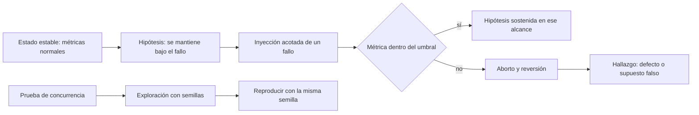
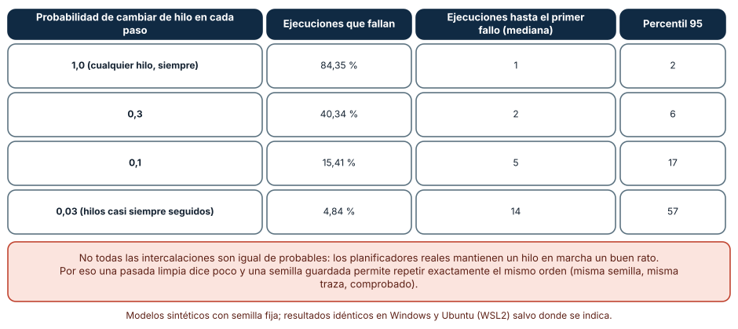
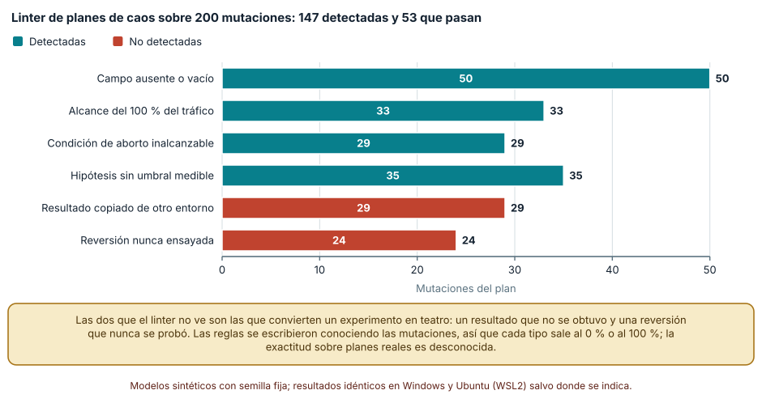

# SE-346 — Caos controlado y pruebas de distribución

[← SE-345 — Replicación, sharding y balanceo](https://github.com/vladimiracunadev-create/modern-software-engineering-program/blob/main/classes/part-28-concurrencia-y-sistemas-distribuidos/se-345-replicacion-sharding-y-balanceo/README.md) · [↑ Parte 28](https://github.com/vladimiracunadev-create/modern-software-engineering-program/blob/main/classes/part-28-concurrencia-y-sistemas-distribuidos/README.md) · [📚 Índice completo](https://github.com/vladimiracunadev-create/modern-software-engineering-program/blob/main/classes/README.md) · [🌐 Portal](https://vladimiracunadev-create.github.io/modern-software-engineering-program/classes/SE-346.html) · [SE-347 — Taller: reproducir una carrera y un fallo parcial →](https://github.com/vladimiracunadev-create/modern-software-engineering-program/blob/main/classes/part-28-concurrencia-y-sistemas-distribuidos/se-347-taller-reproducir-una-carrera-y-un-fallo-parcial/README.md)

## Punto profesional y fundamento pedagógico

**Punto profesional.** La clase existe para que pruebes un sistema distribuido como se rompe: inyectando fallos con una hipótesis, un alcance acotado y una condición de aborto, y explorando intercalaciones de forma sistemática y reproducible en lugar de repetir una prueba esperando suerte. Entenderás qué evidencia da un experimento de caos, cuál no, y cómo escribir uno que pueda fallar con honestidad.

**Por qué aparece aquí.** Sigue a **Replicación, sharding y balanceo**: ya hay decisiones de reintentos, interruptores, réplicas y reparto que prometen resistir fallos; falta comprobarlo. El caso conductor es el cierre de plazo: ¿qué ocurre con las entregas si una réplica cae o una dependencia empieza a fallar al 50 % justo a las 23:55?

**Error conceptual que debe corregir.** Creer que una suite de pruebas que pasa mil veces demuestra que el sistema resiste fallos, o que «hacer caos» es apagar cosas en producción para ver qué pasa: lo primero explora pocos órdenes y lo segundo no es un experimento sin hipótesis ni límites.

**Secuencia de aprendizaje.** Antes de leer los resultados, predices cómo cambia el éxito y la carga de un cliente con reintentos y un interruptor cuando una dependencia falla en una fracción creciente de las llamadas, y cuántas ejecuciones al azar necesitas para ver un defecto presente en casi todas las intercalaciones según cómo conmute el planificador; después revisas un linter de planes de experimento de caos sobre 200 mutaciones. La secuencia usa predicción, explicación propia, contraste y recuperación. [ICAP](https://icap.education.asu.edu/research) distingue participación de construcción de conocimiento; [How People Learn II](https://nap.nationalacademies.org/catalog/24783/how-people-learn-ii-learners-contexts-and-cultures) exige conectar conocimiento previo, contexto y transferencia; la [práctica de recuperación](https://pubmed.ncbi.nlm.nih.gov/16507066/) respalda producir de nuevo la explicación tras una demora; y [Education for Life and Work](https://nap.nationalacademies.org/resource/13398/dbasse_084153.pdf) exige devolución que explique la causa del error.

**Evidencia de aprendizaje.** `caos-log.md` con la predicción, las tres figuras reproducidas, un plan de experimento de caos para la plataforma (hipótesis de estado estable, alcance, condición de aborto, reversión, entorno) y una estrategia de exploración con semillas guardadas para una prueba de concurrencia.

**Límite de la conclusión.** El cliente, la dependencia y su capacidad son un modelo del autor; el planificador «pegajoso» es una aproximación; el linter se escribió conociendo las mutaciones. No se ejecutó ninguna herramienta de caos ni se inyectó un fallo en un sistema real, y no se afirma que ninguna práctica concreta prevenga incidentes.

### Trazabilidad fuente → afirmación

| Fuente primaria u oficial | Afirmación que respalda | Lo que no prueba |
|---|---|---|
| [Basiri et al., «Chaos Engineering» (IEEE Software, 2016)](https://doi.org/10.1109/MS.2016.60) | Presenta la disciplina de experimentar sobre un sistema para ganar confianza en su resistencia a condiciones turbulentas. | No mide el beneficio en la plataforma ni establece una tasa de incidentes evitados. |
| [Principios de la ingeniería del caos](https://principlesofchaos.org/) | Enuncia el método: definir el estado estable, formular una hipótesis, variar eventos reales, automatizar y minimizar el radio de explosión. | No dice qué fallos inyectar en un sistema concreto. |
| [Alvaro et al., «Lineage-driven fault injection» (2015)](https://doi.org/10.1145/2723372.2723711) | Propone guiar la inyección de fallos por el linaje de los datos para explorar combinaciones relevantes. | No cubre sistemas concretos ni garantiza exhaustividad. |
| [Jepsen](https://jepsen.io/) | Documenta pruebas de sistemas distribuidos con inyección de fallos, historias registradas y verificadores de consistencia. | Prueba productos concretos; no prueba la plataforma. |
| [Musuvathi et al., «Finding and reproducing Heisenbugs in concurrent programs» (CHESS, 2008)](https://www.usenix.org/legacy/event/osdi08/tech/full_papers/musuvathi/musuvathi.pdf) | Explora sistemáticamente las intercalaciones de un programa con un planificador controlado y reproduce los fallos encontrados. | No evalúa programas de la plataforma ni de Python. |

## Antes de empezar

Recupera lo aprendido en `SE-345`: reintentos, interruptores, réplicas y reparto son promesas sobre cómo resiste el sistema. La pregunta activa es: **¿qué hipótesis observable dice que la promesa se cumple, qué fallo inyectas para refutarla, hasta dónde dejas que se propague y cómo vuelves atrás?**

## Prerrequisitos

- Haber completado `SE-345` o poder explicar por qué los reintentos amplifican la carga.
- Python 3.11 o posterior; los experimentos usan solo la biblioteca estándar (`random`, `itertools`, `hashlib`, `statistics`).
- Haber visto la enumeración de intercalaciones en `SE-338` y los reintentos en `SE-341`.

## Problema auténtico

Antes del cierre de plazo, el equipo ejecutó la suite de pruebas de integración: verde, 1 200 pruebas. Esa noche la dependencia de calificaciones empezó a fallar de forma intermitente al 50 %. Los reintentos del servicio de entregas, que nadie había probado con fallos parciales, triplicaron la carga sobre la dependencia y la tumbaron. Al día siguiente, alguien propuso «hacer caos»: apagar un servidor de producción a mediodía. Se hizo sin hipótesis, sin medir el estado normal y sin condición de aborto; el panel mostró errores, nadie supo si eran los esperados y el experimento se dio por terminado «cuando se normalizó». Por otro lado, una prueba de concurrencia que fallaba una de cada diez ejecuciones se marcó como «inestable» y se reintentó automáticamente hasta pasar. Tres prácticas distintas con el mismo vacío: ninguna producía evidencia que otra persona pudiera revisar.

## Objetivos observables

Al terminar podrás:

1. formular un experimento de caos con estado estable medible, hipótesis, fallo inyectado, alcance acotado, condición de aborto y reversión;
2. medir cómo cambian el éxito y la carga de un cliente al subir el fallo de una dependencia y encontrar el punto donde la estrategia deja de proteger;
3. explicar por qué la probabilidad de ver un defecto de concurrencia depende del planificador y no solo del número de intercalaciones malas;
4. usar semillas guardadas para repetir exactamente una ejecución fallida;
5. revisar un plan de caos y distinguir lo que un verificador de forma detecta de lo que solo una persona ve.

## Mapa conceptual



El mapa tiene dos caminos que se complementan. El **experimento de caos** parte de un estado estable y exige condiciones de aborto. La **exploración de concurrencia** convierte el azar en una semilla que se puede repetir. Ambos terminan en un hallazgo que otra persona puede reproducir.

## Temas y por qué importan

| Tema | Por qué cambia una decisión profesional | Evidencia mínima |
|---|---|---|
| Estado estable e hipótesis | Sin ellas, un experimento solo produce anécdotas. | Predicción, traza causal y contraejemplo de **Estado estable e hipótesis** en `caos-log.md` |
| Inyección de fallos y radio de explosión | Un experimento sin alcance es un incidente. | Predicción, traza causal y contraejemplo de **Inyección de fallos y radio de explosión** en `caos-log.md` |
| Reintentos e interruptores bajo fallo | Se comportan distinto al subir la tasa de error. | Predicción, traza causal y contraejemplo de **Reintentos e interruptores bajo fallo** en `caos-log.md` |
| Exploración de intercalaciones | Repetir una prueba no explora lo que un planificador rara vez hace. | Predicción, traza causal y contraejemplo de **Exploración de intercalaciones** en `caos-log.md` |
| Evidencia y límites | Un experimento sostiene una hipótesis en un alcance, no en todo el sistema. | Predicción, traza causal y contraejemplo de **Evidencia y límites** en `caos-log.md` |

## Conceptos y decisiones

### 1. Estado estable e hipótesis

El **estado estable** es lo que el sistema produce cuando funciona: una tasa de entregas aceptadas, un percentil 99 de latencia, una profundidad de cola. Se mide antes de inyectar nada. La **hipótesis** es una afirmación observable y falsable sobre ese estado bajo un fallo: «con una réplica de calificaciones caída, el percentil 99 de aceptar una entrega sigue bajo 800 ms y no se pierde ninguna entrega con acuse». Una hipótesis como «el sistema es resistente» no se puede refutar. Sin estado estable no hay referencia para decir si algo cambió, y sin hipótesis, el experimento solo observa.

### 2. Inyección de fallos y radio de explosión

Se inyecta un fallo realista: una latencia añadida, una tasa de errores en una dependencia, una réplica detenida, un enlace que pierde paquetes. El **radio de explosión** es lo que puede dañar el experimento: se acota a una fracción del tráfico, a un entorno, a una ventana de tiempo y a un grupo de personas conocido. La **condición de aborto** detiene el experimento si una métrica cruza un umbral (por ejemplo, si el percentil 99 supera 2 000 ms durante 60 s) y la **reversión** devuelve el sistema al estado previo, con un procedimiento ensayado. Un experimento sin estos tres elementos es una intervención.

### 3. Reintentos e interruptores bajo fallo

Las defensas de resistencia se comportan de forma distinta según la tasa de fallo. Los reintentos ayudan cuando los fallos son raros e independientes (convierten un 20 % de error en un 0,1 %) y dañan cuando el servicio está saturado, porque multiplican la carga. Un **interruptor** (*circuit breaker*) corta las llamadas cuando detecta muchos fallos seguidos y las deja pasar de nuevo tras un tiempo: protege a la dependencia a cambio de rechazar peticiones que quizá habrían tenido éxito. El experimento de caos sirve para encontrar el punto de cruce: la tasa de fallo en la que cada estrategia empieza a empeorar las cosas.

### 4. Exploración de intercalaciones

Un defecto de concurrencia vive en algunas intercalaciones, y la probabilidad de caer en ellas depende del **planificador**. Un planificador que alterna hilos en cada paso explora órdenes muy distintos; uno que mantiene un hilo en marcha casi siempre (como un sistema operativo con cuantos largos) casi nunca cambia en el punto malo. Dos técnicas lo aprovechan: la **exploración con semilla** (cada ejecución usa un planificador pseudoaleatorio con semilla registrada, de modo que un fallo se repite exactamente) y la **exploración sistemática** (se enumeran las intercalaciones o se limita el número de cambios, como hace CHESS). Ambas cambian «a veces falla» por «falla con esta semilla».

### 5. Evidencia y límites

Un experimento de caos sostiene o refuta una hipótesis *en un alcance*: este fallo, esta carga, esta versión. No demuestra que el sistema sea resistente en general, y un resultado favorable no cubre otras combinaciones. Las evidencias que valen se registran: hipótesis, métrica de referencia, fallo inyectado, resultado, decisión. El valor está en el hallazgo reproducible y en la corrección posterior. Jepsen es el ejemplo de rigor: historias registradas de operaciones y un verificador que las analiza, con los fallos inyectados descritos.

### Qué hace cada estrategia al subir el fallo

Un cliente envía 80 solicitudes por turno a una dependencia con capacidad 100. Si la carga supera la capacidad, la dependencia rechaza en proporción al exceso. Se comparan tres estrategias con fallo base creciente: sin reintentos, con hasta cuatro intentos y con un interruptor que corta las llamadas cinco turnos tras veinte fallos seguidos.

```python
over = max(0.0, (load - self.capacity) / max(load, 1))
return r.random() >= self.p and r.random() >= over     # falla por tasa propia o por sobrecarga
```

| Fallo inyectado | Sin reintentos (éxito · llamadas) | Con reintentos (máx. 4) | Con interruptor |
|---:|---|---|---|
| 0 % | 100,0 % · 1,00 | 100,0 % · 1,00 | 100,0 % · 1,00 |
| 20 % | 80,5 % · 1,00 | 99,9 % · 1,24 | 99,9 % · 1,24 |
| 50 % | 50,1 % · 1,00 | 93,1 % · 1,90 | 93,1 % · 1,90 |
| 80 % | 20,1 % · 1,00 | 54,1 % · 3,05 | 9,9 % · 0,53 |

Con fallos del 20 % o 50 % los reintentos rescatan casi todo con un costo modesto de llamadas. Con 80 % el cliente con reintentos hace más de tres llamadas por solicitud, sobrecarga la dependencia y consigue 54,1 %; el interruptor hace 0,53 llamadas por solicitud y acierta solo el 9,9 %, a cambio de dejar de golpear a la dependencia. Ninguna es la ganadora: cada una elige qué proteger.


**Cómo leer la figura.** El eje horizontal es el fallo inyectado en la dependencia y el vertical el porcentaje de solicitudes con éxito; cada línea es una estrategia y las anotaciones dan las llamadas por solicitud. Mira dónde se separan las líneas de reintentos e interruptor, entre 50 % y 80 %: ahí empieza a costar la protección. **Dónde deja de valer:** la dependencia, su capacidad de 100 y la relación entre exceso y rechazo son un modelo del autor, y el interruptor se simplificó (sin estado semiabierto). Lo transferible es la forma: hay una tasa a partir de la cual los reintentos empeoran la situación, y el experimento de caos existe para encontrarla en el sistema real.

### El mismo defecto, distintos planificadores

Tres solicitudes leen, comprueban y escriben un cupo de 2; falla si se aceptan tres. Hay 1 680 intercalaciones posibles y 1 620 la violan. Se ejecuta con planificadores pseudoaleatorios cuya probabilidad de cambiar de hilo en cada paso va de 1,0 (cualquier hilo en cada paso) a 0,03 (el mismo hilo casi siempre), 20 000 ejecuciones cada uno, y 500 campañas para ver cuántas ejecuciones hasta el primer fallo.

```python
if cur not in live or r.random() < q:      # q = probabilidad de cambiar de hilo en cada paso
    cur = r.choice(live)
```

| Probabilidad de cambiar de hilo en cada paso | Ejecuciones que fallan | Ejecuciones hasta el primer fallo (mediana) | Percentil 95 |
|---|---:|---:|---:|
| 1,0 | 84,35 % | 1 | 2 |
| 0,3 | 40,34 % | 2 | 6 |
| 0,1 | 15,41 % | 5 | 17 |
| 0,03 (hilos casi siempre seguidos) | 4,84 % | 14 | 57 |

El 96 % de las intercalaciones violan la invariante y, aun así, un planificador pegajoso solo la expone en el 4,84 % de las ejecuciones. Una pasada limpia con 10 repeticiones es habitual (más de la mitad de las veces con q = 0,03) y no dice casi nada. La misma semilla produjo la misma traza (huella idéntica), de modo que un fallo encontrado se puede repetir exactamente.



**Cómo leer la figura.** Cada fila es un planificador (con el porcentaje de ejecuciones que fallan en la etiqueta) y la pista va de la mediana al p95 de las ejecuciones necesarias para ver el defecto, en escala logarítmica. Mira cómo la pista se desplaza y alarga hacia la derecha a medida que el planificador cambia de hilo con menos frecuencia. **Dónde deja de valer:** el defecto y la probabilidad de cambio son construcciones del autor; un sistema operativo real no cambia con probabilidad fija y las ejecuciones con hilos reales no son reproducibles por semilla. La exploración controlada (semilla o enumeración) solo vale si el programa se ejecuta bajo un planificador que puedes gobernar.

### Un linter de planes de caos

Se parte de un plan de experimento completo (hipótesis, métrica, alcance, aborto, reversión, ventana, responsable, entorno) y se generan 200 mutaciones de ocho tipos. Un linter de forma comprueba que cada campo exista, que el alcance no sea el 100 % del tráfico, que la condición de aborto sea alcanzable y que la hipótesis contenga un umbral.

```python
if "%" in p["alcance"] and p["alcance"].strip().startswith("100"):  return True
if "durante 3600" in p["aborto"]:                                    return True
if "<" not in p["hipotesis"] and ">" not in p["hipotesis"]:          return True
```

| Mutación | Detectadas |
|---|---:|
| Campo ausente o vacío | 50 de 50 |
| Alcance del 100 % del tráfico | 33 de 33 |
| Condición de aborto inalcanzable | 29 de 29 |
| Hipótesis sin umbral medible | 35 de 35 |
| Resultado copiado de otro entorno | 0 de 29 |
| Reversión nunca ensayada | 0 de 24 |

El linter detecta 147 de 200 mutaciones y falla exactamente en las dos que convierten un experimento en teatro: un resultado que no se obtuvo en este entorno y una reversión que nunca se probó. Ambas dejan los campos plausibles y no se ven con un verificador de forma.



**Cómo leer la figura.** Cada barra es un tipo de mutación y se divide entre las detectadas por el linter (verde) y las que pasan (coral). Mira que cada barra es de un solo color: el linter ve la forma, no el contenido. **Dónde deja de valer:** las reglas se escribieron conociendo las mutaciones, así que cada tipo sale al 0 % o al 100 %; la exactitud sobre planes reales de personas es desconocida y probablemente peor. Sirve para mostrar la frontera entre lo que verifica una máquina y lo que exige una revisión.

## Definiciones de trabajo

- **estado estable:** conjunto de métricas observables que describen el funcionamiento normal del sistema.
- **radio de explosión:** alcance máximo del daño que puede causar un experimento.
- **condición de aborto:** umbral de una métrica que detiene el experimento.
- **interruptor (*circuit breaker*):** mecanismo que corta las llamadas a una dependencia tras muchos fallos y las reanuda tras un tiempo.
- **exploración con semilla:** ejecución de una prueba bajo un planificador pseudoaleatorio con semilla registrada para poder repetirla.

Las definiciones son operativas para la plataforma de entregas. No convierten términos con una historia más amplia en sinónimos y deben contrastarse con la documentación primaria enlazada al final.

## Ejemplo mínimo

El fragmento muestra que una semilla repite exactamente una ejecución. Antes de ejecutarlo, predice si las dos trazas coinciden.

```python
import random
def traza(seed):
    r = random.Random(seed)
    return tuple(r.choice([0, 1, 2]) for _ in range(9))
assert traza(1234) == traza(1234)
assert traza(1234) != traza(1235)
```

La misma semilla produce el mismo orden de ejecución, y otra distinta, otro. Registra versión de Python y salida; después usa la traza como el orden en que tres hilos simulados avanzan un paso y busca una semilla que viole la invariante del cupo.

## Ejemplo profesional

El equipo escribe su primer plan de caos para el cierre de plazo. Estado estable: 99 % de las entregas aceptadas en menos de 800 ms, 0 entregas con acuse y sin registro. Hipótesis: con una réplica de calificaciones caída y el 10 % del tráfico de un curso de prueba, se mantiene el estado estable. Fallo inyectado: detener la réplica. Alcance: un curso interno en preproducción, 30 minutos. Aborto: el percentil 99 supera 2 000 ms durante 60 s o aparece una entrega con acuse sin registro. Reversión: reiniciar la réplica, ensayada la semana anterior. Antes de ejecutar, el linter de formato revisa los campos y una segunda persona revisa que la reversión se haya ensayado y que los resultados no se copien de otro entorno. El resultado se registra aunque confirme la hipótesis. Aparte, la prueba de concurrencia del cupo pasa a ejecutarse con un planificador de semilla registrada: se corre con 200 semillas por compilación y las que fallan se guardan como regresión.

## Práctica guiada

1. Escribe el estado estable de la plataforma en tres métricas con su valor normal.
2. Formula una hipótesis falsable para una réplica de calificaciones caída.
3. Define alcance, aborto y reversión, y comprueba que la reversión se haya ensayado.
4. Simula el cliente con tres estrategias y fallos de 0 a 80 % y encuentra el punto donde los reintentos empeoran.
5. Ejecuta la prueba de concurrencia con cuatro planificadores y registra las ejecuciones hasta el primer fallo.
6. Guarda la semilla de una ejecución fallida y repítela hasta obtener la misma traza.
7. Entrega `caos-log.md` y pide a otra persona que encuentre el campo del plan que parece completo y no lo está.

## Ejercicios

1. **Hipótesis:** reescribe «el sistema se recupera de una caída» como una hipótesis medible con umbral y plazo.
2. **Cálculo:** si un defecto aparece en el 4,84 % de las ejecuciones, ¿cuántas repeticiones necesitas para verlo con el 95 % de probabilidad?
3. **Contraejemplo:** describe un fallo que un experimento de caos acotado no revelaría y por qué.
4. **Diagnóstico:** el experimento terminó «normalizado» y nadie sabe si confirmó la hipótesis. Formula tres causas del vacío y qué registro las habría evitado.

## Reto verificable

Entrega `caos-log.md` con la predicción, las tres tablas, un plan de experimento completo y una estrategia de exploración de concurrencia con semillas guardadas. Se aprueba si otra persona ejecuta el código desde un checkout limpio, obtiene los mismos resultados con las mismas semillas y puede decir cuál es la condición de aborto y cómo se revierte. No se aprueba por un plan sin condición de aborto ni por declarar resistente al sistema porque la suite pasó.

## Caso conductor

El plan de caos del cierre de plazo es el artefacto de esta clase en el caso conductor de la Parte 28. `SE-347` convierte una carrera y un fallo parcial en un caso reproducible y mínimo. Cambia después una sola decisión, la tasa de fallo inyectada, y observa qué otra (la estrategia de reintentos) se ve afectada.

## Preguntas frecuentes

### ¿El caos se hace en producción?

Puede hacerse, pero solo con un alcance acotado, una hipótesis medible y una condición de aborto, y después de haber ensayado en entornos de prueba. Para empezar, preproducción con tráfico sintético es suficiente y mucho más seguro.

### ¿Reintentar pruebas inestables hasta que pasen es aceptable?

No como práctica: esconde un defecto real y lo convierte en deuda. Una prueba que falla una de cada diez veces tiene una causa; se explora con semillas, se reproduce y se arregla o se documenta como límite.

### ¿Qué diferencia hay con una prueba de carga?

La carga aumenta el volumen para medir capacidad; el caos introduce fallos para medir resistencia. Se combinan: muchos defectos aparecen solo con fallo y carga a la vez.

### ¿Cuántos experimentos son suficientes?

No hay un número: cada experimento cubre un fallo y un alcance. Prioriza por impacto y por lo que el sistema promete, y repite tras cada cambio relevante.

## Fallo controlado y diagnóstico

Reproduce el fallo clásico de la clase: **una prueba de concurrencia que pasa casi siempre porque el planificador rara vez cambia de hilo en el punto malo**. Ejecuta el cupo con un planificador de probabilidad de cambio 0,03 durante 10 ejecuciones y después durante 200.

Registra síntoma, entrada mínima, hipótesis, observación que descarta cada hipótesis, causa, corrección y prueba de regresión. **Síntoma:** la prueba del cupo pasa en CI y falla cada cierto tiempo en producción con tres entregas aceptadas. **Hipótesis rivales:** (a) un error de datos en producción; (b) un servidor con una versión distinta; (c) un defecto de concurrencia que la prueba rara vez expone. **Prueba:** ejecuta la prueba con 200 semillas y registra cuáles fallan; si algunas fallan y las repeticiones con la misma semilla las reproducen, la causa es la intercalación. **Conclusión:** el defecto existe y el planificador de la prueba casi nunca lo explora. **Regresión:** guarda las semillas que fallan como casos fijos y corrige el cupo con una operación atómica. No cambies a la vez el planificador y el código.

## Errores comunes y cómo corregirlos

| Síntoma | Causa probable | Corrección |
|---|---|---|
| La suite pasa y producción falla al primer fallo parcial | Las pruebas no inyectan fallos | Experimento de caos acotado con hipótesis |
| El experimento «terminó» sin conclusión | Falta el estado estable o la condición de aborto | Definirlos antes y registrar el resultado |
| Los reintentos tumban a la dependencia | Amplificación bajo carga | Presupuesto de reintentos e interruptor |
| Una prueba inestable se reintenta hasta pasar | Se oculta un defecto de concurrencia | Exploración con semillas y regresión |
| El plan parece completo y la reversión no funciona | Reversión nunca ensayada | Ensayarla antes y registrar la evidencia |

## Entorno y archivos clave

```text
work/SE-346/
├── README.md
├── modelo/
│   ├── cliente_y_dependencia.py
│   ├── planificador.py
│   └── linter_de_planes.py
├── tests/test_caos.py
└── evidence/caos-log.md
```

El `README` declara plataforma, versión de Python, semillas (346, 3463 y las de cada campaña) y comandos. Los experimentos usan solo la biblioteca estándar (`random`, `itertools`, `hashlib`, `statistics`, `collections`) y se ejecutaron con CPython 3.12.9 en Windows 11 y 3.12.3 en Ubuntu bajo WSL2: las salidas fueron idénticas. Si añades una dependencia, fija procedencia y versión.

## Seguridad, ética y accesibilidad

- un experimento de caos que toque datos de personas necesita permiso, alcance acotado y una reversión ensayada; nunca uses datos reales de estudiantes en un entorno de prueba;
- una herramienta que inyecta fallos es también una herramienta de ataque: restringe quién puede ejecutarla y audita su uso;
- avisa a quienes operan el sistema antes de un experimento para que no confundan el fallo inyectado con un incidente;
- documenta el plan en texto accesible, con la condición de aborto en una frase clara;
- respeta las licencias de los artículos y herramientas citadas y atribuye lo adaptado.

## Puente hacia el trabajo con agentes

Un agente al que se le pide «prueba la resistencia del servicio» escribirá un script que apague contenedores y comprobará que el proceso responde, sin hipótesis, sin alcance y sin condición de aborto. Pídele en cambio que defina el estado estable con métricas, que formule la hipótesis con un umbral, que acote el alcance y que incluya el aborto y la reversión; que las pruebas de concurrencia usen semillas registradas; y que declare qué no cubre. Revisa especialmente si la reversión se ensayó y si los resultados provienen de este entorno: son los dos defectos que esta clase mostró sin aviso.

## Transferencia

Traslada el análisis a otro dominio (por ejemplo, un servicio de pagos con una pasarela externa): cambia el fallo y conserva el procedimiento de medir el estado estable, formular la hipótesis, acotar el alcance, definir aborto y reversión, y explorar con semillas. La transferencia está lograda cuando puedes decir en qué alcance se sostuvo la hipótesis y en cuál no se probó, no cuando se ejecutó una herramienta de caos.

## Evaluación y evidencia

| Criterio | Evidencia para aprobar |
|---|---|
| comprensión | explicación del estado estable, la hipótesis y el radio de explosión con ejemplos |
| corrección | tablas de estrategias, de planificadores y de linter reproducibles |
| diseño | plan de experimento completo y estrategia de exploración con semillas |
| diagnóstico | reproducción del defecto que casi nunca se expone, con regresión por semilla |
| incertidumbre | declaración de qué alcance se probó y cuál no |
| reproducibilidad | versiones, comandos, salida, semillas y límites declarados |

## Fuentes

- [Basiri et al., «Chaos Engineering»](https://doi.org/10.1109/MS.2016.60) — la disciplina; autoridad: artículo de IEEE Software (2016).
- [Principios de la ingeniería del caos](https://principlesofchaos.org/) — método del experimento; autoridad: autores del manifiesto.
- [Alvaro et al., «Lineage-driven fault injection»](https://doi.org/10.1145/2723372.2723711) — inyección guiada por linaje; autoridad: artículo original (2015).
- [Jepsen](https://jepsen.io/) — pruebas con inyección de fallos y verificadores; autoridad: Jepsen.
- [Musuvathi et al., CHESS](https://www.usenix.org/legacy/event/osdi08/tech/full_papers/musuvathi/musuvathi.pdf) — exploración sistemática de intercalaciones; autoridad: artículo de OSDI (2008).
- [Google SRE: fallos en cascada](https://sre.google/sre-book/addressing-cascading-failures/) — amplificación bajo sobrecarga; autoridad: Google.

Cada fuente respalda el mecanismo indicado; ninguna demuestra que los 54,1 %, el 4,84 % de exposición o las 147 mutaciones detectadas se observen en un sistema real. Esa afirmación depende del sistema, de la carga y de los fallos inyectados.

## Límites y siguiente paso

Se ejecutaron tres experimentos en Windows y Ubuntu (WSL2) con resultados idénticos. No se ejecutó ninguna herramienta de caos ni se inyectó un fallo en un sistema real: el cliente, la dependencia, el planificador y las reglas del linter son construcciones del autor. La siguiente clase es un taller: reproducir una carrera y un fallo parcial hasta tener un caso mínimo y una regresión estable.

## Glosario

- **estado estable:** conjunto de métricas observables que describen el funcionamiento normal del sistema.
- **radio de explosión:** alcance máximo del daño que puede causar un experimento.
- **condición de aborto:** umbral de una métrica que detiene el experimento.
- **interruptor (*circuit breaker*):** mecanismo que corta las llamadas a una dependencia tras muchos fallos y las reanuda tras un tiempo.
- **exploración con semilla:** ejecución de una prueba bajo un planificador pseudoaleatorio con semilla registrada para poder repetirla.

---

[← SE-345 — Replicación, sharding y balanceo](https://github.com/vladimiracunadev-create/modern-software-engineering-program/blob/main/classes/part-28-concurrencia-y-sistemas-distribuidos/se-345-replicacion-sharding-y-balanceo/README.md) · [↑ Parte 28](https://github.com/vladimiracunadev-create/modern-software-engineering-program/blob/main/classes/part-28-concurrencia-y-sistemas-distribuidos/README.md) · [📚 Índice completo](https://github.com/vladimiracunadev-create/modern-software-engineering-program/blob/main/classes/README.md) · [🌐 Portal](https://vladimiracunadev-create.github.io/modern-software-engineering-program/classes/SE-346.html) · [SE-347 — Taller: reproducir una carrera y un fallo parcial →](https://github.com/vladimiracunadev-create/modern-software-engineering-program/blob/main/classes/part-28-concurrencia-y-sistemas-distribuidos/se-347-taller-reproducir-una-carrera-y-un-fallo-parcial/README.md)
