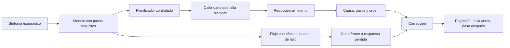
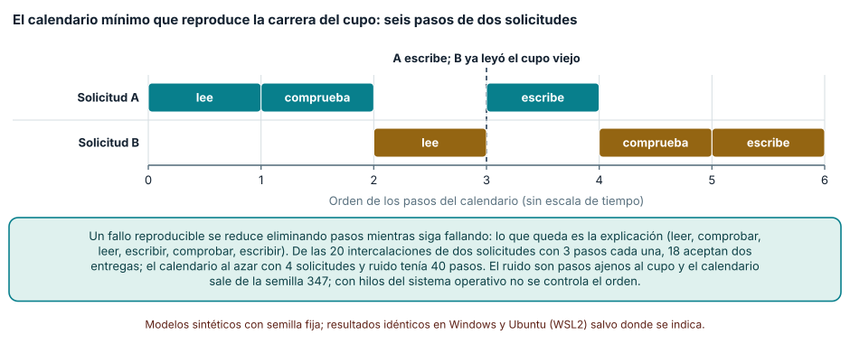
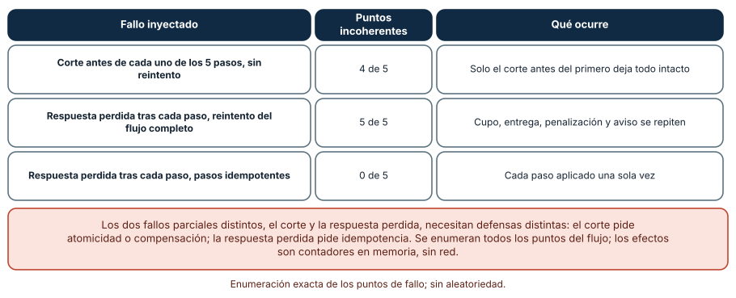
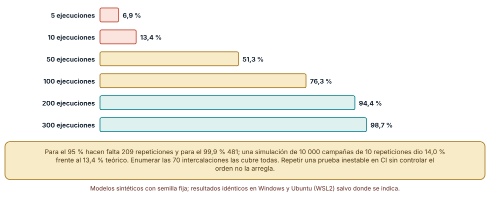

# SE-347 — Taller: reproducir una carrera y un fallo parcial

[← SE-346 — Caos controlado y pruebas de distribución](https://github.com/vladimiracunadev-create/modern-software-engineering-program/blob/main/classes/part-28-concurrencia-y-sistemas-distribuidos/se-346-caos-controlado-y-pruebas-de-distribucion/README.md) · [↑ Parte 28](https://github.com/vladimiracunadev-create/modern-software-engineering-program/blob/main/classes/part-28-concurrencia-y-sistemas-distribuidos/README.md) · [📚 Índice completo](https://github.com/vladimiracunadev-create/modern-software-engineering-program/blob/main/classes/README.md) · [🌐 Portal](https://vladimiracunadev-create.github.io/modern-software-engineering-program/classes/SE-347.html) · [SE-348 — Proyecto: servicio distribuido con degradación →](https://github.com/vladimiracunadev-create/modern-software-engineering-program/blob/main/classes/part-28-concurrencia-y-sistemas-distribuidos/se-348-proyecto-servicio-distribuido-con-degradacion/README.md)

## Punto profesional y fundamento pedagógico

**Punto profesional.** El taller existe para que practiques el oficio más caro de los sistemas concurrentes y distribuidos: convertir un síntoma esporádico («a veces se aceptan dos entregas con un solo cupo», «a veces el acuse llega y el registro no») en un caso que falla siempre, que es lo más pequeño posible y que queda como prueba de regresión estable. Es trabajo de diagnóstico, no de diseño: parte de un fallo observado y termina en una evidencia que otra persona puede ejecutar.

**Por qué aparece aquí.** Cierra el bloque de técnicas de la **Parte 28** después de **Caos controlado y pruebas de distribución**: ya sabes qué es una intercalación, un tiempo agotado ambiguo, un reintento y una exploración con semillas. Aquí se aplican juntos a dos fallos concretos de la plataforma de entregas. Prepara el proyecto final, que exige entregar un paquete con garantías declaradas y pruebas que las comprueben.

**Error conceptual que debe corregir.** Creer que un fallo esporádico se arregla «añadiendo un cerrojo donde parece» o repitiendo la prueba hasta que pase: sin reproducirlo y reducirlo no se sabe si se corrigió, solo si dejó de aparecer esta semana.

**Secuencia de aprendizaje.** Antes de leer los resultados, predices cuántas de las intercalaciones de dos solicitudes sobre un cupo de uno aceptan las dos y cuántos pasos de un calendario fallido de 40 hacen falta de verdad; después enumeras en qué puntos de un flujo de cinco pasos un corte o una respuesta perdida deja el estado incoherente, y calculas cuántas repeticiones de una prueba inestable hacen falta para verla. La secuencia usa predicción, explicación propia, contraste y recuperación. [ICAP](https://icap.education.asu.edu/research) distingue participación de construcción de conocimiento; [How People Learn II](https://nap.nationalacademies.org/catalog/24783/how-people-learn-ii-learners-contexts-and-cultures) exige conectar conocimiento previo, contexto y transferencia; la [práctica de recuperación](https://pubmed.ncbi.nlm.nih.gov/16507066/) respalda producir de nuevo la explicación tras una demora; y [Education for Life and Work](https://nap.nationalacademies.org/resource/13398/dbasse_084153.pdf) exige devolución que explique la causa del error.

**Evidencia de aprendizaje.** `taller-log.md` y una carpeta `reproductor/` con: el síntoma original, el planificador controlado que reproduce la carrera, el calendario mínimo, la enumeración de puntos de fallo del flujo parcial, la corrección de cada defecto y la prueba de regresión que falla antes y pasa después.

**Límite de la conclusión.** Los fallos del taller se reproducen sobre un modelo con pasos explícitos y un planificador controlado, no con hilos del sistema operativo ni con una red real; la reducción usa una variante simple de la reducción por bloques. No se afirma que las técnicas encuentren todos los defectos de un servicio real ni se midió el costo de aplicarlas.

### Trazabilidad fuente → afirmación

| Fuente primaria u oficial | Afirmación que respalda | Lo que no prueba |
|---|---|---|
| [Zeller y Hildebrandt, «Simplifying and isolating failure-inducing input» (2002)](https://doi.org/10.1109/32.988498) | Describe la reducción por delta (*delta debugging*): quitar partes de una entrada fallida mientras siga fallando hasta obtener una entrada mínima. | No garantiza una entrada mínima global ni cubre fallos no deterministas. |
| [Musuvathi et al., CHESS (2008)](https://www.usenix.org/legacy/event/osdi08/tech/full_papers/musuvathi/musuvathi.pdf) | Reproduce fallos de concurrencia controlando el planificador y explorando sistemáticamente las intercalaciones. | No evalúa programas de la plataforma ni cubre todos los modelos de memoria. |
| [rr: grabación y reproducción](https://rr-project.org/) | Muestra la técnica de grabar una ejecución no determinista para reproducirla de forma determinista y depurarla. | Es una herramienta concreta de Linux; esta clase no la ejecuta. |
| [Helland, «Idempotence is not a medical condition» (2012)](https://doi.org/10.1145/2181796.2187821) | Explica por qué los reintentos y la respuesta perdida obligan a diseñar operaciones repetibles. | No enumera los puntos de fallo de la plataforma. |
| [Python: unittest](https://docs.python.org/3/library/unittest.html) | Documenta cómo expresar una prueba de regresión ejecutable y repetible. | No dice cómo hacer determinista una prueba concurrente. |

## Antes de empezar

Recupera lo aprendido en `SE-346`: una semilla repite una ejecución y un experimento tiene hipótesis, alcance y aborto. La pregunta activa es: **¿cuál es el caso más pequeño que falla siempre, qué paso lo causa y qué prueba lo sostiene después de la corrección?**

## Prerrequisitos

- Haber completado `SE-346` o poder explicar por qué una pasada limpia no demuestra ausencia de carrera.
- Python 3.11 o posterior; los experimentos usan solo la biblioteca estándar (`itertools`, `random`, `collections`, `math`).
- Haber visto la enumeración de intercalaciones (`SE-338`), la ambigüedad del tiempo agotado (`SE-341`) y la idempotencia (`SE-344`).

## Problema auténtico

Dos reportes llegaron el mismo lunes. El primero: «una tutoría con un solo cupo tiene dos estudiantes inscritos». Ocurrió dos veces en un mes, siempre con carga alta, y en ninguna prueba. El segundo: «un estudiante recibió el aviso de entrega y la entrega no existe, o existe dos veces con dos penalizaciones». El equipo intentó arreglar el primero con un cerrojo en la ruta que le pareció la causa y el segundo con un reintento adicional. Ninguno se reprodujo antes de arreglarse, y ninguno de los dos arreglos añadió una prueba que fallara antes del cambio. A los dos meses, el primero volvió a aparecer por otra ruta. El taller recorre el camino que faltó: reproducir, reducir, explicar, corregir y blindar.

## Objetivos observables

Al terminar podrás:

1. reproducir de forma determinista una carrera de «comprobar y luego actuar» con un planificador controlado;
2. reducir un calendario fallido a un caso mínimo y explicar cada paso que queda;
3. enumerar los puntos de fallo de un flujo con efectos y clasificar cuáles dejan el estado incoherente según se trate de un corte o de una respuesta perdida;
4. estimar cuántas repeticiones de una prueba hacen falta para ver un fallo raro y por qué la enumeración es mejor;
5. entregar una prueba de regresión que falla antes de la corrección y pasa después.

## Mapa conceptual



El mapa tiene un camino para la **carrera** (modelo, planificador, calendario, reducción) y otro para el **fallo parcial** (puntos de fallo, corte frente a respuesta perdida). Ambos desembocan en una corrección que se prueba con una regresión que falla primero.

## Temas y por qué importan

| Tema | Por qué cambia una decisión profesional | Evidencia mínima |
|---|---|---|
| Del síntoma al modelo | Un fallo que no se modela no se reproduce. | Predicción, traza causal y contraejemplo de **Del síntoma al modelo** en `taller-log.md` |
| Planificador controlado | Convierte «a veces» en «siempre con este orden». | Predicción, traza causal y contraejemplo de **Planificador controlado** en `taller-log.md` |
| Reducción de calendarios | Deja solo los pasos que explican el fallo. | Predicción, traza causal y contraejemplo de **Reducción de calendarios** en `taller-log.md` |
| Fallos parciales de un flujo | El corte y la respuesta perdida piden defensas distintas. | Predicción, traza causal y contraejemplo de **Fallos parciales de un flujo** en `taller-log.md` |
| Regresión estable | Si no falla antes de la corrección, no prueba nada. | Predicción, traza causal y contraejemplo de **Regresión estable** en `taller-log.md` |

## Conceptos y decisiones

### 1. Del síntoma al modelo

Un síntoma esporádico se vuelve tratable cuando se traduce a pasos explícitos y a un estado observable. Para el cupo: cada solicitud ejecuta tres pasos (leer el cupo, comprobar que queda, escribir la entrega) y el estado es el número de entregas aceptadas; la invariante es «nunca más que el cupo». Se omite todo lo que no interviene (red, formato, autenticación). El modelo es una hipótesis sobre el mecanismo: si reproduce el síntoma con una intercalación concreta, la hipótesis se sostiene; si no, hay que corregir el modelo, no el código. Un buen modelo cabe en una pantalla y puede ejecutarse sin la plataforma.

### 2. Planificador controlado

Un **planificador controlado** ejecuta los pasos de las tareas en el orden que se le indica, y puede enumerar todos los órdenes posibles o recibir uno concreto. Con él, «a veces falla» pasa a ser «falla con este orden». Se obtiene sustituyendo la concurrencia real por una simulación de pasos (como en `SE-338`), poniendo puntos de sincronización explícitos (barreras) o ejecutando bajo una herramienta que controle el planificador. Lo importante es que el orden sea un dato que se pueda guardar, compartir y repetir, igual que una entrada de prueba.

### 3. Reducción de calendarios

Un calendario fallido encontrado al azar contiene pasos que no importan. La **reducción por bloques** (delta debugging) los elimina: se quita un bloque de pasos, se vuelve a ejecutar y, si sigue fallando, la reducción se acepta; si no, se repone y se prueba otro bloque. Termina cuando ningún paso puede quitarse. Lo que queda es una explicación: «lectura de A, lectura de B, escritura de A, escritura de B». No es necesariamente el mínimo global, pero suele ser lo bastante corto como para entenderse y para fijar la prueba de regresión.

### 4. Fallos parciales de un flujo

Un flujo con efectos (reservar cupo, guardar entrega, cobrar una penalización, avisar, marcar completa) puede interrumpirse de dos maneras distintas. En un **corte**, el proceso se detiene antes de un paso: los efectos anteriores quedan hechos y los siguientes no. En una **respuesta perdida**, el paso se ejecutó pero el cliente no lo sabe y repite el flujo. El corte pide atomicidad o compensación (deshacer lo hecho); la respuesta perdida pide idempotencia (que repetir no cambie el estado). Confundirlos lleva a arreglar uno y dejar el otro: un cerrojo no ayuda a una respuesta perdida y una clave de idempotencia no deshace un corte.

### 5. Regresión estable

Una prueba de regresión útil **falla antes** de la corrección y **pasa después**, con el mismo orden y la misma entrada. Eso exige que sea determinista: se fija el calendario mínimo o la semilla, no se confía en la repetición. Además, debe expresar la invariante y no el mecanismo: «nunca hay más entregas que cupo» sobrevive a un cambio de implementación, mientras que «se toma el cerrojo X» no. Y se guarda junto al código: una carrera corregida sin prueba vuelve por otra ruta, como pasó en el caso del lunes.

### La carrera del cupo y su calendario mínimo

Dos solicitudes ejecutan cada una tres pasos (leer, comprobar, escribir) sobre un cupo de 1. Se enumeran las 20 intercalaciones y se cuentan las que aceptan las dos. Después se genera al azar un calendario de 40 pasos con ruido (pasos ajenos al cupo) que viola la invariante y se reduce por bloques.

```python
def ddmin(s):
    n = 2
    while len(s) >= 2:
        chunk = max(1, len(s) // n)
        for i in range(0, len(s), chunk):
            cand = s[:i] + s[i + chunk:]
            if cand and noisy_exec(cand):      # sigue fallando sin esos pasos
                s = cand; n = max(n - 1, 2); break
        else:
            if chunk == 1: break
            n = min(len(s), n * 2)
    return s
```

| Medida | Resultado |
|---|---:|
| Intercalaciones de 2 solicitudes (3 pasos cada una) | 20 |
| …con dos entregas aceptadas con cupo 1 | 18 (90 %) |
| Calendario fallido al azar, 4 solicitudes y ruido | 40 pasos |
| Calendario mínimo que sigue fallando | 6 pasos |

Solo 2 de 20 intercalaciones respetan el cupo: las dos secuenciales. El calendario de 40 pasos se redujo a 6: dos hilos leyendo antes de que cualquiera escriba. El calendario que encontró la reducción fue, con los hilos renombrados, leer A, leer B, comprobar B, escribir B, comprobar A, escribir A: un hilo lee antes de que el otro escriba y ambos aceptan. Es la explicación del defecto en una línea.



**Cómo leer la figura.** Cada carril es una solicitud y el eje es el orden de los pasos (no hay escala de tiempo); la línea punteada marca el momento en que A escribe después de que B ya leyó. Mira que B comprueba con un valor viejo: ese cruce es toda la explicación del defecto. **Dónde deja de valer:** el ruido son pasos ajenos al cupo y el calendario sale de la semilla 347; la reducción es una variante simple y puede devolver un calendario mínimo local. Con hilos del sistema operativo no se controla el orden; el modelo explica el mecanismo, y la corrección real se comprueba además con una operación atómica del almacén.

### Corte frente a respuesta perdida

Un flujo de cinco pasos (reservar cupo, guardar entrega, cobrar penalización, enviar aviso, marcar completa) se interrumpe en cada uno de sus puntos. Se compara el corte antes de cada paso sin reintento, la respuesta perdida tras cada paso con reintento ingenuo del flujo completo y el mismo reintento con pasos idempotentes. El estado es coherente si está todo hecho una vez o nada.

```python
def apply(s):
    if idempotent and s in done:      # el paso ya se aplicó: repetirlo no cambia nada
        return
    done.add(s)
```

| Fallo inyectado | Puntos incoherentes | Qué ocurre |
|---|---:|---|
| Corte antes de cada uno de los 5 pasos, sin reintento | 4 de 5 | Solo el corte antes del primero deja todo intacto |
| Respuesta perdida tras cada paso, reintento del flujo completo | 5 de 5 | Cupo, entrega, penalización y aviso se repiten |
| Respuesta perdida tras cada paso, pasos idempotentes | 0 de 5 | Cada paso aplicado una sola vez |

El corte deja huérfano el efecto de los pasos hechos en 4 de 5 puntos (por ejemplo, el cupo descontado sin entrega). La respuesta perdida con reintento ingenuo duplica el efecto en los cinco puntos, incluido el último, aunque todo estaba hecho. Con pasos idempotentes la repetición es inofensiva. Y nótese lo que la tabla no dice: los pasos idempotentes no arreglan el corte, que sigue pidiendo atomicidad o compensación.



**Cómo leer la figura.** Cada barra es un tipo de fallo con su defensa y se divide entre los 5 puntos del flujo que dejan el estado coherente (verde) y los que lo dejan incoherente (coral). Mira que cada defensa mueve el coral de una barra a otra: el corte y la respuesta perdida no se arreglan con lo mismo. **Dónde deja de valer:** los efectos son contadores en memoria y el flujo es lineal, sin red ni concurrencia; no se modela un corte que ocurre dentro de un paso. La enumeración es exacta y por eso no tiene semilla: sirve como lista de comprobación para cualquier flujo con efectos.

### Cuántas repeticiones hacen falta

Un defecto aparece en 1 de cada 70 ejecuciones (el caso de las 70 intercalaciones de `SE-338`). Se calcula la probabilidad de verlo al menos una vez en *n* repeticiones, `1 − (1 − 1/70)ⁿ`, y se comprueba por simulación con 10 000 campañas de 10 repeticiones.

```python
need95  = math.ceil(math.log(0.05)  / math.log(1 - 1 / 70))    # repeticiones para el 95 %
need999 = math.ceil(math.log(0.001) / math.log(1 - 1 / 70))    # y para el 99,9 %
```

| Repeticiones | Probabilidad de verlo al menos una vez |
|---:|---:|
| 5 | 6,9 % |
| 10 | 13,4 % |
| 50 | 51,3 % |
| 100 | 76,3 % |
| 200 | 94,4 % |
| 300 | 98,7 % |

Para el 95 % hacen falta 209 repeticiones y para el 99,9 %, 481; la simulación de 10 000 campañas de 10 repeticiones dio 14,0 % frente al 13,4 % teórico. Enumerar las 70 intercalaciones las cubre todas con 70 ejecuciones. Repetir una prueba inestable en el servidor de integración continua diez veces «para ver si pasa» solo detecta un defecto de este tipo una de cada siete veces.



**Cómo leer la figura.** Cada barra es un número de repeticiones y su longitud, la probabilidad de ver el fallo al menos una vez. **Dónde deja de valer:** supone ejecuciones independientes con la misma probabilidad, lo que un planificador real no cumple (`SE-346`); la tasa de 1 en 70 es el caso del modelo, no una medida de la plataforma. Sirve para decidir cuándo repetir es un plan y cuándo es una ilusión.

## Definiciones de trabajo

- **reproductor mínimo:** programa pequeño y determinista que muestra un fallo con la menor cantidad posible de pasos.
- **calendario (*schedule*):** orden concreto en que se ejecutan los pasos de varias tareas.
- **reducción por bloques (*delta debugging*):** técnica que elimina partes de una entrada fallida mientras siga fallando.
- **corte:** interrupción de un flujo antes de un paso, que deja hecho lo anterior y sin hacer lo siguiente.
- **prueba de regresión:** prueba que falla ante el defecto original y pasa con la corrección.

Las definiciones son operativas para la plataforma de entregas. No convierten términos con una historia más amplia en sinónimos y deben contrastarse con la documentación primaria enlazada al final.

## Ejemplo mínimo

El fragmento reproduce el calendario mínimo de la carrera del cupo. Antes de ejecutarlo, predice cuántas entregas se aceptan.

```python
def ejecutar(calendario):
    cupo, visto, entregas = 1, {}, 0
    for paso, i in calendario:
        if paso == "leer":     visto[i] = cupo
        elif paso == "comprobar": visto[(i, "ok")] = visto[i] > 0
        elif visto.get((i, "ok")):
            entregas += 1; cupo = visto[i] - 1
    return entregas
minimo = [("leer", 0), ("comprobar", 0), ("leer", 1), ("escribir", 0), ("comprobar", 1), ("escribir", 1)]
assert ejecutar(minimo) == 2
```

Con ese orden se aceptan dos entregas con cupo 1. Registra versión de Python y salida; después cambia el cálculo del cupo por un descuento atómico (`cupo -= 1` con comprobación) y verifica que el calendario deja de fallar.

## Ejemplo profesional

El equipo del reporte del lunes sigue el procedimiento del taller. Para el cupo duplicado, escribe el modelo de tres pasos, reproduce con el calendario mínimo de seis pasos y descubre que otra ruta (la importación masiva) también leía y escribía el cupo sin la comprobación atómica. La corrección reemplaza «leer y escribir» por `UPDATE cupo SET libres = libres - 1 WHERE libres > 0` y comprueba el número de filas afectadas; la regresión ejecuta el calendario mínimo y 200 semillas del planificador y falla antes del cambio. Para el acuse sin registro, enumera los cinco puntos de fallo, descubre que el aviso se enviaba antes de guardar la entrega y que el reintento del cliente repetía el cobro; mueve el aviso al final, añade una clave de idempotencia por paso y una compensación para el corte tras cobrar. Cada decisión queda en `taller-log.md` con la evidencia de que la regresión falló antes y pasa después.

## Práctica guiada

1. Escribe el síntoma «dos entregas con un cupo» como un modelo de tres pasos y una invariante.
2. Predice cuántas de las 20 intercalaciones de dos solicitudes aceptan las dos y comprueba.
3. Genera un calendario fallido al azar con ruido y redúcelo con la reducción por bloques.
4. Explica con una frase cada paso del calendario mínimo y qué dependencia entre ellos causa el fallo.
5. Enumera los cinco puntos de fallo del flujo con corte y con respuesta perdida; clasifica cuáles dejan estado incoherente.
6. Aplica una corrección a cada defecto y comprueba que las pruebas de regresión fallan antes y pasan después.
7. Entrega `taller-log.md` y `reproductor/` y pide a otra persona que reproduzca el fallo con un solo comando.

## Ejercicios

1. **Enumeración:** con tres solicitudes sobre un cupo de 2, ¿cuántas intercalaciones hay y cuántas aceptan tres? Compara con `SE-346`.
2. **Reducción:** un calendario de 12 pasos falla y al quitar cualquier paso deja de fallar; ¿qué sabes de él y qué no?
3. **Clasificación:** en un flujo «guardar entrega, enviar correo», ¿qué fallo se resuelve con idempotencia y cuál con compensación?
4. **Diagnóstico:** una regresión pasa antes y después de la corrección. Formula tres hipótesis sobre por qué no prueba nada.

## Reto verificable

Entrega `taller-log.md` y `reproductor/` con el síntoma, el modelo, el calendario mínimo, la enumeración de puntos de fallo, las correcciones y las pruebas de regresión que fallan antes y pasan después. Se aprueba si otra persona ejecuta el reproductor desde un checkout limpio con un solo comando, ve el fallo, aplica la corrección y ve pasar la regresión. No se aprueba por una corrección sin una prueba que haya fallado antes ni por repetir diez veces una prueba inestable.

## Caso conductor

La carrera del cupo y el flujo del acuse son los casos del taller en el caso conductor de la Parte 28. `SE-348` pide integrarlo todo en un paquete de servicio con garantías declaradas y degradación. Cambia después una sola decisión, el orden de los pasos del flujo, y observa qué punto de fallo cambia de clasificación.

## Preguntas frecuentes

### ¿Cómo reproduzco una carrera si mi servicio usa hilos reales?

Introduce puntos de sincronización (barreras) en el código de prueba para forzar el orden, o aísla la lógica en una función pura que recibe el orden como dato. Si ninguna es posible, graba la ejecución con una herramienta como rr y reprodúcela de forma determinista.

### ¿La reducción siempre da el mínimo?

No: da un mínimo local, es decir, uno al que no se le puede quitar ningún paso. Suele bastar. Si hay varias causas, puede reducir a una y esconder otra, de ahí la importancia de volver a ejecutar la regresión completa.

### ¿Qué hago si no logro reproducir el fallo?

Registra lo que sabes (versión, carga, hora, trazas), mejora la observabilidad en el punto sospechoso y deja el caso como límite declarado. No lo «arregles» sin reproducirlo: no sabrás si funcionó.

### ¿Una regresión debe probar el mecanismo o la invariante?

La invariante («nunca más entregas que cupo»): sobrevive a cambios de implementación. El calendario mínimo se guarda además como caso fijo porque garantiza que el defecto original sigue cubierto.

## Fallo controlado y diagnóstico

Reproduce el fallo clásico del taller: **dos entregas aceptadas con un solo cupo por una carrera de «comprobar y luego actuar»**. Ejecuta el calendario mínimo de seis pasos y después la versión corregida.

Registra síntoma, entrada mínima, hipótesis, observación que descarta cada hipótesis, causa, corrección y prueba de regresión. **Síntoma:** una tutoría de un cupo tiene dos inscritos. **Hipótesis rivales:** (a) un error de importación que duplicó una fila; (b) un reintento del cliente sin clave; (c) dos solicitudes que leyeron el cupo antes de que alguna lo descontara. **Prueba:** registra el identificador de solicitud y el valor de cupo leído; si ambas leyeron el mismo valor y sus escrituras llevan identificadores distintos, la causa es la carrera. **Conclusión:** la comprobación y la escritura son pasos separados. **Regresión:** usa un descuento atómico condicionado, y ejecuta el calendario mínimo y 200 semillas; comprueba que la prueba falla antes del cambio. No cambies a la vez la ruta de importación y la de la web sin una regresión por ruta.

## Errores comunes y cómo corregirlos

| Síntoma | Causa probable | Corrección |
|---|---|---|
| El fallo desaparece al añadir registros | El registro cambia el orden de los pasos | Registrar fuera de la sección o grabar la ejecución |
| El arreglo vuelve a fallar por otra ruta | Solo se protegió una de las rutas | Proteger el dato, no la ruta, y probar cada ruta |
| La regresión pasa antes de la corrección | Prueba que no fuerza el orden | Fijar el calendario o la semilla y comprobar el fallo previo |
| Se arregla el corte con idempotencia | Se confundió con la respuesta perdida | Compensación o atomicidad para el corte |
| La prueba inestable se reintenta hasta pasar | Se oculta un defecto raro | Enumerar o explorar con semillas y reproducir |

## Entorno y archivos clave

```text
work/SE-347/
├── README.md
├── reproductor/
│   ├── cupo.py
│   ├── reducir.py
│   └── flujo.py
├── tests/test_regresion.py
└── evidence/taller-log.md
```

El `README` declara plataforma, versión de Python, semillas (347 y 3473) y comandos. Los experimentos usan solo la biblioteca estándar (`itertools`, `random`, `collections`, `math`) y se ejecutaron con CPython 3.12.9 en Windows 11 y 3.12.3 en Ubuntu bajo WSL2: las salidas fueron idénticas. Si añades una dependencia, fija procedencia y versión.

## Seguridad, ética y accesibilidad

- una carrera sobre un cupo, un saldo o un permiso es también una vulnerabilidad (doble gasto, escalada); trata los casos reproducidos como información sensible hasta corregirlos;
- un reproductor no debe contener datos reales de estudiantes ni credenciales: usa identificadores sintéticos;
- las compensaciones del corte (devolver una penalización) afectan a personas: documenta quién las aprueba y cómo se comunican;
- escribe el calendario mínimo y su explicación en texto accesible, además de la tabla;
- respeta las licencias de las herramientas y artículos citados y atribuye lo adaptado.

## Puente hacia el trabajo con agentes

Un agente al que se le pide «arregla este fallo esporádico» propondrá a menudo un cerrojo en la ruta más evidente y una prueba que lo ejecuta varias veces. Pídele en cambio que primero reproduzca el fallo con un calendario explícito, que lo reduzca y explique cada paso, que enumere los puntos de fallo del flujo separando corte y respuesta perdida, y que entregue una regresión que falle antes de su cambio y pase después. Revisa especialmente si la regresión se ejecutó contra el código original y si el cambio protege el dato y no una sola ruta: son los dos defectos que este taller mostró sin aviso.

## Transferencia

Traslada el taller a otro dominio (por ejemplo, el stock de una tienda con reservas simultáneas y un flujo de pago con aviso): cambia los pasos y conserva el procedimiento de modelar, controlar el orden, reducir, enumerar puntos de fallo y blindar con una regresión. La transferencia está lograda cuando puedes entregar un reproductor que otra persona ejecuta con un comando, no cuando el código tiene un cerrojo nuevo.

## Evaluación y evidencia

| Criterio | Evidencia para aprobar |
|---|---|
| comprensión | explicación del calendario mínimo y de la diferencia entre corte y respuesta perdida |
| corrección | enumeración, reducción y probabilidades reproducibles |
| diseño | corrección que protege el dato y regresión sobre la invariante |
| diagnóstico | reproductor mínimo con la regresión que falla antes y pasa después |
| incertidumbre | declaración de que el modelo no incluye hilos reales ni red |
| reproducibilidad | versiones, comandos, salida, semillas y límites declarados |

## Fuentes

- [Zeller y Hildebrandt, «Simplifying and isolating failure-inducing input»](https://doi.org/10.1109/32.988498) — reducción por delta; autoridad: artículo original (2002).
- [Musuvathi et al., CHESS](https://www.usenix.org/legacy/event/osdi08/tech/full_papers/musuvathi/musuvathi.pdf) — planificador controlado y exploración sistemática; autoridad: artículo de OSDI (2008).
- [rr: grabación y reproducción](https://rr-project.org/) — reproducción determinista de ejecuciones; autoridad: proyecto rr.
- [Helland, «Idempotence is not a medical condition»](https://doi.org/10.1145/2181796.2187821) — reintentos y respuesta perdida; autoridad: artículo de ACM Queue (2012).
- [Python: unittest](https://docs.python.org/3/library/unittest.html) — pruebas de regresión ejecutables; autoridad: documentación de Python.

Cada fuente respalda el mecanismo indicado; ninguna demuestra que los 18 de 20 calendarios, los 6 pasos del mínimo o las 209 repeticiones se observen en un servicio real. Esa afirmación depende del programa, del planificador y de los datos.

## Límites y siguiente paso

Se ejecutaron tres experimentos deterministas en Windows y Ubuntu (WSL2) con resultados idénticos. No se usaron hilos del sistema operativo ni una red: el modelo de tres pasos, el ruido, el flujo de cinco pasos y la tasa de 1 en 70 son construcciones del autor, y la reducción puede devolver un mínimo local. La siguiente clase integra todo en un proyecto: un servicio distribuido con garantías declaradas, degradación y una prueba para cada promesa.

## Glosario

- **reproductor mínimo:** programa pequeño y determinista que muestra un fallo con la menor cantidad posible de pasos.
- **calendario (*schedule*):** orden concreto en que se ejecutan los pasos de varias tareas.
- **reducción por bloques (*delta debugging*):** técnica que elimina partes de una entrada fallida mientras siga fallando.
- **corte:** interrupción de un flujo antes de un paso, que deja hecho lo anterior y sin hacer lo siguiente.
- **prueba de regresión:** prueba que falla ante el defecto original y pasa con la corrección.

---

[← SE-346 — Caos controlado y pruebas de distribución](https://github.com/vladimiracunadev-create/modern-software-engineering-program/blob/main/classes/part-28-concurrencia-y-sistemas-distribuidos/se-346-caos-controlado-y-pruebas-de-distribucion/README.md) · [↑ Parte 28](https://github.com/vladimiracunadev-create/modern-software-engineering-program/blob/main/classes/part-28-concurrencia-y-sistemas-distribuidos/README.md) · [📚 Índice completo](https://github.com/vladimiracunadev-create/modern-software-engineering-program/blob/main/classes/README.md) · [🌐 Portal](https://vladimiracunadev-create.github.io/modern-software-engineering-program/classes/SE-347.html) · [SE-348 — Proyecto: servicio distribuido con degradación →](https://github.com/vladimiracunadev-create/modern-software-engineering-program/blob/main/classes/part-28-concurrencia-y-sistemas-distribuidos/se-348-proyecto-servicio-distribuido-con-degradacion/README.md)
