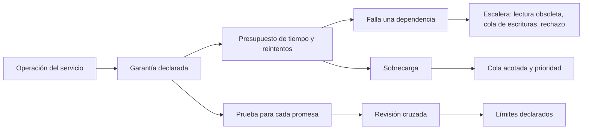
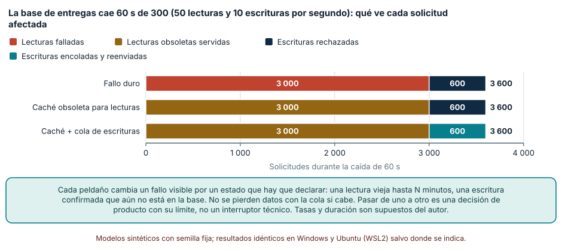

# SE-348 — Proyecto: servicio distribuido con degradación

[← SE-347 — Taller: reproducir una carrera y un fallo parcial](https://github.com/vladimiracunadev-create/modern-software-engineering-program/blob/main/classes/part-28-concurrencia-y-sistemas-distribuidos/se-347-taller-reproducir-una-carrera-y-un-fallo-parcial/README.md) · [↑ Parte 28](https://github.com/vladimiracunadev-create/modern-software-engineering-program/blob/main/classes/part-28-concurrencia-y-sistemas-distribuidos/README.md) · [📚 Índice completo](https://github.com/vladimiracunadev-create/modern-software-engineering-program/blob/main/classes/README.md) · [🌐 Portal](https://vladimiracunadev-create.github.io/modern-software-engineering-program/classes/SE-348.html) · [SE-349 — IaaS, PaaS, SaaS y responsabilidad compartida →](https://github.com/vladimiracunadev-create/modern-software-engineering-program/blob/main/classes/part-29-cloud-plataforma-e-infraestructura/se-349-iaas-paas-saas-y-responsabilidad-compartida/README.md)

## Punto profesional y fundamento pedagógico

**Punto profesional.** El proyecto existe para que entregues un servicio del que se pueda decir con evidencia qué garantiza, qué deja de garantizar cuando una dependencia falla o la carga lo supera, y qué ve la persona usuaria en cada caso. Integra la Parte 28 en un paquete revisable: garantías declaradas, presupuestos de tiempo y de reintentos, escalera de degradación, protección ante sobrecarga, pruebas para cada promesa y un archivo de límites.

**Por qué aparece aquí.** Cierra la **Parte 28** después de **Taller: reproducir una carrera y un fallo parcial**: el taller dio las técnicas de diagnóstico; el proyecto las usa para sostener un servicio completo. Prepara la Parte 29, que lleva este servicio a una plataforma de nube y necesita saber qué se espera de él cuando la infraestructura falle.

**Error conceptual que debe corregir.** Creer que un paquete completo es un paquete correcto: un documento con todas las secciones puede declarar una garantía imposible, un presupuesto de tiempo incoherente o una prueba que nunca se ejecutó, y un verificador de forma no lo ve.

**Secuencia de aprendizaje.** Antes de leer los resultados, predices qué ve el estudiante y qué pierde el sistema durante una caída de la base con tres estrategias y cuántas solicitudes se atienden con y sin límite de cola ante una sobrecarga del 50 %; después revisas qué detecta un validador de forma de un paquete en 200 mutaciones. La secuencia usa predicción, explicación propia, contraste y recuperación. [ICAP](https://icap.education.asu.edu/research) distingue participación de construcción de conocimiento; [How People Learn II](https://nap.nationalacademies.org/catalog/24783/how-people-learn-ii-learners-contexts-and-cultures) exige conectar conocimiento previo, contexto y transferencia; la [práctica de recuperación](https://pubmed.ncbi.nlm.nih.gov/16507066/) respalda producir de nuevo la explicación tras una demora; y [Education for Life and Work](https://nap.nationalacademies.org/resource/13398/dbasse_084153.pdf) exige devolución que explique la causa del error.

**Evidencia de aprendizaje.** El paquete `servicio-distribuido/` con `GARANTIAS.md`, `PRESUPUESTOS.md`, `DEGRADACION.md`, `SOBRECARGA.md`, `PRUEBAS.md`, el código del servicio de referencia, las pruebas ejecutables y `LIMITES.md`, más una revisión cruzada por otra persona.

**Límite de la conclusión.** Todas las cifras salen de simulaciones del autor con semilla fija: la caída de la base (60 s de 300), la sobrecarga (150 solicitudes por turno frente a una capacidad de 100), la proporción 30/70 entre entregas y listados y las mutaciones del paquete son supuestos. No se desplegó ningún servicio ni se midió una carga real, y el validador se escribió conociendo las mutaciones.

### Trazabilidad fuente → afirmación

| Fuente primaria u oficial | Afirmación que respalda | Lo que no prueba |
|---|---|---|
| [Google SRE: manejo de sobrecarga](https://sre.google/sre-book/handling-overload/) | Describe cómo rechazar el exceso de carga, priorizar solicitudes y evitar que las colas largas aumenten la latencia de todo. | No cuantifica los números de esta clase ni mide la plataforma. |
| [AWS Builders' Library: descartar carga para evitar la sobrecarga](https://aws.amazon.com/builders-library/using-load-shedding-to-avoid-overload/) | Explica el descarte de carga (*load shedding*) y por qué es preferible a dejar que la latencia crezca sin límite. | Es la experiencia de una empresa; no prueba lo mismo en otra plataforma. |
| [Little, «A proof for the queuing formula» (1961)](https://doi.org/10.1287/opre.9.3.383) | Demuestra que, en régimen estable, el número medio de elementos en un sistema es la tasa de llegada por el tiempo medio de estancia. | No dice cuál es la distribución de la espera ni qué política conviene. |
| [Microsoft Azure: patrón de interruptor](https://learn.microsoft.com/en-us/azure/architecture/patterns/circuit-breaker) | Presenta el interruptor como mecanismo para evitar llamadas repetidas a una dependencia que está fallando. | No establece los umbrales adecuados para la plataforma. |
| [Fowler, «CircuitBreaker»](https://martinfowler.com/bliki/CircuitBreaker.html) | Describe los estados cerrado, abierto y semiabierto del interruptor. | No mide su efecto en un sistema concreto. |

## Antes de empezar

Recupera lo aprendido en `SE-347`: un defecto reproducido y blindado con una regresión. La pregunta activa es: **si cada una de las garantías de este servicio se pusiera a prueba hoy, qué evidencia la sostendría, y qué ve una persona cuando la dependencia falla o llegan más solicitudes de las que caben?**

## Prerrequisitos

- Haber completado `SE-347` o poder entregar un reproductor con regresión que falle antes y pase después.
- Python 3.11 o posterior; los experimentos usan solo la biblioteca estándar (`random`, `collections`, `statistics`).
- Haber leído las clases `SE-337` a `SE-346` o poder explicar la garantía que cada una aporta a un servicio.

## Problema auténtico

La plataforma debe publicar un servicio de entregas que sobreviva al cierre de plazo y a la caída ocasional de la base de datos. El equipo tiene las piezas: reintentos con presupuesto, clave de idempotencia, cuórum de escritura, titular único para la publicación de notas, balanceo de dos opciones, caos acotado. Falta lo que las une: ¿qué promete exactamente el servicio mientras la base está caída?, ¿cuánto tarda una persona en saber que su entrega se recibió?, ¿qué se hace cuando llegan más solicitudes de las que se pueden atender? Hoy esas respuestas viven en la cabeza de tres personas y en tres tableros distintos. El proyecto exige ponerlas en un paquete que un revisor ajeno pueda leer, ejecutar y desafiar.

## Objetivos observables

Al terminar podrás:

1. declarar las garantías de un servicio por operación (qué promete, bajo qué fallos, con qué límite de tiempo) y distinguirlas de los deseos;
2. repartir un presupuesto de tiempo y de reintentos entre las llamadas de una solicitud con aritmética comprobable;
3. diseñar una escalera de degradación y medir qué ve la persona y qué se pierde en cada peldaño ante una caída;
4. proteger al servicio de la sobrecarga con un límite de cola y una política de prioridad, y comprobar la ley de Little;
5. entregar un paquete con una prueba para cada promesa y un archivo de límites, y reconocer qué ningún validador de forma ve.

## Mapa conceptual



El mapa muestra que el paquete se lee en cadena: cada operación tiene una garantía; la garantía exige presupuestos; los presupuestos se ponen a prueba cuando la dependencia falla o la carga sube; y cada promesa tiene una prueba y un límite. Lo que sobra o falta en esa cadena es lo que el revisor debe encontrar.

## Temas y por qué importan

| Tema | Por qué cambia una decisión profesional | Evidencia mínima |
|---|---|---|
| Garantías declaradas por operación | Convierten expectativas en compromisos revisables. | Predicción, traza causal y contraejemplo de **Garantías declaradas por operación** en el paquete |
| Presupuestos de tiempo y reintentos | Impiden que las capas se sumen hasta superar el plazo. | Predicción, traza causal y contraejemplo de **Presupuestos de tiempo y reintentos** en el paquete |
| Escalera de degradación | Cambia un fallo visible por un estado declarado. | Predicción, traza causal y contraejemplo de **Escalera de degradación** en el paquete |
| Protección ante sobrecarga | Decide qué se descarta en lugar de dejar que todo se degrade. | Predicción, traza causal y contraejemplo de **Protección ante sobrecarga** en el paquete |
| Evidencia, revisión y límites | Distingue un paquete completo de uno correcto. | Predicción, traza causal y contraejemplo de **Evidencia, revisión y límites** en el paquete |

## Conceptos y decisiones

### 1. Garantías declaradas por operación

Una garantía bien escrita dice qué operación, bajo qué fallo y con qué límite: «registrar una entrega: si la base de datos tiene mayoría, el acuse se emite solo tras la confirmación de dos de tres réplicas y la entrega no se pierde ni se duplica ante reintentos con la misma clave; sin mayoría, se rechaza con un error reintentable». Dice también lo que *no* garantiza: no se promete orden entre entregas de estudiantes distintos, ni que un listado refleje una entrega de hace menos de cinco segundos. Las garantías se escriben por operación porque las operaciones toleran cosas distintas (`SE-342`), y se evitan las imposibles: «exactamente una vez de extremo a extremo y disponible en cualquier partición» no es una garantía, es un deseo.

### 2. Presupuestos de tiempo y reintentos

Una solicitud del usuario tiene un plazo total (por ejemplo, 800 ms) que debe repartirse entre las llamadas internas, incluidos los reintentos. Si cada una de tres llamadas tiene un tiempo límite de 500 ms, el peor caso es 1 500 ms y el plazo se rompe sin que ninguna llamada «falle». La aritmética se escribe en el paquete: tiempo límite de cada llamada, número de reintentos, retroceso, presupuesto del 10 % por servicio y el máximo teórico que resulta. Un presupuesto que no suma es una mutación que un validador de forma no ve a menos que alguien compruebe la cuenta, y por eso se prueba con una prueba que lo calcula.

### 3. Escalera de degradación

Cuando una dependencia cae, hay peldaños entre «todo funciona» y «error 500». Un primer peldaño es **servir lecturas obsoletas** de una caché, con una antigüedad máxima declarada y una etiqueta visible. Un segundo es **encolar las escrituras** localmente y reenviarlas al volver la dependencia, con un tamaño máximo de cola y una promesa honesta («tu entrega está recibida y se confirmará en unos minutos»). El último es **rechazar** con un mensaje claro. Cada peldaño cambia un fallo visible por un estado que hay que declarar, vigilar y limitar, y decidir cuál usar es una decisión de producto, no un interruptor técnico: aceptar una entrega que aún no está en la base es una promesa que hay que poder cumplir.

### 4. Protección ante sobrecarga

Si llegan más solicitudes de las que se atienden, algo espera o se descarta. Sin límite, la cola crece, la espera de *todas* las solicitudes crece y el servicio se vuelve inútil para todos; la ley de Little (`L = λ · W`) lo cuantifica: con un número de elementos creciente y una tasa de servicio fija, el tiempo de estancia crece en proporción. Con una **cola acotada**, el exceso se rechaza pronto y lo aceptado se atiende rápido. Con **prioridad**, lo que no se puede repetir sin costo (una entrega) se protege a costa de lo que sí (un listado). Elegir qué se descarta es la política, y se escribe: nunca entregas antes que listados.

### 5. Evidencia, revisión y límites

Un paquete se compone de promesas y de evidencia de cada una. Una prueba ejecutable por promesa es el estándar; cuando no la hay, se declara. El **archivo de límites** lista lo que nadie midió: qué supuestos son del autor, qué entornos no se probaron, qué fallos no se inyectaron. Un validador de forma puede verificar que los campos existan y que los números cuadren a simple vista, pero no puede saber si una evidencia fue copiada de otro servicio, si una prueba se ejecutó alguna vez o si una garantía es físicamente posible. Eso lo ve una revisión cruzada por otra persona que intente romper el paquete.

### La base cae un minuto

La base de entregas está caída de t = 120 s a t = 180 s de 300. Llegan 50 lecturas y 10 escrituras por segundo. Se comparan tres estrategias: fallo duro, lecturas obsoletas desde caché, y caché más cola local de escrituras reenviada al recuperar la base.

```python
if not is_down:             reads_ok += 1
elif strategy in ("cache", "cola"):  reads_stale += 1      # se sirve desde caché
else:                       reads_fail += 1
...
elif strategy == "cola":    queue.append(t); writes_queued += 1
```

| Estrategia | Lecturas | Escrituras | Datos perdidos |
|---|---|---|---:|
| Fallo duro | 3 000 falladas | 600 rechazadas | 0 |
| Caché obsoleta para lecturas | 3 000 obsoletas, 0 falladas | 600 rechazadas | 0 |
| Caché y cola de escrituras | 3 000 obsoletas, 0 falladas | 600 encoladas y reenviadas | 0 si la cola cabe |

El fallo duro pierde 3 000 lecturas y 600 escrituras durante la caída. La caché sirve todas las lecturas con datos viejos y no resuelve las escrituras. La cola resuelve ambas, y aquí sube un riesgo nuevo: 600 escrituras confirmadas a personas que aún no están en la base, que se pierden si el proceso cae antes de reenviarlas o si la cola supera su límite (500 en el paquete: 100 se perderían o deberían rechazarse). La escalera cambia el costo de un lugar a otro.



**Cómo leer la figura.** Cada barra es una estrategia de degradación y se divide por lo que vive cada solicitud afectada: lectura fallada (coral), lectura obsoleta (dorado), escritura rechazada (azul) o escrita en cola (verde). Mira cómo el coral y el azul desaparecen peldaño a peldaño y son reemplazados por estados que hay que declarar. **Dónde deja de valer:** la caída de 60 s, las tasas de 50 y 10 por segundo y la cola ideal sin límite son supuestos del autor; no se modela la antigüedad máxima de la caché ni que una escritura encolada pueda fallar al reenviarse (por ejemplo, porque el cupo ya se agotó). Esos casos son los que `DEGRADACION.md` debe declarar.

### Sobrecarga del 50 %

Llegan 150 solicitudes por turno (el 30 % entregas y el 70 % listados) a un sistema que atiende 100 por turno, durante 120 turnos. Se comparan tres políticas: sin límite, una cola acotada a 200 y una cola acotada con prioridad para las entregas (si está llena, se descarta un listado en cola antes que una entrega).

```python
if policy == "prioridad" and len(queue) >= 200:
    if prio == "listado": shed[prio] += 1; continue          # el listado nuevo se rechaza
    for i in range(len(queue) - 1, -1, -1):                   # se expulsa un listado en cola
        if queue[i][1] == "listado": del queue[i]; shed["listado"] += 1; break
```

| Política | Al final | Espera media de una entrega | Espera media de un listado | Descartadas |
|---|---|---:|---:|---|
| Sin límite | 6 000 en cola | 21,2 turnos | 20,9 turnos | 0 |
| Cola acotada a 200 | 100 en cola | 2,0 turnos | 2,0 turnos | 1 761 entregas y 4 139 listados |
| Cola acotada con prioridad | 100 en cola | 1,0 turnos | 2,8 turnos | 0 entregas y 5 900 listados |

Sin límite, queda una cola de 6 000 solicitudes y todas esperan unos 21 turnos, de modo que el servicio atiende a todos tarde. Con una cola acotada la espera baja a 2 turnos, a costa de descartar 5 900 solicitudes, entre ellas 1 761 entregas. Con prioridad, el descarte se concentra en los listados y ninguna entrega se pierde, y esperan 1 turno. La ley de Little ayuda a leerlo: la cola crece 50 por turno (150 llegan, 100 salen), así que la espera de quien llega crece de forma lineal hasta unos 41 turnos al final (percentil 99 medido: 41) y la media de lo atendido ronda la mitad, 21.


**Cómo leer la figura.** Cada barra es una política y se divide entre solicitudes atendidas (verde), que esperan en cola (dorado) y descartadas, de entregas (coral) o de listados (azul). Mira que el verde es igual en las tres: la política no cambia la capacidad, solo decide qué espera y qué se descarta. **Dónde deja de valer:** la capacidad constante, las llegadas fijas y la proporción 30/70 son supuestos del autor; con ráfagas, la cola acotada absorbe picos que esta simulación no muestra, y con entregas que se reintentan, descartarlas aumenta el tráfico siguiente. El rechazo debe llevar una señal (código de error y espera sugerida) para que el cliente no reintente de inmediato.

### Un validador de paquete y lo que no ve

Se parte de un paquete completo (garantías, tiempos límite, reintentos, idempotencia, degradación, pruebas, operación, límites) y se generan 200 mutaciones de ocho tipos. Un validador de forma comprueba que los ocho campos existan y no estén vacíos, que el presupuesto de tiempo no tenga tres llamadas de 500 ms para un plazo de 800, que la degradación no diga «sin límite» y que el reintento no sea «hasta que funcione».

```python
if any(not p.get(f) for f in fields):       return True     # campo ausente o vacío
if "500 ms con 3" in p["tiempos_limite"]:   return True     # presupuesto incoherente conocido
if "sin limite" in p["degradacion"]:        return True
if "hasta que" in p["reintentos"]:          return True
```

| Mutación | Detectadas |
|---|---:|
| Campo ausente o vacío | 59 de 59 |
| Degradación sin límite declarado | 21 de 21 |
| Reintento «hasta que funcione» | 21 de 21 |
| Presupuesto de tiempos incoherente (800 ms con 3 llamadas de 500 ms) | 0 de 23 |
| Evidencia copiada del servicio vecino | 0 de 23 |
| Prueba de fallos que nunca se ejecutó | 0 de 25 |
| Garantía imposible (exactamente una vez y disponible en cualquier partición) | 0 de 28 |

El validador detecta 101 de 200 mutaciones y falla exactamente en las cuatro que importan: las que dejan el texto plausible. Incluso el presupuesto incoherente, que parece aritmética, no se detecta: la regla busca una frase concreta y la mutación fue otra. Esto no es un defecto del validador sino de la idea: un verificador de forma no sustituye a alguien que haga la cuenta, abra la prueba y pregunte «¿quién la ejecutó?».


**Cómo leer la figura.** Cada barra es un tipo de mutación y se divide entre las detectadas por el validador (verde) y las que pasan (coral). Mira que cada barra es de un solo color: la forma se valida; el contenido, no. **Dónde deja de valer:** las reglas se escribieron conociendo las mutaciones y cada tipo sale al 0 % o al 100 %; la exactitud sobre paquetes reales es desconocida y es probablemente peor. Sirve para mostrar la frontera entre lo que verifica una máquina y lo que exige revisión.

## Definiciones de trabajo

- **garantía:** compromiso verificable sobre el comportamiento de una operación bajo condiciones y fallos declarados.
- **escalera de degradación:** secuencia ordenada de estados de menor servicio que adopta un sistema ante un fallo, cada uno con su límite declarado.
- **descarte de carga (*load shedding*):** rechazo deliberado de parte de las solicitudes para proteger la capacidad de atender el resto.
- **ley de Little:** relación `L = λ · W` entre el número medio de elementos en un sistema, la tasa de llegada y el tiempo medio de estancia.
- **archivo de límites:** documento que lista lo que no se midió, lo que es supuesto y los entornos no probados.

Las definiciones son operativas para la plataforma de entregas. No convierten términos con una historia más amplia en sinónimos y deben contrastarse con la documentación primaria enlazada al final.

## Ejemplo mínimo

El fragmento comprueba que un presupuesto de tiempo suma. Antes de ejecutarlo, predice si cabe en el plazo.

```python
plazo_ms = 800
llamadas = [{"limite_ms": 250, "reintentos": 0}, {"limite_ms": 250, "reintentos": 0}, {"limite_ms": 200, "reintentos": 0}]
peor_caso = sum(c["limite_ms"] * (1 + c["reintentos"]) for c in llamadas)
assert peor_caso <= plazo_ms, peor_caso
```

El peor caso es 700 ms y cabe. Registra versión de Python y salida; después cambia la segunda llamada a un reintento y verifica que la aserción falla con 950, señal de que el presupuesto no suma.

## Ejemplo profesional

El equipo ensambla el paquete. `GARANTIAS.md` declara, por operación, la garantía con su condición (por ejemplo, «el acuse se emite tras confirmar en dos de tres réplicas; sin mayoría se rechaza con un error reintentable») y lo que no garantiza. `PRESUPUESTOS.md` reparte 800 ms entre tres llamadas con un máximo de un reintento de 150 ms solo en la primera, con un máximo de 700 ms comprobado por una prueba. `DEGRADACION.md` define la escalera: lecturas obsoletas hasta 5 minutos con etiqueta, cola local de 500 escrituras con reenvío y alerta al superar 400, rechazo después. `SOBRECARGA.md` fija una cola de 200 solicitudes con prioridad a las entregas y una respuesta con espera sugerida para los rechazos. `PRUEBAS.md` enlaza una prueba por promesa, con la salida de su última ejecución y quién la ejecutó. `LIMITES.md` declara que nada se midió con carga real y que la caída de 60 s es un supuesto. Una segunda persona intenta romper el paquete y registra lo que encontró.

## Práctica guiada

1. Lista las operaciones del servicio y escribe una garantía por operación con su condición de fallo.
2. Calcula el presupuesto de tiempo del peor caso para tu cadena de llamadas y comprueba que cabe en el plazo.
3. Simula una caída de 60 s con fallo duro, caché obsoleta y cola de escrituras y registra qué ve la persona y qué se pierde.
4. Simula una sobrecarga del 50 % con cola sin límite, acotada y con prioridad; comprueba la ley de Little.
5. Escribe una prueba ejecutable por cada promesa y anota quién la ejecutó y cuándo.
6. Crea `LIMITES.md` con lo no medido y lo supuesto.
7. Pide a otra persona que intente romper el paquete y registra sus hallazgos como evidencia.

## Ejercicios

1. **Presupuesto:** un plazo de 1 000 ms con cuatro llamadas de 300 ms y un reintento en cada una; ¿cuánto es el peor caso y qué recortas?
2. **Cola:** con capacidad 200 por turno y una llegada de 260, ¿cuántos elementos tiene la cola tras 20 turnos sin límite y cuánto espera el último?
3. **Garantía:** reescribe «el sistema nunca pierde una entrega» como una garantía con condición y límite.
4. **Diagnóstico:** una persona recibe un acuse y su entrega no aparece tras la caída de la base. Formula tres hipótesis y la observación que descarta cada una.

## Reto verificable

Entrega el paquete `servicio-distribuido/` completo con una prueba ejecutable por cada promesa y `LIMITES.md`. Se aprueba si otra persona ejecuta las pruebas desde un checkout limpio, obtiene los mismos resultados con las mismas semillas, no encuentra una garantía imposible, un presupuesto que no suma ni una evidencia copiada, y puede decir qué ve un estudiante en cada peldaño de la escalera. No se aprueba por un paquete con todas las secciones y ninguna prueba ejecutada.

## Caso conductor

El paquete del servicio de entregas es el artefacto final de la Parte 28. La Parte 29 lleva ese servicio a una plataforma de nube y se pregunta qué responsabilidad corresponde a quién cuando la infraestructura falla. Cambia al final una sola decisión, el tamaño de la cola de escrituras, y observa qué otra (la garantía de acuse) se ve afectada.

## Preguntas frecuentes

### ¿Una cola local de escrituras no rompe la garantía de acuse?

Sí, si el acuse se emite al encolar; por eso el mensaje debe decir «recibida, pendiente de confirmación» y la garantía debe distinguir ambos estados. Si el acuse debe significar «guardada», esa operación se rechaza durante la caída.

### ¿Cuánto debe durar la caché obsoleta?

Lo que el negocio tolera mostrar sin engañar: es una decisión de producto con una etiqueta visible. Para un listado propio, cinco minutos pueden bastar; para una nota final, ninguno.

### ¿Descartar carga no es perder entregas?

Descartar con una señal clara permite al cliente reintentar con espera; aceptar y no atender pierde entregas sin avisar. Con prioridad, lo que no se debe perder se protege primero.

### ¿Hace falta un validador automático del paquete?

Ayuda a detectar lo que falta, no a juzgar lo que hay. Úsalo como filtro y declara su alcance; el control real es la revisión cruzada y la ejecución de las pruebas.

## Fallo controlado y diagnóstico

Reproduce el fallo clásico de la clase: **un paquete completo y plausible que declara una garantía imposible o una prueba que nunca se ejecutó**. Introduce las cuatro mutaciones que el validador no ve y pásalo.

Registra síntoma, entrada mínima, hipótesis, observación que descarta cada hipótesis, causa, corrección y prueba de regresión. **Síntoma:** el paquete pasa el validador y una persona que lo revisa dice que no puede ejecutar la prueba de degradación. **Hipótesis rivales:** (a) la prueba existe y falta una dependencia; (b) la prueba existe pero nadie la ha ejecutado; (c) la prueba se copió de otro servicio y no corresponde. **Prueba:** ejecuta cada prueba del paquete desde un checkout limpio y compara su salida con la registrada; si no se ejecuta o la salida no corresponde, la evidencia no es válida. **Conclusión:** el validador comprobó la forma y no la ejecución. **Regresión:** añade al proceso de entrega un paso que ejecuta las pruebas y compara la salida, y una revisión cruzada obligatoria. No cambies a la vez el validador y el contenido del paquete.

## Errores comunes y cómo corregirlos

| Síntoma | Causa probable | Corrección |
|---|---|---|
| El servicio tarda más que el plazo sin que nadie falle | Tiempos límite que se suman por capa | Presupuesto de tiempo comprobado con una prueba |
| Un estudiante tiene acuse y no entrega | Acuse emitido al encolar sin distinguir estados | Estados «recibida» y «guardada» en la garantía |
| Toda la plataforma se vuelve lenta ante un pico | Cola sin límite | Cola acotada y descarte con señal |
| Se pierden entregas ante la sobrecarga | Descarte sin prioridad | Prioridad a lo que no se puede repetir |
| Un paquete aprobado no se puede ejecutar | Evidencia nunca ejecutada o copiada | Ejecutar las pruebas y registrar quién y cuándo |

## Entorno y archivos clave

```text
servicio-distribuido/
├── GARANTIAS.md
├── PRESUPUESTOS.md
├── DEGRADACION.md
├── SOBRECARGA.md
├── PRUEBAS.md
├── LIMITES.md
├── servicio/
│   ├── cola.py
│   └── degradacion.py
└── tests/
    ├── test_presupuestos.py
    ├── test_degradacion.py
    └── test_sobrecarga.py
```

El `README` del paquete declara plataforma, versión de Python, semillas (348, 3481 y 3483) y comandos. Los experimentos usan solo la biblioteca estándar (`random`, `collections`, `statistics`) y se ejecutaron con CPython 3.12.9 en Windows 11 y 3.12.3 en Ubuntu bajo WSL2: las salidas fueron idénticas. Si añades una dependencia, fija procedencia y versión.

## Seguridad, ética y accesibilidad

- una cola local de escrituras es un almacén de datos de estudiantes fuera de la base: protégela con los mismos controles y define su caducidad;
- los rechazos y las lecturas obsoletas deben ser comprensibles y accesibles: lenguaje claro, una acción sugerida y sin depender de color;
- descartar solicitudes puede afectar más a unas personas que a otras (conexiones lentas que reintentan menos): revisa quién queda fuera;
- las pruebas y el paquete no deben contener datos reales ni credenciales;
- respeta las licencias de los materiales citados y atribuye lo adaptado.

## Puente hacia el trabajo con agentes

Un agente al que se le pide «prepara el paquete de resiliencia del servicio» generará todas las secciones con frases plausibles («alta disponibilidad», «exactamente una vez», «pruebas de caos ejecutadas») y un validador que las comprueba. Pídele en cambio que escriba cada garantía con su condición y su límite, que calcule los presupuestos con una prueba que falle si no suman, que ejecute cada prueba y pegue su salida real, y que deje en `LIMITES.md` lo que no pudo medir. Revisa especialmente si hay garantías incompatibles entre sí y si alguna evidencia no tiene una ejecución verificable: son los dos defectos que este proyecto mostró sin aviso.

## Transferencia

Traslada el proyecto a otro dominio (por ejemplo, un servicio de reservas de turnos médicos): cambia las operaciones y conserva el procedimiento de declarar garantías por operación, sumar los presupuestos, definir la escalera, proteger de la sobrecarga con prioridad y exigir una prueba por promesa. La transferencia está lograda cuando otra persona puede reproducir cada afirmación y encuentra los límites declarados, no cuando el paquete tiene los mismos archivos.

## Evaluación y evidencia

| Criterio | Evidencia para aprobar |
|---|---|
| comprensión | explicación de cada garantía, de la escalera y de la política de descarte con ejemplos |
| corrección | caída, sobrecarga y presupuestos reproducibles con las mismas semillas |
| diseño | paquete con garantías, presupuestos, escalera, sobrecarga y pruebas por promesa |
| diagnóstico | reproducción del paquete plausible pero no ejecutable con regresión en el proceso |
| incertidumbre | `LIMITES.md` con lo no medido y los supuestos declarados |
| reproducibilidad | versiones, comandos, salida, semillas y revisión cruzada registrada |

## Fuentes

- [Google SRE: manejo de sobrecarga](https://sre.google/sre-book/handling-overload/) — descarte y prioridad; autoridad: Google.
- [AWS Builders' Library: load shedding](https://aws.amazon.com/builders-library/using-load-shedding-to-avoid-overload/) — rechazo de carga; autoridad: Amazon Web Services.
- [Little, «A proof for the queuing formula»](https://doi.org/10.1287/opre.9.3.383) — `L = λ · W`; autoridad: artículo original (1961).
- [Microsoft Azure: patrón de interruptor](https://learn.microsoft.com/en-us/azure/architecture/patterns/circuit-breaker) — protección de dependencias; autoridad: Microsoft.
- [Fowler, «CircuitBreaker»](https://martinfowler.com/bliki/CircuitBreaker.html) — estados del interruptor; autoridad: autor del texto.
- [Google SRE: fallos en cascada](https://sre.google/sre-book/addressing-cascading-failures/) — propagación de la sobrecarga; autoridad: Google.

Cada fuente respalda el mecanismo indicado; ninguna demuestra que los 21,2 turnos de espera, las 5 900 solicitudes descartadas o las 101 mutaciones detectadas se observen en un sistema real. Esa afirmación depende de la carga, de la capacidad y de la política.

## Límites y siguiente paso

Se ejecutaron tres experimentos deterministas en Windows y Ubuntu (WSL2) con resultados idénticos. No se desplegó ningún servicio ni se midió una carga real: la caída de 60 s, la sobrecarga del 50 %, la proporción 30/70, la capacidad constante y las mutaciones del paquete son construcciones del autor, y el validador se escribió conociendo las mutaciones. La Parte 29 lleva este servicio a una plataforma de nube y se pregunta quién responde de cada capa cuando la infraestructura falla.

## Glosario

- **garantía:** compromiso verificable sobre el comportamiento de una operación bajo condiciones y fallos declarados.
- **escalera de degradación:** secuencia ordenada de estados de menor servicio que adopta un sistema ante un fallo, cada uno con su límite declarado.
- **descarte de carga (*load shedding*):** rechazo deliberado de parte de las solicitudes para proteger la capacidad de atender el resto.
- **ley de Little:** relación `L = λ · W` entre el número medio de elementos en un sistema, la tasa de llegada y el tiempo medio de estancia.
- **archivo de límites:** documento que lista lo que no se midió, lo que es supuesto y los entornos no probados.

---

[← SE-347 — Taller: reproducir una carrera y un fallo parcial](https://github.com/vladimiracunadev-create/modern-software-engineering-program/blob/main/classes/part-28-concurrencia-y-sistemas-distribuidos/se-347-taller-reproducir-una-carrera-y-un-fallo-parcial/README.md) · [↑ Parte 28](https://github.com/vladimiracunadev-create/modern-software-engineering-program/blob/main/classes/part-28-concurrencia-y-sistemas-distribuidos/README.md) · [📚 Índice completo](https://github.com/vladimiracunadev-create/modern-software-engineering-program/blob/main/classes/README.md) · [🌐 Portal](https://vladimiracunadev-create.github.io/modern-software-engineering-program/classes/SE-348.html) · [SE-349 — IaaS, PaaS, SaaS y responsabilidad compartida →](https://github.com/vladimiracunadev-create/modern-software-engineering-program/blob/main/classes/part-29-cloud-plataforma-e-infraestructura/se-349-iaas-paas-saas-y-responsabilidad-compartida/README.md)
