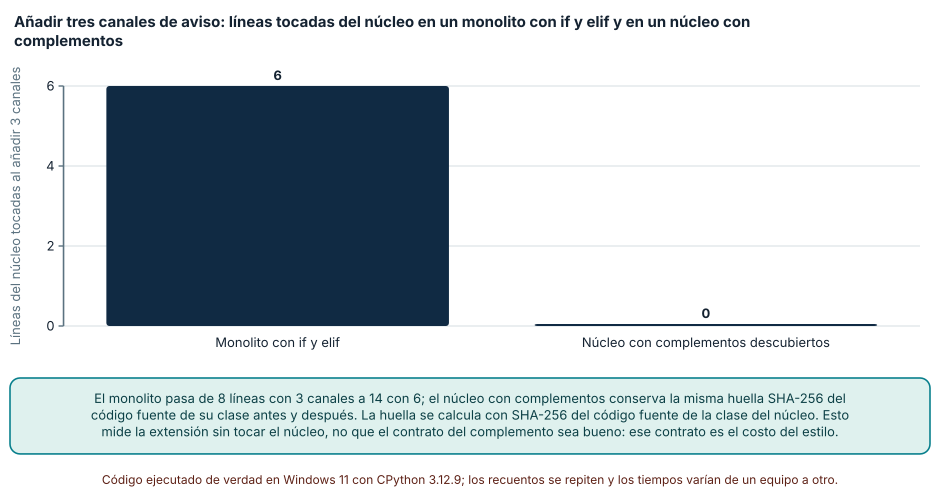

# SE-338 — Microkernel y arquitecturas de plugins

[← SE-337 — Estilos como respuestas a fuerzas de calidad](https://github.com/vladimiracunadev-create/modern-software-engineering-program/blob/main/classes/part-28-estilos-arquitectonicos/se-337-estilos-como-respuestas-a-fuerzas-de-calidad/README.md) · [↑ Parte 28](https://github.com/vladimiracunadev-create/modern-software-engineering-program/blob/main/classes/part-28-estilos-arquitectonicos/README.md) · [📚 Índice completo](https://github.com/vladimiracunadev-create/modern-software-engineering-program/blob/main/classes/README.md) · [🌐 Portal](https://vladimiracunadev-create.github.io/modern-software-engineering-program/classes/SE-338.html) · [SE-339 — Pipes and filters y arquitecturas de flujo →](https://github.com/vladimiracunadev-create/modern-software-engineering-program/blob/main/classes/part-28-estilos-arquitectonicos/se-339-pipes-and-filters-y-arquitecturas-de-flujo/README.md)

## Punto profesional y fundamento pedagógico

**Punto profesional.** La clase existe para que sepas cuándo una arquitectura de complementos es la respuesta correcta y qué cuesta mantenerla. El microkernel compra una propiedad valiosa: que terceros, o equipos que no se coordinan entre sí, añadan comportamiento sin tocar el núcleo. La paga con un contrato que debe mantenerse estable, con aislamiento que hay que construir a propósito y con la confianza que se deposita en código ajeno. Quien lo adopta solo por la propiedad, sin presupuestar el contrato, termina con un núcleo que no puede evolucionar porque rompería a todos sus complementos.

**Por qué aparece aquí.** Sigue a `SE-337` porque es el primer estilo que se evalúa con el método de escenarios: la fuerza que lo motiva (extensión sin modificar el núcleo) se puede escribir con una medida y comprobar con código. Es además el estilo que mejor ilustra que el costo no está en el estilo sino en su contrato, idea que reaparece en los microservicios (`SE-340`), en el gateway (`SE-341`) y en los productos de datos (`SE-343`).

**Error conceptual que debe corregir.** Creer que un sistema de complementos es modular por definición. Un núcleo con complementos que dependen de sus detalles internos está más acoplado que un monolito: cualquier cambio del núcleo es potencialmente un cambio de contrato para decenas de desconocidos. La modularidad no viene del mecanismo de carga; viene de que el contrato sea pequeño, estable y versionado.

**Secuencia de aprendizaje.** Antes de ejecutar, predices cuántas líneas del núcleo hay que tocar para añadir tres canales de aviso en un monolito con `if`/`elif` y en un núcleo con complementos. Después ejecutas el núcleo real (se descubren módulos de un directorio con `importlib`), lo sometes a un complemento que falla, a uno lento y a un cambio de contrato, y mides qué cuesta el aislamiento por proceso.

**Evidencia de aprendizaje.** `contrato-del-complemento.md` con la interfaz mínima que el núcleo expone, la versión del contrato, la política ante incompatibilidades, el nivel de aislamiento elegido con su costo medido y una nota sobre en qué casos no usarías el estilo.

**Límite de la conclusión.** El núcleo tiene unas treinta líneas y los complementos tres líneas cada uno. Se midió el mecanismo (líneas tocadas, tiempos de una llamada, qué se rompe), no la experiencia de mantener un ecosistema real de complementos con autores externos. No se ejecutó ningún sistema de complementos de terceros ni se invocó ningún modelo de lenguaje.

### Trazabilidad fuente → afirmación

| Fuente primaria u oficial | Afirmación que respalda | Lo que no prueba |
|---|---|---|
| [PyPA, «Entry points specification»](https://packaging.python.org/en/latest/specifications/entry-points/) | Describe el mecanismo estándar de Python por el que un paquete declara puntos de extensión que otro descubre sin importarlo por nombre. | No prescribe cómo diseñar el contrato del complemento. |
| [Python: `importlib`](https://docs.python.org/3/library/importlib.html) | Documenta la carga dinámica de módulos desde una ruta, que es lo que usa el laboratorio. | No define límites de confianza: cargar un módulo ejecuta su código. |
| [Python: `subprocess`](https://docs.python.org/3/library/subprocess.html) | Documenta el límite de tiempo (`timeout`) y la captura de salida para ejecutar un complemento en otro proceso. | No mide el costo del aislamiento en otras máquinas. |
| [Semantic Versioning 2.0.0](https://semver.org/spec/v2.0.0.html) | Define que un cambio incompatible de una interfaz pública se señala con un cambio de versión mayor. | No impide que los autores ignoren la versión. |
| [Fowler, «TolerantReader»](https://martinfowler.com/bliki/TolerantReader.html) | Describe una forma de leer datos de otro componente que tolera cambios que no le afectan. | Es una opinión de diseño, no una medición. |

## Antes de empezar

Recupera lo aprendido en `SE-337`: un estilo compra una propiedad con una restricción y paga con un costo. La pregunta activa es: **¿qué cambio de un componente compartido rompió alguna vez a quien no esperabas, y qué habría hecho falta para saberlo antes de publicar el cambio?**

## Prerrequisitos

- Haber completado `SE-337` o poder escribir un escenario de calidad con medida.
- Saber cargar un módulo de Python y manejar excepciones.
- Haber visto los patrones Strategy (`SE-316`) y Adapter (`SE-315`) de la [Parte 26](../../part-26-patrones-de-diseno-empresariales-y-de-resiliencia/README.md).
- Python 3.11 o posterior; el laboratorio usa solo la biblioteca estándar.

## Problema auténtico

*Avisos* envía hoy correo, SMS y notificaciones push, y esa lista vive en una función con una cadena de `if`/`elif`. Cada universidad cliente pide su canal: un resumen semanal, un webhook hacia su campus virtual, una invitación de calendario. Cada alta es un cambio en la función central, una revisión del equipo del núcleo y un despliegue de todo *Avisos*. El equipo del núcleo se convierte en cuello de botella y los canales de unas universidades esperan por las prioridades de otras.

La clase reconstruye la alternativa y la mide. Se define un núcleo mínimo que descubre complementos en un directorio, se añaden tres canales sin tocar el núcleo, se prueba qué ocurre cuando un complemento lanza una excepción, cuando se queda dormido y cuando el núcleo sube su contrato a una versión 2. Cada una de esas pruebas es el costo que el estilo declara: el núcleo ya no controla lo que hace el código que ejecuta.

## Objetivos observables

Al terminar podrás:

1. escribir el escenario de calidad que justifica un microkernel y medirlo en líneas del núcleo tocadas por cada extensión;
2. diseñar el contrato mínimo de un complemento y decidir qué se queda dentro del núcleo;
3. elegir el nivel de aislamiento (excepción, hilo, proceso) según el modo de fallo que debes contener y medir su costo;
4. definir una política de versión del contrato y comprobar sus tres variantes (sin comprobar, exigir, adaptar);
5. reconocer cuándo el estilo no compensa: pocas extensiones, un solo autor o un contrato que cambia cada semana.

## Mapa conceptual


El mapa muestra que el contrato es el centro: el descubrimiento carga lo que declara la versión correcta y el despacho debe asumir que cualquier complemento puede fallar o bloquearse. El aislamiento no es una propiedad del estilo; es un servicio que el núcleo debe construir.

## Temas y por qué importan

| Tema | Por qué cambia una decisión profesional | Evidencia mínima |
|---|---|---|
| Núcleo mínimo | Todo lo que vive en el núcleo es contrato implícito para los complementos. | Lista de lo que el núcleo hace y lo que no |
| Contrato del complemento | Es el producto del estilo y lo más caro de cambiar. | Interfaz, versión y política de cambio |
| Descubrimiento | Define quién puede añadir un complemento y cómo se declara. | Mecanismo y directorio o metadato |
| Aislamiento | Contiene fallos y bloqueos a costos muy distintos. | Costo medido por llamada |
| Versionado | Decide si un cambio del núcleo rompe en producción o al arrancar. | Resultado de las tres políticas |
| Confianza | Un complemento ejecuta con los privilegios del núcleo. | Modelo de amenaza del complemento |
| Cuándo no usarlo | El estilo cuesta más que lo que ahorra con pocas extensiones. | Número de extensiones esperadas |

## Conceptos y decisiones

### 1. El núcleo hace lo mínimo estable

Un microkernel conserva en el núcleo solo lo que todos los complementos necesitan y que cambia poco: registrar complementos, despachar eventos y fallar de forma controlada. Todo lo demás vive fuera. En el laboratorio el núcleo (`Kernel`) tiene tres métodos: cargar un directorio, comprobar la versión del contrato y despachar un evento a cada complemento. La tentación contraria es dejar en el núcleo «lo común», que crece hasta que el núcleo es el sistema y los complementos son decoración. La pregunta de control es: ¿esta función la necesitan todos los complementos y la voy a poder mantener igual durante años?

### 2. El contrato es el producto

Cada complemento declara una versión de API (`API = 1`), un nombre (`NAME`) y una función (`handle(event)`) que devuelve un resultado. Esas tres cosas son el contrato. El núcleo promete que llamará a `handle` con un evento que tiene al menos el campo `id`; el complemento promete devolver una cadena. Cualquier detalle que el núcleo haga por casualidad (el orden de llamada, que los eventos lleguen de uno en uno) se convierte en contrato en cuanto un complemento depende de él. Por eso se mantiene corto y se escribe explícito, con ejemplos de complementos correctos e incorrectos como parte de la documentación del núcleo.

### 3. Descubrir sin modificar

Hay dos formas habituales de descubrir. La primera es un directorio: el núcleo recorre una carpeta y carga cada módulo (es lo que hace el laboratorio con `importlib.util.spec_from_file_location`). La segunda es un metadato de paquete: la especificación de puntos de entrada de Python permite que un paquete instalado declare un grupo y un nombre, y que el núcleo los enumere sin saber de antemano qué paquetes existen. Ambas permiten añadir un complemento sin editar el núcleo; la segunda además delega la instalación y las dependencias al gestor de paquetes. En el experimento, añadir tres canales (`digest`, `webhook` y `calendario`) tocó 0 líneas del núcleo: la huella SHA-256 de su código fuente es idéntica antes y después. En el monolito con `if`/`elif` el mismo alta tocó 6 líneas de la función central, que pasó de 8 a 14.

### 4. Aislar: cuatro modos de fallo, tres niveles de defensa

Un complemento puede lanzar una excepción, quedarse bloqueado, consumir memoria sin límite o terminar el proceso. La defensa más barata es capturar la excepción en el despachador (`try`/`except`) y continuar con el siguiente complemento. En el experimento, con ocho complementos de los cuales uno lanza `RuntimeError`, el despachador entrega siete resultados y registra el error; sin captura, la excepción detiene la entrega a los demás. Esa defensa no ayuda con un complemento lento: uno que duerme un segundo bloquea al núcleo durante 1,00 s en el mismo hilo. Para el bloqueo hace falta ejecutar el complemento en otro hilo o proceso con un límite de tiempo: un proceso con `timeout` de 0,3 s cortó al lento a los 314 ms. El costo es la diferencia que más importa: la mediana de una llamada a un complemento en otro proceso fue de unos 122 ms en esta máquina (arrancar un intérprete de Python), contra 0,30 µs en el mismo proceso. Son más de cinco órdenes de magnitud de diferencia, y por eso el aislamiento por proceso se reserva para complementos de terceros no confiables o para tareas poco frecuentes.

### 5. Versionar el contrato

El núcleo sube su contrato a la versión 2: `handle` ahora debe devolver un diccionario con una clave `status`. De seis complementos, cinco están escritos para la versión 1. Con tres políticas el resultado fue distinto. Sin comprobar la versión, los seis se cargan y los cinco de la versión 1 fallan en plena ejecución, durante el procesamiento de un evento real: 0 correctos y 6 rotos (el sexto, que declara API 2, devuelve una cadena porque la plantilla del laboratorio no lo adapta; el experimento cuenta como roto a cualquier complemento que no devuelva el diccionario). Exigiendo la API 2, el núcleo carga uno y rechaza cinco al arrancar, con el nombre y la versión de cada uno. Con un adaptador para la API 1 (el núcleo envuelve el resultado en un diccionario), carga los seis. La política cambia cuándo y a quién le cuesta: un fallo en ejecución le cuesta al usuario final, un rechazo al arrancar le cuesta al operador, un adaptador le cuesta al equipo del núcleo, que lo mantiene.

### 6. La confianza es parte del diseño

Cargar un módulo de Python ejecuta su código con los privilegios del proceso. Un complemento puede leer variables de entorno, abrir archivos y llamar a la red. En un entorno cerrado donde los autores son del mismo equipo, esto es aceptable; con autores externos, no. La defensa es doble: aislamiento por proceso con permisos reducidos y una lista de complementos aprobados. El estilo no aporta seguridad por sí mismo; aporta un lugar donde ponerla.

### 7. Cuándo no usarlo

Con dos o tres extensiones previsibles y un solo equipo, una interfaz y tres implementaciones en el mismo repositorio (el patrón Strategy de la [Parte 26](../../part-26-patrones-de-diseno-empresariales-y-de-resiliencia/README.md)) dan la misma extensión sin descubrimiento, sin versión y sin aislamiento. El microkernel compensa cuando las extensiones las escriben personas que no se coordinan con el núcleo, cuando su número crece sin que nadie lo planifique o cuando deben poder instalarse sin recompilar el sistema. Si el contrato cambia cada semana, el costo de mantener la compatibilidad supera lo que se ahorra.

## Alta de canales sin tocar el núcleo

La primera comparación mide la propiedad que el estilo promete: extender sin modificar.



**Cómo leer la figura.** Cada barra es una estructura y su altura las líneas del núcleo que hay que tocar al añadir tres canales. Mira primero que la barra de los complementos no existe: los canales son archivos nuevos y la huella SHA-256 del núcleo es la misma antes y después. **Dónde deja de valer:** medir líneas tocadas favorece al estilo por construcción; no mide cuánto costó diseñar el contrato ni cuánto costará cambiarlo. Seis líneas en un monolito de catorce no es una carga que justifique por sí sola un microkernel; lo justifica la coordinación entre equipos que esas líneas representan.

## Aislar al complemento que falla o se bloquea

La segunda comparación ejecuta tres formas de llamar a un complemento y mide qué contienen y cuánto cuestan.


**Cómo leer la figura.** Cada grupo es una forma de ejecutar el complemento; la barra roja es lo que bloquea el complemento lento y la azul oscura el costo por llamada, en milisegundos y en escala logarítmica. Mira primero el intercambio del tercer grupo: la barra roja baja a 314 ms, pero la azul sube más de cinco órdenes de magnitud. **Dónde deja de valer:** los 122 ms son de un intérprete que arranca desde cero en Windows 11 y dependen de la máquina; con un proceso trabajador reutilizado el costo baja, pero entonces el complemento puede dejar estado en el trabajador. La figura muestra el orden de magnitud y la relación de costos, no un valor para tu sistema.

## Cambiar el contrato

La tercera comparación sube el contrato a la versión 2 y compara tres políticas del núcleo.


**Cómo leer la figura.** Cada barra es una política del núcleo, partida entre los complementos correctos o cargados (verde) y los rotos o rechazados (rojo). Mira primero cómo el rojo se reduce de 6 a 5 y a 0: exigir la versión no arregla nada, solo adelanta el fallo, y solo el adaptador carga todo. **Dónde deja de valer:** seis complementos de tres líneas escritos por el autor no se parecen a un ecosistema real, donde los autores no leen la documentación de versión y los complementos antiguos nunca se actualizan. El resultado muestra el mecanismo, no la proporción.

## Definiciones de trabajo

- **[Microkernel](../../../glosario/entradas/m/microkernel.md):** estilo con un núcleo mínimo que registra y despacha, y extensiones que viven fuera de él.
- **[Complemento (plugin)](../../../glosario/entradas/c/complemento.md):** módulo que cumple el contrato del núcleo y se descubre, no se enlaza.
- **[Contrato](../../../glosario/entradas/c/contrato.md):** interfaz, versión y garantías que el núcleo ofrece a los complementos y viceversa.
- **[Punto de extensión](../../../glosario/entradas/p/punto-de-extension.md):** lugar declarado donde un complemento puede engancharse.
- **[Aislamiento](../../../glosario/entradas/a/aislamiento.md):** técnica que impide que el fallo de un complemento se propague al núcleo o a otros complementos.
- **[Adaptador de compatibilidad](../../../glosario/entradas/a/adaptador-de-compatibilidad.md):** capa del núcleo que traduce un contrato antiguo al nuevo.

## Ejemplo mínimo

El núcleo completo cabe en una pantalla:

```python
import importlib.util
from pathlib import Path

class Kernel:
    API_VERSION = 1
    def __init__(self, accept=(1,)):
        self.plugins, self.rejected, self.accept = {}, [], accept

    def load_dir(self, path):
        for f in sorted(Path(path).glob("*.py")):
            spec = importlib.util.spec_from_file_location(f"plugin_{f.stem}", f)
            mod = importlib.util.module_from_spec(spec)
            spec.loader.exec_module(mod)
            if getattr(mod, "API", None) not in self.accept:
                self.rejected.append((f.stem, getattr(mod, "API", None)))
                continue
            self.plugins[mod.NAME] = mod

    def dispatch(self, event):
        out, errors = [], []
        for name, mod in self.plugins.items():
            try:
                out.append(mod.handle(event))
            except Exception as exc:
                errors.append((name, type(exc).__name__))
        return out, errors
```

Un complemento es un archivo de tres líneas: `API = 1`, `NAME = "sms"` y una función `handle(event)` que devuelve `"sms:" + event["id"]`. Copiarlo a la carpeta añade el canal; ningún archivo del núcleo cambia.

## Ejemplo profesional

*Escenario ilustrativo: las cifras y los resultados que aparecen en este ejemplo son supuestos de la narración, no mediciones.*

Una universidad cliente pide que *Avisos* envíe cada aviso también a su campus virtual por webhook. Con el núcleo de complementos, su equipo de integración escribe el módulo, lo prueba contra la clase de pruebas de contrato que publica el equipo del núcleo y lo coloca en el directorio. Dos semanas después, el equipo del núcleo necesita añadir un campo de prioridad al evento y decide subir el contrato a la versión 2. Antes de publicar, ejecuta el cargador contra los diez complementos conocidos con la política de rechazo al arrancar: siete son suyos y se migran en el mismo cambio; tres son de universidades, que quedan con el adaptador de la versión 1 durante un trimestre y con un aviso de retirada. Nadie se entera de la versión 2 por una caída. El costo fue escribir y mantener el adaptador y comunicar el calendario.

## Práctica guiada

1. Copia el núcleo del ejemplo mínimo y escribe tres complementos; comprueba que añadir un cuarto no cambia el núcleo (calcula la huella SHA-256 con `hashlib`).
2. Escribe un complemento que lance una excepción y otro que duerma un segundo; mide cuánto tarda `dispatch` con y sin captura.
3. Ejecuta `python scripts/experiments_part28_a.py 530` y compara tus tiempos con los de la figura.
4. Sube el contrato a una versión 2 e implementa las tres políticas; cuenta qué complementos fallan, se rechazan o se adaptan.
5. Escribe en el contrato qué garantiza el núcleo sobre el orden de llamada y el paralelismo, aunque hoy sea «nada».

## Ejercicios

1. **Básico.** Explica por qué añadir una cuarta ruta de aviso con `elif` toca el núcleo y añadir un complemento no, y qué parte del núcleo con complementos sí cambia si el contrato cambia.
2. **Intermedio.** Cambia el experimento para que el complemento lento se ejecute en un hilo con un límite de 0,3 s en lugar de un proceso, y mide el costo por llamada y qué ocurre con el hilo que sigue vivo.
3. **Avanzado.** Diseña un contrato versión 2 compatible hacia atrás (por ejemplo, un diccionario con el resultado antiguo bajo una clave) y demuestra con el cargador que los cinco complementos de la versión 1 siguen funcionando sin adaptador.

## Reto verificable

Entrega `contrato-del-complemento.md` y un núcleo ejecutable con tres complementos, un complemento defectuoso y un cambio de contrato. Es válido si otra persona puede añadir un cuarto complemento sin editar el núcleo, ver cómo se aísla el defectuoso y reproducir el resultado de las tres políticas de versión.

## Caso conductor

*Avisos* pasa de una función con `if`/`elif` a un núcleo que descubre canales. Esta clase muestra el estilo que compra extensión y paga con contrato. `SE-339` cambia de pregunta: ya no quién extiende, sino cómo fluyen los datos entre pasos de un procesamiento.

## Preguntas frecuentes

### ¿Es lo mismo un microkernel que una arquitectura de plugins?

Se usan casi como sinónimos. El nombre microkernel viene de los sistemas operativos con un núcleo mínimo y servicios en el espacio de usuario; en aplicaciones se habla de arquitectura de complementos. Lo que comparten es un núcleo pequeño y un contrato de extensión.

### ¿Cada complemento debe ser un paquete aparte?

No. Puede ser un archivo en un directorio, un paquete instalado con puntos de entrada o un contenedor. El mecanismo de empaquetado es independiente del estilo; lo que importa es que el núcleo no conozca de antemano sus complementos.

### ¿Cómo pruebo un complemento?

El equipo del núcleo publica una suite de pruebas de contrato que cualquier complemento puede ejecutar: carga con la versión correcta, devuelve el tipo esperado y tolera eventos con campos adicionales. Es la manera de que el autor externo sepa que cumple el contrato sin hablar con el equipo del núcleo.

### ¿Los complementos pueden depender entre sí?

Es posible, y casi siempre es un error: crea un grafo de dependencias que el núcleo no gobierna y que la versión del contrato no protege. Si dos complementos necesitan compartir comportamiento, ese comportamiento es un servicio del núcleo, con su propio contrato.

## Fallo controlado y diagnóstico

**Fallo.** Tras subir el contrato a la versión 2, el servicio arranca sin errores. Una hora después, los estudiantes de tres universidades dejan de recibir avisos. El núcleo no cayó y los registros no muestran excepciones del núcleo.

**Diagnóstico paso a paso.** (1) Se revisa el cargador: no comprueba la versión del complemento, de modo que los cinco complementos de la versión 1 se cargaron. (2) Se despacha un evento de prueba: cada complemento devuelve una cadena y el despachador espera un diccionario; el acceso `res["status"]` lanza `TypeError`. (3) El despachador captura la excepción y la registra con un nivel que nadie vigila. (4) El aislamiento funcionó como estaba diseñado y por eso el fallo fue silencioso.

**Corrección.** Se añade la comprobación de versión al arrancar, con rechazo explícito y un recuento de complementos cargados y rechazados en el registro de inicio, y una alerta si el número de errores de complemento supera un umbral. La lección es que el aislamiento contiene el fallo pero lo esconde si no se observa.

## Errores comunes y cómo corregirlos

- **Un núcleo que crece con lo «común».** Se vuelve el sistema. Corrige dejando en el núcleo solo lo que todos necesitan y es estable.
- **Un contrato implícito.** Los complementos dependen de lo que el núcleo hace por casualidad. Corrige escribiendo las garantías y las no garantías.
- **Capturar excepciones sin observarlas.** El fallo queda oculto. Corrige contando y alertando sobre errores por complemento.
- **Aislamiento por proceso en cada llamada.** Cuesta 122 ms en esta medida. Corrige reservándolo a lo no confiable y reutilizando procesos.
- **No versionar el contrato.** Un cambio rompe en producción. Corrige declarando `API` y rechazando al arrancar.
- **Usar el estilo con tres extensiones y un autor.** Corrige con una interfaz y tres implementaciones.

## Entorno y archivos clave

- `scripts/experiments_part28_a.py`: función `e530` con el núcleo, la plantilla de complemento, los defectuosos y las tres políticas; se ejecuta con `python scripts/experiments_part28_a.py 530`.
- El experimento crea los complementos en un directorio temporal (`tempfile`) y lo borra al terminar.
- `scripts/figures_part28_a.py`: las tres figuras de la clase.
- Solo la biblioteca estándar de Python 3.11 o posterior; el arranque de un proceso nuevo tarda decenas o cientos de milisegundos según el sistema.

## Seguridad, ética y accesibilidad

Cargar un complemento ejecuta su código. En el laboratorio los complementos los escribe el propio experimento y viven en un directorio temporal; con autores externos, tratarlos como código no confiable: aislamiento por proceso, permisos mínimos, lista de aprobados y revisión del código antes de aceptarlos. Ética: un ecosistema de complementos crea una relación con terceros que dependen de tu contrato; anunciar los cambios con plazo y mantener un calendario de retirada es una obligación hacia ellos, no un favor. Las figuras son tablas con texto alternativo completo y no dependen solo del color.

## Puente hacia el trabajo con agentes

Un agente de código es, en pequeño, un núcleo con complementos: el agente es el núcleo y sus herramientas son los complementos. Todo lo de esta clase se aplica: el contrato de una herramienta (qué recibe, qué devuelve), su versión, qué ocurre cuando falla o se cuelga y qué privilegios tiene. Cuando pidas a un agente que escriba un complemento para tu núcleo, dale la suite de pruebas de contrato y exige que la pase; no aceptes un complemento que el agente probó solo con sus propios ejemplos. Cuando el agente use herramientas de terceros, aplica el mismo criterio de confianza: aislamiento, permisos reducidos y registro de lo que hizo.

## Transferencia

Busca en tu sistema un lugar donde una lista crece por altas externas: reglas de validación, exportadores, canales, integraciones. Escribe el escenario («un equipo añade X en N días sin que otro despliegue»), cuenta cuántas líneas centrales toca hoy cada alta y decide con ese número si un contrato de extensión compensa. Si lo adoptas, define primero el contrato y su política de versión, no el cargador.

## Evaluación y evidencia

| Criterio | Evidencia aceptable | Rechazo |
|---|---|---|
| Extensión sin modificar | Huella del núcleo antes y después | «Parece que no cambió» |
| Contrato explícito | Interfaz, versión y garantías escritas | Comportamiento implícito |
| Aislamiento medido | Costo por llamada y modo de fallo contenido | «Es más seguro» |
| Política de versión | Resultado de cargar complementos antiguos | No probada |
| Cuándo no usarlo | Número de extensiones esperadas | Estilo sin justificación |

## Fuentes

- Python Packaging Authority. [«Entry points specification»](https://packaging.python.org/en/latest/specifications/entry-points/).
- Python Software Foundation. [`importlib`](https://docs.python.org/3/library/importlib.html) y [`subprocess`](https://docs.python.org/3/library/subprocess.html).
- Preston-Werner, T. [«Semantic Versioning 2.0.0»](https://semver.org/spec/v2.0.0.html).
- Fowler, M. [«TolerantReader»](https://martinfowler.com/bliki/TolerantReader.html).
- Organización Internacional de Normalización. [ISO/IEC 25010:2023](https://www.iso.org/standard/78176.html), para el vocabulario de modificabilidad.

## Límites y siguiente paso

El núcleo, los complementos y los defectos son construcciones del autor y miden el mecanismo, no un ecosistema real. El tiempo de 122 ms es de una máquina y un sistema; no se midió ningún sistema de complementos de producción ni el esfuerzo humano de mantener un contrato. El siguiente paso, `SE-339`, estudia otro estilo, pipes and filters, donde la pregunta ya no es quién extiende sino cómo fluyen los datos y qué memoria cuesta.

## Glosario

| Término | Definición breve |
|---|---|
| Microkernel | Núcleo mínimo que registra y despacha, con extensiones fuera de él |
| Complemento | Módulo que cumple el contrato del núcleo y se descubre |
| Contrato | Interfaz, versión y garantías entre núcleo y complemento |
| Punto de extensión | Lugar declarado donde un complemento se engancha |
| Aislamiento | Técnica que impide que un fallo cruce a otros componentes |
| Adaptador de compatibilidad | Capa que traduce un contrato antiguo al nuevo |

Conceptos de esta clase en el [glosario del programa](../../../glosario/README.md): [Adaptador de compatibilidad](../../../glosario/entradas/a/adaptador-de-compatibilidad.md) · [Aislamiento](../../../glosario/entradas/a/aislamiento.md) · [Complemento](../../../glosario/entradas/c/complemento.md) · [Confianza](../../../glosario/entradas/c/confianza.md) · [Contrato](../../../glosario/entradas/c/contrato.md) · [Descubrimiento](../../../glosario/entradas/d/descubrimiento.md) · [Microkernel](../../../glosario/entradas/m/microkernel.md) · [Punto de extensión](../../../glosario/entradas/p/punto-de-extension.md) · [Versionado](../../../glosario/entradas/v/versionado.md).

---

[← SE-337 — Estilos como respuestas a fuerzas de calidad](https://github.com/vladimiracunadev-create/modern-software-engineering-program/blob/main/classes/part-28-estilos-arquitectonicos/se-337-estilos-como-respuestas-a-fuerzas-de-calidad/README.md) · [↑ Parte 28](https://github.com/vladimiracunadev-create/modern-software-engineering-program/blob/main/classes/part-28-estilos-arquitectonicos/README.md) · [📚 Índice completo](https://github.com/vladimiracunadev-create/modern-software-engineering-program/blob/main/classes/README.md) · [🌐 Portal](https://vladimiracunadev-create.github.io/modern-software-engineering-program/classes/SE-338.html) · [SE-339 — Pipes and filters y arquitecturas de flujo →](https://github.com/vladimiracunadev-create/modern-software-engineering-program/blob/main/classes/part-28-estilos-arquitectonicos/se-339-pipes-and-filters-y-arquitecturas-de-flujo/README.md)
