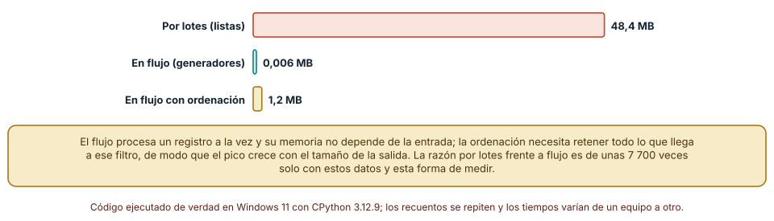
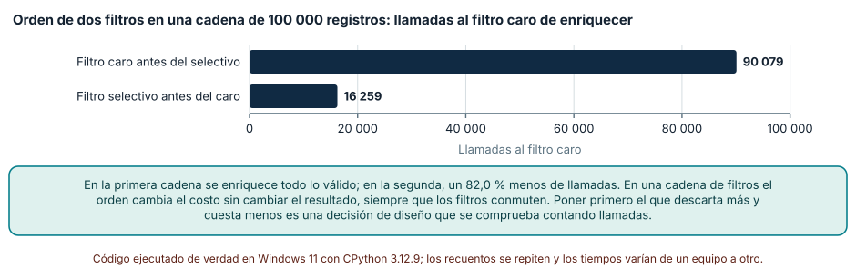
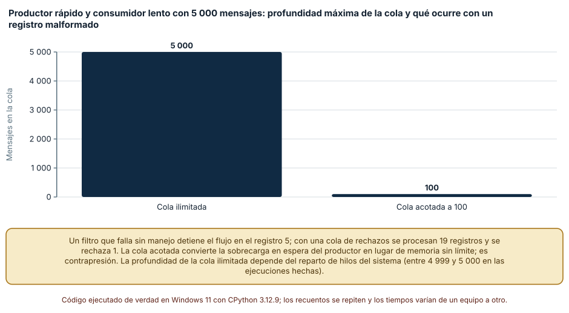

# SE-339 — Pipes and filters y arquitecturas de flujo

[← SE-338 — Microkernel y arquitecturas de plugins](https://github.com/vladimiracunadev-create/modern-software-engineering-program/blob/main/classes/part-28-estilos-arquitectonicos/se-338-microkernel-y-arquitecturas-de-plugins/README.md) · [↑ Parte 28](https://github.com/vladimiracunadev-create/modern-software-engineering-program/blob/main/classes/part-28-estilos-arquitectonicos/README.md) · [📚 Índice completo](https://github.com/vladimiracunadev-create/modern-software-engineering-program/blob/main/classes/README.md) · [🌐 Portal](https://vladimiracunadev-create.github.io/modern-software-engineering-program/classes/SE-339.html) · [SE-340 — Microservicios y sus costes reales →](https://github.com/vladimiracunadev-create/modern-software-engineering-program/blob/main/classes/part-28-estilos-arquitectonicos/se-340-microservicios-y-sus-costes-reales/README.md)

## Punto profesional y fundamento pedagógico

**Punto profesional.** La clase existe para que reconozcas cuándo un procesamiento se entiende mejor como una cadena de transformaciones independientes y qué hay que decidir para que esa cadena sea segura: cuánta memoria retiene, en qué orden se aplican los pasos, qué pasa cuando un paso es más lento que el anterior y qué se hace con el registro que no se puede procesar. Pipes and filters es un estilo antiguo (los filtros de Unix, los compiladores por fases, las canalizaciones de datos) y sigue siendo la respuesta natural a cualquier problema de la forma «entra un flujo, sale otro flujo». Quien lo usa sin las cuatro decisiones obtiene un sistema que funciona con mil registros y se cae con diez millones.

**Por qué aparece aquí.** Sigue a `SE-338` porque cambia la pregunta que ordena la arquitectura: ya no se trata de quién extiende el sistema sino de cómo viaja un dato por él. Prepara los productos de datos de `SE-343`, que son canalizaciones con dueño, y la migración gradual de `SE-346`, que reencamina un flujo de un módulo a otro.

**Error conceptual que debe corregir.** Creer que dividir un procesamiento en pasos lo hace automáticamente escalable. La división solo escala si cada paso procesa un elemento a la vez y no retiene la entrada. Un paso que necesita ver todo (ordenar, agrupar, eliminar duplicados) devuelve al sistema la memoria que el estilo prometía no gastar. En esta clase se mide: la misma cadena, con los mismos datos, usa 48,4 MB por lotes y 0,006 MB en flujo.

**Secuencia de aprendizaje.** Antes de ejecutar, predices cuánta memoria pico usan 100 000 registros procesados por lotes y en flujo, y cuántas veces se llama a un filtro caro según su posición en la cadena. Después ejecutas cuatro versiones sobre los mismos datos sintéticos, inyectas un productor rápido y un consumidor lento, provocas un registro malformado y lees qué decisión de diseño explica cada número.

**Evidencia de aprendizaje.** `cadena-de-filtros.md` con el diagrama de la canalización, el contrato de cada filtro (qué recibe, qué emite, si retiene estado), la memoria pico medida, el orden elegido con el recuento de llamadas al filtro caro, la política de contrapresión y el destino de los registros rechazados.

**Límite de la conclusión.** Se midió Python con `tracemalloc`, que cuenta las asignaciones de Python y no la memoria total del proceso; los datos son 100 000 registros sintéticos con semilla 44 y la salida es de 16 259 elementos. Los números de memoria muestran la forma del efecto (acotado frente a proporcional a la entrada), no el consumo de un sistema real. No se ejecutó ninguna plataforma de flujo de datos ni se invocó ningún modelo de lenguaje.

### Trazabilidad fuente → afirmación

| Fuente primaria u oficial | Afirmación que respalda | Lo que no prueba |
|---|---|---|
| [Azure Architecture Center, «Pipes and Filters pattern»](https://learn.microsoft.com/en-us/azure/architecture/patterns/pipes-and-filters) | Describe la descomposición de un procesamiento en filtros independientes conectados por tuberías, con sus beneficios (reuso, escala por filtro) y sus problemas (orden, fallos, contexto compartido). | No mide el comportamiento de ninguna implementación concreta. |
| [Python HOWTO, «Functional Programming»: generadores](https://docs.python.org/3/howto/functional.html) | Explica que un generador produce un valor a la vez bajo demanda, lo que permite componer filtros perezosos. | No dice cuánta memoria usa tu cadena. |
| [Python: `tracemalloc`](https://docs.python.org/3/library/tracemalloc.html) | Documenta el seguimiento del pico de asignaciones de memoria de Python que usa el laboratorio. | No mide memoria fuera del montón de Python. |
| [Python: `queue`](https://docs.python.org/3/library/queue.html) | Documenta la cola con tamaño máximo (`maxsize`): `put` espera cuando está llena. | No define la política de reintentos ni de pérdida. |
| [Python: `threading`](https://docs.python.org/3/library/threading.html) | Documenta los hilos del productor y el consumidor. | No garantiza el reparto de tiempo entre ellos. |

## Antes de empezar

Recupera lo aprendido en `SE-338`: un estilo se paga en su contrato. La pregunta activa es: **¿cuál fue la última vez que un trabajo por lotes se quedó sin memoria con un volumen mayor que el de las pruebas, y qué paso de la cadena retenía los datos sin que nadie lo hubiera declarado?**

## Prerrequisitos

- Haber completado `SE-337` y `SE-338`.
- Saber qué es un generador de Python (`yield`) y qué es un hilo.
- Conocer de `SE-436` (latencia, throughput, saturación y capacidad) la diferencia entre una cola que absorbe una ráfaga y una que oculta una sobrecarga.
- Python 3.11 o posterior; el laboratorio usa solo la biblioteca estándar.

## Problema auténtico

*Avisos* recibe cada noche un volcado de entregas del sistema académico: cien mil filas con estudiante, curso, plazo y estado. El procesamiento tiene cuatro pasos: descartar las filas inválidas, quedarse con las que vencen dentro de 72 horas, enriquecerlas con el nombre del curso (una consulta cara) y formatear el aviso. La primera versión lee todo el volcado en una lista, aplica cada paso a la lista completa y escribe el resultado. Funciona con las pruebas de mil filas. El primer día de matrícula llega un millón y el proceso se queda sin memoria a las tres de la madrugada.

La clase reconstruye el procesamiento como una cadena de filtros y mide cada decisión. Se compara por lotes con flujo, se prueba un filtro que necesita todo (ordenar), se cambia el orden de dos filtros contando llamadas, se enfrenta un productor rápido a un consumidor lento con y sin cola acotada y se provoca un registro malformado en medio del flujo.

## Objetivos observables

Al terminar podrás:

1. descomponer un procesamiento en filtros con un contrato uniforme (iterador de entrada, iterador de salida) y decir cuáles retienen estado;
2. medir el pico de memoria de una cadena por lotes y en flujo, y explicar por qué un filtro que necesita todo rompe la cota;
3. ordenar filtros según su selectividad y su costo, y comprobar con un recuento de llamadas que el resultado no cambia;
4. diseñar la contrapresión con una cola acotada y razonar qué ocurre con el productor cuando se llena;
5. decidir qué se hace con un registro que falla (detener, saltar con registro o enviar a una cola de rechazos).

## Mapa conceptual


Las flechas continuas son el flujo de datos; las punteadas son los dos canales que un diseño serio añade: el desvío de lo que no se puede procesar y la señal que frena a la fuente cuando el destino no da abasto. Sin ellos, el flujo funciona solo mientras todo sale bien.

## Temas y por qué importan

| Tema | Por qué cambia una decisión profesional | Evidencia mínima |
|---|---|---|
| Filtro y tubería | Un contrato uniforme permite recombinar y probar cada paso por separado. | Interfaz común de los filtros |
| Flujo frente a lotes | Decide si la memoria depende o no del volumen. | Pico de memoria medido |
| Filtros con estado | Ordenar o agrupar retiene todo lo que llega. | Memoria con ese filtro |
| Orden de filtros | Cambia el costo sin cambiar el resultado. | Llamadas al filtro caro por orden |
| Contrapresión | Convierte la sobrecarga en espera en lugar de memoria. | Profundidad máxima de la cola |
| Registros rechazados | Un fallo no debe detener o esconder el flujo. | Destino de los rechazos |
| Cuándo no usarlo | Con interacción de ida y vuelta o dependencias entre elementos no encaja. | El tipo de proceso |

## Conceptos y decisiones

### 1. Filtros con un contrato uniforme

Un filtro recibe un flujo de elementos y emite otro. Si todos los filtros comparten esa forma, se conectan en cualquier orden que tenga sentido y cada uno se prueba con una lista pequeña. En el laboratorio, cada filtro es un generador de Python: `f_validate` deja pasar las filas válidas, `f_due` las que vencen en 72 horas o menos, `f_enrich` añade una etiqueta y `f_format` produce el texto del aviso. La cadena completa es la composición `f_format(f_enrich(f_due(f_validate(filas))))`. El contrato uniforme es la propiedad que el estilo compra: reuso y sustitución de pasos sin editar los vecinos.

### 2. Perezoso por naturaleza: un elemento a la vez

Un generador no calcula nada hasta que alguien le pide el siguiente elemento. En una cadena de generadores, el consumidor final tira de la cadena: cada petición recorre los cuatro filtros con un solo elemento en vuelo. Esa es la razón del número más llamativo del experimento: con 100 000 registros, la versión por lotes (una lista por paso) tuvo un pico de memoria de 48,4 MB y la versión en flujo, de 0,006 MB. Las dos versiones produjeron exactamente la misma salida de 16 259 elementos; solo cambió cuánto se retuvo. La memoria de la versión en flujo no depende del volumen de entrada; la de los lotes crece con él, y por eso el millón de la matrícula la rompió.

### 3. Los filtros con estado devuelven la memoria

No todo filtro puede ser perezoso. Ordenar necesita ver todos los elementos antes de emitir el primero; agrupar por curso, eliminar duplicados o calcular un percentil también. Si en la misma cadena se añade un ordenamiento final, el pico de memoria pasó de 0,006 MB a 1,2 MB: unas 200 veces más, y proporcional al tamaño de lo que llega a ese filtro (aquí, los 16 259 avisos formateados). La cota no desaparece, pero deja de ser constante. La decisión de diseño es dónde poner los filtros con estado: lo más tarde posible (cuando el flujo ya está filtrado) y con un tamaño máximo declarado, y si el estado puede crecer sin límite, cambiar el algoritmo (por ejemplo, ordenar por bloques en disco) o aceptar que esa parte es un trabajo por lotes.

### 4. El orden de los filtros es una decisión de costo

Dos filtros que conmutan (el resultado final no depende del orden) pueden aplicarse en cualquiera. El costo sí depende. Si el filtro de enriquecer (que consulta algo caro) va antes del que descarta los avisos lejanos, se llama 90 079 veces; si va después, 16 259: un 82,0 % menos llamadas con la misma salida. El criterio es poner antes el filtro que descarta más por unidad de costo. Para decidir se necesitan dos números de cada filtro (qué proporción deja pasar y cuánto cuesta por elemento), no la intuición. Un filtro que no conmuta, como uno que depende de un contexto acumulado por otro, no puede moverse: es un hallazgo sobre la cadena, no una excepción.

### 5. Contrapresión: quién espera cuando el destino es lento

Si el productor es más rápido que el consumidor y entre ellos hay una cola sin límite, la cola crece hasta agotar la memoria y el sistema parece sano hasta que cae. Con 5 000 mensajes, un productor rápido y un consumidor que pide dormir 50 µs por mensaje (el sueño real es mayor y depende del sistema), la cola ilimitada llegó a una profundidad de unos 5 000 (todo el lote esperando) y la cola acotada a 100, a exactamente 100: cuando se llena, el `put` del productor se bloquea hasta que el consumidor libera un hueco. La sobrecarga se convirtió en espera del productor en lugar de memoria. Es una decisión, no un detalle: acotar la cola significa que el productor se frena, y eso debe ser aceptable para quien lo alimenta (un archivo se frena sin problema; un cliente HTTP tal vez no, y habrá que rechazar con un código de error en lugar de esperar).

### 6. Fallos: detener, saltar o desviar

Un filtro recibe un registro malformado. Hay tres respuestas. Detener todo el flujo es lo más seguro y lo menos disponible: en el experimento, una excepción sin manejar en el registro 5 detuvo la cadena de 20. Saltar el registro y seguir sin dejar rastro es disponible y peligroso, porque los datos desaparecen en silencio. Desviarlo a una cola de rechazos con su causa permite continuar (19 procesados y 1 rechazado) y deja una lista revisable. La tercera es la que casi siempre conviene, con una condición: alguien debe mirar la cola de rechazos y se mide su tamaño; una cola de rechazos que nadie lee es un salto silencioso con pasos adicionales.

### 7. Qué problemas no encajan

El estilo supone que cada elemento se procesa de forma independiente y en un solo sentido. No encaja cuando un paso necesita preguntar algo al anterior, cuando el resultado de un elemento depende de los demás de forma compleja o cuando hay interacción en tiempo real con un usuario. Tampoco encaja si el orden de llegada importa y los filtros se ejecutan en paralelo sin preservarlo: cada filtro con varias copias puede reordenar el flujo, y recuperar el orden cuesta una cola con números de secuencia.

## Memoria: lotes, flujo y flujo con un paso que lo necesita todo

La primera medida es el pico de memoria de Python al procesar 100 000 registros con tres variantes.



**Cómo leer la figura.** La longitud de cada barra es el pico de memoria; la de en flujo es tan pequeña que apenas se ve. Lo que importa es la forma: acotado frente a proporcional a la entrada. **Dónde deja de valer:** `tracemalloc` cuenta solo las asignaciones de Python, no el consumo del proceso entero, y los datos son sintéticos con registros de unos pocos campos. La razón de unas 7 700 veces no se traslada a otros datos; lo que sí se traslada es que el flujo no depende del volumen y que un filtro con estado devuelve esa dependencia.

## El orden de los filtros

La segunda medida cuenta cuántas veces se llama al filtro caro con dos órdenes.



**Cómo leer la figura.** Cada barra es un orden de la misma cadena y su longitud las llamadas al filtro caro. Mira primero la diferencia entre las dos barras: el resultado es el mismo, solo cambia cuántas veces se paga el filtro caro. **Dónde deja de valer:** el 82,0 % depende de la selectividad de `f_due` en estos datos (aproximadamente el 18 % de lo válido vence en 72 horas); con otra distribución de plazos el ahorro cambia. Además, solo se pueden reordenar filtros que conmutan, y esa propiedad hay que comprobarla, no suponerla.

## Contrapresión y fallos

La tercera medida enfrenta un productor rápido a un consumidor lento y provoca un registro malformado.



**Cómo leer la figura.** Cada barra es una política de cola y su altura la profundidad máxima que alcanza con un productor rápido y un consumidor lento. Mira primero la distancia entre las dos: la cola acotada convierte la sobrecarga en espera del productor; el filtro que falla y la cola de rechazos están en la nota. **Dónde deja de valer:** el reparto de tiempo entre hilos lo decide el sistema operativo, y la profundidad de la cola ilimitada fue de 4 999 o 5 000 según la ejecución; lo estable es el orden de magnitud. El modelo no incluye pérdida de mensajes, reintentos ni varios consumidores.

## Definiciones de trabajo

- **[Filtro](../../../glosario/entradas/f/filtro.md):** paso que transforma, descarta o enriquece elementos de un flujo.
- **[Tubería (pipe)](../../../glosario/entradas/t/tuberia.md):** conexión entre la salida de un filtro y la entrada del siguiente.
- **[Flujo (stream)](../../../glosario/entradas/f/flujo.md):** secuencia de elementos procesada de uno en uno.
- **[Filtro con estado](../../../glosario/entradas/f/filtro-con-estado.md):** filtro que necesita retener elementos antes de emitir.
- **[Contrapresión](../../../glosario/entradas/c/contrapresion.md):** señal que frena al productor cuando el consumidor no da abasto.
- **[Cola de rechazos (dead letter)](../../../glosario/entradas/c/cola-de-rechazos.md):** destino de lo que no se pudo procesar, con su causa.
- **[Selectividad](../../../glosario/entradas/s/selectividad.md):** proporción de elementos que un filtro deja pasar.

## Ejemplo mínimo

Dos filtros y un consumidor, con el número de llamadas contado:

```python
calls = {"caro": 0}

def barato(rows):
    for r in rows:
        if r % 10 == 0:          # deja pasar 1 de cada 10
            yield r

def caro(rows):
    for r in rows:
        calls["caro"] += 1
        yield r

print(sum(1 for _ in caro(barato(range(1000)))), calls)   # 100 elementos, 100 llamadas
calls["caro"] = 0
print(sum(1 for _ in barato(caro(range(1000)))), calls)   # 100 elementos, 1000 llamadas
```

La salida es la misma (100 elementos) y las llamadas al filtro caro son 100 contra 1 000. Es el mecanismo de la figura con diez líneas.

## Ejemplo profesional

*Escenario ilustrativo: las cifras y los resultados que aparecen en este ejemplo son supuestos de la narración, no mediciones.*

El equipo de *Avisos* migra el volcado nocturno a una cadena de filtros. Al ponerla en producción descubre dos cosas. La primera: el paso de ordenar los avisos por urgencia, que alguien añadió al final «para que salgan ordenados», retiene todo el lote y es el único que escala con el volumen. Tras discutirlo se decide ordenar solo dentro de cada curso (un filtro con estado, pero de tamaño acotado por el número de entregas de un curso) y entregar el orden global como una consulta aparte. La segunda: una fila con un código de curso nulo detenía la cadena entera a las tres de la mañana. Se añade la cola de rechazos y una alerta si más del 1 % de las filas va a ella; esa noche acaban 213 filas en la cola y el flujo termina. Por la mañana, una persona encuentra que un campus exportó el curso con el campo en blanco. El diseño no evitó el problema; lo convirtió en una lista que alguien puede leer.

## Práctica guiada

1. Dibuja la cadena de filtros de un proceso por lotes de tu sistema, con lo que cada filtro retiene y lo que descarta.
2. Escribe los filtros como generadores y mide el pico de memoria con `tracemalloc` para 10 000 y 100 000 elementos.
3. Ejecuta `python scripts/experiments_part28_a.py 531` y compara tu predicción de memoria y de llamadas con las medidas.
4. Mide la selectividad y el costo de cada filtro de tu cadena y decide el orden con esos números.
5. Provoca un registro malformado y decide, por escrito, si se detiene, se salta o se desvía, y quién mira la cola de rechazos.

## Ejercicios

1. **Básico.** Explica por qué la versión en flujo usa 0,006 MB con 100 000 registros y qué número esperarías con un millón.
2. **Intermedio.** Añade al experimento un filtro de agrupar por curso y mide el pico; explica qué determina cuánto crece y cómo acotarlo.
3. **Avanzado.** Diseña la cadena con dos copias del filtro de enriquecer en paralelo y propone cómo preservar el orden de salida; mide el costo de preservarlo frente a ignorarlo.

## Reto verificable

Entrega `cadena-de-filtros.md` y el código de una cadena de al menos cuatro filtros sobre datos sintéticos con semilla fija. Es válido si otra persona reproduce los picos de memoria en flujo y por lotes con el mismo orden de magnitud, el recuento de llamadas con dos órdenes y el comportamiento ante un registro malformado.

## Caso conductor

*Avisos* procesa su volcado nocturno como una cadena. Esta clase muestra el estilo que compra reuso y memoria acotada, y que paga con la disciplina de los filtros con estado y la contrapresión. `SE-340` pasa a otra pregunta: qué cuesta separar procesos y repartir el trabajo entre servicios que se llaman por red.

## Preguntas frecuentes

### ¿Pipes and filters es lo mismo que una canalización de CI?

Comparte la forma (pasos encadenados) pero no necesariamente el contrato: en una canalización de CI cada paso suele recibir artefactos completos, no un flujo de elementos. El estilo de esta clase trata de datos que fluyen.

### ¿Hace falta un sistema de mensajería?

No. Una cadena de generadores en un proceso es pipes and filters. La mensajería interviene cuando los filtros viven en procesos distintos y la tubería es una cola persistente, con su costo de operación y sus garantías de entrega.

### ¿Cómo sé que dos filtros conmutan?

Comprobándolo con datos: aplicas ambos órdenes a un conjunto representativo y comparas las salidas (como se hizo con 100 000 registros). Una prueba basada en propiedades que genere entradas al azar es más fuerte que unos pocos ejemplos.

### ¿Y si necesito el orden global?

Entonces esa parte es un trabajo por lotes o necesita un estado acotado por diseño. Lo que no conviene es esconderlo al final de una cadena que se vende como de memoria constante.

## Fallo controlado y diagnóstico

**Fallo.** La cadena corre bien dos semanas. Un lunes, el proceso se detiene con un error de memoria. El volumen de entrada fue similar al de otros lunes.

**Diagnóstico paso a paso.** (1) Se compara el pico de memoria por filtro: el último, que ordena por urgencia, retiene todos los avisos. (2) Ese día el campus de una universidad grande publicó todas las entregas del semestre a la vez y el número de avisos del lote se multiplicó por seis. (3) El filtro de ordenar era el único con estado y nadie lo había declarado en el contrato. (4) El resto de los filtros había funcionado con memoria constante, de modo que el problema no aparecía en las pruebas con lotes pequeños.

**Corrección.** Se declara en el contrato de cada filtro si retiene estado y cuánto, se acota el de ordenar al tamaño de un curso y se añade una prueba que ejecuta la cadena con diez veces el volumen y comprueba que el pico no crece más de lo previsto. La lección es que una cota de memoria es una propiedad que se prueba, no se supone.

## Errores comunes y cómo corregirlos

- **Materializar listas entre pasos.** Convierte el flujo en lotes. Corrige con generadores o iteradores.
- **Esconder un filtro con estado.** La cota de memoria desaparece. Corrige declarándolo y acotándolo.
- **Ordenar los filtros por intuición.** Corrige midiendo selectividad y costo.
- **Cola sin límite.** La sobrecarga se vuelve memoria. Corrige con una cola acotada y una política de frenado.
- **Detener el flujo por un registro.** Corrige con una cola de rechazos y una alerta sobre su tamaño.
- **Ignorar el orden con varias copias de un filtro.** Corrige con números de secuencia o aceptando el desorden.

## Entorno y archivos clave

- `scripts/experiments_part28_a.py`: función `e531` con los cuatro filtros, el productor y el consumidor; se ejecuta con `python scripts/experiments_part28_a.py 531`.
- Los datos se generan con `random.Random(44)`; los picos de memoria varían en los últimos dígitos entre versiones de Python y sistemas.
- `scripts/figures_part28_a.py`: las tres figuras de la clase.
- Solo la biblioteca estándar de Python 3.11 o posterior.

## Seguridad, ética y accesibilidad

Una cadena de filtros procesa datos de personas: el filtro de rechazos puede acumular registros con datos personales y debe tener el mismo cuidado de retención y acceso que el flujo principal. Un filtro que descarta en silencio es una decisión sobre personas (un estudiante sin aviso). Los registros de errores no deben incluir el contenido completo del registro. Las figuras son un gráfico y dos tablas con texto alternativo completo y no dependen solo del color.

## Puente hacia el trabajo con agentes

Una conversación con un agente de código es una cadena de filtros sobre contexto: lecturas de archivos, resultados de herramientas, resúmenes. Los mismos problemas aparecen con otro nombre: un paso que retiene todo el contexto (el equivalente del filtro con estado) agota la ventana, el orden de las herramientas cambia el costo y un paso que falla debe desviarse a un registro y no detener la tarea ni descartarse en silencio. Cuando le pidas a un agente que escriba un procesamiento por lotes, exige que declare qué retiene cada paso y verifica el pico de memoria con un volumen diez veces mayor que el de la prueba; el agente tiende a materializar listas porque el código resulta más corto.

## Transferencia

Elige un proceso por lotes de tu sistema y dibuja su cadena. Marca cada paso con tres datos: si retiene estado, qué proporción deja pasar y cuánto cuesta por elemento. Reordena por selectividad y costo, ejecuta con diez veces el volumen y mide el pico. Si un paso con estado domina, decide si acotarlo, cambiar de algoritmo o aceptar que esa parte es por lotes y dejarlo escrito.

## Evaluación y evidencia

| Criterio | Evidencia aceptable | Rechazo |
|---|---|---|
| Contrato de filtros | Qué recibe, qué emite, si retiene estado | «Cada paso hace lo suyo» |
| Memoria medida | Pico con dos volúmenes | «Usa poca memoria» |
| Orden justificado | Selectividad y costo medidos | Orden por intuición |
| Contrapresión | Profundidad máxima de la cola | Cola sin límite |
| Rechazos | Destino, dueño y alerta | Descarte silencioso |

## Fuentes

- Microsoft. [«Pipes and Filters pattern»](https://learn.microsoft.com/en-us/azure/architecture/patterns/pipes-and-filters).
- Python Software Foundation. [«Functional Programming HOWTO»](https://docs.python.org/3/howto/functional.html).
- Python Software Foundation. [`tracemalloc`](https://docs.python.org/3/library/tracemalloc.html), [`queue`](https://docs.python.org/3/library/queue.html) y [`threading`](https://docs.python.org/3/library/threading.html).

## Límites y siguiente paso

Los datos son sintéticos, la memoria es la de Python y los tiempos de hilo dependen del sistema; no se midió ninguna plataforma de flujo de datos ni un sistema de producción. El siguiente paso, `SE-340`, cambia de eje: separar procesos y llamarse por red, con los costos que un límite de proceso añade a cada llamada.

## Glosario

| Término | Definición breve |
|---|---|
| Filtro | Paso que transforma o descarta elementos de un flujo |
| Tubería | Conexión entre dos filtros |
| Flujo | Elementos procesados de uno en uno |
| Filtro con estado | Filtro que retiene elementos antes de emitir |
| Contrapresión | Señal que frena al productor |
| Cola de rechazos | Destino de lo que no se pudo procesar |

Conceptos de esta clase en el [glosario del programa](../../../glosario/README.md): [Cola de rechazos](../../../glosario/entradas/c/cola-de-rechazos.md) · [Contrapresión](../../../glosario/entradas/c/contrapresion.md) · [Filtro](../../../glosario/entradas/f/filtro.md) · [Filtro con estado](../../../glosario/entradas/f/filtro-con-estado.md) · [Flujo](../../../glosario/entradas/f/flujo.md) · [Selectividad](../../../glosario/entradas/s/selectividad.md) · [Tubería](../../../glosario/entradas/t/tuberia.md).

---

[← SE-338 — Microkernel y arquitecturas de plugins](https://github.com/vladimiracunadev-create/modern-software-engineering-program/blob/main/classes/part-28-estilos-arquitectonicos/se-338-microkernel-y-arquitecturas-de-plugins/README.md) · [↑ Parte 28](https://github.com/vladimiracunadev-create/modern-software-engineering-program/blob/main/classes/part-28-estilos-arquitectonicos/README.md) · [📚 Índice completo](https://github.com/vladimiracunadev-create/modern-software-engineering-program/blob/main/classes/README.md) · [🌐 Portal](https://vladimiracunadev-create.github.io/modern-software-engineering-program/classes/SE-339.html) · [SE-340 — Microservicios y sus costes reales →](https://github.com/vladimiracunadev-create/modern-software-engineering-program/blob/main/classes/part-28-estilos-arquitectonicos/se-340-microservicios-y-sus-costes-reales/README.md)
