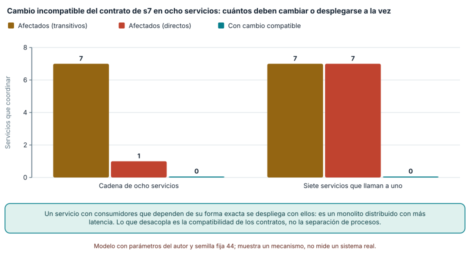

# SE-340 — Microservicios y sus costes reales

[← SE-339 — Pipes and filters y arquitecturas de flujo](https://github.com/vladimiracunadev-create/modern-software-engineering-program/blob/main/classes/part-28-estilos-arquitectonicos/se-339-pipes-and-filters-y-arquitecturas-de-flujo/README.md) · [↑ Parte 28](https://github.com/vladimiracunadev-create/modern-software-engineering-program/blob/main/classes/part-28-estilos-arquitectonicos/README.md) · [📚 Índice completo](https://github.com/vladimiracunadev-create/modern-software-engineering-program/blob/main/classes/README.md) · [🌐 Portal](https://vladimiracunadev-create.github.io/modern-software-engineering-program/classes/SE-340.html) · [SE-341 — BFF, API gateway y service mesh →](https://github.com/vladimiracunadev-create/modern-software-engineering-program/blob/main/classes/part-28-estilos-arquitectonicos/se-341-bff-api-gateway-y-service-mesh/README.md)

## Punto profesional y fundamento pedagógico

**Punto profesional.** La clase existe para que puedas poner un precio a separar un sistema en servicios y compararlo con lo que se compra. Los microservicios compran despliegue independiente, escala selectiva y propiedad clara por equipo. Pagan con latencia, con disponibilidad, con complejidad operativa y con un tipo de acoplamiento más difícil de ver que el de las llamadas en proceso. Quien conoce ambas columnas puede decir «sí» cuando hay doce equipos que se estorban y «todavía no» cuando hay seis personas y un dominio que aún se descubre. Quien solo conoce la primera columna migra por moda y descubre la segunda en producción.

**Por qué aparece aquí.** Sigue a `SE-339` porque es el primer estilo que atraviesa límites de proceso: hasta aquí todo ocurría dentro de un mismo programa. Retoma la pregunta de `SE-327` (monolito, monolito modular y servicios) con medidas de código en lugar de argumentos, y prepara `SE-341` (qué se pone entre los clientes y los servicios) y `SE-344` (cómo acotar el daño cuando un servicio falla).

**Error conceptual que debe corregir.** Creer que separar procesos desacopla. Lo que desacopla es la compatibilidad de los contratos: un servicio cuyo contrato cambia y rompe a sus consumidores se despliega con ellos, de modo que el sistema es un monolito distribuido con más latencia y más fallos. En esta clase se cuenta: un cambio incompatible en el servicio `s7` obliga a coordinar siete servicios tanto en una cadena como en una estrella.

**Secuencia de aprendizaje.** Antes de ejecutar, predices cuántas veces más cuesta una consulta si cruza un proceso por HTTP en la misma máquina, y qué disponibilidad tiene una petición que atraviesa ocho servicios de 99,9 %. Después mides una consulta en proceso, serializada y por HTTP local, simulas cadenas de uno a ocho servicios y calculas cuántos servicios se coordinan ante un cambio incompatible en dos topologías.

**Evidencia de aprendizaje.** `costo-de-separar.md` con la medida de una llamada entre procesos de tu sistema, el cálculo de la disponibilidad y del p99 de tu camino crítico, el mapa de dependencias síncronas y el criterio de compatibilidad de tus contratos, y una recomendación explícita con el número de equipos y el escenario que la justifican.

**Límite de la conclusión.** El costo de HTTP se midió en `127.0.0.1` con un servidor de la biblioteca estándar, sin red, balanceador ni cifrado; la cadena de servicios es una simulación con latencias lognormales y semilla 44; la topología de las dependencias es de ocho servicios inventados. Las cifras muestran el mecanismo y las proporciones, no el costo de un sistema real. No se midió ningún sistema de microservicios ni se invocó ningún modelo de lenguaje.

### Trazabilidad fuente → afirmación

| Fuente primaria u oficial | Afirmación que respalda | Lo que no prueba |
|---|---|---|
| [Lewis y Fowler, «Microservices»](https://martinfowler.com/articles/microservices.html) | Caracteriza el estilo: componentes que son servicios, organización por capacidades de negocio, gestión descentralizada de datos, diseño para el fallo y evolución. | Es una descripción de rasgos observados, no una medición de su efecto. |
| [Fowler, «Microservice Premium»](https://martinfowler.com/bliki/MicroservicePremium.html) | Argumenta que los microservicios añaden un costo de complejidad que solo se compensa en sistemas suficientemente complejos. | Es una opinión informada, sin datos de proyectos. |
| [Fowler, «MonolithFirst»](https://martinfowler.com/bliki/MonolithFirst.html) | Propone empezar por un monolito y separar cuando se conocen las fronteras del dominio. | No es una regla universal. |
| [Conway, «How Do Committees Invent?»](https://www.melconway.com/Home/Conways_Law.html) | Origina la idea de que la estructura del sistema refleja la de la organización. | No cuantifica el efecto. |
| [Python: `http.client`](https://docs.python.org/3/library/http.client.html) | Documenta el cliente HTTP con conexión reutilizable que usa el laboratorio. | No mide ninguna red real. |
| [RFC 9110, «HTTP Semantics»](https://www.rfc-editor.org/rfc/rfc9110) | Define la semántica de HTTP (métodos, códigos, idempotencia) que sustenta los contratos entre servicios. | No dice cómo versionar un contrato de negocio. |

## Antes de empezar

Recupera lo aprendido en `SE-338` y `SE-339`: un estilo se paga en su contrato y los límites tienen costo. La pregunta activa es: **¿cuál fue el último cambio «pequeño» en un servicio que obligó a otro equipo a desplegar el mismo día, y qué habría que haber hecho para que no hiciera falta?**

## Prerrequisitos

- Haber completado `SE-337`.
- Conocer de `SE-327` la diferencia entre monolito, monolito modular y servicios, y de `SE-436` qué es una latencia de cola.
- Saber qué es un percentil y qué significa una disponibilidad de 99,9 %.
- Python 3.11 o posterior; el laboratorio usa solo la biblioteca estándar y un servidor local.

## Problema auténtico

El módulo de cálculo de avisos de *Avisos* es el más cambiado de la plataforma y el que más compite por ciclos de CPU en las horas de entrega. Una persona propone separarlo en un servicio propio. El razonamiento es sólido: se desplegaría sin esperar al resto, escalaría aparte y tendría un equipo dueño. Una segunda persona pregunta cuánto añade una llamada de red a cada petición y qué ocurre si el servicio nuevo cae. Nadie tiene los números. La reunión termina con «hagámoslo y veamos», que es la forma más cara de medir.

La clase mide antes. Se compara la misma consulta de aviso como llamada en proceso, serializada y por HTTP local; se calcula qué disponibilidad y qué latencia de cola tiene una petición que atraviesa k servicios; y se cuenta cuántos servicios se coordinan ante un cambio de contrato según la topología. Con esos números la decisión sigue siendo posible, pero con un precio escrito.

## Objetivos observables

Al terminar podrás:

1. medir el costo de cruzar un límite de proceso en tu entorno y expresarlo como múltiplo de una llamada en proceso;
2. calcular la disponibilidad de una cadena síncrona y estimar su latencia de cola con una simulación de semilla fija;
3. explicar por qué la latencia de una petición que espera k llamadas en paralelo empeora con k aunque cada llamada sea igual de rápida;
4. distinguir un acoplamiento por llamada de uno por contrato y reconocer un monolito distribuido;
5. escribir el criterio para separar un módulo (equipos, medida y compatibilidad) y el criterio para no hacerlo.

## Mapa conceptual


El mapa muestra que el despliegue independiente solo se obtiene si los contratos son compatibles; si no, la rama termina en un monolito distribuido, que conserva todos los costos de la izquierda y ninguno de los beneficios.

## Temas y por qué importan

| Tema | Por qué cambia una decisión profesional | Evidencia mínima |
|---|---|---|
| Costo de una llamada remota | Se multiplica por el número de llamadas del camino crítico. | Medida en proceso y por HTTP |
| Disponibilidad de una cadena | Se multiplica; ocho servicios de 99,9 % no dan 99,9 %. | Cálculo y simulación |
| Latencia de cola | Esperar a varias llamadas empeora el percentil alto. | p99 por número de llamadas |
| Contratos y compatibilidad | Decide si hay despliegue independiente o monolito distribuido. | Servicios afectados por un cambio |
| Datos por servicio | Obliga a replicar o a coordinar sin transacción global. | Mapa de propiedad de datos |
| Organización | El estilo funciona si hay equipos que lo justifican. | Equipos y dependencias |
| Costo operativo | Observabilidad, despliegue y diagnóstico se multiplican. | Prerrequisitos de operación |

## Conceptos y decisiones

### 1. Qué compra el estilo

La descripción más citada del estilo enumera rasgos: componentes que son servicios que se despliegan solos, organización por capacidad de negocio y no por capa técnica, propiedad de los datos por servicio, infraestructura automatizada, diseño para el fallo y evolución del conjunto. Lo que compra es autonomía: un equipo cambia, prueba y despliega su servicio sin pedir permiso a los demás. Esa autonomía tiene sentido cuando hay varios equipos cuyos ciclos de cambio se estorban; con un equipo no hay a quién estorbar. Por eso `SE-337` dio pesos distintos al despliegue independiente según el contexto.

### 2. El precio de cruzar un proceso

Una llamada en proceso, a una función, cuesta nanosegundos. Cruzar un límite de proceso añade serializar, enviar, esperar y deserializar. Se midió la misma consulta de aviso de cuatro maneras (una ejecución en Windows 11): en el mismo proceso, mediana 0,0002 ms; serializando y deserializando JSON, 0,0051 ms; por HTTP local con conexión reutilizada, 0,3237 ms (p99 0,6739 ms); y por HTTP local abriendo una conexión nueva, 1,0791 ms (p99 1,8198 ms). Una llamada por HTTP cuesta más de mil veces una llamada en proceso aun sin red, balanceador, TLS ni autenticación, y reutilizar la conexión triplica el rendimiento. En una red real el costo es de uno o varios milisegundos. Lo que importa es el múltiplo y cuántas llamadas hay en el camino crítico, no el valor absoluto: un camino con una llamada cuesta décimas de milisegundo; uno con veinte, varios milisegundos más la variación.

### 3. Disponibilidad: se multiplica

Si una petición depende de forma síncrona de k servicios y cada uno tiene disponibilidad *a*, la petición tiene disponibilidad *a* elevada a k, siempre que los fallos sean independientes. La simulación de 20 000 peticiones con una probabilidad de fallo de 0,1 % por salto da, para k = 1, 2, 4 y 8: 99,915 %, 99,750 %, 99,655 % y 99,150 %, contra los valores analíticos 99,900 %, 99,800 %, 99,601 % y 99,203 %. La diferencia es el ruido del muestreo. Ocho servicios de 99,9 % dan 99,2 %: casi seis horas de caída al mes en lugar de unos 43 minutos. Los remedios (reintentos, caché, degradación, respuesta por defecto) rompen la dependencia síncrona, pero cada uno añade complejidad y su propio modo de fallo.

### 4. Latencia de cola y esperas en paralelo

Con latencias lognormales de mediana 20 ms, el percentil 99 de una cadena en serie sube de 79,2 ms con un servicio a 316,7 ms con ocho, mientras la mediana va de 20,1 a 186,1 ms: las latencias se suman y las colas también. Hay una segunda amplificación, más sutil, cuando una petición llama a k servicios en paralelo y espera a todos: la latencia es el máximo de las k. Con 50 000 peticiones simuladas, el p99 de la petición pasó de 80,7 ms (k = 1) a 108,6 ms (k = 4), 122,4 ms (k = 8) y 137,9 ms (k = 16), y la probabilidad de que al menos una de las k llamadas supere su propio p99 es 1 − 0,99^k: 3,9 % con 4, 7,7 % con 8 y 14,9 % con 16. Un evento raro para una llamada se vuelve frecuente para la petición. La defensa son los plazos agresivos, las llamadas redundantes y reducir el número de llamadas en el camino crítico.

### 5. Acoplamiento por contrato: el monolito distribuido

Se construyó un grafo de ocho servicios (`s0` a `s7`) en dos formas: una cadena en la que cada uno llama al siguiente y una estrella en la que siete llaman a `s7`. Si `s7` cambia su contrato de forma incompatible, los servicios que deben coordinarse con él son 7 en ambas topologías contando los dependientes transitivos; los afectados directamente son 1 en la cadena y 7 en la estrella. Con un cambio compatible (un campo opcional añadido) y consumidores que ignoran lo que no usan (el lector tolerante de Fowler), el número de despliegues coordinados es 0. Lo que da el despliegue independiente no es la frontera del proceso sino la disciplina de compatibilidad: añadir sin quitar, versionar lo que se retira y probar los contratos desde el lado del consumidor. Sin ella, el sistema se despliega en bloque con más piezas.

### 6. Datos por servicio

Cada servicio posee sus datos y los demás los piden por su interfaz. Eso elimina las uniones entre bases y las transacciones globales: una operación que antes era una transacción pasa a ser una secuencia de pasos con compensaciones, y el sistema es eventualmente consistente. Esto no se midió aquí, pero es el costo que más sorprende. Antes de separar, preguntar qué operaciones hoy son transacciones que cruzarían la frontera propuesta; si son muchas, la frontera está mal puesta.

### 7. La organización como condición

Conway observó que la estructura del sistema refleja la de la organización. El estilo funciona cuando la frontera de un servicio coincide con la de un equipo y ese equipo puede operarlo. Si tres equipos comparten un servicio, o un equipo posee veinte, se pierde la autonomía que se compraba. La medida práctica es cuántos equipos hay y qué parte de los cambios necesita coordinación entre ellos hoy; si es cercana a cero, separar no compra nada.

### 8. Cuándo sí y cuándo todavía no

Separar tiene sentido cuando hay evidencia de al menos una de tres fuerzas: equipos cuyos despliegues se estorban, un módulo con una escala o un riesgo muy distinto del resto, o un dominio bien entendido con fronteras estables. En su defecto, un monolito modular con interfaces internas explícitas conserva la opción de separar más adelante a un costo menor, que es lo que defiende la propuesta de empezar por el monolito. Un criterio práctico es separar cuando el escenario de calidad que lo exige se puede escribir con un número y ese número ya se incumple, no cuando se prevé que se incumplirá.

## El precio de una llamada

La primera comparación mide la misma consulta de aviso de cuatro maneras.


**Cómo leer la figura.** Cada grupo es una forma de hacer la llamada; la barra verde es la mediana y la roja el percentil 99, en milisegundos y en escala logarítmica. Mira primero cuántas décadas separan la primera barra de la última: más de tres. **Dónde deja de valer:** es una ejecución en una máquina con un servidor de la biblioteca estándar y sin red; los valores absolutos cambian de un equipo a otro y con el sistema operativo. Con red, cifrado y balanceador el costo sube. Las proporciones son lo que se traslada.

## Una cadena de servicios en serie

La segunda comparación simula una petición que atraviesa k servicios y mide disponibilidad y latencia.


**Cómo leer la figura.** El eje horizontal son los servicios en la cadena y el vertical la latencia en milisegundos; la línea verde es la mediana y la roja el percentil 99. Mira primero cómo las dos suben casi linealmente con cada servicio; la disponibilidad, analítica y simulada, está en la nota. **Dónde deja de valer:** los fallos de la simulación son independientes y de igual probabilidad; en la realidad fallan juntos (una caída de la red o de una base compartida derriba varios servicios a la vez) y la disponibilidad real es peor que el producto. Las latencias son una distribución lognormal elegida por el autor.

## Coordinación ante un cambio de contrato

La tercera comparación cuenta los servicios afectados por un cambio incompatible en `s7`.



**Cómo leer la figura.** Cada grupo es una topología; las barras son los servicios afectados transitivamente (dorada), directamente (roja) y con un cambio compatible (verde). Mira primero que la barra verde es cero en las dos: lo que desacopla es la compatibilidad del contrato, no la topología. **Dónde deja de valer:** el cálculo supone que todo cambio incompatible obliga a coordinar con todos los dependientes, y en la práctica se puede acotar con versiones paralelas de un contrato; el grafo es de ocho nodos inventados y no representa la topología de ningún sistema real.

## Definiciones de trabajo

- **Microservicio:** servicio desplegable de forma independiente, organizado alrededor de una capacidad de negocio y dueño de sus datos.
- **Monolito distribuido:** sistema de servicios que debe desplegarse en conjunto por acoplamiento de contratos.
- **Latencia de cola:** percentil alto de la latencia, como el p99.
- **Contrato compatible:** cambio que no obliga a los consumidores existentes a modificarse.
- **Lector tolerante:** consumidor que ignora los campos que no usa.
- **Camino crítico:** secuencia de llamadas de la que depende la respuesta al usuario.
- **Saga:** secuencia de transacciones locales con pasos de compensación.

## Ejemplo mínimo

La disponibilidad de una cadena en cuatro líneas:

```python
a = 0.999
for k in (1, 2, 4, 8):
    print(k, f"{100 * a ** k:.3f} %")   # 99.900, 99.800, 99.601, 99.203
```

Cada servicio añadido resta casi una décima de punto. La conclusión práctica es que el número de servicios síncronos en el camino crítico es un presupuesto de disponibilidad: si el objetivo es 99,9 % y cada servicio da 99,9 %, el presupuesto es de un solo servicio sin redundancia.

## Ejemplo profesional

*Escenario ilustrativo: las cifras y los resultados que aparecen en este ejemplo son supuestos de la narración, no mediciones.*

El equipo de *Avisos* decide separar el cálculo de avisos. Antes de empezar dibuja el camino crítico de «mostrar mis avisos»: hoy tiene cuatro llamadas en proceso; separado, tendría cuatro llamadas remotas y una más hacia el nuevo servicio. Con la disponibilidad de cada servicio en 99,9 % y las cinco llamadas en serie, el producto es 99,5 %, por debajo del objetivo de 99,9 %. El equipo rediseña: tres de las llamadas se hacen en paralelo, una se sustituye por una réplica local con datos de hasta cinco minutos de antigüedad y el servicio nuevo responde con el último resultado calculado si el cálculo tarda más de 150 ms. Con eso el camino crítico depende de dos servicios y el p99 medido en una prueba de carga queda dentro del escenario. El resultado es una separación con un presupuesto: lo que costó (una réplica y una política de degradación) estaba escrito antes de empezar.

## Práctica guiada

1. Mide en tu entorno una llamada en proceso y la misma por HTTP local con conexión reutilizada; calcula el múltiplo.
2. Dibuja el camino crítico de una operación importante de tu sistema, cuenta las llamadas síncronas y calcula la disponibilidad esperada.
3. Ejecuta `python scripts/experiments_part28_a.py 532` y compara con tus medidas y con la figura.
4. Dibuja el grafo de dependencias síncronas entre tus servicios o módulos y cuenta los dependientes transitivos de los dos más cambiados.
5. Escribe el criterio con que decidirías separar un módulo: equipos, medida y compatibilidad de contratos.

## Ejercicios

1. **Básico.** Calcula la disponibilidad de una petición que atraviesa cinco servicios de 99,95 % y la de una que atraviesa tres de 99,9 %; indica cuál cumple un objetivo de 99,9 %.
2. **Intermedio.** Modifica la simulación para que dos de los k servicios compartan una base de datos que falla con probabilidad 0,1 % y comprueba cuánto empeora la disponibilidad frente a fallos independientes.
3. **Avanzado.** Diseña el contrato de un servicio para que añadir un campo no obligue a desplegar a sus consumidores y escribe una prueba de contrato del lado del consumidor que falle si el proveedor quita un campo que usa.

## Reto verificable

Entrega `costo-de-separar.md` con la medida del costo de una llamada remota, la disponibilidad y el p99 estimados de un camino crítico real o ficticio, el mapa de dependencias y una recomendación defendida («separar» o «todavía no») con el número de equipos y el escenario que la sostienen. Es válido si otra persona reproduce los cálculos y puede señalar el supuesto que invertiría la recomendación.

## Caso conductor

*Avisos* evalúa separar su cálculo de avisos. Esta clase da el precio: más de mil veces una llamada en proceso, disponibilidad multiplicada, latencia de cola amplificada y un riesgo de acoplamiento por contrato. `SE-341` estudia qué se coloca entre los clientes y esos servicios (un BFF, un gateway, una malla) y cuánto de lo que prometen es evitable con una decisión más simple.

## Preguntas frecuentes

### ¿Los microservicios son más rápidos?

Cada llamada es más lenta que una llamada en proceso. Lo que puede ser más rápido es el flujo de trabajo del equipo, porque despliega sin esperar a otros, y la capacidad de escalar una parte sin escalar el resto. Son dos ganancias distintas de la de latencia.

### ¿Cuántos servicios son demasiados?

No hay un número. La medida útil es cuántos servicios hay en el camino crítico de cada operación y cuántos equipos operan cuántos servicios. Un equipo que opera más servicios de los que puede mantener con guardias razonables tiene demasiados.

### ¿Y si empiezo con servicios grandes?

Es una práctica habitual: pocos servicios con fronteras de negocio claras, que se parten si la evidencia lo pide. Conserva casi todos los beneficios y paga solo una parte del costo.

### ¿Cómo se prueban los contratos?

Con pruebas de contrato dirigidas por el consumidor (como las de `SE-547`): cada consumidor declara lo que usa y el proveedor ejecuta esas expectativas antes de publicar. Así se descubre un cambio incompatible antes de que alguien lo sufra.

## Fallo controlado y diagnóstico

**Fallo.** Tras separar el cálculo de avisos, el p99 de «mostrar mis avisos» sube de 180 a 420 ms y la disponibilidad mensual baja de 99,95 % a 99,7 %, aunque cada servicio por separado cumple su objetivo.

**Diagnóstico paso a paso.** (1) Se traza una petición lenta: atraviesa seis servicios en serie, tres más que antes. (2) Se calcula la disponibilidad esperada: 0,9995 elevado a 6 da 99,70 %, que coincide con lo observado. (3) Se mide la latencia del camino: cada salto añade en promedio 20 ms y una cola larga. (4) Nadie había calculado el producto antes de separar.

**Corrección.** Se reduce el camino crítico a dos llamadas en paralelo, se añade una respuesta degradada con el último resultado conocido y se fija un presupuesto de llamadas síncronas por operación, comprobado en las revisiones. La lección es que el objetivo de disponibilidad se reparte entre todos los eslabones y no lo cumple cada uno por separado.

## Errores comunes y cómo corregirlos

- **Separar por moda.** Sin escenario no hay evidencia. Corrige escribiendo la medida que se incumple hoy.
- **Ignorar el producto de las disponibilidades.** Corrige calculándolo antes de separar.
- **Cadenas largas de llamadas síncronas.** Amplifican latencia y fallos. Corrige con llamadas en paralelo, caché y degradación.
- **Compartir la base de datos entre servicios.** Es acoplamiento por datos. Corrige con propiedad por servicio y contrato.
- **Cambios incompatibles de contrato.** Producen un monolito distribuido. Corrige con compatibilidad y pruebas de consumidor.
- **Un equipo para veinte servicios.** Se pierde la autonomía. Corrige alineando servicios y equipos.

## Entorno y archivos clave

- `scripts/experiments_part28_a.py`: función `e532` con las medidas de llamada, la simulación de cadenas y el grafo de dependencias; se ejecuta con `python scripts/experiments_part28_a.py 532`.
- `scripts/experiments_part28_lab.py`: el servidor HTTP local (solo `127.0.0.1`, puerto asignado por el sistema) y los cronómetros.
- `scripts/figures_part28_a.py`: las tres figuras de la clase.
- Solo la biblioteca estándar de Python 3.11 o posterior; los tiempos de HTTP local dependen del sistema.

## Seguridad, ética y accesibilidad

El servidor del laboratorio escucha solo en la interfaz local y termina con el proceso. Cada servicio añadido es una superficie: autenticación entre servicios, secretos y permisos se multiplican, y una cadena de confianza mal definida entre servicios es una vía de escalada de privilegios (se retoma en `SE-341`). Ética: una decisión de separar impone guardias y carga operativa a personas; presupuestar esa carga es parte de la decisión. Las figuras son tablas con texto alternativo completo y no dependen solo del color.

## Puente hacia el trabajo con agentes

Un agente de código recomienda microservicios con facilidad, porque la literatura que lo formó los presenta como la dirección natural; no conoce tu número de equipos ni tu presupuesto de disponibilidad. Pídele que calcule el producto de disponibilidades de tu camino crítico y el número de llamadas síncronas antes de aceptar su propuesta, y pídele los contratos con compatibilidad explícita. Si el agente genera servicios, verifica que cada uno tenga su prueba de contrato del lado del consumidor y que ninguno comparta base de datos con otro. Lo que no se delega es la decisión sobre cuántos equipos justifican separar.

## Transferencia

Toma una operación importante de tu sistema y haz las cuentas completas: llamadas síncronas, disponibilidad esperada, p99 estimado y dependientes transitivos de sus dos servicios más cambiados. Si ya está separado, compara con el escenario que lo motivó; si no lo está, escribe el escenario que lo justificaría y la medida que hoy no se cumple.

## Evaluación y evidencia

| Criterio | Evidencia aceptable | Rechazo |
|---|---|---|
| Costo de llamada | Medida en tu entorno y su múltiplo | «Es lento» |
| Disponibilidad de cadena | Producto calculado y simulación | Disponibilidad de cada servicio |
| Latencia de cola | p99 por número de llamadas | Solo la mediana |
| Compatibilidad | Servicios afectados por un cambio | «Usamos versiones» |
| Recomendación | Equipos, medida y supuesto que la invierte | Preferencia sin número |

## Fuentes

- Lewis, J. y Fowler, M. [«Microservices»](https://martinfowler.com/articles/microservices.html).
- Fowler, M. [«Microservice Premium»](https://martinfowler.com/bliki/MicroservicePremium.html) y [«MonolithFirst»](https://martinfowler.com/bliki/MonolithFirst.html).
- Fowler, M. [«TolerantReader»](https://martinfowler.com/bliki/TolerantReader.html).
- Conway, M. E. [«How Do Committees Invent?»](https://www.melconway.com/Home/Conways_Law.html).
- IETF. [RFC 9110, «HTTP Semantics»](https://www.rfc-editor.org/rfc/rfc9110) y Python Software Foundation, [`http.client`](https://docs.python.org/3/library/http.client.html).

## Límites y siguiente paso

El costo de HTTP es el de un servidor de la biblioteca estándar en la misma máquina; la cadena de servicios y la topología son simulaciones con parámetros del autor. No se midió ningún sistema de microservicios, ningún equipo ni el costo humano de operarlos. El siguiente paso, `SE-341`, estudia lo que se interpone entre los clientes y los servicios: el BFF, el gateway y la malla de servicios.

## Glosario

| Término | Definición breve |
|---|---|
| Microservicio | Servicio desplegable solo, con una capacidad de negocio y sus datos |
| Monolito distribuido | Servicios que se despliegan en bloque por acoplamiento |
| Latencia de cola | Percentil alto de la latencia |
| Contrato compatible | Cambio que no obliga a modificar a los consumidores |
| Camino crítico | Llamadas de las que depende la respuesta |
| Saga | Transacciones locales con compensaciones |

---

[← SE-339 — Pipes and filters y arquitecturas de flujo](https://github.com/vladimiracunadev-create/modern-software-engineering-program/blob/main/classes/part-28-estilos-arquitectonicos/se-339-pipes-and-filters-y-arquitecturas-de-flujo/README.md) · [↑ Parte 28](https://github.com/vladimiracunadev-create/modern-software-engineering-program/blob/main/classes/part-28-estilos-arquitectonicos/README.md) · [📚 Índice completo](https://github.com/vladimiracunadev-create/modern-software-engineering-program/blob/main/classes/README.md) · [🌐 Portal](https://vladimiracunadev-create.github.io/modern-software-engineering-program/classes/SE-340.html) · [SE-341 — BFF, API gateway y service mesh →](https://github.com/vladimiracunadev-create/modern-software-engineering-program/blob/main/classes/part-28-estilos-arquitectonicos/se-341-bff-api-gateway-y-service-mesh/README.md)
