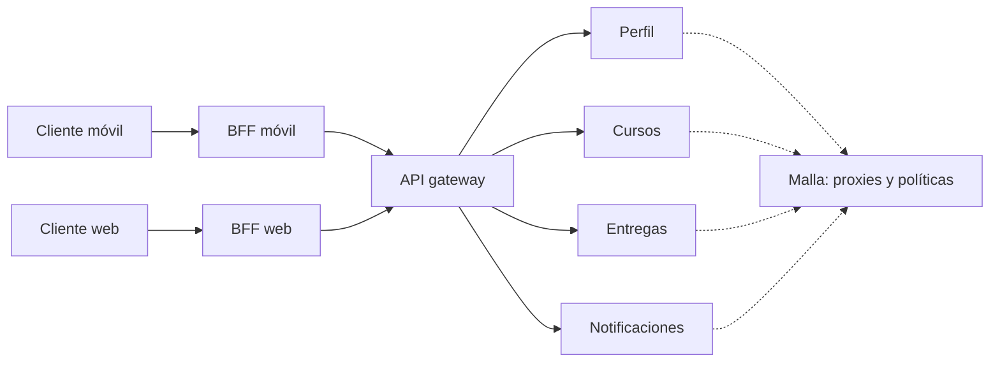
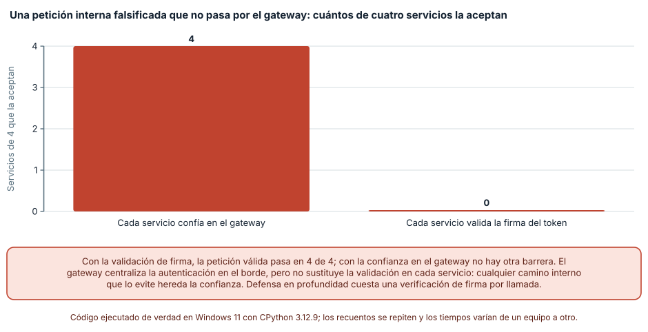
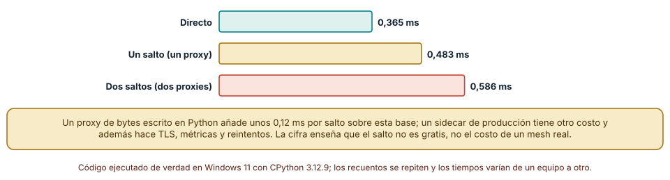

# SE-341 — BFF, API gateway y service mesh

[← SE-340 — Microservicios y sus costes reales](https://github.com/vladimiracunadev-create/modern-software-engineering-program/blob/main/classes/part-28-estilos-arquitectonicos/se-340-microservicios-y-sus-costes-reales/README.md) · [↑ Parte 28](https://github.com/vladimiracunadev-create/modern-software-engineering-program/blob/main/classes/part-28-estilos-arquitectonicos/README.md) · [📚 Índice completo](https://github.com/vladimiracunadev-create/modern-software-engineering-program/blob/main/classes/README.md) · [🌐 Portal](https://vladimiracunadev-create.github.io/modern-software-engineering-program/classes/SE-341.html) · [SE-342 — Multi-tenancy y aislamiento →](https://github.com/vladimiracunadev-create/modern-software-engineering-program/blob/main/classes/part-28-estilos-arquitectonicos/se-342-multi-tenancy-y-aislamiento/README.md)

## Punto profesional y fundamento pedagógico

**Punto profesional.** La clase existe para que distingas tres componentes que se confunden en casi todas las conversaciones de arquitectura: el API gateway, el BFF (backend for frontend) y la malla de servicios. Los tres se colocan «delante» de algo, los tres reciben tráfico y los tres se venden como la solución a los problemas de los microservicios, pero resuelven problemas distintos, en lugares distintos y con dueños distintos. Quien los confunde instala una malla para resolver un problema de agregación, o convierte el gateway en un monolito con lógica de negocio que ningún equipo posee. Quien los distingue sabe cuál necesita, cuál no y cuánto cuesta cada uno.

**Por qué aparece aquí.** Sigue a `SE-340` porque es la respuesta habitual a lo que ese estilo deja abierto: cuando hay muchos servicios, el cliente no puede ni debe hablar con todos, y el tráfico entre servicios necesita políticas comunes. Prepara `SE-342` (aislamiento por inquilino, que muchas veces se aplica en el borde) y `SE-344` (las celdas necesitan un enrutador, que es un gateway especializado).

**Error conceptual que debe corregir.** Creer que el gateway garantiza la seguridad del sistema. El gateway autentica en el borde; un servicio que confía en que «si llegó hasta aquí es porque el gateway lo permitió» acepta cualquier petición que llegue por otro camino (otro servicio comprometido, una herramienta de diagnóstico, un error de red). En esta clase se prueba con código: con confianza solo en el borde, una petición interna falsificada la aceptan 4 de 4 servicios; con validación de firma en cada servicio, 0 de 4.

**Secuencia de aprendizaje.** Antes de ejecutar, predices cuántos bytes necesita realmente una pantalla móvil frente a la web cuando detrás hay cuatro servicios, y cuánta latencia añade un proxy por salto. Después mides tamaños de respuestas JSON, calculas rondas y tiempos con un modelo declarado, pruebas una petición interna falsificada con y sin validación en cada servicio y mides con un proxy TCP de verdad cuánto añade cada salto.

**Evidencia de aprendizaje.** `capas-de-entrada.md` con una tabla de qué responsabilidad vive en el gateway, en cada BFF y en la malla, quién es dueño de cada una, la medida de bytes por cliente de una pantalla tuya, el modelo de confianza entre servicios y el costo por salto medido o declarado como supuesto.

**Límite de la conclusión.** Los tamaños de respuesta son de datos sintéticos con semilla 44; los tiempos de ronda usan 80 ms de ida y vuelta y 0,5 MB/s, supuestos del autor; el proxy es un reenviador de bytes de 40 líneas en Python, no un sidecar de producción. No se ejecutó ningún gateway, BFF ni malla real (Envoy, Istio, Kong u otros) ni se invocó ningún modelo de lenguaje.

### Trazabilidad fuente → afirmación

| Fuente primaria u oficial | Afirmación que respalda | Lo que no prueba |
|---|---|---|
| [Newman, «Pattern: Backends For Frontends»](https://samnewman.io/patterns/architectural/bff/) | Describe un backend por tipo de experiencia de cliente, propiedad del equipo de ese cliente, en lugar de una API general única. | No mide el beneficio de ningún caso. |
| [Azure Architecture Center, «Backends for Frontends pattern»](https://learn.microsoft.com/en-us/azure/architecture/patterns/backends-for-frontends) | Documenta el patrón, sus beneficios y sus riesgos (duplicación entre BFF, más componentes). | No cuantifica el esfuerzo. |
| [Azure Architecture Center, «Gateway Aggregation pattern»](https://learn.microsoft.com/en-us/azure/architecture/patterns/gateway-aggregation) | Describe agregar varias llamadas a servicios en una sola petición del cliente mediante un gateway. | No dice cuánto ahorra en tu sistema. |
| [Istio, «Architecture»](https://istio.io/latest/docs/ops/deployment/architecture/) | Describe una malla como un plano de datos de proxies y un plano de control que los configura. | No mide su costo en tu clúster. |
| [IETF, RFC 2104, «HMAC»](https://www.rfc-editor.org/rfc/rfc2104) y [Python: `hmac`](https://docs.python.org/3/library/hmac.html) | Definen el código de autenticación de mensajes con clave que usa el laboratorio para firmar el token. | No definen cómo distribuir ni rotar las claves. |
| [OWASP, «Application Security Verification Standard»](https://owasp.org/www-project-application-security-verification-standard/) | Recoge requisitos de verificación de seguridad de aplicaciones, entre ellos la autenticación y el control de acceso en cada capa. | No certifica ninguna implementación. |

## Antes de empezar

Recupera lo aprendido en `SE-340`: cruzar un proceso cuesta y los contratos acoplan. La pregunta activa es: **¿qué parte de tu sistema asume que otra ya validó la petición, y qué ocurre si una petición llega por un camino que no pasa por esa otra parte?**

## Prerrequisitos

- Haber completado `SE-340`.
- Saber qué es un token firmado y la diferencia entre autenticar y autorizar.
- Conocer de `SE-321` (bulkhead, sidecar, ambassador y degradación) la idea de sidecar.
- Python 3.11 o posterior; el laboratorio usa solo la biblioteca estándar y servidores locales.

## Problema auténtico

La pantalla de inicio de la aplicación de *Avisos* muestra el nombre del estudiante, sus próximas tres entregas y cuántas notificaciones no ha leído. Esos datos viven en cuatro servicios: perfil, cursos, entregas y notificaciones. La primera versión del cliente móvil llama a cada servicio, recibe respuestas completas y recorta lo que necesita. En una red móvil mala, la pantalla tarda segundos y gasta datos del usuario. El equipo web, con otra pantalla, necesita otra combinación de campos. Mientras tanto, el equipo de plataforma quiere que todos los servicios apliquen autenticación, límites de tasa y trazas de la misma manera, y nadie quiere repetirlo cuatro veces.

Hay tres respuestas posibles y se suelen mezclar: un gateway que agregue y centralice, un BFF por cliente que proyecte lo que cada pantalla necesita, y una malla que dé a los servicios políticas comunes. La clase las separa y mide lo que cada una cambia.

## Objetivos observables

Al terminar podrás:

1. distinguir gateway, BFF y malla por la pregunta que responde cada uno y por quién debe poseerlo;
2. medir cuántos bytes y cuántas rondas necesita una pantalla con y sin agregación y con y sin proyección por cliente;
3. demostrar con código que la confianza solo en el borde es una vulnerabilidad y diseñar la validación en cada servicio;
4. medir el costo de un salto adicional de proxy y decir qué se paga y qué se compra con él;
5. decidir cuándo no se necesita ninguno de los tres.

## Mapa conceptual



El mapa separa tres planos: el de la experiencia (los BFF, uno por cliente), el del borde (el gateway, con autenticación, límites y enrutamiento) y el del tráfico entre servicios (la malla, con proxies junto a cada servicio). Puede haber uno, dos o los tres; ninguno exige a los otros.

## Temas y por qué importan

| Tema | Por qué cambia una decisión profesional | Evidencia mínima |
|---|---|---|
| Gateway | Centraliza autenticación, límites y enrutamiento en el borde. | Lista de responsabilidades y su dueño |
| Agregación | Ahorra rondas al cliente. | Rondas con y sin agregación |
| BFF | Ahorra bytes y desacopla a los clientes entre sí. | Bytes por cliente |
| Malla | Da políticas comunes entre servicios a costa de un salto. | Latencia por salto |
| Modelo de confianza | El borde no es la única defensa. | Prueba con petición interna falsificada |
| Dónde acaba la lógica | Un gateway con negocio es un monolito sin dueño. | Qué reglas viven en cada capa |
| Cuándo prescindir | Con pocos servicios y un cliente, sobran. | Número de servicios y de clientes |

## Conceptos y decisiones

### 1. Tres componentes, tres preguntas

El gateway responde «¿quién puede entrar y por dónde?»: enrutamiento, autenticación, límites de tasa, terminación de TLS, a veces agregación simple. El BFF responde «¿qué necesita esta pantalla?»: una API pensada para un tipo de cliente, propiedad del equipo que construye ese cliente, que consume los servicios y devuelve exactamente lo que la interfaz usa. La malla responde «¿cómo se hablan los servicios entre sí?»: cifrado, reintentos, plazos, métricas, políticas de acceso entre servicios, aplicados por proxies sin cambiar el código de cada uno. Se confunden porque los tres son proxies en algún sentido; se distinguen por su dueño y por su dirección del tráfico (norte-sur frente a este-oeste).

### 2. Agregar ahorra rondas; proyectar ahorra bytes

En el laboratorio, los cuatro servicios devuelven 509, 1 473, 2 428 y 2 282 bytes de JSON: 6 692 en total. La pantalla móvil necesita el nombre, tres entregas con identificador, título y plazo, y el número de notificaciones sin leer: 163 bytes, el 2,4 % del total. La web necesita las listas de cursos, entregas y notificaciones con unos pocos campos cada una: 1 169 bytes, el 17,5 %. Con el cliente llamando a los cuatro servicios en dos rondas (el perfil y los cursos primero, las entregas y notificaciones después, porque las entregas dependen de los cursos) y el modelo de 80 ms de ida y vuelta y 0,5 MB/s, la pantalla tarda 173 ms; con un gateway que agrega (una ronda, la misma carga completa), 93 ms; con un BFF móvil (una ronda, 163 bytes), 80 ms; con un BFF web (una ronda, 1 169 bytes), 82 ms. Agregar quita una ronda (80 ms en este modelo); proyectar quita 6 529 bytes (unos 13 ms a 0,5 MB/s). El orden de magnitud depende de la red: a 0,5 MB/s las rondas pesan más; en una red lenta con RTT bajo, pesarían los bytes.

### 3. El BFF cuesta duplicación y necesita un dueño

Un BFF por cliente permite que el equipo móvil evolucione su API sin negociar con el equipo web. El costo es que la lógica común (por ejemplo, calcular «próximas entregas») puede duplicarse en dos BFF y divergir. Las guías de patrones señalan el riesgo y la mitigación: subir la lógica compartida a un servicio de dominio y dejar en cada BFF solo la composición y el formato. La regla de propiedad importa más que la técnica: si el BFF lo mantiene un equipo de plataforma y no el del cliente, se convierte en un gateway más con cola de peticiones.

### 4. El gateway con lógica de negocio es un monolito sin dueño

El gateway ve todo el tráfico, y es tentador añadirle reglas: «si el estudiante es de primer año, filtrar tal campo». Cada regla en el gateway es una regla que ningún equipo de dominio posee y que cambia el comportamiento de todos. La disciplina es que el gateway contenga solo lo que es genuinamente transversal (identidad, límites, enrutamiento, observabilidad) y que las reglas de negocio vivan en los servicios.

### 5. Confiar en el borde es una vulnerabilidad

Se construyó un token de la forma `{estudiante, firma}` donde la firma es un HMAC-SHA256 del identificador con una clave (derivada de bytes fijos del laboratorio, no una clave real). Se modelaron cuatro servicios con dos políticas. En la primera, cada servicio confía en el gateway y no valida nada: ante una petición interna falsificada con una firma inventada, la aceptan 4 de 4. En la segunda, cada servicio valida la firma con comparación en tiempo constante: aceptan la falsificada 0 de 4 y la válida 4 de 4. El gateway sigue siendo útil (rechaza tráfico malformado, limita tasas y centraliza la identidad), pero no es la única barrera. Una petición falsificada puede llegar por otro servicio comprometido, por una herramienta de operaciones o por una configuración de red equivocada. La defensa en profundidad cuesta una verificación de firma por llamada, y la gestión de claves, que el laboratorio no resuelve.

### 6. El salto de la malla no es gratis

Una malla coloca un proxy junto a cada servicio y desvía el tráfico por él. Cada salto añade latencia. Se construyó un proxy TCP de reenvío de bytes (sin TLS, sin reintentos, sin métricas) y se midieron 400 llamadas por camino en ocho rondas intercaladas, con conexiones reutilizadas: la mediana de medianas fue 0,365 ms directa, 0,483 ms con un proxy (+0,117 ms) y 0,586 ms con dos (+0,221 ms); el p99 fue 0,670, 0,849 y 1,059 ms. Cada salto añadió entre 0,11 y 0,12 ms a una llamada que cuesta 0,36 ms. Un sidecar de producción hace más (cifrado mutuo, políticas, telemetría) y su costo cambia; el número enseña que el salto existe, que se multiplica por los saltos del camino y que, en una llamada ya costosa, es una fracción pequeña, pero en un camino de veinte llamadas es un presupuesto.

### 7. Lo que la malla compra y lo que no

Lo que compra es uniformidad: cifrado entre servicios, reintentos y plazos configurados en un lugar, métricas comunes, políticas de quién llama a quién. Lo que no compra: no arregla contratos incompatibles, no reemplaza la validación de la petición en cada servicio (la identidad del usuario sigue viajando en el token) y suma un plano de control que hay que operar, actualizar y entender cuando falla. Para un sistema con cuatro servicios y un equipo, una biblioteca compartida o la configuración del propio servicio dan casi lo mismo con mucho menos que operar.

### 8. Cuándo ninguno

Con un cliente, pocos servicios y un equipo, el cliente puede llamar a un servicio de fachada simple sin ninguna de las tres cosas. La agregación se vuelve necesaria cuando un cliente necesita datos de varios servicios en una pantalla; el BFF, cuando hay clientes con necesidades distintas; la malla, cuando hay decenas de servicios y la necesidad de políticas comunes pesa más que su operación.

## Rondas, bytes y tiempo

La primera comparación mide lo que cambia armar la pantalla de avisos con cada arreglo.


**Cómo leer la figura.** Cada grupo es un camino, con sus rondas entre paréntesis; la barra azul oscura son los bytes y la roja el tiempo modelado, en escala logarítmica. Mira primero que el gateway acorta el tiempo pero no los bytes, y que solo los BFF reducen la barra azul. **Dónde deja de valer:** los tiempos son un modelo con 80 ms de ida y vuelta y 0,5 MB/s, no una medición de red; los tamaños son de datos sintéticos con campos de relleno. En una red rápida y con cargas pequeñas la diferencia entre las filas desaparece, y entonces ninguno de los tres componentes se justifica por rendimiento.

## Confianza en el borde frente a validación en cada servicio

La segunda comparación prueba una petición interna falsificada contra dos políticas.



**Cómo leer la figura.** Cada barra es una política de autenticación y su altura los servicios, de cuatro, que aceptan la petición falsa. Mira primero la barra de la confianza en el gateway: llega a 4 porque no hay otra barrera detrás; la de la validación de firma no existe. **Dónde deja de valer:** el modelo valida una firma con una clave que comparten los servicios; en un sistema real hay que distribuir y rotar claves o usar tokens firmados con clave asimétrica y verificar caducidad, audiencia y revocación. La prueba demuestra que la confianza en el borde falla, no que una firma HMAC compartida sea la solución completa.

## Cuánto añade cada salto

La tercera comparación mide proxies reales de reenvío de bytes en cadena.



**Cómo leer la figura.** Cada barra es un camino; la diferencia entre barras consecutivas es el costo del salto (unos 0,12 ms). Las rondas intercaladas evitan que el ruido del sistema favorezca a un camino. **Dónde deja de valer:** un proxy de Python con hilos no es un Envoy; el sidecar real tiene otro costo y hace más cosas. Los 0,12 ms son una cota inferior de lo que cuesta pasar por un proxy en esta máquina, no el costo de una malla.

## Definiciones de trabajo

- **API gateway:** punto de entrada que centraliza enrutamiento, autenticación y límites para clientes externos.
- **Agregación:** combinar en una respuesta datos de varios servicios.
- **BFF:** backend propio de un tipo de cliente, que proyecta lo que su interfaz necesita.
- **Malla de servicios:** capa de proxies y control que gobierna el tráfico entre servicios.
- **Sidecar:** proceso auxiliar desplegado junto a un servicio que intercepta su tráfico.
- **Defensa en profundidad:** validar en cada capa en lugar de confiar en una sola barrera.
- **Tráfico norte-sur y este-oeste:** el que entra al sistema y el que circula entre servicios.

## Ejemplo mínimo

Validar el token en cada servicio con la biblioteca estándar:

```python
import hmac

def sign(key: bytes, student: str) -> str:
    return hmac.new(key, student.encode(), "sha256").hexdigest()

def accepts(key: bytes, request: dict) -> bool:
    return hmac.compare_digest(request.get("sig", ""), sign(key, request.get("student", "")))

key = bytes(range(16))                       # clave de demostración, no real
good = {"student": "s1", "sig": sign(key, "s1")}
forged = {"student": "s1", "sig": "0" * 64}
print(accepts(key, good), accepts(key, forged))   # True False
```

`compare_digest` compara en tiempo constante, lo que evita revelar por el tiempo cuántos caracteres coinciden. Un servicio que trata `forged` como válida porque «ya pasó por el gateway» es el fallo que la clase demuestra.

## Ejemplo profesional

*Escenario ilustrativo: las cifras y los resultados que aparecen en este ejemplo son supuestos de la narración, no mediciones.*

El equipo móvil de *Avisos* mide la pantalla de inicio en una red 3G simulada y observa que la mayor parte del tiempo se va en tres idas y vueltas y en descargar listas completas. Propone un BFF móvil. El equipo de plataforma, que mantiene el gateway, propone en cambio que el gateway agregue las llamadas. Discuten con los números del modelo: agregar ahorra una ronda; proyectar ahorra bytes y, además, independiza al equipo móvil. Deciden un BFF móvil propiedad del equipo móvil, que consume los servicios a través del gateway existente (para no duplicar autenticación) y que no contiene reglas de dominio: solo composición y formato. Durante la revisión de seguridad alguien pregunta qué pasa si una petición llega directamente al servicio de entregas sin pasar por el gateway; la respuesta es que hoy la acepta, y se añade la validación de firma en cada servicio antes de la salida a producción. El gateway no fue lo que protegió el sistema; fue la pregunta.

## Práctica guiada

1. Toma una pantalla de tu sistema que llame a varios servicios y mide bytes recibidos y bytes usados.
2. Calcula rondas y tiempo con un modelo declarado de red, antes y después de agregar y de proyectar.
3. Ejecuta `python scripts/experiments_part28_a.py 533` y compara tus tamaños con los de la tabla.
4. Envía una petición con un token inválido directamente a cada servicio (en tu entorno de pruebas) y anota cuántos la rechazan.
5. Dibuja el equivalente del mapa conceptual para tu sistema, con el dueño de cada pieza.

## Ejercicios

1. **Básico.** Explica la diferencia entre agregar en el gateway y proyectar en un BFF, y qué mide cada una de las columnas de la primera figura.
2. **Intermedio.** Cambia en el modelo el ancho de banda a 5 MB/s y el RTT a 20 ms y decide qué arreglo (agregación, proyección o ninguno) sigue justificándose.
3. **Avanzado.** Añade al laboratorio caducidad al token y una comprobación de audiencia, y demuestra que un token válido pero emitido para otro servicio es rechazado.

## Reto verificable

Entrega `capas-de-entrada.md` con la tabla de responsabilidades por capa y por dueño, la medida de bytes por cliente de una pantalla, la prueba de la petición falsificada contra tus servicios y la medida del salto de un proxy. Es válido si otra persona puede reproducir la medida de bytes y señalar, para cada responsabilidad, quién responde cuando falla.

## Caso conductor

*Avisos* añade un BFF móvil, mantiene un gateway delgado y exige validación en cada servicio. `SE-342` usa esa estructura para tratar un problema que ya asomó aquí, el del inquilino: qué identifica una petición y cómo se impide que los datos de un cliente se mezclen con los de otro.

## Preguntas frecuentes

### ¿Un BFF es un gateway?

No. Un gateway es transversal y sirve a todos los clientes; un BFF es específico de un cliente y suele llevar su propia lógica de composición. Pueden convivir, con el BFF detrás del gateway o con un gateway por BFF.

### ¿Necesito una malla para tener TLS entre servicios?

No. Se puede configurar TLS en cada servicio o con un proxy local sin una malla completa. La malla compensa cuando hay muchos servicios y se quiere administrar el cifrado, las políticas y la telemetría desde un lugar.

### ¿La agregación no es lógica de negocio en el gateway?

Una agregación simple (juntar respuestas) es composición; una agregación que decide qué mostrar según reglas de negocio es lógica de dominio y debería vivir en un servicio o en el BFF de quien posee esa experiencia.

### ¿Cuántos BFF son demasiados?

Uno por tipo de experiencia con necesidades diferentes (móvil, web, un socio externo). Si hay un BFF por pantalla, el patrón se ha convertido en una colección de endpoints que nadie posee.

## Fallo controlado y diagnóstico

**Fallo.** Tras la salida a producción del gateway, una auditoría muestra que un servicio de notificaciones respondió a una petición de un estudiante sobre los avisos de otro. No hubo fallo del gateway.

**Diagnóstico paso a paso.** (1) Se revisa el registro del gateway: la petición original fue válida y el estudiante estaba autenticado. (2) Se revisa el servicio: aceptaba el identificador de estudiante de un encabezado que el gateway rellena, y no comprobaba que coincidiera con el del token. (3) Una herramienta interna de soporte llamaba al servicio con el encabezado manual. (4) Ninguna capa comparaba el identificador del encabezado con el del token firmado.

**Corrección.** Cada servicio valida la firma del token y toma de él la identidad, sin leerla de un encabezado; las herramientas internas usan identidades propias con permisos acotados; y se añade una prueba que envía a cada servicio una petición sin gateway y comprueba que es rechazada. La lección es que el borde reduce el riesgo, pero la identidad se comprueba donde se usa.

## Errores comunes y cómo corregirlos

- **Un gateway con reglas de negocio.** Es un monolito sin dueño. Corrige moviendo las reglas a los servicios.
- **Un BFF mantenido por otro equipo.** Pierde su razón de ser. Corrige asignándolo al equipo del cliente.
- **Confiar en el borde.** Corrige con validación de firma e identidad en cada servicio.
- **Instalar una malla para resolver agregación.** Resuelve otro problema. Corrige eligiendo el componente por la pregunta.
- **No medir bytes ni rondas.** El BFF se justifica sin números. Corrige midiendo antes.
- **Ignorar el costo de los saltos.** Corrige sumando los saltos del camino crítico en el presupuesto de latencia.

## Entorno y archivos clave

- `scripts/experiments_part28_a.py`: función `e533` con los tamaños, el modelo de rondas, el token firmado y el reenvío de bytes; se ejecuta con `python scripts/experiments_part28_a.py 533`.
- `scripts/experiments_part28_lab.py`: servidor HTTP local y proxy TCP de un salto, solo en `127.0.0.1`.
- `scripts/figures_part28_a.py`: las tres figuras de la clase.
- Solo la biblioteca estándar de Python 3.11 o posterior. La clave del token se deriva de bytes fijos del laboratorio y no es una clave real.

## Seguridad, ética y accesibilidad

El laboratorio no usa claves ni credenciales reales: la clave de demostración se construye con `bytes(range(16))`. En un sistema real, las claves se guardan en un gestor de secretos, se rotan y no se comparten entre entornos. Una malla con cifrado entre servicios protege el tráfico, pero concentra la confianza en el plano de control: quien lo controla puede reconfigurar el tráfico de todo el sistema. Ética: los BFF y gateways ven datos personales en tránsito; registrar cuerpos completos de peticiones sin necesidad viola la minimización. Las figuras son tablas y un gráfico con texto alternativo completo y no dependen solo del color.

## Puente hacia el trabajo con agentes

Un agente de código que genere un BFF o un gateway tiende a añadirle la lógica que le pidas, incluida la de negocio. Exige que declare qué responsabilidades puso en cada capa y que no incluya reglas de dominio en el gateway. Para la seguridad, pídele la prueba de la petición que salta el gateway para cada servicio y ejecútala tú. Las herramientas de un agente (por ejemplo, un servidor de protocolo de contexto) son, en pequeño, otro BFF: exponen una vista de un sistema para un cliente específico; aplican las mismas reglas de proyección mínima y de validación de identidad en cada herramienta.

## Transferencia

Dibuja el camino de una pantalla de tu sistema desde el cliente hasta los datos. Marca dónde se autentica, dónde se agrega, dónde se proyecta y dónde se aplican políticas entre servicios. Cuenta los saltos y los bytes sobrantes. Si falta alguna de las tres capas, decide con las medidas si la necesitas; si sobra alguna, decide qué responsabilidad cumple que no cumpla otra.

## Evaluación y evidencia

| Criterio | Evidencia aceptable | Rechazo |
|---|---|---|
| Distinción de componentes | Pregunta, dueño y dirección del tráfico | «Es un proxy» |
| Medida de bytes y rondas | Valores por cliente | Impresión |
| Modelo de confianza | Prueba de petición que salta el borde | «Confiamos en el gateway» |
| Costo de saltos | Medida o supuesto declarado | Omitido |
| Dónde vive la lógica | Responsabilidades por capa | Todo en el gateway |

## Fuentes

- Newman, S. [«Pattern: Backends For Frontends»](https://samnewman.io/patterns/architectural/bff/).
- Microsoft. [«Backends for Frontends pattern»](https://learn.microsoft.com/en-us/azure/architecture/patterns/backends-for-frontends) y [«Gateway Aggregation pattern»](https://learn.microsoft.com/en-us/azure/architecture/patterns/gateway-aggregation).
- Istio. [«Architecture»](https://istio.io/latest/docs/ops/deployment/architecture/).
- IETF. [RFC 2104, «HMAC»](https://www.rfc-editor.org/rfc/rfc2104); Python Software Foundation, [`hmac`](https://docs.python.org/3/library/hmac.html).
- OWASP. [«Application Security Verification Standard»](https://owasp.org/www-project-application-security-verification-standard/).

## Límites y siguiente paso

Los tamaños son de datos sintéticos, los tiempos de ronda son un modelo con supuestos del autor, el token es una demostración y el proxy es un reenviador mínimo. No se ejecutó ningún gateway, BFF ni malla real. El siguiente paso, `SE-342`, trata la identidad del inquilino: cómo se impide que los datos de un cliente aparezcan en la respuesta de otro y qué cuesta el aislamiento.

## Glosario

| Término | Definición breve |
|---|---|
| API gateway | Punto de entrada que centraliza enrutamiento y autenticación |
| BFF | Backend propio de un tipo de cliente |
| Malla de servicios | Proxies y plano de control para el tráfico entre servicios |
| Sidecar | Proceso auxiliar junto a un servicio |
| Defensa en profundidad | Validar en cada capa |
| Tráfico norte-sur | El que entra al sistema desde fuera |

---

[← SE-340 — Microservicios y sus costes reales](https://github.com/vladimiracunadev-create/modern-software-engineering-program/blob/main/classes/part-28-estilos-arquitectonicos/se-340-microservicios-y-sus-costes-reales/README.md) · [↑ Parte 28](https://github.com/vladimiracunadev-create/modern-software-engineering-program/blob/main/classes/part-28-estilos-arquitectonicos/README.md) · [📚 Índice completo](https://github.com/vladimiracunadev-create/modern-software-engineering-program/blob/main/classes/README.md) · [🌐 Portal](https://vladimiracunadev-create.github.io/modern-software-engineering-program/classes/SE-341.html) · [SE-342 — Multi-tenancy y aislamiento →](https://github.com/vladimiracunadev-create/modern-software-engineering-program/blob/main/classes/part-28-estilos-arquitectonicos/se-342-multi-tenancy-y-aislamiento/README.md)
