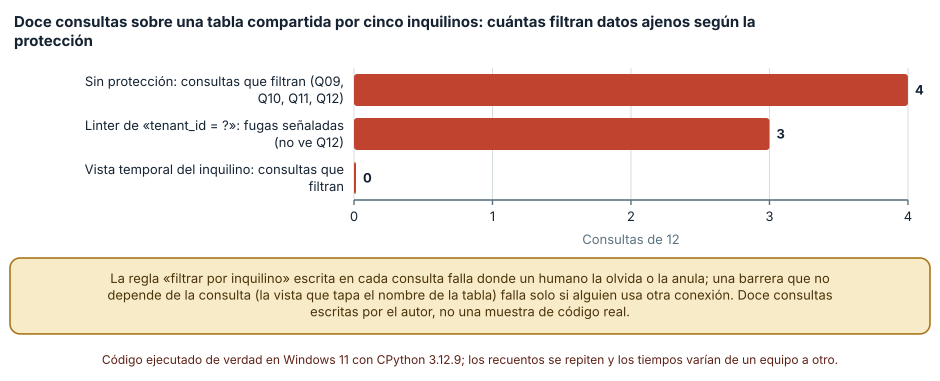
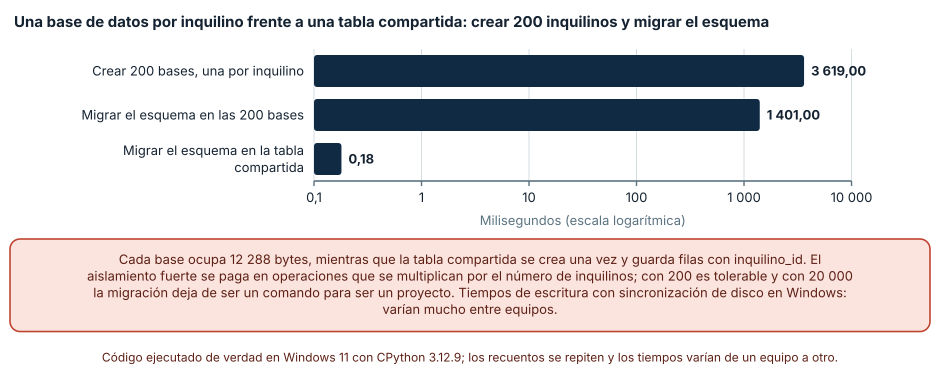
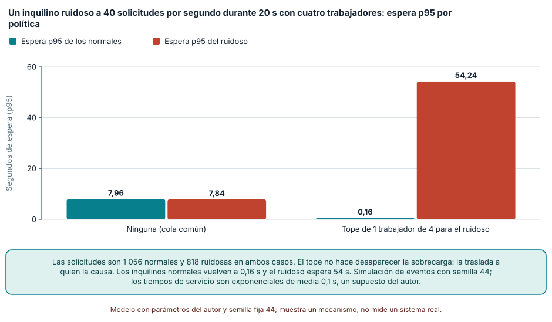

# SE-342 — Multi-tenancy y aislamiento

[← SE-341 — BFF, API gateway y service mesh](https://github.com/vladimiracunadev-create/modern-software-engineering-program/blob/main/classes/part-28-estilos-arquitectonicos/se-341-bff-api-gateway-y-service-mesh/README.md) · [↑ Parte 28](https://github.com/vladimiracunadev-create/modern-software-engineering-program/blob/main/classes/part-28-estilos-arquitectonicos/README.md) · [📚 Índice completo](https://github.com/vladimiracunadev-create/modern-software-engineering-program/blob/main/classes/README.md) · [🌐 Portal](https://vladimiracunadev-create.github.io/modern-software-engineering-program/classes/SE-342.html) · [SE-343 — Data mesh y propiedad de los datos →](https://github.com/vladimiracunadev-create/modern-software-engineering-program/blob/main/classes/part-28-estilos-arquitectonicos/se-343-data-mesh-y-propiedad-de-los-datos/README.md)

## Punto profesional y fundamento pedagógico

**Punto profesional.** La clase existe para que puedas decidir cómo se aísla a los clientes entre sí en un sistema que los atiende a todos, y para que sepas qué cuesta cada nivel de aislamiento. Multi-tenancy no es una tecnología: es la decisión de que muchos clientes (inquilinos) comparten parte de la infraestructura, y cada grado de compartición reparte de forma distinta tres riesgos (que un cliente vea datos de otro, que un cliente degrade el servicio de otros y que operar a cada uno cueste más que lo que paga). Quien no lo decide explícitamente hereda un nivel por accidente, y los accidentes en esta materia se descubren cuando un cliente ve la factura de otro.

**Por qué aparece aquí.** Sigue a `SE-341` porque la identidad del inquilino es lo primero que el gateway y el BFF propagan, y a partir de ahí cada capa decide qué hacer con ella. Prepara `SE-344`, donde la celda es la respuesta extrema al aislamiento de fallos, y `SE-343`, donde la propiedad de los datos plantea una pregunta cercana: quién responde por un conjunto de datos.

**Error conceptual que debe corregir.** Creer que «filtrar por `tenant_id` en cada consulta» es aislamiento. Es una convención que cada autor de consulta debe recordar, y las convenciones se olvidan, se anulan con un `OR` o se vuelven una tautología. En el laboratorio, de doce consultas sobre una tabla compartida por cinco inquilinos, cuatro filtraban datos ajenos; un analizador que busca el filtro en el texto vio tres de las cuatro. El aislamiento fuerte es el que no depende de que cada consulta haga lo correcto.

**Secuencia de aprendizaje.** Antes de ejecutar, predices cuántas de doce consultas escritas con distintos estilos filtran datos de otros inquilinos y cuántas detecta un analizador de texto. Después ejecutas las doce, pruebas una barrera independiente de la consulta (una vista temporal por solicitud), mides lo que cuesta una base por inquilino frente a una tabla compartida y simulas un inquilino ruidoso con y sin tope de concurrencia.

**Evidencia de aprendizaje.** `modelo-de-aislamiento.md` con el nivel de aislamiento elegido para datos, cómputo y operaciones; las doce (o más) consultas de tu sistema con la prueba de fuga; el costo medido de tu alternativa de aislamiento fuerte; y la política contra el vecino ruidoso con su efecto medido.

**Límite de la conclusión.** Las doce consultas las escribió el autor para cubrir distintos estilos y no son una muestra del código real; SQLite en memoria o en archivos no se comporta como un motor cliente-servidor bajo carga; el vecino ruidoso es una simulación de eventos con semilla 44 y tiempos de servicio exponenciales. Las cifras muestran mecanismos y órdenes de magnitud. No se evaluó ninguna plataforma multi-inquilino real ni se invocó ningún modelo de lenguaje.

### Trazabilidad fuente → afirmación

| Fuente primaria u oficial | Afirmación que respalda | Lo que no prueba |
|---|---|---|
| [Azure Architecture Center, «Architecting multitenant solutions»](https://learn.microsoft.com/en-us/azure/architecture/guide/multitenant/overview) | Presenta los modelos de tenencia (de recursos compartidos a recursos dedicados), sus compromisos entre aislamiento, costo y operación, y el problema del vecino ruidoso. | No mide ninguna implementación. |
| [SQLite, «CREATE VIEW»](https://www.sqlite.org/lang_createview.html) | Documenta las vistas, incluidas las temporales, que ocultan una tabla y son de solo lectura. | No define una política de aislamiento. |
| [Python: `sqlite3`](https://docs.python.org/3/library/sqlite3.html) | Documenta el módulo con el que se ejecutan las consultas del laboratorio. | No mide el rendimiento de SQLite bajo concurrencia. |
| [OWASP, «ASVS»](https://owasp.org/www-project-application-security-verification-standard/) | Incluye requisitos de control de acceso a datos por usuario o inquilino en cada operación. | No certifica un diseño. |
| [ISO/IEC 25010:2023](https://www.iso.org/standard/78176.html) | Nombra la confidencialidad y el aislamiento como parte de la seguridad del producto. | No prescribe un nivel de aislamiento. |

## Antes de empezar

Recupera lo aprendido en `SE-341`: la identidad se valida donde se usa. La pregunta activa es: **¿qué consulta de tu sistema se escribió sin filtrar por cliente y qué te habría avisado antes de que alguien lo notara?**

## Prerrequisitos

- Haber completado `SE-341`.
- Saber escribir consultas SQL con filtros y uniones.
- Conocer de `SE-439` (circuit breakers, bulkheads y degradación) la idea de limitar recursos por origen.
- Python 3.11 o posterior; el laboratorio usa `sqlite3` y archivos en un directorio temporal.

## Problema auténtico

*Avisos* nació para una universidad y hoy atiende a ciento cuarenta. Los datos de todas viven en las mismas tablas, con una columna `tenant_id`. Una consulta nueva de un informe para el rector de una de ellas olvidó el filtro, y el informe incluyó los totales de todas. Se detectó porque los números eran absurdos; si hubieran sido plausibles, se habría entregado. Otra semana, una universidad grande lanzó una campaña masiva de recordatorios y las demás vieron retrasos de ocho segundos durante veinte minutos. Un tercer cliente pidió que sus datos estuvieran en una base separada por exigencia de su normativa, y nadie sabía cuánto costaría.

Son tres problemas distintos con el mismo nombre. La clase los separa y los mide: la fuga de datos (aislamiento de datos), el vecino ruidoso (aislamiento de cómputo) y el costo operativo de separar (aislamiento de operaciones).

## Objetivos observables

Al terminar podrás:

1. ubicar un diseño en el espectro de aislamiento (todo compartido, esquema compartido, esquema o base por inquilino, despliegue dedicado) y nombrar lo que compra y lo que cuesta cada punto;
2. escribir pruebas de fuga entre inquilinos y reconocer los tres patrones que un analizador de texto no ve;
3. implementar una barrera de aislamiento que no dependa de cada consulta y señalar su límite;
4. medir el costo operativo de crear y migrar N inquilinos con aislamiento fuerte frente a una tabla compartida;
5. diseñar y comprobar un tope contra el vecino ruidoso y describir a quién traslada la espera.

## Mapa conceptual


El mapa muestra dos ejes independientes: dónde se aíslan los datos y cómo se reparte el cómputo. Elegir un nivel fuerte en uno no resuelve el otro: una base por inquilino con un solo grupo de trabajadores sigue sufriendo al vecino ruidoso.

## Temas y por qué importan

| Tema | Por qué cambia una decisión profesional | Evidencia mínima |
|---|---|---|
| Espectro de aislamiento | Cada punto reparte de forma distinta riesgo, costo y operación. | Nivel elegido por datos, cómputo y operación |
| Fuga por consulta | Una convención que cada autor debe recordar no es una garantía. | Doce consultas con su resultado |
| Barrera independiente | Quita la responsabilidad de cada consulta. | Fugas con la barrera activa |
| Costo de separar | Las operaciones se multiplican por N. | Tiempo de crear y migrar N inquilinos |
| Vecino ruidoso | Un inquilino puede degradar a todos. | Espera p95 con y sin tope |
| Datos por inquilino | Respaldo, borrado y residencia se vuelven por cliente. | Procedimiento de borrado de un inquilino |
| Pruebas | Sin pruebas entre inquilinos, el aislamiento es una suposición. | Prueba con dos inquilinos |

## Conceptos y decisiones

### 1. Un espectro, no una decisión binaria

El extremo compartido es una sola base, un solo esquema y una columna que identifica al inquilino. El siguiente punto da a cada inquilino su esquema dentro de la misma base. Después, una base por inquilino. En el extremo opuesto, un despliegue completo (cómputo y datos) por inquilino. Cada paso hacia el aislamiento reduce el riesgo de fuga y el de vecino ruidoso, y sube el costo por inquilino y el trabajo de operaciones. Un diseño real suele mezclar: los inquilinos pequeños comparten y los grandes o regulados tienen recursos dedicados. La decisión no es una vez para siempre: debe poder moverse un inquilino de un nivel a otro, y eso es un requisito de diseño desde el inicio.

### 2. La identidad del inquilino es contexto, no un parámetro

Si cada función recibe `tenant_id` como argumento, cada función puede olvidarlo. Si el contexto del inquilino se establece una vez al entrar la petición (a partir del token validado, como se vio en `SE-341`) y la capa de datos lo aplica sin que el código de negocio lo escriba, el error de olvido deja de ser posible en ese código. Es la misma idea de las barreras independientes: mover la responsabilidad de «recordar» a un lugar donde se escribe una vez.

### 3. Tres formas de fugar con una columna compartida

Sobre una tabla con 1 000 filas de cinco inquilinos se ejecutaron doce consultas. Ocho filtraban de formas distintas pero correctas (mayúsculas, alias, subconsulta, agrupación, límite). Cuatro no: la consulta Q09 y la Q10 no tenían ningún filtro (un conteo y una lista); la Q11 tenía un filtro que parecía una condición pero era una tautología de cadenas (`'tenant_id' = 'tenant_id'`) y no restringía nada; la Q12 tenía el filtro correcto con un `OR` que lo anulaba (`tenant_id = ? OR due <= 5`). Las cuatro devolvieron más filas que las del inquilino 1. Un analizador que busca la expresión `tenant_id = ?` en el texto señaló tres (Q09, Q10 y Q11) y no vio la Q12, porque el texto contiene el filtro correcto. No hubo falsas alarmas. El analizador es útil como primera defensa y su límite es estructural: ve el texto, no el efecto lógico de la consulta.

### 4. Una barrera que no depende de la consulta

Se probó una barrera independiente: al abrir la conexión de cada solicitud, se crea una vista temporal con el nombre de la tabla que oculta la real y solo muestra las filas del inquilino (`CREATE TEMP VIEW deliveries AS SELECT * FROM deliveries_all WHERE tenant_id = N`). Las doce consultas se ejecutaron sin cambios: 0 fugas de 12. Una consulta sin filtro ve solo las 42 filas del inquilino que cumplen su condición. Crear la vista cuesta decenas de microsegundos (49,4 µs en la ejecución de referencia, comparable al coste de la consulta más simple). La barrera tiene límites claros: una conexión que no la cree (un script de soporte, un trabajo por lotes) ve todo; las vistas de SQLite son de solo lectura, de modo que las escrituras necesitan otro camino con su propia garantía; y la identidad que se interpola en la vista debe provenir de una fuente validada (aquí se convierte a entero). Otros motores ofrecen mecanismos equivalentes a nivel de base de datos; el principio es el mismo: la garantía vive en un lugar que el autor de la consulta no controla.

### 5. Una base por inquilino: lo que compra y lo que cuesta

La base por inquilino hace imposible, por construcción, que una consulta lea filas de otro: no existen en esa conexión. Se crearon 200 bases de SQLite con una tabla, un índice y 50 filas cada una: tomó 3 619 ms con sincronización de disco en Windows, ocupó 2 457 600 bytes (12 288 por inquilino) y migrar el esquema con un `ALTER TABLE` en las 200 tardó 1 401 ms; el mismo cambio en una tabla compartida con las mismas 10 000 filas tardó 0,18 ms. Los números absolutos dependen de la máquina; la relación es lo que se traslada: cada operación de esquema se multiplica por N. Con 200 inquilinos es tolerable; con 20 000, una migración es un proyecto con orquestación, reintentos, verificación por inquilino y plan de reversión. A cambio, el respaldo, la restauración y el borrado de un inquilino son operaciones sobre un archivo, y la residencia de datos (en qué país viven) se resuelve colocando la base donde corresponde.

### 6. El vecino ruidoso: aislamiento de cómputo

Los datos aislados no protegen el servicio. En la simulación, cuatro trabajadores atienden las solicitudes de nueve inquilinos normales (2 por segundo cada uno) y de uno ruidoso que envía 40 por segundo entre los segundos 20 y 40; el tiempo de servicio es exponencial de media 0,1 s. Con una cola común, la espera p95 de los inquilinos normales fue de 7,96 s y la del ruidoso, de 7,84 s: todos esperan lo mismo, y los normales pagan la campaña del ruidoso. Con un tope de un trabajador de cuatro para el ruidoso, la espera p95 de los normales bajó a 0,16 s y la del ruidoso subió a 54,24 s. Las solicitudes atendidas fueron las mismas (1 056 y 818). El tope no elimina la sobrecarga: la traslada a quien la causa, que es lo que se busca. Qué se hace con el ruidoso (esperar, rechazar con un código de error o cobrar capacidad adicional) es una decisión de producto.

### 7. El borrado, el respaldo y los datos por inquilino

Un inquilino que se va pide que se borren sus datos; otro pide una copia. En una tabla compartida, esas operaciones son consultas con riesgo de dejar restos (copias en índices, registros, cachés, respaldos). En una base por inquilino son operaciones sobre un archivo. Cualquiera sea el diseño, el procedimiento de borrado debe estar escrito y probado con un inquilino de prueba; es una obligación que el nivel de aislamiento facilita pero no cumple por sí mismo.

### 8. Probar el aislamiento

El aislamiento se prueba con dos inquilinos: se crea un dato en cada uno y se comprueba que cada operación de lectura, escritura, listado, búsqueda y exportación del inquilino A no devuelve ni modifica nada del B. Estas pruebas deben ejecutarse sobre todas las rutas de acceso (API, trabajos por lotes, herramientas internas) y repetirse cuando se añade una. Una prueba de fuga que solo cubre la ruta principal deja sin comprobar el informe del rector.

## Fugas: tres estrategias sobre doce consultas

La primera comparación mide las fugas de las doce consultas con tres estrategias.



**Cómo leer la figura.** Cada barra es una estrategia y su longitud el número de consultas, de doce; la primera son las que filtran sin protección, la segunda las que señala el linter y la tercera las que filtran con la vista temporal. Mira primero que el linter se queda a una de las cuatro, la anulada con OR, y que la vista las cierra sin tocar las consultas. **Dónde deja de valer:** las doce consultas son del autor y cubren los patrones conocidos; una consulta que pasa por un ORM, una vista materializada o una función puede filtrar de otra forma. La vista temporal funciona solo en las conexiones que la crean y solo en lectura. Cero fugas de doce no es prueba de ausencia.

## Costo de aislar con una base por inquilino

La segunda comparación mide crear y migrar 200 inquilinos con una base cada uno frente a una tabla compartida.



**Cómo leer la figura.** Cada barra es una operación y su longitud el tiempo en milisegundos, en escala logarítmica. Mira primero la distancia de casi cuatro décadas entre migrar 200 bases y migrar una tabla compartida. **Dónde deja de valer:** son archivos de SQLite en un disco de una máquina de desarrollo con sincronización a disco; un motor cliente-servidor con una base por inquilino tiene otros costos (conexiones, memoria por base, catálogos). La conclusión estable es que las operaciones de esquema escalan con N y las de la tabla compartida no.

## Vecino ruidoso con y sin tope

La tercera comparación simula una campaña masiva de un inquilino contra los demás.



**Cómo leer la figura.** Cada grupo es una política de planificación; la barra verde es la espera p95 de los inquilinos normales y la roja la del ruidoso. Mira primero cómo con el tope la verde cae a casi cero y la roja se dispara: la sobrecarga se traslada a quien la causa. **Dónde deja de valer:** es una simulación con llegadas de Poisson, servicio exponencial y un tope fijo de un trabajador; un sistema real tiene prioridades, colas por inquilino, reintentos y cargas con otra forma. El tope de un trabajador cubre este caso y deja el ruidoso con una espera de casi un minuto: la política debe elegirse con ese número a la vista.

## Definiciones de trabajo

- **Multi-tenancy:** servir a varios clientes (inquilinos) con infraestructura compartida.
- **Inquilino (tenant):** cliente cuyos datos y comportamiento deben aislarse de los de otros.
- **Aislamiento de datos:** garantía de que una operación de un inquilino no lee ni escribe datos de otro.
- **Vecino ruidoso:** inquilino cuya carga degrada el servicio de otros.
- **Silo y pool:** recursos dedicados a un inquilino frente a recursos compartidos entre varios.
- **Barrera independiente de la consulta:** mecanismo que aplica el aislamiento sin que cada consulta lo escriba.
- **Tope de concurrencia:** límite de trabajo simultáneo que un inquilino puede ocupar.

## Ejemplo mínimo

La fuga y la barrera en diez líneas:

```python
import sqlite3
c = sqlite3.connect(":memory:")
c.execute("create table deliveries_all(id integer, tenant_id integer, due integer)")
c.executemany("insert into deliveries_all values (?,?,?)", [(1, 1, 10), (2, 2, 10), (3, 2, 80)])
print(c.execute("select count(*) from deliveries_all where due <= 72").fetchone())   # (2,) incluye ajenas
c.execute("create temp view deliveries as select * from main.deliveries_all where tenant_id = 1")
print(c.execute("select count(*) from deliveries where due <= 72").fetchone())       # (1,) solo el inquilino 1
```

La consulta no cambió salvo el nombre de la tabla; la vista hizo el filtro. Quien olvide el `WHERE` en `deliveries` ya no filtra datos ajenos.

## Ejemplo profesional

*Escenario ilustrativo: las cifras y los resultados que aparecen en este ejemplo son supuestos de la narración, no mediciones.*

Tras el incidente del informe del rector, el equipo de *Avisos* escribe una prueba de fuga: crea dos inquilinos con datos distintos y ejecuta cada endpoint, informe y trabajo por lotes como el inquilino A, comprobando que nada del B aparece. La prueba encuentra tres rutas más con el mismo defecto, todas de informes antiguos. Introducen una barrera en la capa de acceso a datos: cada solicitud establece el inquilino una vez, y el acceso a tablas pasa por vistas por inquilino. Para el cliente con exigencia de residencia deciden una base separada en la región correspondiente, con el mismo esquema y la misma migración orquestada; calculan que, con tres bases dedicadas, la migración es manejable y fijan un umbral (veinte bases) a partir del cual la orquestación debe automatizarse. Para el vecino ruidoso, un tope de concurrencia por inquilino en la cola de envíos, con alertas cuando un inquilino lo alcanza. Cada decisión tiene un número y un disparador.

## Práctica guiada

1. Lista las consultas de tu sistema que leen datos de clientes y clasifícalas: con filtro correcto, sin filtro, con filtro dudoso.
2. Escribe una prueba de dos inquilinos para cada ruta de acceso y ejecútala; anota cuántas fallan.
3. Ejecuta `python scripts/experiments_part28_a.py 534` y compara tu predicción de fugas con la medida.
4. Mide el costo de crear y migrar N entornos aislados en tu stack, con N igual a 10, 100 y 1 000.
5. Simula o prueba un inquilino ruidoso y decide una política de tope con la espera que impone al ruidoso.

## Ejercicios

1. **Básico.** Explica por qué la consulta con `tenant_id = ? OR due <= 5` filtra datos ajenos aunque contenga el filtro correcto.
2. **Intermedio.** Añade al laboratorio una decimotercera consulta que filtre por una unión (`JOIN`) con una tabla de cursos y comprueba si el analizador de texto la señala y si la vista la protege.
3. **Avanzado.** Diseña un nivel híbrido: inquilinos pequeños en tabla compartida con barrera y un inquilino grande en base propia, y escribe el procedimiento y la prueba para mover un inquilino de un nivel a otro sin perder datos.

## Reto verificable

Entrega `modelo-de-aislamiento.md` con el nivel de aislamiento elegido para datos, cómputo y operaciones; la prueba de dos inquilinos sobre todas las rutas de tu sistema o de un sistema modelo; el costo medido de crear y migrar N inquilinos; y la política contra el vecino ruidoso con su espera p95. Es válido si otra persona reproduce las pruebas de fuga y las medidas con tus datos.

## Caso conductor

*Avisos* pasa de una universidad a ciento cuarenta y debe decidir cuánto comparten. Esta clase da el vocabulario y las pruebas del aislamiento. `SE-343` cambia la pregunta: ya no quién ve qué datos, sino quién responde por un conjunto de datos y cómo se garantiza su calidad.

## Preguntas frecuentes

### ¿Siempre es mejor una base por inquilino?

No. Es la forma más fuerte de aislar datos y la más cara de operar a escala. Con pocos inquilinos o con requisitos regulatorios estrictos es razonable; con miles de pequeños, una tabla compartida con barrera y pruebas suele ser más viable.

### ¿El aislamiento de datos es suficiente para cumplir una norma?

No por sí mismo. Las normas piden controles de acceso, cifrado, registro, retención y procedimientos de borrado. El aislamiento es un componente, y su efectividad se demuestra con pruebas, no con el diseño.

### ¿Cómo evito el vecino ruidoso sin penalizar a un buen cliente?

Con topes que sean generosos para el uso normal y con alertas antes de alcanzarlos, no después. Un tope que un cliente legítimo alcanza en un día normal es un fallo de dimensionamiento, no una política de aislamiento.

### ¿Qué pasa con las cachés y los índices de búsqueda?

Cada uno es otro lugar donde puede mezclarse la identidad. La clave de caché debe incluir al inquilino y el índice debe particionarse o filtrarse con una barrera. Se prueban con la misma prueba de dos inquilinos.

## Fallo controlado y diagnóstico

**Fallo.** Tras activar la barrera de vistas por inquilino, un trabajo nocturno que calcula estadísticas para todos los clientes devuelve resultados vacíos para algunos y duplicados para otros.

**Diagnóstico paso a paso.** (1) Se revisa la conexión del trabajo: reutiliza la conexión de la última solicitud del hilo, con la vista de otro inquilino aún activa. (2) Los resultados de un inquilino salen vacíos porque la vista es del anterior. (3) Para los duplicados, el trabajo cambia de vista a mitad de la consulta. (4) Ninguna prueba cubría los trabajos por lotes con conexiones reutilizadas.

**Corrección.** La conexión de cada unidad de trabajo establece y elimina la vista al abrir y al cerrar (con un bloque que garantice la limpieza), el trabajo nocturno itera por inquilino con una conexión por cada uno y se añade una prueba que ejecuta dos inquilinos seguidos en la misma conexión. La lección es que una barrera por conexión exige disciplina sobre el ciclo de vida de la conexión.

## Errores comunes y cómo corregirlos

- **Confiar en el filtro de cada consulta.** Se olvida o se anula. Corrige con una barrera independiente y pruebas.
- **Probar solo la ruta principal.** Informes y trabajos quedan fuera. Corrige probando todas las rutas con dos inquilinos.
- **Aislar datos y no el cómputo.** El vecino ruidoso sigue. Corrige con topes por inquilino.
- **Una base por inquilino sin automatizar migraciones.** El costo crece con N. Corrige orquestando y midiendo.
- **No poder mover a un inquilino de nivel.** Corrige diseñando la migración desde el inicio.
- **Registrar datos de inquilinos en registros compartidos.** Corrige con registros por inquilino o con campos mínimos.

## Entorno y archivos clave

- `scripts/experiments_part28_a.py`: función `e534` con las doce consultas, la barrera, las 200 bases y la simulación del vecino ruidoso; se ejecuta con `python scripts/experiments_part28_a.py 534`.
- Las 200 bases se crean en un directorio temporal (`tempfile`) y se eliminan al terminar; el experimento tarda unos segundos por la sincronización a disco.
- `scripts/figures_part28_a.py`: las tres figuras de la clase.
- Solo la biblioteca estándar de Python 3.11 o posterior (`sqlite3`).

## Seguridad, ética y accesibilidad

Los datos del laboratorio son sintéticos. En un sistema real, una fuga entre inquilinos es un incidente de seguridad y puede ser una violación de protección de datos con obligación de notificar: las pruebas de fuga son una obligación de diligencia, no una opción. Las vistas con interpolación de identidad deben recibir valores validados (en el laboratorio, un entero) para no abrir una inyección. Ética: el tope contra el vecino ruidoso decide quién espera; aplicarlo a un cliente sin avisarle le traslada un costo que no pactó. Las figuras son tablas con texto alternativo completo y no dependen solo del color.

## Puente hacia el trabajo con agentes

Un agente de código que escribe consultas para un sistema multi-inquilino tiende a omitir el filtro cuando el contexto no se lo recuerda en cada petición, y a «arreglar» un resultado vacío quitando una condición. Dale la barrera y la prueba de dos inquilinos como parte del repositorio, y haz que cada cambio de acceso a datos del agente deba pasarla. Si el agente ejecuta consultas por ti sobre una base con datos de varios clientes, la regla es la misma que para un trabajo nocturno: una conexión por inquilino y sin permisos de lectura global. Un agente con acceso a una base compartida sin barrera es el vecino ruidoso más peligroso que puede tener un sistema.

## Transferencia

Haz la prueba de dos inquilinos sobre tu propio sistema, sobre todas las rutas, incluidos informes, exportaciones, búsqueda y trabajos programados. Anota las rutas sin cobertura y las que fallan. Después decide el nivel de aislamiento por inquilino (pool, silo o híbrido) con el costo medido de operar tu alternativa de aislamiento fuerte y el disparador que movería a un cliente de nivel.

## Evaluación y evidencia

| Criterio | Evidencia aceptable | Rechazo |
|---|---|---|
| Nivel elegido | Datos, cómputo y operaciones, con su costo | «Aislamos por tenant_id» |
| Prueba de fuga | Dos inquilinos sobre todas las rutas | Solo la ruta principal |
| Barrera | Fugas medidas con y sin barrera | Convención de equipo |
| Costo de separar | Tiempo de crear y migrar N | «Es manejable» |
| Vecino ruidoso | Espera p95 con y sin tope | Sin simulación ni prueba |

## Fuentes

- Microsoft. [«Architecting multitenant solutions on Azure»](https://learn.microsoft.com/en-us/azure/architecture/guide/multitenant/overview).
- SQLite. [«CREATE VIEW»](https://www.sqlite.org/lang_createview.html) y Python Software Foundation, [`sqlite3`](https://docs.python.org/3/library/sqlite3.html).
- OWASP. [«Application Security Verification Standard»](https://owasp.org/www-project-application-security-verification-standard/).
- Organización Internacional de Normalización. [ISO/IEC 25010:2023](https://www.iso.org/standard/78176.html).

## Límites y siguiente paso

Las consultas, los datos y la simulación son construcciones del autor; SQLite no se comporta como un motor cliente-servidor, y el costo de operar un entorno por inquilino en producción incluye conexiones, memoria, respaldos y orquestación que no se midieron. No se evaluó ninguna plataforma multi-inquilino. El siguiente paso, `SE-343`, estudia otra cuestión de propiedad: quién es dueño de un conjunto de datos y cómo se garantiza su calidad cuando la organización lo reparte.

## Glosario

| Término | Definición breve |
|---|---|
| Multi-tenancy | Servir a varios clientes con infraestructura compartida |
| Inquilino | Cliente cuyos datos deben aislarse |
| Vecino ruidoso | Inquilino que degrada el servicio de otros |
| Silo y pool | Recursos dedicados o compartidos |
| Barrera independiente de la consulta | Aislamiento aplicado fuera de cada consulta |
| Tope de concurrencia | Límite de trabajo simultáneo por inquilino |

---

[← SE-341 — BFF, API gateway y service mesh](https://github.com/vladimiracunadev-create/modern-software-engineering-program/blob/main/classes/part-28-estilos-arquitectonicos/se-341-bff-api-gateway-y-service-mesh/README.md) · [↑ Parte 28](https://github.com/vladimiracunadev-create/modern-software-engineering-program/blob/main/classes/part-28-estilos-arquitectonicos/README.md) · [📚 Índice completo](https://github.com/vladimiracunadev-create/modern-software-engineering-program/blob/main/classes/README.md) · [🌐 Portal](https://vladimiracunadev-create.github.io/modern-software-engineering-program/classes/SE-342.html) · [SE-343 — Data mesh y propiedad de los datos →](https://github.com/vladimiracunadev-create/modern-software-engineering-program/blob/main/classes/part-28-estilos-arquitectonicos/se-343-data-mesh-y-propiedad-de-los-datos/README.md)
