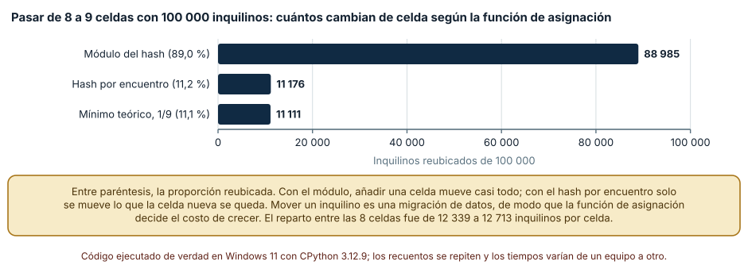
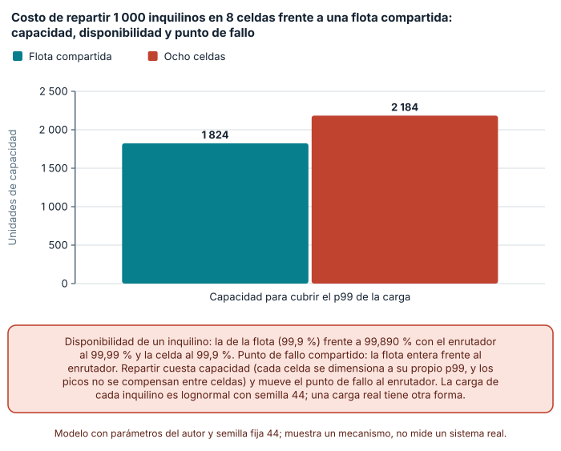

# SE-344 — Arquitectura celular y radio de impacto

[← SE-343 — Data mesh y propiedad de los datos](https://github.com/vladimiracunadev-create/modern-software-engineering-program/blob/main/classes/part-28-estilos-arquitectonicos/se-343-data-mesh-y-propiedad-de-los-datos/README.md) · [↑ Parte 28](https://github.com/vladimiracunadev-create/modern-software-engineering-program/blob/main/classes/part-28-estilos-arquitectonicos/README.md) · [📚 Índice completo](https://github.com/vladimiracunadev-create/modern-software-engineering-program/blob/main/classes/README.md) · [🌐 Portal](https://vladimiracunadev-create.github.io/modern-software-engineering-program/classes/SE-344.html) · [SE-345 — 12-factor y aplicaciones nativas de la nube →](https://github.com/vladimiracunadev-create/modern-software-engineering-program/blob/main/classes/part-28-estilos-arquitectonicos/se-345-12-factor-y-aplicaciones-nativas-de-la-nube/README.md)

## Punto profesional y fundamento pedagógico

**Punto profesional.** La clase existe para que puedas tratar el radio de impacto de un fallo como una propiedad que se diseña y se mide, no como un resultado de la suerte. La arquitectura celular responde a una pregunta concreta: cuando algo falla (un cliente que envía una petición que tumba un proceso, un despliegue defectuoso, una base saturada), ¿qué fracción de los clientes se entera? En una flota compartida la respuesta es «todos». En una arquitectura de celdas es «los de esa celda». Un ingeniero que sabe diseñarlas puede prometer un techo para el daño y comprobarlo; uno que no, promete disponibilidad con un promedio que esconde que, cuando falla, falla para todos a la vez.

**Por qué aparece aquí.** Sigue a `SE-342` (aislamiento por inquilino) y `SE-343` (propiedad de los datos): el aislamiento de datos y el de cómputo ya se vieron por separado, y la celda los une en una unidad que contiene todo lo que un grupo de inquilinos necesita. Retoma los bulkheads de `SE-439` y `SE-321`, que aislaban recursos dentro de un proceso, y los lleva a la escala de la plataforma. Prepara `SE-346`, donde mover un inquilino de una celda a otra es una migración.

**Error conceptual que debe corregir.** Creer que repartir en celdas es una mejora gratuita de disponibilidad. Las celdas reducen el daño por fallo y suben el costo (capacidad, operación, un enrutador). Además, un fallo que ocurre en el enrutador o en un componente compartido sigue afectando a todos: la celda acota solo lo que realmente está dentro de ella. En esta clase se mide el costo de capacidad, casi un 20 % más, y se calcula la disponibilidad con el enrutador como punto de fallo compartido.

**Secuencia de aprendizaje.** Antes de ejecutar, predices qué fracción de inquilinos se mueve al añadir una celda con un reparto por módulo y con hash por encuentro, y qué fracción cae si un inquilino venenoso tumba su celda, su fragmento de trabajadores o toda la flota. Después ejecutas la asignación con 100 000 inquilinos, simulas los tres escenarios y mides cuánta capacidad extra exige repartir.

**Evidencia de aprendizaje.** `radio-de-impacto.md` con la función de asignación elegida y su costo de reubicación, el radio de impacto calculado para tu sistema (con y sin celdas), el costo de capacidad medido o estimado, la lista de componentes compartidos fuera de la celda y el procedimiento para mover un inquilino.

**Límite de la conclusión.** Los inquilinos son identificadores sintéticos; el comportamiento del inquilino venenoso (que tumba trabajadores con sus peticiones) es un supuesto; en la flota compartida se supone que los reintentos del cliente recorren todos los trabajadores y la tumban entera, lo que es un peor caso, no un hecho. La carga por inquilino es lognormal con semilla 44. No se midió ninguna plataforma celular ni se invocó ningún modelo de lenguaje.

### Trazabilidad fuente → afirmación

| Fuente primaria u oficial | Afirmación que respalda | Lo que no prueba |
|---|---|---|
| [AWS Well-Architected, «Reducing the Scope of Impact with Cell-Based Architecture»](https://docs.aws.amazon.com/wellarchitected/latest/reducing-scope-of-impact-with-cell-based-architecture/reducing-scope-of-impact-with-cell-based-architecture.html) | Define la arquitectura de celdas como réplicas independientes de la carga de trabajo que acotan el alcance de un fallo, con una capa de enrutamiento y consideraciones de tamaño y migración. | No mide el beneficio en ningún sistema ajeno al de su autor. |
| [Amazon Builders' Library, «Workload isolation using shuffle-sharding»](https://aws.amazon.com/builders-library/workload-isolation-using-shuffle-sharding/) | Describe asignar a cada cliente un subconjunto aleatorio de recursos para que el fallo de un cliente afecte solo a quien comparte todo su subconjunto. | No garantiza el resultado con varios clientes defectuosos. |
| [Azure Architecture Center, «Architecting multitenant solutions»](https://learn.microsoft.com/en-us/azure/architecture/guide/multitenant/overview) | Describe los modelos de tenencia y la agrupación de inquilinos en unidades de despliegue («sellos») con sus compromisos. | No define el tamaño de la celda. |
| [Python: `hashlib`](https://docs.python.org/3/library/hashlib.html) | Documenta `blake2b`, la función de hash con la que el laboratorio asigna inquilinos de forma reproducible. | No valida el reparto para una carga real. |

## Antes de empezar

Recupera lo aprendido en `SE-342`: el aislamiento de datos no basta; hay que aislar el cómputo. La pregunta activa es: **¿cuál fue tu peor incidente en que un solo cliente o una sola petición afectó a todos, y qué fracción de tu base de clientes habría quedado afectada si el sistema hubiera estado repartido en ocho unidades independientes?**

## Prerrequisitos

- Haber completado `SE-342`.
- Conocer de `SE-439` los conceptos de bulkhead y degradación.
- Saber qué es una función de hash y qué es una combinación (n sobre k).
- Python 3.11 o posterior; el laboratorio usa solo la biblioteca estándar.

## Problema auténtico

*Avisos* atiende a ciento cuarenta universidades desde una sola flota de trabajadores. Un martes, una universidad envió por una integración propia una solicitud con un campo mal formado que provocaba una excepción no controlada en el proceso que la atendía. El cliente reintentó: cada reintento tumbó otro trabajador. En seis minutos, la flota entera estaba reiniciándose en bucle y las ciento cuarenta universidades no recibieron avisos durante cuarenta minutos. La causa raíz era una petición. El daño fue total porque todos compartían todo.

Se proponen dos remedios que reducen el radio de impacto de maneras distintas. Las celdas dividen a los inquilinos en grupos, cada uno con su propia pila completa, de modo que un inquilino venenoso tumba solo a su celda. La fragmentación aleatoria (shuffle sharding) da a cada inquilino un subconjunto de trabajadores elegido por hash, de forma que dos inquilinos comparten pocos trabajadores y un venenoso deja sin servicio solo a quien tenga justo sus mismos trabajadores. La clase mide ambos y su costo.

## Objetivos observables

Al terminar podrás:

1. definir el radio de impacto como la fracción de clientes que un fallo deja sin servicio y calcularlo para un diseño;
2. diseñar la asignación de inquilinos a celdas y medir cuántos se reubican al añadir una celda con distintas funciones;
3. comparar flota compartida, celdas y fragmentación aleatoria ante uno y varios inquilinos venenosos;
4. estimar el costo de capacidad de repartir en celdas y nombrar los componentes que siguen compartidos;
5. decidir cuándo las celdas compensan y cuándo bastan los topes y bulkheads de `SE-342`.

## Mapa conceptual


El mapa muestra que cada celda es una réplica completa y que el fallo de una no cruza a las otras. La línea punteada marca lo que la celda no acota: el enrutador, que es compartido y debe ser tan simple y estable como sea posible.

## Temas y por qué importan

| Tema | Por qué cambia una decisión profesional | Evidencia mínima |
|---|---|---|
| Radio de impacto | Convierte la disponibilidad en la fracción de clientes afectada. | Fracción afectada por fallo |
| Celda | Unidad independiente con pila completa. | Qué hay dentro y qué fuera |
| Función de asignación | Decide cuánto cuesta crecer. | Inquilinos reubicados al añadir una celda |
| Fragmentación aleatoria | Reduce el radio sin particionar por completo. | Caídos y degradados con k venenosos |
| Costo de capacidad | Cada celda se dimensiona a su propio pico. | Capacidad frente a flota compartida |
| Enrutador | Componente compartido que debe ser mínimo. | Disponibilidad con el enrutador |
| Cuándo no | Con pocos clientes los topes bastan. | Número de clientes y de incidentes |

## Conceptos y decisiones

### 1. El radio de impacto es la métrica

La disponibilidad habitual es un promedio sobre el tiempo; no dice cuántos clientes se ven afectados cuando algo falla. El radio de impacto es la fracción de clientes que quedan sin servicio por un único fallo. En una flota compartida, cualquier fallo que se propague por la flota alcanza al 100 %. El objetivo de las celdas es poner un techo: si hay ocho celdas con un reparto uniforme, un fallo contenido en una celda afecta a una octava parte, el 12,5 %. Ese techo es un escenario de calidad medible en el sentido de `SE-337` («un fallo de cualquier inquilino afecta como máximo al 15 % de los inquilinos»), y se puede comprobar inyectando el fallo.

### 2. Qué es una celda

Una celda es una copia completa y autónoma de la pila que atiende a un subconjunto de los inquilinos: sus propios trabajadores, su propia base de datos, su propia cola, su propia caché. Lo esencial es que no comparte estado con otras celdas. Delante hay una capa de enrutamiento que lleva cada petición a la celda de su inquilino. Las celdas se despliegan por separado y suelen actualizarse una a la vez, empezando por una pequeña, con lo que un despliegue defectuoso también queda acotado: la misma estructura que contiene un fallo en producción contiene un cambio malo.

### 3. La función de asignación y el costo de crecer

El enrutador necesita una función que, dado un inquilino, devuelva su celda y que sea estable. La opción ingenua es el módulo: la celda es el hash del inquilino módulo el número de celdas. Funciona hasta que se añade una celda. Con 100 000 inquilinos y el paso de 8 a 9 celdas, el módulo reubicó 88 985, el 89,0 %: casi todos cambian de celda, y cada cambio es una migración de datos. El hash por encuentro (rendezvous) calcula para cada inquilino un puntaje con cada celda y elige la de mayor puntaje; al añadir una celda nueva, solo se mueven los inquilinos para los que la nueva obtiene el puntaje más alto: 11 176, el 11,2 %, cercano al mínimo teórico de un noveno (11,1 %). El reparto entre las 8 celdas fue de 12 339 a 12 713 inquilinos, sobre una media de 12 500. La función de asignación decide cuánto cuesta crecer, y es de las primeras decisiones de diseño, porque cambiarla después es una migración de todos.

### 4. Cuando un inquilino tumba su celda

Con 1 000 inquilinos asignados a las 8 celdas por hash por encuentro, el inquilino venenoso quedó en una celda con otros 108, de modo que el fallo afectó a 109 de 1 000 (10,9 %), alrededor de un octavo y distinto de 12,5 % porque el reparto no es exacto. En la flota compartida, con el supuesto de que los reintentos recorren todos los trabajadores, el fallo alcanza a 1 000 de 1 000. La celda no evitó el incidente; lo acotó a una fracción que el diseño fija de antemano. La pregunta de seguimiento es siempre la misma: ¿cuántos inquilinos caben en una celda sin que el fallo de una sea inaceptable y sin que el costo de tener muchas sea excesivo? Con celdas más pequeñas, el radio baja y el costo operativo sube.

### 5. Fragmentación aleatoria: un reparto distinto del riesgo

En lugar de particionar a los inquilinos en grupos disjuntos, la fragmentación asigna a cada inquilino un subconjunto de k trabajadores de un total de n, elegido por hash. Con n = 8 y k = 2 hay 28 pares posibles. Un inquilino venenoso tumba sus dos trabajadores; solo quien comparta exactamente ese par queda sin servicio (1/28, un 3,6 %), y quien comparta uno queda degradado, con la mitad de su capacidad (1 menos la probabilidad de no compartir ninguno, 1 − 15/28 = 46,4 %). En el experimento, con 1 000 inquilinos y un venenoso: 30 caídos del todo (3,0 %) y 456 degradados (45,6 %). La ventaja es una pérdida total baja con casi todos los recursos compartidos, lo que ahorra capacidad frente a celdas disjuntas. El precio es que la protección se debilita deprisa: con dos inquilinos venenosos, 4 de 8 trabajadores caen y 222 inquilinos (22,2 %) quedan caídos del todo, y 577 degradados. Funciona para pocos venenosos; no sustituye a quitar al venenoso o limitarlo.

### 6. El costo de repartir: capacidad

Una flota compartida absorbe los picos de unos inquilinos con los valles de otros, porque la carga agregada es más estable que la individual. Una celda solo tiene la carga de sus inquilinos y debe dimensionarse para su propio pico. En la simulación, con 1 000 inquilinos cuya carga por minuto es lognormal (semilla 44, 1 000 minutos), cubrir el percentil 99 de la carga total exigió 1 824 unidades en una flota compartida y 2 184 sumando los percentiles 99 de ocho celdas: un 19,8 % más. Esa es la pérdida de multiplexación estadística. Además, cada celda necesita su redundancia mínima (al menos dos instancias de cada cosa), y el costo operativo se multiplica por el número de celdas: ocho copias que desplegar, monitorear y actualizar.

### 7. Lo que sigue compartido

Una celda acota lo que está dentro. Lo que queda fuera es un punto de fallo para todos: el enrutador, el plano de control que crea celdas, el sistema de identidad, el DNS, la configuración global. Con el enrutador al 99,99 % y la celda al 99,9 %, la disponibilidad de un inquilino es 99,890 %, un producto menor que el de la celda sola. La conclusión de diseño es que el enrutador debe ser lo más simple posible (sin lógica de negocio, sin base de datos propia) y su disponibilidad debe estar por encima de la de las celdas. Las operaciones que cruzan celdas (un informe global, una búsqueda entre inquilinos) son caras o imposibles y deben diseñarse como procesos aparte sobre copias de datos.

### 8. Cuándo no

Con pocos inquilinos o con un incidente de impacto total en la historia, los topes por inquilino y los bulkheads de `SE-342` dan buena parte de la protección a un costo mucho menor. Las celdas compensan cuando la propiedad de «un fallo no afecta a más de una fracción de los clientes» tiene un valor contractual o de reputación, cuando el costo de un incidente total supera con holgura el 20 % de capacidad adicional, o cuando el despliegue escalonado por celdas es un objetivo en sí mismo.

## Qué cambia de celda al añadir una

La primera medida cuenta cuántos inquilinos se mueven al pasar de 8 a 9 celdas.



**Cómo leer la figura.** Cada barra es una función de asignación, con la proporción reubicada entre paréntesis, y su longitud los inquilinos que cambian de celda. Mira primero que el hash por encuentro casi coincide con el mínimo teórico mientras que el módulo mueve a casi todos. **Dónde deja de valer:** los inquilinos son identificadores sintéticos con carga uniforme; una celda real tiene inquilinos de tamaños muy distintos, y reubicar un inquilino grande cuesta más que uno pequeño. Contar inquilinos no es contar datos: la figura muestra la proporción de movimientos, no el costo en bytes.

## Radio de impacto de un inquilino venenoso

La segunda medida compara la fracción de inquilinos afectada en tres diseños.


**Cómo leer la figura.** Cada barra es una fracción de los 1 000 inquilinos. Las celdas tienen una única barra porque un inquilino afectado lo está del todo; la fragmentación tiene dos, porque separa a quien cae del todo de quien solo pierde capacidad. **Dónde deja de valer:** el 100 % de la flota compartida es un supuesto de peor caso; si el sistema tuviera topes de reintento o un cortacircuitos eficaz, la cifra sería menor. Los porcentajes de la fragmentación valen para un venenoso; con dos, los caídos del todo son 22,2 %.

## Costo de las celdas

La tercera medida estima el costo de repartir en términos de capacidad y de disponibilidad.



**Cómo leer la figura.** Cada barra es una organización de la flota y su altura la capacidad para cubrir el p99 de la carga. Mira primero la diferencia entre las dos: es el costo de repartir; la disponibilidad y el punto de fallo compartido están en la nota. **Dónde deja de valer:** la carga por inquilino es lognormal con parámetros del autor y los inquilinos son independientes; si varios inquilinos se activan a la vez (fin de semestre), el pico de una celda es más alto y la pérdida de multiplexación, mayor. La disponibilidad del enrutador es un supuesto.

## Definiciones de trabajo

- **[Celda](../../../glosario/entradas/c/celda.md):** copia completa e independiente de la pila que atiende a un subconjunto de inquilinos.
- **[Radio de impacto](../../../glosario/entradas/r/radio-de-impacto.md):** fracción de clientes afectada por un fallo.
- **[Enrutador de celdas](../../../glosario/entradas/e/enrutador-de-celdas.md):** capa mínima que lleva cada petición a la celda de su inquilino.
- **[Hash por encuentro (rendezvous)](../../../glosario/entradas/h/hash-por-encuentro.md):** función de asignación que elige el elemento de mayor puntaje por clave y elemento.
- **[Fragmentación aleatoria (shuffle sharding)](../../../glosario/entradas/f/fragmentacion-aleatoria.md):** asignar a cada cliente un subconjunto aleatorio de recursos.
- **[Inquilino venenoso](../../../glosario/entradas/i/inquilino-venenoso.md):** inquilino cuya petición provoca un fallo repetible en el recurso que la atiende.
- **[Multiplexación estadística](../../../glosario/entradas/m/multiplexacion-estadistica.md):** ahorro de capacidad por promediar cargas independientes.

## Ejemplo mínimo

La asignación por hash por encuentro en seis líneas:

```python
import hashlib

def score(tenant: str, cell: str) -> int:
    return int.from_bytes(hashlib.blake2b(f"{tenant}|{cell}".encode(), digest_size=8).digest(), "big")

def cell_of(tenant: str, cells: list[str]) -> str:
    return max(cells, key=lambda c: score(tenant, c))

cells = [f"c{i}" for i in range(8)]
moved = sum(cell_of(f"t{i}", cells) != cell_of(f"t{i}", cells + ["c8"]) for i in range(100000))
print(moved)   # alrededor de 11 100: un noveno
```

Cada inquilino elige la celda donde su puntaje es máximo. Añadir `c8` solo roba los inquilinos para quienes `c8` gana, y el resto conserva su celda.

## Ejemplo profesional

*Escenario ilustrativo: las cifras y los resultados que aparecen en este ejemplo son supuestos de la narración, no mediciones.*

Tras el incidente del martes, el equipo de *Avisos* calcula el radio de impacto de cada opción. Con ocho celdas, el 12,5 %; con fragmentación aleatoria sobre la flota existente, un 3,6 % caído del todo con un venenoso. El equipo descarta empezar con celdas completas porque el costo de capacidad del 20 % y la operación de ocho copias superan lo que puede asumir este año, y elige un camino por etapas: primero un tope de reintentos por inquilino y un cortacircuitos (para que el cliente que reintenta no tumbe trabajadores), después fragmentación aleatoria de dos trabajadores de ocho para los envíos, y celdas solo para el cliente más grande, que se aísla en una celda propia. Fija un disparador: si un incidente vuelve a afectar a más del 15 % de los inquilinos, o si se firma un contrato que exija un radio máximo, se pasa a celdas para todos, con el hash por encuentro ya elegido para no pagar una reubicación masiva. La decisión no es todo o nada y cada etapa tiene su medida.

## Práctica guiada

1. Calcula el radio de impacto de tus tres incidentes más amplios: qué fracción de clientes afectó cada uno.
2. Implementa el hash por encuentro y mide cuántos inquilinos se mueven al añadir una celda; compáralo con el módulo.
3. Ejecuta `python scripts/experiments_part28_b.py 536` y reproduce la tabla de radios y de capacidad.
4. Cambia en el experimento el número de trabajadores y el tamaño del fragmento y observa los caídos y los degradados.
5. Lista los componentes de tu sistema que quedarían fuera de una celda y escribe su disponibilidad objetivo.

## Ejercicios

1. **Básico.** Explica por qué con el módulo se mueve el 89 % de los inquilinos al pasar de 8 a 9 celdas y con el hash por encuentro el 11 %.
2. **Intermedio.** Calcula analíticamente la fracción de inquilinos caídos del todo y degradados con n = 10 trabajadores y k = 3 por inquilino y un venenoso, y compruébalo con el experimento.
3. **Avanzado.** Añade al modelo inquilinos de distinto tamaño (uno grande con el 30 % de la carga) y calcula el efecto en el costo de capacidad y en el radio de impacto, con y sin una celda dedicada al grande.

## Reto verificable

Entrega `radio-de-impacto.md` con la función de asignación elegida y su costo de reubicación medido, el radio de impacto de tu diseño actual y del propuesto, el costo de capacidad estimado con tus cargas y la lista de componentes compartidos con su disponibilidad. Es válido si otra persona reproduce las cifras y puede señalar el componente compartido que limita la disponibilidad.

## Caso conductor

*Avisos* pasa de «todos caen» a «una fracción cae» con una decisión por etapas y con números. Esta clase pone un techo al daño de un fallo. `SE-345` baja a lo que una aplicación debe cumplir para que cualquier copia suya, en una celda o fuera, se pueda crear, parar y reemplazar sin esfuerzo.

## Preguntas frecuentes

### ¿Una celda es lo mismo que un clúster o una región?

No. Una región o un clúster son unidades de infraestructura; una celda es una unidad de la aplicación con pila completa y un subconjunto de inquilinos. Una celda puede vivir en un clúster, y un clúster puede alojar varias celdas.

### ¿Cuántas celdas debo tener?

Las que den el radio de impacto objetivo al costo aceptable. Con n celdas iguales, el radio es 1/n; con 8, 12,5 %; con 20, 5 %. Cada una cuesta capacidad mínima y operación, de modo que el número es un compromiso, no un valor bueno de por sí.

### ¿Se puede mover un inquilino entre celdas?

Debe poderse: para equilibrar carga, para aislar a un cliente grande o problemático y para añadir celdas. Es una migración de datos con un procedimiento ensayado, y la función de asignación determina cuántas migraciones habrá.

### ¿La fragmentación aleatoria sustituye a las celdas?

Es una alternativa más barata cuando el riesgo es un número pequeño de inquilinos venenosos y la protección parcial es aceptable. No ofrece aislamiento de datos ni de despliegue, y se debilita con varios inquilinos defectuosos.

## Fallo controlado y diagnóstico

**Fallo.** Con las celdas ya en producción, un despliegue defectuoso de la capa de enrutamiento deja sin servicio a todas las universidades durante veinte minutos. Las celdas estaban sanas.

**Diagnóstico paso a paso.** (1) Se confirma que cada celda respondía a sus pruebas internas. (2) El enrutador, desplegado de una vez a toda la flota, contenía un cambio en la tabla de asignación que dejó a los inquilinos sin celda. (3) El enrutador era el componente compartido y se había tratado como cualquier otro servicio, sin despliegue escalonado. (4) El radio de impacto del enrutador era del 100 %.

**Corrección.** El enrutador se simplifica (una tabla de asignación versionada y solo lectura), se despliega con réplicas escalonadas y con una versión anterior lista para retroceso inmediato, y su cambio se valida con una prueba que enruta todos los inquilinos conocidos antes de publicar. La lección es que el componente compartido hereda el radio de impacto que las celdas quitaron al resto, y exige el cuidado de un componente crítico.

## Errores comunes y cómo corregirlos

- **Repartir con módulo.** Crecer mueve casi todo. Corrige con hash por encuentro u otra asignación estable.
- **Un enrutador con lógica de negocio.** Es el punto de fallo de todos. Corrige manteniéndolo mínimo y desplegándolo con cuidado.
- **Celdas que comparten una base de datos.** No son celdas. Corrige con pila completa por celda.
- **No medir el radio de impacto.** Se asume. Corrige inyectando el fallo en pruebas.
- **Ignorar el costo de capacidad.** Corrige estimándolo con tus propias cargas.
- **Creer que la fragmentación protege de varios venenosos.** Se debilita con rapidez. Corrige limitando y expulsando al venenoso.

## Entorno y archivos clave

- `scripts/experiments_part28_b.py`: función `e536` con la asignación módulo y por encuentro, el radio de impacto y el costo de capacidad; se ejecuta con `python scripts/experiments_part28_b.py 536`.
- `scripts/figures_part28_b.py`: las tres figuras de la clase.
- Solo la biblioteca estándar de Python 3.11 o posterior. Los hashes se calculan con `blake2b` para que el reparto sea reproducible en cualquier equipo.

## Seguridad, ética y accesibilidad

Las celdas son también una frontera de seguridad: una celda comprometida no debería dar acceso a otra, lo que exige credenciales, redes y claves por celda. El enrutador ve todo el tráfico de entrada y debe tratarse con el cuidado de un componente privilegiado. Ética: asignar a un cliente a una celda más pequeña o más antigua tiene efectos de servicio; la política de asignación (quién va a una celda dedicada y por qué) debe ser explícita y no depender de quién negocia mejor. Las figuras son tablas, un gráfico y texto alternativo completo; no dependen solo del color.

## Puente hacia el trabajo con agentes

Un agente que ejecuta tareas en tu sistema es una fuente de peticiones y puede ser, sin pretenderlo, un inquilino venenoso: reintenta, genera carga y repite una acción que falla. Dale una identidad de inquilino propia, un tope de peticiones y una celda o cola aparte, y no le permitas compartir la cola de producción. Si varios agentes trabajan a la vez, aplica a cada uno el mismo razonamiento de radio de impacto: ¿cuántas tareas fallan si uno de ellos entra en un bucle? Un agente con permisos amplios sobre una flota compartida es la situación que esta clase enseña a evitar.

## Transferencia

Calcula el radio de impacto de los fallos más probables de tu sistema (una petición venenosa, un despliegue defectuoso, una base saturada) y expresa cada uno como una fracción de clientes. Elige el menor cambio que baje la peor a un valor aceptable: un tope, una fragmentación o una celda dedicada al cliente más grande. Escribe el disparador que te llevaría a un diseño por celdas completo.

## Evaluación y evidencia

| Criterio | Evidencia aceptable | Rechazo |
|---|---|---|
| Radio de impacto | Fracción medida o inyectada | «Disponibilidad del 99,9 %» |
| Asignación | Reubicación medida al crecer | Módulo sin análisis |
| Costo | Capacidad y operación estimadas con tus cargas | «Cuesta más» |
| Componentes compartidos | Lista con disponibilidad objetivo | Omitidos |
| Alternativas | Topes y fragmentación consideradas | Celdas por defecto |

## Fuentes

- AWS. [«Reducing the Scope of Impact with Cell-Based Architecture»](https://docs.aws.amazon.com/wellarchitected/latest/reducing-scope-of-impact-with-cell-based-architecture/reducing-scope-of-impact-with-cell-based-architecture.html).
- Amazon Builders' Library. [«Workload isolation using shuffle-sharding»](https://aws.amazon.com/builders-library/workload-isolation-using-shuffle-sharding/).
- Microsoft. [«Architecting multitenant solutions on Azure»](https://learn.microsoft.com/en-us/azure/architecture/guide/multitenant/overview).
- Python Software Foundation. [`hashlib`](https://docs.python.org/3/library/hashlib.html).

## Límites y siguiente paso

Los inquilinos, la carga y el comportamiento del venenoso son construcciones del autor, y el 100 % de la flota compartida es un supuesto de peor caso. No se midió ningún sistema celular ni el costo operativo de mantener ocho copias. El siguiente paso, `SE-345`, baja a la aplicación misma: qué propiedades debe tener para poder copiarse, escalarse, pararse y reemplazarse sin ceremonia, que es lo que los doce factores resumen.

## Glosario

| Término | Definición breve |
|---|---|
| Celda | Pila completa e independiente para un subconjunto de inquilinos |
| Radio de impacto | Fracción de clientes afectada por un fallo |
| Enrutador de celdas | Capa mínima que lleva cada petición a su celda |
| Hash por encuentro | Asignación por puntaje máximo entre clave y celda |
| Fragmentación aleatoria | Subconjunto aleatorio de recursos por cliente |
| Inquilino venenoso | Inquilino cuya petición provoca un fallo repetible |

Conceptos de esta clase en el [glosario del programa](../../../glosario/README.md): [Celda](../../../glosario/entradas/c/celda.md) · [Enrutador](../../../glosario/entradas/e/enrutador.md) · [Enrutador de celdas](../../../glosario/entradas/e/enrutador-de-celdas.md) · [Fragmentación aleatoria](../../../glosario/entradas/f/fragmentacion-aleatoria.md) · [Hash por encuentro](../../../glosario/entradas/h/hash-por-encuentro.md) · [Inquilino venenoso](../../../glosario/entradas/i/inquilino-venenoso.md) · [Multiplexación estadística](../../../glosario/entradas/m/multiplexacion-estadistica.md) · [Radio de impacto](../../../glosario/entradas/r/radio-de-impacto.md).

---

[← SE-343 — Data mesh y propiedad de los datos](https://github.com/vladimiracunadev-create/modern-software-engineering-program/blob/main/classes/part-28-estilos-arquitectonicos/se-343-data-mesh-y-propiedad-de-los-datos/README.md) · [↑ Parte 28](https://github.com/vladimiracunadev-create/modern-software-engineering-program/blob/main/classes/part-28-estilos-arquitectonicos/README.md) · [📚 Índice completo](https://github.com/vladimiracunadev-create/modern-software-engineering-program/blob/main/classes/README.md) · [🌐 Portal](https://vladimiracunadev-create.github.io/modern-software-engineering-program/classes/SE-344.html) · [SE-345 — 12-factor y aplicaciones nativas de la nube →](https://github.com/vladimiracunadev-create/modern-software-engineering-program/blob/main/classes/part-28-estilos-arquitectonicos/se-345-12-factor-y-aplicaciones-nativas-de-la-nube/README.md)
