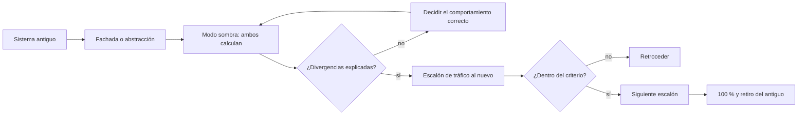
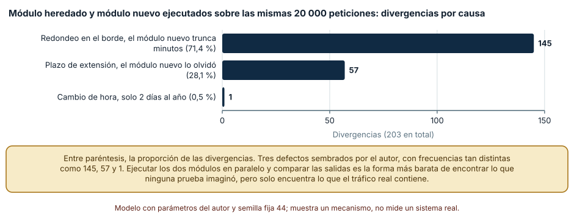

# SE-346 — Evolución y migración entre estilos

[← SE-345 — 12-factor y aplicaciones nativas de la nube](https://github.com/vladimiracunadev-create/modern-software-engineering-program/blob/main/classes/part-28-estilos-arquitectonicos/se-345-12-factor-y-aplicaciones-nativas-de-la-nube/README.md) · [↑ Parte 28](https://github.com/vladimiracunadev-create/modern-software-engineering-program/blob/main/classes/part-28-estilos-arquitectonicos/README.md) · [📚 Índice completo](https://github.com/vladimiracunadev-create/modern-software-engineering-program/blob/main/classes/README.md) · [🌐 Portal](https://vladimiracunadev-create.github.io/modern-software-engineering-program/classes/SE-346.html) · [SE-347 — Taller: seleccionar un estilo con escenarios de calidad →](https://github.com/vladimiracunadev-create/modern-software-engineering-program/blob/main/classes/part-28-estilos-arquitectonicos/se-347-taller-seleccionar-un-estilo-con-escenarios-de-calidad/README.md)

## Punto profesional y fundamento pedagógico

**Punto profesional.** La clase existe para que puedas cambiar la arquitectura de un sistema que está en producción sin detenerlo y sin apostar el negocio a una fecha de corte. La mayoría de los cambios de estilo (de un monolito a servicios, de un módulo antiguo a uno nuevo, de una base a otra) no fallan por la idea sino por la forma de ejecutarlos: se reescribe todo en paralelo durante meses, se cambia de golpe un fin de semana y se descubre en producción lo que ninguna prueba imaginó. Los patrones de migración incremental (estrangular, abstraer, expandir y contraer, comparar en sombra, subir el tráfico por escalones) sustituyen la apuesta única por una secuencia de pasos pequeños, reversibles y medidos. Quien los domina puede prometer un avance verificable en lugar de un gran día.

**Por qué aparece aquí.** Cierra el bloque de estilos antes del taller y del proyecto: las clases anteriores describieron destinos (microkernel, flujo, servicios, celdas); esta describe el viaje. Usa lo de `SE-345` (dos versiones deben poder correr a la vez), lo de `SE-344` (mover inquilinos por tramos) y lo de `SE-332` (arquitectura evolutiva y funciones de aptitud, que dan la red de seguridad de cada paso).

**Error conceptual que debe corregir.** Creer que una divergencia entre el sistema antiguo y el nuevo es un defecto del nuevo. Es una pregunta: ¿cuál de los dos tiene razón? En el experimento, de 203 divergencias, 145 eran un redondeo en el borde (el módulo nuevo trunca minutos), 57 eran un plazo de extensión que el nuevo olvidó y 1 era un cambio de hora. Las tres exigen una decisión de negocio sobre qué comportamiento es el correcto, y el antiguo puede ser el equivocado. Comparar no es validar contra un oráculo perfecto; es descubrir qué decisiones no se habían tomado.

**Secuencia de aprendizaje.** Antes de ejecutar, predices qué fracción de peticiones difiere entre un módulo heredado y su reemplazo con tres diferencias sembradas, y con qué probabilidad un modo sombra que compara el 1 % del tráfico ve cada una. Después ejecutas los dos módulos sobre 20 000 peticiones, mides la detección según la fracción comparada y calculas, para un defecto visible en el 0,4 % de las peticiones, qué escalón de tráfico lo detecta y a cuántos usuarios afecta antes de detenerlo.

**Evidencia de aprendizaje.** `plan-de-migracion.md` con la secuencia de pasos reversibles, el comparador de sombra con las causas de divergencia clasificadas, los escalones de tráfico con su criterio de avance y de retroceso, la estrategia de datos y el criterio de retiro del sistema antiguo.

**Límite de la conclusión.** Los dos módulos de avisos y sus tres diferencias son construcciones del autor; las 20 000 peticiones son sintéticas con semilla 44; la probabilidad de detección usa una distribución de Poisson con tasas supuestas. No se migró ningún sistema real, no se ejecutó ningún enrutador de tráfico ni se invocó ningún modelo de lenguaje.

### Trazabilidad fuente → afirmación

| Fuente primaria u oficial | Afirmación que respalda | Lo que no prueba |
|---|---|---|
| [Fowler, «StranglerFigApplication»](https://martinfowler.com/bliki/StranglerFigApplication.html) | Describe reemplazar un sistema de forma gradual, rodeándolo con el nuevo y desviando funcionalidad por partes hasta retirar el antiguo. | No mide el costo ni la duración de ninguna migración. |
| [Microsoft, «Strangler Fig pattern»](https://learn.microsoft.com/en-us/azure/architecture/patterns/strangler-fig) | Documenta el patrón con una fachada que enruta entre el sistema antiguo y el nuevo, y sus consideraciones (datos, consistencia, retiro). | No define los criterios de avance de tu caso. |
| [Fowler, «BranchByAbstraction»](https://martinfowler.com/bliki/BranchByAbstraction.html) | Describe introducir una abstracción sobre el componente que se reemplaza para cambiar la implementación sin ramas largas. | No dice cuándo conviene. |
| [Fowler, «ParallelChange»](https://martinfowler.com/bliki/ParallelChange.html) | Describe el patrón expandir, migrar y contraer para cambiar una interfaz sin romper a sus consumidores. | No cubre cambios de datos con escrituras concurrentes. |
| [Fowler, «MonolithFirst»](https://martinfowler.com/bliki/MonolithFirst.html) | Sitúa la separación en servicios como un paso posterior que se hace cuando las fronteras se conocen. | Es una opinión, no una medición. |

## Antes de empezar

Recupera lo aprendido en `SE-345`: una aplicación se puede copiar y ejecutar en dos versiones a la vez. La pregunta activa es: **¿cuál fue la última migración de tu equipo, cuánto tiempo estuvo el sistema antiguo y el nuevo funcionando a la vez, y qué decisión de comportamiento descubrieron solo al compararlos?**

## Prerrequisitos

- Haber completado `SE-340` y `SE-345`.
- Conocer de `SE-332` qué es una función de aptitud y de `SE-423` qué es una prueba de contrato.
- Saber qué es una distribución de Poisson o poder aceptar la fórmula del número esperado de eventos.
- Python 3.11 o posterior; el laboratorio usa solo la biblioteca estándar.

## Problema auténtico

El cálculo de avisos de *Avisos* vive en un módulo heredado de miles de líneas, escrito por personas que ya no están. El equipo escribió uno nuevo, limpio y con pruebas, y quiere reemplazar al antiguo. La propuesta inicial es un fin de semana de corte: se apaga el antiguo el sábado por la noche y se enciende el nuevo. Alguien pregunta qué ocurre si el nuevo se comporta distinto en algún caso que las pruebas no cubren. La respuesta es «lo arreglamos el lunes», que significa que los estudiantes que no reciban un aviso el domingo sobre una entrega del lunes son el costo de aprender.

La clase construye la alternativa y la mide. Se ejecutan ambos módulos sobre las mismas peticiones y se clasifican las diferencias; se calcula con qué fracción del tráfico comparado se detecta cada causa; y se calcula cuántos usuarios se ven afectados con un cambio de golpe y con una subida por escalones.

## Objetivos observables

Al terminar podrás:

1. diseñar una migración como una secuencia de pasos pequeños, cada uno reversible y con un criterio de avance;
2. comparar dos implementaciones en modo sombra, clasificar las divergencias por causa y decidir cuál comportamiento es el correcto;
3. calcular la probabilidad de detectar una divergencia según la fracción del tráfico comparada y su frecuencia;
4. diseñar escalones de tráfico con un criterio estadístico de detección y calcular el daño acumulado;
5. planificar la migración de datos con expandir, migrar y contraer, y decidir cuándo retirar el sistema antiguo.

## Mapa conceptual



El mapa muestra dos bucles: el de la sombra, que se repite hasta que cada divergencia tiene una explicación y una decisión, y el de los escalones, que avanza solo si el criterio se cumple y retrocede si no. El retiro del sistema antiguo es el último paso, no el primero.

## Temas y por qué importan

| Tema | Por qué cambia una decisión profesional | Evidencia mínima |
|---|---|---|
| Fachada y estrangulamiento | Permite mover funcionalidad por partes. | Qué rutas van a cada sistema |
| Abstracción de rama | Cambia la implementación sin ramas largas. | Una interfaz con dos implementaciones |
| Modo sombra | Descubre diferencias antes de que las vea el usuario. | Divergencias clasificadas |
| Detección por fracción | Lo raro no se ve comparando poco. | Probabilidad por fracción y causa |
| Escalones de tráfico | Acotan el daño de un defecto. | Usuarios afectados por escalón |
| Datos | Es la parte más difícil de revertir. | Plan expandir, migrar y contraer |
| Cuándo no | Con un sistema pequeño y sin tráfico, el corte directo es válido. | Volumen y costo de un error |

## Conceptos y decisiones

### 1. Migrar es una secuencia de pasos reversibles

Un cambio grande se descompone en pasos tales que cada uno se puede revertir sin consecuencias y deja el sistema funcionando. La lista habitual es: introducir una abstracción o fachada, implementar lo nuevo detrás de ella sin activarlo, compararlo en sombra, subir el tráfico por escalones, migrar los datos con compatibilidad y retirar lo antiguo. Lo que cambia respecto de una reescritura es que en cada momento el sistema está en producción y funciona, y el riesgo se reparte en muchos cambios pequeños en lugar de uno enorme. El costo es que durante la migración hay dos cosas que mantener, y que la fachada y la comparación son trabajo adicional.

### 2. Estrangular: una fachada que decide a dónde va cada cosa

El patrón del estrangulamiento coloca delante del sistema antiguo una fachada que, para cada petición, decide si la atiende el antiguo o el nuevo. Se empieza con todo al antiguo y se desvían rutas, inquilinos o tipos de operación hacia el nuevo, una a una. Cuando el último tramo se ha movido y el antiguo no recibe tráfico, se retira. El nombre viene de una planta que crece alrededor de un árbol hasta reemplazarlo. La fachada es la pieza clave y es también un componente compartido (como el enrutador de `SE-344`): debe ser simple, versionada y con un camino de retroceso inmediato.

### 3. Abstraer por rama dentro del código

Cuando lo que se reemplaza es una parte interna, sin una frontera de red, la técnica equivalente es introducir una interfaz sobre el componente antiguo, hacer que todos los usos pasen por ella, escribir la implementación nueva detrás de la misma interfaz y elegir cuál se usa con una configuración. Así el reemplazo vive en la misma rama principal, sin ramas largas que divergen, y se puede probar con ambas implementaciones. La prueba más útil es una que ejecuta la misma batería sobre las dos y compara los resultados, que es el comparador de la sombra llevado a las pruebas.

### 4. Modo sombra: dos respuestas, una decisión

En el modo sombra, cada petición se envía al sistema antiguo, cuya respuesta se devuelve al usuario, y también al nuevo, cuya respuesta se compara y se descarta. En el experimento se ejecutaron ambos módulos sobre 20 000 peticiones sintéticas: difirieron en 203 (1,01 %). Las causas, clasificadas, fueron 145 por redondeo en el borde (el módulo nuevo trunca los minutos a horas y el antiguo conserva la fracción), 57 por un plazo de extensión que el antiguo concede y el nuevo olvidó, y 1 por un cambio de hora que el antiguo trata con un desplazamiento. Cada divergencia es una pregunta de negocio: ¿un aviso a las 72 horas exactas se envía o no se envía?, ¿las entregas con extensión tienen 24 horas más?, ¿qué pasa el día del cambio de hora? Las respuestas se escriben en las pruebas del nuevo módulo, con el ejemplo concreto que las decidió.

### 5. Lo que la sombra no puede ver

La sombra tiene límites que deben conocerse. Los efectos laterales: el nuevo módulo no puede enviar avisos reales mientras está en sombra, de modo que se compara lo que habría enviado, no lo enviado; todo lo que dependa de un efecto (un reintento, un acuse) queda sin comparar. El no determinismo: dos ejecuciones pueden diferir por el reloj o por un orden de llegada y producir falsas divergencias, que se filtran normalizando. El tráfico que aún no ha ocurrido: la sombra solo ve lo que el sistema recibe durante la comparación; un caso de fin de trimestre no aparece en una comparación de una semana a mitad de mes.

### 6. Cuánto tráfico comparar

Lo raro se ve poco. Se repitió 500 veces, para cada fracción del tráfico comparado, la pregunta de si se observa al menos una divergencia de cada causa. Con el 1 % de las peticiones: se vio el plazo de extensión (frecuencia del 0,3 %) el 46 % de las veces, el cambio de hora (1 en 20 000) el 1 % y el redondeo (0,7 %) el 75 %. Con el 5 %: 95 %, 6 % y 100 %. Con el 25 %: 100 %, 27 % y 100 %. Con todo el tráfico, los tres siempre. El resultado general es sencillo: la probabilidad de observar un evento que ocurre una vez entre 20 000 es la fracción comparada, porque solo se observa si cae en la muestra. Comparar todo es la única forma de ver lo muy raro, y aun así solo si ocurre mientras se compara. Para lo que es crítico y raro (el cambio de hora ocurre dos días al año), la comparación debe provocarse con datos construidos, no esperarse del tráfico.

### 7. Escalones de tráfico: acotar el daño y detectar a tiempo

Cuando el nuevo módulo ya pasó la sombra, se le dirige tráfico real en escalones (1, 5, 25, 50 y 100 %) con un criterio para avanzar. Se tomó un defecto que afecta visiblemente al 0,4 % de las peticiones y se calculó, con 20 000 peticiones por escalón, cuántos usuarios se ven afectados esperados (0,8 al 1 %, 4,0 al 5 %, 20,0 al 25 %, 40,0 al 50 % y 80,0 al 100 %) y la probabilidad de ver al menos tres errores en el escalón con una distribución de Poisson (4,7 %, 76,2 %, y prácticamente 100 % desde el 25 %). Un escalón del 1 % casi nunca detecta este defecto y el del 5 % lo detecta tres de cada cuatro veces afectando a unos cuatro usuarios. Si el escalón del 5 % lo detiene, el daño acumulado es de 4,8 usuarios esperados (0,8 + 4,0), contra 80 si se cambia todo de golpe. El diseño de los escalones es una decisión estadística: el tamaño de cada uno y el criterio de detección fijan cuántos usuarios se pagan por aprender.

### 8. Datos: expandir, migrar, contraer

La parte difícil es el cambio de datos. El patrón de cambio en paralelo lo divide en tres fases: expandir (añadir la estructura nueva sin quitar la antigua y escribir en ambas), migrar (rellenar lo antiguo hacia lo nuevo y mover a los consumidores) y contraer (retirar lo antiguo cuando nadie lo usa). Cada fase es reversible hasta que se contrae. La doble escritura exige que ambas escrituras sean consistentes entre sí o que una sea la fuente de verdad y la otra una copia derivada y comprobada. El criterio de retiro debe ser una medida (cero lecturas de la estructura antigua durante un periodo), no una fecha.

### 9. Cuándo el corte directo es válido

Con un sistema pequeño, tráfico bajo, ventana de mantenimiento aceptable y un error de bajo costo, la migración incremental puede ser más cara que el riesgo. Lo mismo vale para un sistema sin usuarios activos o cuando el costo de mantener dos versiones supera el de equivocarse. La pregunta que lo decide es cuánto cuesta un error en producción durante la migración y cuánto cuesta evitarlo.

## Qué difiere entre el antiguo y el nuevo

La primera medida ejecuta ambos módulos y clasifica las diferencias.



**Cómo leer la figura.** Cada barra es una causa de divergencia, con su proporción entre paréntesis, y su longitud las divergencias entre los dos módulos. Mira primero la diferencia entre 145 y 1: dos causas reales con frecuencias muy distintas. **Dónde deja de valer:** los tres defectos los sembró el autor con tasas que eligió el autor (2 % de entregas con extensión, 0,5 % con cambio de hora); en un sistema real las causas y sus frecuencias no se conocen de antemano, y precisamente la comparación sirve para descubrirlas. Una causa con frecuencia 1 en 20 000 es la más difícil de ver.

## Cuánto se ve según la fracción comparada

La segunda medida calcula la probabilidad de observar cada causa según la fracción del tráfico comparada.


**Cómo leer la figura.** El eje horizontal es la fracción del tráfico comparada, en escala logarítmica, y el vertical la probabilidad de ver la divergencia; cada línea es una causa. Mira primero la línea roja del cambio de hora, que solo llega al 100 % comparándolo todo, y compárala con la del redondeo, que sube casi de inmediato. **Dónde deja de valer:** las 500 repeticiones por fila son un muestreo con semilla 44, y las probabilidades tienen un error de unos pocos puntos; el cálculo supone que las peticiones se eligen al azar para comparar. Si la elección sigue un patrón (por ejemplo, solo las de un inquilino), la detección depende de qué contenga ese patrón.

## Escalones de tráfico

La tercera medida calcula el efecto de cada escalón sobre un defecto visible.


**Cómo leer la figura.** El eje horizontal es el escalón de tráfico, en escala logarítmica, y el vertical la probabilidad de ver al menos tres errores. Mira primero el salto entre el 1 % y el 5 %: del 4,7 % al 76,2 % con unos 4 usuarios afectados; los usuarios afectados de cada escalón están en la nota. **Dónde deja de valer:** el criterio de «al menos tres errores» y la tasa del 0,4 % son supuestos; un defecto que solo ocurre para un tipo de usuario puede concentrarse en un escalón sin verse en el resto. Los escalones reducen el daño de un defecto que se manifiesta en el tráfico, no el de uno latente que aparece semanas después.

## Definiciones de trabajo

- **Estrangulamiento (strangler fig):** reemplazo gradual de un sistema desviando su funcionalidad a uno nuevo a través de una fachada.
- **Fachada:** componente que decide qué sistema atiende cada petición.
- **Abstracción de rama (branch by abstraction):** interfaz que permite cambiar la implementación sin ramas largas.
- **Modo sombra:** ejecutar el sistema nuevo con tráfico real sin devolver su respuesta, solo para compararla.
- **Escalón de tráfico (canary):** fracción creciente del tráfico dirigida al sistema nuevo.
- **Expandir, migrar y contraer:** secuencia de tres fases para cambiar una interfaz o un dato.
- **Criterio de retroceso:** condición medible que devuelve el tráfico al sistema antiguo.

## Ejemplo mínimo

Un comparador de sombra en una pantalla:

```python
def legacy(d):   return "aviso" if d["remaining"] <= 72 else None
def nuevo(d):    return "aviso" if d["remaining"] < 72 else None

requests = [{"remaining": h} for h in (10, 71, 72, 73, 200)]
diffs = [(r, legacy(r), nuevo(r)) for r in requests if legacy(r) != nuevo(r)]
print(len(diffs), diffs)    # 1 [({'remaining': 72}, 'aviso', None)]
```

Una sola petición (72 horas exactas) difiere y la comparación la deja visible. La pregunta ya no es técnica: ¿a las 72 horas exactas se avisa? Quien decide es quien conoce la regla.

## Ejemplo profesional

*Escenario ilustrativo: las cifras y los resultados que aparecen en este ejemplo son supuestos de la narración, no mediciones.*

El equipo de *Avisos* descarta el fin de semana de corte y propone una migración con tres pasos y un criterio por paso. Primero, una interfaz `CalculadoraDeAvisos` con la implementación heredada detrás. Segundo, el módulo nuevo en sombra durante dos ciclos de entrega completos, con un informe diario de divergencias por causa; el primer informe muestra el 1 % de diferencias, y el tercero tiene cero tras decidir con las docentes los tres comportamientos en disputa y escribirlos como pruebas. Tercero, escalones del 1, 5, 25 y 100 % con un criterio de retroceso: si la tasa de errores del nuevo supera en un 0,2 % absoluto la del antiguo en un escalón, el tráfico vuelve. En el escalón del 5 %, la comparación detecta un caso de cambio de hora que ni la sombra ni las pruebas cubrían; el criterio de retroceso se activa, el equipo lo corrige y repite el escalón. El defecto afectó a tres estudiantes durante cuarenta minutos y no a los cuarenta mil del total. El retiro del módulo antiguo se hace cuando pasan dos semanas sin tráfico hacia él.

## Práctica guiada

1. Dibuja la migración que tienes pendiente como una secuencia de pasos reversibles, con su criterio de avance.
2. Escribe un comparador de sombra para una función tuya y ejecútalo sobre datos de ejemplo; clasifica las diferencias por causa.
3. Ejecuta `python scripts/experiments_part28_b.py 538` y compara la detección por fracción con la tuya.
4. Calcula, para un defecto del 0,2 % de las peticiones y tu volumen de tráfico, qué escalón lo detectaría y a cuántos usuarios afectaría.
5. Escribe el plan de datos con expandir, migrar y contraer, y el criterio medible para contraer.

## Ejercicios

1. **Básico.** Explica por qué una divergencia entre el módulo antiguo y el nuevo no prueba que el nuevo esté mal.
2. **Intermedio.** Calcula con la fórmula de Poisson la probabilidad de ver al menos 5 errores con un defecto del 0,1 % y 10 000 peticiones por escalón, y decide qué tamaño de escalón elegirías.
3. **Avanzado.** Diseña un comparador para una función con un efecto lateral (enviar un correo) sin ejecutar el efecto, e indica qué divergencias no podrá ver.

## Reto verificable

Entrega `plan-de-migracion.md` con la secuencia de pasos, el comparador de sombra con sus causas de divergencia, los escalones con criterio de avance y de retroceso, el plan de datos y el criterio de retiro. Es válido si otra persona ejecuta tu comparador sobre los datos de ejemplo y obtiene las mismas divergencias, y puede calcular el daño esperado de tu plan.

## Caso conductor

*Avisos* reemplaza su módulo de cálculo sin detener el servicio, con una secuencia de pasos medida. Esta clase cierra el viaje entre estilos. `SE-347` pide al estudiante aplicar todo el método a un caso: elegir un estilo con escenarios de calidad y medir la sensibilidad de la decisión.

## Preguntas frecuentes

### ¿El modo sombra duplica la carga?

Sí, la del componente comparado. Se puede comparar una fracción, o solo las rutas críticas, o hacerlo por un tiempo limitado. Es un costo explícito de la migración.

### ¿Cuánto tiempo debe durar la sombra?

Hasta cubrir los ciclos relevantes del negocio (un mes completo, un cierre de trimestre) y hasta que las divergencias nuevas dejen de aparecer. No es una duración fija: es una condición de salida.

### ¿Qué hago con los casos raros que la sombra no ve?

Construirlos: datos sintéticos que representen el cambio de hora, el fin de año, los límites. Se añaden como pruebas al comparador y se ejecutan siempre.

### ¿Y si el sistema antiguo está equivocado?

Es frecuente. La divergencia se documenta, se decide el comportamiento correcto y se corrige en el nuevo; si el antiguo seguirá en uso, se corrige también allí o se declara la diferencia a quien la sufra.

## Fallo controlado y diagnóstico

**Fallo.** Tras subir al 25 % del tráfico, no hay alarmas, pero una semana después soporte recibe quejas de estudiantes que no recibieron avisos de entregas con extensión. El comparador de sombra llevaba diez días sin diferencias.

**Diagnóstico paso a paso.** (1) Se busca el patrón: todas las quejas son de entregas con extensión. (2) Se revisa la sombra: comparaba el resultado de la función, no los avisos efectivamente enviados. (3) El módulo nuevo devolvía el aviso correcto pero la capa de envío lo descartaba por una regla distinta. (4) El comparador no incluía el tramo de envío.

**Corrección.** Se amplía la comparación hasta el último punto observable (qué se habría enviado) y se añade una prueba sintética de entregas con extensión. Se corrige la regla de envío y se repite el escalón. La lección es que la comparación debe cubrir hasta donde llega el efecto observable para el usuario, no solo la función que se reemplaza.

## Errores comunes y cómo corregirlos

- **Un corte único sin retroceso.** Todo el riesgo en un día. Corrige con escalones y criterio de retroceso.
- **Tratar toda divergencia como un defecto del nuevo.** Corrige decidiendo cuál comportamiento es el correcto.
- **Comparar solo la función reemplazada.** Los efectos laterales quedan fuera. Corrige comparando hasta el efecto observable.
- **Comparar poco tráfico y concluir que no hay diferencias.** Lo raro no se ve. Corrige con datos construidos para los casos raros.
- **Retirar lo antiguo por fecha.** Corrige con una medida de uso nulo.
- **Migrar datos en un solo paso.** Corrige con expandir, migrar y contraer.

## Entorno y archivos clave

- `scripts/experiments_part28_b.py`: función `e538` con los dos módulos, el comparador, la detección por fracción y los escalones; se ejecuta con `python scripts/experiments_part28_b.py 538`.
- `scripts/figures_part28_b.py`: las tres figuras de la clase.
- Solo la biblioteca estándar de Python 3.11 o posterior. Las peticiones se generan con `random.Random(44)`.

## Seguridad, ética y accesibilidad

La sombra procesa datos reales de personas con un sistema que aún no se ha validado: debe respetar la misma privacidad, retención y acceso que la producción, y no registrar más de lo necesario para comparar. El nuevo módulo no debe tener efectos laterales mientras está en sombra. Ética: un escalón de tráfico expone a un grupo de personas a un defecto posible; elegir quién va primero (por ejemplo, empleados internos o clientes que aceptaron un programa piloto) es una decisión con consecuencias, y debe ser explícita. Las figuras son tablas con texto alternativo completo y no dependen solo del color.

## Puente hacia el trabajo con agentes

Un agente de código puede escribir la reimplementación de un módulo con rapidez, y la tentación es validarla con las pruebas que el propio agente escribió. La comparación con el comportamiento actual es un oráculo independiente: ejecuta ambas versiones sobre datos reales o realistas y clasifica las diferencias antes de aceptar. Si el agente propone una migración, exige el plan de pasos reversibles, el criterio de retroceso y el comparador; y no le permitas ejecutar el retiro de lo antiguo. Para las migraciones de datos, que son las más peligrosas, exige que cada paso se pueda ejecutar en una copia y revertir.

## Transferencia

Elige un cambio de tu sistema que hoy asustaría hacer de golpe (un módulo, un esquema, un proveedor) y escribe su migración con los seis elementos: abstracción, sombra, escalones con criterio de avance y retroceso, plan de datos y criterio de retiro. Calcula el daño esperado de la versión incremental y de la de golpe con una tasa de defecto supuesta y decide si el costo adicional de la comparación se justifica.

## Evaluación y evidencia

| Criterio | Evidencia aceptable | Rechazo |
|---|---|---|
| Pasos reversibles | Secuencia con retroceso por paso | «Se hace el sábado» |
| Comparador | Divergencias clasificadas por causa | «Probamos y estaba bien» |
| Detección | Probabilidad por fracción y causa | Una muestra pequeña sin análisis |
| Escalones | Criterio de avance, de retroceso y daño esperado | Subir «poco a poco» |
| Retiro | Medida de uso nulo | Fecha fija |

## Fuentes

- Fowler, M. [«StranglerFigApplication»](https://martinfowler.com/bliki/StranglerFigApplication.html), [«BranchByAbstraction»](https://martinfowler.com/bliki/BranchByAbstraction.html), [«ParallelChange»](https://martinfowler.com/bliki/ParallelChange.html) y [«MonolithFirst»](https://martinfowler.com/bliki/MonolithFirst.html).
- Microsoft. [«Strangler Fig pattern»](https://learn.microsoft.com/en-us/azure/architecture/patterns/strangler-fig).

## Límites y siguiente paso

Los dos módulos, las tres diferencias, las tasas y las peticiones son construcciones del autor; la detección se calculó por muestreo y por una distribución de Poisson con supuestos declarados. No se migró ningún sistema real ni se midió el costo humano de mantener dos versiones. El siguiente paso, `SE-347`, es un taller: aplicar el método de escenarios de calidad a un caso, comparar candidatos con un modelo ejecutable y encontrar el supuesto que invierte la decisión.

## Glosario

| Término | Definición breve |
|---|---|
| Estrangulamiento | Reemplazo gradual mediante una fachada |
| Fachada | Componente que decide qué sistema atiende cada petición |
| Abstracción de rama | Interfaz para cambiar la implementación sin ramas largas |
| Modo sombra | Ejecutar lo nuevo con tráfico real sin devolver su respuesta |
| Escalón de tráfico | Fracción creciente del tráfico dirigida a lo nuevo |
| Expandir, migrar y contraer | Cambio de interfaz o de dato en tres fases |

---

[← SE-345 — 12-factor y aplicaciones nativas de la nube](https://github.com/vladimiracunadev-create/modern-software-engineering-program/blob/main/classes/part-28-estilos-arquitectonicos/se-345-12-factor-y-aplicaciones-nativas-de-la-nube/README.md) · [↑ Parte 28](https://github.com/vladimiracunadev-create/modern-software-engineering-program/blob/main/classes/part-28-estilos-arquitectonicos/README.md) · [📚 Índice completo](https://github.com/vladimiracunadev-create/modern-software-engineering-program/blob/main/classes/README.md) · [🌐 Portal](https://vladimiracunadev-create.github.io/modern-software-engineering-program/classes/SE-346.html) · [SE-347 — Taller: seleccionar un estilo con escenarios de calidad →](https://github.com/vladimiracunadev-create/modern-software-engineering-program/blob/main/classes/part-28-estilos-arquitectonicos/se-347-taller-seleccionar-un-estilo-con-escenarios-de-calidad/README.md)
