# Parte 29 — Cloud, plataforma e infraestructura

La Parte 28 dejó un servicio que sabe degradarse cuando falla una dependencia, pero esa dependencia seguía siendo una máquina que alguien operaba. La pregunta cambia de «cómo falla un sistema distribuido» a «qué pasa cuando la máquina, la red, la identidad y el despliegue pertenecen en parte a otra organización y se describen como código». Esta parte trabaja sobre **la plataforma de entregas de tareas llevada a una infraestructura gestionada**, un caso sintético: una aplicación web, un corrector de entregas, una base de datos y avisos a estudiantes que deben ejecutarse, aislarse, repartirse en nodos, conectarse con permisos mínimos, declararse como código, separarse en entornos, dimensionarse, mantenerse portables y ofrecerse a otros equipos sin que cada uno reconstruya lo mismo. Recorre IaaS, PaaS y SaaS con la responsabilidad compartida, las máquinas virtuales, los contenedores y su aislamiento, la orquestación y el scheduling, la ejecución gestionada sin servidores, las redes, la identidad y los secretos, la infraestructura como código y su estado, los entornos y las cuentas, el escalado y los costos, el multi-cloud y la portabilidad, las plataformas internas y los caminos dorados, un taller de despliegue y destrucción de un entorno y un paquete de plataforma mínima y reproducible.

## Pregunta rectora

> ¿Qué capacidad de autoservicio se ofrece, qué guardrail limita su impacto y qué evidencia permite a otra persona reconstruirla, auditarla y destruirla?

## Antes del recorrido clase por clase

Esta parte no enseña un proveedor ni un producto. Enseña a decir qué capas se delegan y cuáles siguen siendo tuyas, a medir qué cuesta cada frontera de aislamiento, a ver cómo un orquestador empaqueta lo que se le pide y repara lo que falla con retardo, a anticipar los arranques en frío y los duplicados de la ejecución gestionada, a calcular la distancia entre internet y un dato, a distinguir el código, el estado y la realidad de una infraestructura, a acotar el alcance de un error con cuentas, a dimensionar capacidad con la forma de la demanda, a calcular qué gana y qué pierde un segundo proveedor, a medir cuántos pasos y errores quita un camino dorado y a destruir un entorno con una comprobación independiente. Cada clase ejecuta experimentos con datos sintéticos que muestran un mecanismo (un segundo proveedor que no mejora la disponibilidad por un DNS compartido, un plan que revierte arreglos manuales, una suma de comprobación que cambia con el sistema que creó el archivo) y declara lo que esa medida no demuestra.

```mermaid
flowchart LR
    A[Responsabilidad compartida] --> B[Aislamiento]
    B --> C[Orquestación]
    C --> D[Ejecución gestionada]
    D --> E[Redes, identidad y secretos]
    E --> F[Infraestructura como código]
    F --> G[Entornos y cuentas]
    G --> H[Escalado y costos]
    H --> I[Multi-cloud y portabilidad]
    I --> J[Plataformas internas]
    J --> K[Taller de despliegue y destrucción]
    K --> L[Plataforma mínima reproducible]
    L -->|incidente o hallazgo| A
```

El diagrama se lee de izquierda a derecha y no es un proceso obligatorio. El retorno indica que un incidente, un cambio de proveedor o un hallazgo en la destrucción de un entorno reabre la matriz de responsabilidades; un paquete aprobado no cierra el diseño, lo fecha.

## Resultados acumulativos

Podrás construir una matriz de responsabilidades por capa y estimar con una simulación cómo cambian la exposición a vulnerabilidades y la probabilidad de un error de configuración al delegar; medir el coste de arrancar un hilo y un proceso, calcular cuántas instancias caben según el sobrecoste de cada unidad y observar la interferencia entre procesos que comparten núcleos; comparar políticas de ubicación y órdenes de llegada en un clúster casi lleno, calcular las réplicas ausentes según el intervalo de un controlador y el riesgo de sobreasignar; simular arranques en frío según la tasa y la inactividad, medir el peso de las dependencias al iniciar y contar los efectos repetidos que deja una ventana de deduplicación; calcular los saltos entre internet y una base de datos, comparar estilos de política por permisos concedidos y usados y evaluar un detector de secretos; medir la deriva que ve un plan con y sin refresco, enumerar las escrituras simultáneas de un estado y calcular el camino crítico de un grafo de recursos; comparar estructuras de cuentas por el alcance de un error, medir la divergencia entre entornos con y sin promoción y contar las combinaciones tóxicas de permisos; dimensionar el escalado con arranque, relacionar utilización y latencia y buscar el nivel de compromiso de menor costo; componer la disponibilidad de dos proveedores, medir las funciones comunes y calcular el tiempo y el costo de mover datos; medir pasos, errores y soporte de un camino dorado y lo que un verificador de políticas no ve; cortar la creación de un entorno en cada paso, destruir en el orden correcto y barrer por etiqueta; y entregar un paquete reproducible con un validador cuyos límites conoces.

Al finalizar podrás defender una plataforma mínima con su matriz de responsabilidades, sus fronteras de aislamiento, su política de capacidad, de estado, de cuentas y de permisos, su estrategia de portabilidad, su camino de creación con verificador, su prueba de destrucción y una lista de lo que ninguna prueba ni validador ve, y podrás indicar qué parte de tu conclusión es observación, cuál es inferencia y cuál es suposición.

## Prerrequisitos enlazados

- [Parte 2 — Sistemas operativos, terminal y automatización](https://github.com/vladimiracunadev-create/modern-software-engineering-program/blob/main/classes/part-02-sistemas-operativos-terminal-y-automatizacion-base/): procesos, archivos y automatización con scripts.
- [Parte 3 — Redes, internet y protocolos](https://github.com/vladimiracunadev-create/modern-software-engineering-program/blob/main/classes/part-03-redes-internet-y-protocolos/): direcciones, enrutamiento y latencia.
- [Parte 20 — Backend, APIs y procesamiento asíncrono](https://github.com/vladimiracunadev-create/modern-software-engineering-program/blob/main/classes/part-20-backend-apis-y-procesamiento-asincrono/): colas, reintentos e idempotencia.
- [Parte 25 — Arquitectura de software y dominio](https://github.com/vladimiracunadev-create/modern-software-engineering-program/blob/main/classes/part-25-arquitectura-de-software-y-dominio/): fronteras, decisiones registradas y atributos de calidad.
- [Parte 26 — Datos, persistencia y recuperación](https://github.com/vladimiracunadev-create/modern-software-engineering-program/blob/main/classes/part-26-datos-persistencia-y-recuperacion/): transacciones, actualización perdida y copias de seguridad.
- [Parte 28 — Concurrencia y sistemas distribuidos](https://github.com/vladimiracunadev-create/modern-software-engineering-program/blob/main/classes/part-28-concurrencia-y-sistemas-distribuidos/): fallos parciales, composición de disponibilidad y degradación.
- Python 3.11+ y terminal; los experimentos usan solo la biblioteca estándar y datos sintéticos, sin proveedor, orquestador ni herramienta de infraestructura.

## Bloques y progresión

1. **Delegar y aislar:** las clases 349 y 350 separan qué capas se delegan y qué frontera aísla cada unidad de ejecución.
2. **Ejecutar y repartir:** las clases 351 y 352 miden la ubicación, la reconciliación, los arranques en frío y la entrega al menos una vez.
3. **Acceso y declaración:** las clases 353 y 354 miden saltos de red, permisos concedidos y usados, secretos, deriva y estado.
4. **Entornos y capacidad:** las clases 355 y 356 miden el alcance de un error por cuentas, la divergencia entre entornos, el escalado y el compromiso de capacidad.
5. **Portar y ofrecer:** las clases 357 y 358 miden la disponibilidad compuesta, las funciones comunes, el costo de mover datos y el valor de un camino dorado.
6. **Aplicar e integrar:** las clases 359 y 360 ensayan el ciclo de vida de un entorno y entregan un paquete reproducible.

## Evidencia medida y límites

Las figuras y los ejemplos de esta parte usan experimentos ejecutados con CPython 3.12.9 en Windows 11 y repetidos con CPython 3.12.3 en Ubuntu bajo WSL2, en el mismo equipo de 8 hilos lógicos. Los datos son **sintéticos** y las semillas están fijadas: las salidas de las simulaciones y los cálculos fueron idénticas en ambos sistemas en todas las cifras. Hay dos tipos de excepción, ambos del entorno y no del método. Los tiempos de `SE-350` (arranque de un hilo y de procesos, interferencia entre procesos) y de `SE-352` (arranque de un intérprete con módulos) son mediciones reales: cambian de una ejecución a otra y entre sistemas, se publican con su mediana y su rango y se leen como órdenes de magnitud. Y las sumas de comprobación de `SE-360` coinciden entre Windows y Ubuntu solo cuando el archivo normaliza también el campo que registra el sistema que lo creó. Todo el código usa solo la biblioteca estándar.

Los experimentos son: una matriz de 12 capas por modelo de servicio, la exposición anual a vulnerabilidades con las mismas 127 vulnerabilidades en cuatro modelos y la probabilidad de dejar un ajuste mal configurado según el número de ajustes (`SE-349`); el arranque de un hilo y de tres tipos de proceso, la densidad de instancias según el sobrecoste de cada unidad y el trabajo por proceso con 1 a 16 procesos que consumen CPU (`SE-350`); tres políticas de ubicación con cuatro órdenes de llegada en 19 nodos con el 91 % de la CPU ocupada, las réplicas ausentes según el intervalo de un controlador con el retroceso de reinicios y la probabilidad de saturar un nodo según la sobreasignación (`SE-351`); los arranques en frío con cinco tasas y cuatro plazos de inactividad, el arranque de un proceso con cuatro conjuntos de módulos y los efectos repetidos de 976 reentregas con cinco ventanas de deduplicación (`SE-352`); los saltos hasta la base de datos tras cada una de 127 reglas posibles, cuatro estilos de política en 25 roles y cinco reglas de un detector sobre 260 cadenas (`SE-353`); la deriva que ve un plan con y sin refresco, todas las intercalaciones de dos y tres aplicaciones sobre un estado y el camino crítico de un grafo de 60 recursos (`SE-354`); el alcance de un error con tres estructuras de cuentas, la divergencia entre preproducción y producción con y sin promoción y las combinaciones tóxicas de 40 roles (`SE-355`); seis políticas de escalado sobre siete días de tráfico con picos, una cola de un servidor con cinco utilizaciones y el costo con siete niveles de compromiso (`SE-356`); cinco composiciones de disponibilidad de dos proveedores verificadas con 35 millones de horas simuladas, las funciones comunes de tres proveedores ficticios y el tiempo y el costo de mover datos (`SE-357`); la creación de un servicio con 23 y con 5 pasos, una cola de soporte con cuatro fracciones de adopción y un verificador de ocho reglas sobre 150 descriptores (`SE-358`); doce cortes de la creación de un entorno de carpetas locales con tres estrategias de estado, 5 000 órdenes de destrucción y un barrido por etiqueta con tres coberturas (`SE-359`); y cinco variantes de construcción de un paquete en dos sistemas, un validador con 208 mutaciones y el gasto de 500 meses con entornos olvidados (`SE-360`).

Los parámetros (los 12 niveles de responsabilidad, las medianas de remedio de 3, 10 y 21 días, los 300, 120, 45 y 14 ajustes y el 1 y el 2 % de error por ajuste, el sobrecoste de 30 y 1 024 MiB, los 150 pods y los 19 nodos, el arranque de 7 s y el 0,2 % de fallo por segundo, la distribución del uso de recursos, las llegadas de Poisson y el 5 % de reentregas, los 13 nodos de la red y sus 17 flujos, los 25 roles y las 60 acciones, los 80 secretos y 180 señuelos, las duraciones de 5 a 120 s, los 24 recursos y el 5 % de acciones comodín, el 99,95 % de disponibilidad, los 23 y 5 pasos con el 2 % de error, las 0,3 y 2,0 solicitudes por servicio, los doce recursos con sus dependencias, el 15 % de entornos olvidados y todos los precios) son supuestos del autor, no datos de una plataforma, una organización, un proveedor ni de personas reales. Los precios no son tarifas de ningún proveedor y no se compara ninguna oferta. Los tres proveedores de `SE-357` son ficticios. El detector de secretos, el verificador de políticas y el validador de paquetes se escribieron conociendo los datos con que se evalúan: su exactitud real es desconocida. Los «secretos» son cadenas aleatorias que no abren nada. Los modelos de planificador, de bucle de reconciliación, de evaluación de permisos, de estado y de cola son versiones simplificadas del autor y no reproducen Kubernetes, Terraform, OpenTofu ni el motor de políticas de ningún proveedor. Los generadores de números pseudoaleatorios de Python se usaron solo para simular; no son criptográficos. No se usó ningún proveedor de nube, orquestador, contenedor, máquina virtual, función sin servidores, red real, herramienta de infraestructura como código ni cuenta de nadie; no se midió latencia de red, costo, tiempo de un despliegue real ni disponibilidad de un servicio; y no se evaluó ningún contrato, norma ni regulación. Esta parte no tiene laboratorio propio en `labs/`; el proyecto integrador `SE-360` define el paquete y la evidencia. Cada clase termina con un puente hacia el trabajo con agentes.

## Guía razonada clase por clase

La plataforma de entregas mantiene un caso, una pregunta y un paquete estables mientras cambian las decisiones. Cada clase explica qué incertidumbre reduce, qué experimento la muestra, qué no demuestra y qué evidencia permite abandonar la conclusión.

### Bloque 1 — Delegar y aislar

#### SE-349 — IaaS, PaaS, SaaS y responsabilidad compartida

[Abrir la clase SE-349](https://github.com/vladimiracunadev-create/modern-software-engineering-program/blob/main/classes/part-29-cloud-plataforma-e-infraestructura/se-349-iaas-paas-saas-y-responsabilidad-compartida/)

Delegar la operación no es delegar la responsabilidad por los datos, la identidad ni la configuración. La clase construye una matriz de 12 capas por modelo, simula cuánto cambia la exposición a vulnerabilidades según quién parchea cada capa y calcula la probabilidad de dejar al menos un ajuste mal configurado según cuántos se poseen.

El estudiante entrega la matriz de responsabilidades de las piezas de la plataforma con fuente y dueño por celda. `SE-350` pregunta qué hay bajo cada servicio: cómo se aíslan una máquina virtual, un contenedor y un proceso.

#### SE-350 — Máquinas virtuales, contenedores y aislamiento

[Abrir la clase SE-350](https://github.com/vladimiracunadev-create/modern-software-engineering-program/blob/main/classes/part-29-cloud-plataforma-e-infraestructura/se-350-maquinas-virtuales-contenedores-y-aislamiento/)

Cada frontera comparte algo distinto con su vecino. La clase mide el arranque real de un hilo y de procesos con y sin dependencias, calcula cuántas instancias caben según el sobrecoste de cada unidad y observa cómo procesos que consumen CPU se quitan trabajo entre sí.

El estudiante entrega un cuadro de fronteras por pieza con su modelo de amenaza. `SE-351` pregunta quién decide dónde corre cada unidad y qué hace cuando falla.

### Bloque 2 — Ejecutar y repartir

#### SE-351 — Orquestación y scheduling

[Abrir la clase SE-351](https://github.com/vladimiracunadev-create/modern-software-engineering-program/blob/main/classes/part-29-cloud-plataforma-e-infraestructura/se-351-orquestacion-y-scheduling/)

Un orquestador empaqueta lo que se le pide y repara con retardo. La clase cuenta los pods que no caben con tres políticas y cuatro órdenes en un clúster casi lleno, calcula las réplicas ausentes según cada cuánto revisa el controlador y mide el riesgo de saturación según cuánto se sobreasigna.

El estudiante entrega peticiones, límites y política de ubicación justificados. `SE-352` pregunta qué ocurre cuando ni siquiera se elige el nodo.

#### SE-352 — Serverless y ejecución gestionada

[Abrir la clase SE-352](https://github.com/vladimiracunadev-create/modern-software-engineering-program/blob/main/classes/part-29-cloud-plataforma-e-infraestructura/se-352-serverless-y-ejecucion-gestionada/)

Sin servidores no es sin operación: aparecen los arranques en frío y las entregas repetidas. La clase simula siete días de llegadas con cinco tasas y cuatro plazos, mide cómo crece el arranque de un intérprete con sus dependencias y cuenta los efectos repetidos que deja pasar cada ventana de deduplicación.

El estudiante entrega la clasificación de piezas para ejecución gestionada y el diseño de idempotencia de una. `SE-353` pregunta quién puede hablar con quién y con qué credenciales.

### Bloque 3 — Acceso y declaración

#### SE-353 — Redes, identidad y secretos en cloud

[Abrir la clase SE-353](https://github.com/vladimiracunadev-create/modern-software-engineering-program/blob/main/classes/part-29-cloud-plataforma-e-infraestructura/se-353-redes-identidad-y-secretos-en-cloud/)

La seguridad de una red se mide en saltos, y la identidad la salta con una credencial. La clase calcula la distancia de internet a la base de datos tras cada regla posible, compara cuatro estilos de política por lo concedido y lo usado y evalúa cinco reglas de un detector de secretos con sus límites.

El estudiante entrega el grafo de flujos, una política mínima por servicio y un inventario de secretos con rotación. `SE-354` pregunta cómo se declara todo esto de forma repetible.

#### SE-354 — Infraestructura como código y estado

[Abrir la clase SE-354](https://github.com/vladimiracunadev-create/modern-software-engineering-program/blob/main/classes/part-29-cloud-plataforma-e-infraestructura/se-354-infraestructura-como-codigo-y-estado/)

El código dice qué se desea y el estado, qué cree la herramienta que existe; la realidad es una tercera cosa. La clase mide la deriva que ve un plan con y sin refresco, enumera las escrituras simultáneas de un estado y calcula el camino crítico de un grafo de dependencias.

El estudiante entrega la descripción declarativa con su política de estado y su plan de deriva. `SE-355` pregunta en qué cuentas se aplica y quién puede hacerlo.

### Bloque 4 — Entornos y capacidad

#### SE-355 — Entornos, cuentas y separación de responsabilidades

[Abrir la clase SE-355](https://github.com/vladimiracunadev-create/modern-software-engineering-program/blob/main/classes/part-29-cloud-plataforma-e-infraestructura/se-355-entornos-cuentas-y-separacion-de-responsabilidades/)

Lo que acota un error es una frontera de credenciales, no un prefijo. La clase compara el alcance de un error con tres estructuras de cuentas, mide la divergencia entre entornos con y sin promoción y cuenta cuántas personas acumulan una combinación tóxica de permisos al sumar roles.

El estudiante entrega el mapa de cuentas, los pares incompatibles con su prueba y el procedimiento de emergencia. `SE-356` pregunta cuánta capacidad necesita cada entorno y cuánto cuesta.

#### SE-356 — Escalado, capacidad y costos

[Abrir la clase SE-356](https://github.com/vladimiracunadev-create/modern-software-engineering-program/blob/main/classes/part-29-cloud-plataforma-e-infraestructura/se-356-escalado-capacidad-y-costos/)

El escalado reactivo llega tarde y la espera se dispara antes de saturar. La clase compara seis políticas sobre siete días de tráfico con picos, relaciona la utilización con el tiempo en el sistema y busca el nivel de compromiso de capacidad de menor costo.

El estudiante entrega la política de escalado y el nivel de compromiso con su señal de revisión. `SE-357` pregunta qué pasa si parte de la capacidad vive en otro proveedor.

### Bloque 5 — Portar y ofrecer

#### SE-357 — Multi-cloud, híbrido y portabilidad real

[Abrir la clase SE-357](https://github.com/vladimiracunadev-create/modern-software-engineering-program/blob/main/classes/part-29-cloud-plataforma-e-infraestructura/se-357-multi-cloud-hibrido-y-portabilidad-real/)

Dos proveedores no son siempre más disponibles que uno. La clase compone la disponibilidad con conmutación perfecta, imperfecta, con un DNS compartido y exigiendo ambos, cuenta las funciones que ofrecen a la vez tres proveedores ficticios y calcula el tiempo y el costo de mover datos.

El estudiante entrega la clasificación de piezas por portabilidad con el motivo de la estrategia y su costo. `SE-358` pregunta cómo se ofrece todo esto a los equipos.

#### SE-358 — Plataformas internas y golden paths

[Abrir la clase SE-358](https://github.com/vladimiracunadev-create/modern-software-engineering-program/blob/main/classes/part-29-cloud-plataforma-e-infraestructura/se-358-plataformas-internas-y-golden-paths/)

Un camino dorado quita pasos y no libertad. La clase calcula la probabilidad de crear un servicio sin errores con 23 y con 5 pasos, simula la cola de soporte del equipo de plataforma según la adopción y mide lo que un verificador de políticas ve y lo que no.

El estudiante entrega el camino de cinco pasos, el verificador con sus pruebas y las medidas con lo que no miden. `SE-359` pone todo a prueba en un taller.

### Bloque 6 — Aplicar e integrar

#### SE-359 — Taller: desplegar y destruir un entorno seguro

[Abrir la clase SE-359](https://github.com/vladimiracunadev-create/modern-software-engineering-program/blob/main/classes/part-29-cloud-plataforma-e-infraestructura/se-359-taller-desplegar-y-destruir-un-entorno-seguro/)

Crear no es atómico y destruir no es el inverso exacto. El taller corta la creación de doce recursos en cada paso con tres estrategias de estado, destruye en 5 000 órdenes al azar y en el correcto y barre por etiqueta con tres coberturas.

El estudiante entrega el ciclo de vida de un entorno de laboratorio con su prueba de destrucción. `SE-360` lo integra en un paquete.

#### SE-360 — Proyecto: plataforma mínima reproducible

[Abrir la clase SE-360](https://github.com/vladimiracunadev-create/modern-software-engineering-program/blob/main/classes/part-29-cloud-plataforma-e-infraestructura/se-360-proyecto-plataforma-minima-reproducible/)

Un paquete completo no es un paquete correcto. El proyecto construye el mismo paquete en dos sistemas hasta que sus sumas coinciden, mide qué detecta un validador sobre 208 mutaciones y simula el gasto de entornos olvidados con y sin plazo.

El estudiante entrega la plataforma mínima con su manifiesto, su validador y `LIMITES.md`. La Parte 30 cambia de pregunta: de cómo se construye y se entrega la plataforma a cómo se prueba con una estrategia por riesgo.

## Fuentes

- [NIST SP 800-145, «The NIST Definition of Cloud Computing»](https://csrc.nist.gov/pubs/sp/800/145/final) — IaaS, PaaS, SaaS y modelos de despliegue; autoridad: NIST.
- [AWS: Shared Responsibility Model](https://aws.amazon.com/compliance/shared-responsibility-model/) y [Microsoft: shared responsibility](https://learn.microsoft.com/azure/security/fundamentals/shared-responsibility) — responsabilidad compartida; autoridad: documentación de los proveedores.
- [namespaces(7)](https://man7.org/linux/man-pages/man7/namespaces.7.html), [Control Group v2](https://docs.kernel.org/admin-guide/cgroup-v2.html) y [OCI Runtime Specification](https://github.com/opencontainers/runtime-spec) — aislamiento de procesos y contenedores; autoridad: manual de Linux, núcleo Linux y Open Container Initiative.
- [Kubernetes: kube-scheduler](https://kubernetes.io/docs/concepts/scheduling-eviction/kube-scheduler/), [controladores](https://kubernetes.io/docs/concepts/architecture/controller/) y [Borg](https://research.google/pubs/large-scale-cluster-management-at-google-with-borg/) — ubicación y reconciliación; autoridad: documentación oficial y artículo de Google.
- [AWS Lambda: entorno de ejecución](https://docs.aws.amazon.com/lambda/latest/dg/lambda-runtime-environment.html), [CloudEvents](https://cloudevents.io/) y [Hellerstein et al.](https://arxiv.org/abs/1812.03651) — ejecución gestionada, eventos y sus límites; autoridad: proveedor, CNCF e investigación.
- [NIST SP 800-207](https://csrc.nist.gov/pubs/sp/800/207/final), [AWS IAM: evaluación de políticas](https://docs.aws.amazon.com/IAM/latest/UserGuide/reference_policies_evaluation-logic.html) y [OWASP Secrets Management](https://cheatsheetseries.owasp.org/cheatsheets/Secrets_Management_Cheat_Sheet.html) — confianza cero, permisos y secretos; autoridad: NIST, proveedor y OWASP.
- [Terraform: estado](https://developer.hashicorp.com/terraform/language/state) y [destroy](https://developer.hashicorp.com/terraform/cli/commands/destroy), y [OpenTofu](https://opentofu.org/docs/) — infraestructura como código y su estado; autoridad: documentación oficial de los proyectos.
- [AWS: múltiples cuentas](https://docs.aws.amazon.com/whitepapers/latest/organizing-your-aws-environment/organizing-your-aws-environment.html), [Twelve-Factor: paridad](https://12factor.net/dev-prod-parity) y [NIST SP 800-53 Rev. 5](https://csrc.nist.gov/pubs/sp/800/53/r5/upd1/final) — entornos, paridad y separación de funciones; autoridad: proveedor, autores de la metodología y NIST.
- [Kubernetes: HPA](https://kubernetes.io/docs/tasks/run-application/horizontal-pod-autoscale/), [Little (1961)](https://doi.org/10.1287/opre.9.3.383) y [FinOps Framework](https://www.finops.org/framework/) — escalado, colas y costos; autoridad: documentación oficial, artículo original y FinOps Foundation.
- [Google Cloud: patrones híbridos y multi-cloud](https://cloud.google.com/architecture/hybrid-multicloud-patterns-and-practices) y [OCI Image Specification](https://github.com/opencontainers/image-spec) — portabilidad; autoridad: proveedor y Open Container Initiative.
- [CNCF Platforms White Paper](https://tag-app-delivery.cncf.io/whitepapers/platforms/), [Team Topologies](https://teamtopologies.com/) y [DORA](https://dora.dev/) — plataformas internas; autoridad: CNCF, autores del libro y programa de investigación DORA.
- [Reproducible Builds](https://reproducible-builds.org/docs/), [SLSA v1.0](https://slsa.dev/spec/v1.0/) y [NIST SP 800-218](https://csrc.nist.gov/pubs/sp/800/218/final) — paquetes reproducibles y desarrollo seguro; autoridad: proyectos abiertos y NIST.

Las fuentes se vinculan también dentro de cada clase. Definen vocabulario y mecanismos; la adecuación de las decisiones de la plataforma se demuestra con el caso, la evidencia trazable y la revisión de otra persona, no con la autoridad de la fuente.

## Criterios de aceptación de la parte

- cada clase conecta mecanismo, medida y límite en una conclusión revisable;
- cada medida puede reproducirse desde un checkout limpio con las mismas semillas, y los tiempos reales se leen como órdenes de magnitud;
- ninguna afirmación sobre un proveedor, un orquestador, una organización o personas reales se apoya en una simulación;
- los límites declarados permiten a otra persona decidir qué comprobar antes de confiar.

[Volver al índice de clases](https://github.com/vladimiracunadev-create/modern-software-engineering-program/blob/main/classes/README.md)
