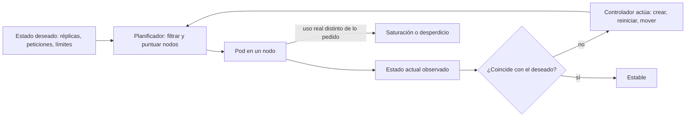
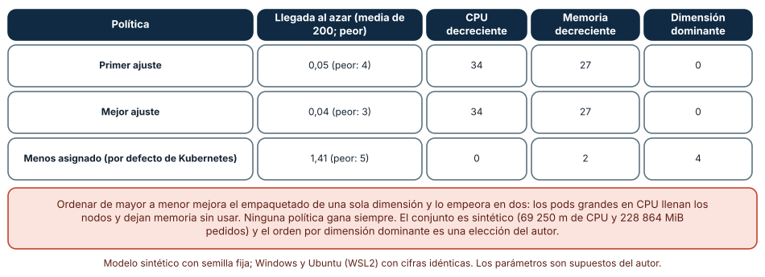
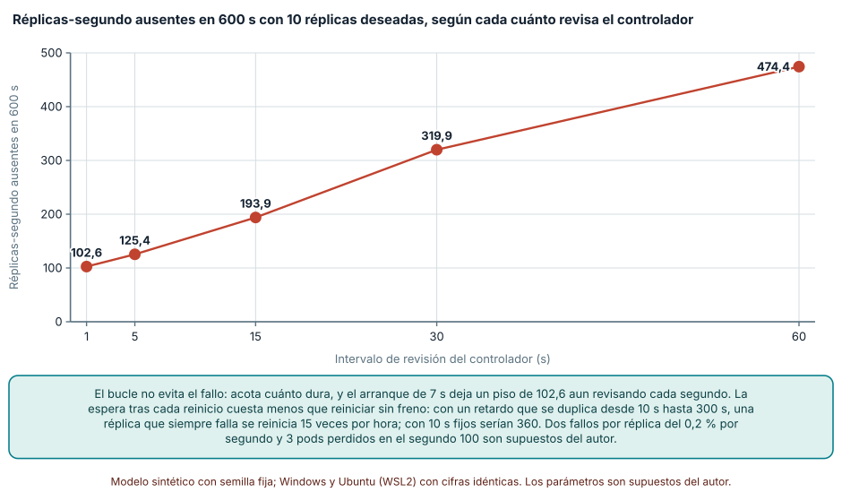
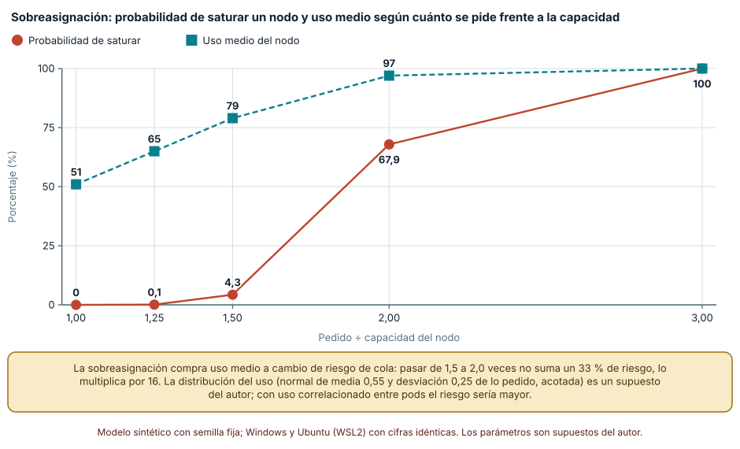

# SE-351 — Orquestación y scheduling

[← SE-350 — Máquinas virtuales, contenedores y aislamiento](https://github.com/vladimiracunadev-create/modern-software-engineering-program/blob/main/classes/part-29-cloud-plataforma-e-infraestructura/se-350-maquinas-virtuales-contenedores-y-aislamiento/README.md) · [↑ Parte 29](https://github.com/vladimiracunadev-create/modern-software-engineering-program/blob/main/classes/part-29-cloud-plataforma-e-infraestructura/README.md) · [📚 Índice completo](https://github.com/vladimiracunadev-create/modern-software-engineering-program/blob/main/classes/README.md) · [🌐 Portal](https://vladimiracunadev-create.github.io/modern-software-engineering-program/classes/SE-351.html) · [SE-352 — Serverless y ejecución gestionada →](https://github.com/vladimiracunadev-create/modern-software-engineering-program/blob/main/classes/part-29-cloud-plataforma-e-infraestructura/se-352-serverless-y-ejecucion-gestionada/README.md)

## Punto profesional y fundamento pedagógico

**Punto profesional.** La clase existe para que entiendas qué hace un orquestador cuando decide dónde corre cada unidad y qué hace cuando una falla: es un bucle que compara lo que declaraste con lo que existe y actúa, y un algoritmo de ubicación que empaqueta lo que pides en lo que hay. Entenderlo evita dos errores caros: pedir recursos sin saber lo que significan y esperar que el orquestador repare lo que su diseño no repara.

**Por qué aparece aquí.** Sigue a **Máquinas virtuales, contenedores y aislamiento**: ya sabes qué es la unidad y qué frontera la rodea; ahora alguien tiene que decidir en qué nodo corre, cuántas copias hay y qué ocurre cuando una desaparece. El caso conductor de la parte es la plataforma de entregas llevada a una infraestructura gestionada, y esta clase decide cómo se reparten sus servicios entre nodos.

**Error conceptual que debe corregir.** Creer que el orquestador «optimiza» el uso del clúster. Aplica una política de ubicación sencilla sobre lo que cada pieza pide, no sobre lo que usa, y repara el estado deseado con un retardo que depende de cada cuánto mira. Ninguna de las dos cosas es un defecto: son su contrato, y los resultados de esta clase lo miden.

**Secuencia de aprendizaje.** Antes de leer los resultados, predices cuántos pods de 150 quedarán sin ubicar en un clúster ocupado al 91 % según el orden en que lleguen, cuánto tiempo falta una réplica según cada cuánto revisa el controlador y con qué probabilidad se satura un nodo si se admite el doble de lo que tiene; después lo contrastas con una simulación de ubicación, un bucle de reconciliación y un muestreo de uso. La secuencia usa predicción, explicación propia, contraste y recuperación. [ICAP](https://icap.education.asu.edu/research) distingue participación de construcción de conocimiento; [How People Learn II](https://nap.nationalacademies.org/catalog/24783/how-people-learn-ii-learners-contexts-and-cultures) exige conectar conocimiento previo, contexto y transferencia; la [práctica de recuperación](https://pubmed.ncbi.nlm.nih.gov/16507066/) respalda producir de nuevo la explicación tras una demora; y [Education for Life and Work](https://nap.nationalacademies.org/resource/13398/dbasse_084153.pdf) exige devolución que explique la causa del error.

**Evidencia de aprendizaje.** `orquestacion.md` con la predicción, las tres figuras reproducidas, la tabla de peticiones y límites de cada servicio de la plataforma con su justificación y una nota que separe qué decide el orquestador y qué debes declarar tú.

**Límite de la conclusión.** Los pods, los nodos y las probabilidades son sintéticos y los algoritmos son versiones simplificadas de políticas conocidas, no el planificador de Kubernetes ni de ningún otro. No se instaló ningún orquestador, no se midió tiempo de reloj de un clúster real y el retardo de arranque de siete segundos es un supuesto del autor.

### Trazabilidad fuente → afirmación

| Fuente primaria u oficial | Afirmación que respalda | Lo que no prueba |
|---|---|---|
| [Kubernetes: kube-scheduler](https://kubernetes.io/docs/concepts/scheduling-eviction/kube-scheduler/) | El planificador filtra los nodos que pueden alojar el pod y puntúa los restantes para elegir uno. | No dice qué política de puntuación da mejor resultado para una carga concreta. |
| [Kubernetes: controladores](https://kubernetes.io/docs/concepts/architecture/controller/) | Un controlador observa el estado actual y actúa para acercarlo al deseado, en un bucle. | No fija el intervalo entre revisiones ni garantiza el tiempo de convergencia. |
| [Kubernetes: ciclo de vida de un pod](https://kubernetes.io/docs/concepts/workloads/pods/pod-lifecycle/) | Un contenedor que falla se reinicia con un retardo que crece de forma exponencial hasta un tope. | No dice cuántos reinicios convienen ni qué hacer con una réplica que nunca arranca. |
| [Kubernetes: gestión de recursos de contenedores](https://kubernetes.io/docs/concepts/configuration/manage-resources-containers/) | La planificación usa lo que el contenedor pide, y el límite se aplica durante la ejecución. | No mide cuánto se puede sobreasignar sin riesgo. |
| [Verma et al., «Large-scale cluster management at Google with Borg»](https://research.google/pubs/large-scale-cluster-management-at-google-with-borg/) | Describe un orquestador de producción, con reutilización de recursos reservados y no usados. | Las cifras de Google no se transfieren a otra organización. |

## Antes de empezar

Recupera lo aprendido en `SE-350`: una unidad de ejecución tiene frontera y límites. La pregunta activa es: **¿qué pido, qué usa realmente mi servicio y cuánto tarda el sistema en reparar una pieza que se cae?**

## Prerrequisitos

- Haber completado `SE-350` o poder explicar qué comparte un contenedor con su anfitrión.
- Python 3.11 o posterior; los experimentos usan solo la biblioteca estándar (`random`, `statistics`) y no necesitan Kubernetes.
- Saber qué es un nodo, un pod o instancia, una petición de recursos y un límite.

## Problema auténtico

La plataforma de entregas corre veinte servicios en un clúster pequeño. En la semana de cierre de entregas, tres servicios quedaron «pendientes» sin ubicar aunque el panel mostraba un 40 % de CPU libre en promedio: los nodos tenían CPU libre pero no la memoria que pedían los pods grandes. Dos días después un nodo se reinició y la aplicación web quedó con dos réplicas de cuatro durante casi un minuto, porque el controlador revisaba cada treinta segundos. Y un servicio con un error de configuración se reinició cientos de veces y dejó al nodo sin recursos para sus vecinos. Tres síntomas, tres mecanismos distintos del mismo orquestador.

## Objetivos observables

Al terminar podrás:

1. explicar el filtro y la puntuación de una ubicación y por qué el orden de llegada cambia el resultado;
2. medir cuántos pods quedan sin ubicar con tres políticas y cuatro órdenes en un clúster casi lleno;
3. calcular cuánto tiempo falta una réplica según el intervalo del bucle de reconciliación y cuántos reinicios provoca un retardo fijo frente a uno exponencial;
4. estimar la probabilidad de saturar un nodo según cuánto se sobreasigna lo pedido;
5. escribir peticiones y límites justificados para los servicios de la plataforma.

## Mapa conceptual



El mapa muestra dos bucles. El de **ubicación** decide dónde va cada pod con lo que pide; el de **reconciliación** vuelve a ejecutarlo cuando lo observado no coincide con lo declarado. La rama inferior es la que ninguno de los dos mira: lo que el pod usa de verdad.

## Temas y por qué importan

| Tema | Por qué cambia una decisión profesional | Evidencia mínima |
|---|---|---|
| Ubicación y puntuación | Una política distinta deja un clúster casi lleno con más o menos pods sin sitio. | Tabla de pods sin ubicar por política y orden |
| Reconciliación | El tiempo que una réplica falta depende de cada cuánto mira el controlador. | Réplicas-segundo ausentes según el intervalo |
| Reinicios y retroceso | Un retardo creciente protege al nodo de una réplica que nunca arranca. | Reinicios por hora con retardo fijo y exponencial |
| Peticiones y límites | Lo pedido decide dónde cabe; el límite decide cuándo se corta. | Tabla de peticiones y límites justificados |
| Sobreasignación | Admitir más de lo que hay compra uso a cambio de riesgo. | Probabilidad de saturación según el cociente |

## Conceptos y decisiones

### 1. Ubicación y puntuación

El planificador de Kubernetes decide dónde va un pod en dos fases: filtra los nodos que cumplen las condiciones (hay recursos libres, las etiquetas coinciden) y puntúa los restantes con una o varias funciones. Por defecto favorece los nodos con más recursos libres tras la asignación, lo que reparte la carga, mientras que políticas de empaquetado prefieren llenar nodos y dejar otros libres para apagarlos. No hay una política mejor en abstracto: el reparto protege frente a la caída de un nodo y el empaquetado ahorra costo, y se elige según cuál de los dos riesgos pesa más. El algoritmo ve un pod a la vez, en el orden en que llegan, y esa ceguera al futuro es lo que hace que el orden importe.

### 2. Bucles de reconciliación

Un controlador observa el estado actual, lo compara con el deseado y actúa, y repite. Es un diseño robusto porque no depende de recibir cada evento: si se pierde un aviso, la siguiente revisión lo corrige. Su límite es el tiempo: entre un fallo y su reparación pasan la espera hasta la próxima revisión, el tiempo de decidir y el de arrancar la réplica nueva (descargar la imagen, iniciar el proceso, pasar las comprobaciones). Cuanto más espaciadas las revisiones, más dura el hueco, y en una aplicación con pocas réplicas el hueco es un porcentaje grande de la capacidad.

### 3. Reinicios y retroceso exponencial

Cuando un contenedor falla, el orquestador lo reinicia. Si lo hiciera al instante, una réplica con un error de configuración consumiría recursos del nodo en un bucle sin fin. Kubernetes documenta un retardo que se duplica desde 10 segundos hasta un tope de 5 minutos y que se reinicia tras un periodo de ejecución estable. En una hora, una réplica que siempre falla pasa de unos 360 intentos con un retardo fijo de 10 segundos a unos 15 con el retroceso exponencial. El retroceso es una decisión de protección del nodo, no de recuperación del servicio: la réplica sigue sin funcionar.

### 4. Peticiones y límites

La **petición** es lo que el pod reserva para efectos de ubicación; el **límite** es el techo que el sistema aplica mientras se ejecuta. Con CPU, superar el límite estrangula el proceso; con memoria, superarlo termina el proceso. Una petición baja cabe en cualquier nodo y expone al nodo a quedar sobrecargado; una alta reserva más de lo necesario y deja pods sin sitio. Los servicios con petición igual al límite se tratan con más prioridad ante una escasez que los que piden menos de lo que pueden usar. Fijar estas cifras es una decisión de diseño que se revisa con la medida del uso real, no con una intuición.

### 5. Sobreasignación

Si todos los pods usaran siempre lo que piden, convendría que la suma de peticiones igualara la capacidad. Pero el uso medio suele ser inferior y nunca coincide en el tiempo, así que admitir más peticiones que capacidad aprovecha mejor el hardware. El riesgo está en la cola: cuando varios pods suben a la vez, el nodo se satura. Los orquestadores de producción reutilizan los recursos reservados y no usados con esta idea; lo que no pueden evitar es que la apuesta pierda a veces. La pregunta de diseño es cuánto riesgo se tolera por cada punto de uso medio ganado.

### Pods sin ubicar en un clúster casi lleno

Se generan con semilla fija 150 pods con CPU en {100, 250, 500, 1 000, 2 000} m (pesos 30, 30, 20, 15, 5) y memoria en {256, 512, 1 024, 2 048, 4 096} MiB, que suman 69 250 m y 228 864 MiB, y 19 nodos de 4 000 m y 16 384 MiB: el 91 % de la CPU y el 74 % de la memoria. Se ubican con tres políticas, **primer ajuste** (el primer nodo que cabe), **mejor ajuste** (el que deja menos espacio libre) y **menos asignado** (el más vacío), con 200 órdenes al azar y con tres ordenaciones decrecientes.

```python
def place(pods, policy, nodes=19, cpu=4000, mem=16384):
    free = [[cpu, mem] for _ in range(nodes)]
    for c, m in pods:
        cand = [i for i, f in enumerate(free) if f[0] >= c and f[1] >= m]
        if not cand: unsch += 1; continue
        i = cand[0] if policy == "primer ajuste" else (
            min(cand, key=lambda j: (free[j][0] - c) / cpu + (free[j][1] - m) / mem)
            if policy == "mejor ajuste" else
            max(cand, key=lambda j: free[j][0] / cpu + free[j][1] / mem))
        free[i][0] -= c; free[i][1] -= m
```

| Política | Llegada al azar (media de 200; peor) | CPU decreciente | Memoria decreciente | Dimensión dominante |
|---|---|---:|---:|---:|
| Primer ajuste | 0,05 (4) | 34 | 27 | 0 |
| Mejor ajuste | 0,04 (3) | 34 | 27 | 0 |
| Menos asignado | 1,41 (5) | 0 | 2 | 4 |

Ninguna política gana siempre. Con llegada al azar el empaquetado deja casi todos los pods ubicados y el reparto deja 1,41 en promedio, porque el reparto fragmenta el espacio. Ordenar los pods de mayor a menor por una sola dimensión, la receta clásica del empaquetado, empeora mucho el empaquetado (34 pods sin sitio): los pods grandes en CPU llenan los nodos y dejan memoria que los pequeños en CPU y grandes en memoria no pueden aprovechar. Con el orden por la dimensión dominante el empaquetado coloca los 150, y el reparto en cambio coloca peor.



**Cómo leer la figura.** Cada fila es una política y cada columna un orden de llegada; la celda es el número de pods sin sitio y el tono más oscuro, más pods perdidos. Los recuadros marcan que ordenar de mayor a menor, que ayuda en una dimensión, deja 34 y 27 pods fuera con primer y mejor ajuste, mientras que menos asignado, que parte de 1,41 con llegada al azar, sale con 0 en CPU decreciente. La tabla da el peor caso con llegada al azar. **Dónde deja de valer:** los pods son sintéticos, hay solo dos dimensiones y no se modelan afinidades, taints ni prioridades. El resultado enseña que el orden y la política interactúan, no cuál usa Kubernetes.

### Cuánto falta una réplica

Se simulan 600 pasos de 1 s con 10 réplicas deseadas, un 0,2 % de fallo por réplica y por segundo y la pérdida de tres réplicas en el segundo 100. El controlador revisa cada 1, 5, 15, 30 o 60 s y, si falta alguna, pide otra que tarda 7 s en estar lista (2 de planificación y 5 de descarga). Se suman las réplicas-segundo ausentes con 300 semillas.

```python
if t % interval == 0:
    need = desired - running - len(pending)
    for _ in range(max(0, need)):
        pending.append(t + 7)
missing += desired - running
```

| Intervalo | Réplicas-segundo ausentes |
|---|---:|
| 1 s | 102,6 |
| 5 s | 125,4 |
| 15 s | 193,9 |
| 30 s | 319,9 |
| 60 s | 474,4 |

Pasar de revisar cada segundo a hacerlo cada minuto multiplica por 4,6 la capacidad perdida. El intervalo de 1 s no llega a cero porque cada reposición tarda 7 s. Y para un servicio que nunca arranca, la suma de intentos es otra historia: con el retardo documentado, 10 s duplicado hasta 300 s, una réplica que siempre falla se reinicia 15 veces en una hora; con 10 s fijos serían 360.



**Cómo leer la figura.** El eje horizontal es el intervalo con que el controlador revisa y el vertical, la capacidad perdida acumulada en 600 s (réplicas-segundo); cada punto es la media de 300 corridas. Mira que la pérdida crece con el intervalo y que con 1 s ya queda un piso de 102,6 por el arranque de 7 s. Los reinicios con retardo fijo y exponencial están en la tabla. **Dónde deja de valer:** los fallos aleatorios, los 7 s de arranque y la pérdida de tres réplicas son supuestos del autor; un orquestador real reacciona a eventos además de revisar periódicamente, y por eso sus tiempos no son estos.

### Cuánto se puede sobreasignar

Se llena un nodo de 4 000 m con pods que piden entre 100 y 1 000 m hasta que la suma pedida alcanza `r` veces la capacidad, con `r` entre 1 y 3. El uso real de cada pod es lo pedido por una fracción de distribución normal de media 0,55 y desviación 0,25, acotada entre 0,05 y 2. Se miden 20 000 nodos por `r` y se cuenta cuántos superan la capacidad.

```python
use = sum(c * min(2.0, max(0.05, r.gauss(0.55, 0.25))) for c in reqs)
over += use > 4000
```

| Pedido ÷ capacidad | Probabilidad de saturar | Uso medio |
|---|---:|---:|
| 1,00 | 0,0 % | 51 % |
| 1,25 | 0,1 % | 65 % |
| 1,50 | 4,3 % | 79 % |
| 2,00 | 67,9 % | 97 % |
| 3,00 | 100 % | 100 % |

El riesgo no crece de forma lineal: de 1,25 a 1,5 pasa de 0,1 % a 4,3 % y de 1,5 a 2 multiplica por dieciséis. Elegir 1,25 compra 14 puntos de uso medio por un riesgo casi nulo; elegir 2,0 compra 32 puntos a cambio de saturar dos de cada tres nodos. El punto razonable depende de qué cuesta una saturación (un pico de latencia o la terminación de procesos) y de qué tan correlacionados están los usos.



**Cómo leer la figura.** El eje horizontal es el cociente entre lo pedido y la capacidad; el vertical es un porcentaje, y las dos curvas comparten la escala: el riesgo de saturar (coral) y el uso medio del nodo (verde azulado). Mira cómo el uso medio sube casi en línea recta mientras el riesgo apenas se mueve hasta 1,5 veces y luego se dispara. **Dónde deja de valer:** la distribución del uso es un supuesto y supone pods independientes; si varios suben a la vez, por un pico de entregas, el riesgo real es mayor. Tampoco distingue CPU, que se estrangula, de memoria, que mata procesos.

## Definiciones de trabajo

- **planificador:** componente que decide en qué nodo se ejecuta cada unidad a partir de lo que pide y de lo que hay libre.
- **bucle de reconciliación:** ciclo en el que un controlador compara el estado actual con el deseado y actúa para acercarlos.
- **petición de recursos:** cantidad que una unidad reserva y que se usa para decidir dónde cabe.
- **límite de recursos:** techo que el sistema aplica a una unidad mientras se ejecuta.
- **sobreasignación:** admitir peticiones por una suma mayor que la capacidad del nodo, apostando a que no se usarán a la vez.

Las definiciones son operativas para la plataforma de entregas. Cada orquestador usa estos términos con matices y debe contrastarse con la documentación primaria enlazada al final.

## Ejemplo mínimo

El fragmento intenta ubicar cuatro pods en dos nodos con la política de primer ajuste. Antes de ejecutarlo, predice cuántos pods quedan sin sitio y cuántos si el orden fuera 3 000, 1 000, 3 000, 1 000.

```python
nodos = [[4000, 16384], [4000, 16384]]
pods = [(1000, 1024), (1000, 1024), (3000, 1024), (3000, 1024)]
for c, m in pods:
    n = next((x for x in nodos if x[0] >= c and x[1] >= m), None)
    if n: n[0] -= c; n[1] -= m
    else: print("sin ubicar", c, m)
```

Con ese orden el último pod queda sin ubicar, porque los dos primeros se juntan en el primer nodo y dejan 2 000 m donde cabría uno de 3 000; con el orden 3 000, 1 000, 3 000, 1 000 caben los cuatro. Registra versión de Python, comando y salida y busca otro orden que falle.

## Ejemplo profesional

El equipo de la plataforma de entregas define para cada servicio una petición cercana al uso medio medido y un límite algo mayor, y marca el corrector como de baja prioridad para que lo desplacen antes que a la aplicación web. Revisa el intervalo de lectura de su controlador con el tiempo de arranque de cada servicio y concluye que la aplicación web, con cuatro réplicas, no puede tolerar un hueco de un minuto, así que sube las réplicas a seis y mide el arranque. Fija un tope de reinicios y una alerta cuando un servicio entra en retroceso, de modo que un error de configuración llegue a una persona en minutos y no a los 300 intentos. Admite una sobreasignación de 1,25 en nodos de baja prioridad y de 1,0 en los de la base de datos y lo escribe con la medida de saturación. Compara con el estado inicial: los pods grandes ya no quedan pendientes por fragmentación porque el orden de despliegue de la semana de cierre está documentado.

## Práctica guiada

1. Predice cuántos de 150 pods quedan sin ubicar con llegada al azar y con orden por CPU decreciente.
2. Genera los pods con semilla fija y ejecuta las tres políticas y los cuatro órdenes.
3. Cambia la capacidad a 18 y a 21 nodos y anota cómo cambia la tabla.
4. Simula el bucle de reconciliación con intervalos de 1 a 60 s y calcula las réplicas-segundo ausentes.
5. Calcula los reinicios por hora con retardo fijo de 10 s y con el exponencial hasta 300 s.
6. Mide la probabilidad de saturación para cocientes de 1,0 a 3,0 y elige uno con su justificación.
7. Entrega `orquestacion.md` y pide a otra persona que identifique qué supuesto cambiaría el cociente elegido.

## Ejercicios

1. **Orden:** explica por qué ordenar los pods por CPU decreciente empeora el empaquetado en este clúster y propón un orden que lo mejore.
2. **Intervalo:** con un tiempo de arranque de 20 s y 6 réplicas, ¿qué intervalo de revisión mantiene la ausencia por debajo de 100 réplicas-segundo? Razona con el modelo.
3. **Retroceso:** calcula los reinicios en 24 horas con el retardo exponencial hasta 300 s y explica por qué el número no se multiplica por 24.
4. **Sobreasignación:** con un uso medio de 0,40 de lo pedido y desviación de 0,2, ¿sube o baja el cociente que elegirías? Justifica sin repetir la simulación.

## Reto verificable

Entrega `orquestacion.md` con la predicción, las tres tablas reproducidas con las mismas semillas, la tabla de peticiones y límites de la plataforma con la fuente de cada cifra y la lista de lo que el modelo no representa. Se aprueba si otra persona ejecuta el código desde un checkout limpio, obtiene las mismas cifras y puede decir qué le pasaría a la aplicación web si se perdiera un nodo en la semana de cierre. No se aprueba por afirmar que el orquestador «balancea la carga» sin medir una ubicación, ni por fijar peticiones sin medir el uso.

## Caso conductor

La plataforma de entregas es el caso conductor de la Parte 29. Esta clase deja el tercer artefacto: peticiones, límites y política de ubicación de sus servicios. `SE-352` pregunta qué ocurre cuando ni siquiera se elige el nodo y la ejecución es gestionada por completo. Cambia una cifra, por ejemplo la memoria pedida por el corrector, y mira cuántos pods dejan de caber.

## Preguntas frecuentes

### ¿Por qué un pod queda pendiente si el clúster tiene CPU libre?

Porque la ubicación exige que quepan a la vez todas las dimensiones que el pod pide: si pide CPU y memoria, hace falta un nodo con ambas libres. Un clúster puede tener CPU libre en unos nodos y memoria libre en otros sin que ninguno aloje el pod, la fragmentación que la tabla mide.

### ¿Se puede evitar la fragmentación?

Se reduce, no se elimina: usando tamaños de pod estandarizados, desplazando pods ya ubicados o añadiendo nodos. El costo es complejidad y movimiento de cargas; el orquestador no reubica pods ya ubicados salvo que se lo pidas.

### ¿Por qué no poner el intervalo de revisión en cero?

Un intervalo muy corto aumenta la carga sobre el sistema de control y no elimina el retardo de arranque. Los orquestadores combinan revisiones periódicas con notificaciones de eventos; el modelo de la clase solo contempla las primeras.

### ¿La sobreasignación es una mala práctica?

No: es una apuesta explícita sobre la correlación del uso. Se vuelve mala práctica cuando se hace sin medir el uso real o en cargas que suben a la vez, como la semana de cierre de entregas.

## Fallo controlado y diagnóstico

Reproduce el fallo clásico de la clase: **pods pendientes con CPU libre en el panel**. Ubica con la política de primer ajuste los 150 pods en orden de CPU decreciente.

Registra síntoma, entrada mínima, hipótesis, observación que descarta cada hipótesis, causa, corrección y prueba de regresión. **Síntoma:** 34 pods quedan pendientes y el uso medio de CPU del clúster no llega al 100 %. **Hipótesis rivales:** (a) faltan nodos; (b) un nodo está averiado; (c) la fragmentación de una dimensión impide ubicar pods que piden otra. **Prueba:** para cada pod pendiente, calcula cuántos nodos tienen la CPU libre suficiente y cuántos la memoria; si hay nodos con una y no con la otra, la causa es la fragmentación. **Conclusión:** el orden de llegada llenó la CPU de los primeros nodos y dejó la memoria sin pareja. **Regresión:** documenta el orden de despliegue por dimensión dominante y repite la ubicación comprobando que no queda ninguno pendiente. No arregles a la vez el orden y la capacidad del clúster.

## Errores comunes y cómo corregirlos

| Síntoma | Causa probable | Corrección |
|---|---|---|
| Pods pendientes con CPU libre | Fragmentación de memoria o de CPU entre nodos | Revisar el orden y los tamaños de pod y medir qué dimensión se agota |
| Una réplica caída tarda minutos en volver | Intervalo de revisión largo o arranque lento | Medir el tiempo de arranque y subir réplicas o acortar el intervalo |
| Un servicio se reinicia en bucle y degrada el nodo | Sin retroceso ni alerta | Mantener el retroceso exponencial y alertar tras N reinicios |
| Un pod muere por memoria sin saturar el nodo | El límite era menor que el uso real | Medir el uso máximo y fijar el límite con margen |
| Los nodos se saturan en la semana de cierre | Sobreasignación calculada con uso medio y no con picos | Calcular el cociente con el pico y con usos correlacionados |

## Entorno y archivos clave

```text
work/SE-351/
├── README.md
├── orquestacion/
│   ├── ubicacion.py
│   ├── reconciliacion.py
│   └── sobreasignacion.py
├── tests/test_orquestacion.py
└── evidence/orquestacion.md
```

El `README` declara versión de Python, semillas y comandos. Los experimentos usan solo la biblioteca estándar y se ejecutaron con CPython 3.12.9 en Windows 11 y 3.12.3 en Ubuntu bajo WSL2 con salidas idénticas. No se usó ningún orquestador; si usas Kubernetes local, declara versión, herramienta y limpieza.

## Seguridad, ética y accesibilidad

- el modelo no necesita datos reales ni credenciales; no copies manifiestos de producción a ejemplos públicos;
- una petición de recursos mal fijada es también un problema de equidad entre equipos que comparten el clúster: documenta quién decide las cifras;
- las prioridades de despliegue deciden qué servicio cae primero: acuerda con el negocio que lo esencial para estudiantes en cierre no sea el que se desaloje;
- documenta la política de ubicación y el orden de despliegue en texto, no solo en un diagrama;
- respeta las licencias de los manifiestos de ejemplo y atribuye lo adaptado.

## Puente hacia el trabajo con agentes

Un agente al que se le pide «escribe los manifiestos de Kubernetes de la plataforma» producirá recursos válidos, a menudo sin peticiones ni límites, con una sola réplica y con la etiqueta de imagen más reciente. Pídele en cambio que justifique cada petición y límite con una medida o con un supuesto declarado, que fije al menos dos réplicas con sus comprobaciones de salud y que incluya una prueba que simule la pérdida de un nodo y cuente las réplicas disponibles. Revisa especialmente qué recursos dejó sin definir y qué prioridad asignó: son los dos lugares donde un manifiesto correcto se comporta mal bajo presión.

## Transferencia

Traslada el análisis a otro dominio (por ejemplo, un servicio de procesamiento de imágenes con colas de trabajos): cambia los pods y conserva el procedimiento de generar la carga con semilla fija, comparar políticas y órdenes, medir la reconciliación y elegir un cociente de sobreasignación con su riesgo. La transferencia está lograda cuando puedes decir qué decisión era del orquestador y cuál tuya, no cuando los manifiestos se parecen.

## Evaluación y evidencia

| Criterio | Evidencia para aprobar |
|---|---|
| comprensión | explicación de petición, límite, ubicación y reconciliación con ejemplos |
| corrección | tablas reproducibles con las mismas semillas |
| decisión | peticiones, límites y cociente de sobreasignación con su justificación |
| diagnóstico | reproducción del fallo «pendientes con CPU libre» con regresión |
| incertidumbre | declaración de que no se midió ningún orquestador real |
| reproducibilidad | versiones, comandos, salida y límites declarados |

## Fuentes

- [Kubernetes: kube-scheduler](https://kubernetes.io/docs/concepts/scheduling-eviction/kube-scheduler/) — filtrado y puntuación de nodos; autoridad: documentación oficial de Kubernetes.
- [Kubernetes: controladores](https://kubernetes.io/docs/concepts/architecture/controller/) — bucle de control entre estado actual y deseado; autoridad: documentación oficial de Kubernetes.
- [Kubernetes: ciclo de vida de un pod](https://kubernetes.io/docs/concepts/workloads/pods/pod-lifecycle/) — reinicios y retardo exponencial; autoridad: documentación oficial de Kubernetes.
- [Kubernetes: gestión de recursos de contenedores](https://kubernetes.io/docs/concepts/configuration/manage-resources-containers/) — peticiones y límites; autoridad: documentación oficial de Kubernetes.
- [Large-scale cluster management at Google with Borg](https://research.google/pubs/large-scale-cluster-management-at-google-with-borg/) — orquestación de producción y reutilización de recursos; autoridad: artículo de Google (EuroSys 2015).

Cada fuente respalda el mecanismo indicado; ninguna demuestra que los 34 pods sin ubicar, las 474,4 réplicas-segundo ni el 67,9 % de saturación se observen en un clúster real. Esa afirmación depende de la carga, la política y el uso real de cada servicio.

## Límites y siguiente paso

Se ejecutaron tres experimentos sintéticos en Windows y Ubuntu (WSL2) con resultados idénticos. No se usó ningún orquestador real ni se midió el tiempo de un clúster: las políticas son versiones simplificadas, el arranque de 7 s, los fallos y la distribución del uso son supuestos del autor y el resultado no se extrapola a otra carga. La siguiente clase mira el caso en que ni siquiera se elige el nodo: la ejecución gestionada y sin servidor.

## Glosario

- **planificador:** componente que decide en qué nodo se ejecuta cada unidad a partir de lo que pide y de lo que hay libre.
- **bucle de reconciliación:** ciclo en el que un controlador compara el estado actual con el deseado y actúa para acercarlos.
- **petición de recursos:** cantidad que una unidad reserva y que se usa para decidir dónde cabe.
- **límite de recursos:** techo que el sistema aplica a una unidad mientras se ejecuta.
- **sobreasignación:** admitir peticiones por una suma mayor que la capacidad del nodo, apostando a que no se usarán a la vez.

---

[← SE-350 — Máquinas virtuales, contenedores y aislamiento](https://github.com/vladimiracunadev-create/modern-software-engineering-program/blob/main/classes/part-29-cloud-plataforma-e-infraestructura/se-350-maquinas-virtuales-contenedores-y-aislamiento/README.md) · [↑ Parte 29](https://github.com/vladimiracunadev-create/modern-software-engineering-program/blob/main/classes/part-29-cloud-plataforma-e-infraestructura/README.md) · [📚 Índice completo](https://github.com/vladimiracunadev-create/modern-software-engineering-program/blob/main/classes/README.md) · [🌐 Portal](https://vladimiracunadev-create.github.io/modern-software-engineering-program/classes/SE-351.html) · [SE-352 — Serverless y ejecución gestionada →](https://github.com/vladimiracunadev-create/modern-software-engineering-program/blob/main/classes/part-29-cloud-plataforma-e-infraestructura/se-352-serverless-y-ejecucion-gestionada/README.md)
