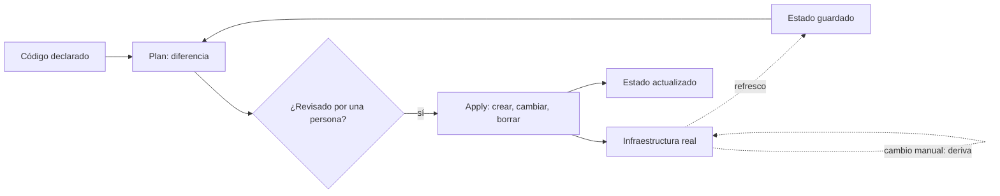
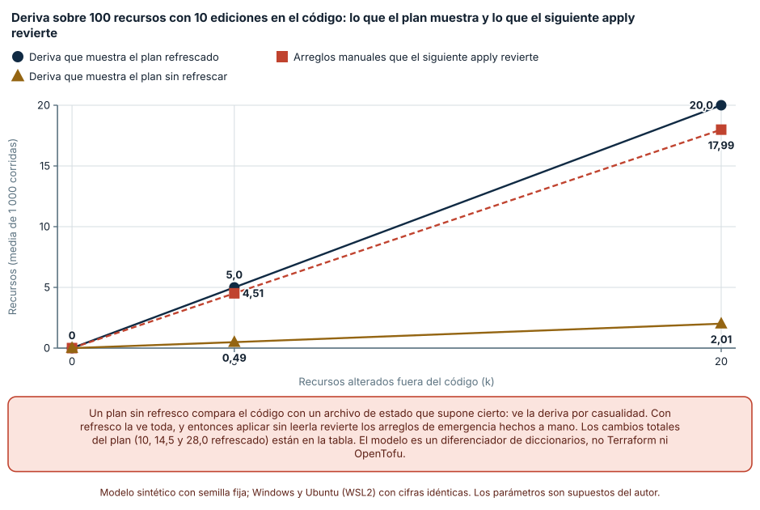
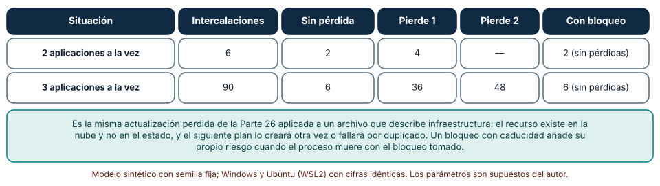
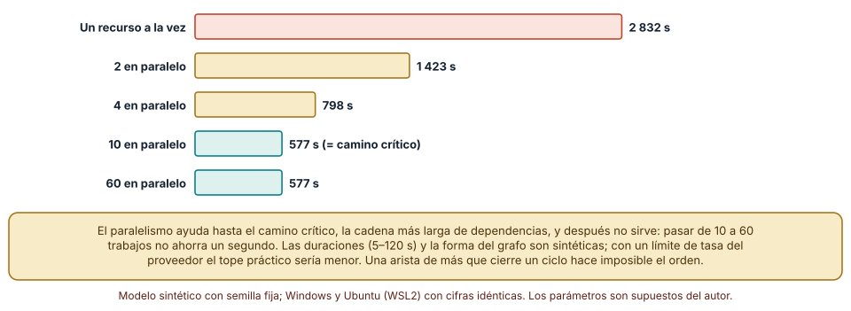

# SE-354 — Infraestructura como código y estado

[← SE-353 — Redes, identidad y secretos en cloud](https://github.com/vladimiracunadev-create/modern-software-engineering-program/blob/main/classes/part-29-cloud-plataforma-e-infraestructura/se-353-redes-identidad-y-secretos-en-cloud/README.md) · [↑ Parte 29](https://github.com/vladimiracunadev-create/modern-software-engineering-program/blob/main/classes/part-29-cloud-plataforma-e-infraestructura/README.md) · [📚 Índice completo](https://github.com/vladimiracunadev-create/modern-software-engineering-program/blob/main/classes/README.md) · [🌐 Portal](https://vladimiracunadev-create.github.io/modern-software-engineering-program/classes/SE-354.html) · [SE-355 — Entornos, cuentas y separación de responsabilidades →](https://github.com/vladimiracunadev-create/modern-software-engineering-program/blob/main/classes/part-29-cloud-plataforma-e-infraestructura/se-355-entornos-cuentas-y-separacion-de-responsabilidades/README.md)

## Punto profesional y fundamento pedagógico

**Punto profesional.** La clase existe para que puedas declarar infraestructura como código y, sobre todo, entender el archivo que ese código necesita para funcionar: el estado. Un plan que parece seguro puede ser un diagnóstico de una realidad que ya no existe, y un archivo de estado puede perder una escritura igual que lo hace una base de datos. Quien lo ignora acaba con recursos que nadie sabe que existen o con arreglos de emergencia revertidos en silencio.

**Por qué aparece aquí.** Sigue a **Redes, identidad y secretos en cloud**: allí las reglas, los roles y los secretos eran configuraciones sueltas. Ahora se escriben como código versionado y se aplican con una herramienta que compara lo declarado con lo existente. El caso conductor de la parte es la plataforma de entregas llevada a una infraestructura gestionada, y esta clase decide cómo se describe y se mantiene todo lo anterior.

**Error conceptual que debe corregir.** Creer que el código describe la infraestructura. Describe la intención; la verdad es lo que existe, y entre ambas hay un archivo de estado que es una tercera versión de la realidad, tan propensa a quedar obsoleta como cualquier caché.

**Secuencia de aprendizaje.** Antes de leer los resultados, predices cuántos de cinco cambios hechos a mano verá un plan que no consulta lo existente, cuántas escrituras simultáneas del estado se pierden con tres aplicaciones y cuánto baja el tiempo de aplicar sesenta recursos al ejecutar diez a la vez; después lo reproduces con un diferenciador de diccionarios, una enumeración de intercalaciones y un planificador de un grafo de dependencias. La secuencia usa predicción, explicación propia, contraste y recuperación. [ICAP](https://icap.education.asu.edu/research) distingue participación de construcción de conocimiento; [How People Learn II](https://nap.nationalacademies.org/catalog/24783/how-people-learn-ii-learners-contexts-and-cultures) exige conectar conocimiento previo, contexto y transferencia; la [práctica de recuperación](https://pubmed.ncbi.nlm.nih.gov/16507066/) respalda producir de nuevo la explicación tras una demora; y [Education for Life and Work](https://nap.nationalacademies.org/resource/13398/dbasse_084153.pdf) exige devolución que explique la causa del error.

**Evidencia de aprendizaje.** `iac-estado.md` con la predicción, las tres figuras reproducidas, el grafo de dependencias de la plataforma con su camino crítico, la política de refresco y bloqueo del estado y una nota con qué hacer ante deriva.

**Límite de la conclusión.** El diferenciador, la enumeración y el planificador son modelos del autor y no ejecutan Terraform, OpenTofu ni otra herramienta; no se llamó a ningún proveedor, no se guardó un estado real y las duraciones y la forma del grafo son sintéticas.

### Trazabilidad fuente → afirmación

| Fuente primaria u oficial | Afirmación que respalda | Lo que no prueba |
|---|---|---|
| [Terraform: estado](https://developer.hashicorp.com/terraform/language/state) | El estado relaciona los recursos declarados con los objetos reales, guarda metadatos y puede contener datos sensibles; los almacenes remotos permiten bloqueo. | No cuantifica con qué frecuencia se pierde una escritura ni cuánta deriva hay en la práctica. |
| [OpenTofu: documentación](https://opentofu.org/docs/) | Es una bifurcación abierta con el mismo modelo de configuración declarativa, plan y estado. | No garantiza que cada comportamiento coincida con el de Terraform en todas las versiones. |
| [Terraform: comando destroy](https://developer.hashicorp.com/terraform/cli/commands/destroy) | Describe que destruir elimina los objetos que el estado registra como gestionados. | No dice qué ocurre con recursos creados fuera del estado. |
| [AWS Well-Architected: pilar de excelencia operativa](https://docs.aws.amazon.com/wellarchitected/latest/framework/welcome.html) | Recomienda tratar las operaciones como código y automatizar los cambios para que sean repetibles. | No fija una herramienta ni una política de estado. |

## Antes de empezar

Recupera lo aprendido en `SE-353`: las reglas y los permisos son aristas y roles que conviene calcular, no recordar. La pregunta activa es: **¿qué ve el plan, contra qué compara y qué pasa si dos personas aplican a la vez?**

## Prerrequisitos

- Haber completado `SE-353` o poder explicar cómo se calcula la distancia entre dos nodos de un grafo.
- Python 3.11 o posterior; los experimentos usan solo la biblioteca estándar (`random`, `itertools`) y no necesitan Terraform ni una cuenta en un proveedor.
- Saber qué es un archivo versionado, un diff y una dependencia entre recursos.

## Problema auténtico

El equipo de la plataforma describió su infraestructura con código y aplicó un plan que decía «sin cambios». Esa noche un incidente obligó a ampliar a mano la memoria de dos instancias de la aplicación; nadie actualizó el código. Una semana después un cambio de etiquetas disparó un nuevo plan que, además de las etiquetas, restauró la memoria al valor declarado y reinició las instancias en pleno cierre de entregas. Dos días más tarde, dos personas aplicaron cambios distintos casi a la vez; el segundo apply sobrescribió el estado con una versión que no incluía un recurso creado por el primero, y el siguiente plan intentó crearlo otra vez. Tres síntomas, tres propiedades del estado.

## Objetivos observables

Al terminar podrás:

1. explicar el papel del estado como relación entre lo declarado y lo existente;
2. medir qué deriva ve un plan según consulte o no la realidad y cuántos arreglos manuales revertiría un apply;
3. enumerar las intercalaciones de aplicaciones simultáneas sobre un estado y contar las que pierden trabajo con y sin bloqueo;
4. calcular el tiempo de aplicar un grafo de recursos según el paralelismo y su camino crítico;
5. escribir una política de refresco, bloqueo y revisión del plan para la plataforma.

## Mapa conceptual



El mapa tiene tres versiones de la verdad: el **código** (lo que se desea), el **estado** (lo que la herramienta cree que existe) y la **infraestructura** (lo que existe). El plan compara las dos primeras y solo con un **refresco** incorpora la tercera; la línea punteada es la deriva, que el plan no ve sin ese refresco.

## Temas y por qué importan

| Tema | Por qué cambia una decisión profesional | Evidencia mínima |
|---|---|---|
| Declarativo frente a imperativo | Describir el resultado permite repetir y diferenciar; ordenar pasos no. | Plan que cambia solo lo necesario |
| Estado | Es la relación entre lo declarado y lo real y puede quedar obsoleta. | Medición de deriva con y sin refresco |
| Deriva | Un cambio manual no desaparece: el siguiente apply lo revierte o lo ignora. | Arreglos manuales revertidos |
| Bloqueo del estado | Dos aplicaciones simultáneas pierden trabajo sin él. | Intercalaciones con pérdida con y sin bloqueo |
| Grafo de dependencias | Fija el orden y el paralelismo posible. | Tiempo según paralelismo y camino crítico |

## Conceptos y decisiones

### 1. Declarativo frente a imperativo

Un script imperativo dice qué hacer: crear esta máquina, abrir este puerto. Una descripción declarativa dice qué debe existir y deja a la herramienta calcular los pasos. La ventaja es que describir el resultado permite compararlo con lo que hay y actuar solo sobre la diferencia, repetir el mismo código en varios entornos y revisar un cambio como un diff. El coste es que la herramienta debe saber qué existe, y de ahí sale la necesidad de un estado. Lo declarativo no es mágico: un cambio que la herramienta traduce en «borrar y crear de nuevo» puede destruir datos aunque el código parezca solo editar un valor.

### 2. Estado

El estado de una herramienta como Terraform u OpenTofu relaciona cada recurso declarado con el objeto real que lo implementa y guarda sus atributos para poder compararlos. Sin él, la herramienta no sabría si un recurso ya existe o es nuevo. Tiene tres consecuencias prácticas. Es una fuente de verdad parcial que queda obsoleta si alguien cambia algo fuera de la herramienta. Puede contener datos sensibles, porque guarda los valores de los atributos, y debe tratarse como un secreto. Y es un archivo compartido, de modo que necesita un almacenamiento común y un bloqueo para que dos personas no lo escriban a la vez.

### 3. Deriva

La deriva es la diferencia entre lo que el estado cree y lo que existe, nacida de un cambio hecho fuera del código: un arreglo de emergencia, una consola, otra herramienta. Un plan que solo compara el código con el estado no la ve; uno que antes refresca el estado con la realidad la ve y propone revertirla. Ninguna de las dos conductas es incorrecta: la primera es rápida y ciega; la segunda es exacta y puede deshacer un arreglo necesario. Lo importante es la decisión explícita: incorporar el cambio al código, o revertirlo, y que una persona la tome antes del apply.

### 4. Bloqueo del estado

Cuando una aplicación lee el estado, calcula y lo escribe entero, dos aplicaciones simultáneas pueden leer la misma versión y la última en escribir borra el trabajo de la otra: es la actualización perdida de la Parte 26 aplicada a un archivo que describe infraestructura. Los almacenes remotos de estado ofrecen un bloqueo que impide que dos operaciones lo modifiquen a la vez. El bloqueo tiene su propio fallo: si el proceso muere con el bloqueo tomado, nadie puede aplicar hasta que alguien lo libera, y liberarlo a la fuerza sin comprobar que nadie escribe repite el problema.

### 5. Grafo de dependencias y paralelismo

Los recursos dependen unos de otros: una subred necesita su red, una instancia necesita su subred. La herramienta construye un grafo acíclico, crea en orden topológico y destruye en el inverso. Los recursos independientes pueden crearse a la vez, pero el tiempo total no baja de la suma de los tiempos de la cadena más larga, el **camino crítico**. Un ciclo hace imposible el orden y debe detectarse antes de aplicar. Más paralelismo ayuda hasta el camino crítico, y después solo consume los límites de tasa del proveedor.

### Cuánta deriva ve un plan

Se modelan 100 recursos con atributos `tam` y `etiqueta`, y 10 de ellos cambian en el código (`tam = 8`). Fuera del código se altera a mano `k` recursos (`tam = 16`), con `k` igual a 0, 5 y 20. Se compara el plan que solo usa el estado con el que refresca contra la realidad, con 1 000 corridas por valor de `k`.

```python
def plan(desired, state, real=None, refresh=False):
    cur = real if refresh else state
    create = [k for k in desired if k not in cur]
    delete = [k for k in cur if k not in desired]
    update = [k for k in desired if k in cur and desired[k] != cur[k]]
    return create, update, delete
```

| Recursos alterados a mano (k) | 0 | 5 | 20 |
|---|---:|---:|---:|
| Deriva que el plan muestra sin refrescar | 0 | 0,49 | 2,01 |
| Deriva que el plan muestra tras refrescar | 0 | 5,0 | 20,0 |
| Cambios totales en el plan sin refrescar | 10 | 10 | 10 |
| Cambios totales en el plan refrescado | 10 | 14,5 | 28,0 |
| Arreglos manuales que el siguiente apply revierte | 0 | 4,51 | 17,99 |

Sin refresco el plan es siempre el mismo (10 cambios) y ve la deriva solo cuando coincide con una edición del código: 0,49 de 5, 2,01 de 20. Con refresco la ve completa y la propone revertir, de modo que los arreglos manuales que no estaban en el código, 4,51 de 5 y 17,99 de 20, se deshacen si el plan se aplica sin leerlo. La conclusión no es que deba refrescarse siempre ni nunca, sino que un plan «sin cambios» es una afirmación sobre el estado, no sobre la realidad.



**Cómo leer la figura.** El eje horizontal es cuántos recursos se alteraron fuera del código y el vertical, cuántos aparecen o se revierten, en media de 1 000 corridas. La brecha entre la línea azul oscuro (plan refrescado) y la dorada (sin refrescar) es la deriva invisible; la línea coral, casi pegada a la azul, es lo que el siguiente apply deshace. La tabla da los cambios totales del plan. **Dónde deja de valer:** el diferenciador compara diccionarios; una herramienta real distingue atributos que fuerzan reemplazo, valores calculados y cambios que no son reversibles, y su comportamiento depende de la versión y de los ajustes de refresco.

### Escrituras simultáneas del estado

Cada aplicación lee el estado (`r`) y luego lo escribe completo con su recurso añadido (`w`). Se enumeran todas las intercalaciones de dos y de tres aplicaciones que respetan el orden de cada una y se cuenta cuántos recursos quedan sin registrar.

```python
for order in set(itertools.permutations([i for i in range(n) for _ in range(2)])):
    pos, state, snap = [0] * n, set(), {}
    for i in order:
        if pos[i] == 0: snap[i] = set(state)           # lee
        else: state = snap[i] | {i}                    # escribe lo leído más lo suyo
        pos[i] += 1
    perdidos = n - len(state)
```

| Situación | Intercalaciones | Sin pérdida | Pierde 1 | Pierde 2 | Con bloqueo |
|---|---:|---:|---:|---:|---|
| 2 aplicaciones | 6 | 2 | 4 | — | 2 órdenes, sin pérdidas |
| 3 aplicaciones | 90 | 6 | 36 | 48 | 6 órdenes, sin pérdidas |

Con dos aplicaciones, cuatro de seis órdenes pierden el trabajo de una; con tres, solo seis de noventa no pierden nada. Ninguna falla con un error: ambas terminan «con éxito» y el estado no incluye uno de los recursos que existen. El siguiente plan creará el recurso de nuevo o fallará por duplicado. Un bloqueo reduce las ejecuciones posibles a las seriales, que nunca pierden.



**Cómo leer la figura.** Cada barra es una situación y todas suman 100 % de las intercalaciones posibles; el color dice cuánto trabajo se pierde. Mira cómo con tres aplicaciones el verde azulado (sin pérdida) casi desaparece y cómo el bloqueo lo vuelve la barra entera. El número de intercalaciones de cada situación va en la etiqueta. **Dónde deja de valer:** el modelo supone que cada aplicación lee y escribe el estado completo y todas las intercalaciones son igual de probables; en la práctica el tiempo entre lectura y escritura es largo, lo que las hace más probables, y los almacenes con versiones pueden rechazar la escritura obsoleta.

### Paralelismo y camino crítico

Se genera con semilla fija un grafo de 60 recursos con 86 dependencias, donde cada recurso depende de entre uno y tres anteriores y tarda entre 5 y 120 s. Se calcula el camino crítico y el tiempo total con un planificador voraz de `p` trabajos simultáneos.

```python
fin[i] = dur[i] + max([fin[d] for d in deps[i]], default=0)   # camino crítico = max(fin)
```

| Recursos a la vez | Tiempo total |
|---|---:|
| 1 | 2 832 s |
| 2 | 1 423 s |
| 4 | 798 s |
| 10 | 577 s |
| 60 | 577 s |

La suma de duraciones es 2 832 s y el camino crítico, 577 s: ejecutar diez a la vez ya alcanza el mínimo, y pasar a sesenta no ahorra un segundo. Añadir una sola arista que cierre un ciclo hace que el ordenamiento topológico falle, que es la forma en que una herramienta detecta una dependencia circular antes de crear nada.



**Cómo leer la figura.** Cada barra es el tiempo de aplicar el mismo grafo con un número distinto de trabajos simultáneos; la última no mejora a la anterior. **Dónde deja de valer:** las duraciones son sintéticas y no hay límites de tasa del proveedor, que impondrían un tope práctico por debajo del camino crítico; un recurso real tampoco tarda siempre igual.

## Definiciones de trabajo

- **infraestructura como código:** práctica de describir la infraestructura en archivos versionados que una herramienta aplica de forma repetible.
- **estado:** registro que relaciona cada recurso declarado con el objeto real y sus atributos.
- **deriva:** diferencia entre lo que el estado cree y lo que existe, causada por cambios hechos fuera del código.
- **plan:** cálculo de las acciones necesarias para llevar lo existente a lo declarado, previo a aplicarlas.
- **camino crítico:** cadena de dependencias cuya suma de duraciones fija el tiempo mínimo de aplicar el conjunto.

Las definiciones son operativas para la plataforma de entregas. Cada herramienta usa estos términos con matices y debe contrastarse con la documentación primaria enlazada al final.

## Ejemplo mínimo

El fragmento calcula el plan entre lo declarado, el estado y lo real. Antes de ejecutarlo, predice qué acciones propone con y sin refresco.

```python
deseado = {"a": 8}
estado = {"a": 4}
real = {"a": 16}
def plan(d, s, r=None, refresco=False):
    cur = r if refresco else s
    return [k for k in d if d[k] != cur.get(k)]
print(plan(deseado, estado), plan(deseado, estado, real, True))
```

La salida es `['a'] ['a']`: ambos proponen actualizar `a`, pero el segundo parte de 16 y el primero de 4. Registra versión de Python, comando y salida; después cambia `real` a `{"a": 8}` y observa qué propone cada uno.

## Ejemplo profesional

El equipo de la plataforma guarda el estado en un almacén remoto con bloqueo y cifrado, trata su acceso como el de un secreto y exige que todo cambio pase por un plan revisado por una persona distinta de quien lo escribió. Programa un plan solo de lectura cada noche para detectar deriva y abre una incidencia con cada diferencia; cuando la deriva es un arreglo de emergencia, el equipo lo incorpora al código o lo revierte de forma deliberada, no al pasar. Divide la infraestructura en estados separados para red, datos y aplicación, de modo que un cambio en la aplicación no pueda destruir la base de datos y el bloqueo de uno no frena a los demás. Mide el tiempo de aplicar cada parte con su camino crítico y fija el paralelismo en el valor que no supera el límite de tasa del proveedor. Compara con el estado inicial: el cambio de etiquetas ya no puede revertir en silencio una ampliación de memoria.

## Práctica guiada

1. Predice cuántos de cinco cambios manuales verá un plan sin refresco y cuántos revertirá uno con refresco.
2. Implementa el diferenciador y reproduce la tabla de 0, 5 y 20 recursos alterados.
3. Enumera las intercalaciones de dos y tres aplicaciones y verifica los 6 y 90 órdenes con sus pérdidas.
4. Añade un bloqueo al modelo y comprueba que solo quedan las ejecuciones seriales.
5. Genera el grafo de 60 recursos con semilla fija y calcula tiempos con 1, 2, 4, 10 y 60 trabajos.
6. Añade una arista que cierre un ciclo y comprueba que el ordenamiento topológico falla.
7. Entrega `iac-estado.md` y pide a otra persona que encuentre una forma de perder una escritura que tu política no cubra.

## Ejercicios

1. **Deriva:** explica por qué un plan sin cambios no demuestra que la infraestructura coincida con el código.
2. **Bloqueo:** propón qué hacer cuando un proceso muere con el bloqueo tomado y qué comprobarías antes de liberarlo.
3. **Camino crítico:** si el recurso más lento del grafo pasara de 120 a 240 s y estuviera en el camino crítico, ¿qué tiempo total tendría con 10 trabajos? Razona.
4. **Estados separados:** di qué ventaja y qué desventaja tiene dividir el estado de la plataforma en tres.

## Reto verificable

Entrega `iac-estado.md` con la predicción, las tres tablas reproducidas con las mismas semillas, el grafo de dependencias de la plataforma con su camino crítico, la política de refresco, bloqueo y revisión y la lista de lo que el modelo no representa. Se aprueba si otra persona ejecuta el código desde un checkout limpio, obtiene las mismas cifras y puede decir qué le pasaría a una ampliación manual de memoria al aplicar un cambio de etiquetas. No se aprueba por afirmar que el código es la fuente de verdad sin plan de deriva, ni por guardar el estado en un lugar sin acceso controlado.

## Caso conductor

La plataforma de entregas es el caso conductor de la Parte 29. Esta clase deja el sexto artefacto: la descripción declarativa de su infraestructura con su política de estado. `SE-355` pregunta en qué cuentas y entornos se aplica y quién puede hacerlo. Cambia una dependencia, por ejemplo hacer que la base de datos dependa de otra subred, y observa cómo cambia el camino crítico.

## Preguntas frecuentes

### ¿Por qué no basta con guardar el código en un repositorio?

Porque el código dice qué se quiere y no qué existe. Sin estado la herramienta no sabe si un recurso es nuevo; sin comparación con la realidad, no sabe si el estado sigue siendo cierto. El repositorio registra la intención, no los hechos.

### ¿Hay que refrescar siempre antes de planificar?

Refrescar da un plan fiel a la realidad y es más lento; no hacerlo es rápido y ciego. Una práctica común es refrescar siempre en el plan que se revisa y aplica, y usar planes sin refresco solo para iterar localmente.

### ¿Qué pasa con los recursos creados a mano que no están en el estado?

La herramienta no los conoce: no los modifica ni los destruye. Siguen costando y siguen siendo una superficie de ataque. Importarlos al estado o eliminarlos son decisiones que alguien debe tomar.

### ¿Es lo mismo Terraform que OpenTofu?

Comparten el modelo de lenguaje declarativo, el plan y el estado y han divergido en licencia y en algunas funciones. Los experimentos de la clase son independientes de ambos y la política de estado aplica a los dos.

## Fallo controlado y diagnóstico

Reproduce el fallo clásico de la clase: **un apply revierte un arreglo manual que nadie había incorporado al código**. Modifica a mano un valor en el «real» del modelo, cambia otro atributo en el código y calcula el plan con refresco.

Registra síntoma, entrada mínima, hipótesis, observación que descarta cada hipótesis, causa, corrección y prueba de regresión. **Síntoma:** tras aplicar un cambio de etiquetas, la memoria de las instancias vuelve a su valor anterior. **Hipótesis rivales:** (a) un error del proveedor; (b) el cambio de etiquetas reinició las instancias; (c) el plan incluía la reversión de una deriva. **Prueba:** compara el plan con y sin refresco y lista las acciones que no corresponden a ediciones del código. **Conclusión:** el plan refrescado propuso revertir la ampliación manual y nadie lo leyó. **Regresión:** añade una prueba que falle si el plan incluye acciones sobre atributos que el código no editó, y un paso de revisión que las liste. No arregles a la vez la deriva y el proceso de revisión.

## Errores comunes y cómo corregirlos

| Síntoma | Causa probable | Corrección |
|---|---|---|
| Un apply revierte un arreglo de emergencia | Deriva no incorporada al código | Revisar las acciones que el código no editó y decidir cada una |
| Un recurso se crea dos veces o falla por duplicado | Escritura del estado perdida | Almacén remoto con bloqueo y versión |
| Nadie puede aplicar porque el estado está bloqueado | Proceso muerto con el bloqueo tomado | Comprobar que nadie escribe y liberar con registro |
| Un cambio pequeño destruye una base de datos | Atributo que fuerza reemplazo | Leer el plan y proteger los recursos con datos |
| El estado aparece en un repositorio público | Se trató como código y no como secreto | Almacén cifrado con acceso restringido y rotación de lo expuesto |

## Entorno y archivos clave

```text
work/SE-354/
├── README.md
├── iac/
│   ├── plan.py
│   ├── estado.py
│   └── grafo.py
├── tests/test_iac.py
└── evidence/iac-estado.md
```

El `README` declara versión de Python, semillas y comandos. Los experimentos usan solo la biblioteca estándar y se ejecutaron con CPython 3.12.9 en Windows 11 y 3.12.3 en Ubuntu bajo WSL2 con salidas idénticas. No se usó ninguna herramienta de infraestructura; si usas una en modo plan, declara versión, proveedor y que no se aplicó nada.

## Seguridad, ética y accesibilidad

- el estado contiene valores sensibles: no lo subas al repositorio ni a un lugar sin control de acceso;
- un plan revisado por quien lo escribió no es una revisión: exige una segunda persona para los cambios sobre recursos con datos;
- un arreglo manual de emergencia debe registrarse con quién, cuándo y por qué, para poder incorporarlo o revertirlo;
- documenta el grafo de dependencias en texto además del diagrama, para que un lector de pantalla pueda seguirlo;
- respeta las licencias de los módulos que reutilices y atribuye lo adaptado.

## Puente hacia el trabajo con agentes

Un agente al que se le pide «escribe el código de infraestructura de la plataforma» producirá recursos válidos, a menudo en un solo estado, sin bloqueo, con la última versión de cada módulo y con valores sensibles en variables por defecto. Pídele en cambio que separe el estado por dominio, que declare el almacén remoto con bloqueo, que fije versiones y que incluya una prueba que falle si el plan toca un atributo que el código no editó. Revisa especialmente qué acciones de borrado o reemplazo propone el plan y qué valores aparecen en el estado: son los dos lugares donde una descripción correcta destruye o filtra.

## Transferencia

Traslada el análisis a otro dominio (por ejemplo, la infraestructura de una tienda en línea con pagos): cambia los recursos y conserva el procedimiento de separar código, estado y realidad, medir la deriva con y sin refresco, enumerar las escrituras simultáneas y calcular el camino crítico. La transferencia está lograda cuando puedes decir qué haría tu plan con un cambio manual y quién lo decide, no cuando el código se parece.

## Evaluación y evidencia

| Criterio | Evidencia para aprobar |
|---|---|
| comprensión | explicación de código, estado y realidad como tres versiones y de qué ve el plan |
| corrección | diferenciador, intercalaciones y planificador reproducibles con las mismas semillas |
| decisión | política de refresco, bloqueo y revisión con estados separados |
| diagnóstico | reproducción del fallo «apply que revierte un arreglo manual» con regresión |
| incertidumbre | declaración de que ninguna herramienta real fue ejecutada |
| reproducibilidad | versiones, comandos, salida y límites declarados |

## Fuentes

- [Terraform: estado](https://developer.hashicorp.com/terraform/language/state) — propósito del estado, datos sensibles y bloqueo; autoridad: documentación oficial de HashiCorp.
- [OpenTofu: documentación](https://opentofu.org/docs/) — bifurcación abierta con el mismo modelo declarativo; autoridad: proyecto OpenTofu.
- [Terraform: destroy](https://developer.hashicorp.com/terraform/cli/commands/destroy) — destrucción de los objetos gestionados; autoridad: documentación oficial de HashiCorp.
- [AWS Well-Architected Framework](https://docs.aws.amazon.com/wellarchitected/latest/framework/welcome.html) — operaciones como código; autoridad: documentación del proveedor.
- [Python: itertools](https://docs.python.org/3/library/itertools.html) — permutaciones usadas para enumerar intercalaciones; autoridad: documentación de Python.

Cada fuente respalda el mecanismo indicado; ninguna demuestra que el 0,49 de deriva visto, los 36 órdenes con pérdida ni los 577 s se observen en una infraestructura real. Esa afirmación depende de la herramienta, la versión, el proveedor y el tamaño del grafo.

## Límites y siguiente paso

Se ejecutaron tres experimentos sintéticos en Windows y Ubuntu (WSL2) con resultados idénticos. No se ejecutó ninguna herramienta de infraestructura ni se tocó un proveedor: el diferenciador, la enumeración y el planificador son modelos del autor, las duraciones y el grafo son sintéticos y no se modelaron límites de tasa ni reemplazos forzados. La siguiente clase mira dónde se aplica todo esto: cuentas, entornos y separación de responsabilidades.

## Glosario

- **infraestructura como código:** práctica de describir la infraestructura en archivos versionados que una herramienta aplica de forma repetible.
- **estado:** registro que relaciona cada recurso declarado con el objeto real y sus atributos.
- **deriva:** diferencia entre lo que el estado cree y lo que existe, causada por cambios hechos fuera del código.
- **plan:** cálculo de las acciones necesarias para llevar lo existente a lo declarado, previo a aplicarlas.
- **camino crítico:** cadena de dependencias cuya suma de duraciones fija el tiempo mínimo de aplicar el conjunto.

---

[← SE-353 — Redes, identidad y secretos en cloud](https://github.com/vladimiracunadev-create/modern-software-engineering-program/blob/main/classes/part-29-cloud-plataforma-e-infraestructura/se-353-redes-identidad-y-secretos-en-cloud/README.md) · [↑ Parte 29](https://github.com/vladimiracunadev-create/modern-software-engineering-program/blob/main/classes/part-29-cloud-plataforma-e-infraestructura/README.md) · [📚 Índice completo](https://github.com/vladimiracunadev-create/modern-software-engineering-program/blob/main/classes/README.md) · [🌐 Portal](https://vladimiracunadev-create.github.io/modern-software-engineering-program/classes/SE-354.html) · [SE-355 — Entornos, cuentas y separación de responsabilidades →](https://github.com/vladimiracunadev-create/modern-software-engineering-program/blob/main/classes/part-29-cloud-plataforma-e-infraestructura/se-355-entornos-cuentas-y-separacion-de-responsabilidades/README.md)
