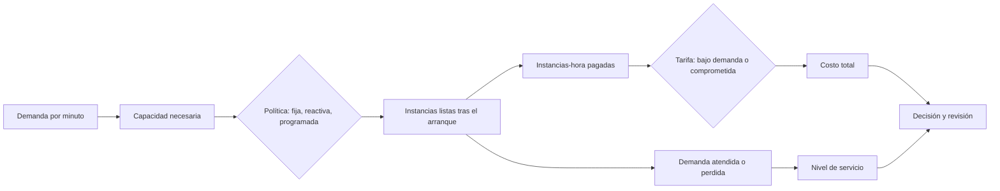
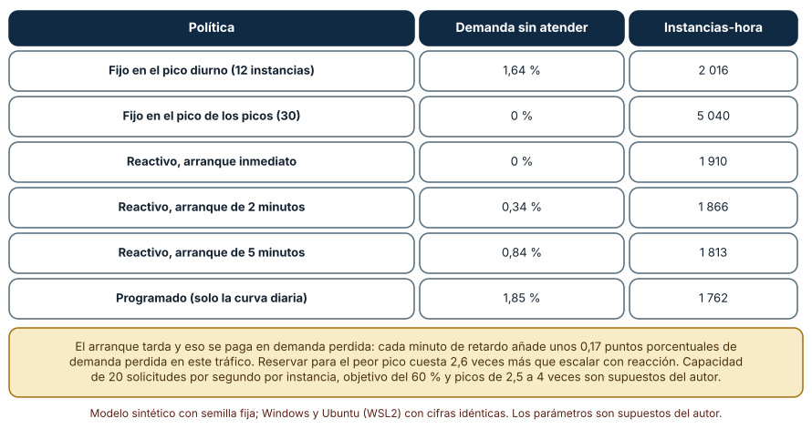
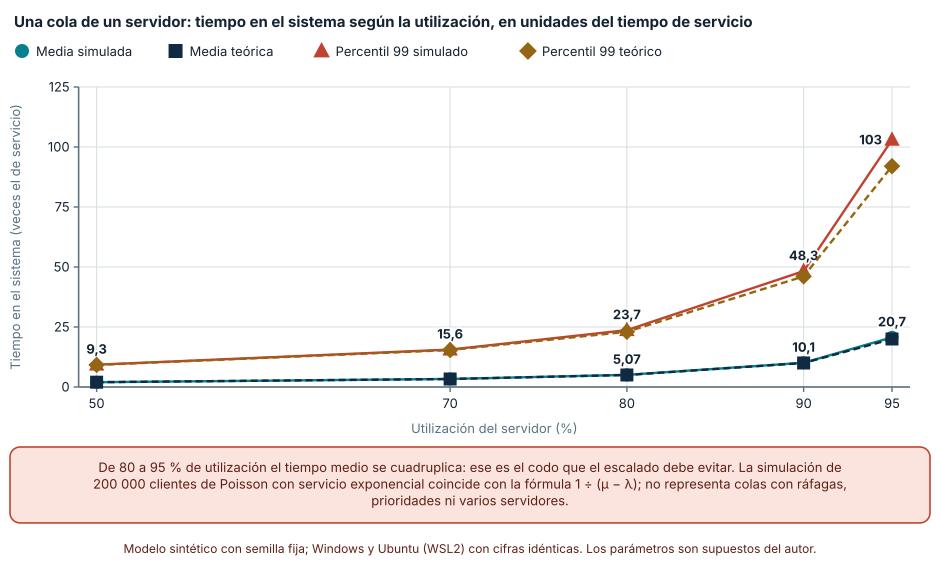
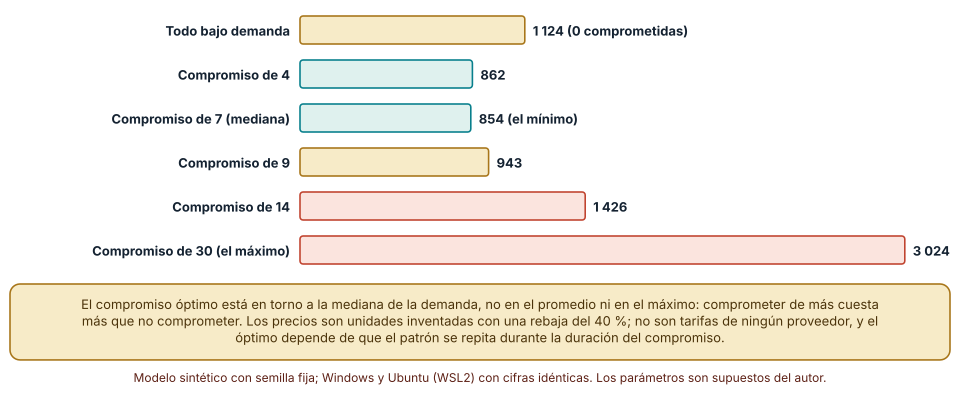

# SE-356 — Escalado, capacidad y costos

[← SE-355 — Entornos, cuentas y separación de responsabilidades](https://github.com/vladimiracunadev-create/modern-software-engineering-program/blob/main/classes/part-29-cloud-plataforma-e-infraestructura/se-355-entornos-cuentas-y-separacion-de-responsabilidades/README.md) · [↑ Parte 29](https://github.com/vladimiracunadev-create/modern-software-engineering-program/blob/main/classes/part-29-cloud-plataforma-e-infraestructura/README.md) · [📚 Índice completo](https://github.com/vladimiracunadev-create/modern-software-engineering-program/blob/main/classes/README.md) · [🌐 Portal](https://vladimiracunadev-create.github.io/modern-software-engineering-program/classes/SE-356.html) · [SE-357 — Multi-cloud, híbrido y portabilidad real →](https://github.com/vladimiracunadev-create/modern-software-engineering-program/blob/main/classes/part-29-cloud-plataforma-e-infraestructura/se-357-multi-cloud-hibrido-y-portabilidad-real/README.md)

## Punto profesional y fundamento pedagógico

**Punto profesional.** La clase existe para que puedas decidir cuánta capacidad tener, cuándo cambiarla y cuánto pagar por ella con evidencia y no con una impresión. Hay tres relaciones que gobiernan casi todo: el escalado reactivo siempre llega tarde por lo que tarda en arrancar, la latencia se dispara antes de que la capacidad se agote y el precio más bajo por unidad exige comprometer una cantidad que hay que elegir bien.

**Por qué aparece aquí.** Sigue a **Entornos, cuentas y separación de responsabilidades**: ya sabes dónde vive cada entorno; ahora preguntas cuántas instancias necesita y a qué precio. El caso conductor de la parte es la plataforma de entregas llevada a una infraestructura gestionada, y esta clase decide cómo se dimensiona para la semana de cierre sin pagarla todo el año.

**Error conceptual que debe corregir.** Creer que el escalado automático absorbe cualquier pico. Reacciona a lo que ya ocurrió, tarda en tener instancias listas y no hace nada por la demanda que llega mientras tanto; y que la capacidad «sobra» mientras la utilización sea del 90 %, cuando es justo ahí donde la espera se multiplica.

**Secuencia de aprendizaje.** Antes de leer los resultados, predices qué porcentaje de demanda se pierde si las instancias tardan cinco minutos en arrancar, cuánto crece el tiempo en el sistema al pasar de una utilización del 80 % al 95 % y cuántas instancias conviene comprometer para ahorrar; después lo calculas con una simulación de siete días de tráfico, una cola de un servidor y un modelo de precios. La secuencia usa predicción, explicación propia, contraste y recuperación. [ICAP](https://icap.education.asu.edu/research) distingue participación de construcción de conocimiento; [How People Learn II](https://nap.nationalacademies.org/catalog/24783/how-people-learn-ii-learners-contexts-and-cultures) exige conectar conocimiento previo, contexto y transferencia; la [práctica de recuperación](https://pubmed.ncbi.nlm.nih.gov/16507066/) respalda producir de nuevo la explicación tras una demora; y [Education for Life and Work](https://nap.nationalacademies.org/resource/13398/dbasse_084153.pdf) exige devolución que explique la causa del error.

**Evidencia de aprendizaje.** `capacidad-y-costos.md` con la predicción, las tres figuras reproducidas, la política de escalado de la aplicación web con sus parámetros justificados, el nivel de compromiso elegido con su cálculo y una nota con qué cambia si el patrón de tráfico cambia.

**Límite de la conclusión.** El tráfico es sintético (una curva diaria con picos que el autor inventó), la capacidad por instancia, el objetivo de utilización, el arranque y los precios son supuestos del autor, y los precios no son los de ningún proveedor. No se midió ninguna plataforma ni un autoescalador real; la cola es un modelo de un servidor con llegadas y servicio exponenciales.

### Trazabilidad fuente → afirmación

| Fuente primaria u oficial | Afirmación que respalda | Lo que no prueba |
|---|---|---|
| [Kubernetes: Horizontal Pod Autoscaler](https://kubernetes.io/docs/tasks/run-application/horizontal-pod-autoscale/) | Escala el número de réplicas con una relación entre la métrica observada y la deseada, y aplica ventanas de estabilización para evitar oscilaciones. | No dice qué objetivo de utilización conviene ni cuánto tarda en arrancar una réplica. |
| [Little, «A Proof for the Queuing Formula: L = λW» (1961)](https://doi.org/10.1287/opre.9.3.383) | Establece que el número medio de elementos en un sistema estable es la tasa de llegada por el tiempo medio que pasan en él. | No dice cómo se distribuye el tiempo ni qué pasa en picos. |
| [Google, «Site Reliability Engineering»](https://sre.google/sre-book/table-of-contents/) | Trata la planificación de capacidad y la gestión de la sobrecarga como parte de la ingeniería de fiabilidad. | No fija un porcentaje de utilización universal. |
| [FinOps Foundation: Framework](https://www.finops.org/framework/) | Describe prácticas para informar, optimizar y operar el gasto en la nube, entre ellas la optimización de tarifas por compromiso. | No da precios ni dice qué compromiso conviene a cada carga. |

## Antes de empezar

Recupera lo aprendido en `SE-355`: cada entorno tiene sus propias reglas y su propia factura. La pregunta activa es: **¿cuántas instancias necesito en cada minuto, cuánto tardan en llegar y qué parte de ellas conviene reservar de antemano?**

## Prerrequisitos

- Haber completado `SE-355` o poder explicar por qué un entorno de producción tiene su propia cuenta.
- Python 3.11 o posterior; los experimentos usan solo la biblioteca estándar (`random`, `math`, `statistics`) y no necesitan cuenta en un proveedor.
- Saber qué es la utilización, la latencia y una tasa de llegada por segundo.

## Problema auténtico

La plataforma de entregas atendía cerca de 120 solicitudes por segundo en horas normales y 600 en los picos de cierre. El equipo fijó 30 instancias para cubrir el peor pico y pagó, siete días a la semana, una capacidad que usaba cuatro horas al mes. Luego activó el escalado automático con arranque de cinco minutos y, en el siguiente cierre, el 0,8 % de las solicitudes se perdió durante el minuto de la subida. Finalmente alguien propuso comprometer toda la flota por un descuento y el gasto subió, porque el compromiso cubría los picos y no el uso típico. Tres decisiones, tres mecanismos.

## Objetivos observables

Al terminar podrás:

1. generar un patrón de demanda con ritmo diario y picos y calcular cuántas instancias hacen falta por minuto;
2. comparar políticas de escalado por demanda sin atender y por instancias-hora, incluido el efecto del tiempo de arranque;
3. calcular cómo crece el tiempo en el sistema con la utilización y dónde está el codo;
4. encontrar el nivel de compromiso que minimiza el costo con un patrón de demanda y un descuento dados;
5. escribir la política de capacidad de la plataforma con sus supuestos y su revisión.

## Mapa conceptual



El mapa tiene dos salidas que se comparan, el **nivel de servicio** (qué demanda se atendió) y el **costo** (qué se pagó), y las dos dependen de una política que decide cuántas instancias hay en cada momento. La tarifa es una segunda decisión, independiente de la primera: cuántas de esas instancias se compran por adelantado.

## Temas y por qué importan

| Tema | Por qué cambia una decisión profesional | Evidencia mínima |
|---|---|---|
| Patrón de demanda | Un promedio oculta los picos y la forma del día. | Mínimo, mediana, percentil 99 y máximo del tráfico |
| Políticas de escalado | El arranque tarda y eso se paga en demanda perdida. | Demanda sin atender e instancias-hora por política |
| Latencia y utilización | La espera se dispara antes de saturar. | Tiempo en el sistema según la utilización |
| Compromiso de capacidad | Una base reservada abarata lo constante. | Costo según el nivel comprometido |
| Revisión | El patrón cambia y la decisión caduca. | Fecha y señal que reabre la política |

## Conceptos y decisiones

### 1. Patrón de demanda

La capacidad no se dimensiona con el promedio sino con la forma: un ritmo diario, uno semanal y picos que ocurren por razones del negocio, como el cierre de entregas. Conviene describir la demanda con unos pocos números, el mínimo, la mediana, un percentil alto y el máximo, porque cada uno responde a una decisión distinta: la mediana, a lo que se puede comprometer; el máximo, a lo que ninguna política reactiva cubrirá. Una demanda con picos de cuatro veces la mediana obliga a elegir qué parte del pico se cubre con reserva, qué parte con escalado y qué parte se acepta perder o degradar.

### 2. Políticas de escalado

Una política **fija** mantiene un número de instancias; una **reactiva** lo ajusta según una métrica observada; una **programada** lo ajusta según un calendario conocido. La reactiva, como el autoescalador horizontal de Kubernetes, calcula las réplicas deseadas como la relación entre la métrica observada y la deseada, y usa ventanas de estabilización para no oscilar. Su límite es que actúa sobre el pasado: observa, decide y espera el arranque. La programada anticipa lo que sigue un patrón y no lo que no lo sigue. Combinarlas es lo habitual: una base programada y un margen reactivo.

### 3. Latencia y utilización

Con llegadas y servicios aleatorios, una cola crece de forma no lineal con la utilización. Para el modelo más simple, un servidor con llegadas de Poisson y servicio exponencial, el tiempo medio en el sistema es el tiempo de servicio dividido entre uno menos la utilización, y el percentil 99 es unas cuatro veces y media mayor. La ley de Little, que relaciona el número de elementos en el sistema con la tasa de llegada y el tiempo en él, permite pasar de latencia a cantidad de trabajo en curso. La consecuencia es práctica: funcionar al 90 % de utilización no es «aprovechar bien» sino vivir junto a un precipicio.

### 4. Compromiso de capacidad

Los proveedores ofrecen un precio menor por unidad si te comprometes a pagar una cantidad durante un plazo. Pagas lo comprometido lo uses o no, así que conviene comprometer la parte de la demanda que casi siempre está presente y dejar el resto bajo demanda. El nivel óptimo está cerca de la mediana de la demanda, no del promedio ni del máximo: comprometer de más cuesta más que no comprometer. FinOps incluye esta optimización de tarifas como práctica, y la acompaña de una advertencia: el patrón debe repetirse durante todo el plazo.

### 5. Revisión

Una política de capacidad es una apuesta sobre el futuro del tráfico. Cuando el patrón cambia, por una nueva universidad cliente o un cambio de calendario, la política se vuelve incorrecta sin que nada falle. Por eso se escribe con su señal de revisión: qué métrica la reabre y cada cuánto se mira.

### Siete días con picos

Se genera, con semilla fija, el tráfico por minuto de siete días: una curva diaria entre 60 y 180 solicitudes por segundo, ruido gaussiano del 5 % y dos picos al día de diez minutos con factor 2,5, 3 o 4. El resultado tiene mínimo 50,3, mediana 120,8, percentil 99 de 267,9 y máximo 598,2 solicitudes por segundo. Con 20 solicitudes por segundo por instancia, el máximo exige 30 instancias. Se simulan seis políticas con objetivo de utilización del 60 %.

```python
want = math.ceil(d / (cap * target))
have = n + sum(k for _, k in pend)            # instancias en camino cuentan
if want > have: pend.append((m + delay, want - have))
elif want < have and m - last_in >= cooldown: n = max(want, 1)   # reducir tras 10 min
unmet += max(0.0, d - n * cap)
```

| Política | Demanda sin atender | Instancias-hora |
|---|---:|---:|
| Fijo en el pico diurno (12) | 1,64 % | 2 016 |
| Fijo en el pico de los picos (30) | 0 % | 5 040 |
| Reactivo, arranque inmediato | 0 % | 1 910 |
| Reactivo, arranque de 2 minutos | 0,34 % | 1 866 |
| Reactivo, arranque de 5 minutos | 0,84 % | 1 813 |
| Programado (solo la curva diaria) | 1,85 % | 1 762 |

Reservar para el pico absoluto cubre todo y cuesta 2,6 veces más que escalar con reacción. Cada minuto de arranque añade unos 0,17 puntos porcentuales de demanda perdida. La política programada es la más barata y la que más pierde, porque no ve los picos aleatorios; combinada con un margen reactivo reuniría lo bueno de ambas. El resultado enseña la forma del compromiso, no el mejor punto: esa elección depende de cuánto cueste perder una solicitud.



**Cómo leer la figura.** Cada punto es una política: el eje horizontal es el costo en instancias-hora de siete días y el vertical, la demanda que no se atendió. Lo mejor está abajo a la izquierda; mira que el escalado reactivo con arranque lento se acerca a ese rincón y que reservar para el pico lo abandona por la derecha. **Dónde deja de valer:** el tráfico lo generé yo, y los picos de un cierre de entregas real tienen una subida más brusca o más lenta; la solicitud no atendida se pierde, sin cola ni reintento, que es una simplificación.

### La espera se dispara antes de saturar

Se simula una cola de un servidor con llegadas de Poisson y servicio exponencial de media 1, con 200 000 clientes por utilización, y se mide el tiempo en el sistema (espera más servicio) con la recurrencia de Lindley.

```python
w = max(0.0, w + prev_s - a)        # espera del cliente actual
soj.append(w + s)                   # tiempo en el sistema
```

| Utilización | Media simulada / teórica | Percentil 99 simulado / teórico |
|---|---|---|
| 50 % | 2,00 / 2,00 | 9,3 / 9,2 |
| 70 % | 3,35 / 3,33 | 15,6 / 15,4 |
| 80 % | 5,07 / 5,00 | 23,7 / 23,0 |
| 90 % | 10,1 / 10,0 | 48,3 / 46,1 |
| 95 % | 20,7 / 20,0 | 103 / 92 |

De 80 % a 95 % de utilización el tiempo medio se cuadruplica y el percentil 99 pasa de 24 a 103 veces el tiempo de servicio. La simulación coincide con la fórmula 1 ÷ (μ − λ) para la media y es algo mayor para el percentil con 95 %, donde el muestreo converge más despacio. Por eso el objetivo de utilización de un autoescalador es del 50 al 70 % y no del 90: el margen no se desperdicia, es lo que absorbe la variabilidad.



**Cómo leer la figura.** El eje horizontal es la utilización del servidor y el vertical, el tiempo en el sistema en unidades del tiempo de servicio; las líneas punteadas son la teoría y las continuas, la simulación, y casi se cubren. Mira el codo: pasado el 80 % las dos curvas se disparan, y el percentil 99 lo hace más que la media. **Dónde deja de valer:** es un servidor con llegadas y servicios exponenciales; un servicio con varias réplicas, servicios más regulares o ráfagas se comporta distinto, y la utilización de un sistema real no es una constante.

### Cuánto conviene comprometer

Con la demanda de los siete días convertida en instancias necesarias por minuto, se calcula el costo para siete niveles de compromiso: lo comprometido se paga siempre a 0,6 por instancia-hora, y lo que excede se paga bajo demanda a 1,0. Los precios son unidades inventadas con una rebaja del 40 %.

```python
extra = sum(max(0, x - c) for x in need) / 60.0
cost = c * horas * 0.6 + extra * 1.0
```

| Compromiso | Instancias | Costo |
|---|---:|---:|
| Todo bajo demanda | 0 | 1 124 |
| Percentil 25 | 4 | 862 |
| Mediana | 7 | 854 |
| Percentil 75 y 90 | 9 | 943 |
| Percentil 99 | 14 | 1 426 |
| Máximo | 30 | 3 024 |

El mínimo, 854, está en la mediana, que es 24 % más barato que todo bajo demanda; comprometer el máximo cuesta 3,5 veces el mínimo. La curva es plana cerca del óptimo y empinada a la derecha: equivocarse por defecto cuesta poco y por exceso cuesta mucho. Eso sugiere comprometer un poco menos que la mediana y revisar.



**Cómo leer la figura.** Cada barra es el costo total de los mismos siete días con un nivel de compromiso distinto; la más corta es la mejor. **Dónde deja de valer:** los precios son inventados y el descuento del 40 % es un supuesto; el cálculo supone que la demanda de las próximas semanas tendrá la misma forma, y si el patrón de un curso cambia, el compromiso queda sobredimensionado hasta que vence.

### Ampliación: software verde, intensidad de carbono y GreenOps

Esta clase dimensiona capacidad y costo. La misma capacidad tiene también un costo ambiental que se puede medir con la misma disciplina: las emisiones de gases de efecto invernaldero del software no dependen solo de cuánto cómputo usa, sino de dónde y cuándo se ejecuta y de cuánto hardware hace falta fabricar para ejecutarlo. El **software verde** es la práctica de diseñar y operar software para emitir menos por cada unidad de trabajo útil; **GreenOps** es su dimensión operativa (medir, atribuir y reducir en producción), por analogía con FinOps para el costo.

**Mecanismo: la intensidad de software por unidad funcional.** La [Software Carbon Intensity (SCI)](https://sci.greensoftware.foundation/) de la Green Software Foundation, publicada también como norma ISO/IEC 21031, define una tasa:

SCI = ((E × I) + M) por R

donde **E** es la energía consumida por el software (kWh), **I** la intensidad de carbono de la electricidad donde y cuando se consume (gCO2e/kWh), **M** las emisiones incorporadas del hardware (fabricación y fin de vida) atribuidas al software, y **R** la unidad funcional (por solicitud, por usuario, por tarea). Importa que sea una tasa y no un total: un servicio que crece puede emitir más en total y menos por solicitud, y es la tasa la que permite comparar dos diseños. Importa también que la intensidad (**I**) no depende del software: es una propiedad de la red eléctrica, que varía por región y por hora.

**Tres palancas, tres naturalezas.**

1. **Hacer menos trabajo** (reducir E): un algoritmo mejor, menos transferencia, caché, cómputo más utilizado. Su efecto es multiplicativo e independiente de la red eléctrica.
2. **Ejecutar donde y cuando la electricidad es más limpia** (reducir I): mover trabajos diferibles a horas de baja intensidad (*time shifting*) o a regiones más limpias (*location shifting*). El [Carbon Aware SDK](https://github.com/Green-Software-Foundation/carbon-aware-sdk) de la fundación ofrece una interfaz para consultar esos datos. Solo vale para trabajo que puede esperar o moverse, y mover datos entre regiones tiene su propio costo.
3. **Usar menos hardware** (reducir M): mayor utilización, vida útil más larga, no sobredimensionar. La clase ya muestra que el exceso de capacidad cuesta dinero; también cuesta carbono incorporado.

**Causa de que la medición importe: el costo monetario y el de carbono se parecen pero no coinciden.** Apagar una máquina ociosa baja ambos. Pasar un trabajo a una región más barata puede subir las emisiones si su red es más sucia, y un compromiso de capacidad que reduce el costo por hora puede aumentar el hardware reservado. Sin medir las dos cosas, optimizar una puede empeorar la otra.

**Experimento reproducible.** `scripts/experiments_part29_ext.py` hace dos cosas. Primero mide el tiempo de ejecución real, en un solo hilo, de dos implementaciones de la misma tarea (agrupar 20 000 registros de 3 000 claves): una con búsqueda lineal en una lista para saber si la clave ya se vio y otra con diccionario. Después calcula el SCI por tarea con supuestos declarados: 15 W por núcleo, intensidad de la red de 50, 300 y 700 gCO2e/kWh (valores ilustrativos de orden de magnitud, no de una región concreta) y emisiones incorporadas de 1 300 kg para un servidor de 16 núcleos con vida útil de 4 años, atribuidas por tiempo de uso.

| Red eléctrica | SCI con búsqueda lineal (1,1112 s) | SCI con diccionario (0,0076 s) |
|---|---:|---:|
| 50 gCO2e/kWh | 0,947 mg | 0,006 mg |
| 300 gCO2e/kWh | 2,105 mg | 0,014 mg |
| 700 gCO2e/kWh | 3,957 mg | 0,027 mg |

El diccionario tardó unas 146 veces menos en la corrida usada en esta tabla; en las repeticiones del autor la razón varió entre 75 y 170 (otras tareas compiten por el procesador y los tiempos de milisegundos son ruidosos), por lo que la cifra fiable es el orden de magnitud, no el número. Para el desplazamiento temporal se usa una curva diaria sintética de intensidad (mínimo de 100 al mediodía por la generación solar, máximo de 600 a las 19:00) y un trabajo diferible de 3 horas: ejecutado a las 18:00 se expone a una intensidad media de 573,3 gCO2e/kWh y en la mejor ventana (desde las 11:00) a 106,7, una reducción del 81,4 % de las emisiones operativas de ese trabajo.


**Cómo leer la figura.** La escala vertical es logarítmica: cada marca vale diez veces la anterior. Compara dos distancias: la de cada par de barras (el algoritmo, más de dos órdenes de magnitud) y la de las tres redes dentro de una misma serie (poco más de un factor 4). Mira además que con la red de 50 el caso eficiente ya tiene unas tres cuartas partes de su SCI en el término M: cuando la electricidad es limpia, lo que queda por reducir es el hardware. **Dónde deja de valer:** la energía se estima a partir del tiempo y de una potencia por núcleo supuesta, no se midió con un vatímetro ni con contadores de energía del procesador; las intensidades no son de ninguna región; la tarea es una sola función en Python y no representa un servicio completo con red, disco y memoria; y no se consideró la sobrecarga de mover un trabajo a otra hora o región.

**Límite y decisión.** El experimento no mide una organización ni un servicio real. La decisión práctica es operativa: elegir una unidad funcional (por solicitud, por informe), medir energía con la mejor fuente disponible (contadores del proveedor de nube, estimadores como los del modelo de la fundación) y reportar el SCI junto al costo en la misma revisión de capacidad; reducir primero el trabajo innecesario, que ahorra dinero y carbono a la vez; trasladar en el tiempo lo diferible cuando hay datos de intensidad; y declarar qué parte del SCI es estimada, porque una cifra de carbono con falsa precisión es más dañina que ninguna.

## Definiciones de trabajo

- **escalado reactivo:** ajuste del número de instancias según una métrica observada, con un retardo hasta que las nuevas estén listas.
- **escalado programado:** ajuste del número de instancias según un calendario basado en un patrón conocido.
- **utilización:** fracción del tiempo o de la capacidad que un recurso está ocupado.
- **ley de Little:** relación L = λW entre el número medio de elementos en un sistema estable, la tasa de llegada y el tiempo medio que pasan en él.
- **compromiso de capacidad:** acuerdo de pagar una cantidad de capacidad por un plazo a cambio de un precio unitario menor.

Las definiciones son operativas para la plataforma de entregas. Cada proveedor y cada herramienta usan estos términos con matices y deben contrastarse con la documentación primaria enlazada al final.

## Ejemplo mínimo

El fragmento calcula el tiempo medio en el sistema de una cola de un servidor con la fórmula. Antes de ejecutarlo, predice cuánto vale con utilización 0,8 y con 0,9.

```python
mu = 1.0
for rho in (0.5, 0.8, 0.9, 0.95):
    print(rho, round(1 / (mu - rho * mu), 1))
```

La salida es `0.5 2.0`, `0.8 5.0`, `0.9 10.0` y `0.95 20.0`: cada diez puntos de utilización pasan de duplicar a cuadruplicar la espera. Registra versión de Python, comando y salida; después aplica la ley de Little para obtener cuántos clientes hay en el sistema con una llegada de 50 por segundo y un tiempo de 0,04 s.

## Ejemplo profesional

El equipo de la plataforma describe la demanda de siete días con mínimo, mediana, percentil 99 y máximo, y concluye que 12 instancias cubren el día normal y 30 el peor pico. Elige una política programada con una base de 7 instancias, una subida programada para las horas del cierre y un margen reactivo con objetivo de utilización del 60 % y arranque de 2 minutos, y mide con su propio tráfico cuánta demanda pierde en los picos aleatorios. Para las notificaciones, que toleran retraso, usa una cola en lugar de instancias. Compromete 7 instancias, la mediana, con revisión cada trimestre y una alerta si la demanda mediana baja o sube un 25 %. Registra el costo con y sin compromiso. Compara con el estado inicial: ya no paga el pico absoluto todo el año ni pierde solicitudes por un arranque de cinco minutos.

## Práctica guiada

1. Predice la demanda sin atender con arranque de 5 minutos y las instancias que comprometerías.
2. Genera el tráfico de siete días con semilla fija y describe sus cuatro números clave.
3. Simula las seis políticas y reproduce la tabla de demanda sin atender e instancias-hora.
4. Cambia el objetivo de utilización a 80 % y mide el efecto sobre el servicio perdido.
5. Simula la cola con cinco utilizaciones y compara con la fórmula.
6. Calcula el costo para siete niveles de compromiso y localiza el mínimo.
7. Entrega `capacidad-y-costos.md` y pide a otra persona que identifique qué supuesto cambiaría el nivel de compromiso.

## Ejercicios

1. **Pico:** con un pico de cuatro veces la mediana durante diez minutos y arranque de 5, calcula cuánta demanda se pierde y qué política la reduciría.
2. **Cola:** explica por qué el percentil 99 crece más que la media al acercarse a la saturación.
3. **Little:** con 600 solicitudes por segundo y un tiempo en el sistema de 0,05 s, ¿cuántas hay en curso? ¿Cuántas instancias de 20 en curso por instancia hacen falta?
4. **Compromiso:** si el descuento fuera del 20 % en lugar del 40 %, ¿sube o baja el nivel óptimo? Razona sin repetir el cálculo.

## Reto verificable

Entrega `capacidad-y-costos.md` con la predicción, las tres tablas reproducidas con las mismas semillas, la política de escalado de la aplicación web con sus parámetros y el nivel de compromiso con su cálculo. Se aprueba si otra persona ejecuta el código desde un checkout limpio, obtiene las mismas cifras y puede decir qué le pasaría al servicio si el pico de cierre llegara con un arranque de diez minutos. No se aprueba por afirmar que el escalado automático «absorbe los picos» sin medir el arranque, ni por comprometer capacidad con el promedio.

## Caso conductor

La plataforma de entregas es el caso conductor de la Parte 29. Esta clase deja el octavo artefacto: la política de capacidad y el nivel de compromiso. `SE-357` pregunta qué pasa si parte de esta capacidad está en otro proveedor o en una instalación propia. Cambia un supuesto, por ejemplo el tiempo de arranque, y observa cuánto se mueve la demanda sin atender.

## Preguntas frecuentes

### ¿Por qué no usar siempre un objetivo de utilización alto para ahorrar?

Porque la espera crece más que proporcionalmente y porque el autoescalador necesita margen para el arranque. Un objetivo del 90 % ahorra instancias y paga con latencia y con demanda perdida en cada pico.

### ¿El escalado programado reemplaza al reactivo?

No: cubre lo que sigue un patrón y es ciego a lo que no. En la tabla pierde más que el reactivo con arranque de 5 minutos. Combinados dan el costo bajo del primero y la respuesta a lo inesperado del segundo.

### ¿Se puede comprometer sin conocer bien la demanda?

Se puede comprometer poco, por debajo de la mediana, donde la curva es plana y el riesgo pequeño. Comprometer más exige una historia de demanda y la confianza de que el patrón seguirá durante el plazo.

### ¿Qué pasa con las solicitudes que no se atienden?

En el modelo se pierden. En un sistema real se encolan, se reintentan o se degradan; cada una de esas opciones tiene su costo de latencia y de estado y es una decisión de diseño de la Parte 28.

## Fallo controlado y diagnóstico

Reproduce el fallo clásico de la clase: **el pico llega antes de que lleguen las instancias**. Aplica la política reactiva con arranque de 5 minutos sobre el tráfico con un pico de cuatro veces.

Registra síntoma, entrada mínima, hipótesis, observación que descarta cada hipótesis, causa, corrección y prueba de regresión. **Síntoma:** durante la subida del pico, una fracción visible de las solicitudes de ese cuarto de hora se pierde y después todo se normaliza. **Hipótesis rivales:** (a) el autoescalador está mal configurado; (b) hay un defecto en la aplicación; (c) las instancias nuevas tardan en estar listas. **Prueba:** compara en el tiempo la demanda, las instancias pedidas y las instancias listas; si las pedidas suben de inmediato y las listas lo hacen cinco minutos después, la causa es el arranque. **Conclusión:** el escalado reactivo no cubre el primer tramo del pico. **Regresión:** añade una subida programada previa al cierre y repite la simulación comprobando la pérdida. No arregles a la vez el objetivo de utilización y el calendario.

## Errores comunes y cómo corregirlos

| Síntoma | Causa probable | Corrección |
|---|---|---|
| Se pierden solicitudes en cada pico aunque el autoescalador funcione | El arranque tarda más que la subida | Subida programada previa o instancias de reserva |
| Se paga el pico todo el año | Capacidad fija dimensionada al máximo | Escalado reactivo con base programada |
| La latencia se dispara con 90 % de utilización | Objetivo demasiado alto | Bajar el objetivo al 50–70 % |
| El compromiso aumenta el gasto | Se comprometió el pico o el promedio de un patrón que cambió | Comprometer por debajo de la mediana y revisar |
| La política se vuelve incorrecta sin avisar | El patrón de tráfico cambió | Señal de revisión sobre la mediana y los picos |

## Entorno y archivos clave

```text
work/SE-356/
├── README.md
├── capacidad/
│   ├── trafico.py
│   ├── escalado.py
│   ├── cola.py
│   └── compromiso.py
├── tests/test_capacidad.py
└── evidence/capacidad-y-costos.md
```

El `README` declara versión de Python, semillas y comandos. Los experimentos usan solo la biblioteca estándar y se ejecutaron con CPython 3.12.9 en Windows 11 y 3.12.3 en Ubuntu bajo WSL2 con salidas idénticas. No se usó ninguna plataforma; si usas una, declara región, tarifa y limpieza.

## Seguridad, ética y accesibilidad

- los precios del ejemplo son inventados y no son una oferta: no tomes una decisión de compra con ellos;
- una solicitud perdida en el cierre es una entrega de un estudiante que no se confirmó: decide qué se garantiza antes de decidir qué se ahorra;
- escalar a cero puede dejar sin servicio a quien lo necesita fuera del horario esperado: documenta qué se tolera;
- describe la política de capacidad en texto además del gráfico, para que un lector de pantalla pueda seguirla;
- respeta las condiciones de los proveedores al comprometer capacidad y registra quién autoriza el gasto.

## Puente hacia el trabajo con agentes

Un agente al que se le pide «configura el escalado automático de la plataforma» producirá una regla con un objetivo de utilización alto y sin base programada, y no medirá el tiempo de arranque. Pídele en cambio que declare el patrón de demanda con sus cuatro números, que calcule la demanda perdida con el arranque medido y que incluya una prueba que simule el pico y falle si la pérdida supera un umbral. Revisa especialmente el objetivo de utilización, los mínimos y máximos de instancias y el tiempo de enfriamiento: son los tres parámetros donde un escalado correcto pierde solicitudes o paga de más.

## Transferencia

Traslada el análisis a otro dominio (por ejemplo, un servicio de reservas con picos de fin de semana): cambia la curva y conserva el procedimiento de generar la demanda, comparar políticas por servicio perdido y costo, calcular el codo de la cola y buscar el nivel de compromiso. La transferencia está lograda cuando puedes decir qué parte de la demanda cubrirías con reserva y cuál con escalado, no cuando las tablas se parecen.

## Evaluación y evidencia

| Criterio | Evidencia para aprobar |
|---|---|
| comprensión | explicación del efecto del arranque, del codo de la cola y del compromiso |
| corrección | simulaciones y fórmulas reproducibles con las mismas semillas |
| decisión | política de escalado y nivel de compromiso con su señal de revisión |
| diagnóstico | reproducción del fallo «pico antes que las instancias» con regresión |
| incertidumbre | declaración de que el tráfico y los precios son supuestos del autor |
| reproducibilidad | versiones, comandos, salida y límites declarados |

## Fuentes

- [Kubernetes: Horizontal Pod Autoscaler](https://kubernetes.io/docs/tasks/run-application/horizontal-pod-autoscale/) — cálculo de réplicas y ventanas de estabilización; autoridad: documentación oficial de Kubernetes.
- [Little (1961), A Proof for the Queuing Formula: L = λW](https://doi.org/10.1287/opre.9.3.383) — relación entre llegadas, tiempo y elementos en el sistema; autoridad: artículo original (Operations Research, 9(3)).
- [Site Reliability Engineering](https://sre.google/sre-book/table-of-contents/) — capacidad y sobrecarga como ingeniería; autoridad: libro de Google publicado en línea.
- [FinOps Framework](https://www.finops.org/framework/) — optimización de tarifas y compromisos; autoridad: FinOps Foundation.
- [Python: random](https://docs.python.org/3/library/random.html) — generador usado en los experimentos; autoridad: documentación de Python.

Cada fuente respalda el mecanismo indicado; ninguna demuestra que el 0,84 %, el 95 % de utilización con 103 veces el servicio ni el costo de 854 se observen en una plataforma real. Esa afirmación depende del tráfico, de los precios y del arranque de cada servicio.

- [Green Software Foundation: Software Carbon Intensity (SCI)](https://sci.greensoftware.foundation/) — fórmula SCI = ((E × I) + M) por R y definiciones de energía, intensidad, emisiones incorporadas y unidad funcional; autoridad: Green Software Foundation (especificación, publicada como ISO/IEC 21031; la página de la norma en iso.org bloquea clientes automáticos y no se pudo verificar con curl).
- [Green Software Foundation: Carbon Aware SDK](https://github.com/Green-Software-Foundation/carbon-aware-sdk) — consulta de intensidad de carbono para desplazar trabajo en el tiempo o en la región; autoridad: repositorio de la Green Software Foundation.

## Límites y siguiente paso

Se ejecutaron tres experimentos sintéticos en Windows y Ubuntu (WSL2) con resultados idénticos. No se midió ninguna plataforma ni un autoescalador real: el tráfico, la capacidad por instancia, el arranque y los precios son supuestos del autor y la cola es un modelo de un servidor. La siguiente clase mira qué pasa cuando parte de esta capacidad vive en otro proveedor o en una instalación propia: multi-cloud, híbrido y portabilidad real. La ampliación sobre software verde mide tiempos reales con CPython 3.12.9 en Windows, que varían entre ejecuciones, y calcula el SCI con potencia, intensidades y emisiones incorporadas supuestas; no se midió energía con instrumentos ni se evaluó ninguna región ni servicio real.

## Glosario

- **escalado reactivo:** ajuste del número de instancias según una métrica observada, con un retardo hasta que las nuevas estén listas.
- **escalado programado:** ajuste del número de instancias según un calendario basado en un patrón conocido.
- **utilización:** fracción del tiempo o de la capacidad que un recurso está ocupado.
- **ley de Little:** relación L = λW entre el número medio de elementos en un sistema estable, la tasa de llegada y el tiempo medio que pasan en él.
- **compromiso de capacidad:** acuerdo de pagar una cantidad de capacidad por un plazo a cambio de un precio unitario menor.

---

[← SE-355 — Entornos, cuentas y separación de responsabilidades](https://github.com/vladimiracunadev-create/modern-software-engineering-program/blob/main/classes/part-29-cloud-plataforma-e-infraestructura/se-355-entornos-cuentas-y-separacion-de-responsabilidades/README.md) · [↑ Parte 29](https://github.com/vladimiracunadev-create/modern-software-engineering-program/blob/main/classes/part-29-cloud-plataforma-e-infraestructura/README.md) · [📚 Índice completo](https://github.com/vladimiracunadev-create/modern-software-engineering-program/blob/main/classes/README.md) · [🌐 Portal](https://vladimiracunadev-create.github.io/modern-software-engineering-program/classes/SE-356.html) · [SE-357 — Multi-cloud, híbrido y portabilidad real →](https://github.com/vladimiracunadev-create/modern-software-engineering-program/blob/main/classes/part-29-cloud-plataforma-e-infraestructura/se-357-multi-cloud-hibrido-y-portabilidad-real/README.md)
