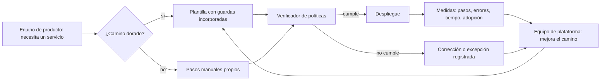
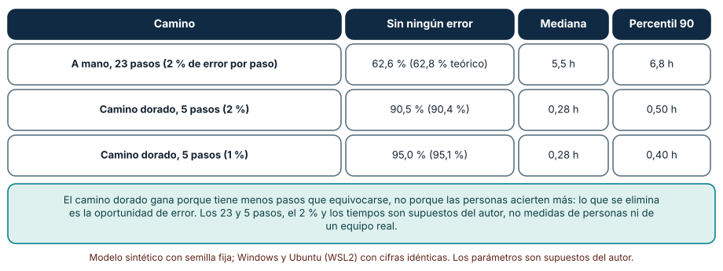
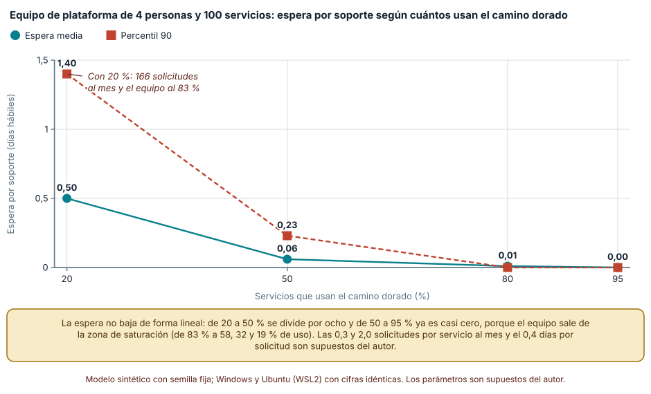
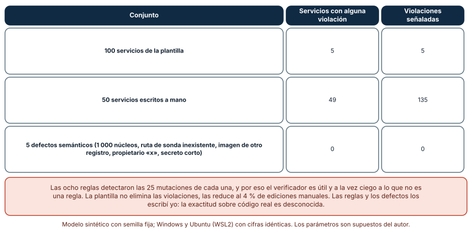

# SE-358 — Plataformas internas y golden paths

[← SE-357 — Multi-cloud, híbrido y portabilidad real](https://github.com/vladimiracunadev-create/modern-software-engineering-program/blob/main/classes/part-29-cloud-plataforma-e-infraestructura/se-357-multi-cloud-hibrido-y-portabilidad-real/README.md) · [↑ Parte 29](https://github.com/vladimiracunadev-create/modern-software-engineering-program/blob/main/classes/part-29-cloud-plataforma-e-infraestructura/README.md) · [📚 Índice completo](https://github.com/vladimiracunadev-create/modern-software-engineering-program/blob/main/classes/README.md) · [🌐 Portal](https://vladimiracunadev-create.github.io/modern-software-engineering-program/classes/SE-358.html) · [SE-359 — Taller: desplegar y destruir un entorno seguro →](https://github.com/vladimiracunadev-create/modern-software-engineering-program/blob/main/classes/part-29-cloud-plataforma-e-infraestructura/se-359-taller-desplegar-y-destruir-un-entorno-seguro/README.md)

## Punto profesional y fundamento pedagógico

**Punto profesional.** La clase existe para que puedas tratar la infraestructura como un producto con usuarios: los equipos que despliegan servicios. Una plataforma interna no es un portal ni un conjunto de herramientas, es una oferta de caminos ya resueltos con sus guardas incorporadas, y su valor se mide por cuántos pasos y cuántos errores le quita a quien la usa y por cuánto trabajo le deja a quien la mantiene.

**Por qué aparece aquí.** Sigue a **Multi-cloud, híbrido y portabilidad real**: allí decidiste dónde vive cada pieza; ahora preguntas cómo se la ofreces a diez equipos sin que cada uno reconstruya las redes, los permisos y los despliegues de las clases anteriores. El caso conductor de la parte es la plataforma de entregas llevada a una infraestructura gestionada, y esta clase decide cómo se crea el siguiente servicio de esa plataforma.

**Error conceptual que debe corregir.** Creer que una plataforma interna es un catálogo de herramientas o un portal con botones. Una plataforma que nadie usa, o que obliga a lo mismo a quien no lo necesita, solo traslada el costo: el trabajo de integración pasa del equipo de producto al equipo de plataforma y los errores se mueven a una capa que tampoco nadie revisa.

**Secuencia de aprendizaje.** Antes de leer los resultados, predices qué probabilidad hay de crear un servicio sin ningún error con 23 pasos manuales frente a 5 automatizados, cómo cambia la espera del equipo de plataforma según cuántos servicios sigan el camino y qué ve un verificador de políticas en servicios hechos a mano; después lo calculas con una simulación de ensayos, una cola de soporte y un verificador de ocho reglas. La secuencia usa predicción, explicación propia, contraste y recuperación. [ICAP](https://icap.education.asu.edu/research) distingue participación de construcción de conocimiento; [How People Learn II](https://nap.nationalacademies.org/catalog/24783/how-people-learn-ii-learners-contexts-and-cultures) exige conectar conocimiento previo, contexto y transferencia; la [práctica de recuperación](https://pubmed.ncbi.nlm.nih.gov/16507066/) respalda producir de nuevo la explicación tras una demora; y [Education for Life and Work](https://nap.nationalacademies.org/resource/13398/dbasse_084153.pdf) exige devolución que explique la causa del error.

**Evidencia de aprendizaje.** `camino-dorado.md` con la predicción, las tres figuras reproducidas, el camino dorado de la plataforma en cinco pasos con sus guardas, la medida de adopción que usarías y la lista de lo que el verificador no ve.

**Límite de la conclusión.** Los pasos, las probabilidades de error, los tiempos, las tasas de solicitudes y los descriptores son sintéticos y supuestos del autor; no se midió ninguna persona ni equipo, no se evaluó ningún portal ni plataforma real, y el verificador y sus defectos los escribí yo, así que su exactitud sobre código real es desconocida.

### Trazabilidad fuente → afirmación

| Fuente primaria u oficial | Afirmación que respalda | Lo que no prueba |
|---|---|---|
| [CNCF Platforms White Paper](https://tag-app-delivery.cncf.io/whitepapers/platforms/) | Describe las plataformas internas como capacidades integradas ofrecidas a los equipos de producto para reducir su carga cognitiva y repetir buenas prácticas. | No mide el efecto en una organización concreta. |
| [Team Topologies](https://teamtopologies.com/) | Propone equipos de plataforma que ofrecen servicios autoservicio a equipos alineados al flujo de valor para disminuir su carga cognitiva. | Es un marco de organización; no demuestra su efecto con una medida. |
| [DORA: investigación](https://dora.dev/) | Reúne investigación sobre prácticas y capacidades asociadas al desempeño de entrega de software, como la frecuencia de despliegue y el tiempo de recuperación. | No establece que una plataforma concreta mejore esas medidas. |
| [Backstage: qué es](https://backstage.io/docs/overview/what-is-backstage/) | Presenta un portal de desarrollo de código abierto con catálogo de software y plantillas para crear componentes con estándares incorporados. | Es una herramienta posible; no decide qué ofrecer ni cómo medir su uso. |
| [Open Policy Agent](https://www.openpolicyagent.org/docs/latest/) | Documenta un motor de políticas como código para comprobar configuraciones de forma automática. | No dice qué políticas convienen ni garantiza que cubran un riesgo. |

## Antes de empezar

Recupera lo aprendido en `SE-357`: cada decisión de dónde vive algo tiene un costo. La pregunta activa es: **¿cuántos pasos y cuántas decisiones debe tomar alguien para llevar un servicio nuevo a producción de forma segura, y cuántos puedo quitarle sin quitarle control?**

## Prerrequisitos

- Haber completado `SE-357` o poder explicar qué se gana y qué se pierde al limitarse a lo común entre proveedores.
- Python 3.11 o posterior; los experimentos usan solo la biblioteca estándar (`random`, `re`, `statistics`) y no necesitan Backstage ni un motor de políticas.
- Saber qué es una plantilla de servicio, un descriptor de despliegue y una política comprobable.

## Problema auténtico

La plataforma de entregas creció a nueve servicios y cuatro equipos. Para crear un servicio nuevo, un equipo seguía una página de 23 pasos: repositorio, cuenta, red, permisos, registro de imágenes, despliegue, alarmas. Cada equipo lo hacía un poco distinto: uno olvidó los límites de recursos, otro dejó la imagen con la etiqueta más reciente y un tercero ejecutó el proceso como administrador. El equipo de plataforma, de cuatro personas, pasaba el día respondiendo dudas sobre esos pasos. Una propuesta fue «hacer un portal»; otra, «prohibir todo salvo lo aprobado». Ninguna decía qué problema resolvía ni cómo se sabría si funcionó.

## Objetivos observables

Al terminar podrás:

1. definir un camino dorado como una oferta con guardas incorporadas y distinguirlo de una obligación y de un portal;
2. calcular la probabilidad de crear un servicio sin errores según el número de pasos y el tiempo esperado;
3. estimar cómo cambia la espera del equipo de plataforma según la fracción de servicios que usan el camino;
4. escribir un verificador de políticas, medir lo que detecta y listar lo que no puede ver;
5. definir cómo medirías la adopción y el valor del camino sin convertirlo en una cifra vacía.

## Mapa conceptual



El mapa muestra que el camino dorado y el verificador son dos mecanismos distintos: el primero **reduce** el número de pasos y de decisiones; el segundo **comprueba** el resultado venga de donde venga. La excepción registrada es parte del diseño: cuando alguien se aparta del camino, el motivo vuelve al equipo de plataforma como información para mejorarlo.

## Temas y por qué importan

| Tema | Por qué cambia una decisión profesional | Evidencia mínima |
|---|---|---|
| Plataforma como producto | Tiene usuarios, una oferta y una medida de valor. | Descripción del usuario y de la oferta |
| Camino dorado | Quita pasos y decisiones, no libertad. | Pasos y probabilidad de error con y sin él |
| Carga cognitiva y soporte | El tiempo de los equipos y la cola de soporte limitan la escala. | Espera del equipo según la adopción |
| Políticas como código | Comprobar el resultado no depende de quién lo creó. | Detección sobre servicios con defectos sembrados |
| Medir adopción y valor | Una cifra mal elegida premia lo que no importa. | Medidas con lo que no miden declarado |

## Conceptos y decisiones

### 1. Plataforma como producto

El libro Team Topologies y el documento de plataformas de la CNCF coinciden en un punto: una plataforma interna existe para reducir la carga cognitiva de los equipos que construyen producto, ofreciéndoles capacidades listas para usar en autoservicio. Tratarla como producto significa tener usuarios identificados, entender qué les cuesta y medir si lo que se ofrece lo reduce. Sin eso se vuelve un proyecto de infraestructura con su propia agenda. Una plataforma se vuelve costosa de mantener cuando ofrece mucho y se usa poco, y se vuelve inútil cuando no ofrece lo que el equipo necesita justo cuando lo necesita.

### 2. Camino dorado

Un camino dorado, o camino pavimentado, es la forma recomendada, soportada y automatizada de hacer algo frecuente, como crear un servicio nuevo. Incorpora las guardas que de otro modo cada equipo debería recordar: límites de recursos, un usuario sin privilegios, una etiqueta de dueño, sondas de salud, imágenes con versión fija. No es una obligación: quien tenga una necesidad distinta puede apartarse, asumiendo el costo de mantener lo suyo. Lo que lo hace valioso no es la libertad sino el costo: el camino más fácil es también el correcto. Si lo correcto exige más pasos que lo incorrecto, la gente elige lo incorrecto.

### 3. Carga cognitiva y soporte

Cada paso manual es algo que recordar y algo que se puede hacer mal. La probabilidad de completar una secuencia sin error cae de forma geométrica con su longitud: con un 2 % de error por paso, 23 pasos dan un 62,8 % de aciertos y 5 pasos un 90,4 %. El otro costo es el de soporte: cada servicio hecho a mano genera más solicitudes que uno creado con el camino, y un equipo de plataforma pequeño pasa de ser un habilitador a ser una cola. La saturación de esa cola es lo que hace que los equipos dejen de pedir ayuda y se aparten del camino.

### 4. Políticas como código

Un verificador de políticas lee un descriptor de servicio (qué imagen, con qué usuario, qué límites) y comprueba reglas escritas como código: debe tener dueño, límites, una imagen con versión fija, un usuario sin privilegios. Es independiente del origen: un servicio de la plantilla y uno hecho a mano pasan por la misma puerta. Herramientas como Open Policy Agent ofrecen un lenguaje para escribir esas reglas. Su límite es que comprueban forma, no sentido: un límite de CPU de mil núcleos cumple la regla «tiene límite» y es absurdo.

### 5. Medir adopción y valor

La adopción se mide con la fracción de servicios que usan el camino, y es una medida engañosa si se obliga a usarlo: sube sin que sirva. Mejor acompañarla de medidas de resultado, como el tiempo hasta el primer despliegue, la tasa de errores al crearlo y el número de excepciones y sus motivos. DORA reúne investigación sobre medidas de desempeño de entrega, como la frecuencia de despliegue o el tiempo de recuperación, útiles para ver el efecto sobre los equipos; no prueban por sí solas que la plataforma sea la causa. Toda medida debe ir con lo que no mide.

### Pasos manuales frente a un camino

Se simulan 20 000 creaciones de un primer servicio para tres caminos. Cada paso falla con probabilidad `p`; cada error añade un retrabajo con mediana de 45 minutos. El tiempo de cada paso es lognormal con mediana de 12 minutos a mano y 3 con el camino.

```python
errs = sum(r.random() < perr for _ in range(n))
t = sum(r.lognormvariate(math.log(12.0 if manual else 3.0), 0.5) for _ in range(n))
t += errs * r.lognormvariate(math.log(45), 0.6)
```

| Camino | Sin ningún error | Mediana | Percentil 90 |
|---|---:|---:|---:|
| A mano, 23 pasos (2 % de error por paso) | 62,6 % (62,8 % teórico) | 5,5 h | 6,8 h |
| Camino dorado, 5 pasos (2 %) | 90,5 % (90,4 %) | 0,28 h | 0,50 h |
| Camino dorado, 5 pasos (1 %) | 95,0 % (95,1 %) | 0,28 h | 0,40 h |

La simulación coincide con la fórmula (1 − p)^n. Con el camino el éxito sube del 62,6 % al 90,5 % y la mediana baja de 5,5 horas a 17 minutos. Lo que explica la mejora no es que las personas acierten más sino que hay menos pasos que equivocar: el error por paso es el mismo. Si el camino no baja ese error por paso, por ejemplo con un paso que sigue siendo difícil, la mejora es menor.



**Cómo leer la figura.** Cada fila es un camino; las columnas son la proporción de creaciones sin ningún error y los tiempos mediano y del percentil 90. **Dónde deja de valer:** los 23 y 5 pasos, el 2 % de error y los tiempos son supuestos del autor, no medidas de personas ni de un equipo; los errores reales no son independientes, y los tiempos de espera por una aprobación o un recurso no están modelados.

### La cola del equipo de plataforma

Se simula una cola de soporte de 24 meses de 20 días hábiles con 100 servicios, cada uno de los cuales genera 0,3 solicitudes al mes si usa el camino y 2,0 si no; el equipo son cuatro personas y cada solicitud toma 0,4 días hábiles de media. Se varía la fracción de servicios que usan el camino.

```python
rate_month = services * (frac * 0.3 + (1 - frac) * 2.0)
lam = rate_month / 20.0                       # por día hábil
start = max(t, free[i]); waits.append(start - t)
free[i] = start + rr.expovariate(1 / 0.4)
```

| Servicios en el camino | Solicitudes al mes | Uso del equipo | Espera media (días) | Percentil 90 |
|---|---:|---:|---:|---:|
| 20 % | 166 | 83 % | 0,50 | 1,40 |
| 50 % | 115 | 58 % | 0,06 | 0,23 |
| 80 % | 64 | 32 % | 0,01 | 0,00 |
| 95 % | 38,5 | 19 % | 0,00 | 0,00 |

La espera no baja de forma lineal: de 20 % a 50 % se divide por ocho, y de 50 % a 95 % ya es casi cero porque el equipo sale de la zona de saturación. Es el mismo codo de la cola de `SE-356`: cerca del 83 % de uso un equipo todavía responde, pero a poco más se desborda. Un equipo que responde tarde enseña a los demás a no preguntar, y el camino deja de ser el más fácil.



**Cómo leer la figura.** Cada fila es una fracción de servicios en el camino; las columnas dan la carga de soporte, el uso del equipo y la espera. **Dónde deja de valer:** las 0,3 y 2,0 solicitudes por servicio, el 0,4 días por solicitud y la llegada de Poisson son supuestos del autor; las solicitudes reales vienen en oleadas (una versión nueva, un incidente) y los equipos reales hacen además trabajo de desarrollo que compite con el soporte.

### Lo que un verificador ve y lo que no

Se generan 150 descriptores sintéticos: 100 desde una plantilla, con un 4 % que recibe una edición manual con un defecto, y 50 escritos a mano, donde cada una de ocho reglas se incumple con probabilidad 0,3. Las reglas son: propietario, límites de recursos, imagen con versión fija, usuario sin privilegios, sonda de salud, sin red del anfitrión, sin secreto literal y al menos dos réplicas en producción. Además se prueba el verificador con 25 mutaciones por regla y con cinco defectos semánticos que ninguna regla enuncia.

```python
def check(d):
    v = []
    if not d.get("propietario"): v.append("propietario")
    if str(d.get("imagen", "")).endswith(":latest"): v.append("imagen_fijada")
    if re.search(r"(clave|token|secreto)\s*=\s*[A-Za-z0-9+/]{12,}", d.get("env", "")): v.append("sin_secreto_literal")
```

| Conjunto | Servicios con alguna violación | Violaciones señaladas |
|---|---:|---:|
| 100 servicios de la plantilla | 5 | 5 |
| 50 servicios escritos a mano | 49 | 135 |
| 5 defectos semánticos (1 000 núcleos, ruta de sonda inexistente, imagen de otro registro, propietario «x», secreto corto) | 0 | 0 |

El verificador detectó las 25 mutaciones de cada una de las ocho reglas, y por eso resulta útil, y no vio ninguno de los cinco defectos semánticos, porque cada uno cumple la forma de su regla. La plantilla no elimina las violaciones, las reduce al 4 % de ediciones manuales. Las reglas y los defectos los escribí yo: 25 de 25 describe estas reglas contra estas mutaciones, no una cobertura general.



**Cómo leer la figura.** Cada fila es un conjunto de descriptores; las columnas cuentan cuántos servicios tienen alguna violación y cuántas violaciones se señalaron. **Dónde deja de valer:** los descriptores y los defectos son sintéticos; en un servicio real hay reglas que dependen del contexto y excepciones legítimas que un verificador no distingue de un descuido.

## Definiciones de trabajo

- **plataforma interna:** conjunto de capacidades de infraestructura y entrega que un equipo ofrece como producto a otros equipos de la organización.
- **camino dorado:** forma recomendada, soportada y automatizada de realizar una tarea frecuente, con las guardas incorporadas.
- **carga cognitiva:** esfuerzo mental que un equipo dedica a recordar y decidir cosas ajenas a su trabajo principal.
- **política como código:** regla de configuración escrita de forma que una herramienta pueda comprobarla de manera automática.
- **excepción registrada:** apartamiento deliberado del camino, con su motivo, dueño y fecha de revisión.

Las definiciones son operativas para la plataforma de entregas. Cada autor y cada herramienta usan estos términos con matices y deben contrastarse con las fuentes enlazadas al final.

## Ejemplo mínimo

El fragmento comprueba un descriptor con dos reglas. Antes de ejecutarlo, predice qué violaciones señala.

```python
def comprobar(d):
    v = []
    if not d.get("propietario"): v.append("propietario")
    if d.get("imagen", "").endswith(":latest"): v.append("imagen_fijada")
    return v
print(comprobar({"propietario": "", "imagen": "reg/app:latest"}), comprobar({"propietario": "eq-1", "imagen": "reg/app:1.4.0"}))
```

La salida es `['propietario', 'imagen_fijada'] []`. Registra versión de Python, comando y salida; después añade un descriptor con una imagen de otro registro y observa que pasa.

## Ejemplo profesional

El equipo de plataforma de la plataforma de entregas escribe la historia de su usuario principal: un equipo de producto que necesita un servicio nuevo en producción en un día, de forma segura. Reduce los 23 pasos a 5: una plantilla crea el repositorio, la cuenta y la red; otra, el despliegue con límites y sondas; otra, las alarmas; el equipo escribe el código y revisa un plan. El verificador de políticas se ejecuta en cada cambio de cualquier servicio, de la plantilla o no, y bloquea los incumplimientos de las ocho reglas. Cuando un equipo necesita apartarse, abre una excepción con motivo, dueño y fecha de revisión, y el equipo de plataforma la lee cada mes para decidir si el camino debe cambiar. Mide la adopción, el tiempo hasta el primer despliegue, los errores de creación y el número de excepciones, y declara que ninguna mide por sí sola la satisfacción de los equipos, que pregunta cada trimestre. Compara con el estado inicial: el servicio nuevo ya no queda sin límites ni con la etiqueta más reciente.

## Práctica guiada

1. Predice la probabilidad de crear un servicio sin errores con 23 y con 5 pasos y un 2 % de error por paso.
2. Simula 20 000 creaciones y reproduce la tabla con las mismas semillas.
3. Simula la cola de soporte para cuatro fracciones de adopción y localiza dónde sale de la saturación.
4. Escribe un verificador de ocho reglas y pruébalo con 25 mutaciones por regla.
5. Escribe tres defectos que cumplan la forma de tus reglas y comprueba que pasan.
6. Define tres medidas de adopción y valor, y para cada una escribe qué no mide.
7. Entrega `camino-dorado.md` y pide a otra persona que encuentre un defecto que tu verificador no ve.

## Ejercicios

1. **Pasos:** si el camino pasa de 5 a 8 pasos con un 2 % de error, ¿cuánto baja el éxito? ¿Qué te dice sobre agregar guardas?
2. **Cola:** con 6 personas en el equipo en lugar de 4, ¿qué fracción de adopción mantiene la espera baja? Razona con el uso.
3. **Verificador:** escribe una regla para que los límites de CPU no superen 8 núcleos y explica qué defecto semántico seguiría sin ver.
4. **Medida:** explica por qué «porcentaje de servicios en el camino» puede subir sin que el valor suba.

## Reto verificable

Entrega `camino-dorado.md` con la predicción, las tres tablas reproducidas con las mismas semillas, el camino de cinco pasos con sus guardas, el verificador con sus pruebas y la lista de defectos que no ve, y las medidas con lo que no miden. Se aprueba si otra persona ejecuta el código desde un checkout limpio, obtiene las mismas cifras y puede decir qué haría un equipo con una necesidad que el camino no cubre. No se aprueba por afirmar que el camino «mejora la productividad» sin una medida, ni por presentar el porcentaje de adopción como prueba de valor.

## Caso conductor

La plataforma de entregas es el caso conductor de la Parte 29. Esta clase deja el décimo artefacto: el camino dorado y su verificador. `SE-359` pone todo a prueba en un taller: desplegar y destruir un entorno de forma segura. Cambia una regla, por ejemplo exige dos réplicas en todos los entornos, y mira cuántos servicios dejan de cumplir.

## Preguntas frecuentes

### ¿Un camino dorado limita la autonomía de los equipos?

Limita las decisiones que no aportan, y deja libres las que sí. Si un equipo debe apartarse, puede hacerlo con una excepción registrada. Si el camino se convierte en obligación sin salida, deja de ser una oferta y se vuelve un cuello de botella.

### ¿Hace falta un portal para tener una plataforma?

No: el portal es una interfaz posible. Una plantilla en un repositorio, un comando y un verificador en la integración continua pueden ser una plataforma. Un portal sin caminos detrás es una página que nadie usa.

### ¿Cuántas reglas debe tener el verificador?

Las que correspondan a riesgos que el equipo ya sufrió o que no puede permitirse sufrir, y no más: cada regla es un costo de mantenimiento y una fuente de bloqueos. Se amplía con cada incidente, no antes.

### ¿Cómo se sabe que la plataforma funciona?

Con medidas de resultado de los equipos (tiempo hasta el primer despliegue, errores al crear, recuperación tras un fallo) y con lo que dicen los propios usuarios. Cualquiera de ellas sola engaña.

## Fallo controlado y diagnóstico

Reproduce el fallo clásico de la clase: **un servicio cumple todas las reglas y es defectuoso**. Escribe un descriptor con un límite de 1 000 núcleos y pásalo por el verificador.

Registra síntoma, entrada mínima, hipótesis, observación que descarta cada hipótesis, causa, corrección y prueba de regresión. **Síntoma:** el verificador aprueba un servicio que agota el nodo al desplegarse. **Hipótesis rivales:** (a) el verificador no se ejecutó; (b) una regla falló; (c) ninguna regla enuncia el defecto. **Prueba:** ejecuta el verificador sobre el descriptor, lista las reglas evaluadas y comprueba que «tiene límites» pasa. **Conclusión:** la regla comprobaba la presencia del límite y no su razonabilidad. **Regresión:** añade una regla con un máximo razonable y una prueba con el descriptor defectuoso; reconoce que seguirán existiendo defectos que ninguna regla enuncia. No arregles a la vez la regla y el proceso de revisión de las reglas.

## Errores comunes y cómo corregirlos

| Síntoma | Causa probable | Corrección |
|---|---|---|
| Los equipos no usan el camino | Es más difícil que lo manual o no cubre su caso | Medir pasos y excepciones y mejorarlo |
| El equipo de plataforma está saturado de solicitudes | Baja adopción y servicios hechos a mano | Reducir pasos del camino y atender primero las excepciones |
| El verificador aprueba un servicio defectuoso | Comprueba la forma y no el sentido | Añadir reglas de razonabilidad y revisión humana |
| La adopción sube y los incidentes no bajan | Se obligó a usar el camino sin mejorar su calidad | Medir resultados y no solo adopción |
| Las excepciones se acumulan sin revisión | No tienen dueño ni fecha | Revisarlas cada mes y cerrar o integrar al camino |

## Entorno y archivos clave

```text
work/SE-358/
├── README.md
├── plataforma/
│   ├── pasos.py
│   ├── cola.py
│   └── verificador.py
├── tests/test_plataforma.py
└── evidence/camino-dorado.md
```

El `README` declara versión de Python, semillas y comandos. Los experimentos usan solo la biblioteca estándar y se ejecutaron con CPython 3.12.9 en Windows 11 y 3.12.3 en Ubuntu bajo WSL2 con salidas idénticas. No se usó ningún portal ni motor de políticas; si usas uno, declara versión y qué reglas cargaste.

## Seguridad, ética y accesibilidad

- medir a los equipos puede volverse una vigilancia: usa medidas de resultado del sistema y no de la conducta de personas, y comparte cómo se usan;
- una excepción no debe ser una puerta oculta: registra quién la aprobó y cuándo caduca;
- una plantilla con un defecto lo replica en todos los servicios: revisa los cambios de la plantilla con el mismo rigor que los de producción;
- el camino y el verificador deben dar mensajes claros y accesibles, con texto que explique la regla y cómo corregirla;
- respeta las licencias de las plantillas y herramientas que reutilices y atribuye lo adaptado.

## Puente hacia el trabajo con agentes

Un agente al que se le pide «crea un servicio nuevo en la plataforma» seguirá el camino si existe y, si no, reproducirá lo que ve en otros servicios, incluidos sus defectos. Pídele en cambio que use la plantilla, que ejecute el verificador antes de proponer el cambio y que, si necesita una excepción, la escriba con su motivo en lugar de omitir la regla. Revisa especialmente si desactivó una comprobación para que pasara y qué valores puso en los límites y en el usuario: son los dos lugares donde un agente cumple la forma y se salta el propósito.

## Transferencia

Traslada el análisis a otro dominio (por ejemplo, la plataforma interna de una tienda con equipos de catálogo, pagos y logística): cambia los servicios y conserva el procedimiento de contar pasos y probabilidades de error, simular la cola de soporte, escribir un verificador con mutaciones y declarar lo que no ve. La transferencia está lograda cuando puedes decir qué quitarías primero del camino de otro equipo, no cuando las plantillas se parecen.

## Evaluación y evidencia

| Criterio | Evidencia para aprobar |
|---|---|
| comprensión | explicación de plataforma, camino dorado y política como código con sus diferencias |
| corrección | simulaciones y verificador reproducibles con las mismas semillas |
| decisión | camino de cinco pasos, medidas y excepciones registradas |
| diagnóstico | reproducción del fallo «cumple las reglas y es defectuoso» con regresión |
| incertidumbre | declaración de que los parámetros son supuestos y el verificador se probó con sus propios casos |
| reproducibilidad | versiones, comandos, salida y límites declarados |

## Fuentes

- [CNCF Platforms White Paper](https://tag-app-delivery.cncf.io/whitepapers/platforms/) — qué es una plataforma interna y qué ofrece; autoridad: CNCF TAG App Delivery.
- [Team Topologies](https://teamtopologies.com/) — equipos de plataforma y carga cognitiva; autoridad: sitio de los autores del libro.
- [DORA](https://dora.dev/) — investigación sobre desempeño de entrega de software; autoridad: programa de investigación DORA.
- [Backstage: What is Backstage?](https://backstage.io/docs/overview/what-is-backstage/) — portal de desarrollo con catálogo y plantillas; autoridad: documentación del proyecto.
- [Open Policy Agent](https://www.openpolicyagent.org/docs/latest/) — políticas como código; autoridad: documentación del proyecto.

Cada fuente respalda el mecanismo indicado; ninguna demuestra que el 62,6 %, los 17 minutos ni las 135 violaciones se observen en una organización real. Esa afirmación depende de los equipos, de las plantillas y de las reglas de cada organización.

## Límites y siguiente paso

Se ejecutaron tres experimentos sintéticos en Windows y Ubuntu (WSL2) con resultados idénticos. No se midió ninguna persona ni plataforma: los pasos, las tasas de error, los tiempos, las solicitudes y los descriptores son supuestos del autor, y el verificador se evaluó con los defectos que yo mismo escribí. La siguiente clase pone todo a prueba en un taller: desplegar y destruir un entorno de forma segura.

## Glosario

- **plataforma interna:** conjunto de capacidades de infraestructura y entrega que un equipo ofrece como producto a otros equipos de la organización.
- **camino dorado:** forma recomendada, soportada y automatizada de realizar una tarea frecuente, con las guardas incorporadas.
- **carga cognitiva:** esfuerzo mental que un equipo dedica a recordar y decidir cosas ajenas a su trabajo principal.
- **política como código:** regla de configuración escrita de forma que una herramienta pueda comprobarla de manera automática.
- **excepción registrada:** apartamiento deliberado del camino, con su motivo, dueño y fecha de revisión.

---

[← SE-357 — Multi-cloud, híbrido y portabilidad real](https://github.com/vladimiracunadev-create/modern-software-engineering-program/blob/main/classes/part-29-cloud-plataforma-e-infraestructura/se-357-multi-cloud-hibrido-y-portabilidad-real/README.md) · [↑ Parte 29](https://github.com/vladimiracunadev-create/modern-software-engineering-program/blob/main/classes/part-29-cloud-plataforma-e-infraestructura/README.md) · [📚 Índice completo](https://github.com/vladimiracunadev-create/modern-software-engineering-program/blob/main/classes/README.md) · [🌐 Portal](https://vladimiracunadev-create.github.io/modern-software-engineering-program/classes/SE-358.html) · [SE-359 — Taller: desplegar y destruir un entorno seguro →](https://github.com/vladimiracunadev-create/modern-software-engineering-program/blob/main/classes/part-29-cloud-plataforma-e-infraestructura/se-359-taller-desplegar-y-destruir-un-entorno-seguro/README.md)
