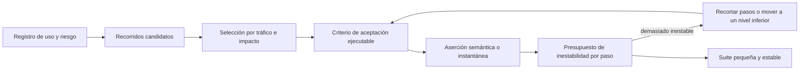
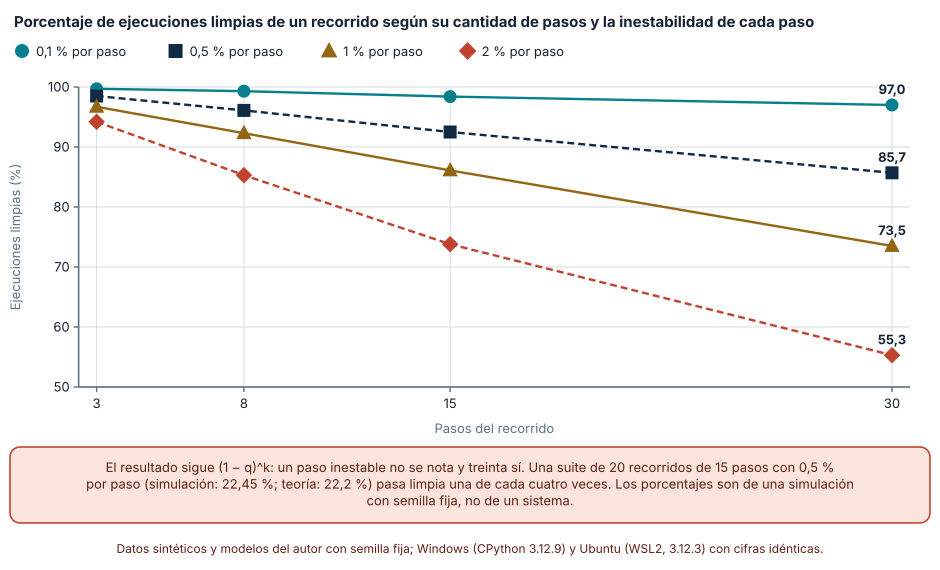
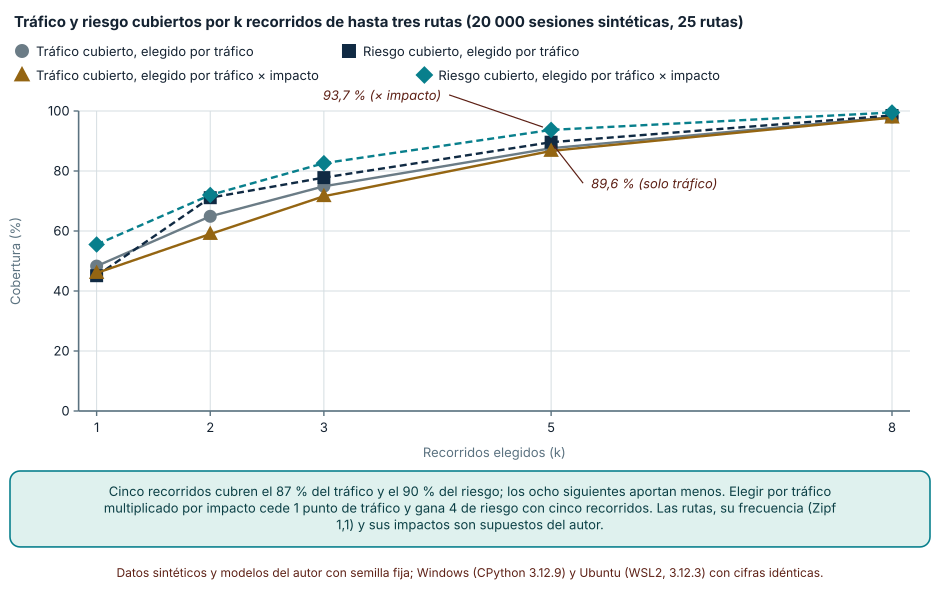
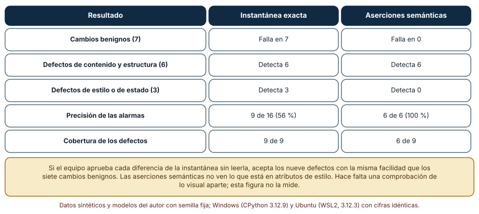

# SE-364 — End-to-end, aceptación y recorridos críticos

[← SE-363 — Integración, componentes y contratos](https://github.com/vladimiracunadev-create/modern-software-engineering-program/blob/main/classes/part-30-estrategia-y-tecnicas-de-prueba/se-363-integracion-componentes-y-contratos/README.md) · [↑ Parte 30](https://github.com/vladimiracunadev-create/modern-software-engineering-program/blob/main/classes/part-30-estrategia-y-tecnicas-de-prueba/README.md) · [📚 Índice completo](https://github.com/vladimiracunadev-create/modern-software-engineering-program/blob/main/classes/README.md) · [🌐 Portal](https://vladimiracunadev-create.github.io/modern-software-engineering-program/classes/SE-364.html) · [SE-365 — Pruebas basadas en propiedades y modelos →](https://github.com/vladimiracunadev-create/modern-software-engineering-program/blob/main/classes/part-30-estrategia-y-tecnicas-de-prueba/se-365-pruebas-basadas-en-propiedades-y-modelos/README.md)

## Punto profesional y fundamento pedagógico

**Punto profesional.** La clase existe para que decidas qué recorridos completos del sistema merece la pena automatizar de extremo a extremo, que escribas criterios de aceptación ejecutables y que sepas cuánto cuesta en inestabilidad cada paso que añades. Las pruebas de extremo a extremo son las únicas que ven el recorrido del usuario y las más caras de mantener: son una inversión que se concentra donde más rinde.

**Por qué aparece aquí.** Sigue a **Integración, componentes y contratos**: las interfaces ya tienen contratos; falta comprobar que un usuario real puede completar lo importante. `SE-361` fijó que el recorrido de usuario es una clase de fallo que solo ven los niveles caros.

**Error conceptual que debe corregir.** Creer que las pruebas de extremo a extremo son «las más reales» y que, por tanto, más es mejor. Cada paso de un recorrido multiplica la probabilidad de un fallo espurio, y una suite grande de recorridos largos casi nunca está en verde sin que nadie haya roto nada.

**Secuencia de aprendizaje.** Antes de leer los resultados, predices qué fracción de ejecuciones limpias tiene un recorrido de 30 pasos si cada paso falla al azar el 1 % de las veces; después mides cuántos recorridos cubren el 90 % del riesgo en un registro sintético y qué hace una instantánea de HTML frente a aserciones semánticas. La secuencia usa predicción, explicación propia, contraste y recuperación. [ICAP](https://icap.education.asu.edu/research) distingue participación de construcción de conocimiento; [How People Learn II](https://nap.nationalacademies.org/catalog/24783/how-people-learn-ii-learners-contexts-and-cultures) exige conectar conocimiento previo, contexto y transferencia; la [práctica de recuperación](https://pubmed.ncbi.nlm.nih.gov/16507066/) respalda producir de nuevo la explicación tras una demora; y [Education for Life and Work](https://nap.nationalacademies.org/resource/13398/dbasse_084153.pdf) exige devolución que explique la causa del error.

**Evidencia de aprendizaje.** `e2e-log.md` con la predicción, la tabla de inestabilidad por pasos, la selección de recorridos críticos con su cobertura de tráfico y de riesgo, la comparación entre instantánea y aserciones semánticas y los criterios de aceptación ejecutables de tres recorridos.

**Límite de la conclusión.** No se usó navegador, servidor ni herramienta de automatización: la inestabilidad se simula con una probabilidad por paso, el registro de 20 000 sesiones es sintético con una distribución Zipf elegida por el autor y el HTML se analiza con `html.parser`. Los resultados muestran mecanismos (composición de probabilidades, selección voraz, ruido de una comparación exacta) y no cifras de una herramienta como Playwright o Selenium.

### Trazabilidad fuente → afirmación

| Fuente primaria u oficial | Afirmación que respalda | Lo que no prueba |
|---|---|---|
| [Martin Fowler, «BroadStackTest»](https://martinfowler.com/bliki/BroadStackTest.html) | Define las pruebas de banda ancha que ejercitan todo el sistema y señala su costo y fragilidad. | No da cifras de inestabilidad. |
| [Google Testing Blog: Just Say No to More End-to-End Tests](https://testing.googleblog.com/2015/04/just-say-no-to-more-end-to-end-tests.html) | Expone por qué las pruebas de extremo a extremo son lentas, inestables y difíciles de localizar. | Es experiencia de una organización. |
| [Martin Fowler, «TestPyramid»](https://martinfowler.com/bliki/TestPyramid.html) | Propone pocas pruebas de interfaz de usuario frente a muchas unitarias. | No fija una proporción universal. |
| [Playwright: buenas prácticas](https://playwright.dev/docs/best-practices) | Recomienda probar el comportamiento visible para el usuario, aislar pruebas y evitar depender de detalles de implementación. | Describe una herramienta concreta. |
| [Cucumber: referencia de Gherkin](https://cucumber.io/docs/gherkin/reference/) | Define el formato Dado/Cuando/Entonces para escribir criterios de aceptación. | No garantiza que el criterio sea el correcto. |
| [Jest: pruebas de instantáneas](https://jestjs.io/docs/snapshot-testing) | Documenta cómo funcionan las instantáneas y que deben revisarse como código. | No mide el ruido de cada proyecto. |

## Antes de empezar

Recupera lo aprendido en `SE-363`: una prueba por interfaz acota mejor que un recorrido completo. La pregunta activa es: **¿qué dos o tres recorridos del usuario son tan importantes que merece la pena pagarlos caros, y qué comprueba cada uno para que su fallo sea una señal y no ruido?**

## Prerrequisitos

- Haber completado `SE-363` o poder explicar qué localiza una prueba por interfaz frente a un recorrido.
- Haber visto `SE-158` (especificación por ejemplos) o saber leer un criterio Dado/Cuando/Entonces.
- Python 3.11 o posterior con `html.parser` y `random`.

## Problema auténtico

La plataforma de entregas tiene 25 rutas y el equipo quiere pruebas de extremo a extremo. Alguien propone automatizar los 40 recorridos que el equipo de producto imaginó; otra persona recuerda que la suite de la versión anterior tardaba 40 minutos, fallaba el 30 % de las veces sin cambios y terminó por ignorarse. Otra más propone usar instantáneas del HTML para detectar cualquier cambio visual, y en la primera semana la instantánea falla en cada cambio de estilo y el equipo empieza a aprobarlas sin leerlas. El equipo necesita elegir pocos recorridos, medir su inestabilidad esperada y decidir qué comprueba cada uno para que fallar signifique algo.

## Objetivos observables

Al terminar podrás:

1. escribir un criterio de aceptación Dado/Cuando/Entonces con un resultado observable por el usuario;
2. calcular la tasa de ejecuciones limpias de un recorrido y de una suite a partir de la inestabilidad por paso;
3. elegir un conjunto pequeño de recorridos que cubra el tráfico y el riesgo, y medir qué se pierde al elegir por una sola variable;
4. decidir cuándo usar una instantánea y cuándo aserciones semánticas, y medir el ruido de la primera;
5. declarar qué comprueba cada recorrido y qué deja a otros niveles.

## Mapa conceptual



El mapa parte del uso y no de la herramienta: los recorridos se eligen por lo que importa y se recortan por lo que cuestan. El retorno indica que un recorrido inestable se acorta o se baja de nivel, no se tolera.

## Temas y por qué importan

| Tema | Por qué cambia una decisión profesional | Evidencia mínima |
|---|---|---|
| Criterios de aceptación ejecutables | Hacen discutible «terminado» con algo que corre. | Tres criterios Dado/Cuando/Entonces con su prueba |
| Inestabilidad compuesta | Un recorrido largo falla por azar con alta probabilidad. | Tabla de tasa de paso por pasos y por paso espurio |
| Selección de recorridos | Pocos recorridos bien elegidos cubren casi todo el tráfico y el riesgo. | Cobertura de tráfico y de riesgo por número de recorridos |
| Instantánea frente a aserción semántica | Una comparación exacta genera ruido que se aprueba sin leer. | Precisión y cobertura de cada técnica |
| Qué deja de ver un recorrido | Un recorrido no ve lo que no mira: estilos, estados no visibles. | Lista de defectos que ninguno detecta |

## Conceptos y decisiones

### 1. Criterios de aceptación ejecutables

Un criterio de aceptación describe un resultado que el usuario o el negocio reconocerían: «Dado un estudiante con una entrega calificada, cuando abre «Mis entregas», entonces ve su nota». Escrito en formato Dado/Cuando/Entonces se puede ejecutar contra el sistema. Su valor está en que fija el resultado observable, no en la herramienta: un criterio que dice «la API devuelve 200» describe una implementación, no una aceptación. Cada criterio debe poder fallar por una razón que el negocio entendería.

### 2. Inestabilidad compuesta

Un recorrido de extremo a extremo es una cadena de pasos (abrir, autenticarse, elegir curso, subir, enviar, comprobar). Si cada paso tiene una probabilidad pequeña \(q\) de fallar por motivos ajenos al defecto (red, tiempos, espera de un elemento), la probabilidad de que el recorrido entero termine limpio es \((1-q)^k\). Con \(q = 1\,\%\) y 30 pasos baja al 74 %; con 20 recorridos de 15 pasos y \(q = 0{,}5\,\%\) la suite pasa limpia una de cada cuatro veces. El número que importa no es el de un paso sino el del recorrido, y por eso el mejor remedio no es reintentar sino acortar y reducir pasos.

### 3. Selección de recorridos

El tráfico se concentra en pocas rutas (en el modelo, con distribución Zipf) y el impacto de un fallo no sigue el tráfico: una ruta poco usada, como la que cierra una entrega, puede ser crítica. Elegir los recorridos por tráfico cubre lo habitual; elegir por tráfico multiplicado por impacto cubre más riesgo con el mismo número de recorridos. El criterio de parada es el costo: con cada recorrido adicional sube el mantenimiento y baja la cobertura marginal.

### 4. Instantánea frente a aserción semántica

Una instantánea guarda la salida (por ejemplo el HTML) y falla ante cualquier diferencia. Detecta todo cambio y no distingue uno que importa de uno que no: un espacio, el orden de los atributos o una fecha nueva rompen la prueba igual que un botón que desaparece. Cuando la mayoría de las diferencias son ruido, el equipo aprende a aprobarlas sin leerlas, y la instantánea deja de proteger. Una aserción semántica afirma lo que el usuario percibe (el título, la nota de la entrega, la presencia del botón) y es insensible al resto; su costo es que solo ve lo que se le pidió mirar.

### 5. Qué deja de ver un recorrido

Un recorrido comprueba lo que sus aserciones miran. No ve un botón deshabilitado si solo comprueba su texto, ni una lista oculta por estilo si solo comprueba el contenido del DOM. Tampoco ve los defectos de rendimiento, de concurrencia o de accesibilidad que otros niveles cubren. Declarar qué deja fuera cada recorrido evita el falso sentido de «ya lo probamos de extremo a extremo».

### La probabilidad de un recorrido limpio

Se simulan 10 000 ejecuciones por celda (semilla 364) de un recorrido de 3, 8, 15 y 30 pasos, cada uno con una probabilidad de fallo espurio de 0,1 %, 0,5 %, 1 % y 2 %.

```python
ok = sum(1 for _ in range(10000) if all(rng.random() >= q for _ in range(k)))
```

| Fallo espurio por paso | 3 pasos | 8 pasos | 15 pasos | 30 pasos |
|---|---:|---:|---:|---:|
| 0,1 % | 99,7 | 99,3 | 98,4 | 97,0 |
| 0,5 % | 98,5 | 96,1 | 92,5 | 85,7 |
| 1 % | 96,7 | 92,3 | 86,1 | 73,5 |
| 2 % | 94,2 | 85,3 | 73,8 | 55,3 |

Los valores siguen \((1-q)^k\): con \(q = 2\,\%\) y 30 pasos el teórico es 54,5 % y la simulación 55,3 %. Una suite de 20 recorridos de 15 pasos con \(q = 0{,}5\,\%\) tiene 300 pasos y pasa limpia 22,45 % de las veces en la simulación (22,2 % en teoría): la mayoría de las corridas fallarían sin que nadie haya roto nada.



**Cómo leer la figura.** El eje horizontal es la longitud del recorrido y el vertical, el porcentaje de ejecuciones que terminan en verde sin defecto alguno; cada línea fija la inestabilidad de un paso. Mira cómo se abre el abanico hacia la derecha: la misma inestabilidad pesa más cuanto más largo es el recorrido. **Dónde deja de valer:** supone pasos independientes y con la misma probabilidad; en la práctica los fallos se correlacionan (un servidor lento afecta a varios pasos a la vez) y hay pasos mucho más frágiles que otros. La figura es una cota del mecanismo, no una predicción de una herramienta.

### Cuántos recorridos hacen falta

Se genera un registro de 20 000 sesiones sobre 25 rutas (frecuencia proporcional a \(1/i^{1{,}1}\)), cada sesión recorre de 1 a 4 rutas, y a cada ruta se le asigna un impacto del 1 al 10 independiente de su frecuencia (supuesto del autor). Los candidatos son secuencias de hasta tres rutas observadas. Se elige con una regla voraz según dos métricas.

```python
mejor = max(cand, key=lambda c: sum(metrica(r) for r in set(c) - cubiertas))
```

| Recorridos | Por tráfico (tráfico / riesgo cubierto) | Por tráfico × impacto (tráfico / riesgo cubierto) |
|---|---|---|
| 1 | 48,3 % / 45,1 % | 46,0 % / 55,5 % |
| 2 | 64,9 % / 71,1 % | 59,0 % / 72,0 % |
| 3 | 74,9 % / 77,8 % | 71,6 % / 82,6 % |
| 5 | 87,6 % / 89,6 % | 86,7 % / 93,7 % |
| 8 | 98,0 % / 98,5 % | 97,8 % / 99,5 % |

Con cinco recorridos de tres rutas se cubre el 87 % del tráfico y el 90 % del riesgo; los ocho siguientes aportan poco. Elegir por tráfico por impacto cede 1 punto de tráfico y gana 4 de riesgo con cinco recorridos.



**Cómo leer la figura.** El eje horizontal es el número de recorridos elegidos y el vertical, el porcentaje cubierto; hay una curva de tráfico y una de riesgo por cada métrica de selección. Mira primero la separación entre las curvas de riesgo con pocos recorridos, que se cierra al llegar a ocho. **Dónde deja de valer:** el registro, la distribución Zipf y los impactos son sintéticos; en un sistema real la frecuencia de las rutas puede ser distinta y el riesgo de una ruta rara puede ser muy alto. La figura no dice que cinco recorridos basten, sino que la métrica de selección cambia qué se cubre.

### Una instantánea frente a una aserción semántica

Se parte de una página «Mis entregas» (título, lista de dos entregas con su nota, fecha de actualización y botón «Reenviar»). Se aplican siete cambios benignos (espacios entre etiquetas, orden de atributos, fecha de actualización, una clase CSS añadida al botón, comillas simples, un comentario HTML, un atributo de prueba) y nueve defectos: seis de contenido o estructura (nota que falta, enlace roto, botón con otro texto, orden invertido, título distinto, nota equivocada) y tres de estilo o estado (botón deshabilitado, lista oculta, nota con el color del fondo). Se prueba con la comparación exacta del HTML y con aserciones sobre el árbol (`html.parser`).

```python
def semantico(html):
    p = Sem(); p.feed(html)
    return (p.h1 == "Mis entregas" and [i["id"] for i in p.items] == ["7", "8"]
            and [i["nota"] for i in p.items] == ["6.5", "sin nota"]
            and "Reenviar" in p.botones and p.enlaces == 2)
```

| Resultado | Instantánea exacta | Aserciones semánticas |
|---|---|---|
| Cambios benignos (7) | Falla en 7 | Falla en 0 |
| Defectos de contenido y estructura (6) | Detecta 6 | Detecta 6 |
| Defectos de estilo o de estado (3) | Detecta 3 | Detecta 0 |
| Precisión de las alarmas | 9 de 16 (56 %) | 6 de 6 (100 %) |
| Cobertura de los defectos | 9 de 9 | 6 de 9 |

La instantánea detecta los nueve defectos y los siete cambios benignos: cada alarma es ruido con probabilidad 44 %. La aserción semántica no da falsas alarmas y no ve lo que está en atributos de estilo. Si el equipo aprueba cada diferencia sin leerla, la instantánea acepta los nueve defectos igual que los siete cambios inocuos.



**Cómo leer la figura.** Cada grupo es una pregunta (cuántas falsas alarmas, cuántos defectos detectados) y cada color, una técnica. Mira que la barra dorada gana en detección y pierde en ruido. **Dónde deja de valer:** son 16 cambios escritos por el autor sobre una página pequeña; con una página real el ruido de una instantánea es probablemente mayor y el conjunto de lo que una aserción debe mirar también. La figura no resuelve lo visual: el estilo y el estado necesitan una comprobación aparte (de accesibilidad, de regresión visual revisada por una persona).

## Definiciones de trabajo

- **recorrido crítico:** secuencia de pasos de un usuario cuyo fallo causa un daño inaceptable para el negocio.
- **criterio de aceptación:** condición observable que el negocio acepta como prueba de que algo está terminado.
- **fallo espurio:** fallo de una prueba que no corresponde a un defecto del producto.
- **instantánea (snapshot):** copia de una salida contra la que se compara exactamente en cada ejecución.
- **aserción semántica:** comprobación de un significado observable por el usuario, no de la representación exacta.

Las definiciones son operativas para la plataforma de entregas y deben contrastarse con la documentación primaria enlazada al final.

## Ejemplo mínimo

El fragmento calcula la tasa de ejecuciones limpias de dos recorridos. Antes de ejecutarlo, predice cuál baja más al duplicar los pasos.

```python
q = 0.01
for k in (10, 20, 40):
    print(k, round(100 * (1 - q) ** k, 1))
```

El resultado es 90,4, 81,8 y 66,9: duplicar los pasos no divide el porcentaje por dos, lo multiplica por sí mismo. Registra versión, comando y salida; después cambia `q` a 0,001 y observa cuánto cuesta cada paso.

## Ejemplo profesional

El equipo de la plataforma analiza el registro de uso del último trimestre (con datos anonimizados) y la tabla de riesgos de `SE-361`, calcula la cobertura voraz y elige cinco recorridos: ingreso, entrega de una tarea, consulta de la nota, calificación por un docente y cierre de un curso. Cada recorrido se limita a ocho pasos o menos, tiene un criterio de aceptación en Dado/Cuando/Entonces con un resultado observable («el estudiante ve «calificada» y la nota 6,5»), usa aserciones semánticas y declara lo que no mira (estilos, rendimiento, accesibilidad). El presupuesto de inestabilidad es de 0,5 % por paso, lo que da más del 96 % de ejecuciones limpias por recorrido; un recorrido que supere el presupuesto se acorta o se baja de nivel. Los recorridos corren antes del despliegue y no en cada propuesta de cambio, donde corren las pruebas unitarias y de contrato.

## Práctica guiada

1. Escribe tres criterios Dado/Cuando/Entonces de la plataforma con un resultado que vería el usuario.
2. Predice la tasa limpia de un recorrido de 30 pasos con un 1 % de fallo espurio por paso.
3. Simula 10 000 ejecuciones por celda para cuatro valores de \(q\) y cuatro longitudes.
4. Genera un registro sintético de sesiones y elige recorridos con las dos métricas.
5. Construye una página y aplica siete cambios benignos y nueve defectos; compara instantánea y aserciones.
6. Escribe lo que cada recorrido no mira.
7. Entrega `e2e-log.md` y pide a otra persona que diga qué recorrido acortaría y por qué.

## Ejercicios

1. **Aceptación:** reescribe «el sistema debe permitir entregar tareas» como tres criterios Dado/Cuando/Entonces con un resultado observable.
2. **Presupuesto:** con \(q\) fijo, calcula el número máximo de pasos que mantiene el 95 % de ejecuciones limpias.
3. **Selección:** cambia los impactos del registro y observa qué recorridos entran o salen del conjunto de cinco.
4. **Aserción:** escribe una aserción semántica que detecte la lista oculta por estilo y explica qué costo añade.

## Reto verificable

Entrega `e2e-log.md` con los criterios, la tabla de inestabilidad, la selección de recorridos con sus coberturas, la comparación entre instantánea y aserciones y la lista de lo que cada recorrido no ve. Se aprueba si otra persona ejecuta el código, obtiene las mismas cifras con la misma semilla y puede decir qué recorrido sacaría de la suite si el presupuesto bajara a la mitad. No se aprueba por mostrar una suite en verde.

## Caso conductor

La plataforma de entregas es el caso conductor. Esta clase deja el cuarto artefacto: cinco recorridos críticos con criterios de aceptación y presupuesto de inestabilidad. `SE-365` explora una forma distinta de elegir casos: dejar que un generador los produzca a partir de una propiedad o de un modelo. Cambia después la probabilidad espuria de 0,5 % a 2 % y observa cuántos recorridos siguen en el presupuesto.

## Preguntas frecuentes

### ¿Cuántas pruebas de extremo a extremo debo tener?

Las pocas que cubran el recorrido que más importa y quepan en el presupuesto de inestabilidad. En el modelo, cinco recorridos cubren el 87 % del tráfico. No hay un número universal: depende del riesgo y de cuántos pasos puede tolerar la estabilidad de la herramienta.

### ¿Reintentar los recorridos que fallan resuelve la inestabilidad?

Oculta el síntoma y no la causa. Con 2 % de fallo espurio por paso, un reintento sube la tasa de un recorrido de 30 pasos de 55 % a casi 80 % pero también deja pasar los fallos intermitentes reales (ver `SE-370`). Primero acorta y estabiliza; reintenta solo con registro.

### ¿Cuándo sirve una instantánea?

Cuando la salida es pequeña, estable y revisada como código: un contrato de un formato de exportación, el texto de un correo, una salida de línea de comandos. No sirve para páginas completas con contenido dinámico, donde casi toda diferencia es ruido.

### ¿Las pruebas de aceptación son pruebas de extremo a extremo?

No necesariamente: una aceptación puede comprobarse en cualquier nivel que vea el resultado observable. Muchos criterios se verifican contra la API o el servicio sin interfaz y son más baratos y estables que un navegador.

## Fallo controlado y diagnóstico

Reproduce el fallo clásico de la clase: **una suite de recorridos largos que casi nunca pasa limpia**. Simula 20 recorridos de 15 pasos con \(q = 0{,}5\,\%\) y ejecútalos 2 000 veces.

Registra síntoma, entrada mínima, hipótesis, observación que descarta cada hipótesis, causa, corrección y prueba de regresión. **Síntoma:** la suite falla en 3 de cada 4 corridas y cada vez falla un recorrido distinto. **Hipótesis rivales:** (a) hay un defecto real que aparece al azar; (b) el entorno está sobrecargado; (c) la probabilidad compuesta de 300 pasos explica los fallos. **Prueba:** calcula \((1-q)^{300} = 22\,\%\) y compara con la tasa observada (22,45 %); ejecuta cada recorrido por separado y comprueba que cada uno pasa más del 92 % de las veces. **Conclusión:** no hay un defecto; la suite es demasiado grande para su inestabilidad por paso. **Regresión:** reduce los recorridos o sus pasos hasta que el cálculo dé más del 95 % de limpieza, y añade una comprobación que falle si el producto de las tasas por paso queda por debajo de ese umbral. No cambies a la vez el número de pasos y el reintento.

## Errores comunes y cómo corregirlos

| Síntoma | Causa probable | Corrección |
|---|---|---|
| La suite casi nunca está en verde sin cambios | Demasiados pasos con fallo espurio pequeño | Calcular \((1-q)^k\) y acortar o dividir los recorridos |
| Las instantáneas se aprueban sin leerlas | Casi todas las diferencias son ruido | Aserciones semánticas y una instantánea solo para salidas pequeñas |
| Se automatizan los 40 recorridos que se imaginaron | Selección por intuición | Cobertura voraz de tráfico e impacto |
| Un defecto de estilo llega a producción con la suite en verde | Las aserciones solo miran contenido | Declarar lo que no se mira y cubrirlo con otro nivel |
| La prueba comprueba la implementación y no el resultado | Criterio escrito como «la API devuelve 200» | Escribir el resultado observable para el usuario |

## Entorno y archivos clave

```text
work/SE-364/
├── README.md
├── e2e/
│   ├── inestabilidad.py
│   ├── seleccion.py
│   └── instantanea.py
├── aceptacion/
│   ├── ingreso.feature
│   ├── entrega.feature
│   └── consulta-nota.feature
└── evidence/e2e-log.md
```

El `README` declara plataforma, versión de Python, semilla (364) y comandos. Los experimentos usan solo la biblioteca estándar (`random`, `html.parser`) y se ejecutaron con CPython 3.12.9 en Windows 11 y 3.12.3 en Ubuntu bajo WSL2: las salidas fueron idénticas. Si añades una dependencia, fija procedencia y versión.

## Seguridad, ética y accesibilidad

- un recorrido que usa cuentas reales o datos personales los filtra en capturas, vídeos y registros: usa cuentas sintéticas;
- una prueba que ejecuta pagos, envíos de correo o borrados contra un entorno compartido puede dañarlo: aísla el entorno y limpia al terminar;
- una suite que sólo se ejecuta con ratón no prueba el uso por teclado: incluye al menos un recorrido por teclado y con lector de pantalla;
- las capturas guardadas por las pruebas pueden contener información sensible y deben tratarse como datos;
- documenta qué grupos de usuarios (idioma, dispositivo, discapacidad) no cubre ningún recorrido.

## Puente hacia el trabajo con agentes

Un agente al que se le pide «automatiza las pruebas de extremo a extremo de la aplicación» producirá decenas de recorridos largos con esperas fijas y comparación exacta del HTML. Pídele en cambio la selección de recorridos con su cobertura de tráfico e impacto, el presupuesto de inestabilidad calculado, el criterio Dado/Cuando/Entonces de cada uno y la lista de lo que no mira. Revisa especialmente que las aserciones sean semánticas y que no haya reintentos ocultos: son los dos mecanismos que esta clase mostró que enmascaran la señal.

## Transferencia

Traslada el análisis a otra aplicación (por ejemplo, una tienda de entradas): construye un registro de uso, elige recorridos con dos métricas, calcula la inestabilidad de cada uno y compara una instantánea con una aserción semántica. La transferencia está lograda cuando puedes explicar por qué un recorrido se acortó o se bajó de nivel, no cuando la lista se parece.

## Evaluación y evidencia

| Criterio | Evidencia para aprobar |
|---|---|
| comprensión | explicación de \((1-q)^k\) y de qué ve y qué no ve cada técnica de comparación |
| corrección | tablas reproducibles con las mismas semillas |
| diseño | recorridos críticos con criterio, presupuesto y lo que no cubren |
| diagnóstico | reproducción del fallo «suite que casi nunca pasa limpia» con regresión |
| incertidumbre | declaración de que registro, impactos e inestabilidad son sintéticos |
| reproducibilidad | versiones, semilla, comandos, salida y límites declarados |

## Fuentes

- [Martin Fowler, «BroadStackTest»](https://martinfowler.com/bliki/BroadStackTest.html) — pruebas de banda ancha; autoridad: autor del texto.
- [Google Testing Blog: Just Say No to More End-to-End Tests](https://testing.googleblog.com/2015/04/just-say-no-to-more-end-to-end-tests.html) — costo de las pruebas de extremo a extremo; autoridad: equipo de pruebas de Google.
- [Martin Fowler, «TestPyramid»](https://martinfowler.com/bliki/TestPyramid.html) — reparto por nivel; autoridad: autor del texto.
- [Playwright: buenas prácticas](https://playwright.dev/docs/best-practices) — pruebas centradas en el usuario; autoridad: documentación oficial.
- [Cucumber: referencia de Gherkin](https://cucumber.io/docs/gherkin/reference/) — criterios de aceptación; autoridad: documentación oficial.
- [Jest: pruebas de instantáneas](https://jestjs.io/docs/snapshot-testing) — instantáneas; autoridad: documentación oficial.

Cada fuente respalda el mecanismo indicado; ninguna demuestra que el 22,45 % de una suite de 300 pasos, los 87,6 % de tráfico de cinco recorridos o el 56 % de precisión de una instantánea se observen en la plataforma. Esa afirmación depende de las herramientas, de la estabilidad del entorno y del tráfico real.

## Límites y siguiente paso

Se ejecutaron tres experimentos con simulaciones y un registro sintético en Windows y Ubuntu (WSL2) con salidas idénticas. No se usó navegador ni herramienta de automatización; la inestabilidad por paso, la distribución Zipf de las rutas, los impactos y los 16 cambios de HTML son del autor. La comprobación de estilo y de accesibilidad visual queda fuera de lo medido. La siguiente clase cambia el método de elección de casos: en lugar de escribirlos, se describe una propiedad o un modelo y un generador produce miles.

## Glosario

- **recorrido crítico:** secuencia de pasos de un usuario cuyo fallo causa un daño inaceptable para el negocio.
- **criterio de aceptación:** condición observable que el negocio acepta como prueba de que algo está terminado.
- **fallo espurio:** fallo de una prueba que no corresponde a un defecto del producto.
- **instantánea (snapshot):** copia de una salida contra la que se compara exactamente en cada ejecución.
- **aserción semántica:** comprobación de un significado observable por el usuario, no de la representación exacta.

---

[← SE-363 — Integración, componentes y contratos](https://github.com/vladimiracunadev-create/modern-software-engineering-program/blob/main/classes/part-30-estrategia-y-tecnicas-de-prueba/se-363-integracion-componentes-y-contratos/README.md) · [↑ Parte 30](https://github.com/vladimiracunadev-create/modern-software-engineering-program/blob/main/classes/part-30-estrategia-y-tecnicas-de-prueba/README.md) · [📚 Índice completo](https://github.com/vladimiracunadev-create/modern-software-engineering-program/blob/main/classes/README.md) · [🌐 Portal](https://vladimiracunadev-create.github.io/modern-software-engineering-program/classes/SE-364.html) · [SE-365 — Pruebas basadas en propiedades y modelos →](https://github.com/vladimiracunadev-create/modern-software-engineering-program/blob/main/classes/part-30-estrategia-y-tecnicas-de-prueba/se-365-pruebas-basadas-en-propiedades-y-modelos/README.md)
