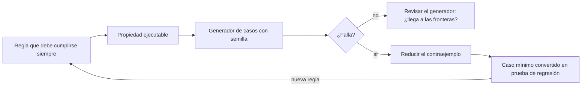
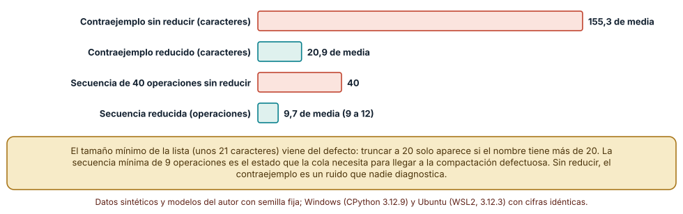
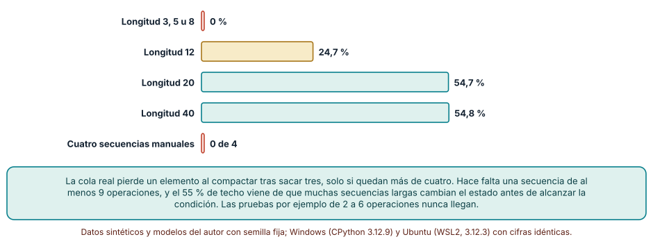

# SE-365 — Pruebas basadas en propiedades y modelos

[← SE-364 — End-to-end, aceptación y recorridos críticos](https://github.com/vladimiracunadev-create/modern-software-engineering-program/blob/main/classes/part-30-estrategia-y-tecnicas-de-prueba/se-364-end-to-end-aceptacion-y-recorridos-criticos/README.md) · [↑ Parte 30](https://github.com/vladimiracunadev-create/modern-software-engineering-program/blob/main/classes/part-30-estrategia-y-tecnicas-de-prueba/README.md) · [📚 Índice completo](https://github.com/vladimiracunadev-create/modern-software-engineering-program/blob/main/classes/README.md) · [🌐 Portal](https://vladimiracunadev-create.github.io/modern-software-engineering-program/classes/SE-365.html) · [SE-366 — Mutación, fuzzing y generación de casos →](https://github.com/vladimiracunadev-create/modern-software-engineering-program/blob/main/classes/part-30-estrategia-y-tecnicas-de-prueba/se-366-mutacion-fuzzing-y-generacion-de-casos/README.md)

## Punto profesional y fundamento pedagógico

**Punto profesional.** La clase existe para que describas qué debe cumplirse siempre (una propiedad) o qué debe imitar el sistema (un modelo) y dejes que un generador busque los casos que se te habrían olvidado, y para que sepas qué te cuesta ese método: un generador mal diseñado nunca llega a las fronteras y un fallo sin reducir es un ruido que nadie diagnostica.

**Por qué aparece aquí.** Sigue a **End-to-end, aceptación y recorridos críticos**, donde los casos se eligen a mano. Aquí el criterio cambia: no se enumeran ejemplos, se enuncia una regla general y se comprueba con muchos casos que no escribió una persona. `SE-159` (contratos e invariantes) y `SE-161` (máquinas de estado) ya dieron el vocabulario.

**Error conceptual que debe corregir.** Creer que «probar con datos aleatorios» encuentra los defectos que los ejemplos no ven. La aleatoriedad uniforme casi nunca produce las fronteras, los vacíos ni las combinaciones raras: una propiedad es tan buena como su generador.

**Secuencia de aprendizaje.** Antes de leer los resultados, predices cuántos de cuatro defectos de una función de reparto detectan cinco ejemplos y cuántos detecta una propiedad con 200 casos aleatorios; después mides con 100 semillas cuántos casos hacen falta para el primer fallo, qué hace la reducción de un contraejemplo y con qué frecuencia una secuencia aleatoria descubre un defecto de una cola frente a un modelo. La secuencia usa predicción, explicación propia, contraste y recuperación. [ICAP](https://icap.education.asu.edu/research) distingue participación de construcción de conocimiento; [How People Learn II](https://nap.nationalacademies.org/catalog/24783/how-people-learn-ii-learners-contexts-and-cultures) exige conectar conocimiento previo, contexto y transferencia; la [práctica de recuperación](https://pubmed.ncbi.nlm.nih.gov/16507066/) respalda producir de nuevo la explicación tras una demora; y [Education for Life and Work](https://nap.nationalacademies.org/resource/13398/dbasse_084153.pdf) exige devolución que explique la causa del error.

**Evidencia de aprendizaje.** `propiedades-log.md` con la predicción, las propiedades de dos funciones, la tabla de casos hasta el primer fallo con dos generadores, la reducción de contraejemplos y el modelo de una cola con la tasa de detección por longitud de secuencia.

**Límite de la conclusión.** El motor de propiedades es un código mínimo del autor (generador con semilla y reducción por eliminación), no Hypothesis ni QuickCheck; los defectos son inyectados y conocidos de antemano. Los datos son sintéticos y las semillas fijas. Los resultados muestran mecanismos y no la tasa de hallazgo de una herramienta madura.

### Trazabilidad fuente → afirmación

| Fuente primaria u oficial | Afirmación que respalda | Lo que no prueba |
|---|---|---|
| [Claessen y Hughes, «QuickCheck» (ICFP 2000)](https://doi.org/10.1145/351240.351266) | Introduce probar propiedades con casos aleatorios generados y su reducción. | No garantiza que el generador cubra las fronteras. |
| [Documentación de Hypothesis](https://hypothesis.readthedocs.io/en/latest/) | Describe estrategias de generación, semillas y reducción en Python. | No es el motor usado en la clase. |
| [Hypothesis: pruebas con estado](https://hypothesis.readthedocs.io/en/latest/stateful.html) | Explica cómo comprobar una implementación contra un modelo mediante secuencias de operaciones. | No dice cuál es un buen modelo. |
| [MacIver et al., «Hypothesis» (JOSS)](https://joss.theoj.org/papers/10.21105/joss.01891) | Presenta el diseño de una biblioteca de pruebas basadas en propiedades con reducción integrada. | No mide su eficacia en un proyecto concreto. |
| [Hughes, «How to Specify It!»](https://doi.org/10.1007/978-3-030-47147-7_4) | Clasifica estrategias para escribir propiedades útiles (invariantes, modelos, metamórficas). | No decide qué propiedad vale la pena. |
| [Documentación del módulo `random`](https://docs.python.org/3/library/random.html) | Documenta la semilla y advierte que el generador no es criptográfico. | No describe el diseño de generadores de casos. |

## Antes de empezar

Recupera lo aprendido en `SE-364`: los recorridos se eligen a mano y cubren lo que alguien pensó. La pregunta activa es: **¿qué regla debe cumplirse para cualquier entrada válida de una función, y qué generador de casos llegaría a las entradas que quiebran esa regla?**

## Prerrequisitos

- Haber completado `SE-364` o poder explicar por qué una lista de ejemplos cubre lo que alguien imaginó.
- Python 3.11 o posterior con `random` y `statistics`.
- Saber escribir una función con `assert` y recorrerla con un bucle.

## Problema auténtico

La plataforma reparte las entregas de un curso entre correctores: cada uno debe recibir una cantidad equilibrada. La función `repartir(n, k)` tiene cinco ejemplos escritos a mano que pasan. Un día se descubre que, con un curso de 600 entregas, se pierde una; otro día, que con menos entregas que correctores la función devuelve una lista de longitud equivocada. Un compañero propone escribir veinte ejemplos más; otro sugiere decir qué debe cumplirse siempre (la suma da `n`, nadie recibe dos más que otro) y que una herramienta pruebe cientos de casos. Además, la cola de correcciones tiene un defecto que solo aparece tras cierta secuencia de operaciones que nadie anticipó. El equipo quiere un método para ambos casos y saber qué pierde con él.

## Objetivos observables

Al terminar podrás:

1. enunciar propiedades de una función (invariantes, idempotencia, relaciones entre entrada y salida) sin copiar su implementación;
2. escribir un generador de casos con semilla y reconocer cuándo no llega a las fronteras;
3. reducir un contraejemplo hasta un tamaño mínimo comprensible y medir cuánto se reduce;
4. comprobar una implementación con estado contra un modelo simple con secuencias aleatorias y medir la probabilidad de hallar un defecto por longitud;
5. decidir cuándo una propiedad no es aplicable (equivalentes, propiedades débiles).

## Mapa conceptual



El mapa parte de la regla y no de los casos: los casos son una consecuencia del generador. El retorno indica que un contraejemplo reducido se vuelve una prueba por ejemplo y la regla se afina.

## Temas y por qué importan

| Tema | Por qué cambia una decisión profesional | Evidencia mínima |
|---|---|---|
| Propiedades | Dicen qué debe cumplirse sin enumerar casos. | Cuatro propiedades de `repartir` en `propiedades-log.md` |
| Generadores | Un generador pobre no llega a las fronteras. | Tabla de casos hasta el primer fallo con dos generadores |
| Reducción de contraejemplos | Un fallo de 150 caracteres no se diagnostica; uno de 20 sí. | Tamaño antes y después de reducir |
| Pruebas contra un modelo | Detectan defectos que dependen de secuencias de operaciones. | Tasa de detección por longitud de secuencia |
| Límites del método | Una propiedad débil o un mutante equivalente no se detectan. | Lista de defectos que ninguna propiedad ve |

## Conceptos y decisiones

### 1. Propiedades

Una propiedad es una afirmación que debe cumplirse para toda entrada del dominio: la suma de las cantidades repartidas es `n`; normalizar dos veces da lo mismo que normalizar una; invertir una lista dos veces devuelve la original. Se escribe sin repetir la implementación (la propiedad «el resultado es lo que calcula la función» no comprueba nada). Hay familias útiles: invariantes que se conservan, idempotencia, relaciones entre entradas (si se añade un elemento, el resultado cambia así), comparación con un modelo más simple y propiedades metamórficas. Una propiedad débil se cumple casi siempre y casi no protege.

### 2. Generadores

El generador decide qué entradas se prueban. Uno uniforme sobre un rango grande produce valores típicos y casi nunca las fronteras: la probabilidad de que `n < k` con `n` en 0–600 y `k` en 1–12 es de aproximadamente el 1 %. Un buen generador añade sesgo hacia los bordes (vacío, uno, el límite, el límite más uno) y hacia combinaciones raras. La semilla hace reproducible la ejecución y su registro convierte un fallo de «a veces» en un fallo repetible.

### 3. Reducción de contraejemplos

Un fallo encontrado con una entrada grande y aleatoria no explica nada. La reducción (shrinking) toma el contraejemplo y prueba versiones más pequeñas (quitar elementos, acortar cadenas) mientras la propiedad siga fallando; termina en un caso en el que quitar cualquier parte lo hace pasar. El caso mínimo es lo que se discute en una revisión y lo que queda como prueba de regresión. Sin reducción, la prueba aleatoria encuentra defectos que nadie puede diagnosticar.

### 4. Pruebas contra un modelo

Para una implementación con estado (una cola, un carrito, una máquina de estados) se escribe un modelo mínimo, normalmente más simple y obviamente correcto (una lista), y se generan secuencias aleatorias de operaciones que se aplican a ambos; cualquier divergencia es un defecto de uno de los dos. Esta técnica encuentra defectos que dependen de secuencias largas, que los ejemplos manuales casi nunca recorren. Su costo es el modelo: si el modelo es tan complejo como la implementación, es otro programa que puede estar mal.

### 5. Límites del método

Una propiedad solo detecta lo que afirma: una función que cumple todas las propiedades escritas puede seguir teniendo un defecto (un mutante equivalente a las propiedades). Un generador no explora defectos que dependen de valores muy específicos (un identificador concreto) salvo que se les dé un sesgo. Y el modelo puede compartir el error de la implementación si ambos los escribió la misma persona con el mismo malentendido. La técnica complementa los ejemplos, no los sustituye: los ejemplos documentan y fijan los casos conocidos.

### Cinco versiones de una misma función

Se prueba `repartir(n, k)` (devuelve cuántas entregas recibe cada uno de `k` correctores) en cinco versiones: la correcta, una que olvida el resto, una que da el resto al último, una que falla solo cuando `n < k` y una que pierde una unidad si `n ≥ 500`. Las propiedades son: longitud `k`, suma `n`, diferencia máxima 1 y cantidades no negativas. El generador uniforme sortea `n` en 0–600 y `k` en 1–12; el sesgado destina el 30 % de los casos a `n` entre 0 y `2k`.

```python
def prop_repartir(f, sesgo=False):
    def prop(rng):
        n, k = rng.randint(0, 600), rng.randint(1, 12)
        if sesgo and rng.random() < 0.3: n = rng.randint(0, 2 * k)
        r = f(n, k)
        assert len(r) == k and sum(r) == n and max(r) - min(r) <= 1 and all(x >= 0 for x in r)
    return prop
```

| Versión | 5 ejemplos | Propiedades, generador uniforme (100 semillas) | Con 30 % de casos cerca de la frontera |
|---|---|---|---|
| Correcta | no detecta | 0 de 100 | 0 de 100 (sin falsas alarmas) |
| Olvida el resto | detecta | 100 de 100 (mediana 1 caso) | 100 de 100 |
| Resto al último corrector | no detecta | 100 de 100 (mediana 1) | 100 de 100 |
| Falla solo si hay menos entregas que correctores | no detecta | 87 de 100 (mediana 66 casos) | 100 de 100 |
| Pierde una entrega si n ≥ 500 | no detecta | 100 de 100 (mediana 4) | 100 de 100 |

Cinco ejemplos detectan una de las cuatro versiones defectuosas. Las propiedades detectan las cuatro con 200 casos, y la que depende de `n < k` aparece en solo 87 de 100 semillas porque ese caso es el 1 % de los sorteos uniformes; con el generador sesgado se detecta siempre. La corrección de la versión correcta se mantiene sin falsas alarmas.


**Cómo leer la figura.** Cada grupo es una versión defectuosa y cada barra, una forma de probarla; la longitud es el porcentaje de semillas que detectan el defecto, y los ejemplos son deterministas (0 o 100). Mira la tercera versión: es la única donde el generador uniforme no llega a 100. **Dónde deja de valer:** los defectos son inyectados y conocidos; un defecto que dependa de un valor puntual (un identificador, una fecha) no se detectaría con ninguno de los dos generadores sin conocerlo. La figura muestra que el generador es parte de la prueba, no que 200 casos basten.

### Reducir el contraejemplo

Una función `normalizar(nombres)` quita espacios, pone mayúsculas iniciales y elimina duplicados; su versión defectuosa trunca cada nombre a 20 caracteres, de modo que `normalizar` aplicada dos veces no da lo mismo que aplicada una vez (no es idempotente). Con 100 semillas se obtienen 100 contraejemplos de listas de nombres aleatorios; la reducción elimina elementos y acorta cadenas mientras la propiedad siga fallando. Con las colas se hace lo mismo con secuencias de 40 operaciones.

```python
def reducir_lista(xs, falla):
    cambiado = True
    while cambiado:
        cambiado = False
        for i in range(len(xs)):
            ys = xs[:i] + xs[i + 1:]
            if falla(ys): xs, cambiado = ys, True; break
        else:
            ...  # acortar cada cadena: mitad, sin primer carácter, sin último
    return xs
```

| Contraejemplo | Antes (media) | Después (media) |
|---|---|---|
| Lista de nombres (100) | 155,3 caracteres | 20,9 caracteres (mediana 22,5) |
| Secuencia de 40 operaciones (106 fallidas de 200) | 40 operaciones | 9,7 operaciones (9 a 12) |

El caso mínimo de la lista de nombres es un único nombre de unos 21 caracteres: justo lo que necesita el defecto para mostrarse. La secuencia mínima tiene 9 operaciones y es el estado que hace falta para llegar a la compactación defectuosa. Un contraejemplo de 155 caracteres con cinco nombres no sugiere «hay un truncamiento a 20»; el de 21 caracteres lo señala.



**Cómo leer la figura.** Cada par de barras compara el tamaño del contraejemplo hallado por el generador con el tamaño tras reducirlo. **Dónde deja de valer:** la reducción simple (quitar elementos, acortar cadenas) es la del autor; una herramienta madura reduce también los valores generados y puede llegar a casos más pequeños. El resultado depende de que el defecto sea reducible: si exige un tamaño o una combinación grande, el mínimo es grande.

### Secuencias contra un modelo

La cola de correcciones tiene capacidad 5 y un defecto de compactación: al sacar el tercer elemento, si quedan más de cuatro en el almacenamiento, pierde uno. El modelo es una lista de Python con la misma capacidad. Se generan secuencias aleatorias de operaciones (encolar con probabilidad 0,55, sacar con 0,45) y se comparan los resultados de cada operación; se mide, con 5 000 secuencias por longitud, qué fracción detecta el defecto.

```python
def falla_secuencia(seq):
    real, modelo = ColaReal(), Modelo()
    for op, x in seq:
        if op == "e" and real.encolar(x) != modelo.encolar(x): return True
        if op == "s" and real.sacar() != modelo.sacar(): return True
    return False
```

| Longitud de la secuencia | 3, 5 u 8 | 12 | 20 | 40 |
|---|---:|---:|---:|---:|
| Secuencias que detectan el defecto | 0 % | 24,7 % | 54,7 % | 54,8 % |

Cuatro secuencias escritas a mano (encolar y sacar, encolar dos y sacar dos, llenar la cola y desbordar, sacar de una cola vacía) no detectan el defecto. Ninguna secuencia de hasta 8 operaciones lo descubre: hace falta, como mínimo, una de 9 operaciones que alcance la condición. El techo cerca del 55 % viene de que muchas secuencias largas cambian el estado y esquivan la condición.



**Cómo leer la figura.** Cada barra es la fracción de 5 000 secuencias aleatorias de esa longitud que hace divergir a la cola del modelo. **Dónde deja de valer:** el defecto y las probabilidades de las operaciones son del autor; con otra mezcla de operaciones la curva cambia. La figura no dice que una longitud de 12 baste: dice que los ejemplos cortos no llegan y que el modelo permite explorar lo que no se escribió.

## Definiciones de trabajo

- **propiedad:** afirmación que debe cumplirse para toda entrada del dominio de una función.
- **generador:** procedimiento que produce entradas de prueba, con semilla si debe ser reproducible.
- **reducción (shrinking):** proceso que simplifica un contraejemplo mientras siga fallando.
- **modelo:** implementación simple y obviamente correcta contra la que se compara otra más compleja.
- **prueba metamórfica:** prueba que relaciona los resultados de dos entradas relacionadas en lugar de conocer el resultado exacto.

Las definiciones son operativas para la plataforma de entregas y deben contrastarse con la documentación primaria enlazada al final.

## Ejemplo mínimo

El fragmento comprueba tres propiedades de una función de reparto con 200 casos aleatorios. Antes de ejecutarlo, predice si pasa la versión que olvida el resto.

```python
import random
def repartir(n, k): return [n // k + (1 if i < n % k else 0) for i in range(k)]
rng = random.Random(365)
for _ in range(200):
    n, k = rng.randint(0, 600), rng.randint(1, 12)
    r = repartir(n, k)
    assert len(r) == k and sum(r) == n and max(r) - min(r) <= 1
```

Si cambias la función por `[n // k] * k`, la propiedad de la suma falla en el primer caso con resto distinto de cero. Registra versión, comando y salida, y anota la semilla.

## Ejemplo profesional

El equipo de la plataforma añade propiedades a tres funciones: el reparto de entregas (suma, longitud, equilibrio), la normalización de nombres (idempotencia, sin duplicados) y la cola de correcciones (contra un modelo de lista). El generador del reparto destina un tercio de los casos a valores cerca de las fronteras (`n` entre 0 y `2k`, `n` en los límites del rango), y la semilla de cada ejecución se imprime en el informe de la integración continua. Cuando una propiedad falla, un script reduce el caso y lo guarda como una prueba por ejemplo en `tests/regresion/`, de modo que el defecto queda fijado aunque el generador cambie. Las propiedades conviven con los ejemplos que documentan la política de negocio («una entrega a las 24 horas exactas aún cuenta como puntual»).

## Práctica guiada

1. Escribe `repartir(n, k)` y cuatro versiones con un defecto cada una.
2. Escribe cinco ejemplos y predice cuántas versiones defectuosas detectan.
3. Escribe las cuatro propiedades y un generador uniforme; mide con 100 semillas cuántos casos hacen falta hasta el primer fallo.
4. Añade un generador con sesgo hacia las fronteras y repite.
5. Escribe un reductor de listas y mide el tamaño antes y después en 100 contraejemplos.
6. Implementa una cola con un defecto de secuencia, un modelo de lista y mide la tasa de detección por longitud.
7. Entrega `propiedades-log.md` y pide a otra persona que invente un defecto que ninguna de tus propiedades vea.

## Ejercicios

1. **Propiedades:** para `ordenar(lista)` escribe tres propiedades distintas (misma longitud, orden ascendente, mismos elementos) y un defecto que una de ellas deje pasar.
2. **Generador:** diseña un generador para números de entregas que incluya 0, 1, el límite y el límite más uno con probabilidad conocida y mide cuántos casos hacen falta para el primer fallo.
3. **Reducción:** toma un contraejemplo de 60 elementos y reduce a mano una lista paso a paso; después automatiza el procedimiento.
4. **Modelo:** escribe un modelo para un carrito de la compra con añadir, quitar y vaciar y busca un defecto de secuencia.

## Reto verificable

Entrega `propiedades-log.md` con la predicción, las propiedades, la tabla de casos hasta el primer fallo con dos generadores, la reducción de contraejemplos y la tasa de detección por longitud de secuencia. Se aprueba si otra persona ejecuta el código, obtiene las mismas cifras con las mismas semillas y puede decir qué defecto ninguna de las propiedades ve. No se aprueba por mostrar que «se probaron 10 000 casos» sin decir cómo se generaron.

## Caso conductor

La plataforma de entregas es el caso conductor. Esta clase deja el quinto artefacto: las propiedades de tres funciones, el generador con sesgo y el modelo de la cola. `SE-366` pregunta cómo medir la calidad de las propias pruebas con mutación y qué descubre el fuzzing. Cambia después una sola decisión, el rango de `n` de 600 a 6 000, y observa si el defecto de `n ≥ 500` se encuentra antes o después.

## Preguntas frecuentes

### ¿Las pruebas basadas en propiedades sustituyen a las de ejemplo?

No. Los ejemplos documentan decisiones de negocio y fijan casos conocidos; las propiedades exploran lo que no se escribió. En la clase, cinco ejemplos detectaron una de cuatro versiones defectuosas y las propiedades las cuatro, pero ninguna de las dos técnicas detecta una política de negocio equivocada que ambas comparten.

### ¿Cómo sé que mi propiedad no es trivial?

Aplicando mutantes o defectos inyectados y comprobando que falla. Una propiedad que nunca falla ante ningún defecto probable es débil. Ver `SE-366` y `SE-371`.

### ¿Qué hago con un fallo que no reproduzco?

Si anotaste la semilla, lo reproduces. Si no, la ejecución con generadores sin semilla fija es el origen del problema: toda ejecución de pruebas aleatorias debe registrar su semilla.

### ¿Cuántos casos debo generar?

Los que quepan en el presupuesto de tiempo de la etapa. En el experimento, los defectos frecuentes aparecen en pocos casos (mediana 1 a 4) y el que ocurre en el 1 % de los sorteos necesitó una mediana de 66. Se aumenta el número de casos en una ejecución nocturna y se mejora el generador.

## Fallo controlado y diagnóstico

Reproduce el fallo clásico de la clase: **una propiedad con generador uniforme que no encuentra el defecto de la frontera**. Ejecuta la propiedad de `repartir_bug3` (falla solo con `n < k`) con 200 casos uniformes y 100 semillas.

Registra síntoma, entrada mínima, hipótesis, observación que descarta cada hipótesis, causa, corrección y prueba de regresión. **Síntoma:** en 13 de 100 semillas la propiedad pasa con 200 casos aunque la función es defectuosa. **Hipótesis rivales:** (a) la propiedad está mal escrita; (b) la función solo falla de forma intermitente; (c) el generador casi nunca produce `n < k`. **Prueba:** cuenta cuántos de los 200 casos cumplen `n < k` en cada semilla (en media unos 2) y ejecuta la función directamente con `n = 3, k = 8`. **Conclusión:** la función falla siempre con `n < k` y el generador apenas lo produce, de modo que la propiedad es correcta y el generador pobre. **Regresión:** añade el sesgo hacia las fronteras, comprueba que ahora se detecta en las 100 semillas y guarda `repartir(3, 8)` como prueba por ejemplo. No cambies a la vez la función y el generador.

## Errores comunes y cómo corregirlos

| Síntoma | Causa probable | Corrección |
|---|---|---|
| La propiedad pasa y la función tiene un defecto conocido | Generador que no llega a la frontera | Sesgo hacia vacío, límites y combinaciones |
| Un fallo aleatorio no se puede reproducir | No se registró la semilla | Imprimir la semilla en cada ejecución |
| El contraejemplo es largo e ininteligible | No hay reducción | Reducir antes de informar |
| La propiedad repite la implementación | Se calcula el resultado esperado con la misma fórmula | Usar invariantes o un modelo distinto |
| El modelo comparte el error de la implementación | Los escribió la misma persona con el mismo malentendido | Revisión independiente del modelo |

## Entorno y archivos clave

```text
work/SE-365/
├── README.md
├── propiedades/
│   ├── repartir.py
│   ├── motor.py
│   └── cola.py
├── tests/
│   ├── test_propiedades.py
│   └── regresion/
└── evidence/propiedades-log.md
```

El `README` declara plataforma, versión de Python, semillas (de 0 a 99 para el reparto, 365 y 7 para la cola) y comandos. Los experimentos usan solo la biblioteca estándar (`random`, `statistics`) y se ejecutaron con CPython 3.12.9 en Windows 11 y 3.12.3 en Ubuntu bajo WSL2: las salidas fueron idénticas. Si añades una dependencia como Hypothesis, fija procedencia y versión.

## Seguridad, ética y accesibilidad

- los generadores de cadenas pueden producir secuencias que desencadenan vulnerabilidades (inyecciones, tamaños extremos): ejecútalos en un entorno aislado;
- una propiedad con datos personales reales filtra información en los contraejemplos: genera datos sintéticos y revisa los informes;
- el generador de `random` de Python no es criptográfico; no lo uses para probar propiedades de seguridad que dependen de aleatoriedad;
- un modelo y una propiedad que codifican una política de negocio injusta la perpetúan: revisa con quien conozca el dominio;
- registra las semillas y la versión del generador para que otra persona pueda auditar el resultado.

## Puente hacia el trabajo con agentes

Un agente al que se le pide «genera pruebas basadas en propiedades» producirá propiedades que repiten la implementación y un generador uniforme sin sesgo ni semilla. Pídele las propiedades con su familia (invariante, idempotencia, modelo), el generador con la distribución de las fronteras, la semilla impresa, la reducción de cada fallo y los defectos inyectados que detectan. Revisa especialmente si el generador produce vacíos, límites y combinaciones raras: sin eso la propiedad parece fuerte y no lo es.

## Transferencia

Traslada el método a otro dominio (por ejemplo, un calendario de reservas): enuncia tres propiedades, diseña un generador con sesgo, reduce un contraejemplo y compara una implementación con un modelo. La transferencia está lograda cuando puedes explicar qué defecto no ve ninguna propiedad, no cuando el código se parece.

## Evaluación y evidencia

| Criterio | Evidencia para aprobar |
|---|---|
| comprensión | explicación de por qué el generador es parte de la prueba |
| corrección | tablas y reducciones reproducibles con las mismas semillas |
| diseño | propiedades por familia, generador con sesgo y modelo de la cola |
| diagnóstico | reproducción del fallo «generador uniforme que no llega a la frontera» con regresión |
| incertidumbre | declaración de que defectos, motor y distribuciones son del autor |
| reproducibilidad | versiones, semillas, comandos, salida y límites declarados |

## Fuentes

- [Claessen y Hughes, «QuickCheck: a lightweight tool for random testing of Haskell programs»](https://doi.org/10.1145/351240.351266) — pruebas por propiedades; autoridad: artículo original de ICFP 2000.
- [Documentación de Hypothesis](https://hypothesis.readthedocs.io/en/latest/) — biblioteca de propiedades para Python; autoridad: documentación oficial.
- [Hypothesis: pruebas con estado](https://hypothesis.readthedocs.io/en/latest/stateful.html) — comparación con modelos; autoridad: documentación oficial.
- [MacIver et al., «Hypothesis: A new approach to property-based testing»](https://joss.theoj.org/papers/10.21105/joss.01891) — diseño de la biblioteca; autoridad: artículo revisado de JOSS.
- [Hughes, «How to Specify It!»](https://doi.org/10.1007/978-3-030-47147-7_4) — estrategias para escribir propiedades; autoridad: capítulo del autor.
- [Documentación del módulo random](https://docs.python.org/3/library/random.html) — semillas y límites del generador; autoridad: documentación oficial de Python.

Cada fuente respalda el mecanismo indicado; ninguna demuestra que el 87 % de detección con un generador uniforme, la reducción de 155 a 21 caracteres o el 55 % de la secuencia aleatoria se observen en el código de la plataforma. Esa afirmación depende de los defectos y de los generadores.

## Límites y siguiente paso

Se ejecutaron tres experimentos con un motor mínimo, defectos inyectados y datos sintéticos en Windows y Ubuntu (WSL2) con salidas idénticas. No se usó Hypothesis ni QuickCheck, y una variante de normalización resultó equivalente a la original respecto de las propiedades escritas (no se detecta con ninguna). Las propiedades se ajustaron con los mismos defectos que las evalúan. La siguiente clase mide la calidad de las propias pruebas con mutación y explora el fuzzing como otra forma de generar casos.

## Glosario

- **propiedad:** afirmación que debe cumplirse para toda entrada del dominio de una función.
- **generador:** procedimiento que produce entradas de prueba, con semilla si debe ser reproducible.
- **reducción (shrinking):** proceso que simplifica un contraejemplo mientras siga fallando.
- **modelo:** implementación simple y obviamente correcta contra la que se compara otra más compleja.
- **prueba metamórfica:** prueba que relaciona los resultados de dos entradas relacionadas en lugar de conocer el resultado exacto.

---

[← SE-364 — End-to-end, aceptación y recorridos críticos](https://github.com/vladimiracunadev-create/modern-software-engineering-program/blob/main/classes/part-30-estrategia-y-tecnicas-de-prueba/se-364-end-to-end-aceptacion-y-recorridos-criticos/README.md) · [↑ Parte 30](https://github.com/vladimiracunadev-create/modern-software-engineering-program/blob/main/classes/part-30-estrategia-y-tecnicas-de-prueba/README.md) · [📚 Índice completo](https://github.com/vladimiracunadev-create/modern-software-engineering-program/blob/main/classes/README.md) · [🌐 Portal](https://vladimiracunadev-create.github.io/modern-software-engineering-program/classes/SE-365.html) · [SE-366 — Mutación, fuzzing y generación de casos →](https://github.com/vladimiracunadev-create/modern-software-engineering-program/blob/main/classes/part-30-estrategia-y-tecnicas-de-prueba/se-366-mutacion-fuzzing-y-generacion-de-casos/README.md)
