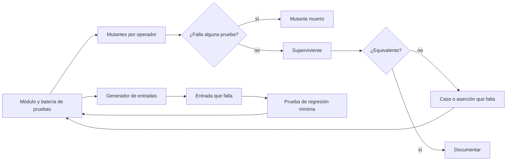
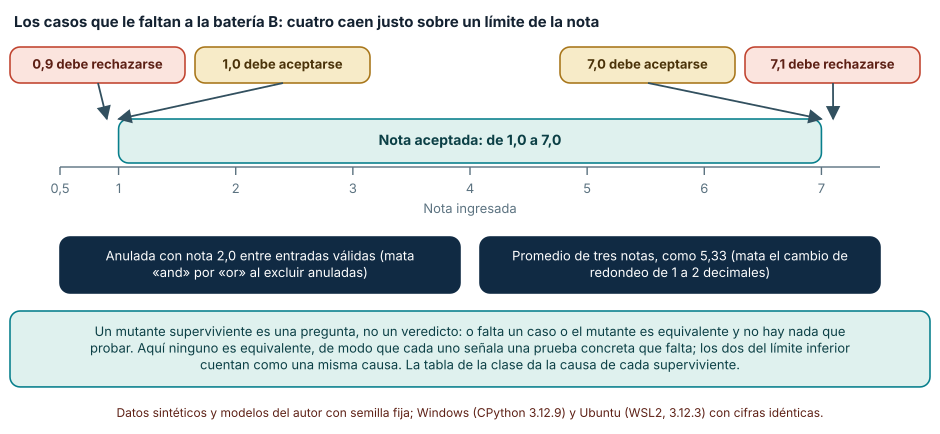
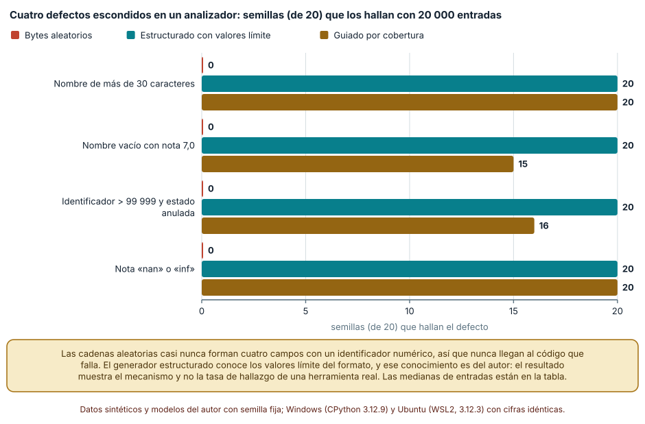

# SE-366 — Mutación, fuzzing y generación de casos

[← SE-365 — Pruebas basadas en propiedades y modelos](https://github.com/vladimiracunadev-create/modern-software-engineering-program/blob/main/classes/part-30-estrategia-y-tecnicas-de-prueba/se-365-pruebas-basadas-en-propiedades-y-modelos/README.md) · [↑ Parte 30](https://github.com/vladimiracunadev-create/modern-software-engineering-program/blob/main/classes/part-30-estrategia-y-tecnicas-de-prueba/README.md) · [📚 Índice completo](https://github.com/vladimiracunadev-create/modern-software-engineering-program/blob/main/classes/README.md) · [🌐 Portal](https://vladimiracunadev-create.github.io/modern-software-engineering-program/classes/SE-366.html) · [SE-367 — Dobles, virtualización y entornos de prueba →](https://github.com/vladimiracunadev-create/modern-software-engineering-program/blob/main/classes/part-30-estrategia-y-tecnicas-de-prueba/se-367-dobles-virtualizacion-y-entornos-de-prueba/README.md)

## Punto profesional y fundamento pedagógico

**Punto profesional.** La clase existe para que midas la calidad de las pruebas con mutación (¿qué cambios del código detectan?) y para que uses la generación automática de entradas (fuzzing) donde los casos escritos a mano no llegan, sabiendo qué conocimiento del formato hace falta darle al generador. La cobertura de líneas dice qué se ejecutó; la mutación y el fuzzing preguntan qué se detecta y qué se descubre.

**Por qué aparece aquí.** Sigue a **Pruebas basadas en propiedades y modelos**: allí el generador de casos era una parte de la prueba; aquí se mide la prueba misma y se amplía la generación a entradas hostiles. `SE-362` mostró que dos baterías con igual cobertura detectaban cantidades distintas de cambios; esta clase sistematiza esa comparación.

**Error conceptual que debe corregir.** Creer que un 90 % de cobertura o un fuzzer ejecutándose durante horas significa que el código está probado. Una batería puede ejecutar el 94 % de las líneas y matar el mismo número de mutantes que otra con el 72 %; un fuzzer con cadenas aleatorias puede no pasar nunca de la primera validación.

**Secuencia de aprendizaje.** Antes de leer los resultados, predices cuántos de 18 mutantes mata una batería que sube de 72 % a 94 % de cobertura de líneas; después mides cuatro baterías, qué sobrevive y qué defectos halla un fuzzer con tres estrategias. La secuencia usa predicción, explicación propia, contraste y recuperación. [ICAP](https://icap.education.asu.edu/research) distingue participación de construcción de conocimiento; [How People Learn II](https://nap.nationalacademies.org/catalog/24783/how-people-learn-ii-learners-contexts-and-cultures) exige conectar conocimiento previo, contexto y transferencia; la [práctica de recuperación](https://pubmed.ncbi.nlm.nih.gov/16507066/) respalda producir de nuevo la explicación tras una demora; y [Education for Life and Work](https://nap.nationalacademies.org/resource/13398/dbasse_084153.pdf) exige devolución que explique la causa del error.

**Evidencia de aprendizaje.** `mutacion-log.md` con la predicción, el módulo con sus mutantes, la matriz de baterías contra mutantes con cobertura de líneas, la clasificación de cada superviviente y la comparación de tres estrategias de fuzzing con sus semillas.

**Límite de la conclusión.** El motor de mutación y el fuzzer son códigos mínimos del autor sobre un módulo de 21 líneas; los 18 mutantes son cambios mecánicos y los cuatro defectos del analizador fueron escritos para ser hallados. El generador estructurado y el guiado usan valores límite que conoce el autor: miden el mecanismo y no el rendimiento de AFL, libFuzzer ni de una herramienta de mutación real.

### Trazabilidad fuente → afirmación

| Fuente primaria u oficial | Afirmación que respalda | Lo que no prueba |
|---|---|---|
| [DeMillo, Lipton y Sayward (1978)](https://doi.org/10.1109/C-M.1978.218136) | Introduce el análisis de mutantes como forma de evaluar conjuntos de datos de prueba. | No fija un umbral de puntuación. |
| [Jia y Harman (2011)](https://doi.org/10.1109/TSE.2010.62) | Resume el desarrollo de la prueba de mutación: operadores, equivalentes y costo. | No cubre cada lenguaje. |
| [Petrović e Ivanković, «State of Mutation Testing at Google»](https://research.google/pubs/state-of-mutation-testing-at-google/) | Describe una aplicación a gran escala de mutantes limitados a los cambios de código. | No es un experimento controlado. |
| [Inozemtseva y Holmes (ICSE 2014)](https://doi.org/10.1145/2568225.2568271) | Encontró que la cobertura no está fuertemente correlacionada con la eficacia de la suite. | No usa este módulo. |
| [Miller et al., «An empirical study of the reliability of UNIX utilities»](https://doi.org/10.1145/96267.96279) | Origen del fuzzing: entradas aleatorias hicieron fallar una fracción de las utilidades. | No cubre fuzzing guiado. |
| [Böhme, Pham y Roychoudhury, «Coverage-based Greybox Fuzzing as Markov Chain»](https://doi.org/10.1145/2976749.2978428) | Explica el fuzzing guiado por cobertura y cómo reparte energía entre entradas. | No describe el fuzzer mínimo de esta clase. |
| [Documentación de libFuzzer](https://llvm.org/docs/LibFuzzer.html) | Describe un motor de fuzzing guiado por cobertura en proceso. | No se usó en los experimentos. |

## Antes de empezar

Recupera lo aprendido en `SE-365`: el generador es parte de la prueba. La pregunta activa es: **si cambio mecánicamente una línea del código, ¿qué pruebas fallan, y si doy bytes al azar a este analizador, cuánto tarda en llegar al código donde están los defectos?**

## Prerrequisitos

- Haber completado `SE-362` y `SE-365` o poder explicar qué es un mutante y qué es un generador de casos.
- Python 3.11 o posterior con `ast`, `sys.settrace` y `random`.
- Saber leer una cobertura de líneas.

## Problema auténtico

La plataforma recibe archivos de entregas con líneas `id;estudiante;nota;estado` y un resumen que calcula promedios. La batería tiene 7 pruebas y la cobertura de líneas dice 94 %, con lo que el equipo cree que el módulo está bien probado. Una persona cambia mecánicamente la comparación del límite superior de la nota y las pruebas siguen pasando. Otra persona propone ejecutar un fuzzer con cadenas aleatorias durante la noche; por la mañana no encontró nada y alguien concluye que el analizador es robusto, mientras un caso con un nombre vacío y una nota de 7,0 lo hace caer. El equipo quiere medir qué detecta realmente su batería y entender por qué el fuzzer no halló nada.

## Objetivos observables

Al terminar podrás:

1. generar mutantes de un módulo con operadores sencillos y calcular una puntuación de mutación descontando equivalentes;
2. clasificar cada mutante superviviente como caso faltante, equivalente o prueba sin aserción;
3. explicar por qué la cobertura de líneas y la puntuación de mutación pueden divergir;
4. comparar tres estrategias de generación de entradas (bytes, estructura, guiada por cobertura) y decir qué conocimiento necesita cada una;
5. convertir una entrada hallada por un fuzzer en una prueba de regresión mínima.

## Mapa conceptual



El mapa tiene dos entradas hacia la misma batería: la mutación mide lo que la batería no detecta y el fuzzing le aporta casos que nadie escribió. Ambos cierran el ciclo añadiendo pruebas.

## Temas y por qué importan

| Tema | Por qué cambia una decisión profesional | Evidencia mínima |
|---|---|---|
| Operadores de mutación | Determinan qué cambios se simulan y cuántos se generan. | Lista de operadores con su número de mutantes |
| Puntuación de mutación | Mide detección, no ejecución. | Matriz de baterías contra mutantes |
| Supervivientes y equivalentes | Cada uno es una pregunta, no un veredicto. | Clasificación de cada superviviente |
| Fuzzing con tres estrategias | El conocimiento del formato decide si se llega al código. | Semillas que hallan cada defecto y mediana de entradas |
| De la entrada hallada a la regresión | Un hallazgo sin prueba de regresión se pierde. | Entrada mínima y prueba por ejemplo |

## Conceptos y decisiones

### 1. Operadores de mutación

Un operador de mutación es una regla de cambio mecánico: sustituir `<` por `<=`, `and` por `or`, sumar uno a una constante, negar una condición. Aplicado en cada lugar posible, produce una población de variantes del código; cada una representa, en pequeño, un error plausible. La hipótesis del programador competente dice que los defectos reales son combinaciones de errores pequeños, y la del efecto de acoplamiento que una batería que detecta los errores simples detecta también la mayoría de los complejos. Son hipótesis con apoyo empírico parcial, no leyes.

### 2. Puntuación de mutación

Es la fracción de mutantes no equivalentes que alguna prueba mata. Responde a una pregunta distinta de la cobertura: no «¿se ejecutó esta línea?» sino «si esta línea cambia, ¿falla algo?». Para una batería con aserciones débiles, la diferencia es grande: ejecutar todas las líneas y no comprobar casi ningún valor da cobertura alta y puntuación baja. La puntuación no es una probabilidad de detectar defectos reales; es una comparación entre baterías sobre el mismo conjunto de mutantes.

### 3. Supervivientes y equivalentes

Un mutante que sobrevive tiene tres explicaciones: falta un caso (el cambio altera el comportamiento y nadie lo comprueba), la prueba que lo ejecuta no afirma lo suficiente (muere solo con una aserción más fuerte) o es equivalente (el comportamiento observable no cambia). Decidir la equivalencia es indecidible en general; en la práctica se razona o se compara el comportamiento sobre una rejilla de entradas, con el riesgo de declarar equivalente un mutante que difiere en una entrada que la rejilla no incluyó.

### 4. Fuzzing y conocimiento del formato

El fuzzing genera entradas y observa si el programa falla (excepción inesperada, caída, tiempo excesivo). Un fuzzer de bytes aleatorios casi nunca produce una entrada que supere la primera validación de un formato con cuatro campos; para llegar a las ramas profundas necesita conocer la estructura (un generador estructurado con valores límite) o descubrirla (guiado por cobertura: guarda las entradas que activan líneas nuevas y las muta). Cada estrategia cuesta algo: la estructurada exige conocer el formato y sus límites; la guiada exige instrumentación y tiempo.

### 5. De la entrada hallada a la regresión

Un fuzzer encuentra entradas que fallan; el trabajo útil es reducirlas, entender la causa y fijarlas como pruebas. Una entrada hallada y no convertida en prueba reaparece la próxima vez que alguien cambie el código. La entrada mínima se guarda como caso de regresión y el defecto se corrige; el fuzzer sigue corriendo con la entrada original en su corpus.

### Cobertura de líneas frente a puntuación de mutación

El módulo `parsear`/`resumen` tiene 21 líneas y se mutan con seis operadores (negar un `if`, cambiar un comparador, sumar uno a una constante, intercambiar `and` y `or`, cambiar `+` por `-`): resultan 18 mutantes. Ninguno es equivalente en la rejilla de 13 líneas de entrada y 8 listas de filas probadas. Se ejecutan cuatro baterías y se mide la cobertura de líneas con `sys.settrace`.

```python
def lineas(suite):
    cub = set()
    def tr(fr, ev, arg):
        if fr.f_code.co_filename == "<src>" and ev == "line": cub.add(fr.f_lineno)
        return tr
    ns = {}; exec(compile(SRC, "<src>", "exec"), ns); sys.settrace(tr)
    for t in suite:
        try: t(ns)
        except Exception: pass
    sys.settrace(None)
    return cub
```

| Batería | Casos | Líneas ejecutadas | Mutantes muertos | Puntuación |
|---|---:|---:|---:|---:|
| A: tres casos del camino feliz | 3 | 72,2 % | 11 de 18 | 61,1 % |
| B: A + rechazos de formato | 7 | 94,4 % | 11 de 18 | 61,1 % |
| C: B + bordes y exclusiones | 14 | 100 % | 17 de 18 | 94,4 % |
| D: una prueba sin aserciones | 1 | 66,7 % | 6 de 18 | 33,3 % |

Pasar de A a B suma 22 puntos de cobertura y no mata ningún mutante más: los cuatro rechazos de formato ejecutan líneas nuevas sin probar los límites. La batería D no tiene una sola aserción, ejecuta dos tercios de las líneas y mata 6 mutantes, todos porque el cambio provoca una excepción; es un detector de caídas, no de comportamientos erróneos. La batería C llega a 17 de 18 y su único superviviente cambia el redondeo de uno a dos decimales: ningún promedio probado tiene segundo decimal.


**Cómo leer la figura.** Cada fila es una batería; la cobertura y la puntuación de mutación se leen en columnas distintas y no siguen el mismo orden. **Dónde deja de valer:** son 18 mutantes de un módulo de 21 líneas y cuatro baterías diseñadas por el autor; la divergencia no se generaliza a una tasa. La figura no dice que la cobertura sea inútil: dice que no distingue la batería B de la A.

### Qué sobrevive y qué lo mataría

De los siete supervivientes de la batería B, seis causas explican todos. Se resumen con el caso que los mata.

| Mutante que sobrevive | Por qué sobrevive | Caso que lo mata |
|---|---|---|
| `or` por `and` en el rango de la nota | Ningún caso trae una nota fuera de rango hasta la comparación | 0,9 o 7,1 deben rechazarse |
| Límite inferior de 1,0 a 2,0, o `<` por `<=` | Ningún caso usa la nota 1,0 exacta | 1,0 debe aceptarse |
| Límite superior de 7,0 a 8,0 | Ningún caso usa una nota apenas sobre 7,0 | 7,1 debe rechazarse |
| `>` por `>=` en el límite superior | Ningún caso usa la nota 7,0 exacta | 7,0 debe aceptarse |
| `and` por `or` al excluir anuladas | Ninguna entrada mezcla una anulada con nota | Anulada con nota 2,0 entre válidas |
| Redondeo de 1 a 2 decimales | Todos los promedios probados tienen un decimal | Promedio de tres notas, como 5,33 |

Cinco de los seis grupos señalan un caso que falta en una frontera; el último, el redondeo, es el único que persiste en la batería C. Ninguno es equivalente: cada uno cambia el comportamiento en una entrada concreta, y decidirlo fue posible porque se comparó contra una rejilla de 13 líneas y 8 listas; con una rejilla más pobre, se habría declarado equivalente alguno.



**Cómo leer la figura.** Cada fila agrupa mutantes por causa; la tercera columna es el caso que falta. **Dónde deja de valer:** la clasificación se hizo con una rejilla finita y la decisión de equivalencia es indecidible en general; un mutante «no equivalente» aquí podría serlo con entradas fuera de la rejilla. La figura convierte supervivientes en tareas concretas, no en una cifra de calidad.

### Tres formas de generar entradas

Se prueba una versión de `parsear` con cuatro defectos escondidos que lanzan `RuntimeError`: un nombre de más de 30 caracteres, un nombre vacío con nota 7,0, un identificador mayor que 99 999 con estado «anulada» y una nota «nan» o «inf» (que `float()` acepta y cuyas comparaciones son falsas). Tres generadores producen 20 000 entradas por semilla, con 20 semillas: bytes aleatorios de 0 a 40 caracteres; estructurado (cuatro campos con valores de una lista que incluye vacío, límites, «nan» y combinaciones); y guiado por cobertura (parte de dos entradas válidas, muta con inserciones, borrados, sustituciones y reemplazo de un campo, y conserva las que cubren líneas nuevas).

```python
if estrategia == "guiado" and not cub <= vistas:
    vistas |= cub
    corpus.append(entrada)
```

| Defecto | Bytes aleatorios | Estructurado con valores límite | Guiado por cobertura |
|---|---|---|---|
| Nombre de más de 30 caracteres | 0 de 20 | 20 de 20 (mediana 31 entradas) | 20 de 20 (317) |
| Nombre vacío con nota 7,0 | 0 de 20 | 20 de 20 (101) | 15 de 20 (4 346) |
| Identificador > 99 999 con estado anulada | 0 de 20 | 20 de 20 (78) | 16 de 20 (6 826) |
| Nota «nan» o «inf» | 0 de 20 | 20 de 20 (43) | 20 de 20 (210) |

Los bytes aleatorios no hallaron ninguno en 20 × 20 000 entradas: casi ninguna cadena aleatoria tiene tres puntos y comas y un identificador numérico. El generador estructurado halló todos con pocas decenas de entradas porque conoce el formato y los límites. El guiado llegó a los mismos defectos sin conocer la estructura completa (parte de dos entradas válidas), a cambio de entre 5 y 90 veces más entradas y de no hallar uno o dos en algunas semillas.



**Cómo leer la figura.** Cada fila es un defecto; cada columna, una estrategia de generación; la celda dice en cuántas de 20 semillas se halló y con qué mediana de entradas. **Dónde deja de valer:** el generador estructurado usa valores que el autor sabe que importan, y el guiado incluye entre sus mutaciones valores como «nan» y 100000 (un diccionario): ambos están favorecidos por ese conocimiento. La figura muestra el mecanismo, no la tasa de hallazgo de una herramienta real.

## Definiciones de trabajo

- **mutante:** copia del código con un cambio mecánico pequeño.
- **puntuación de mutación:** fracción de mutantes no equivalentes que alguna prueba mata.
- **mutante equivalente:** mutante de comportamiento observable igual al original.
- **fuzzing:** generación automática de entradas para provocar fallos del programa.
- **corpus:** conjunto de entradas que un fuzzer conserva y muta.

Las definiciones son operativas para la plataforma de entregas y deben contrastarse con la documentación primaria enlazada al final.

## Ejemplo mínimo

El fragmento genera un mutante y comprueba si una batería lo mata. Antes de ejecutarlo, predice si el caso de nota 7,0 detecta el cambio.

```python
import ast
src = "def ok(n):\n    return 1.0 <= n <= 7.0\n"
t = ast.parse(src)
t.body[0].body[0].value.ops[1] = ast.Lt()          # <= 7.0 pasa a < 7.0
ns = {}; exec(ast.unparse(t), ns)
ok = ns["ok"]
assert ok(7.0) is False                             # el mutante rechaza 7,0: lo mata un caso en el borde
```

Registra versión, comando y salida. Después prueba con un caso típico (5,0) y observa que no distingue el mutante del original.

## Ejemplo profesional

El equipo de la plataforma ejecuta cada noche una mutación acotada sobre los módulos que cambiaron en el día: genera los mutantes con `ast` solo en las líneas modificadas, los ejecuta contra las pruebas del módulo y publica una lista de supervivientes con su línea y el operador. Cada superviviente se revisa en la reunión semanal y se convierte en un caso nuevo, en una aserción más fuerte o en una nota de equivalencia. Para los analizadores que reciben archivos externos, un trabajo de fuzzing estructurado corre con una semilla distinta cada noche, con un corpus guardado y con el límite de tiempo de 10 minutos; las entradas que fallan se reducen y pasan a `tests/regresion/`. Las cifras de cobertura se siguen publicando, pero ya no se presentan como medida de calidad.

## Práctica guiada

1. Escribe el módulo con `parsear` y `resumen` y tres baterías de pruebas de calidad creciente.
2. Predice cuántos mutantes mata cada batería y anótalo.
3. Genera los mutantes con `ast` y mide la puntuación y la cobertura de líneas de cada batería.
4. Clasifica cada superviviente: caso faltante, equivalente o aserción débil, y añade los casos.
5. Escribe tres generadores (bytes, estructurado, guiado) y una versión del analizador con cuatro defectos.
6. Ejecuta 20 semillas por estrategia y anota cuántas hallan cada defecto y con qué mediana.
7. Entrega `mutacion-log.md` y pide a otra persona que proponga un defecto que ninguna estrategia halle.

## Ejercicios

1. **Operadores:** añade un operador (por ejemplo, eliminar una instrucción `return`) y mide cuántos mutantes nuevos genera y cuántos sobreviven.
2. **Equivalente:** encuentra un mutante equivalente de otra función tuya y explica por qué no hay caso que lo mate.
3. **Aserción débil:** escribe una prueba que mate un mutante solo por excepción y refuérzala para que lo mate por un valor.
4. **Guiado:** cambia el fuzzer guiado para que no use valores de un diccionario y observa qué defectos deja de hallar.

## Reto verificable

Entrega `mutacion-log.md` con la predicción, la matriz de baterías contra mutantes con cobertura, la clasificación de supervivientes, la comparación de tres estrategias de fuzzing con sus semillas y las pruebas de regresión resultantes. Se aprueba si otra persona ejecuta el código, obtiene las mismas cifras con las mismas semillas y puede decir qué superviviente representa un caso que falta y cuál un equivalente. No se aprueba por mostrar una puntuación sin decir qué mutantes se generaron.

## Caso conductor

La plataforma de entregas es el caso conductor. Esta clase deja el sexto artefacto: la lista de supervivientes del analizador de entregas con sus casos y el fuzzer estructurado con corpus. `SE-367` trata los dobles y los entornos de prueba, que condicionan qué se puede mutar y generar. Cambia después una sola decisión, el límite de la nota de 7,0 a 6,0 en el código, y observa qué pruebas dejan de pasar: ese es el mapa de lo que la batería protege.

## Preguntas frecuentes

### ¿Qué puntuación de mutación es suficiente?

No hay un umbral universal. Sirve para comparar baterías sobre el mismo código y para encontrar casos que faltan. Se acepta lo que el equipo pueda explicar: cada superviviente tiene una razón escrita.

### ¿Los mutantes equivalentes arruinan la medida?

Introducen ruido en la puntuación y trabajo para clasificar. Se mitigan con operadores que producen pocos equivalentes, con una rejilla de comparación y con la revisión humana de los supervivientes. En el experimento, ningún mutante resultó equivalente en el módulo; en la función de nota de `SE-362` uno de 16 lo fue.

### ¿Cuánto cuesta la mutación?

Cada mutante exige ejecutar las pruebas que lo cubren: con 18 mutantes y 14 pruebas son 252 ejecuciones, trivial; con miles de mutantes y suites lentas es caro. Se limita a las líneas modificadas, se ordenan las pruebas por cobertura y se ejecutan en paralelo.

### ¿El fuzzing sirve en código de negocio?

Sirve en cualquier código que reciba entradas con estructura: analizadores, validadores, conversores. En la lógica de negocio pura es más útil una propiedad (`SE-365`). El fuzzing busca fallos (excepciones, bloqueos), no resultados incorrectos, salvo que se le añada una propiedad como oráculo.

## Fallo controlado y diagnóstico

Reproduce el fallo clásico de la clase: **creer que la cobertura alta significa que las pruebas detectan cambios**. Ejecuta la batería B (94,4 % de líneas) contra los 18 mutantes.

Registra síntoma, entrada mínima, hipótesis, observación que descarta cada hipótesis, causa, corrección y prueba de regresión. **Síntoma:** la cobertura es del 94,4 % y 7 mutantes sobreviven, incluidos los de los límites de la nota. **Hipótesis rivales:** (a) los mutantes son equivalentes; (b) la herramienta de cobertura cuenta mal; (c) ninguna prueba usa valores de frontera. **Prueba:** compara el comportamiento de cada superviviente con el original sobre la rejilla (ninguno es equivalente) y busca en la batería una nota 1,0 o 7,0 (no hay). **Conclusión:** la cobertura mide ejecución; los casos nuevos de los rechazos de formato ejecutan líneas nuevas sin comprobar fronteras. **Regresión:** añade los cuatro casos de borde, comprueba que la puntuación pasa del 61,1 % al 94,4 % y guarda la lista de supervivientes como documento. No cambies a la vez el código y las pruebas.

## Errores comunes y cómo corregirlos

| Síntoma | Causa probable | Corrección |
|---|---|---|
| La cobertura sube y los mutantes muertos no | Se añadieron casos que ejecutan líneas sin afirmar fronteras | Medir la puntuación de mutación al añadir casos |
| Un mutante sobrevive y nadie sabe por qué | No se clasifica | Caso faltante, aserción débil o equivalente, con razón escrita |
| El fuzzer corre toda la noche y no halla nada | Genera bytes que no pasan la validación de formato | Generador estructurado o guiado por cobertura |
| Un fallo hallado por el fuzzer reaparece | No se convirtió en prueba de regresión | Reducir y guardar la entrada mínima |
| La mutación tarda horas | Se mutan todos los módulos con todas las pruebas | Limitar a lo modificado y ordenar las pruebas por cobertura |

## Entorno y archivos clave

```text
work/SE-366/
├── README.md
├── mutacion/
│   ├── modulo.py
│   ├── mutantes.py
│   └── baterias.py
├── fuzz/
│   ├── analizador_con_defectos.py
│   └── estrategias.py
├── tests/regresion/
└── evidence/mutacion-log.md
```

El `README` declara plataforma, versión de Python, semillas (de 0 a 19) y comandos. Los experimentos usan solo la biblioteca estándar (`ast`, `sys.settrace`, `random`) y se ejecutaron con CPython 3.12.9 en Windows 11 y 3.12.3 en Ubuntu bajo WSL2: las salidas fueron idénticas, incluidas las medianas de entradas. El fuzzing de 20 semillas con 20 000 entradas tarda cerca de un minuto y medio por sistema; no se midió tiempo con rigor. Si añades una dependencia, fija procedencia y versión.

## Seguridad, ética y accesibilidad

- un fuzzer puede provocar bloqueos, uso excesivo de memoria o efectos secundarios: ejecútalo aislado, con límite de tiempo y sin acceso a sistemas reales;
- las entradas halladas pueden ser de seguridad (cargas que explotan una vulnerabilidad): trátalas como material sensible y no las publiques sin revisar;
- los corpus derivados de datos reales contienen datos personales: usa datos sintéticos o anonimizados;
- una puntuación de mutación usada como meta individual incentiva pruebas que matan mutantes sin proteger comportamientos: úsala para conversar, no para evaluar personas;
- documenta qué módulos se mutan y cuáles no, y por qué.

## Puente hacia el trabajo con agentes

Un agente al que se le pide «sube la cobertura a 90 %» añadirá pruebas que ejecutan líneas sin afirmar fronteras y la métrica subirá sin que la detección mejore. Pídele en cambio la puntuación de mutación antes y después, la lista de supervivientes clasificada, los casos que cada uno exige y, para el analizador, un generador estructurado con la semilla y las entradas reducidas. Revisa especialmente que las pruebas nuevas tengan aserciones sobre valores y que no «maten» mutantes solo porque lanzan excepciones.

## Transferencia

Traslada el método a otro módulo (por ejemplo, el cálculo de una multa de biblioteca): genera mutantes, mide dos baterías, clasifica los supervivientes y prueba un generador estructurado con valores límite. La transferencia está lograda cuando puedes explicar qué superviviente es equivalente y por qué, no cuando la puntuación se parece.

## Evaluación y evidencia

| Criterio | Evidencia para aprobar |
|---|---|
| comprensión | explicación de por qué cobertura y puntuación de mutación divergen |
| corrección | matriz de mutantes y semillas reproducible |
| diseño | supervivientes clasificados, casos nuevos y fuzzer con corpus |
| diagnóstico | reproducción del fallo «cobertura alta sin detección» con regresión |
| incertidumbre | declaración de que los mutantes y los defectos son del autor y de que la equivalencia se razonó con una rejilla |
| reproducibilidad | versiones, semillas, comandos, salida y límites declarados |

## Fuentes

- [DeMillo, Lipton y Sayward, «Hints on test data selection»](https://doi.org/10.1109/C-M.1978.218136) — origen del análisis de mutantes; autoridad: artículo original de 1978.
- [Jia y Harman, «An analysis and survey of the development of mutation testing»](https://doi.org/10.1109/TSE.2010.62) — panorama de la prueba de mutación; autoridad: artículo revisado de IEEE TSE.
- [Petrović e Ivanković, «State of Mutation Testing at Google»](https://research.google/pubs/state-of-mutation-testing-at-google/) — mutación a gran escala; autoridad: Google Research.
- [Inozemtseva y Holmes, «Coverage is not strongly correlated with test suite effectiveness»](https://doi.org/10.1145/2568225.2568271) — cobertura y eficacia; autoridad: artículo revisado de ICSE 2014.
- [Miller et al., «An empirical study of the reliability of UNIX utilities»](https://doi.org/10.1145/96267.96279) — origen del fuzzing; autoridad: artículo original de Communications of the ACM.
- [Böhme et al., «Coverage-based Greybox Fuzzing as Markov Chain»](https://doi.org/10.1145/2976749.2978428) — fuzzing guiado por cobertura; autoridad: artículo revisado de ACM CCS 2016.
- [Documentación de libFuzzer](https://llvm.org/docs/LibFuzzer.html) — motor de fuzzing guiado; autoridad: documentación oficial de LLVM.

Cada fuente respalda el mecanismo indicado; ninguna demuestra que el 61,1 % frente al 94,4 % de puntuación o la mediana de 31 entradas del generador estructurado se observen en el código y el formato de la plataforma. Esa afirmación depende del módulo, de los operadores y del generador.

## Límites y siguiente paso

Se ejecutaron tres experimentos con un módulo sintético de 21 líneas, 18 mutantes y cuatro defectos escritos por el autor, en Windows y Ubuntu (WSL2), con salidas idénticas. No se usó una herramienta de mutación ni un fuzzer real, y los generadores estructurado y guiado contienen valores que el autor sabía que importaban. La equivalencia se decidió con una rejilla finita. La siguiente clase trata los dobles, la virtualización y los entornos de prueba: qué se puede reemplazar sin dejar de probar lo que importa.

## Glosario

- **mutante:** copia del código con un cambio mecánico pequeño.
- **puntuación de mutación:** fracción de mutantes no equivalentes que alguna prueba mata.
- **mutante equivalente:** mutante de comportamiento observable igual al original.
- **fuzzing:** generación automática de entradas para provocar fallos del programa.
- **corpus:** conjunto de entradas que un fuzzer conserva y muta.

---

[← SE-365 — Pruebas basadas en propiedades y modelos](https://github.com/vladimiracunadev-create/modern-software-engineering-program/blob/main/classes/part-30-estrategia-y-tecnicas-de-prueba/se-365-pruebas-basadas-en-propiedades-y-modelos/README.md) · [↑ Parte 30](https://github.com/vladimiracunadev-create/modern-software-engineering-program/blob/main/classes/part-30-estrategia-y-tecnicas-de-prueba/README.md) · [📚 Índice completo](https://github.com/vladimiracunadev-create/modern-software-engineering-program/blob/main/classes/README.md) · [🌐 Portal](https://vladimiracunadev-create.github.io/modern-software-engineering-program/classes/SE-366.html) · [SE-367 — Dobles, virtualización y entornos de prueba →](https://github.com/vladimiracunadev-create/modern-software-engineering-program/blob/main/classes/part-30-estrategia-y-tecnicas-de-prueba/se-367-dobles-virtualizacion-y-entornos-de-prueba/README.md)
